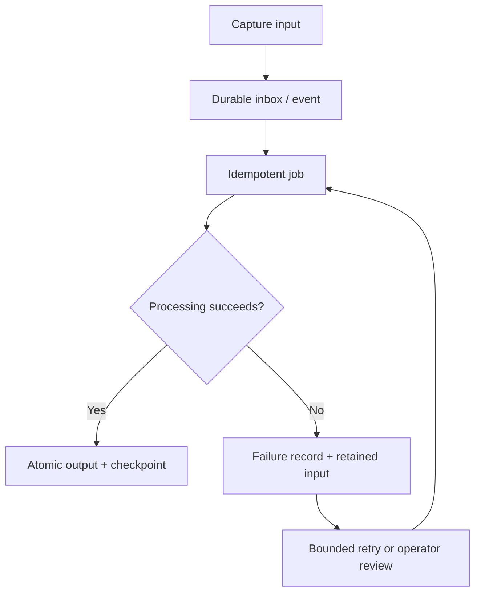

## Intent

Move expensive memory processing out of the interaction path without losing the information when a worker, model provider, parser, or write fails.

## The problem

Automatic memory capture is often asynchronous. The interactive request succeeds, but a later extraction call times out or a worker crashes between writing chunks and updating indexes. If the raw input or job state is ephemeral, the session appears remembered while its durable memory is incomplete.

## The pattern

Persist work before acknowledging it:

Jobs carry stable IDs, input hashes, processor versions, attempt counts, and checkpoints. Outputs use deterministic identities or transactional upserts so retrying cannot duplicate memories. Poison inputs move to a reviewable dead-letter state rather than retrying forever.

For lossy extraction, retain a fenced raw fallback that can be redistilled after the provider or schema is repaired.

## Why it works

The interaction path stays responsive while the system gains at-least-once processing without accepting duplicate durable state. Operators can distinguish delayed memory from lost memory and can replay work after model or embedding upgrades.

## Tradeoffs

Queues and checkpoints add operational machinery and eventual consistency. Retained inputs may contain sensitive transcripts. Retry storms can amplify provider failures. Idempotency is difficult when one job writes several stores that lack a shared transaction.

Expose freshness to callers; do not make asynchronous derivation look immediately consistent.

**The failure this pattern does not cover is the job that succeeds and starves
the write path.** Recoverability protects work that fails; it says nothing about
a maintenance pass that shares one deadline with capture and runs first. A
drain bounded by item count rather than by time can spend the whole budget on a
full backlog and abort the capture it was meant to serve, with every queued item
intact. The rule is ordering, not durability: **a maintenance pass and the
write path it serves must not share one budget, and where they must, the write
path goes first and maintenance takes the remainder**, inside a loop that
honours a deadline and reports that it stopped early.
[PLUR1BUS](../../systems/plur1bus/) keeps the two apart: capture is queued per
agent and runs after the turn ends, and embeddings go to
`embedding-queue.jsonl`, drained by a cron — so a memory can be lexically
retrievable before it is vector-retrievable, which is the freshness gap that
separation costs.

## Cost to adopt

**Build:** durable input records, an explicit job state, idempotent processing,
and a dead-letter path with something that actually looks at it.

**Forces elsewhere:** idempotency is the expensive requirement — every extractor
and consolidator needs a stable key so a retry does not duplicate. Retrofitting
that is harder than building it in.

**Ongoing:** a queue is an operational surface. It needs monitoring, and a
dead-letter path nobody reads is the same as no dead-letter path.

**Skip it if** capture is synchronous and cheap. The pattern exists to protect
work that happens away from the user.

## Seen in the atlas

[nanobot](../../systems/nanobot/) contributes the cheapest correct mechanism on
this page, and it is worth trying before any retry queue. Its `Dream`
consolidation runs against an append-only archive tracked by a **consumption
cursor**, and `MemoryStore.dream_run_completed` advances that cursor only when
the run's stop reason is `completed`. A run that ends on `error`, `tool_error`,
`max_iterations` or `cancelled` **does not advance the cursor** — so the
material is simply reprocessed next time. No retry queue, no
dead-letter table, no partial state to reconcile: the work is not recorded as
done, so it is not done.

The producer/consumer split is what makes this safe. `.cursor` marks how far the
Consolidator has written; `.dream_cursor` marks how far Dream has read. A slow or
failing consumer never blocks the producer and never silently skips material.

[Magic Context](../../systems/magic-context/) reached the same conclusion from
the opposite direction, and its code records the lesson: an earlier version used
a **global commit watermark with all-or-nothing coverage**, reworked to
per-memory `verified_at` so that "partial progress STICKS: a timed-out verify
banks the memories it checked; the next run skips them and continues (the
cold-start trap is gone)." Global watermarks make partial progress worthless.

[Claude-Mem](../../systems/claude-mem/) is the durable hook-queue example:
failures return claimed work to pending, canonical SQLite precedes
acknowledgement, and Chroma sync is a best-effort projection.

[Daimon](../../systems/daimon/) adds the part this pattern usually leaves to the
operator: a **classifier over the capture log, and a command that shows it**.
Every spawn and every result line is appended to one log, and a fold reduces it
per session into outstanding failures, hung children, and retry-exhausted cases —
which `daimon status` reports honestly, including crashes, and `daimon heal`
re-drives. Liveness is decided by a heartbeat the child touches at every chunk
and merge rather than by wall-clock, so a genuinely slow extraction is not
mistaken for a dead one. Retries are capped at one per session with an explicit
`--force` override, and the reasoning is recorded: the cap bounds token burn on
a permanently bad transcript.

Its recovery unit is the interesting choice. Chunk extractions are cached by
content under an explicit version key, so a heal, a merge failure, or simply a
transcript that grew re-pays only for the chunks that changed. The cache key is
deliberately separate from the prompt version — wording edits keep the cache
warm, semantic changes rotate it — which is the distinction between versioning
your *output format* and versioning your *unit of work*.
[Cognee](../../systems/cognee/) stamps artifacts with pipeline provenance, rolls
failed runs back, and recovers stale non-terminal runs at startup.
[llm-wiki-memory](../../systems/llm-wiki-memory/) retains failed inputs for
redistillation. [Hindsight](../../systems/hindsight/) queues consolidation with
capped exponential backoff and per-bank dedup.
[Redis Agent Memory Server](../../systems/redis-agent-memory-server/) debounces
and defers extraction, so a failure delays work rather than losing it.
[Mastra](../../systems/mastra-observational-memory/) persists buffers with
durable range markers before activation.
[Basic Memory](../../systems/basic-memory/) rebuilds projections through startup
reconciliation.

[Heimdall](../../systems/heimdall/) contributes the strongest form of the
idempotency this pattern asks for, by removing the payload from the job. Its
queue rows hold a path and nothing else: *"A queued path is a hint that SOMETHING
changed, never a description of what."* The worker reads that file from disk and
makes the graph match it, so a duplicated hint costs one hash comparison, a
missing hint is caught by a periodic audit that compares the journal against the
filesystem, and a *wrong* hint is harmless — there is no verb in it to be wrong
about. The design it replaced is the one this page is usually written against: an
agent hook that regex-parsed `mv` and `rm` out of tool output and issued deletes
directly, which the repository's own post-mortem says could not see a `git
checkout`, raced when two hooks ran at once, and *"wrote WRONG data, because the
command text was treated as the description of what changed."*

Two of its orderings are worth copying verbatim. The projection is written
**before** the journal row is committed, argued as: a crash between them leaves
the path dirty and it is redone, whereas the reverse order *"could mark a path
clean that was never projected, which is the one failure we cannot detect
later."* And errors dequeue rather than retry — an unreadable file and a
downed backend each drop out of the queue with the prior journal row left
untouched, so a poison row cannot starve the drain; the tests fail the run if the
loop spins more than five rounds. The gap it leaves is on this page's other axis:
the journal is declared authoritative over the graph, and nothing ever compares
the two, so a projection deleted by the system's own read path leaves an id in
the journal that no audit will ever question.

[SESA](../../systems/sesa/) is the compact counterexample, and the mistake is
three lines long. `maybe_apply_updates` snapshots the pending-failure queue,
**clears it**, releases the lock, and only then calls a remote judge model to
turn those failures into skill cards. The whole call is wrapped in a `try` that
logs the exception and returns `{'error': ...}`, so one judge timeout discards up
to three hundred failed rollouts — each of which cost a full multi-turn search
rollout to produce. The queue is also a `deque(maxlen=300)` that silently drops
its oldest entry when full, immediately before a priority function that tries to
pick the *most informative* failures from whatever survived. The cheapest fix on
this page applies exactly: advance the cursor after the work lands, not before it
starts.

[repowise](../../systems/repowise/) shows the loss this page is about happening
without a crash, which is the case a resumable-worker design does not cover. Its
incremental pipeline built the health analyzer without a coverage map, so every
changed file was scored as though coverage had never been ingested — and the
partial writer then upserted the whole row, *"overwriting the stored
`line_coverage_pct` with NULL for exactly the files that just changed — eroding
coverage one file per update, starting with files under active development."*

Nothing failed. Every pass completed, and each one destroyed a field it had no
input for. Two properties make it worth naming as a shape rather than a bug.
**An incremental writer that reconstructs a record from partial inputs and
upserts it will null whatever those inputs did not cover** — the write path
cannot tell "no coverage exists" from "coverage was not loaded this time". And
**the loss is biased toward the records that matter most**, because an
incremental pass by definition runs on what changed, so the fields that vanish
are the ones attached to the files someone is actively working on.

The fix is the general one: load the persisted values before re-scoring, and when
the store is unreadable return an empty map so the analyzer scores *without*
coverage rather than against a false zero. Any background pass that upserts a
full row from a partial computation needs the same question asked of it — which
columns does this pass have no input for, and what happens to them.

[Janus-Graph](../../systems/janus-graph/) builds almost every piece of this pattern and shows two failures it cannot see. The input is durable before extraction — an `add_episode` is one SQLite insert and payloads are kept after `done` — and the sweep has a reaper for stuck rows, an attempt cap and a dead-letter table with a replay verb. But a schema-repair wrapper between the model and Graphiti answers a malformed item with an empty list, so the job *succeeds* with nothing extracted and is marked done, and nothing distinguishes an empty success from a real one. And the nightly run labelled DLQ auto-repair requeues up to a hundred dead-lettered episodes per run without resetting its attempt count or closing its dead-letter row, so a poison input costs one model pass a night indefinitely. A dead-letter path that re-feeds itself is as unread as one nobody opens.

[RushDB](../../systems/rushdb/) has the failure this pattern exists to prevent, in one line. A record write is synchronous, then the embedding work is queued fire-and-forget with an empty catch at all three write paths. The once-a-minute backfill only ever reads indexes already flagged pending, so a rejected mark is not retried, not logged and not reconciled — the record is stored, queryable by `where`, and permanently invisible to semantic recall. The contract package's bounded in-process cache of recent episodes papers over the ordinary one-minute lag and dies with the process, and it holds episodes only, so a newly written fact is unrecallable until the cron catches up.

[marm-memory](../../systems/marm-memory/)'s concept indexer is the outbox done the way this page asks. The enqueue runs inside the memory row's own `BEGIN IMMEDIATE`, so a memory cannot exist without an indexing task and a process killed mid-extraction loses nothing — the task is a row with a lease token, a lease expiry, an attempt counter and a last-error column, parked after three failures rather than dropped. Two details are worth lifting. The aggregate counters are deliberately not the settle signal: the build takes an outcomes dict as an out-parameter because *"a build in which every extraction failed returns success with zeros, and a caller settling queue tasks on that would delete work it promised to retry."* And because the HTTP and STDIO servers are separate processes each running their own worker, the mutual exclusion is a leased row in the database rather than an in-process lock — released when the engine call returns rather than when the awaiting task is cancelled, since cancelling the await leaves the thread writing.

[create-context-graph](../../systems/create-context-graph/) ships this pattern *into generated projects* rather than running it itself, and its version is the resumable cursor plus the piece most omit. The generated importer keeps each connector's cursor in a local dict through the whole run and writes it to disk only when nothing failed — a fetch error, an ingest failure, anything — so a partial import leaves the window re-fetchable instead of silently skipped. Under it sits the retry queue: every failed entity, message or trace call appends a typed record to a JSONL deadletter, and a retry flag reconstructs a minimal payload from those lines and drives it through the same write path. The detail worth copying is the ordering — the retry renames the file aside *before* replaying, so a retry that fails again writes a fresh deadletter without having destroyed the old records. What the design does not protect is the graph itself: a crash mid-ingest leaves a half-populated store with no marker saying so, and on the default hosted backend there is no delete endpoint with which to clean it.

[second-brain (LindaHaviv)](../../systems/lindahaviv-second-brain/) guards the deletion that follows consolidation rather than the consolidation itself. `scripts/memory_expire.py` rotates raw runs and dialogue turns after 90 days only when the newest consolidated fact is at most seven days old, and fails the sync step loudly otherwise, so a silently broken distiller cannot let undistilled rows expire. The consolidation it protects is the counterexample: each run deletes every fact and inserts the model's answer in one transaction, so a failed call is recoverable and a successful short answer is not.

**[Tigerless agent-memory](../../systems/tigerless-agent-memory/) runs the cursor version with two watermarks per session.** A boundary hook appends the raw increment to `archive/sessions/` and advances `consumed` (`adapters/capture.py:31-44`). The detached distiller advances `distilled` only after a batch's operations are applied, and an executor failure raises before that, so the batch is read again at the next boundary (`core/distill.py:54-97`). Operations refused twice wait in `.state/pending` for the session's next boundary. Two gaps remain. The pending file is unlinked before its operations are re-applied, so a failure in the repair round loses them behind an advanced watermark. No lock spans a distillation, so two boundary hooks close together process the same backlog.

**[Resonant](../../systems/resonant/) advances its digest cursor on one path out of two.** The Scribe keeps `(digest.last_thread_id, digest.last_sequence)` and, when the daily thread has rolled over, flushes the old thread's tail into the previous day's Markdown file before reading the new day (`packages/backend/src/services/digest.ts:202-213`). The flush writes no cursor. Only the main path does, and it returns early below five new messages (`:215-218`, `:267-268`). So until the new day reaches five, every 30-minute tick re-reads the same tail, pays for another Haiku call and appends the same block again. **A side path that consumes input must advance the cursor itself, in the same step.**

**[Remembra](../../systems/remembra/) runs a background pass that fails on every item and reports nothing done.** The sleep-time worker is on by default every six hours, and its dedup pass calls `self.qdrant.search(embedding=..., threshold=...)` against a method whose parameters are `query_vector` and `score_threshold` (`src/remembra/services/sleep_time.py:345-350`, `src/remembra/storage/qdrant.py:454-466`). Each `TypeError` is caught per memory and logged at debug, so the report says zero duplicates merged. The tests use a fake whose `search(self, **_)` accepts anything, and a real-store test asserts every point survives the default run, which holds because the search raises. **A per-item except needs a failure count in the run report, or a dead pass reads as an idle one.**

**[Elephantasm](../../systems/elephantasm-core/) derives its synthesis cursor from the output table.** Collection keeps events whose client-supplied `occurred_at` is later than the newest memory's `created_at` (`app/workflows/memory_synthesis/nodes/event_collection.py:37-38`, `app/domain/event_operations.py:248-285`). The Dreamer's merges and splits and a manual `POST /memories` also insert memories stamped now. Each one moves the cursor past events that were pending, and nothing links or collects them afterwards. The pack's pending-events layer filters on the same memory time (`app/domain/memory_retrieval.py:241-261`), so they leave the prompt too. **A cursor is a watermark the consumer owns; any other writer of the output table must not be able to move it.**

[Cindy](../../systems/cindy/) makes its nightly memory tidy reversible item by item. The run is registered before the first change, each change's before and after are written to `learning-history/<runId>.json` as it lands, and the watermark and turn count advance only when the run succeeds, so a failed model call leaves the conversations for the next night (`apps/desktop/src/main/maker-ipc/botNightlyLearning.ts:340-356`, `:441-451`). Undo refuses when the live memory no longer matches the recorded side rather than overwriting a later edit (`:592-631`). Retention is the weak edge: runs past the 30th are dropped with their backup files (`botNightlyLearningState.ts:151-163`).

[ZettelForge](../../systems/zettelforge/) writes the outbox and never reads it. Each causal-extraction, NER and neighbour-evolution job gets a row in an SQLite `enrichment_jobs` ledger, with a state, an attempt count and an error code, and is then put on an in-process queue of 500 (`src/zettelforge/memory_manager.py:1261-1288`). A full queue marks the row failed; a crash leaves rows `queued` or `running`. The ledger's two readers are called only from tests, so no path replays a row, and the atexit drain gives the queue 10 seconds (`:1480-1514`). The module docstring defers a ledger-aware `flush()` to later releases (`enrichment_ledger.py:1-7`). The durable half of the pattern is built; the worker that reads it back is the missing half.

**[OpenYantra](../../systems/openyantra/) keys replay on a request id saved with the row, under a lock its refusal path takes twice.** `LedgerAgent.submit` appends the request to `sanchitta.json`, processes it, and removes the entry by request id in a `finally` block; the next process to construct `OpenYantra` empties the file and runs whatever is in it (`openyantra/core.py:280-286`, `:315-326`, `:645-647`). `_process` skips a request whose id the ledger sheet holds, and `_commit_and_audit` writes the row and its ledger entry in one atomic replace, all under an exclusive file lock (`:332-373`, `:453-569`), so neither a crash nor a second process can apply a request twice while the lock is taken. The lock is not reentrant: a rejected or conflicting request logs through `_write_sheet`, which locks the same file on a second handle, and on Linux and macOS `flock` blocks it forever (`:383-391`, `:571-572`). The entry is then never acknowledged, so the next start's replay blocks on it too. A replay guard is only as sound as the lock around it, and the lock needs a test that sends a refusal through it.

## Tests to require

- Crash before, during, and after each state mutation.
- Retry the same job and prove outputs are not duplicated.
- Preserve failed inputs and processor-version metadata.
- Enforce retry limits and dead-letter review.
- Delete a source while its jobs are queued.
- Report derivation freshness and partial failure accurately.

## Related patterns

- [Evidence before belief](../evidence-before-belief/)
- [Append-only memory audit](../append-only-memory-audit/)
- [Governed write gateway](../governed-write-gateway/)
- [Zero-LLM capture](../zero-llm-capture/)
