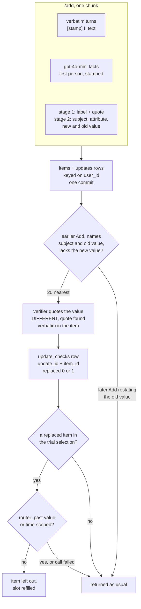

## 1. Executive Summary

ActiveMemoryIndex is a self-hosted FastAPI service implementing the Add/Search
contract of the Agent Memory Leaderboard. Each chunk is stored twice per user,
as verbatim timestamped turns and as gpt-4o-mini first-person facts, in one
SQLite file. Search ranks by cosine against the question fused with a
first-person "Did I tell you about…?" recall question. The notable mechanism is
an opt-in correction path: an explicit replacement detected at Add, a model
verdict per earlier memory on whether it states the replaced value, and those
memories withheld from current-value questions. Its weakness is the key. The
suppression attaches to each earlier memory, not the value, and nothing in the
service can be deleted.

The update and as-of mechanisms are off in code and on in the shipped academic
profile, `.env.academic.example`; this reading holds for that profile unless a
paragraph says otherwise. Two marks: `scope_enforced`, because every content
read carries a `user_id` predicate, and `negative_eval`, because a test asserts
the replaced value absent beside the new one in the same response. The bench
figures in the tree are the project's own local runs, reported here as claims.

## 2. Mental Model

A memory is an `items` row of kind `raw` or `fact`. A `raw` row is one message,
stored whole as `[YYYY-MM-DD HH:MM] I: text` for the user or `Assistant: text`
for anyone else (`app/main.py:308-328`). A `fact` row is one line from a
gpt-4o-mini extraction over the chunk, or the current-value sentence an update
renders. The README's framing is that the turn is the primary source and the
fact a lossy paraphrase of it, and delivery orders turns first for that reason
(`app/main.py:467-476`).

A row is created by `/add` and never changed or removed. The service exposes
three routes, `/add`, `/search` and `/health`, and no SQL statement in `app/`
deletes or updates an item. Every row is therefore in one state, stored, for
the life of the database file.

What can change is whether a row is *returned*. Two mechanisms withhold a row
from one Search without touching it:

- **Explicit update.** When a user says in words that a value is replaced or
  was wrong, Add stores an `updates` record. On the first Search that needs
  it, a verifier judges each candidate earlier memory, and the verdict is
  stored in `update_checks` keyed on the pair `(update_id, item_id)`. A
  memory judged replaced is left out of a Search whose returned set would hold
  it, unless a router says the question asks for a past value or a dated state.
- **As-of selection.** For a question about the state at a stated date, a
  model reads the times each candidate states, and code withholds items not
  valid in that period (`app/asof.py:276-294`). The readings live in process
  memory and are never stored.

Neither is a belief state. A memory carries no status, and a replaced verdict is
a fact about one update and one earlier row, which the next question's router
may cancel. The service treats everything it stores as evidence for a reader
model and never produces an answer itself.

## 3. Architecture

One process: `uvicorn app.main:app --workers 1` in a `python:3.11-slim` image
(`Dockerfile`). FastAPI serves the three routes; a pure-ASGI admission valve in
front bounds concurrent `/add` and `/search` and answers 429 with `Retry-After`
before authentication runs (`app/main.py:52-108`).

**Store.** One SQLite file in WAL mode, `synchronous=NORMAL`, under a process-wide
`RLock` (`app/store.py:155-185`). `items` holds every row with its vector as a
float32 BLOB; `requests` records each `(request_id, user_id)` for idempotency;
`embedding_metadata` records the embedding backend, model, dimensions, endpoint
and preprocessing. A database whose identity differs, or an unlabelled populated
one under a remote embedder, refuses to start (`app/store.py:126-152`). The
`updates` and `update_checks` tables are created only when an update switch is
on (`:173-178`).

**Retrieval cache.** Each user's rows load into a `UserIndex`: items, a numpy
matrix, and maps from id, chunk digest and fact key to row
(`app/store.py:99-123`). The cache is an `OrderedDict` keyed on `user_id`,
evicted least-recently-used once the total exceeds `AMI_CACHE_MAX_ITEMS`,
1,000,000 rows by default (`:279-289`). Every Search is a brute-force matrix
product over the user's rows; there is no ANN index.

**Models.** In the academic profile, `text-embedding-v4` at 1024 dimensions
through DashScope's OpenAI-compatible endpoint, and `gpt-4o-mini` for
extraction, the recall question, the update stages, the router and the as-of
classifier and time reader. The code default embedder is `BAAI/bge-small-en-v1.5`
on CPU, baked into the image (`app/config.py:43-58`).

**Limits.** Every model and embedding call is clipped to an 85-second request
deadline counted from arrival, and a call that cannot finish is a 503 before
anything persists (`app/deadline.py`). Every Search's returned set is bounded
by a token budget derived from the platform's 117,760-token Answer window
(`app/tokens.py:103-120`).

### Deployment and ergonomics

`docker compose up -d` with an env file. The academic profile needs two paid
APIs, OpenAI and DashScope, at startup and on every Add and Search. With no
`OPENAI_API_KEY` the service starts and stores verbatim turns only; with the
default BGE backend it runs offline in that degraded mode. Authentication
defaults to bearer and refuses to start with an empty or placeholder token
(`app/config.py:453-470`); compose binds the port to `127.0.0.1`. The store is
a SQLite file a person can query, but nothing in the service edits or removes a
row, so repair means SQL by hand or a new `AMI_DB_PATH`.

## 4. Essential Implementation Paths

- **Add.** `add` (`app/main.py:748-841`) checks auth, starts the deadline,
  and takes a per-`(request_id, user_id)` lock so overlapping platform
  retries serialise (`store.request_gate`, `app/store.py:200-214`). A seen
  request returns its echo. `build_items` writes the raw rows; update detection
  starts on a thread beside extraction (`app/main.py:773-774`,
  `app/updates.py:295-298`); `llm.extract_facts` returns the facts
  (`app/llm.py:324-339`). Rendered update sentences are appended as facts
  (`app/main.py:806-822`), everything is embedded, and `store.add` commits
  items, update records and the request id in one transaction
  (`app/store.py:226-271`).
- **Extraction.** `EXTRACT_SYSTEM` asks for at most 24 atomic, first-person,
  dated facts with names and numbers kept verbatim (`app/llm.py:26-36`).
  `_parse_facts` takes a JSON object, falling back only to bulleted, numbered
  or bracketed lines, so prose replies store nothing (`:231-253`).
- **Update detection.** Stage 1 labels the user's value-bearing statements
  with seven intents and a verbatim quote (`UPDATE_INTENT_SYSTEM`,
  `app/llm.py:617`). `accept_statements` keeps only `EXPLICIT_REPLACEMENT` and
  `CORRECTION` whose quote is a substring of a user turn
  (`app/updates.py:224-248`). Stage 2 extracts subject, attribute, new and old
  value, `relative`, `subject_is_user`, two language tags and a current-value
  sentence (`UPDATE_EXTRACT5_SYSTEM`, `app/llm.py:649`). `parse_updates` drops
  a record whose new value is not in the user turn and an old value the turn
  does not contain (`app/updates.py:173-211`).
- **Search.** `_search` (`app/main.py:867-1008`) loads the user's index, sets
  the token budget, starts the as-of classifier beside the recall rewrite, and
  ranks (`rank`, `:338-358`). It computes the withheld set, runs a trial
  selection, and asks the router only when a withheld item would be returned
  (`:894-904`). It adds as-of withholding (`:905-915`) and selects
  (`select`, `:485-562`). The response is cut to the token budget (`:1008`).
- **Withholding.** `updates.withheld` (`app/updates.py:465-481`) reads the
  user's absolute records, resolves them through `candidates`, `resolve` and
  `_chunk_facts` (`:326-457`), and caches the result per user until the user's
  row or record count changes.
- **As-of.** `asof.classify` (`app/asof.py:146-166`), `times` (`:219-269`),
  `select_withheld` (`:297-332`).
- **Schema.** `SCHEMA` and `UPDATE_SCHEMA` (`app/store.py:26-79`).
- **Background.** None. No thread, timer or job touches the store between
  requests.
- **API.** `/add`, `/search`, `/health`; contract models at
  `app/main.py:152-179`, with `extra="allow"` so unknown fields are logged by
  name rather than dropped.
- **Tests.** `tests/`, 31 files; `scripts/smoke_contract.py` against a live
  instance.

## 5. Memory Data Model

`items` has `id`, `user_id`, `session_id`, `request_id`, `kind`, `parent_id`,
`content`, `created_at`, `seq`, `vec`, `event_date` and `fact_key`
(`app/store.py:27-40`). `parent_id` is always `None` on the write path; a fact's
chunk is recovered from its id. An id is `sha1(user_id + "\0" +
request_id)[:16]` followed by `-r<position>` for a turn or `-f<n>` for a fact
(`:188-193`), so two users sending the same `request_id` cannot overwrite each
other through `INSERT OR REPLACE`.

`updates` holds one row per detected update: `item_id` of the user turn,
`subject`, `attribute`, `new_value`, optional `old_value`, `relative`,
`statement`, `subject_is_user` and `created_at`. `update_checks` holds one
verdict per `(update_id, item_id)`: `replaced` as 0 or 1 and the quote the
verifier gave (`app/store.py:54-79`). Both carry `user_id`.

**Scope** is `user_id`, a column on every table and the key of the cache.
`session_id` is stored and never read on any path. **Time** is the message's
own timestamp, supplied by the caller in milliseconds and rescaled when it
looks like seconds (`app/main.py:229-243`). Every fact of a chunk gets the
first turn's timestamp (`:801`). The store keeps no time of its own: there is
no ingestion timestamp, only `seq`. `event_date` is a research column written
only under `AMI_EVENT_DATES_AT_ADD` or `AMI_EVENT_DATES_ADD_CALL`, both off in
code and in the academic profile.

There is no version chain, TTL, pin, status or deletion marker on an item.

## 6. Retrieval Mechanics

**Scoring.** The question and a recall question are embedded, and each row
scores `(1 - w)·sim(query) + w·sim(recall)` with `w = 0.5`
(`app/main.py:345-352`). `RECALL_SYSTEM` asks for one first-person question
in the register of a chat log, naming the entities and never answering
(`app/llm.py:48-57`). The README identifies this as HyDE with a recall question
as the hypothesis. No lexical arm runs on the release path; an FTS5 channel was
built and removed, and its negative result is kept in
`bench/results/ordering_ab_all10.txt`.

**Selection.** `select` walks rows by score and takes each one that is new by
its first 120 normalised characters and fits three budgets: `min(top_k,
AMI_RETURN_LIMIT)` items (100), 400,000 characters, and the counted token
budget (`app/main.py:485-530`). A memory that does not fit the token budget is
skipped, never cut, and 50 consecutive misses stop the scan. Each selected
turn brings its neighbours within the same chunk at radius 1, and they spend
slots from the same `top_k` (`:364-382`, `:548-557`).

**Ordering.** The selected set is sorted turns first, facts second, each block
keeping its relevance order (`AMI_RAW_FIRST`, `app/main.py:467-476`). This
changes order and never membership.

**Token budget.** Memories get `(117,760 − 1,024) / 1.15 − tokens(query) −
tokens(options)` tokens, each costing its tokens plus 20, counted with
tiktoken `o200k_base` (`app/tokens.py:96-110`). A question that fills the
window alone returns `[]`.

**Withholding** runs before the final selection, so a withheld slot is refilled
from the ranking. Section 9 covers which delivery paths honour it.

**Research arms,** each off in code and in the academic profile: an agentic
reflect-and-requery round, reserved second-round slots, a cross-encoder
reranker, a direct-corpus agent that greps the user's rows with
model-written regexes, chunk and adaptive-chunk delivery, fact-first
selection, event-date rendering and supersession marks by fact key or cosine.

**Failure modes.** Stale values are the main one. Without the update switches,
the old and new values of an attribute are both returned, and the README's
own oracle study is the reason withholding exists. Over-recall is deliberate:
100 items per Search.

## 7. Write Mechanics

Add is synchronous and model-mediated. Every non-empty message becomes a raw
row; one extraction call per chunk produces up to 24 facts; with
`AMI_UPDATE_DETECT` a stage-1 call runs beside it, and a stage-2 call follows
only when stage 1 accepted a statement. A failed extraction stores the turns
without facts and returns 200, unless `AMI_EXTRACT_REQUIRED` turns it into a
429 or 503 before persistence. A failed update call means no update for that
chunk (`app/updates.py:284-292`).

Deduplication is by `(request_id, user_id)` only. The same sentence in two
Adds is two rows, collapsed at read time by `content_key`. There is no
consolidation and no conflict detection beyond the explicit-update path, which
fires only when the user's own words say a value is replaced or was wrong.
`NEW_INFO`, "I now lead a team of five", is labelled and ignored by design.

A rendered update sentence ("My gym time is 6 pm.") is stored as a fact only
for an absolute update whose two language tags agree (`app/updates.py:136-149`).

**Agent-generated facts.** Extraction reads the assistant's turns too and
attributes them by name or as "the other person", so an assistant's claim can
become a fact. Update records can only anchor in a user turn
(`app/updates.py:184`, `:238`).

### Operational cost

The Add blocks on one extraction call, the update calls in parallel with it,
and the embedding batches, all under the 85-second deadline. A memory is
searchable when Add returns 200. A Search makes a recall-question call and an
as-of classification in parallel, then embeds two texts. The first Search after
an update adds verifier calls for its candidate pairs; their verdicts are
stored, so each pair is judged once. A withholding Search adds one router call,
cached per question. No pass rewrites the store. Each Search returns up to 100
memories inside the platform's Answer window; the service controls no prompt
cache.

## 8. Agent Integration

There is no agent surface. The caller is the evaluation platform, which sends
conversation chunks to `/add` and questions with optional answer options to
`/search`, and hands the returned memories to its own answer model. No model
inside the service can write or delete a memory by choice; every model call is
an extraction, a classification or a verdict whose output code validates.
Adapting it to another agent means calling two HTTP routes. The contract has no
session lifecycle, no compaction boundary and no injection hook.

## 9. Reliability, Safety, and Trust

### Scope

The scope predicate sits on the one read the retriever uses. `_search` calls
`store.get(request.user_id)` (`app/main.py:870`), which returns the cached
index or loads it with `SELECT … FROM items WHERE user_id = ? ORDER BY seq`
(`app/store.py:298-301`). Every later step works on that index. Update records
and verdicts are read with the same predicate (`:347-360`). The only SQL reads
without it are the embedding-identity checks and the two counts in the
authenticated `/health` (`:139`, `:150`, `:322-323`).

The in-process caches agree. The as-of time cache is keyed on item ids, which
hash the user; the router and as-of classifier caches are keyed on the
question and hold only booleans, a kind and a period
(`app/updates.py:95-125`, `app/asof.py:117-166`).

The boundary is between `user_id` values, not between callers. One shared
secret authorises any `user_id`, which is the contest contract.

### What the withholding keys on

The durable record is a verdict on a pair, and the pair names an earlier row.
`candidates` admits only rows *earlier* than the update: an earlier Add, by
message timestamp when both have one, otherwise by row order, and never a row
of the update's own Add (`app/updates.py:307-323`). A later Add restating the
old value is a new row that no verdict names, and it is returned. The test
suite pins this as intended: *"a later restatement of the old value is never
withheld"* (`tests/test_updates.py:214`).

Two further limits follow from the shape:

- **Twenty candidates.** Candidates are cut to the 20 nearest the update turn
  by cosine (`AMI_UPDATE_CANDIDATES`, `app/updates.py:355-356`). A value
  stated in more earlier rows than that leaves the rest unjudged and visible.
- **The router decides per question.** A replaced row is returned to a
  question the router reads as past-value or time-scoped, and to every
  question when the router call fails (`app/updates.py:100-125`). That is the
  design: the stored text is evidence of what was said, and only a
  current-value question loses it.

Every model call on this path fails open, so an outage returns both values.

### Which delivery paths honour it

The default `select`, the neighbour window, the reserved second round, the
agentic round, the direct-corpus agent's picks and adaptive-chunk delivery all
consult the withheld set (`app/main.py:514`, `:589-615`, `:936`, `:961`,
`:974`). **Chunk-memory delivery does not.** With `AMI_CHUNK_MEMORY`, `select`
passes each hit's whole chunk to `take` under the id `<digest>-c0`, which is
never in the set, and the chunk text concatenates every turn including the
withheld ones (`:400-413`, `:540-545`). The trial at `:899-904` then contains
no withheld id, so the router is never asked. The switch is off in code and in
the academic profile.

The direct-corpus agent has a narrower gap. Its picks are filtered by a set
computed from the vector trial, so a replaced row the agent reaches below the
vector cut passes unfiltered when the trial held none.

### Search writes

`resolve` inserts verdicts into `update_checks` during a Search
(`app/updates.py:399`). A read can therefore change the store, and a verdict
given once is final for that pair.

### Deletion and privacy

Nothing is deleted. There is no route, function or SQL statement in `app/` that
removes an item, an update or a verdict. A user's data leaves only with the
database file. The optional request log, `AMI_REQUEST_LOG`, writes every
Search's question, options and returned ids to a JSON-lines file
(`app/main.py:30-40`, `:856-863`).

### Input handling

Only a user turn can anchor an update, and its quote and new value must appear
in that turn verbatim. One edge: the speaker label is `I` for role `user` and
`role.capitalize()` otherwise (`app/main.py:317`), so a message whose role is
`i` is also labelled `I` and passes `is_user_turn` (`app/updates.py:91-92`).

Containment uses `mentions`, whose boundary is `(?<![a-z0-9])…(?![a-z0-9])`
over the lowercased text (`app/updates.py:75-88`). The boundary class is ASCII.
In Cyrillic, Greek or another alphabetic non-Latin script, a value therefore
matches inside a longer word, so the old-value and new-value guards are looser
there. The language-neutral allowlist accepts the pattern as an escaped
literal (`tests/test_language_neutral.py:44-45`).

### Marks

- **`scope_enforced`** — awarded; the `user_id` predicate is on the
  retriever's only load and on both update reads.
- **`negative_eval`** — awarded; see section 10.
- **`tombstone`** — withheld. The record of a replaced value is an `updates`
  row, and what suppresses is a verdict keyed on `(update_id, item_id)` for
  rows earlier than the update. Re-extraction is not consulted: a later row
  stating the old value is returned, by design and by test.
- **`trust_state`** — withheld. Items carry no status. `replaced` is a
  two-valued verdict on a pair, its effect is cancelled per question by the
  router, and nothing holds a memory as candidate or rejected.
- **`bitemporal`** — withheld. `created_at` is the message time, and the store
  keeps no record time. The as-of reader extracts times from text per question
  into process memory; `event_date` has producers only behind research switches
  off in every committed profile.
- **`audit_log`** — withheld. The store is append-only because nothing
  removes, not because mutations are logged; the request log records request
  metadata outside the store, off by default.
- **`human_review`** — withheld. There is no surface for a person.

## 10. Tests, Evals, and Benchmarks

The 31 files under `tests/` are plain scripts with an exit code or unittest
cases, network-free, with fake LLM and embedder; the README runs them in the
image. `RELEASE.md` reports 31 files and 0 failures for rc5 and rc6. I did not
run them.

**`negative_eval` is earned on the update path.** `test_admission.py` drives
the ASGI app at the release version, stores "My gym time is 7 pm." then
"Update: my gym time is now 6 pm.", and asserts `"7 pm"` absent and `"6 pm"`
present in the same response (`tests/test_admission.py:337-339`). The same
test first shows `"7 pm"` returned when the verifier or router fails
(`:331-336`), so the fixture is populated. `test_updates.py` asserts, at
version 1, the replaced turn and fact absent. In the same result it asserts the
new value, an other-attribute row and an other-subject row present, and exactly
two rows fewer than without withholding (`tests/test_updates.py:204-216`).
Both patch the update switches on.

**Other cases.** `test_language_neutral.py` parses `app/` and
fails on any regex or string collection not on its allowlist, and its
`test_the_scanner_finds_what_it_must` runs the scanner on a planted sample, so
the check can fail. `test_concurrency.py` pins overlapping retries to one
write and a colliding `request_id` from another user to a separate row.
`test_parse_facts.py` pins the extraction fallback. `test_adaptive_chunk.py`
asserts withheld turns never enter a chunk; `test_chunk_memory.py` has no
withheld case.

**Bench.** `bench/` holds an offline LoCoMo harness that imports the
platform's answer and judge prompts, with aggregates in `bench/results/`.
The README's ordering result, .5887 for relevance order against .6333
verbatim-first over 1,540 questions, recomputes from the three run means in
`bench/results/ordering_ab_all10.txt`; the per-question files are not
committed. The explicit-update evidence on MQuAKE-Remastered, "+65 to +70
correct of 400", cites `bench/results/explicit_update_*.md` files that are on a
research branch and not in this tree. The README states that no official score
exists and that the official evaluation run had not started. All of these are
the project's own local measurements with a local judge.

**Paper.** The README cites the author's preprint *An Index, Not a Store: The
Model Does Remember — It Just Needs Its Notebook*, Zenodo, 14 August 2026
([doi:10.5281/zenodo.21405963](https://doi.org/10.5281/zenodo.21405963)). I
read its abstract and metadata. It studies a LoRA adapter on a frozen model
as a recognition index, on the author's own audits and the InMind benchmark,
and describes none of this service's mechanisms. The README says its numbers
do not transfer.

**Missing.** A test of withholding under chunk-memory delivery; a case where a
later restatement of a replaced value is expected out; any retrieval-quality
test that runs in CI, of which there is none in the tree.

## 11. For Your Own Build

### Steal

- **Store the turn and the extraction, and deliver the turn first.** The
  extraction is a retrieval key; the turn is what the reader trusts. Ordering by
  provenance changes no membership and is cheap to A/B.
- **Gate a model's correction on a quote you can find.** Stage 1's quote must
  be in a user turn, the new value must be in that turn, and the verifier's
  quoted old value must be in the memory it condemns. Each model output is
  checked against stored text before it acts.
- **Store the verdict, not the decision.** Persisting `(update, item,
  replaced)` means each pair costs one model call, and the per-question gate
  stays cheap.
- **Fail open on every optional model call**, and say so in tests: a timeout
  in the verifier or router returns both values rather than an error.
- **Size the response to the reader's window per request**, counting the
  question and options against a published budget.

### Avoid

- **Keying a correction on the rows that existed when it was made.** A
  correction that consults only earlier rows is undone by the next restatement.
  If a replaced value must stay replaced, key the rejection on subject,
  attribute and value, and check it when a later row is written.
- **A delivery mode that rebuilds content from the store** without
  re-applying the suppression set. Every path that concatenates rows has to
  filter them again, by construction or by test.
- **A store with no delete.** A personal memory service needs a way to remove a
  user's rows that is not dropping the file.

### Fit

This is a competition entry built to a two-route contract, and it is good at
that job: measured knobs, documented negative results, admission control and
deadlines tuned to a platform's retry policy. It is a reasonable base for an
evaluation harness or for studying provenance ordering and quoted-evidence
correction. Walk away if you need memory a user can correct permanently or
erase, per-caller authorisation, or a store that runs without two paid APIs.
One author wrote it in ten weeks against one benchmark's shape.

## 12. Open Questions

- How often the router's past-value reading fires on real current-value
  questions, and so how often a replaced value is shown anyway.
- Whether the 20-candidate cap is reached on long histories, and what share
  of earlier mentions stays unjudged.
- What the platform evaluation measures once it runs, and whether the
  explicit-update gain on synthetic streams appears there.
- Whether the `academic-v4-20261022-rc6mm` tag, on a branch that diverges from
  `main` by one commit adding multimodal content arrays, becomes the release.

## Appendix: File Index

- Storage and schema: `app/store.py`
- Write path: `app/main.py` (`add`, `build_items`), `app/llm.py`
  (`EXTRACT_SYSTEM`, `extract_facts`, `_parse_facts`)
- Retrieval: `app/main.py` (`rank`, `select`, `select_adaptive`,
  `neighbours`, `order`, `_search`), `app/tokens.py`, `app/embed.py`
- Correction: `app/updates.py`, `app/llm.py` (update, verifier and router
  prompts), `app/asof.py`
- Limits: `app/deadline.py`, the admission valve in `app/main.py`,
  `app/config.py`
- Research arms: `app/dci.py`, `app/rerank.py`
- Tests and bench: `tests/`, `scripts/smoke_contract.py`, `bench/`,
  `bench/results/`
- Deployment: `Dockerfile`, `docker-compose.yml`, `.env.example`,
  `.env.academic.example`
- Documentation: `README.md`, `RELEASE.md`, `SUBMISSION.md`, `docs/`

### Recorded searches

Run from the repository root at the pinned commit with `/usr/bin/git grep`.

- **No delete or update path.**
  `git grep -n -i -E 'delete|forget|purge|drop table|remove' -- 'app/*.py' 'scripts/*.py'`
  returns two comments in `app/config.py` and two list removals in
  `app/main.py:90` and `:654`;
  `git grep -n -E '@app\.(get|post|put|delete|patch)'` returns `/health`,
  `/add` and `/search`.
- **Every content read carries the user.**
  `git grep -n -E 'FROM (items|updates|update_checks|requests)' -- app`
  returns eight reads; the four without `user_id = ?` are the identity check,
  the dimension check and the two `/health` counts.
- **No record time or validity interval.**
  `git grep -n -i -E 'valid_?(from|to|until)|expires?_?at|ingested_at|recorded_at|inserted_at' -- app`
  returns nothing; `git grep -c -i -E 'created_at|event_date' -- app/store.py`
  returns 16.
- **No status on an item.**
  `git grep -n -E 'status|verified|trust|confidence' -- app/store.py` returns
  nothing.
- **No mutation log.** `git grep -n -i -E 'audit|event_log' -- app` returns
  nothing.
- **Chunk-memory delivery skips the withheld set.**
  `git grep -n -E 'chunk_memory|withheld' -- app/main.py` shows `withheld` at
  `:514` and in `select_adaptive`, and `chunk_memory` called at `:543` with no
  `withheld` reference in `chunk_memory` (`:400-413`).
- **The explicit-update result files are not in the tree.**
  `git ls-files | grep -i -E 'explicit_update|beam_capacity'` returns
  nothing; `git ls-files | grep -c -i asof_selection` returns 2.
- **Paper.** `git grep -n -i -E 'arxiv|bibtex|@article|@misc|doi' -- README.md SUBMISSION.md RELEASE.md`
  returns cited related work and the Zenodo DOI at `README.md:561` and
  `SUBMISSION.md:177`.

## History

**2026-11-04** — [`22f8287ce0ac02ed493fbbb0f6f8cc7e9556aa3d`](https://github.com/linxuhao/ActiveMemoryIndex/commit/22f8287ce0ac02ed493fbbb0f6f8cc7e9556aa3d). First reading, from a shallow clone at the head of `main`; commit and author counts from the GitHub API. Screened first: no auto-run, build-time, cooldown or unpinned surface. MIT, no rider. Nothing installed, built or run. Two marks: `scope_enforced` for the `user_id` predicate on every content read, and `negative_eval` for a replaced value asserted absent beside its update in one response. `tombstone` is withheld because suppression is keyed on earlier rows, not the value ([section 9](#9-reliability-safety-and-trust)).
