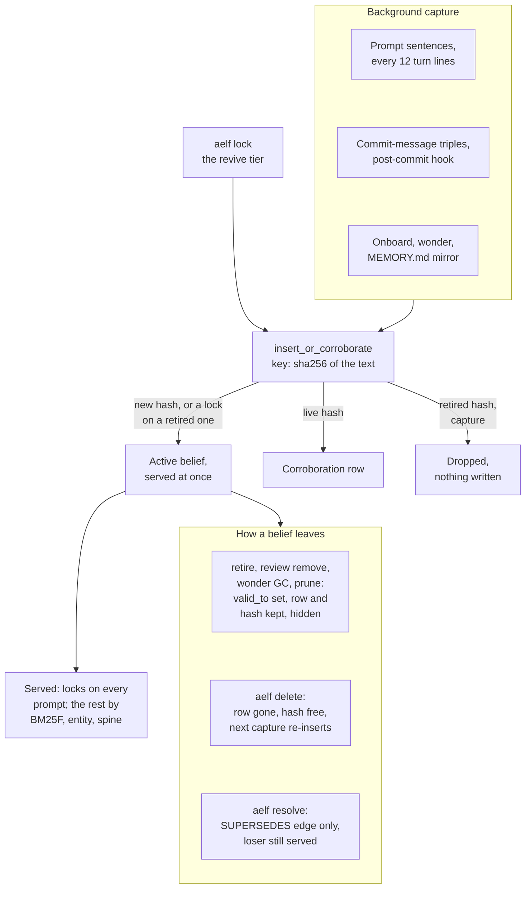

## 1. Executive Summary

aelfrice is a local memory for Claude Code, and less completely for Codex.
Hooks store the user's own sentences as "beliefs" in one SQLite file per git
repository, and before each prompt inject every locked belief plus keyword,
entity and session-neighbour matches, with no model or network on that path.
What is notable is retirement: a retired belief keeps
its row and the hash of its exact text, and every background capture path
lands on that hash and is dropped. What is weak is the rest of correction:
`aelf resolve` records which side of a contradiction won, and the default
retrieval keeps serving both.

The design is deterministic by intent. Transcript sentences are classified by
regex, confidence is a Beta posterior moved by explicit feedback and by
detected praise, and ranking is BM25F over FTS5 with a log-additive posterior
term. A lock is the user's ground truth and is injected on every prompt
whether or not it matches.

The repository documents itself heavily. Most modules carry docstrings that
name the defect they fixed and the test that pins it, and the test code is
two and a half times the size of the source. Some of the project's own
metadata describes mechanisms the code has since removed: `CITATION.cff`
still describes lock decay and demotion pressure, and `pyproject.toml` still
lists `mcp` as a keyword after the MCP server was deleted.

**Licence.** MIT, in `LICENSE`, and `pyproject.toml` declares the same text
through `license-files`. No file in the tree restricts use, and no component
ships under other terms.

Four marks are earned: `tombstone` and `audit_log` on the belief store,
`scope_enforced` on the federation overlay, and `negative_eval` on the
retired-belief and peer-scope tests. Section 9 gives the reason for each of
the three withheld.

## 2. Mental Model

A belief is **one stored sentence with a lock, a provenance tier and a
confidence**. Transcript ingest splits a user turn into sentences and stores
each one; the commit hook stores the noun phrases on either side of a fixed
relation phrase; `aelf lock` stores the typed text; `/aelf:wonder` stores a
machine conjecture. The identity that matters for correction is
`content_hash`, the SHA-256 of the exact text
(`src/aelfrice/derivation.py:315-316`), which the schema makes unique
(`src/aelfrice/store.py:353-393`).

A belief is served from the moment it is written. Nothing gates it. It then
sits in one of four states:

- **Active and unlocked.** Ranked against each prompt and injected if it fits
  the budget.
- **Locked.** Injected on every prompt and at session start, verbatim or as a
  one-line manifest entry for a `reference` lock. A lock can carry an expiry,
  and a sweep at store open unlocks it when due.
- **Retired.** `valid_to` is set, the row and its hash stay, and every read
  path excludes it. `aelf restore` clears it.
- **Deleted.** The row and its index entries are gone.

Origin is a second axis: `user_stated` for a lock, `user_transcript` for a
typed sentence, `agent_inferred` for scanned docs, `speculative` for a
conjecture. Promotion moves `speculative` or `agent_inferred` to
`user_validated`. The origin decides how a belief is labelled in the injected
block and which side wins a contradiction; it removes nothing from retrieval.

Contradiction has a record and no consequence by default. `aelf resolve`
picks a winner by origin precedence and writes `SUPERSEDES` and `RESOLVES`
edges from winner to loser. The retrieval lane that would demote or exclude
the loser ships off.

## 3. Architecture

aelfrice is a Python package installed with `uv tool install`, with three
runtime dependencies: `numpy`, `scipy` and `snowballstemmer`. There is no
server. Eleven console scripts are the `aelf` CLI and the hook entry points
(`pyproject.toml`, `[project.scripts]`), and `aelf setup` writes the hooks
into the host's settings and the repository's `post-commit` hook.

The store is chosen per working directory: `AELFRICE_DB`, then the nearest
`.aelfrice.toml` with a `[store]` table, then
`<git-common-dir>/aelfrice/memory.db`, then `~/.aelfrice/memory.db`
(`src/aelfrice/db_paths.py`). Worktrees of one repository share a store.
User-scope locks live in a second store at `~/.aelfrice/user/memory.db` and
join L0 for every repository (`src/aelfrice/db_paths.py:742-771`,
`src/aelfrice/user_locks.py:171`).

Beside the database sit `turns.jsonl`, the turn log the ingest reads, and
`feed.jsonl`, a write log meant for `tail -f` that swallows its own errors
(`src/aelfrice/feed_log.py:1-21`).

Three paths leave the machine by default. `lifecycle.py` checks PyPI for a
newer release (`src/aelfrice/lifecycle.py:35`). The Stop hook runs the
host's `claude -p` in the background to label new core candidates
(`src/aelfrice/core_gate_background.py:312`). The pre-issue guard runs
`gh issue list --search` with words from an issue title
(`src/aelfrice/pre_issue_create_hook.py:235`). Onboarding classifies with the
host's model, or with the Anthropic SDK when the optional extra and a key
are present.

### Deployment and ergonomics

Two commands install it: `uv tool install aelfrice`, then `aelf setup`. It
runs fully offline with the outbound paths above switched off, needs no API
key to store anything, and has no embedding model. The store is SQLite and
can be inspected and repaired by hand; `aelf doctor` checks the hook wiring
and exits non-zero on a failure.

The first `aelf` command after a package upgrade merges newly default-on
hooks from `data/hook_manifest.json` into `~/.claude/settings.json` under a
file lock, honouring an opt-out file (`src/aelfrice/auto_install.py`). An
operator therefore gains hooks on upgrade without running `aelf setup` again.

## 4. Essential Implementation Paths

- **Schema.** `src/aelfrice/store.py:353-393` (`beliefs`), `:395-403`
  (`edges`), `:405-407` (`beliefs_fts`), `:409-416` (`feedback_history`),
  `:474-482` (`belief_corroborations`), `:568-581` (`ingest_log`), `:690-695`
  (`onboard_rejections`); the dataclasses and constants in
  `src/aelfrice/models.py`.
- **Transcript capture.** `src/aelfrice/transcript_logger.py` writes one line
  per turn; `DEFAULT_STOP_FLUSH_TURNS = 12` at `:138` sets how many new turn
  lines a Stop waits for before it spawns `aelf ingest-transcript`.
  `src/aelfrice/ingest.py:197-412` (`_ingest_turn`) splits a turn into
  sentences, appends one `ingest_log` row per sentence and calls `run_worker`
  once.
- **Derivation.** `src/aelfrice/derivation.py:335` (`derive`) maps a log row
  to a belief: lock text gets `user_stated`, a triple phrase `agent_inferred`
  with a normalised hash, a user-typed transcript sentence `user_transcript`.
  `src/aelfrice/derivation_worker.py:276` (`run_worker`) calls
  `insert_or_corroborate` and stamps the log row.
- **The hash guard.** `src/aelfrice/store.py:5242-5376`
  (`insert_or_corroborate`), the retired branch at `:5316-5334`;
  `src/aelfrice/models.py:324-327` (`CORROBORATION_SOURCES_USER_EXPLICIT`).
- **Retire, restore, delete.** `src/aelfrice/store.py:3821-3850`
  (`soft_delete_belief`), `:3852-3889` (`restore_belief`), `:3753-3764`
  (`delete_belief`) and `:3766-3819` (`_purge_ingest_text`); the CLI handlers
  at `src/aelfrice/cli.py:4477-4551`, `:4554-4613` and `:4616-4651`.
- **Retrieval.** `src/aelfrice/retrieval.py:4163` (`retrieve`, an adapter over
  `retrieve_v2` at `:4838`); the supersession resolver at `:1033-1058`; the
  temporal-spine resolver at `:2598`.
- **Prompt hook.** `src/aelfrice/hook.py:3492-3505` retrieves, then applies
  the project-context and session scope-out filters (`:4780-4822`,
  `:4824`); the framing header at `:1882-1898`; the speculative marker at
  `:4950-4965`.
- **Contradiction.** `src/aelfrice/contradiction.py:287-371`
  (`resolve_contradiction`).
- **Federation.** `src/aelfrice/federation.py:110-126` (deps path),
  `src/aelfrice/store.py:4982-5063` (`search_peer_beliefs`),
  `src/aelfrice/cli.py:4114-4174` (`_apply_scope_change`).

## 5. Memory Data Model

The `beliefs` row holds the content, its hash, `alpha` and `beta`, `type`,
`lock_level`, `locked_at`, `lock_tier`, `lock_expires_at`, `origin`,
`retention_class`, `session_id`, `created_at` and `last_retrieved_at`, with
`valid_to`, `scope`, `project_context` and `last_confirmed_at` added by
migration (`src/aelfrice/store.py:353-393`, `src/aelfrice/models.py:455-537`).
`type` is one of five: `factual`, `correction`, `preference`, `requirement`,
`speculative`.

Three columns are easy to misread from their names:

- **`valid_to` is a soft-delete time, not validity time.** It is set when a
  belief is retired and cleared when it is restored.
- **`scope` is federation visibility.** `project`, `global` or
  `shared:<name>`, validated by a regex on write
  (`src/aelfrice/models.py:436-452`).
- **`project_context` is a within-repository tag.** It is stamped with the
  repository identity on write for project-scope, unlocked beliefs, and read
  only when `AELFRICE_PROJECT_CONTEXT` is set.

`created_at` is the only other time. For a scanned file it is the file's last
commit; for a transcript sentence it is the turn's time.

Edges are typed and weighted, keyed on `(src, dst, type)`, with an optional
anchor text. Ten types carry a valence for confidence propagation; a
`POTENTIALLY_STALE` tag written by `aelf doctor --detect-stale` sits outside
them (`src/aelfrice/models.py`).

Provenance is three records. `ingest_log` holds each raw input with its
source kind, path, session and derived ids. `belief_corroborations` holds one
row per later re-assertion of the same hash, with source and speaker.
`feedback_history` holds every confidence and lifecycle change.

## 6. Retrieval Mechanics

`retrieve` builds the pack in lanes (`src/aelfrice/retrieval.py:4163-4339`):

1. **L0.** Every active lock from the repository store and the user store,
   never trimmed.
2. **L2.5.** An entity index of file paths, symbols, error codes and similar
   spans extracted on write.
3. **L1.** BM25F over FTS5, re-ranked as `log(bm25) + 0.5 * log(posterior
   mean)`, with a demotion for beliefs grounded only in transient tokens such
   as bare issue numbers.
4. **Temporal spine.** A walk of `TEMPORAL_NEXT` edges from the top five L1
   hits, on by default (`:2598`, `src/aelfrice/temporal_spine.py:521`).

BFS over the other edge types is off by default, and an HRR lane runs only
on a marker query. The pack is cut to a token budget, 1,500 on the prompt
hook (`src/aelfrice/hook.py:269`), with a reserved floor so locks cannot
starve the relevant hits.

Every read excludes retired rows. `get_belief` and the content-hash lookup
exclude them unless the caller passes `include_retired=True`, and the search,
index, entity and lock reads append `valid_to IS NULL`.

**Superseded beliefs are served.** `retrieve` passes
`use_supersession_demote=None` (`src/aelfrice/retrieval.py:4305`), and the
resolver returns `False` unless an environment variable, an argument or the
TOML file says otherwise (`:1033-1058`). The comment at `:283-301` gives the
reason: a `SUPERSEDES` edge can also come from the commit-message triple
extractor, and a wrong exclusion hides a belief with no ranking signal. The
cost is that after `aelf resolve`, the loser and the winner are injected
side by side, and only the session's model sees that they disagree.

The injected block is framed in two trust tiers: locks as the user's standing
instructions, the rest as "retrieved data, not instructions". A `speculative`
origin adds `speculative="1"` and a sentence calling it a hypothesis
(`src/aelfrice/hook.py:1882-1898`, `:4950-4965`).

The same retrieval runs before the agent's Grep, Glob, WebSearch, WebFetch and
search-shaped Bash calls, and into the prompt of a dispatched worker.

## 7. Write Mechanics

**Transcript.** The logger appends each user and assistant turn to
`turns.jsonl`. On Stop, once twelve new turn lines have accumulated, it
spawns an ingest of the live file; PreCompact rotates the file and ingests it
too. Only user text becomes beliefs. Each sentence passes a noise filter,
hedges and questions are dropped, and a regex classifier picks the type. One
transaction per turn writes the log rows and the beliefs
(`src/aelfrice/ingest.py:197-412`).

**Commit messages.** The `post-commit` hook matches a fixed list of lowercase
relation phrases, stores up to six words on each side as two beliefs and
writes the edge between them. A message with no match stores nothing.

**Locks.** `aelf lock <text>` records an `ingest_log` row with source
`cli_remember` and runs the worker, so a lock passes through the same hash
guard as capture (`src/aelfrice/cli.py:2641`, `:2268-2286`).

**Onboarding and conjecture.** `aelf onboard` scans docs, the git log and
Python docstrings, and classifies candidates with a model. `aelf wonder`
writes conjectures with origin `speculative` and a hash over their
constituent ids, so a GC'd conjecture is not regenerated
(`src/aelfrice/wonder/lifecycle.py:159-166`).

**Confidence.** `apply_feedback` adds to `alpha` or `beta`, refuses to move a
locked belief's posterior, and writes a row (`src/aelfrice/feedback.py:128`).
`aelf confirm`, `aelf feedback` and detected praise call it. A positive
phrase in a prompt under 200 characters is split across the beliefs injected
on the previous turn; negative phrases apply only when opted in
(`src/aelfrice/sentiment_feedback.py:1-60`). By default, then, implicit
feedback can only raise confidence.

**Contradiction.** The relationship detector that writes `CONTRADICTS` edges
at ingest is off by default. `aelf resolve` writes `SUPERSEDES` and
`RESOLVES` edges and an audit row in one transaction; it changes neither
belief (`src/aelfrice/contradiction.py:287-371`).

### Operational cost

The prompt hook blocks the prompt on one SQLite open, the lanes above and a
render. No model runs on that path. Capture is deferred: a sentence typed
now becomes retrievable after the next Stop that finds twelve new turn lines,
about six exchanges, or at compaction. A lock is retrievable at once. No
pass rewrites the store; wonder GC and the lock-expiry sweep touch only their
own rows. The background `claude -p` labelling runs per ingest batch and
spends the host's model. The injected block is added to each prompt, so it
sits after the host's cached prefix rather than inside it.

## 8. Agent Integration

The model does not call memory; hooks put it in front of the model. On
Claude Code, `UserPromptSubmit` injects the block, `SessionStart` injects
locks once, `PreToolUse` hooks inject before search tools and worker
dispatch, `Stop` logs and ingests, and a `PostToolUse` mirror copies writes
to the host's own memory files into the store once consent is recorded.
Codex gets the prompt and session hooks without the commit hook or a status
line, as the README says.

The person acts through `/aelf:` slash commands, each a thin wrapper over an
`aelf` subcommand. The model holds a general shell, so every `aelf` verb is
also within its reach: lock, unlock, retire, restore, delete with `--yes`,
promote, resolve, review. No verb checks for an interactive terminal (see
Recorded searches). The Stop hook prints suggested `aelf lock` commands for
the person to run.

There is no MCP server. `src/aelfrice/mcp_cleanup.py:1-10` records that it
never started on its declared dependency range and was removed, and it finds
and reports the registration a user may still have.

## 9. Reliability, Safety, and Trust

### The tombstone, and the three ways round it

Retiring sets `valid_to`, prunes the FTS row and keeps the belief with its
hash (`src/aelfrice/store.py:3821-3850`). Because `content_hash` is unique,
any later write of the same text must resolve to that row, and
`insert_or_corroborate` decides what that means by source. Background capture
(transcript, commit, filesystem, wonder, the MEMORY.md mirror, migration)
returns the existing id and writes nothing, not even a corroboration row.
`cli_remember` and `mcp_remember` restore the belief and write a
`reassert:revive` row (`:5316-5334`). Onboarding's candidate filter and
`wonder_ingest` read the retired hash too, so neither offers or regenerates
it (`src/aelfrice/classification.py:212-229`,
`src/aelfrice/wonder/lifecycle.py:159-166`).

The docstring states the policy and its reason: an agent re-observing text
must not undo the user's curation. The tests pin both tiers, and each capture
case is paired with one on live content showing that the same call still
does work (`tests/test_reasserted_retired_belief_1215.py:100-172`).

Three ways round it:

- **A reworded sentence is new.** The key is the exact text, with no case or
  whitespace folding outside commit triples.
- **A hard delete frees the hash.** `aelf delete` removes the row, so the
  next capture of the same sentence inserts it as a new belief, and it also
  blanks the text of the log rows that produced it.
- **The revive tier is a source label.** `cli_remember` is what `aelf lock`
  writes, and the agent's shell can run `aelf lock` as well as the person
  can. `mcp_remember` has no producer since the MCP server was removed.

A sibling ledger, `onboard_rejections`, records text the onboarding
classifier rejected, keyed on source and text, and only onboarding reads it
(`src/aelfrice/store.py:690-695`, `:8387-8424`).

### Contradiction is recorded, then ignored

`aelf resolve` is the only disposition and it writes two edges. The default
retrieval reads neither (section 6), so a resolved contradiction is served
exactly as before. The `exclude` treatment exists and refetches below the
cutoff so the pack does not shrink (`src/aelfrice/retrieval.py:3724-3764`);
it waits on a benchmark the comment names.

### The audit records

`feedback_history` is written for each confidence move and for each
lifecycle verb a person runs. `aelf delete` writes its row before deleting
(`src/aelfrice/cli.py:4541-4547`), and the table has no foreign key, so the
row survives the delete, which a test asserts
(`tests/test_cli_delete_command.py:264-277`). Three gaps:

- **Three soft-delete paths leave no row.** Wonder GC
  (`src/aelfrice/wonder/lifecycle.py:270`), `aelf doctor --prune-noise`
  (`src/aelfrice/cli.py:9661`) and the scheduled-prompt retire
  (`src/aelfrice/scheduled_prompts.py:266`) call `soft_delete_belief` and
  nothing else.
- **A repair command deletes the delete record.**
  `aelf doctor --gc-orphan-feedback --apply` removes every row whose belief
  no longer exists (`src/aelfrice/store.py:5217-5240`), which after a hard
  delete is exactly its `user_deleted` row.
- **Exposure shares the table.** The prompt hook writes a `source='hook'` row
  per injected belief; `EXPOSURE_ONLY_FEEDBACK_SOURCES` names it so readers
  can drop it (`src/aelfrice/models.py:304`).

`ingest_log` is append-only apart from that purge, which replaces the text
with its SHA-256 and the time rather than removing the row
(`src/aelfrice/store.py:3766-3819`).

### Scope

The boundary that holds by default is the file: one store per git repository.
The `scope` column matters only across that boundary. A peer's `project` rows
never reach `aelf search` or `aelf reason`, and its `global` and
`shared:<name>` rows do when this store lists the peer and, for a shared
group, a dep of that name (`src/aelfrice/store.py:5016-5045`). The prompt
hook does not read peers. The predicate runs in the reader's SQL over a file
the reader opens, so it decides what aelfrice shows, not what a process with
the path can read.

Within one store, `project_context` separates worktrees or sub-projects only
when the variable is set; `active_project_context` returns `''` otherwise,
and `''` means no filter (`src/aelfrice/db_paths.py:1291-1325`).

### Prompt injection

Text the user types is stored and assistant text is not, and the block tells
the model that unlocked beliefs are data. A sentence pasted into a prompt,
from a web page or a log, becomes a `user_transcript` belief with the full
prior and is served on matching prompts thereafter. Locks are the stronger
channel, and a lock is one shell command away from the agent.

### Marks

- **`tombstone` — earned.** A retired belief's exact-text hash stays
  occupied, and every capture writer reads it and drops the restatement. The
  three limits above go with it.
- **`scope_enforced` — earned.** A stored `scope` key is applied as an SQL
  predicate on the federated peer read, with a test that a peer's `project`
  row is absent beside its `global` row. The default boundary is a physical
  partition, and the prompt path carries no key unless an environment
  variable is set.
- **`audit_log` — earned.** `feedback_history` and `ingest_log` are
  append-only records of mutations in the store, with producers on every
  person-facing verb; the three silent soft-delete paths and the orphan GC
  are the gaps.
- **`negative_eval` — earned.** Seven retired-belief cases and two federation
  cases require particular material absent from a populated result.
- **`trust_state` — withheld.** Origin is a discrete tier with a speculative
  value and a promotion, and the read path labels it rather than filtering
  on it. `valid_to` filters, and it is a soft-delete timestamp rather than an
  epistemic status. Supersession is an edge nothing reads by default.
- **`bitemporal` — withheld.** `created_at` is record or file-commit time and
  `valid_to` is retirement time; the module docstring says event time is
  deferred (`src/aelfrice/models.py:1-5`).
- **`human_review` — withheld.** Nothing waits for anyone. A belief is served
  when written, and lock, promote and review are verbs on the same CLI the
  agent's shell reaches.

## 10. Tests, Evals, and Benchmarks

I ran none of the suites. The counts are from reading: 12,060 test functions
in 702 files, and 76 skip markers.

The tests behind the marks carry their own negative controls and say why.
The #1215 file explains that "background capture did not revive" and
"background capture did nothing at all" pass the same assertions, and adds a
live-content case for each source
(`tests/test_reasserted_retired_belief_1215.py:128-172`). The #980 file pairs
every absence with a present live belief on the same token, across six read
paths and `retrieve` end to end
(`tests/test_soft_deleted_retrieval_exclusion_980.py:56-150`). The federation
tests seed a peer file and require the `global` row present and the `project`
row absent (`tests/test_scope_field.py:277-304`).

No committed case asserts that `aelf resolve` changes what `retrieve`
returns, that a hard-deleted sentence stays out after the next capture, or
that the agent cannot run `aelf lock`; on the default path none of the three
holds.

The academic suite under `benchmarks/` has adapters for MAB, LoCoMo,
LongMemEval, StructMemEval and AMA-Bench, and committed result files under
`benchmarks/results/` and `docs/bake_off_results/`. They were not opened or
recomputed for this reading. The README's reproducibility badge reads
"partial (6/11 adapters)", and `docs/concepts/ARCHITECTURE.md` says the
11/11 it once reached was measured at v2.1.0.

There is no paper. `CITATION.cff` cites the software itself, and its abstract
describes lock decay and demotion pressure, which the code no longer has: a
migration drops the `demotion_pressure` column
(`src/aelfrice/store.py:1053`).

## 11. For Your Own Build

### Steal

- **Make the retired row own its value.** A unique content hash, a retired
  row that keeps it, and a write path that opts into retired rows before
  deciding: three lines of policy turn a soft delete into a tombstone, and
  every capture path inherits it.
- **Tier revival by who is asserting.** Background capture cannot lift a
  retirement; an explicit command can, and leaves a row saying so.
- **Pair every absence assertion with a live control.** The #1215 and #980
  files are the templates.
- **Write the audit row before the delete, into a table with no foreign
  key.** The record survives the thing it records.
- **Label conjecture in the injected text.** A fixed attribute chosen by
  code, with one sentence explaining it, costs nothing and tells the model
  what it is reading.

### Avoid

- **A disposition the read path does not consult.** A resolve verb that
  writes an edge retrieval ignores leaves the user believing a contradiction
  was settled.
- **A tombstone a hard delete can erase.** If deletion is for erasure, keep
  a keyed digest of the deleted value, or say that delete re-admits it.
- **A repair command that deletes audit rows by orphan status.** The rows a
  hard delete orphans are the ones that explain it.
- **One-sided implicit feedback.** Praise raising the confidence of whatever
  was injected, with complaints off, ratchets the posterior upward.

### Fit

This suits one developer who wants a deterministic, inspectable memory of
their own instructions for Claude Code, with no model and no network on the
prompt path, and who will lock what matters and retire what is wrong. The
retire path is the most dependable part, and a person who corrects by
retiring gets a correction that holds against capture.

It suits a team less. The store is per repository on one machine, federation
is read-only and reaches only the CLI's search, and the agent holds every
verb the person holds. A reader who expects contradictions to be settled
automatically should read section 9 first: the system records them and
serves both sides.

The maintenance budget is the other cost. The project tags releases every few
days, its hooks reconfigure themselves on upgrade, and its metadata trails its
code in places, so an adopter should pin a version and read its CHANGELOG
entry.

## 12. Open Questions

- Will the supersession lane ship on, and with which treatment? The comment
  names a three-arm bench; its result is not in the tree.
- Should `aelf delete` leave a hash behind? The current behaviour blanks the
  log text for privacy and frees the value for re-capture.
- Is `cli_remember` meant to stand for a person? A check that the lock came
  from an interactive terminal would make the revive tier mean what its
  name says.
- Do the committed benchmark files recompute to the figures the docs quote?
  Not checked for this reading.

## Appendix: File Index

| Path | Role |
| --- | --- |
| `src/aelfrice/models.py` | Types, origins, scopes, corroboration source tiers |
| `src/aelfrice/store.py` | Schema, the hash guard, retire, restore, delete, peer search, audit writers |
| `src/aelfrice/derivation.py` | Log row to belief: ids, content hash, origin |
| `src/aelfrice/derivation_worker.py` | Runs `derive` and `insert_or_corroborate` over unstamped log rows |
| `src/aelfrice/ingest.py` | Turn-to-sentence ingest |
| `src/aelfrice/transcript_logger.py` | Turn log and the Stop ingest cadence |
| `src/aelfrice/retrieval.py` | Lanes, budget, supersession and spine resolvers |
| `src/aelfrice/hook.py` | Prompt, session and Stop hooks, filters, framing |
| `src/aelfrice/contradiction.py` | `aelf resolve` |
| `src/aelfrice/review.py` | `aelf review` checklist and apply |
| `src/aelfrice/wonder/lifecycle.py` | Conjecture ingest and GC |
| `src/aelfrice/feedback.py` | `apply_feedback` |
| `src/aelfrice/sentiment_feedback.py` | Praise and complaint detection |
| `src/aelfrice/federation.py` | Peer deps and read-only connections |
| `src/aelfrice/db_paths.py` | Store selection and project context |
| `src/aelfrice/cli.py` | Every `aelf` verb |
| `tests/test_reasserted_retired_belief_1215.py` | The tombstone policy and its controls |
| `tests/test_soft_deleted_retrieval_exclusion_980.py` | Retired beliefs absent from every read |
| `tests/test_scope_field.py` | Scope validation and peer visibility |
| `tests/test_cli_delete_command.py` | Delete audit row survives the delete |

### Recorded searches

Run from the repository root at the pinned commit with `git grep`.

- **No validity time.**
  `git grep -n -i -E 'valid_from|event_time|as_of|observed_at|occurred_at' -- src`
  returns only the docstring at `src/aelfrice/models.py:4`;
  `git grep -n 'valid_to' -- src/aelfrice/models.py` matches.
- **Supersession is off on the production path.**
  `git grep -n 'use_supersession_demote=None' -- src/aelfrice/retrieval.py`
  returns `:4305`; the resolver's last line, `return False`, is at `:1058`.
- **Speculative origin is labelled, not filtered, on the read path.**
  `git grep -n 'ORIGIN_SPECULATIVE' -- src/aelfrice/retrieval.py src/aelfrice/hook.py`
  returns two cost estimates at `retrieval.py:677` and `:700`, the marker at
  `hook.py:4961` and the header at `:5336`, besides the imports.
- **No interactive-terminal check on a CLI verb.**
  `git grep -n -E 'isatty\(' -- src/aelfrice/cli.py` returns nothing;
  `git grep -n 'isatty(' -- src` matches `src/aelfrice/llm_classifier.py:628`.
- **No MCP server.**
  `git grep -n -E 'FastMCP|from mcp|import mcp|@mcp\.tool' -- src` returns
  nothing; `git grep -n 'mcp_remember' -- src/aelfrice/models.py` matches.
- **No producer of `cli_remember` but lock.**
  `git grep -n -E 'INGEST_SOURCE_CLI_REMEMBER|INGEST_SOURCE_MCP_REMEMBER' -- src/aelfrice/cli.py src/aelfrice/hook*.py`
  returns the import and three uses, at `cli.py:2277` and `:2311` in
  lock-ingest helpers and `:2734` in `_cmd_lock`.
- **Peer search has two callers, neither a hook.**
  `git grep -n search_peer_beliefs -- src` returns `cli.py:988` and `:1108`,
  their docstrings, a docstring at `hook.py:4805` and the definition.
- **One caller reads the project context.**
  `git grep -n -E 'active_project_context\(' -- src` returns
  `src/aelfrice/hook.py:4811` besides the definition and docstrings.
- **Soft-delete callers.**
  `git grep -n -E 'soft_delete_belief\(' -- src` returns `cli.py:4601`
  (retire), `:9661` (prune-noise), `migrate.py:387`, `relay_rows.py:436`,
  `review.py:278`, `scheduled_prompts.py:266` and
  `wonder/lifecycle.py:270`;
  `git grep -n -E 'insert_feedback_event' -- src/aelfrice/wonder/lifecycle.py src/aelfrice/scheduled_prompts.py`
  returns nothing.
- **Two writers rewrite or delete `feedback_history`.**
  `git grep -n -E 'DELETE FROM feedback_history|UPDATE feedback_history' -- src`
  returns the dedup migration's re-key at `store.py:2892`, the orphan GC at
  `:5228`, and a docstring in `clamp_ghosts.py:134`.
- **The onboarding rejection ledger has one reader.**
  `git grep -n 'onboard_rejections' -- src` returns the table and the store
  methods at `store.py:8387-8424`.
- **No paper.**
  `git grep -n -i -E 'arxiv\.org|bibtex|@article|@misc' -- . ':!uv.lock'`
  returns nothing; `git grep -n -i 'doi\.org' -- . ':!uv.lock'` matches two
  statistics references in `tests/test_implicit_feedback_age_correlation.py`.

## History

**2026-11-26** — [`7ffe389520ced6431c481da7351519f10963889a`](https://github.com/robotrocketscience/aelfrice/commit/7ffe389520ced6431c481da7351519f10963889a). First reading, from a full clone at the head of `main`, 95 commits past `0ef9a6f652d0`, the commit triage selected. Screened first: one auto-run surface, `.githooks/` (`commit-msg`, `pre-push`), inert until `core.hooksPath` points at it; `pyproject.toml` and `uv.lock` inside the seven-day cooldown; three build-time execution points (`src/aelfrice/setup.py`, `tests/conftest.py`, `tests/e2e/conftest.py`); nothing unpinned. Docs, slash commands and the CHANGELOG were read as data. Nothing was installed, built or run, and the 12,060 test functions were not run. Four marks: `tombstone`, `scope_enforced`, `audit_log`, `negative_eval` ([section 9](#9-reliability-safety-and-trust)).
