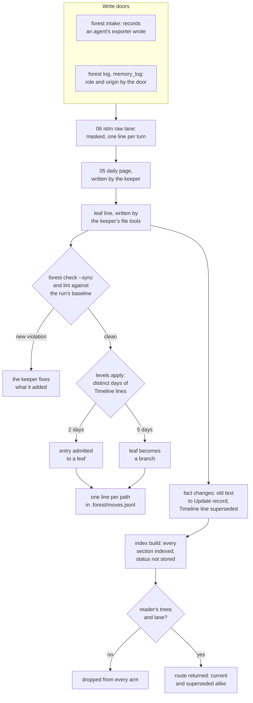

## 1. Executive Summary

Agent Memory Forest is a Python package and a `forest` command that keep
what agents learn as plain Markdown pages in numbered folders on local disk,
with an MCP server for lookup and logging. Its notable part is that code, not
a model, decides where a fact belongs and when a subject grows a page, a
branch or a tree: the level follows the number of distinct days its Timeline
lines cover, and every move is logged. Its weak part is that the facts
themselves are written by the owner's own agent with its own file tools, and
search does not distinguish what is current from what was superseded.

Version 1 is a judge, not an engine. The package takes turns into per-agent
raw lanes, compiles the registry, moves pages, settles levels, lints and
searches. The daily record, the filing run and the upkeep run are carried out
by the keeper agent, following `forest guide routine`, which the package
prints. No model is called by the package, and nothing but optional vector
search needs a network.

Reader scope is the strongest mechanism. One index holds every page, and each
search arm drops any unit outside the reader's trees and raw lane, with the
reader fixed by the connection. Correction is the weakest: a changed fact
moves to the page's Update record and its Timeline line is marked
superseded, and the index serves both as ordinary text.

The licence is MIT, in `LICENSE`, `pyproject.toml` and `CITATION.cff`.

Three marks: `scope_enforced` on the reader scope, `audit_log` on the move
log, and `negative_eval` on a two-agent search test with a positive control.
Section 9 gives the reason for each of the four withheld.

## 2. Mental Model

A memory is a **line on a leaf**. A leaf is one Markdown page for one
sub-topic of one registered subject: a person, a device, a project, an agent.
It has `entity`, `subtopic`, `kind`, `about` and `updated_at` in its
frontmatter, free sections holding the facts, a `## Timeline` of dated lines
and an `## Update record` (`src/memory_forest/guide/routine.md`, *A minimal
leaf*). Every subject has one registry line, under `## Subjects` of its home
tree's index, with its aliases, its level and its home.

A turn becomes a fact in four steps, two of them written by the keeper
agent rather than by code.

- **Raw lane.** `forest intake`, `forest log` or `memory_log` appends one
  JSON line to `06 istm/<agent>/<day>.jsonl`, masked. The two log doors set
  the role and origin themselves; intake takes them from the record
  (`src/memory_forest/intake.py:287-299`, `src/memory_forest/mcp.py:787`).
- **Daily record.** The keeper writes `05 daily/<day>.md`, one block per agent
  and stretch of time, pointing back at the lane lines.
- **Filing.** The keeper updates the subject's leaf, or an entry on its
  category's collection page when the subject is new.
- **Levels.** `forest levels apply` counts the subject's distinct days and
  admits, promotes or makes a tree through the move tool
  (`src/memory_forest/levels.py:1-28`).

The levels are settings and the counting is code. An entry is admitted to a
leaf at two distinct days and a leaf subject gets a branch at five. A branch
of a type in `tree_types` becomes a tree when three sub-topics each span five
days and hold three leaves (`src/memory_forest/config.py:178-182`). A
`standing` line recording the owner's words admits an entry at once. A
superseded Timeline line, a reference line and a line about an agent's own
work count no day (`src/memory_forest/levels.py:78-90`). No level goes down.

A fact stops being current by the keeper rewriting the leaf. The old
statement moves whole into the Update record as a dated line naming what it
was, what it is now, why and the source, and the old Timeline line gets
`[superseded <date>]` in front. A leaf that a newer one replaces takes
`status: superseded` and `superseded_by:`. Nothing is deleted: a record over
its budget is trimmed into a record-history file verbatim, keeping every line
that quotes the owner, and archived pages are compressed copies with a
manifest.

The pages above the leaves are meant to hold only what the leaves
establish. A board's `## Current state` line carries an `as of` date and a
source leaf, and the lint reports it once that leaf's `updated_at` is later
(`src/memory_forest/lint.py:361-382`). That a preference is carried up only on
repeated evidence or the owner's own words is a rule in the contract that no
code checks.

## 3. Architecture

The package is a standard-library Python 3.11+ library with two console
scripts: `forest` (version 1) and `memory-forest` (the 0.3 command, kept
installed beside it) (`pyproject.toml`). There are no runtime dependencies,
no daemon and no worker.

- **The forest folder** holds `01 xltm/XLTM.md` (the root index), `02 ltm/`
  (one page per tree), `03 mtm/<tree>/` (the tree's index and one board per
  branch), `04 stm/<tree>/<branch>/` (the leaves), `05 daily/` and
  `06 istm/<agent>/`, plus `forest.toml`.
- **`.forest/`** holds the compiled registry JSON, `moves.jsonl`, the archive
  and its manifest, record-history files, the credential ledger, intake
  cursors and id files, locks, the commit journal while a commit runs, and
  the SQLite index.
- **The index** has `files`, `units`, `times`, `vectors` and `cjk_grams`
  tables, an FTS5 table over headings and text with `unicode61`, and a
  trigram FTS5 table when the linked SQLite has the tokenizer
  (`src/memory_forest/search.py:1496-1547`). It is derived: `forest index
  reset` and a build make the same index.
- **The MCP server**, `forest mcp --as <agent>`, serves stdio or a loopback
  HTTP port guarded by a token, one agent or one group per connection
  (`src/memory_forest/mcp.py`).
- **Writers are serialised** by a forest writer lock on an exclusive `flock`
  that dies with its holder, and a separate short `intake` lock for the lanes
  (`src/memory_forest/locking.py:88-95`, `src/memory_forest/intake.py:59`).

The 0.3 code (`core.py`, `writer.py`, `retrieval.py`, `index.py`) is reached
only through `memory-forest`: JSON daily, promotion and sweep plans applied
under a maintenance lock with per-transaction receipts in a private
directory (`src/memory_forest/writer.py:1460-1500`, `:1820-1823`). The v1
guides never name it, and this report reads it only far enough to place it.

### Deployment and ergonomics

Nothing has to run. `pip install agent-memory-forest==1.0.0b1` (or from a
clone) gives both commands, and `forest setup` creates or joins a forest from
the owner's answers. No API key is needed to store or find anything. Vector
search needs an embedding provider registered in the same Python process,
and the package registers none (`src/memory_forest/embeddings.py:1-6`), so
from the shipped CLI and MCP server the vector arm never runs.

The store is the most repairable kind there is: every fact is a line in a
Markdown file a person can open, and every derived file can be rebuilt. The
other half of that is the operating cost. The package ships no scheduler, so
the keeper agent has to run the daily, filing and upkeep passes on the
owner's model and bill. The guide tells it to write its own cron line or
scheduled task (`src/memory_forest/guide/routine.md`, *Make it run by
itself*). Windows needs WSL2.

## 4. Essential Implementation Paths

- **Lane write.** `intake.append_owned` appends one turn under the `intake`
  lock, masked, deduplicated on the turn id, after
  `refuse_recording_off` checks the owner's setup answer
  (`src/memory_forest/intake.py:287`, `:412-431`). `forest intake --from jsonl`
  reads records an exporter appended; `memory_log` calls `record_turn` with
  `role="agent"` and an origin from the transport
  (`src/memory_forest/mcp.py:732-743`, `:787`).
- **Filing.** No package code. The keeper edits pages, then runs
  `forest check --sync`, `forest lint`, `forest levels apply` and
  `forest index build` (`src/memory_forest/guide/routine.md`, section 2).
- **Structural change.** Every tool that moves things builds a `Plan`,
  an in-memory overlay. `finish` rewrites references and appends record
  lines, and `check` proves the planned forest. `commit` writes the journal,
  stores archive copies, writes the pages, reads them back and appends the
  move log (`src/memory_forest/plan.py:1-23`, `:922`, `:998`, `:1106-1169`).
- **Levels.** `levels.due` and `levels.apply` compute distinct days and carry
  each change out through the collections or move tool
  (`src/memory_forest/levels.py:236`, `:400`).
- **Search.** `search.query` compiles the registry from the trees, builds the
  reader's `Scope`, indexes changed lanes and daily pages, then adds alias,
  word and vector hits and sorts by tier and score
  (`src/memory_forest/search.py:2491-2545`).
- **Read and navigate.** `search.read` returns the page or an addressed
  section as written, after `_refuse_scope`; `navigate` returns one level
  down from the root index with lines naming hidden trees removed
  (`src/memory_forest/search.py:2549`, `:2636`, `:2728-2746`).
- **Timeline.** `timeline.query` parses English and Korean time phrases and
  returns the units whose Timeline intervals overlap, inside the same scope
  (`src/memory_forest/timeline.py`).
- **Scope.** `scope.for_reader` and `agents.readable_trees`
  (`src/memory_forest/scope.py:52-73`, `src/memory_forest/agents.py:382-403`).
- **Recovery.** `journal.write` and the roll-back the next lock taker runs
  (`src/memory_forest/journal.py:1-20`, `:46-67`).

## 5. Memory Data Model

**Pages.** Leaves, collection pages, boards, tree pages and the root index
are parsed by `model.py`: frontmatter fields, `##` sections, Timeline lines
(`- [superseded D] <when> — <text>`), record lines and registry lines
(`src/memory_forest/model.py:735-760`). A leaf's content cap is 8 KB and its
hard maximum 20 KB; the Update record does not count against the cap
(`src/memory_forest/config.py:75-77`).

**Scope.** No page carries an owner or reader field. The tree is the folder:
`04 stm/<tree>/…` and `03 mtm/<tree>/…` belong to `<tree>`, `06 istm/<agent>/`
to that agent. The registry records each tree's kind, agent or shared. In the
index, each unit stores `path`, `layer`, `tree` and `agent` beside its text,
and `Scope.allows` decides by the role and tree of the classified path
(`src/memory_forest/scope.py:41-49`).

**Time.** Timeline lines carry a date, an optional clock and a zone, and the
index stores each as a UTC interval in `times`. A leaf has `updated_at`. A raw
turn has `at` with its offset. A Timeline line's supersession date is in its
text; `status: superseded` is a frontmatter field. None of these reaches a
column the search reads: `units` has no status or validity field
(`src/memory_forest/search.py:1511-1525`).

**History.** Three records, at three grains. The page's Update record holds
the history of its facts, as the keeper writes it. `record-history/` holds
trimmed record lines verbatim with a manifest row per block. `moves.jsonl`
holds where pages and registry lines went (section 9).

**The two value ledgers.** `.forest/credentials/sign-in.jsonl` keeps an
HMAC-SHA256 digest, under a forest key, of each value a reader judged a
sign-in value, and that value is masked wherever it appears again;
`judged.jsonl` keeps the digests of values judged not to be one
(`src/memory_forest/credential_ledger.py:1-18`). `.forest/repeats-judged.jsonl`
keeps a digest per subject and fact line that a reading found rightly held by
more than one leaf, so the repeat count leaves it out
(`src/memory_forest/repeats.py:1-35`).

## 6. Retrieval Mechanics

**Names first.** `_add_alias_hits` normalises the question and finds every
registry name, id and alias it contains, longest first; a match brings the
subject's home and every leaf whose `about:` names it, at tier 0
(`src/memory_forest/search.py:2749-2789`). This is the design's main bet: a
question that says "the big kiln" lands on Kiln Two's page with no embedding.

**Then words.** `_add_word_hits` ORs the quoted tokens into the FTS5 table
and adds trigram matches for tokens of three or more characters and CJK
bigram hits. It keeps a unit only if a token occurs in its heading or text,
at tier 1, scored by the number of tokens matched (`:2819-2863`). **Vectors** come
third, brute-force cosine over every stored vector above a floor, and only
with a registered provider (`:2881-2926`).

**What comes back is a route.** One result per page, each matching section
with its address, lines, heading, text and the reasons it matched, ordered by
tier, score and path, cut to `limit` (default 10). The agent is told to open
the page, check its dates and its update record, and apply its own rules.
Sign-in values and the account, card and phone numbers the forest recognises
are masked at the door.

**Superseded text is not told apart.** A section is a unit whatever it
holds. The `## Update record`, with its `was "…", now "…"` lines, is indexed
like any other section, and a leaf with `status: superseded` like a current
one. A `[superseded …]` Timeline line is indexed and placed on the time
index. `search.py` and `timeline.py` contain no reference to supersession
(Recorded searches). A word search for an old value finds it, and the route
does not say it is old.

**Cost.** Every search, read, timeline and navigate compiles the registry from
the trees, so it reads every leaf. `tests/test_v1_query_cost.py` pins the
door calls: 46 per added leaf and one per branch for a search or a timeline
read, and nothing per daily page or lane file, after a build with nothing
changed. `docs/tools.md:636-642` states the same.

**Freshness.** A search first indexes the lane files and daily pages that
changed since the build (`refresh_lanes_and_daily`,
`src/memory_forest/search.py:351-410`), so an hour not filed yet is
findable. A leaf the keeper edited is served from the old index until the
next `forest index build`; `memory_read` reads the file and is current.

## 7. Write Mechanics

**No write blocks an agent on a model.** `memory_log` and `forest log` append
one line and return, and the tree and the index entries for a new agent follow
or are reported `pending` with a reason. A logged turn is searchable at the
next search, which indexes changed lanes first. A filed fact is retrievable
after the keeper's next pass and the `forest index build` that ends it, which
by the guide is once a night.

**What the package checks of a turn.** The door sets the role (`agent` for
both log doors) and the origin (`interactive` on stdio, `headless` over
HTTP), and refuses a call that names a reader, role or origin
(`src/memory_forest/mcp.py:644-649`, `src/memory_forest/cli_find.py:138-146`).
Numbers and sign-in values are masked before the line is written. A tool turn
records that the tool ran, not its output, unless `intake.tool_output` is
`keep`. A session whose prompt carries `MEMORY_FOREST_INTERNAL` is not taken
in, so the keeper's own passes do not become conversation. Through
`forest intake --from jsonl` the role is whatever the record says; the
exporter that writes those records is written by the agent itself, following
the setup guide, so "the owner speaking" is the exporter's claim.

**What the package checks of a fact.** Shape, not content
(`src/memory_forest/guide/contract.md`, section 8):

- violations: a leaf outside its subject's home, an unknown entity, a
  registry line out of shape, a stale reference, a current-state line without
  its date and source or with a source changed since, recorder dumps in a
  leaf, and account or sign-in values in full;
- upkeep: size, missing `kind:` or `about:`, repeated lines, stale lists.

A run takes a baseline and must clean up only what its own pages added. The one check that would
compare a filed day with the leaves, `daily_section_unfiled`, is registered
and always reported as *not checked* (`src/memory_forest/lint.py:701-713`).

**Deduplication** is structural: one home per fact, reference lines instead of
copies, and `forest repeats` moving lines shared by two leaves of one subject
to the index leaf, through a checked plan.

**Deletion does not exist.** There is no delete, forget or erase command, and
the contract's rule is that nothing is deleted. `forest credentials fix`
replaces a sign-in value in a page with `[REDACTED]` after storing a
whole-page copy in the archive (`src/memory_forest/credentials.py:975`), so the
value stays on disk, compressed, and `forest archive show` masks it on
print (`src/memory_forest/cli.py:515-522`).

### Operational cost

The package's own cost is file reads: a search reads every leaf to build the
registry, which is fine at hundreds of leaves and linear beyond. The real
cost is the keeper's passes, one model session per pass on whatever model the
owner named, over the day's lanes and the leaves they touch; the package
makes no estimate of it and calls no model itself. Nothing is injected into a
prompt automatically: the agent searches when the use guide tells it to, and
reads what it chooses.

## 8. Agent Integration

The model sees five tools on a one-agent connection: `memory_search`
(`words`, `limit`, `source`), `memory_read` (`path`, `lines`, `source`),
`memory_timeline` (`phrase` or `subject`, `source`), `memory_navigate` (`path`) and
`memory_log` (`text`, `session`, `turn_id`). A group connection adds a
required `agent` to each, resolved only to a member of that group, or admitted
once to an open group (`src/memory_forest/mcp.py:223-239`,
`src/memory_forest/groups.py:131-147`). There is no tool that writes a page.
Filing is done with whatever file tools the keeper agent already has.

The agent connects itself. `forest guide` prints the setup guide.
`forest setup` with no answers lists the questions the agent must ask the
owner, and with every answer writes the forest, the agent's tree and its
record file and prints a `todo`. `forest doctor --phrase` prints a phrase for
the agent to log, and a later doctor proves it arrived and was indexed and
that the MCP server has been called (`src/memory_forest/doctor.py`). Setup writes nothing
into the agent program's own settings; it tells the agent what to register.

Two policies decide where a fact noted by an agent goes: `subject-first`
files it in the subject's home tagged `noted by <agent>`, and `agent-first`
files it in the agent's tree with `about:` pointers (`docs/multi-agent.md`).
Both are rules the keeper follows.

Adapting it to another agent means writing an exporter that appends that
program's turns as records in the lane's shape, or calling `memory_log`. The
package ships no reader of any program's transcripts, by design.

## 9. Reliability, Safety, and Trust

### Correction leaves the old value searchable

The correction model is careful on the page and invisible to search. The
keeper moves the old statement into the Update record and marks the Timeline
line, and both stay in the index as ordinary sections; a superseded leaf is
indexed like any other. Levels skip superseded lines
(`src/memory_forest/levels.py:80`, `:93`), so the code knows the mark; the
search and the time index do not read it. An agent that takes the first
matching section as the answer can read the old value as current, and the
route gives it nothing to tell them apart except the section heading.

### The facts are written outside the package

Every guarantee the package gives is about structure: where a page lives,
that a move rewrote every reference, that a commit rolled back whole. The
content of a leaf is written by the keeper agent with its own file tools, and
the package learns of it at the next check. Nothing records which agent
wrote a fact unless the agent tags it, nothing checks that a changed fact got
its Update record line, and the one content check, `daily_section_unfiled`,
is not implemented. A keeper that rewrites a leaf without recording the old
value loses it, apart from git if the owner keeps one.

### Reader scope is a convention between cooperating agents

On MCP the reader is the server's `--as`, set when the agent registered the
server in its own tool during setup. On the command line it is the `--as` the
calling shell passes, so an agent with a shell can search as the orchestrator,
and the pages are plain files any process can read. The README says so: the
forest is *"not … an authorization system"*. The boundary keeps a
well-behaved agent's context to its own and the shared trees; it does not
contain one that wants out.

### Privacy

Masking happens before a turn is written and again at every answer, and the
sign-in ledger stores only keyed digests. Against that, nothing can be erased:
a fact the owner wants gone stays in the Update record, the record history,
the archive and the raw lane, and a masked secret survives in the archive copy
`credentials fix` makes first.

### Crash safety

A structural commit writes its journal before the first page, reads every
page back, and appends the move log last. A kill at any point leaves a
journal that the next writer rolls back, cutting `moves.jsonl` and the judged
ledger back to their earlier lengths
(`src/memory_forest/journal.py:1-20`). A lane line is appended and synced
before its cursor moves, so a crash can repeat a turn and cannot lose one
(`src/memory_forest/intake.py:1-8`).

### Marks

- **`scope_enforced` — earned.** One index holds every tree and lane; each
  unit stores its path and tree, and every arm of search, read, timeline and
  navigate drops a unit `Scope.allows` refuses, with the reader taken from
  the connection. The key is the tree folder rather than a field on the
  page; the predicate is real, applied per hit in Python against a shared
  index, which is what separates it from one store per agent.
- **`audit_log` — earned, for structure.** `moves.jsonl` is appended by every
  structural operation, under the writer lock, with time, operation, paths,
  subject and reason, and cut back only for a commit that did not finish. It
  does not cover fact content, which no package code writes, and names no
  actor.
- **`negative_eval` — earned.** The same query run as two agents and as the
  orchestrator: absent for one, present for the other.
- **`trust_state` — withheld.** `status: superseded` is a lifecycle field
  that levels honour and search does not, and nothing marks a fact candidate
  or verified.
- **`tombstone` — withheld.** The sign-in ledger has the tombstone's shape,
  a durable record keyed on the value that suppresses it wherever it
  reappears, and it is a secrets mask, not a record of a rejected memory.
  The repeats ledger is keyed on a fact line and records that a duplicate is
  accepted.
- **`bitemporal` — withheld.** Timeline dates are when something happened;
  a supersession date sits in the line's text; no record time exists per line,
  and the index stores the event interval only.
- **`human_review` — withheld.** No memory waits for anyone. Setup's
  questions go to the owner, and the credential judge is a reader's decision
  on masking, not on what the forest holds.

## 10. Tests, Evals, and Benchmarks

CI runs `python -m unittest discover -s tests` on Ubuntu and macOS under
Python 3.11 to 3.14, then the public-release audit, and on one combination
builds the wheel and smoke-tests a clean install (`.github/workflows/ci.yml`).
I ran nothing from the repository.

What the suite covers that bears on memory:

- reader scope across trees, lanes, timeline and navigate, through the API,
  the CLI and the stdio MCP server, with a positive control
  (`tests/test_v1_find.py:340-367`, `:1132-1176`);
- levels from distinct days, including which lines count no day, and the
  promote rows they log (`tests/test_v1_levels.py:38-107`);
- the move log's append, resolve chains, folders and archived pages
  (`tests/test_v1_movelog.py`);
- a kill at each point of a commit, an interrupted roll-back, and a journal of
  an unknown schema stopping the next writer (`tests/test_v1_journal.py:84`, `:104`, `:159`);
- masking of numbers and sign-in values in the index and every answer;
- query cost pinned as door calls at three generated sizes
  (`tests/test_v1_query_cost.py`).

`scripts/mutate_guards.py` turns each guard of a named function (a condition,
a comparison, a raise, a loop) and reruns the named tests, reporting the
survivors; it is the in-tree answer to whether a guard's tests can fail. It
is outside `make check`, and no run of it is committed.

What is not covered: no test asserts that a superseded leaf, a superseded
Timeline line or an Update record's old value is kept out of a search or
flagged in it, and none would pass. No test exercises a filing run, since the
package has none.

No retrieval-quality evaluation and no benchmark result is committed;
`docs/comparison.md:12` says none is published. `CITATION.cff` describes the
software; the tree cites no paper.

## 11. For Your Own Build

### Steal

- **Placement by a counted rule.** Decide a subject's level from the number
  of distinct days its own dated lines cover, with the thresholds in
  settings and the move done by one logged tool. Exclude lines about the
  agent's own work, reference lines and superseded lines from the count.
- **Aliases before words.** A registry of names and aliases, matched in the
  question first, finds the home page of what the question is about without
  an embedding.
- **The reader from the connection.** Reject any tool argument that names a
  reader, role or origin, and refuse the widening flag on an agent's command
  line too.
- **A lint baseline.** Make a run fix what its own pages broke and never what
  was there before, so a stricter rule can land without freezing the store.
- **A plan proved before it is written.** Compute a structural change in
  memory, check every reference and kept line, journal the before-text, write,
  read back, and only then log.

### Avoid

- **History the index cannot see.** If the store keeps old values beside new
  ones, the index needs the status, or the retriever serves the old value as
  readily as the new.
- **A judge with no view of the writes.** A linter that sees shape and a
  writer that edits files directly leave the one property that matters, that
  a changed fact was recorded, to the writer's diligence.
- **Never deleting.** An append-only store with no erase path cannot honour a
  request to forget, and a masking step that archives the unmasked page first
  keeps the secret it masks.

### Fit

This suits an owner who already runs a capable agent on a schedule and wants
its memory as readable, hand-repairable Markdown with strong structural
discipline and a clean separation between agents, on one machine, at the
scale of a personal life or a small business. It assumes the keeper agent is
diligent and the agents are cooperative, and it asks the owner to pay for a
strong model every night. Walk away if facts must be corrected so that
retrieval no longer returns the old value, if something must be erasable, or
if the agents sharing the forest cannot be trusted with a shell.

## 12. Open Questions

- Whether search is meant to return Update record sections and superseded
  leaves as ordinary hits, or whether a status filter is planned.
- How often, in practice, a keeper agent following the routine records the
  old value in the Update record when it rewrites a fact.
- Whether the 0.3 `memory-forest` writer is meant to stay installed through
  the version 1 betas, and whether its receipts are read by anything.
- What a group connection is meant to prevent, given that each call names its
  own member.

## Appendix: File Index

- Layout, pages and settings: `src/memory_forest/layout.py`,
  `src/memory_forest/model.py`, `src/memory_forest/config.py`
- Lanes: `src/memory_forest/intake.py`, `src/memory_forest/adapters/`,
  `src/memory_forest/turn_keys.py`, `src/memory_forest/sources.py`
- Structural change: `src/memory_forest/plan.py`, `src/memory_forest/move.py`,
  `src/memory_forest/collections.py`, `src/memory_forest/levels.py`,
  `src/memory_forest/movelog.py`, `src/memory_forest/journal.py`,
  `src/memory_forest/locking.py`
- Records and archive: `src/memory_forest/record.py`,
  `src/memory_forest/archive.py`, `src/memory_forest/repeats.py`
- Checks: `src/memory_forest/lint.py`, `src/memory_forest/checks.py`,
  `src/memory_forest/validate.py`, `src/memory_forest/maps.py`
- Finding: `src/memory_forest/search.py`, `src/memory_forest/timeline.py`,
  `src/memory_forest/scope.py`, `src/memory_forest/agents.py`,
  `src/memory_forest/embeddings.py`
- MCP and doors: `src/memory_forest/mcp.py`, `src/memory_forest/cli_find.py`,
  `src/memory_forest/groups.py`, `src/memory_forest/cli.py`
- Masking: `src/memory_forest/credentials.py`,
  `src/memory_forest/credential_ledger.py`, `src/memory_forest/numbers.py`,
  `src/memory_forest/leaving.py`
- Guides and contract: `src/memory_forest/guide/`, `docs/contract.md`,
  `docs/v1-design.md`
- 0.3: `src/memory_forest/core.py`, `src/memory_forest/writer.py`,
  `src/memory_forest/retrieval.py`, `src/memory_forest/index.py`
- Tests: `tests/test_v1_find.py`, `tests/test_v1_levels.py`,
  `tests/test_v1_movelog.py`, `tests/test_v1_journal.py`,
  `tests/test_v1_query_cost.py`, `scripts/mutate_guards.py`

### Recorded searches

Run from the repository root at the pinned commit with `/usr/bin/git grep`.

- **Search and the time index read no supersession.**
  `git grep -n -i 'supersed' -- src/memory_forest/search.py src/memory_forest/timeline.py`
  returns nothing; the same pattern on `src/memory_forest/levels.py` matches
  `:9` and `:80`.
- **No delete, forget or erase command.**
  `git grep -n -E 'def cmd_(delete|forget|erase|purge|remove)' -- src` returns
  nothing; `git grep -n -E 'def cmd_(archive_show|recover)' -- src` matches
  `src/memory_forest/cli.py:515` and `:544`.
- **The package registers no embedding provider.**
  `git grep -n -E 'embeddings\.register' -- src` returns nothing; the same
  pattern on `tests` matches `tests/test_v1_find.py:426`.
- **No approval or quarantine state in the code.**
  `git grep -n -i -E 'approv|pending_review|quarantin' -- src/memory_forest`
  returns nothing; on `.` the same pattern matches four lines under
  `docs/archive-0.3/`.
- **No validity columns.** `git grep -n -E 'valid_(from|to|until)' -- .`
  matches only `invalid_toml` in a test name at
  `tests/test_v1_settings_recovery.py:358`.
- **No value-keyed rejection record.**
  `git grep -n -i -E 'tombstone|blocklist|do_not_remember' -- .` returns
  nothing; `git grep -n -i -E 'tombstone|blocklist|redacted' -- src/memory_forest/credential_ledger.py`
  matches `:11` and `:46`.
- **No paper reference.**
  `git grep -n -i -E 'arxiv|bibtex|@article|@misc|doi\.org|zenodo' -- .`
  returns nothing; `git grep -n -i -E 'arxiv|bibtex|citation' -- .` matches
  `CHANGELOG.md:478` and `tests/test_v1_cli.py:145-146`, about `CITATION.cff`.
- **No benchmark results committed.**
  `git grep -n -i -E 'locomo|longmemeval|recall@' -- .` returns nothing;
  adding `benchmark` matches `docs/comparison.md:12`.
- **No committed mutation run.**
  `git ls-files | grep -i -E 'mutant|guards\.json|results'` returns nothing.

## History

**2026-11-26** — [`2a71d9ce0d6dd563fc344c64ec11d8d38e60607c`](https://github.com/hyungchulc/agent-memory-forest/commit/2a71d9ce0d6dd563fc344c64ec11d8d38e60607c). First reading, from a full clone at the head of `main`. Screened first: no auto-run surface, nothing inside the seven-day cooldown, one build-time execution point (`Makefile`) and one unpinned manifest (`pyproject.toml` with no lockfile); `AGENTS.md`, the guides and the contract were read as data. Nothing was installed, built or run, and the 1,198 test functions were not run. Three marks: `scope_enforced`, `audit_log` and `negative_eval` ([section 9](#9-reliability-safety-and-trust)). Search returns superseded text unflagged, the facts are written by the keeper agent's file tools, and nothing can be deleted.
