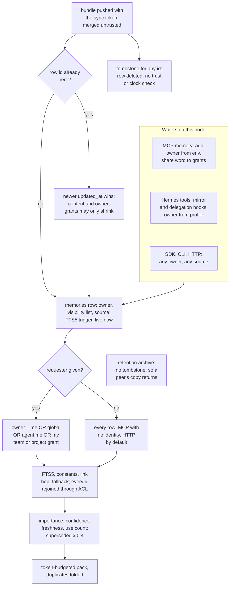

## 1. Executive Summary

Agent Memory OS is a local-first memory store for a fleet of agents sharing
one SQLite file: a zero-dependency Python library with an MCP server, a Hermes
memory-provider plugin, a FastAPI console and peer sync between nodes. Its
notable part is the read gate. Every row stores an owner and a list of grants,
and one SQL predicate over the requester's id and registered memberships runs
on every retrieval track before ranking. Its weak part is what bypasses that
gate: a read with no requester sees every row, and a bundle pushed with the
federation-only token can plant, rewrite and delete memories.

The design has no model in it. A memory is a sentence an agent chose to store,
written at once and searchable at once. Recall is BM25 over FTS5, a track of
always-on constants, one hop along association edges, and a fallback that
returns pinned and important rows when nothing matches. A vector sidecar over
a hashing embedder is written and tested, and the MCP server, the Hermes
plugin, the console and the CLI all construct the client without it.

Correction is thin. An owner edits a row in place, and a `supersedes` edge
multiplies the older row's score by 0.4. A delete removes the row and leaves a
tombstone keyed on its random id, so a peer's older copy does not come back. Nothing records a rejected statement, and retention archives rows
without a tombstone, so a peer's copy of an archived row is re-inserted on the
next sync.

The licence is Apache-2.0, in `LICENSE`, `NOTICE` and `pyproject.toml`.

Two marks are earned on the memory store: `scope_enforced` on the owner and
grant predicate, and `negative_eval` on an isolation matrix that requires each
of five agents to see an exact set. Section 9 gives the reason for each of the
five withheld.

## 2. Mental Model

A memory is **one self-contained statement an agent decided to keep**, with an
owner, a type and a grant list. The MCP tool's description asks for a sentence
that makes sense on its own in a later session
(`src/agent_memory_os/mcp_server.py:103-156`). Nothing extracts, summarises or
infers at write time; the store keeps what it is given.

Five routes create one:

- **An agent's tool call.** `memory_add` over MCP, or `amos_add` in the Hermes
  plugin, with the owner taken from the server's configured identity and the
  grant list resolved from a `share` word
  (`src/agent_memory_os/mcp_server.py:21-51`,
  `src/agent_memory_os/hermes_plugin.py:349-369`).
- **A Hermes mirror.** Each `add` or `replace` the host makes to its own
  `MEMORY.md` or `USER.md` becomes a private row whose id hashes the target and
  the text; a `remove` is not mirrored
  (`src/agent_memory_os/hermes_plugin.py:392-428`).
- **A delegation.** The plugin stores each subagent's task and result as a
  private note at importance 0.3 (`src/agent_memory_os/hermes_plugin.py:430-453`).
- **The operator.** The SDK, `POST /api/memories`, the CLI and the importers
  take every field, including the free `source` JSON that the ranking reads.
- **A peer.** A sync bundle inserts rows the local node has never seen and
  overwrites rows it has (section 9).

The store treats a memory as **true until edited, demoted or removed**. It has
no status, and nothing a read checks can say "on record, not believed".
Confidence starts at 0.8 and falls by 0.05 each time an agent reports a recall
unhelpful (`src/agent_memory_os/db.py:1865-1870`,
`src/agent_memory_os/constants.py:13`); it weights the score. A `supersedes`
edge between two rows that both survive the gate multiplies the older one's
score by 0.4 (`src/agent_memory_os/db.py:2816-2841`). The context pack marks a
line `[CONFLICT]` when two results share a `source.claim_key` with different
`source.claim` values (`src/agent_memory_os/context_pack.py:213-220`), and no
writer in the package sets either field.

A memory stops counting four ways. An owner rewrites it in place, keeping the
id (`src/agent_memory_os/db.py:238-299`). An expiry passes, and every read
drops it at once and retention later moves it to the archive. Retention also
archives a row idle for four half-lives, unless it is pinned or flagged
permanent (`src/agent_memory_os/db.py:2129-2164`). A delete removes the row and
its edges and writes the id into `tombstones`
(`src/agent_memory_os/db.py:316-334`). Consolidation deletes exact duplicates
within one owner, scope and grant list, and adds a concept row summarising a
cluster recalled together at least three times
(`src/agent_memory_os/db.py:2682-2814`).

## 3. Architecture

The core is a library. `MemoryClient` opens `<home>/memories.db` through
`MemoryStore`, which sets WAL, a busy timeout and foreign keys, creates the
base schema and runs twenty forward-only migrations recorded in
`schema_migrations` (`src/agent_memory_os/db.py:83-151`,
`src/agent_memory_os/migrations/__init__.py:29-50`). Several processes share the
file: the MCP server, the Hermes plugin and the console each hold one
connection, and each client clears its caches when `PRAGMA data_version`
changes (`src/agent_memory_os/client.py:65-76`).

- **`db.py`** holds the schema access, every retrieval track, the ACL
  predicate, teams, projects, peers, retention, archive, purge and
  consolidation.
- **`client.py`** wraps the store with an LRU cache, profile resolution,
  context packs, snapshots and the optional semantic index.
- **`context_pack.py`** and **`orchestrator.py`** turn results into prompt
  text under a token budget.
- **`sync.py`** and **`sync_bundles/`** export and merge JSONL bundles and
  speak to peers over HTTP.
- **`mcp_server.py`**, **`hermes_plugin.py`**, **`web_app.py`** and **`cli.py`**
  are the four surfaces.

Retrieval needs nothing beyond SQLite with FTS5. The semantic arm is an
`AutoSemanticIndex` over `turbovec` and a feature-hashing embedder, added only
when a caller constructs `MemoryClient(semantic="auto")`
(`src/agent_memory_os/client.py:36-48`). The four shipped surfaces construct
the client without that argument (`src/agent_memory_os/mcp_server.py:77`,
`src/agent_memory_os/hermes_plugin.py:149`,
`src/agent_memory_os/web_app.py:268`, `src/agent_memory_os/cli.py:1233`), so
installing the `[full]` extra puts `turbovec` on disk and no agent-facing read
uses it.

### Deployment and ergonomics

`pip install agent-memory-os` stores and recalls with no other process, no
key and no model. The `mcp`, `api`, `semantic` and `secure-sync` extras add
the MCP SDK, FastAPI, turbovec and Fernet encryption of bundles. A Docker image
and a compose file for a two-node mesh are in the tree. The store is one
SQLite file that `sqlite3` opens directly, and `agent-memory check` compares
the FTS row count with the table and counts orphan edges
(`src/agent_memory_os/db.py:157-182`).

Identity is configuration. Each MCP server reads `AGENT_MEMORY_AGENT_ID` at
start; `server.json` and `smithery.yaml` both list it as optional, and the
Smithery command runs `uv run --with agent-memory-os[mcp]`, fetching the
package from PyPI at each launch. The console accepts three bearer tokens:
full, read-only, and a sync token limited to the node, export and import
routes (`src/agent_memory_os/web_app.py:301-325`).

## 4. Essential Implementation Paths

- **Capture.** `MemoryClient.add` builds a `MemoryRecord`, which validates
  scope, type, grants and ranges, and `MemoryStore.add` inserts it and commits
  (`src/agent_memory_os/client.py:78-84`, `src/agent_memory_os/schema.py:127-172`,
  `src/agent_memory_os/db.py:184-204`). The FTS5 triggers index it in the same
  statement (`src/agent_memory_os/database_schema.py:33-44`). `auto_link=True`,
  which the Hermes `amos_add` passes, links the new row to similar ones.
- **Retrieval.** `MemoryStore.search` runs `_fts_rows`, `_authority_rows`,
  `_semantic_candidate_rows` and `_resonance_results`, keeps the best score per
  id, applies `_apply_supersedes_demotion`, falls back to
  `_fallback_candidates` when nothing matched and re-weights by profile
  (`src/agent_memory_os/db.py:2527-2669`).
- **The gate.** `_append_acl_filter` is called from the FTS, authority, list,
  type, timeline, recall-feedback and fallback queries, and
  `_visible_rows_for_ids` applies it to ids from link expansion and semantic
  providers (`src/agent_memory_os/db.py:3142-3193`, `:3250-3289`).
- **Context assembly.** `build_context_pack_report` sorts by score plus
  confidence, importance and authority bonuses, folds duplicates by claim key or
  normalised text, reserves budget for flagged constants and records a reason
  for every include and exclude (`src/agent_memory_os/context_pack.py:51-152`).
  `orchestrate_context` splits the budget into session, constants, warnings,
  procedures and task buckets and logs what a session has already received
  (`src/agent_memory_os/orchestrator.py:97-252`).
- **Update and delete.** `update_memory` refuses a requester who is not the
  owner and bumps `acl_updated_at` when the grants change
  (`src/agent_memory_os/db.py:238-299`); `delete` removes edges and row and
  records the tombstone (`:316-334`); `share_memory` and `revoke_share` are
  owner-only and write `memory_audit` (`:2017-2127`).
- **Lifecycle.** `run_retention` tunes half-lives from feedback, archives
  expired rows, rotates snapshots and archives decayed rows
  (`src/agent_memory_os/db.py:2129-2203`); `consolidate` merges duplicates and
  synthesises concept rows (`:2671-2814`).
- **Sync.** `import_bundle` merges memories, links, profiles, tombstones and
  org records in one transaction (`src/agent_memory_os/sync.py:281-344`);
  `_merge_memory` and `_apply_tombstone` carry the trust decisions
  (`:347-486`).
- **Surfaces.** The MCP server registers thirteen tools and serialises them on
  one lock (`src/agent_memory_os/mcp_server.py:73-490`); the Hermes provider
  injects a pack in `prefetch` (`src/agent_memory_os/hermes_plugin.py:182-206`).

## 5. Memory Data Model

The base `memories` table has nineteen columns; migrations add
`helpful_count`, `unhelpful_count`, `acl_updated_at` and
`decay_base_half_life_days` (`src/agent_memory_os/database_schema.py:1-22`,
`src/agent_memory_os/db.py:186-201`). Two fields carry the access model and
one does not:

- **`owner`**, a free string, always sees its own rows.
- **`visibility`**, a JSON list of grants: `global`, `agent:<id>`,
  `team:<id>`, `project:<id>`, and a legacy bare `team` read together with
  `source.team_id`. An empty list is private.
- **`scope`**, one of user, agent, project, team, global or profile, is a
  label. The MCP tool says it *"Does NOT set access control"*
  (`src/agent_memory_os/mcp_server.py:112-118`), and a read filters on it only
  when the caller passes it.

Teams and projects are first-class tables with membership rows; a project's
members must belong to its team, and leaving a team removes the agent from
its projects (`tests/test_team_project_isolation.py:86-111`). Memberships are
read through a 30-second cache that local membership writes and another
process's commits both clear (`src/agent_memory_os/db.py:3418-3442`,
`src/agent_memory_os/client.py:68-76`).

Time is record time. `created_at`, `updated_at` and `last_accessed_at` are
written by the store, `expires_at` by the caller, and `acl_updated_at` is a
second clock for grant changes so that a revoke propagates without touching
freshness (`src/agent_memory_os/db.py:2100-2113`). The time window added on
17 September 2026 accepts only those three store clocks
(`src/agent_memory_os/db.py:3375`). Provenance is the free `source` JSON:
the Hermes plugin writes its system name and session, the importer writes the
file path and section hash, and a sync import adds `synced_from`.

Edges in `memory_links` carry a relation from five (`related_to`,
`supersedes`, `caused_by`, `derived_from`, `co_recalled`), a weight, an
activation count and timestamps, and cascade with their rows
(`src/agent_memory_os/schema.py:219-259`).

## 6. Retrieval Mechanics

Recall is lexical with an associative hop. The FTS arm maps BM25 into a 0.5 to
1.0 text score. Every arm's text score is then multiplied by
`0.45 + 0.35·importance + 0.20·confidence`, by an exponential or linear
freshness on `updated_at`, and by a reinforcement factor capped at 1.25
(`src/agent_memory_os/db.py:2566-2574`, `src/agent_memory_os/scoring.py:38-48`).

Three other tracks add rows the query did not match:

- **Constants.** Rows whose `source` has `permanence` 1 and `weight` at least
  10 join every search, capped at a quarter of the limit, and fill the 20% bedrock
  bucket of every orchestrated context (`src/agent_memory_os/db.py:3012-3061`,
  `:2576-2606`, `:521-537`). The Hermes `MEMORY.md` importer sets both flags on
  every section it imports (`src/agent_memory_os/hermes_importer.py:124-133`).
- **Resonance.** Each hit spreads activation along its strongest edges, decayed
  by 0.6 per hop and by a 90-day edge half-life; the store runs one hop by
  default, and the neighbours are re-read through the gate before they can
  enter the frontier (`src/agent_memory_os/db.py:2843-2956`).
- **Fallback.** When no track returns anything, the store returns pinned,
  important, confident and recent visible rows
  (`src/agent_memory_os/db.py:3470-3536`). An agent asking about something the
  store does not hold gets its most important memories, where the MCP tool's
  description promises an empty list.

Supersession is a demotion. When both ends of a `supersedes` edge are in one
result set, the older row's score is multiplied by 0.4; when only the old row
matches, it is returned at full score (`src/agent_memory_os/db.py:2816-2841`).

The pack is bounded by the caller's `max_tokens`, counted with a dependency-free
estimate that counts CJK characters at one token each
(`src/agent_memory_os/context_pack.py:26-44`). Flagged constants may exceed the
budget while less than the larger of 300 tokens or a quarter of the budget
has been used. The Hermes plugin injects up to
900 tokens before each turn; MCP clients call the pack tools themselves.

## 7. Write Mechanics

Writes are explicit and synchronous. `add` commits one row and returns, the
triggers index it, and the next search in any process finds it. No path calls
a model; `extractors.py` wraps a caller-supplied completion function for
`consolidate(link_extractor=...)` and the package never constructs one
(`src/agent_memory_os/extractors.py:1-15`).

There is no deduplication on write. The MCP description of `memory_add` says
*"Content is de-duplicated softly"*; `MemoryClient.add` and `MemoryStore.add`
insert unconditionally (`src/agent_memory_os/client.py:78-84`,
`src/agent_memory_os/db.py:184-204`). Duplicates are folded when a pack is
built and merged when `consolidate` runs, which an agent or operator must call.

Updates replace fields in place. Over MCP, `memory_update` changes content,
importance, confidence or the pin of a row the configured identity owns
(`src/agent_memory_os/mcp_server.py:303-333`). The Hermes mirror never edits.
A `replace` in `MEMORY.md` adds a second row under a new hash and leaves the
old one. A `remove` is ignored, so a fact the host deleted from its own memory
file stays in the store and keeps being recalled
(`src/agent_memory_os/hermes_plugin.py:392-428`).

### Operational cost

The write path blocks for one SQLite insert and its FTS trigger. Nothing runs
in the background. Consolidation loads every row under its owner filter and
groups them in Python, and retention scans with SQL, each when called. The
read path injects a bounded pack; the Hermes plugin returns it from
`prefetch`, and its system-prompt block is a fixed paragraph.

## 8. Agent Integration

The MCP server exposes thirteen tools: add, search, timeline, context pack,
orchestrated context, link, recall feedback, update, share, consolidate, and
offload, reload and diff of context snapshots. None deletes a memory. Every
tool runs as the identity in `AGENT_MEMORY_AGENT_ID`, and the legacy `owner`
argument must match it when it is set
(`src/agent_memory_os/mcp_server.py:87-99`, `:146-148`). Mutations check
ownership: a second identity's `memory_update`, `memory_link`, snapshot reload
and consolidation all return errors in a stdio test
(`tests/test_mcp_sharing.py:105-234`).

The Hermes plugin is a native memory provider. It derives its identity from
config or as `hermes-<profile>`, injects a pack each turn, offers
`amos_search`, `amos_add` and `amos_share`, mirrors the host's built-in memory
writes, and refuses writes from cron and subagent contexts
(`src/agent_memory_os/hermes_plugin.py:127-206`, `:301-388`).

Adapting it to another agent means running the MCP server with a distinct
identity per agent against one home, which is what the Claude Code guide
configures (`docs/integrations/claude-code.md:20`, `:34`).

## 9. Reliability, Safety, and Trust

### Scope

The predicate is the system's strongest part. One function builds the clause:
the requester's own rows, `global`, `agent:<me>`, each team the registry lists
for the requester and each project it lists
(`src/agent_memory_os/db.py:3250-3289`). It is applied in SQL on every track,
and candidate ids from link traversal and semantic providers pass through it
again before their content is read, so an invisible row can neither be
returned nor bridge two visible ones (`src/agent_memory_os/db.py:3155-3160`).
Project grants resolve only from the membership table.

The predicate is skipped when no requester is passed:
`if not requester_agent_id: return` (`src/agent_memory_os/db.py:3259-3260`).
The project names this the owner or admin view. It is what the MCP server does
when `AGENT_MEMORY_AGENT_ID` is unset, as both registry manifests allow, and
what every HTTP read does without a `requester_agent_id` parameter
(`src/agent_memory_os/mcp_server.py:8-13`, `src/agent_memory_os/web_app.py:1-7`).
The default has already cost the project once: until 17 September 2026
`resonance_search` accepted no requester and returned other owners' private
memories to any SDK caller (`CHANGELOG.md:49-57`).

`requester_team_id` is a caller-supplied team added to the clause without a
membership check. The SDK and every HTTP read route accept it, and a test
records the intent that it may widen team visibility and never reach projects
(`tests/test_team_project_isolation.py:114-124`). The MCP server and the Hermes
plugin never pass it.

### What a pushed bundle can do

`POST /api/sync/import` merges a pushed bundle with `trusted=False` and no org
mutations, and the sync token reaches it (`src/agent_memory_os/web_app.py:1202-1246`).
The comment beside the token tiers says a peer holding it *"cannot read/write
memory via the API"* (`src/agent_memory_os/web_app.py:307-309`). The import
route writes memory, and four things in the merge are not gated by trust:

- **New rows keep the peer's grants and flags.** For an unknown id, the only
  untrusted check refuses an owner that is a registered local agent; the row is
  inserted with its visibility and `source`, and `synced_from` is added
  (`src/agent_memory_os/sync.py:378-401`). A row with `["global"]`,
  `permanence` 1 and `weight` 10 joins the constants track of every agent's
  search. The module docstring says an untrusted peer may not inject globally
  visible memories (`src/agent_memory_os/sync.py:17-19`, `:291-292`).
  `test_semi_trusted_import_records_provenance` imports a global row untrusted
  and asserts it is present (`tests/test_federation_trust.py:109-126`).
- **Known rows take the peer's owner and content.** A newer `updated_at`
  overwrites every column except `id` and the two grant fields, `owner`
  included (`src/agent_memory_os/sync.py:404-416`). The shrink-only rule guards
  visibility (`:445-455`); setting the owner to another agent grants that agent
  the row through the owner clause.
- **The content clock has no future bound.** `_ts_too_future` guards the ACL
  clock and the three org record kinds and is not called on `updated_at`
  (`src/agent_memory_os/sync.py:86-96`, `:434`, `:523`, `:578`, `:627`), so a
  far-future edit outranks every later local edit. `docs/THREAT_MODEL.md:35-36`
  says future-dated timestamps are rejected.
- **Tombstones apply to any id.** `_apply_tombstone` takes no trust argument,
  deletes the row when `deleted_at` is not older than its `updated_at`, and
  keeps the tombstone so the row cannot return
  (`src/agent_memory_os/sync.py:470-486`).

`GET /api/sync/export` serves every non-private row to the same token, so the
ids those bullets need come from the node itself. The tests cover the grant
clock and org tombstones under untrusted import, with future clocks
(`tests/test_review_fixes_v0_14.py:68-93`, `:234-257`); none sends an untrusted memory
tombstone, a new global row or an owner change. This section is read from the
code and was not run.

### Correction and deletion

A delete is a hard delete with an id tombstone that blocks a peer's older copy,
with a test (`tests/test_federation_trust.py:66-80`). Ids are random UUIDs, so
the same statement stored again is a new row the tombstone does not know.
Retention archives without a tombstone, and `sync.py` never reads the archive,
so a row archived on one node is re-inserted when a peer that still holds it
syncs. `purge_owner` reaches the live table, the archive, the delivery log and
the share audit, and tombstones every id (`src/agent_memory_os/db.py:2284-2346`).

### Marks

Two are earned, both on the memory store's read path.

- **`scope_enforced` — earned.** Each row stores `owner` and a grant list,
  and the same predicate is appended in SQL to every retrieval query, with
  candidate ids rejoined through it. On MCP and in Hermes the requester comes
  from configuration, not from a tool argument. An unset identity removes the
  predicate, and a pushed bundle can change a row's owner.
- **`negative_eval` — earned.** One case requires a private row absent and a
  global row present for another agent on one query; the isolation module
  requires five agents' search and list results to equal exact sets across two
  teams and three projects.
- **`audit_log` — withheld.** `memory_audit` has writers only in
  `share_memory` and `revoke_share` (`src/agent_memory_os/db.py:2060-2088`).
  Add, update, delete, consolidation and sync write nothing to it, the MCP and
  Hermes share tools change grants through `update` and skip it, the HTTP share
  route records a caller-supplied `actor`, and `purge_owner` deletes its rows.
  `org_audit` records team and membership changes, which are not memory.
- **`trust_state` — withheld.** No status column exists. Confidence is a float
  used in scoring, and supersession is a 0.4 multiplier.
- **`tombstone` — withheld.** `tombstones` is keyed on the row id for sync.
  Nothing records a rejected value.
- **`bitemporal` — withheld.** Every stored time is a store clock or a caller
  expiry; no column says when a fact held.
- **`human_review` — withheld.** No memory waits for anyone. The console
  edits, deletes and shares after the write.

## 10. Tests, Evals, and Benchmarks

The suite has 572 pytest functions in 65 files. CI runs it on three operating
systems and three Python versions, beside an MCP v1 compatibility job and an
upgrade job that migrates a database written by the last published release
(`.github/workflows/ci.yml`). The isolation tests are the strongest
part: the matrix in `tests/test_team_project_isolation.py` checks equality of
sets, so it fails if a row leaks in or a permitted row drops out. The MCP tests
start the real server over stdio as two identities.

Two committed artifacts measure the system. A validation report at v0.14.0,
dated 11 July 2026, records twelve ACL checks and ten functional checks over
5,055 generated memories, with the raw JSON beside it
(`docs/reports/20260711-v0.14.0-validation-report.md`). Its recall probe
searches for unique tokens such as `zxq001` planted in one memory each
(`scripts/validation_run.py:105-110`, `:182-186`), which measures FTS5 on an
exact token rather than recall of a paraphrase. The README's latency figures
come from `docs/reviews/20260712-v1.0.0-perf-security.md`, which names
`scripts/perf_bench.py 10000` to reproduce them; no raw output of that run is
committed.

`golden_recall.py` runs caller-written query cases with `forbidden` terms and
counts forbidden hits; its tests use inline cases, and no case file is
committed. No paper is cited.

Missing before trusting it across machines: untrusted-import cases for memory
tombstones, new global rows, owner changes and future content clocks; a sync
case for an archived row; and the isolation matrix run through the MCP server
with and without `AGENT_MEMORY_AGENT_ID`.

## 11. For Your Own Build

### Steal

- **One predicate function, called by every track.** Build the access clause
  once and append it to every query, including the rejoin of ids from link
  traversal and vector sidecars. A new arm then inherits the gate instead of
  re-implementing it.
- **Identity from the process, not the call.** Reading the requester from the
  server's environment removes the argument a model could forge.
- **An isolation matrix that checks equality.** Seed one row per boundary,
  list what each agent is entitled to, and assert the set; it fails on a leak
  and on an over-tight filter.
- **A separate clock for grants.** Propagating revocations on their own
  timestamp, and accepting only a shrink from a peer you do not fully trust,
  lets a revoke travel without letting a replica widen access.

### Avoid

- **A gate that opens when the caller says nothing.** A missing requester
  should be an error or an empty result. A default of "see everything" turns
  each new entry point into a possible leak, as one already did here.
- **Trust checks on one field of a merge.** Guarding visibility while the same
  merge rewrites the owner, honours any timestamp and applies deletions
  unconditionally guards the wrong door. Apply the peer's trust level to every
  column and every record kind.
- **Retiring a row without telling the mesh.** Any removal that is not a
  tombstone is undone by the next replica that still has the row.
- **Tool descriptions that promise what the handler does not do.** An agent
  told its writes are de-duplicated stops checking.

### Fit

This suits a small team that owns every machine in the mesh and wants several
agents on one workstation to share team and project memory without a model,
a server or a key. The ACL work is careful and well tested, and the rest is
plain: memory is what agents chose to write, ranked by keywords and links.
Walk away if any peer is not yours, because the sync token can plant and
remove memory. Walk away too if recall has to match a paraphrase from an MCP
client, or if a deleted fact must stay gone when an agent restates it.

## 12. Open Questions

- Whether the untrusted import was meant to refuse new global rows, as its
  docstring says, or to accept them, as its test asserts.
- Whether `owner` was meant to be part of the content merge from untrusted
  peers.
- Whether the semantic sidecar is meant to be on for MCP and Hermes, given the
  README's "semantic recall works out of the box".
- Whether retention is meant to tombstone, or the archive meant to be checked
  on import.
- What is meant to write `source.claim_key` and `source.claim` for the
  conflict tag.

## Appendix: File Index

- Schema and migrations: `src/agent_memory_os/database_schema.py`,
  `src/agent_memory_os/schema.py`, `src/agent_memory_os/migrations/`
- Store, gate, retrieval, lifecycle: `src/agent_memory_os/db.py`,
  `src/agent_memory_os/scoring.py`, `src/agent_memory_os/constants.py`
- Client, packs, orchestration: `src/agent_memory_os/client.py`,
  `src/agent_memory_os/context_pack.py`, `src/agent_memory_os/orchestrator.py`
- Semantic sidecar: `src/agent_memory_os/embedding.py`,
  `src/agent_memory_os/providers/turbovec.py`,
  `src/agent_memory_os/candidates.py`
- Sync: `src/agent_memory_os/sync.py`, `src/agent_memory_os/sync_bundles/`,
  `src/agent_memory_os/crypto.py`
- Surfaces: `src/agent_memory_os/mcp_server.py`,
  `src/agent_memory_os/hermes_plugin.py`, `src/agent_memory_os/web_app.py`,
  `src/agent_memory_os/cli.py`, `server.json`, `smithery.yaml`
- Tests: `tests/test_team_project_isolation.py`, `tests/test_acl_visibility.py`,
  `tests/test_mcp_sharing.py`, `tests/test_federation_trust.py`,
  `tests/test_review_fixes_v0_14.py`, `.github/workflows/ci.yml`
- Evaluation: `scripts/validation_run.py`, `scripts/perf_bench.py`,
  `docs/reports/`, `docs/reviews/`, `docs/THREAT_MODEL.md`

### Recorded searches

Run from the repository root at the pinned commit with `git grep`.

- **No validity-time column.**
  `git grep -n -i -E 'valid_from|valid_to|valid_at|invalid_at|event_time|occurred_at|valid_until'`
  returns nothing; `git grep -n -c -i -E 'expires_at' -- src` matches
  `db.py` 19 times.
- **No status column on memory.**
  `git grep -n -E 'status TEXT|"status"' -- src/agent_memory_os/db.py src/agent_memory_os/database_schema.py src/agent_memory_os/migrations`
  returns nothing; `git grep -n -E 'status' -- src/agent_memory_os/discovery.py`
  matches a node-probe field.
- **No pending or approval state.**
  `git grep -n -i -E 'pending|approv|quarantin|needs_review|awaiting' -- src`
  returns two comments, `cli.py:539` and `schema.py:85`.
- **No value-keyed refusal.**
  `git grep -n -i -E 'reject(ed)?_(value|content|fact|claim)|blocklist|denylist|suppress' -- src`
  returns `context_pack.py:79`, the duplicate fold.
- **The share audit has two writers.**
  `git grep -n -E '_audit\(|_org_audit\(|audit_fleet_op\(' -- src/agent_memory_os`
  returns `db.py:2060`, `:2061`, `:2067` and `:2088` for `memory_audit`, the
  rest being org and fleet audit calls.
- **No MCP tool deletes.**
  `git grep -n -E 'def memory_' -- src/agent_memory_os/mcp_server.py` returns
  thirteen tools, none a delete.
- **No shipped surface enables the semantic arm.**
  `git grep -n -E 'semantic ==|semantic=' -- src tests scripts` returns
  `client.py:36`, one test and `scripts/validation_run.py:304` with `None`;
  `git grep -n -E 'MemoryClient\(' -- src` returns four constructors, none
  passing it.
- **The content clock is not bounded.**
  `git grep -n -E '_ts_too_future|SYNC_MAX_FUTURE_SKEW' -- src` returns the
  definition and `sync.py:434`, `:523`, `:578`, `:627`.
- **Sync never reads the archive.**
  `git grep -n -E 'memories_archive|archive' -- src/agent_memory_os/sync.py`
  returns nothing; `git grep -n -E 'memories_archive' -- src` returns lines in
  `db.py`.
- **No writer of the conflict fields.**
  `git grep -n -E 'claim_key|"claim"'` returns `SPEC.md`, two docs, one
  downgrade-check script and `context_pack.py`.
- **No untrusted memory-tombstone test.**
  `git grep -n -E '"kind": "tombstone"|kind.*tombstone' -- tests` returns a
  fixture, contract lines and org-tombstone cases.
- **No paper reference.**
  `git grep -n -i -E 'arxiv|bibtex|@article|@misc|citation|doi\.org'` returns
  nothing, and there is no `CITATION.cff`.

## History

**2026-11-26** — [`2932382b430a14a59019f907a873094f741f215b`](https://github.com/yamantaka520/Agent-Memory-OS/commit/2932382b430a14a59019f907a873094f741f215b). First reading, read only, from a full clone at the head of `main`. Screened first: two auto-run surfaces, the MCP start commands in `server.json` and `smithery.yaml`; nothing inside the seven-day cooldown; no build-time execution; one unpinned surface, `pyproject.toml` with no lockfile. Docs were read as data. Nothing was installed, built or run, and the 572 test functions were not run. Two marks: `scope_enforced` and `negative_eval` ([section 9](#9-reliability-safety-and-trust)). A read without a requester sees every row, and a pushed sync bundle can plant global constants, rewrite owners and delete any known id.
