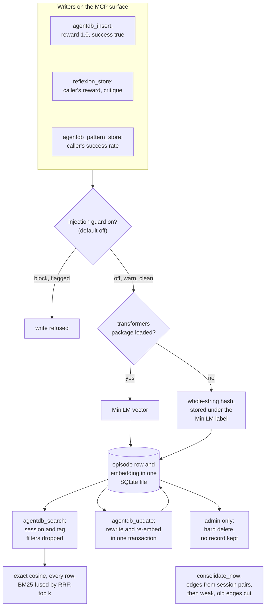

## 1. Executive Summary

AgentDB is an MIT TypeScript package, used as a library, an `agentdb` CLI and a
stdio MCP server, that keeps an agent's Reflexion-style episodes, reasoning
patterns, skills and causal edges in one SQLite file and recalls episodes by
cosine fused with BM25. Its notable part is the episode CRUD path: ids are
parsed strictly, a text change is re-embedded inside a transaction that refuses
a concurrent edit, and the default MCP profile can write and update but not
delete. Its weak part is that the memory has no scope, no status and no record
of change. The MCP search advertises session and tag filters and drops both,
and the README's headline *"36% from feedback alone"* is a variable the
benchmark script raises by 0.04 per session.

Much of what the README and schema describe is declared and not wired. Seven
schema tables, including `facts` with an `expires_at` TTL, have no writer in
`src/`. The JWT and audit-logger middleware has no importer and no HTTP server
exists to mount it. The RVF "mutation witness" is a solver training run seeded
by a 32-bit hash of the string `insert:<id>`. The recall-certificate verifier
has no caller.

The agent surface is the MCP server, which builds every controller without a
vector index: its own capability report says *"every search here is an exact
cosine scan over the SQL embedding tables"*
(`src/mcp/agentdb-mcp-server.ts:333-336`). The HNSW, RuVector and RVF backends
behind the README's speed figures are reached only through the library API.

The plugin marketplace has a second gap. Six of its seven plugins carry skills
and agents that call `agentdb_hierarchical_store`, `agentdb_causal_edge`,
`agentdb_attestation_log` and other names the server does not register. The
one plugin that starts a server pins `agentdb@3.6.0`, 33 commits before the pin.

**Licence.** The README badge, its *License* section and six of the seven
`plugin.json` files say *"MIT OR Apache-2.0"*, and the tree holds one licence
text, MIT, which the root `package.json` and the `agentdb` plugin also name.
The MIT grant in `LICENSE` is complete on its own, so the dual offer adds
nothing a reader can rely on until an Apache-2.0 text is committed.

No marks. Section 9 gives the reason for each of the seven.
[Ruflo](../ruflo/), from the same author, embeds this package as its vector
backend, and [RuVector](../ruvector/) supplies the engine packages; the
`packages/ruvector-upstream` submodule is not checked out and was not read.

## 2. Mental Model

A memory is an **episode**: one attempt at a task, with input, output, a
critique, a reward and a success flag (`src/schemas/schema.sql:21-36`). It
becomes a belief the moment a caller stores it. No model call extracts or
checks it, and the reward and success flag are whatever the caller wrote;
`agentdb_insert` stores every row with reward 1.0 and success true
(`src/mcp/agentdb-mcp-server.ts:1419-1436`).

Three other kinds sit beside it.

- A **reasoning pattern** is a task type and an approach with a success rate
  the caller states at store time (`required: ['taskType', 'approach',
  'successRate']`, `src/mcp/agentdb-mcp-server.ts:946-957`). Feedback averages
  into it, so the first feedback replaces the stated rate entirely
  (`src/controllers/ReasoningBank.ts:650-668`).
- A **skill** is a named description and code template with usage statistics.
- A **causal edge** links two memory ids, or two bare strings: the MCP
  `causal_add_edge` writes `fromMemoryId: 0` and puts the cause and effect text
  in the type columns (`src/mcp/agentdb-mcp-server.ts:1712-1730`).

A memory stops counting in three ways, none of them a judgement about whether
it is true. An admin deletes it by id, by session or before a timestamp, and
the row and its embedding are removed (`src/controllers/ReflexionMemory.ts:1605-1690`).
`agentdb_update` rewrites it in place. `pruneEpisodes` deletes low-reward
episodes older than 30 days beyond five per task
(`src/controllers/ReflexionMemory.ts:1253-1290`), and `consolidate_now`
deletes every causal edge below confidence 0.6 or older than 90 days,
including edges the agent added by hand (`src/controllers/NightlyLearner.ts:571-583`).

No state between stored and deleted exists. Reward and success rate rank and
can filter by a caller-chosen minimum, but nothing withholds a stored episode
from recall.

## 3. Architecture

Everything runs in one Node.js process over one SQLite file. The MCP server
opens `AGENTDB_PATH`, default `./agentdb.db` in the directory the client
starts it from, through `createDatabase`, which loads better-sqlite3 when the
optional native module resolves and sql.js otherwise
(`src/mcp/agentdb-mcp-server.ts:271-277`, `src/db-fallback.ts`). On sql.js the
database lives in memory and is written back every five minutes and on SIGINT
or SIGTERM, so a crash can lose up to five minutes of writes
(`src/mcp/agentdb-mcp-server.ts:2948-2990`).

- **Controllers.** `ReflexionMemory` (episodes), `ReasoningBank` (patterns),
  `SkillLibrary`, `CausalMemoryGraph`, `CausalRecall`, `NightlyLearner`,
  `LearningSystem` (nine RL algorithms over `learning_experiences`), and three
  model stores added in 3.8 to 3.10: `FannModels`, `WeightPrograms` and
  `NeuralReranker`.
- **Schemas.** `src/schemas/schema.sql` and `frontier-schema.sql`, inlined at
  build time into `src/schemas/inline.ts`. `ReasoningBank` creates its own two
  tables (`src/controllers/ReasoningBank.ts:215-261`).
- **Embeddings.** `EmbeddingService` with `Xenova/all-MiniLM-L6-v2` through
  `@huggingface/transformers`, an optional dependency, 384 dimensions
  (`src/mcp/agentdb-mcp-server.ts:300-305`).
- **Vector backends.** `RuVectorBackend`, `HNSWLibBackend`, `RvfBackend` and
  `SelfLearningRvfBackend` under `src/backends/`, thin wrappers over the
  `@ruvector/*` and `hnswlib-node` npm packages. The library's `AgentDB` class
  passes one to its controllers (`src/core/AgentDB.ts:73-88`); the MCP server
  and the CLI pass none.
- **Policy.** `src/security/mcp-policy.ts` maps `AGENTDB_MCP_PROFILE` to a tool
  allowlist.

### Deployment and ergonomics

`claude mcp add agentdb -- npx agentdb mcp start` is the documented install,
and `npx` fetches the package at run time. Nothing else has to run and no API
key is needed: MiniLM downloads about 90 MB on first use, or comes from a
bundled `.rvf` model when present. Offline without the model, the service logs
*"Falling back to mock embeddings for testing"* and keeps going
(`src/controllers/EmbeddingService.ts:156-166`), which section 6 prices.

The store is an ordinary SQLite file, readable and repairable with any SQLite
tool. The library's `.rvf` and `.ruvector` sidecars are opaque formats owned
by the `@ruvector` packages.

## 4. Essential Implementation Paths

- **Capture.** `agentdb_insert`, `agentdb_insert_batch`, `reflexion_store`,
  `reflexion_store_batch` call `ReflexionMemory.storeEpisode`, which screens
  the text, inserts the row, embeds `task`, `critique` and `output`, and
  writes the embedding (`src/controllers/ReflexionMemory.ts:190-335`).
  `agentdb_pattern_store` calls `ReasoningBank.storePattern`
  (`src/controllers/ReasoningBank.ts:264-313`); `skill_create` calls
  `SkillLibrary.createSkill`.
- **Retrieval.** `agentdb_search` and `reflexion_retrieve` call
  `retrieveRelevant` (`src/controllers/ReflexionMemory.ts:341-399`), which
  pools `max(4k, 50)` dense candidates from `retrieveFromSQLFallback`
  (`:633-662`) and fuses them with `EpisodeLexicalIndex` hits in `hybridRank`
  (`:434-481`), using `fuseEpisodeScores` and `applyCrossEncoder`
  (`src/controllers/episode-hybrid.ts:125-170`).
- **Pattern retrieval.** `agentdb_pattern_search` embeds the query and calls
  `searchPatternsLegacy`, which scans `pattern_embeddings` with optional
  `task_type`, `success_rate` and tag predicates and ranks by `rerankScore`
  (`src/controllers/ReasoningBank.ts:432-512`, `:104-113`).
- **Causal recall.** `recall_with_certificate` runs `CausalRecall.recall`,
  which reranks by similarity, uplift and latency and writes a
  `recall_certificates` row with a Merkle root over the returned sources
  (`src/controllers/ExplainableRecall.ts:130-216`).
- **Update and delete.** `handleCrudTool` dispatches the ADR-017 tools
  (`src/mcp/agentdb-mcp-server.ts:1233-1354`); `updateEpisode`
  (`src/controllers/ReflexionMemory.ts:1124-1246`), `deleteEpisode`
  (`:1605-1690`), and the bulk `deleteEpisodesWhere`
  (`src/mcp/agentdb-mcp-server.ts:1206-1216`).
- **Consolidation.** `consolidate_now` calls `NightlyLearner.run` or, with a
  session id, `consolidateEpisodes` (`src/mcp/agentdb-mcp-server.ts:2890-2905`,
  `src/controllers/NightlyLearner.ts:101-158`).
- **Policy.** `buildMcpToolPolicy` and `isMcpToolAllowed`, checked at the top
  of the call handler (`src/mcp/agentdb-mcp-server.ts:1363-1368`).
- **CLI.** `agentdb reflexion store|retrieve|prune`, `skill`, `causal`,
  `learner`, `recall` and `mcp start` in `src/cli/agentdb-cli.ts:1727-1982`.

## 5. Memory Data Model

**Episodes.** `episodes` holds an integer id, `ts`, `session_id`, `task`,
`input`, `output`, `critique`, `reward`, `success`, latency, tokens, JSON
`tags` and `metadata`, and `created_at`. `episode_embeddings` holds one blob
per episode and an `embedding_model` column that defaults to
`'all-MiniLM-L6-v2'` (`src/schemas/schema.sql:21-50`). `storeEmbedding` never
writes that column, so a hash-fallback vector is labelled as MiniLM
(`src/controllers/ReflexionMemory.ts:1302-1310`).

**Patterns and skills.** `reasoning_patterns` carries `task_type`, `approach`,
`success_rate`, `uses`, `avg_reward`, tags and metadata; `skills` adds a name,
a signature, code, `avg_latency_ms` and links to other skills.

**Causal graph.** `causal_edges` holds from and to ids and types, similarity,
uplift, confidence, sample size, evidence ids and a free-text `mechanism`. Its
comment says the foreign keys were removed so ids can be 0 for *"abstract
causal relationships"* (`src/schemas/frontier-schema.sql:14-44`). The
consolidator writes the two episodes' task text into `mechanism`
(`src/controllers/NightlyLearner.ts:402`), and deleting an episode does not
touch its edges.

**Scope.** The only key is `session_id`. `listEpisodes`, `getRecentEpisodes`
and the consolidator filter on it; `ReflexionQuery` has no session field, so
retrieval cannot (`src/controllers/ReflexionMemory.ts:129-151`). The library's
`AgentDBConfig.namespace` is declared and never read
(`src/core/AgentDB.ts:24`).

**Time.** `ts` and `created_at` are record times. The only validity column,
`facts.expires_at`, belongs to a table nothing writes.

**Declared and unwritten.** `facts`, `notes`, `consolidated_memories`,
`exp_nodes`, `memory_scores`, `memory_access_log` and `consolidation_runs` have
no `INSERT` in `src/` outside the schema; `events` is written only by
`agentdb migrate`. `ExplainableRecall` reads `notes` and `facts` when hashing a
source of that type, so those reads find nothing.

## 6. Retrieval Mechanics

**Recall is tool-mediated.** Nothing injects memory into a prompt; the agent
calls `agentdb_search`, `reflexion_retrieve`, `agentdb_pattern_search`,
`skill_search` or `recall_with_certificate` and reads a formatted text reply;
the two search tools print the first five hits.

**The dense arm is a full scan.** `retrieveFromSQLFallback` selects every
episode joined to its embedding, ordered by reward, and keeps the top k by
cosine in a bounded heap (`src/controllers/ReflexionMemory.ts:633-662`). Cost
grows with the file, and the MCP server never uses the HNSW index the README
measures.

**Fusion.** With `hybrid` on by default, BM25 over task, input, output and
critique joins the dense pool by weighted reciprocal rank, k = 60, lexical
weight 1; keyword-only hits are loaded, filtered and given their true cosine
(`src/controllers/episode-hybrid.ts:26-29`, `:125-135`). `rerank: true` adds
a cross-encoder rank at weight 8 over the top 60 of each list (`:151-155`).
The fusion is the strongest piece of the read path, and section 10 shows it
measured.

**The filters the schema promises.** `agentdb_search` declares
`filters.session_id` and `filters.tags` (`src/mcp/agentdb-mcp-server.ts:462-468`).
The handler copies `min_reward` and leaves the comment *"Session ID filter
would require custom query"* (`:1511-1516`), so a model that asks for one
session's episodes gets the whole file ranked.

**The embedder can stop being one.** When `@huggingface/transformers` is not
installed or the model cannot load, `mockEmbedding` hashes the whole string to
one 32-bit integer and fills the vector with `sin` and `cos` of it
(`src/controllers/EmbeddingService.ts:309-343`). Two texts that differ by one
character get unrelated vectors, so the dense arm becomes noise and the
lexical arm carries recall. `agentdb_capabilities` reports `embedding.active:
'mock'`; the search reply does not.

**Pattern ranking.** `0.7 × similarity + 0.2 × success rate + 0.1 × average
reward`, clamped (`src/controllers/ReasoningBank.ts:77-81`, `:104-113`). A
new pattern ranks on the success rate its author claimed until the first
feedback arrives.

**Neural reranking.** An opt-in `neuralRerank` scores up to 64 candidates with
a caller-trained ruv-FANN model, in shadow mode by default, which annotates
scores and keeps the baseline order (`src/controllers/ReflexionMemory.ts:401-432`).
Promotion of a reranker is admin-only; promotion of a weight-space program is
in the default learning profile (`src/security/mcp-policy.ts:43`).

## 7. Write Mechanics

Writes are synchronous and model-free. The tool call embeds the text,
inserts the row and returns, and the episode is retrievable in the next
call; the lexical index rebuilds lazily when it sees a new count or maximum
id. No background pass reads or rewrites the store unless the agent calls
`consolidate_now`.

**What the caller decides.** Reward, success, critique and, for patterns, the
success rate are arguments. The tool descriptions do not ask the model to
justify them, and nothing in the server checks them against an outcome.

**Screening.** `screenStoredText` runs before every episode, pattern and skill
write and update (`src/controllers/ReflexionMemory.ts:191`, `:1145`,
`src/controllers/ReasoningBank.ts:265`, `src/controllers/SkillLibrary.ts:102`).
It is off unless `AGENTDB_INJECTION_GUARD` is `warn` or `block`, and `block`
refuses the write when the optional `aidefence` package is missing
(`src/security/injection-guard.ts:88-112`). The plugin's mod adds a secret
check at the tool-call boundary (`plugins/agentdb/hooks/register.ts:28-52`).

**Update.** `updateEpisode` patches named fields, re-embeds only when the
embedded text changed, embeds outside the transaction, and inside it re-reads
the row and refuses the write if the text moved meanwhile
(`src/controllers/ReflexionMemory.ts:1206-1222`). Patterns and skills repeat
the check (`src/controllers/ReasoningBank.ts:839`,
`src/controllers/SkillLibrary.ts:1046`). The old text is overwritten and kept
nowhere.

**Delete.** By id through the controller, which removes graph, vector-index
and SQL copies and invalidates the lexical index; by session or before a
timestamp through `deleteEpisodesWhere`, which deletes embeddings first
because foreign-key cascades are off by default
(`src/mcp/agentdb-mcp-server.ts:1205-1216`). Under the default learning
profile the agent has no delete tool at all, so an agent cannot forget
anything it stored (`tests/mcp-crud-e2e.mjs:144-149`).

**Consolidation.** `discoverCausalEdges` pairs episodes in the same session
within an hour, computes a doubly-robust estimate with the treatment
indicator fixed at 1 and similarity fixed at 0.8, and adds an edge when the
estimate and a sample-size confidence clear their thresholds
(`src/controllers/NightlyLearner.ts:340-417`). `learner_discover` runs it and
returns an empty array whatever it wrote, with the comment *"In a real
implementation, we'd track and return the actual edges created"* (`:191`).

### Operational cost

Every recall embeds the query and scans every embedding row; a cross-encoder
rerank adds about 200 ms on CPU by the tool's own description. Writes cost one
embedding. Nothing is injected per turn, so nothing touches a provider's
prompt cache. `consolidate_now` without a session reads up to 1,000 same-session
episode pairs and runs several aggregate queries over `episodes` for each.

## 8. Agent Integration

The server registers 72 tools: 50 in its own array and 22 from the rerank,
weight-program and neural-model modules (`src/mcp/agentdb-mcp-server.ts:393-1196`).
The README says 41. Four profiles filter them: `readonly` and `retrieval` are
the same list, `learning` is the default and adds every write and update, and
`admin` adds deletes, reset and reranker promotion
(`src/security/mcp-policy.ts:3-90`).

The marketplace lists seven plugins. Only `plugins/agentdb` has an
`.mcp.json`, and it runs `npx -y agentdb@3.6.0 mcp start`, the release of
commit `27678c3` on 6 November 2026, so a plugin install runs neither this
commit nor the reranker and model tools the README documents
(`plugins/agentdb/.mcp.json:4-5`). Its mod refuses memory writes that look like
secrets and refuses destructive tools unless `allow_destructive` is set.

The other six carry skills, commands and agents that tell the model to call
`agentdb_hierarchical_store`, `agentdb_hierarchical_recall`,
`agentdb_causal_edge`, `agentdb_causal_node_delete`,
`agentdb_attestation_log` and others. None of those names is registered in
`src/`. [Ruflo](../ruflo/) records that AgentDB removed `HierarchicalMemory` at
3.0.0-alpha.17 and routes hierarchical memory to its own store, which is
consistent with these names being a different server's.

Integration with another agent is easy where it works: the tools take plain
text, and the policy layer is a reusable allowlist. Memory has no
session-lifecycle or compaction hook; the mod's `session.start` handler only
registers a slash command.

## 9. Reliability, Safety, and Trust

### Claims the code does not carry

- *"Cryptographic audit trail"* and *"SOC2 / GDPR audit trails"* (README
  lines 23 and 131). `AuditLogger` is imported only by `auth.middleware.ts` and
  `rate-limit.middleware.ts`, nothing imports either, and `src/` has no HTTP
  server. It logs authentication events, not memory changes.
- The RVF *"mutation witness"*. `recordMutationWitness` calls
  `solver.train({ count: 1, ... seed })` with a 32-bit hash of `insert:<id>`
  or `remove:<id>` (`src/backends/rvf/SelfLearningRvfBackend.ts:126-133`). What
  the solver's chain records is in `@ruvector/rvf-solver`, not read; the call
  passes no content, no before or after value and no actor, and nothing maps
  a witness entry back to an id.
- Recall certificates. `recall_certificates` records which sources a recall
  returned, with a Merkle root over their content hashes. It is a retrieval
  log, and `verifyCertificate` has no caller outside its own file.

### Silent degradation

The hash fallback in section 6 is logged once at start to stderr and stored
under the MiniLM label. A store written partly offline holds two embedding
spaces with no way to tell rows apart, the failure
[RuVector](../ruvector/)'s hook store refuses with a provenance stamp.
`EmbeddingSpaceIdentity` and `assertEmbeddingSpaceCompatible` exist here and
are used only by `MemoryController`, an in-process map that nothing outside
tests constructs.

### Injection and authority

Every stored memory is the agent's own claim about its own success, and every
MCP client of one server shares one file. Screening is opt-in. The default
profile cannot delete, which also means a poisoned episode stays until an
operator runs an admin server.

### Deletion

Deletes are hard and leave no residue in the episode tables. The task text of a
deleted episode survives in any `causal_edges.mechanism` the consolidator
wrote and in SQLite free pages until a `VACUUM`.

### Marks

- **`scope_enforced` — withheld.** `session_id` is the only key, retrieval
  cannot filter on it, and the search drops the filter its schema declares.
  Isolation is one database file per server process, a physical partition.
- **`trust_state` — withheld.** No status column exists on any memory.
  Reward, success and success rate rank and back optional caller-chosen
  minimums; the reranker's shadow and active modes describe a ranking model,
  not a memory.
- **`audit_log` — withheld.** No append-only record of memory mutations
  exists; the three candidates above are an unwired auth log, a solver
  training call and a retrieval log.
- **`human_review` — withheld.** Writes take effect at once. Admin-only
  promotion and rollback apply to reranker models, which are not memory, and
  weight-program promotion is open to the default profile.
- **`tombstone` — withheld.** A deleted episode leaves nothing that a later
  write consults.
- **`bitemporal` — withheld.** Record time only; `facts.expires_at` has no
  writer.
- **`negative_eval` — withheld.** The one memory-level case cannot fail on
  what it names, and the cases that can fail sit on the vector-index layer
  the MCP server does not use (section 10).

## 10. Tests, Evals, and Benchmarks

I ran nothing from the repository. `library.yml` runs on pull requests: 30
named vitest targets, the MCP stdio-purity, CRUD, FANN, weight-program and
rerank end-to-end scripts, and the neural-rerank evaluation
(`.github/workflows/library.yml:40-52`). The rest of the 2,668 cases run
only by hand.

What the memory tests cover:

- episode, pattern and skill get, list, update and delete, re-embedding,
  concurrency refusal and orphan-free deletes with foreign keys off
  (`tests/unit/controllers/crud-adr017.test.ts`);
- the same verbs over the real MCP transport, including that the learning
  profile neither lists nor runs the three delete tools and that the
  injection guard reports a planted instruction (`tests/mcp-crud-e2e.mjs:60-175`);
- hybrid fusion and cross-encoder ordering
  (`tests/unit/controllers/ReflexionMemory-hybrid.test.ts`,
  `tests/unit/controllers/episode-rerank.test.ts`).

**The negative case that cannot fail.** *"re-embeds on a text change and the
keyword index serves the new text, not the old"* stores 31 episodes, renames
one from *zorblax* to *quuxifier*, and asserts that a search for *zorblax*
returns no episode whose task contains it
(`tests/unit/controllers/crud-adr017.test.ts:126-143`). Both arms load each
hit's row from the table after the update, so `task` holds the new text
whether or not the keyword index was refreshed. The assertion can pass with a
stale index, which is the defect its name says it excludes.

**The negative cases that can fail are below the memory.**
`rvf-049-upsert-lock.test.ts:218-226` and `ruvector-backend-async.test.ts:60-78`
remove a vector from a populated index and require it absent from the next
search. They test the `RvfBackend` and `RuVectorBackend` wrappers, which the
MCP server and CLI never construct.

**The +36% has no measurement behind it.** The README cites
`benchmarks/ruvector-performance.test.ts` for a *"Self-learning quality
lift"* of +36% (`README.md:183`). That file times inserts, searches and graph
queries and measures no quality. The number comes from
`benchmarks/advanced-self-learning-benchmark.js`, which raises a variable
`overallSuccessRate` by 0.04 at the start of each of ten sessions, generates
episodes that succeed with that probability, records the variable as the
session's success rate, and reports the difference between the last and the
first: 0.90 − 0.54 (`:122-161`). Retrieval does not feed it.

**LongMemEval recomputes.** The README's three rows (recall_all@5 0.630,
0.719, 0.789) match `dense only`, `hybrid rrf 1:1 max` and `hybrid 1:1 + CE
x8` in `benchmarks/longmemeval/results/m-ms-marco-MiniLM-L-6-v2.json`. The
harness imports the product's `Bm25Index` and tokenizer and its own RRF with
the same k and weight, over turn chunks with max-per-session aggregation; it
does not call `retrieveRelevant`. BM25 alone scores 0.702 in the same file,
so most of the hybrid's lift over dense comes from the lexical arm.

**The speed table has harnesses and no outputs.** `benchmarks/hnsw/`,
`vector-search/`, `database/` and `quantization/` each hold one script; the
only committed result files are the LongMemEval set and two CRUD latency runs
under `benchmarks/results/`. `npm run bench`, which the README offers, is not
a script in `package.json`.

No paper describes AgentDB. The ADRs cite related work, and the episode store
credits Reflexion (Shinn et al., 2023) in prose without an identifier.

What I would want before trusting it: a search for one session's episodes
that must omit another session's; a store written with the hash fallback and
read with MiniLM; and a delete followed by a populated search through the MCP
tool.

## 11. For Your Own Build

### Steal

- **Re-embed inside the writer's transaction and refuse a concurrent edit.**
  Embed outside, re-read inside, and abort if the text moved; a stale vector
  can never be stored against new text.
- **A default tool profile without deletes.** Shipping writes and updates to
  the model and keeping destructive verbs behind an operator setting is a
  cheap, real boundary.
- **Commit the result files beside the headline table.** The LongMemEval rows
  are checkable because the JSON is in the tree, per question type.
- **Report the embedder that is actually running.** `getRuntimeInfo` and
  `agentdb_capabilities` say `mock` when the model did not load; put that in
  every search reply too.

### Avoid

- **A filter in the tool schema that the handler drops.** The model reads the
  schema as a promise; refuse the argument or apply it.
- **A hash embedder as a silent fallback under the real model's label.**
  Stamp each vector with what produced it and refuse to mix.
- **Self-reported reward as a ranking input.** A model that writes its own
  success rate ranks its own claims; take outcomes from something the model
  does not author.
- **A benchmark whose improvement is a loop variable.** If the number would be
  the same with retrieval removed, it measures the script.
- **Plugin skills written against another server's tool names.**

### Fit

This suits a single developer who wants a local episode log with good hybrid
recall and is content to treat every entry as the agent's own account. It
needs nothing to run and the file is inspectable. Walk away if two agents,
users or projects share a server and must not see each other's episodes, if
a correction has to be recorded rather than overwritten, or if the README's
learning and audit claims are the reason for choosing it: the code that
would carry them is unwired or measures nothing. The release cadence, eight
library tags between 1 and 10 November 2026, means the surface will move.

## 12. Open Questions

- Whether the MCP server is meant to use a vector backend; its capability
  report says it does not, and the README's performance table assumes one.
- What `@ruvector/rvf-solver`'s witness chain actually records for a
  `train` call; the package is not in this tree.
- What the published `agentdb@3.6.0` contains; the plugin runs it, and the
  repository has no tag for it.
- Which server the six sibling plugins' tool names were written for.
- Whether the sql.js path is common in practice, since it sets the
  five-minute loss window.

## Appendix: File Index

- Schema: `src/schemas/schema.sql`, `src/schemas/frontier-schema.sql`,
  `src/schemas/inline.ts`
- Episodes: `src/controllers/ReflexionMemory.ts`,
  `src/controllers/episode-hybrid.ts`, `src/search/conversation-retrieval.ts`,
  `src/controllers/crud-helpers.ts`
- Patterns and skills: `src/controllers/ReasoningBank.ts`,
  `src/controllers/SkillLibrary.ts`
- Causal graph and consolidation: `src/controllers/CausalMemoryGraph.ts`,
  `src/controllers/CausalRecall.ts`, `src/controllers/ExplainableRecall.ts`,
  `src/controllers/NightlyLearner.ts`
- Embeddings: `src/controllers/EmbeddingService.ts`,
  `src/embedding/EmbeddingSpaceIdentity.ts`
- Storage: `src/db-fallback.ts`, `src/core/AgentDB.ts`, `src/backends/`
- MCP: `src/mcp/agentdb-mcp-server.ts`, `src/mcp/rerank-tools.ts`,
  `src/mcp/wsp-tools.ts`, `src/mcp/fann-tools.ts`,
  `src/security/mcp-policy.ts`, `src/security/injection-guard.ts`
- CLI: `src/cli/agentdb-cli.ts`, `src/cli/commands/migrate.ts`
- Unwired: `src/services/audit-logger.service.ts`, `src/middleware/`,
  `src/controllers/MemoryController.ts`
- Plugins: `.claude-plugin/marketplace.json`, `plugins/agentdb/`,
  `plugins/agentdb-*/`
- Tests and benchmarks: `tests/unit/controllers/crud-adr017.test.ts`,
  `tests/mcp-crud-e2e.mjs`, `tests/backends/`, `benchmarks/longmemeval/`,
  `benchmarks/advanced-self-learning-benchmark.js`,
  `.github/workflows/library.yml`

### Recorded searches

Run from the repository root at the pinned commit with `/usr/bin/git grep`.

- **No supersession, validity or tombstone vocabulary in the source.**
  `git grep -n -i -E 'tombstone|supersed|valid_from|validfrom|valid_until|validuntil' -- src`
  returns nothing; `git grep -n -i -E 'expires_at' -- src` matches
  `src/controllers/WeightPrograms.ts:50`.
- **Seven tables have no writer.**
  `git grep -n -i -E 'INTO (facts|notes|consolidated_memories|memory_access_log|consolidation_runs|memory_scores|exp_nodes)([^_a-z]|$)' -- src ':!*.sql' ':!src/schemas/inline.ts'`
  returns nothing; the same form with `reasoning_patterns` matches
  `src/controllers/ReasoningBank.ts:273`, and with `events` matches only
  `src/cli/commands/migrate.ts:586`.
- **The auth and audit middleware has no importer.**
  `git grep -n -E 'middleware/(auth|rate-limit)' -- src tests` returns
  nothing; `git grep -n 'auth.middleware' -- src` matches the relative import
  at `src/middleware/rate-limit.middleware.ts:22`.
- **No HTTP listener.** `git grep -n -E '\.listen\(|express\(\)|fastify\(' -- src`
  and `git grep -n -E "createServer|from 'http'|from 'node:http'|from 'https'" -- src`
  return nothing; `git grep -n 'auth.middleware' -- src` shows the search form
  matches imports.
- **Retrieval takes no session.** `git grep -n -E 'session_id|sessionId' -- src/controllers/ReflexionMemory.ts`
  matches the insert, conversions, `getRecentEpisodes` and `listEpisodes`, and
  nothing in `retrieveRelevant`, `buildSQLFilters` or `ReflexionQuery`.
- **The plugins' extra tool names are not registered.**
  `git grep -n -E "'agentdb_(hierarchical|causal_edge|attestation_log|reflexion_store|skill_compose|bandit_pick)" -- src`
  returns nothing; `git grep -n -E "'agentdb_pattern_store'" -- src` matches
  `src/mcp/agentdb-mcp-server.ts:946` and `:1933`.
- **The certificate verifier has no caller.**
  `git grep -n 'verifyCertificate(' -- src ':!src/controllers/ExplainableRecall.ts'`
  returns nothing; the same for `createCertificate(` matches
  `src/controllers/CausalRecall.ts:330`.
- **`MemoryController` has no product constructor.**
  `git grep -n 'new MemoryController(' -- src` returns nothing.
- **The episode store never writes `embedding_model`.**
  `git grep -n 'embedding_model' -- src ':!*.sql' ':!src/schemas/inline.ts'`
  matches `src/cli/commands/init.ts:128` and `src/cli/commands/migrate.ts:677`
  only; `src/schemas/schema.sql:48` declares the default.
- **The attention tools are not in the server.**
  `git grep -n 'attention-mcp-integration' -- src` matches only comments
  inside `src/mcp/attention-mcp-integration.ts`.
- **`namespace` is not read by `AgentDB`.**
  `git grep -n -E 'namespace' -- src/core/AgentDB.ts` matches only the
  declaration at line 24.
- **No `bench` script.** `grep -n '"bench"' package.json` returns nothing;
  `grep -n '"benchmark"' package.json` matches.
- **No paper about AgentDB.**
  `git grep -n -i -E 'arxiv|bibtex|@article|@misc|doi\.org|zenodo' -- . ':!package-lock.json' ':!ui'`
  returns references in `docs/ADR-002-*` and `docs/adrs/` to prior work only.

## History

**2026-11-26** — [`84081e21afa383f7f0849fed96c90b177ce27c8b`](https://github.com/ruvnet/agentdb/commit/84081e21afa383f7f0849fed96c90b177ce27c8b). First reading, from a full clone at the head of `main`, read only. Screened first: twelve auto-run surfaces (the marketplace manifest, `.gitmodules`, seven plugin manifests, the `agentdb` plugin's `.mcp.json`, its hooks directory and `hooks.json`), one build-time execution point (`postinstall` in `package.json`), three manifests with floating ranges, nothing inside the seven-day cooldown; none executed, and the `packages/ruvector-upstream` submodule was not fetched. Docs, skills and plugin prompts were read as data. Nothing was installed, built or run, and the 2,668 test cases were not run. No marks ([section 9](#9-reliability-safety-and-trust)).
