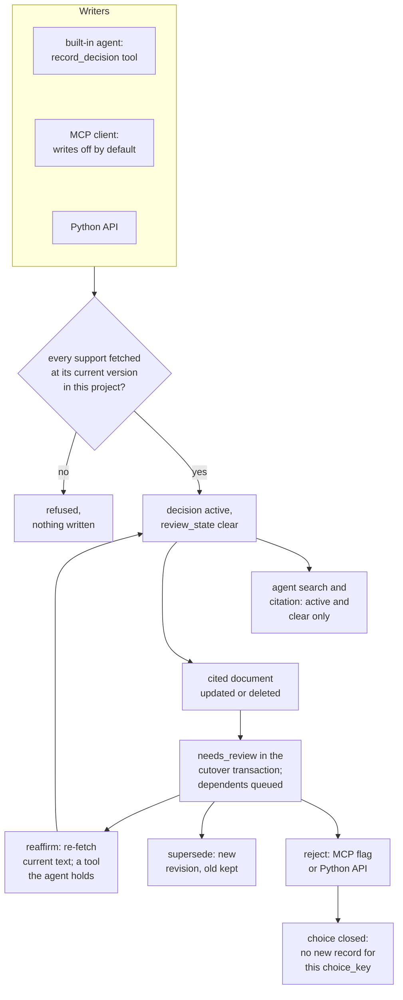

## 1. Executive Summary

Agentic GraphRAG is a Python framework from ontogr that ingests documents into a
schema-shaped knowledge graph on Neo4j or FalkorDB. It stores what an agent did
with that graph as tasks, events and decisions. A built-in LangGraph agent and an
MCP server share one set of tools for search, exact-passage fetch, navigation,
citation checking, history and decisions.

What is notable is the decision layer. A decision is recorded only when every
document it cites was fetched in the same run at its current version. When a
cited document changes, the cutover that activates the new version flags the
decision for review in the same transaction. Until someone re-reads the current
text and reaffirms, the agent's search leaves it out and the agent cannot cite
it. Scope is a predicate on every evidence query, and the suite proves it
against populated decoys.

What is weak is who does the reviewing. `reaffirm_decision` is a tool on the
built-in agent, so the model that wrote a decision can clear its own review
flag after re-fetching. Rejecting an extraction candidate stops it being queued
again and does not stop the same value entering the graph. The graph keeps one
clock.

**Licence.** Apache-2.0, in `LICENSE` and `pyproject.toml`, which agree. The
FinanceBench example under `examples/eval/financebench/` carries its own
CC BY-NC 4.0 licence file, so that dataset is not usable commercially.

## 2. Mental Model

There are three kinds of stored thing, and only one of them is an agent's
belief. Document structure and extracted entities are the corpus. Task events
are a log of what happened in a run. A **decision** is the agent's conclusion:
a `choice_key` within a task, a conclusion and rationale, assumptions, open
questions, and up to 20 typed supports pointing at passages, task events or
earlier decisions (`agrag/decisions.py:924-976`).

A decision has two state fields. `status` is `active`, `rejected` or
`superseded`; `review_state` is `clear`, `needs_review` or `unknown`
(`agrag/common/data_models/decision.py:25-43`). The docstring is precise about
the second: `needs_review` *"does not mean the decision is false"*, and
`unknown` is treated as needing review.

A belief becomes trusted by being recorded against current evidence. It stops
being trusted in three ways: a cited document changes, a dependency is flagged,
or a reviewer rejects or supersedes it. A flagged decision returns to `clear`
only through `reaffirm_decision`, which requires a fetch of every cited
document at its current content hash (`agrag/decisions.py:876-893`).

A rejected decision closes its choice. `_record` refuses a new decision for a
`(task, choice_key)` that has any revision, and supersede needs an active one,
so nothing more can be recorded for that choice in that task
(`agrag/decisions.py:636-641`).

## 3. Architecture

The library is the system. A deployment needs a graph database (Neo4j or
FalkorDB), optionally a vector store (Qdrant, Milvus or Weaviate; otherwise
vectors live in the graph), an embedder, and an LLM for the parts that use one.
GLiNER runs locally and needs no key; an LLM is needed for hybrid extraction,
community reports, the resolver's last tier and the built-in agent.

Ingestion goes through Docling into a document hierarchy, then chunking,
extraction, entity resolution and storage inside a cutover job, so a new
version becomes visible in one transaction (`agrag/ingestion/_cutover.py`).
The `agrag-mcp` entry point starts the MCP server (`pyproject.toml:87-88`). It
refuses to start without a document scope, and it refuses writes unless a
trusted project id and agent id are configured (`agrag/mcp_server/settings.py:71-84`).

Operating it means running a graph database and keeping a schema. The schema
is the ontology the extractor, the graph labels, the retrieval queries and the
agent all read, and changing it is a reviewed patch.

## 4. Essential Implementation Paths

- **Ingest.** Docling parts become a Document, Sections, Chunks, Tables and
  Figures joined by `HAS_CHILD` and `HAS_PART`; each `HAS_PART` edge carries
  `valid_at` stamped at ingest and `invalid_at` set when a later version
  closes it (`agrag/ingestion/_lexical_backbone.py:43-60`,
  `agrag/cypher/relations.py:100-118`).
- **Extract.** GLiNER keeps spans above each label's cut; spans in the band
  below it and relations below their cut or off the schema's allowed pairs
  become candidates (`agrag/ingestion/_gliner_decode.py:182-190`, `:240-268`).
- **Activate.** The cutover records an activation and runs
  `flag_decisions_for_activation_query`, which flags every active decision
  with a current document support on that document whose recorded activation
  sequence differs, or whose document was deleted or purged
  (`agrag/cypher/documents.py:139-170`, `agrag/ingestion/_cutover.py:524-530`).
- **Run.** The agent loads the task view, marks interrupted steps, expands at
  most 20 queued review units, records the user message as an event, and
  reuses completed step results that are still valid
  (`agrag/agents/build.py:165-180`).
- **Decide.** `record_decision` resolves supports inside one transaction and
  refuses a document support not fetched with status `ok`, an event support
  outside the project, and a decision support that is not active
  (`agrag/decisions.py:924-976`).
- **Review.** `reaffirm_decision`, `supersede_decision` and `reject_decision`
  (`agrag/decisions.py:190-314`); `continue_decision_review` expands queued
  units one dependency hop at a time (`:326-357`).

## 5. Memory Data Model

A `Task` node under a `Project` holds an ordered event log (`message`,
`tool_call`, `tool_result`, `note`) with a sequence number and payload hash per
event, and named `Step` nodes with a state and an optional result. A
`Decision` hangs off its task by `MADE`; each `DecisionSupport` node records
its kind, target, ordinal, `current` flag and, for a document, the content
hash and activation sequence it was recorded against. Supersession links the
new revision to the old by `SUPERSEDES`, and the old keeps its node.

The decision row stores `author`, `rejected_by` and the reviewer as the
configured `agent_id`, not as a verified principal (`agrag/decisions.py:653-673`,
`:837`, `:855`). Every task, decision and support query carries `project_id`.

Extraction candidates are `Candidate` nodes keyed by
`kind|normalized label|normalized text or endpoints`, where normalization
folds case, accents, punctuation and a leading English article
(`agrag/common/data_models/candidate.py:32-55`). Their state is `pending`,
`approved` or `rejected`. `Candidate` is a reserved label that no schema may
declare (`agrag/cypher/entities.py:73`, `:91`).

## 6. Retrieval Mechanics

Passage search is lexical, semantic or hybrid with an optional reranker over
the top hybrid results. Every evidence query restricts to documents in
`$scope_ids` and to parts with an open `HAS_PART` edge, so superseded and
deleted text drops out (`agrag/cypher/evidence.py:34-43`). Entity search runs
per schema label and returns an entity only if it has a passage in scope;
relation expansion returns, per relation, up to a limit of in-scope supporting
passages and marks a relation with none as a bare connection
(`agrag/cypher/evidence.py:371-393`, `:416-448`). Theme search matches the
query to embedded community reports and returns the in-scope passages behind
each theme, never the report text (`agrag/cypher/community_read.py:82-115`).

Fetch is by evidence id and returns the version the id names. An id from
before an edit returns the old text marked superseded; an out-of-scope id
answers exactly as a missing one does. The citation check flags any cited id
the run did not fetch, that is out of scope, or that is malformed.

Decision search is full-text over conclusion and rationale, filtered to
`status = 'active'` and the project (`agrag/decisions.py:484-521`). The agent's
tool then drops any hit whose review state is not `clear` or whose supports
are not all current (`agrag/agents/tools/core.py:431-446`). The MCP tool calls
the library directly, so an MCP client receives `needs_review` decisions with
their state in the payload (`agrag/mcp_server/read_tools.py:285-293`). Neither
filters by document scope.

## 7. Write Mechanics

Writes are synchronous graph transactions. An event append allocates its
sequence and creates the event in one write callback; a decision write, its
supports and its review flag share one transaction, and a request id makes a
retry return the stored result of the first call (`agrag/decisions.py:1068-1118`).
A decision written while one of its fetched documents changed is recorded with
`review_state = 'needs_review'` and reason `source_changed_during_recording`
(`:650-652`).

Extraction runs during ingestion, not during a conversation. In `hybrid` mode
the LLM reads only the chunks GLiNER is least sure of, within a budget, and its
labels are built from the schema at call time. Ingestion blocks until the
cutover commits; a passage is searchable once its version is active.

Review propagation is lazy and bounded. The direct flag is written in the
cutover; flags reach dependent decisions only when `continue_decision_review`
runs. While any propagation is pending, the project carries
`review_incomplete`, and every decision whose own state is `clear` reads as
`unknown` (`agrag/decisions.py:111-124`), which the agent's filters treat as
not clear.

Rejecting an extraction candidate writes its state. Before the next upsert,
`blocked_candidate_keys` drops candidates whose key has a committed reviewed
row, and the upsert query checks again under the key's lock
(`agrag/ingestion/_candidate_stage.py:206-213`, `agrag/cypher/candidates.py:44-92`).
The entity and relation writers do not read candidate state, so a later chunk
where GLiNER scores the same span above its cut writes the entity.

## 8. Agent Integration

The built-in agent exposes evidence tools, history tools and decision tools:
`record_decision`, `supersede_decision`, `search_decisions`,
`list_decisions_for_review`, `reaffirm_decision` and `continue_decision_review`
(`agrag/agents/tools/core.py:550-572`). It has no reject tool, and its prompt
says *"You cannot reject a human decision"* (`agrag/agents/prompts.py:31`).
Its decision-support check refuses a cited decision that is not active and
clear, or whose supports are not all current (`:595-612`).

The MCP server starts read-only. Writes need `MCP_READ_ONLY=false` with a
trusted project id and agent id; `reject_decision` is registered only with
`MCP_ALLOW_REJECT` (`agrag/mcp_server/write_tools.py:263-280`). The document
scope is configuration, and no tool takes a scope argument.

## 9. Reliability, Safety, and Trust

### What clears a review flag

`reaffirm_decision` refuses unless every document the decision cites is live
and was fetched in this session at its current content hash, and unless no
decision it depends on still needs review. It replaces the document supports
and records the caller as reviewer (`agrag/decisions.py:259-314`, `:765-875`).
The check is mechanical. It proves the current text was read, not that anyone
judged it, and the built-in agent holds the tool
(`agrag/agents/tools/core.py:519-541`). The integration tests cover the
refusals: a reaffirm without a current fetch keeps the flag, a removed document
cannot be revalidated, and a reaffirm is refused while a dependency needs
review (`tests/integration/graphdb/history/test_decision_review.py:382-433`,
`:529`).

### What a rejection stops

A rejected decision closes its `(task, choice_key)` for good. A rejected
candidate stops the same key being queued for review again. Neither is keyed
on the rejected value. A different task can record the same conclusion, and a
confident extraction writes the value a reviewer rejected as a candidate.

### What the reads leave out

- **Decision search** filters by project and not by document scope, so a
  decision whose supports are outside a caller's scope returns its conclusion
  and rationale. A fetch of its support ids answers unavailable.
- **MCP decision search** labels `needs_review` and `unknown` rather than
  dropping them; only the built-in agent's tool drops them.

### Marks

- **`trust_state`** — awarded on decision `status` and `review_state`.
  Rejected and superseded decisions are out of every search and cannot be
  cited; `needs_review` and `unknown` are out of the agent's search and
  citations, and labelled on MCP.
- **`scope_enforced`** — awarded on `$scope_ids` in every evidence query and
  `project_id` on every history query, both from configuration. Decision search
  is the gap.
- **`human_review`** — awarded on the candidate queue. Model output below the
  confidence cut or off the schema's pairs waits outside search, and only
  `approve_candidates` turns it into graph content, through a schema patch.
  The agent and the MCP server cannot reach it. Decision review is not on this
  mark, since the agent can reaffirm.
- **`negative_eval`** — awarded; see section 10.
- **`tombstone`** — withheld. The two rejection records close a choice slot and
  a review question, not a value.
- **`bitemporal`** — withheld. `valid_at` and `invalid_at` on `HAS_PART` are
  both stamped from the clock at ingest and cutover, one record-time axis, and
  decisions carry `created_at` only.
- **`audit_log`** — withheld. Task events log the agent's work, and
  `reaffirm_decision` appends a note event (`agrag/decisions.py:867`), but
  reject and supersede write no event, and `delete_task` removes a task's
  events and decisions together (`agrag/history/retention.py:96-158`).
  Superseded decisions and closed `HAS_PART` edges keep history as state, not
  as a mutation record.

### Other risks

- **Redaction and deletion** are Python-only (`redact_event`, `delete_task`),
  and dependent decisions in other tasks are flagged `needs_review` rather
  than left citing a deleted event.
- **FalkorDB** can retain earlier statements when a later statement in a write
  fails, so a failed multi-statement history write may leave partial state; the
  module says so (`agrag/history/tasks.py:1-8`).

## 10. Tests, Evals, and Benchmarks

The suite has 2,313 pytest functions, 1,708 unit and 605 integration. The
integration workflow runs on push, pull request and nightly against Neo4j,
FalkorDB and the vector stores as services (`.github/workflows/integration.yml:3-10`,
`:44-110`). I ran none of it.

`negative_eval` rests on two populated cases:

- `tests/integration/retrieval/evidence/test_search.py:750-790` ingests 90
  decoys whose text ranks above the target — 30 out of scope, 30 deleted, 30
  superseded — and one live passage, and asserts the hits are exactly the live
  document.
- `tests/integration/retrieval/evidence/test_entities.py:410-434` asserts an
  entity whose only passage is out of scope is absent, and the same query with
  that document in scope returns it.

The decision lifecycle has its own integration file: activation and purge
flags, propagation to dependents, a rejected parent making descendants
`unknown` until propagation runs, and the reaffirm refusals
(`tests/integration/graphdb/history/test_decision_review.py:58-632`). No test
asserts that a rejected candidate's value stays out of the graph, which
section 7 shows it does not.

The committed benchmark records are five lite runs of one or two questions
each, on FinanceBench, GraphRAG-Bench, BEAM, LegalBench-RAG and HealthBench,
with traces (`benchmarks/results/lite/`). They show the harness runs; they are
not an evaluation. No paper is associated with the project.

## 11. For Your Own Build

### Steal

- **Record a decision against the version it read.** Store the content hash
  and activation sequence on each document support, and flag the decision in
  the same transaction that activates a new version. A stale conclusion then
  announces itself instead of waiting to be found.
- **Make clearing a flag cost a re-read.** Reaffirm only with a fetch of every
  cited document at its current hash, and refuse while a dependency is still
  flagged.
- **Read as unknown while propagation is pending.** A bounded, restartable
  propagation is cheap if every `clear` decision reads as `unknown` until it
  finishes.
- **Make scope configuration, not an argument.** No tool takes a scope, and an
  out-of-scope id answers exactly as a missing one.

### Avoid

- **A review verb on the reviewed party's surface.** The agent that records a
  decision can reaffirm it; a person-only review needs the verb off the agent's
  tools or an actor check.
- **A rejection keyed on the question.** Closing a review slot or a choice key
  does not stop the value; key the refusal on the value and consult it in the
  writer.
- **A precedent search outside the evidence scope.** Filter decisions by the
  scope of their supports, or a narrowly scoped session reads conclusions drawn
  from documents it may not see.

### Fit

This fits a team that already has an ontology and wants agents to answer from
a document corpus with citations that can be checked, and to keep conclusions
that go stale when the documents move. It suits work where the risk is acting
on an outdated decision rather than forgetting a preference. Walk away if you
want conversational memory of a user: there is no profile, no preference store
and no fact extracted from a conversation. Walk away too if a person must sign
off each conclusion, since the review flag is the agent's to clear.

## 12. Open Questions

- Whether `reaffirm_decision` is meant to stay on the built-in agent, given the
  prompt's line that it cannot reject a human decision.
- How the rejected-candidate key is meant to interact with later confident
  extractions of the same span.
- What the full benchmark runs show; the README does not publish numbers, and
  the committed records are lite runs.

## Appendix: File Index

- Decisions: `agrag/decisions.py`, `agrag/common/data_models/decision.py`,
  `agrag/cypher/decision_review.py`, `agrag/cypher/history.py`
- History: `agrag/history/tasks.py`, `agrag/history/retention.py`
- Candidates: `agrag/candidates/review.py`, `agrag/cypher/candidates.py`,
  `agrag/common/data_models/candidate.py`, `agrag/ingestion/_candidate_stage.py`,
  `agrag/ingestion/_gliner_decode.py`
- Versions and cutover: `agrag/ingestion/_cutover.py`,
  `agrag/ingestion/_lexical_backbone.py`, `agrag/cypher/documents.py`,
  `agrag/cypher/relations.py`
- Retrieval: `agrag/cypher/evidence.py`, `agrag/cypher/community_read.py`,
  `agrag/evidence/`
- Agent and MCP: `agrag/agents/tools/core.py`, `agrag/agents/build.py`,
  `agrag/agents/prompts.py`, `agrag/mcp_server/settings.py`,
  `agrag/mcp_server/read_tools.py`, `agrag/mcp_server/write_tools.py`
- Tests: `tests/integration/retrieval/evidence/test_search.py`,
  `tests/integration/retrieval/evidence/test_entities.py`,
  `tests/integration/graphdb/history/test_decision_review.py`

### Recorded searches

Run from the repository root at the pinned commit with `/usr/bin/git grep`.

- **No validity-time field.**
  `git grep -n -i -E 'valid_from|valid_to|valid_until|as_of|event_time|occurred_at' -- agrag`
  returns nothing; `git grep -n -E '"valid_at": |r\.invalid_at = ' -- agrag`
  matches `agrag/ingestion/_lexical_backbone.py:54`, stamped from
  `datetime.now`, and `agrag/cypher/relations.py:112`, whose `$closed_at` is
  `datetime.now` at `agrag/ingestion/_document_lifecycle.py:213`.
- **The entity writers do not read candidate state.**
  `git grep -l -E 'CANDIDATE_LABEL|blocked_candidate|candidate_key\(' -- agrag`
  lists the candidate modules, the store, the schema, document cleanup, vector
  targets and `agrag/cypher/entities.py`, where the label appears only as a
  reserved name at lines 73 and 91.
- **Candidate review is off the agent and MCP surfaces.**
  `git grep -n -E 'approve_candidates|reject_candidates|list_candidates|candidate_patch' -- agrag/agents agrag/mcp_server`
  returns nothing; the same pattern over `agrag/candidates` matches six lines.
- **Decision reads carry no document scope.**
  `git grep -n 'scope_ids' -- agrag/decisions.py agrag/cypher/history.py agrag/cypher/decision_review.py`
  returns nothing; `git grep -c 'scope_ids' -- agrag/cypher/evidence.py`
  counts 11.
- **Retention is Python-only.**
  `git grep -n -E 'delete_task|redact_event' -- agrag/agents agrag/mcp_server`
  returns nothing.
- **Only reaffirm writes a note event.**
  `git grep -n '_append_note(' -- agrag/decisions.py` matches line 867, inside
  `_reaffirm`, and the definition at 895.
- **No paper.** `git grep -n -i -E 'arxiv|bibtex|CITATION\.cff' -- README.md`
  matches only the GLiNER citation at line 364, and the tree has no
  `CITATION.cff`.

## History

**2026-11-19** — [`757b77bdf51b32d5bbe433ee3a685f04150a8619`](https://github.com/ontogr/agentic-graphrag/commit/757b77bdf51b32d5bbe433ee3a685f04150a8619) — first reading, from a full clone of `main` at release `v0.0.7`, scoped to the decision, history, candidate, versioning, retrieval-scope, agent-tool and MCP paths and their tests; the document loaders, resolution tiers and community detection were read only where they write what those paths read. Screened first: no auto-run surface; fifteen build-time execution points, fourteen `conftest.py` files and a Makefile; one unpinned surface, the docs site's `package.json`; nothing inside the cooldown. Apache-2.0, no rider. Nothing installed, built or run. Four marks: `trust_state`, `scope_enforced`, `human_review`, `negative_eval`.
