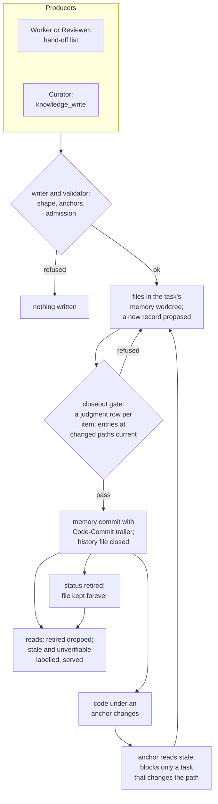

## 1. Executive Summary

Agents Remember is a local system for coding agents that keeps a repository's
memory in a second Git repository. Each source file has a Markdown card at its
own path, and shared rules are JSON records under `knowledge/`. A Python MCP
server reads and writes them, a Paseo host runs Architect, Worker, Reviewer and
Curator agents, and a dashboard shows each change with the knowledge it reaches.

What is notable is the anchor and the gate. Every citation, realization and
proof in a card's sidecar records a path, a locator, a Git blob and a content
hash, so a read reports each rule as `current`, `stale`, `unverifiable` or
`unrealized` at the code the caller sees. Closeout refuses while any change the
worklist sees lacks a written judgment, or while an entry at a path the task
changed is stale.

What is weak is what "verified" covers. A current anchor proves the cited code
did not change, not that the card describes it truly. A stale anchor outside a
task's diff never blocks, and the writer accepts any caller holding a contract.

**Licence.** The host every role agent needs is covered by nothing in the tree.
An install downloads Paseo, pinned at 0.15.4 in
`mcp/src/agents_remember/package_data/paseo_host/package-lock.json`, and no
`@getpaseo` entry in that lockfile, seven in all, carries a `license` field; no
file states Paseo's terms. The repository itself is MIT, with `LICENSE`
(copyright 2026 Readone Mohamed) and `mcp/pyproject.toml` agreeing, and the
canvas kits under `package_data/canvas/kit/` carry their own MIT files.

## 2. Mental Model

A memory here is a claim about code that names where it holds. There are two
shapes. A **card** is prose about one file, its numbered citations bound by the
sidecar to anchors (`docs/concepts.md`, Card and Anchor). A **record** is one
shared truth with a stable id, a revision that rises when meaning changes, and
a status (`mcp/src/agents_remember/models/knowledge_files/records.py:1-21`).
An invariant states a rule; card sidecars say which code realizes it and which
test proves it.

Record status is `proposed`, `accepted` or `retired` for invariants, families
and facet kinds, and `active` or `under_reconsideration` for decisions
(`records.py:57-59`). A new record starts `proposed`
(`mcp/src/agents_remember/application/knowledge_writer/authoring.py:425`,
`:457-458`). No read path distinguishes `proposed` from `accepted`; `retired`
is the state that withholds.

Currentness is a second axis, derived per read and never stored. An entry is
`current` when the file's blob is unchanged or the resolved range has the
recorded content, `stale` when the content differs, the symbol does not bind
once, or the file is gone, and `unverifiable` when it cannot be resolved
(`mcp/src/agents_remember/application/knowledge_currentness/observe.py:9-20`).
An invariant takes the worst state of its entries, and is `unrealized` when it
has no realization (`knowledge_currentness/state.py:60-70`). The docstring says
what reads do with it: a stale invariant *"stays in the answer"* and *"nothing
is withheld"* (`state.py:16-18`).

A claim becomes published memory only through closeout. A record stops being
in force by `status: retired`; it is never deleted, and the validator refuses a
tree that lacks a record its base held
(`mcp/src/agents_remember/memory_quality/knowledge_validator/rules_admission.py:32-34`).
A decision's rejected alternative can be reopened when the code it is linked to
changes: the Curator answers `still_rejected` or `raise`, and `raise` sets the
decision `under_reconsideration` with a question for the developer
(`knowledge_writer/reconsideration.py:1-20`).

## 3. Architecture

The package `agents-remember-mcp` (`mcp/pyproject.toml`) provides two commands:
the MCP server that a harness starts over stdio, and `agents-remember`, which
runs the dashboard on `127.0.0.1:8765` and the knowledge CLI. A settings file
names a workspace root, a coordination root and the code repositories
(`docs/architecture.md`). The coordination root holds `memory-repos/ar-<id>`,
one memory repository per code repository, plus task documents, enclosures
(paired code and memory worktrees per task), logs and runtime caches.

Paseo is the host that runs role agents as chats of Claude Code, Codex, Hermes
or Pi on `127.0.0.1:8766`. The first `role_start(role="bootstrap")` downloads
it. The tool server and dashboard run without it; starting a role does not.

Persistence is text in Git. The one database is the knowledge index, an SQLite
file per memory tree and build under `runtime/knowledge-index/`, derived from the
files and rebuilt when the tree or the package source changes
(`docs/reference/knowledge-system.md`, Derived index and reads). Anchors are
parsed with tree-sitter grammars for Python, TypeScript and JavaScript, pinned
tightly because node type names are the API (`mcp/pyproject.toml`).

### Deployment and ergonomics

It needs Linux on x86_64 (WSL counts), Python 3.14, uv, Git and a logged-in
harness. No API key is needed to store anything; the models are the harness's.
The store is human-readable Markdown and canonical JSON, repairable by hand,
with every record change in the memory repository's Git log. The cost is the
workflow: a task is a requirement packet, an enclosure, four roles and a
closeout, and memory reaches the shared line only through that path.

## 4. Essential Implementation Paths

- **Write.** `knowledge_write` is registered on the MCP server beside
  `knowledge_read` (`mcp/src/agents_remember/mcp/registration/knowledge.py:141-186`).
  It refuses a blank `authorizationRef` and otherwise runs the same body as
  `agents-remember knowledge-ingest`
  (`mcp/src/agents_remember/mcp/tools/knowledge.py:1809-1835`,
  `mcp/src/agents_remember/application/knowledge_write_route.py:295-320`).
  Without `commit` it plans; with it, it writes files and commits nothing.
- **Author.** `_invariant_document` copies the hand-off's statement, scope,
  admission and status; `_attaches_to_retired` refuses a change attached to a
  retired invariant; `_remove_record` removes only a dependent record
  (`knowledge_writer/authoring.py:388-434`, `:479-506`).
- **Observe.** `observe_entry` compares a recorded anchor with one code tree
  and caches the observation by blob, locator and extractor version
  (`knowledge_currentness/observe.py:242-273`).
- **Read.** `read_ar_files_tool` names the governing card and the records of up
  to 20 paths, with counts by state and the non-current records listed
  (`mcp/src/agents_remember/application/read_files.py:1-18`,
  `application/read_file_cards.py:151-219`). The leaf selection walks one family
  hop from a path's invariants and skips retired records
  (`application/knowledge_leaf/selection.py:1-11`, `:243`, `:254`, `:261`).
- **Gate.** `judge` turns a recomputed worklist into findings: an item with no
  current row, an incomplete run, a refusing validator violation, and a stale
  entry at a changed path (`application/knowledge_gate/gate.py:419-450`,
  `:389-416`). `net_stale_entries` limits the last to paths the net code diff
  changed (`application/knowledge_gate/landing.py:688-718`).
- **Commit.** `worktree_closeout_apply` takes a required `intent_note` and
  commits code and then memory
  (`mcp/src/agents_remember/mcp/registration/closeout.py:113-137`).

## 5. Memory Data Model

An anchor is a path, a locator (a symbol, a line range or the whole file), the
file's Git blob and a hash of the content at the locator. A sidecar's
`references` bind numbered markers in the card to anchors or records;
`realizes` and `proves` entries bind anchors to invariants
(`docs/reference/knowledge-system.md`, Files and ownership).

An invariant record holds a statement, applicability, conditions, exclusions,
`supersedes` and an admission criterion; it lists no locations, because a
relationship has one owner (`records.py:124-145`). A family owns its members and
routes. A decision holds a context, at least two alternatives with exactly one
`chosen`, a reason each, and a `reconsider_when` for each rejected or deferred
one (`records.py:170-200`). An incident's `observed_at` is a free label.

Records carry `origin` (task, leaf or wave) and no recording time: the index
projects the epoch as `recorded_at` and says no reader may read it as one
(`mcp/src/agents_remember/memory/knowledge_index/projection.py:20-22`, `:77`).
Time is the memory commit, and each memory commit names the code commit it
describes in a `Code-Commit` trailer, which the dashboard reader uses to measure
an old memory commit against its own code
(`application/knowledge_reader/selection.py:14-18`).

Judgment rows live in `knowledge/history/<owner>.json`. Row kinds and their
dispositions are fixed: an invariant is `changed`, `moved`, `deleted`,
`extended` or `no_impact`; a family adds `rerouted`, `assigned` and `retired`;
a card is `updated` or `no_impact`; other records are `changed`, `retired` or
`no_impact` (`models/knowledge_files/history.py:102-110`).

Scope is the directory. There is one memory repository per configured code
repository, and `require_repo` refuses an unlisted `repo_id`
(`mcp/src/agents_remember/kernel/authority.py:20-28`). No record carries a scope
key.

## 6. Retrieval Mechanics

There is no search. An agent holding a file opens the card at the mirrored path
under `onboarding/`, and `read_ar_files` adds the governing route overviews, the
card's invariants by state, and the non-current ones by id and card heading.
Both it and `knowledge_read` return locations and states, never text; the agent
reads the files itself (`read_files.py:1-18`). The two search providers the
install copies are files only: *"nothing starts, indexes or queries them"*
(`docs/architecture.md:118`).

`knowledge_read` serves views over the index: source context, invariant,
family, record, open weaknesses and dependents. Its memory tree is a path the
caller supplies, and any directory holding `knowledge/layout.json` is accepted
(`registration/knowledge.py:74-75`, `tools/knowledge.py:645-658`). Currentness is
measured at the commit for a clean checkout and at the working tree otherwise,
and the answer says which.

Retired invariants and families are not projected into the tables the reads
select, a retired member is left out of its family, and a realization of a
retired invariant is not projected (`projection.py:23-30`, `:108-115`). The index
still answers the retired record by id, labelled `retired`. The filter governs
the tool answers. An agent that greps the memory repository as text, which the
skill recommends when it knows a concept and no file, finds the retired file
with its status in it.

Answers are bounded: 20 paths per `read_ar_files`, 32 rows by default per
`knowledge_read` page, and a list cap on every answer, with the whole result in
a file the answer names.

## 7. Write Mechanics

Memory is written by an agent, deliberately. The Worker and Reviewer hand the
Curator lists of what changed; the Curator authors cards, records and judgment
rows and passes them to `knowledge_write`. The writer refuses in the same run
each row the gate would refuse, writes nothing on a refusal, and undoes a write
that fails part-way (`docs/reference/knowledge-system.md`, Writes and producer
lists). No LLM runs inside the server.

The write does not block on extraction: it is a synchronous file write and a
validation against the exact code and memory trees. A card is readable in the
task's worktree at once, and by other tasks only after closeout and landing on
the master's line. Nothing rewrites the whole store in the background. The
index is rebuilt for a tree the first time it is read, so its cost scales with
the tree and recurs after every memory change.

Deletion is not available for records. A record leaves use by `retired`; only a
dependent record goes, with the document it described
(`authoring.py:479-506`). A history file closed by a closeout is frozen, and a
reopened task writes an attempt-numbered successor.

Conflict between branches is a structural merge: Markdown by line, sidecar
references by number and entries by id, records by field. A field changed
differently on both sides stays a conflict for the Curator
(`docs/reference/knowledge-system.md`, Memory merges in a sync).

## 8. Agent Integration

The agent's memory surface is MCP. Reads are `read_ar_files`, `knowledge_read`,
`knowledge_diff` and `context_packet`; checks are `memory_quality_check` and
`knowledge_integrity_check`; the write is `knowledge_write`. The role
instructions are a skill, `l-01-agent-lifecycles`, served from the package and
delivered to each role agent in its first message.

Nothing is injected automatically per turn. The role capsule tells the agent
which files to read and when, and the agent decides what to open. A harness
without Paseo can still use the reads and the writer; the role workflow needs
the host.

Adapting it means adopting the workflow. The memory format is independent of
it, and the anchor and currentness code reads only Git objects, so the
observation is the part another agent could take as it stands.

## 9. Reliability, Safety, and Trust

### What "Git-verified" checks

The check is a content comparison. An entry is current when the file's blob is
the recorded one, or when the range its locator resolves to in the new blob has
the recorded content hash (`observe.py:9-20`). At commit and landing a reference
anchor is stale when only its file's blob changed (`docs/concepts.md`, Anchor).
That proves the cited code has not moved since the card was written. It proves
nothing about whether the prose describes that code, and a card wrong on the
day it was written reads `current` until the code changes.

### What the gate blocks

The README says a task *"neither closes out nor lands with memory that holds a
stale anchor"* (`README.md:68-71`). The gate is narrower. It refuses a stale or
unverifiable entry at a path the task's own net code diff changed
(`landing.py:688-718`). An anchor made stale by a commit that did not go
through a task, or by a task that changed a different file, is labelled on
every read and blocks nothing until some task changes that path. A master's
recorded landing keeps such an entry as debt when it is the only finding.

### Who writes memory

*"Only the Curator writes memory"* (`docs/architecture.md:245`) is an
instruction. `knowledge_write` reads no seat binding, and its one authorization
check is that `authorizationRef` is not blank (`tools/knowledge.py:1829-1832`).
The role capsule adds that when every admitted route refuses a write, the agent
should *"make that write openly by hand and log it"*
(`mcp/src/agents_remember/cli/role_launch_preparation.py:362`). The validator and
the gate still run at closeout, so a hand-written file has to pass them.

### Marks

- **`trust_state`** — awarded on record `status`. `retired` withholds a record
  from every index-backed read and the file stays. The producer is the
  Curator's hand-off through `knowledge_write` (`authoring.py:425`). `proposed`
  is the default and is served as `accepted`, and currentness is derived and
  labelled, so the mark rests on retirement alone.
- **`audit_log`** — awarded on the judgment rows. Every item the worklist
  raises needs a current row before closeout, and R22.7-history-frozen refuses a
  changed or deleted closed file at every commit route
  (`rules_structure.py:138-157`). The rows are authored, not generated from the
  diff, carry no time, and are raised by changed code and records: card items
  come from changed source files
  (`mcp/src/agents_remember/worktrees/modules/onboarding_trace.py:6-11`).
- **`negative_eval`** — awarded; see section 10.
- **`human_review`** — withheld. The developer's `go` is recorded by the
  Architect agent through `task_doc`, and only an Architect seat may write it
  (`application/task_docs/task_doc_content_edits.py:40-47`). It gates a task's
  start, not memory. Closeout takes `intent_note` as a string, and a raised
  decision waits on a question the Architect relays.
- **`tombstone`** — withheld. A rejected alternative is keyed by its index in
  one decision and consulted when its linked code changes; nothing compares a
  new decision's chosen option with it.
- **`scope_enforced`** — withheld. Scope is one repository per directory, a
  physical partition, and `knowledge_read` reads any converted tree it is given.
- **`bitemporal`** — withheld. Records carry no time; the `Code-Commit`
  trailer pairs a memory commit with a code commit, one version axis.

### Other risks

- **Prose outside the anchors.** A card's sentence with no citation marker has
  no anchor and no currentness. The validator checks markers and references,
  not coverage of the prose.
- **The index is a cache keyed by tree and build.** A process whose build
  identity is unknown builds a private index each time
  (`docs/reference/knowledge-system.md`, Derived index and reads).

## 10. Tests, Evals, and Benchmarks

The suite has 8,293 `def test_` functions in 792 test files. The pull-request
workflow runs lint, type and generated-copy checks through
`.githooks/_gate.sh targeted` and no test suite; its header says acceptance is
*"lifecycle-owned"* (`.github/workflows/quality-checks.yml:3-7`, `:59-60`), so
tests run in Dagger at a task's closeout. I ran none of it.

`negative_eval` rests on two populated cases:

- `mcp/tests/test_knowledge_index_surfaces.py:82-118` retires one invariant of
  a reviewed tree and seeds a scope read by its path. The retired revision and
  its realization must not be projected, the sibling invariant must be, and the
  statements returned are exactly the sibling's. The index then answers the
  retired record by id with `status` `retired`.
- `mcp/tests/test_knowledge_reader.py:559-562` asserts the dashboard path view
  lists exactly the two live invariants of a file whose sidecar also holds a
  realization of a retired one (fixture at `:190-192`, `:253-259`).

The frozen history file has its own case: an edit and a deletion of a closed
file are each refused under R22.7-history-frozen
(`mcp/tests/test_knowledge_validator.py:399-414`). No test asserts that a stale
anchor outside a task's diff is reported at closeout, which section 9 shows it
is not.

One benchmark case is committed:
`benchmarks/cases/tensorflow-check-numerics-xla/`, three Codex runs per arm on
19 May 2026 without memory, with memory, and with memory declared current. The
summary records cost only. Runs took 207-254 s without memory, 280-321 s with
it and 207-264 s warm; input tokens were 1,202,850-1,247,262, 913,806-1,265,240
and 825,157-1,007,688. No answer-quality score is in the summary. No paper is
associated with the project.

## 11. For Your Own Build

### Steal

- **Anchor a claim to the bytes it describes.** Store the blob and a content
  hash of the cited range, resolve the range again in the new blob through a
  zero-context diff, and report the claim stale when the content differs. That
  is cheap, offline and deterministic.
- **Derive staleness; do not store it.** Currentness as a function of a memory
  tree and a code tree needs no background job and cannot drift from the code.
- **Retire, never delete, and enforce it.** A validator rule that refuses a tree
  missing a record its base held makes the record set append-only.
- **Freeze the judgment log at publication.** A per-task file of authored
  judgments, closed by the commit that publishes it and refused if changed
  afterwards, is a mutation record a reviewer can read.

### Avoid

- **A gate scoped to the diff, sold as a guarantee.** Checking only paths the
  change touched lets drift on other paths sit labelled indefinitely; state the
  scope, or sweep.
- **A writer whose authority is a string.** Role separation that the writer
  does not check is advice; bind the write to a verified seat or say it is.
- **Instructions to bypass a refusal.** Telling an agent to hand-write what the
  writer refused leaves the validator as the only check.

### Fit

This fits a developer or a small team already running Claude Code or Codex on a
codebase too large for one context, who will accept a task workflow with four
agent roles and a closeout for every change. The benefit is rules that stay
attached to the code across folders, with drift reported mechanically. Walk
away if you want memory of a user or a conversation: there is none. Walk away
too if you will not run Linux, Python 3.14 and a host process, or if your
changes do not go through tasks, because the gate sees only what a task changed.

## 12. Open Questions

- Whether a card edited without a change to its source file raises any
  worklist item, or reaches the official line with no judgment row.
- Whether anything is meant to move a record from `proposed` to `accepted`, and
  what an `accepted` record would then be allowed to do that a `proposed` one
  is not.
- Paseo's licence, which no file in the tree states.
- What the project's public memory repository, `Foxfire1st/ar-agents-remember`,
  shows about how often anchors go stale outside a task; it was not read.

## Appendix: File Index

- Records and sidecars: `mcp/src/agents_remember/models/knowledge_files/records.py`,
  `models/knowledge_files/sidecars.py`, `models/knowledge_files/history.py`,
  `models/knowledge_files/anchor_content.py`
- Writer: `mcp/src/agents_remember/application/knowledge_write_route.py`,
  `application/knowledge_writer/authoring.py`,
  `application/knowledge_writer/reconsideration.py`,
  `application/knowledge_writer/handoff.py`
- Currentness: `application/knowledge_currentness/observe.py`,
  `application/knowledge_currentness/state.py`
- Index and reads: `memory/knowledge_index/projection.py`,
  `memory/knowledge_index/query.py`, `application/knowledge_leaf/selection.py`,
  `application/read_files.py`, `application/read_file_cards.py`,
  `application/knowledge_reader/selection.py`
- Gate and validator: `application/knowledge_gate/gate.py`,
  `application/knowledge_gate/landing.py`,
  `memory_quality/knowledge_validator/rules_structure.py`,
  `memory_quality/knowledge_validator/rules_admission.py`,
  `memory_quality/knowledge_validator/rules_history.py`,
  `worktrees/modules/onboarding_trace.py`
- MCP: `mcp/src/agents_remember/mcp/registration/knowledge.py`,
  `mcp/registration/closeout.py`, `mcp/tools/knowledge.py`,
  `mcp/tools/read_files.py`, `kernel/authority.py`
- Roles: `application/task_docs/task_doc_content_edits.py`,
  `cli/role_launch_preparation.py`, `skills/l-01-agent-lifecycles/`
- Tests: `mcp/tests/test_knowledge_index_surfaces.py`,
  `mcp/tests/test_knowledge_reader.py`, `mcp/tests/test_knowledge_validator.py`,
  `mcp/tests/test_mik_r53_judgment_rows.py`
- Benchmark: `benchmarks/cases/tensorflow-check-numerics-xla/author-results/2026-05-19/summary.md`

### Recorded searches

Run from the repository root at the pinned commit with `/usr/bin/git grep`.

- **No read filters on `proposed` or `accepted`.**
  `git grep -n -E 'state_at_origin[[:space:]]*(=|IN|!=|==)' -- mcp/src/agents_remember/memory mcp/src/agents_remember/application`
  matches only keyword-argument assignments
  (`review_family_rosters.py:410`, `memory/knowledge/records.py:120`, `:176`,
  `projection.py:177`, `:227`). Control:
  `git grep -n -E 'status[[:space:]]*(==|!=)[[:space:]]*_RETIRED' -- 'mcp/src/*.py'`
  matches 10 lines.
- **The writer checks no seat.**
  `git grep -n -E 'read_agent_binding|CURATOR_ROLE|ARCHITECT_ROLE' -- mcp/src/agents_remember/application/knowledge_write_route.py mcp/src/agents_remember/application/knowledge_writer mcp/src/agents_remember/mcp/tools/knowledge.py mcp/src/agents_remember/mcp/registration/knowledge.py`
  returns nothing; the same pattern over
  `mcp/src/agents_remember/application/task_docs/task_doc_tools.py` and
  `task_doc_content_edits.py` matches four lines.
- **No validity-time field on records.**
  `git grep -n -i -E 'valid_from|valid_to|valid_until|valid_at|invalid_at|effective_from' -- mcp/src/agents_remember/models/knowledge_files mcp/src/agents_remember/memory/knowledge_index`
  returns nothing; `git grep -n -i -E 'observed_at' -- mcp/src/agents_remember/models/knowledge_files`
  matches `records.py:211`.
- **A rejected option is read only within its own decision.**
  `git grep -n -E '\.option([^_[:alnum:]]|$)|"option"' -- 'mcp/src/*.py'`
  matches the reader's rendering, the reconsideration item, `remap_links` in
  `knowledge_writer/record_updates.py:65-70`, the alternative-order rule in
  `rules_reconsideration.py:43-44` and a model message; none compares one
  decision's option with another's.
- **No paper.** `git grep -n -i -E 'arxiv|bibtex|@article|@misc|doi\.org' -- README.md docs ROADMAP.md`
  returns nothing, and `git ls-files | grep -i citation` lists only the
  product's citation-check modules and tests.

## History

**2026-11-21** — [`e07c10b3a67036b4187dc2d6629a4c093e13242c`](https://github.com/Foxfire1st/agents-remember/commit/e07c10b3a67036b4187dc2d6629a4c093e13242c) — first reading, from a clone of `main` at release `mcp-v3.0.3`, scoped to the knowledge records, writer, currentness, index, reads, gate, validator, MCP registration and their tests; the dashboard, canvas and host integration were read only where they touch memory. Screened first: one auto-run surface, committed `.githooks/` (inert until `core.hooksPath` points there); four build-time execution points, two provider `setup.py` files, `mcp/tests/conftest.py` and a dashboard `prepare` script; five unpinned surfaces; `mcp/pyproject.toml` and `mcp/uv.lock` inside the cooldown; an `AGENTS.md`, read as data. MIT, no rider. Nothing installed, built or run. Three marks: `trust_state`, `audit_log`, `negative_eval`.
