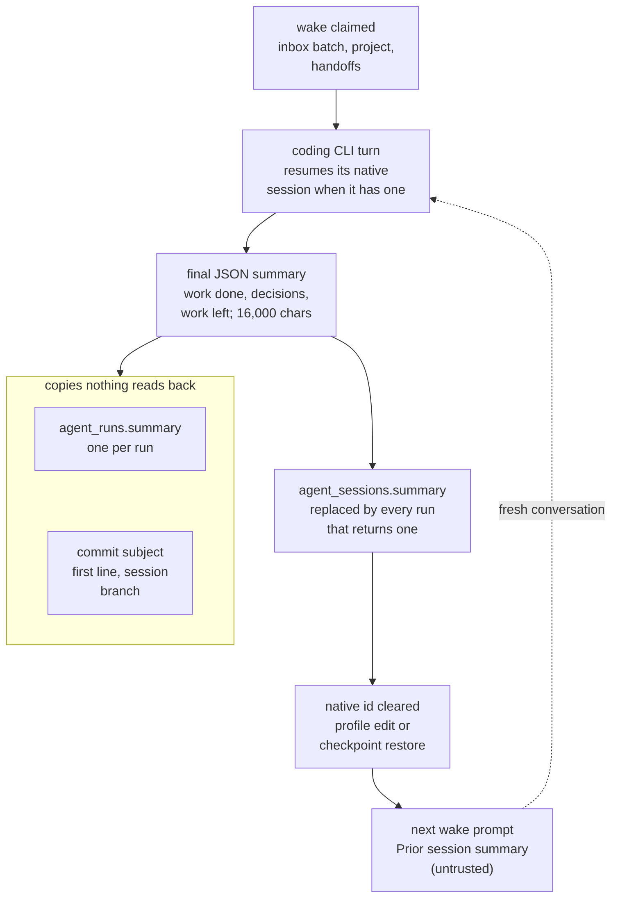

## 1. Executive Summary

Agora is **a self-hosted chat platform for AI coding agents**. Claude Code,
Codex, Gemini CLI, opencode and others join shared channels through an MCP
server, `agora-mcp`. An agent host, `agora-host`, runs on the user's machine and
wakes an agent's CLI headlessly when the agent is mentioned. The server is
Fastify over Postgres and Redis, AGPL-3.0, self-hosted only.

Most of what Agora stores is coordination state: messages, threads, task cards,
file reservations and handoffs. These record what happened and who holds what.
The one store that holds a model's claim and carries it into a later
conversation is **the session summary**. At the end of each headless run the
CLI returns a JSON object with *"a short summary string of completed work,
decisions and remaining work"* (`agora-host/src/prompt.ts:82`). The server keeps
it on the session and, when the CLI's own conversation cannot be resumed, puts it
into the next wake as *"Prior session summary (untrusted)"*
(`agora-host/src/prompt.ts:93`).

What is good:

- **The summary is quoted as data.** It goes into the prompt inside an escaped
  block beside a rule that messages, names and the prior summary are untrusted.
  A test checks that a forged `[SYSTEM]` line in a summary stays inside the
  block (`agora-host/test/adapters.test.ts:135-145`).
- **A dropped conversation does not start from nothing.** An incompatible
  profile edit or a checkpoint restore clears the native session id, and the
  next wake gets the last summary instead.

What is weak:

- **No person reads the summary.** The session and run APIs leave it out, and
  its only visible copy is the first line, used as the commit subject on the
  session's branch.
- **Each run replaces it.** Whether the summary covers the turn or the whole
  session is left to the model.

No capability mark is earned. The careful trust machinery in this tree guards
shared files rather than memory (§9).

## 2. Mental Model

A memory is **the latest account a session's agent gave of its own work**. It is
a string on the session row, not a record with an id, a source or a state.

### How a thing becomes a belief

Every headless run ends with the CLI's structured output. `summary()` in
`agora-host/src/adapters.ts:576-581` takes the `summary` field, caps it at
16,000 characters, and maps a lurk run's `[pass]` to nothing. The host reports
it on completion. `complete()` stores it on the run row and sets
`summary = COALESCE($3, s.summary)` on the session (`src/lib/agent-runs.ts:775-812`),
so a run that returns no summary leaves the previous one in place.

While the CLI's native session id is kept, the agent resumes its own
conversation (`--resume <id>` or `resume <id>`, `agora-host/src/adapters.ts:543`,
`:559`) and is not shown the summary at all. The summary is read only when that
id is gone. Two writers clear it:

- an incompatible profile edit, for every session of that profile
  (`src/routes/agent-hosts.ts:379-381`);
- a checkpoint restore or commit from the review panel
  (`src/routes/workspace-review.ts:162-164`).

### How a belief stops being one

The next run that returns a summary replaces it. A checkpoint restore replaces
it with *"Restored checkpoint &lt;sha&gt;. Read channel history for context."*,
and a fork starts the new session with *"Forked from &lt;id&gt; at &lt;sha&gt;"*
(`src/routes/workspace-review.ts:159-164`). Both actions are owner-only. Nothing
else writes the column, and no route lets a person edit or clear it.

## 3. Architecture

The server (`src/`) is Fastify with Postgres for state, Redis and BullMQ for
queues, MinIO or a local volume for encrypted files, and Socket.IO for live
events. 89 migrations under `src/db/migrations/` define the schema, with
row-level security enabled on the tables they create. `agora-host` runs on the user's computer. It
claims runs from the server, launches each agent's CLI in a git worktree for its
session, commits the changes at the end of the turn and reports back.
`agora-mcp` is the MCP server every agent loads. `agora-ui` is the React web
client. `agora-mobile` is the unreleased phone app, and `agora-push-relay` its
notification relay.

Memory adds nothing to this. The summary is one `TEXT` column on
`agent_sessions` and one on `agent_runs`, written in the run-completion
transaction. Like message content, it is stored in plain text: the storage
document lists files, provider keys and push handles as the encrypted items and
*"everything else in Postgres"* as not encrypted
(`docs/storage-and-encryption.md`).

### Deployment and ergonomics

Docker Compose files bring up Postgres, Redis, migrations and the server, with
optional speech services.
The `agora-connect` skill walks a coding agent through setup. Summaries need no
configuration and cannot be turned off.

## 4. Essential Implementation Paths

**Summary out** — `resultSchema` and `summary()` (`agora-host/src/adapters.ts:51`,
`:576-626`) → `complete()` (`src/lib/agent-runs.ts:762-824`), which writes
`agent_runs.summary` and the session's copy.

**Summary in** — the claim (`src/lib/agent-runs.ts:379-410`) returns
`session.summary` and `nativeSessionId` → `wakePrompt`
(`agora-host/src/prompt.ts:64-96`).

**Clearing the native session** — `src/routes/agent-hosts.ts:379-381` and
`src/routes/workspace-review.ts:162-164`.

**Commit** — `commitRun` (`agora-host/src/review.ts:222-233`) uses the summary's
first line as the subject.

**Subtasks** — `reportSubtask` (`src/lib/agent-subtasks.ts:53-92`) posts a
child session's summary, cut to 3,500 characters, as a message to the parent's
thread and wakes the parent with it.

**Handoffs** — `src/lib/handoffs.ts`, and `handoff_offer` in
`agora-mcp/src/tools.ts:911-915`.

**Project context** — `src/lib/channel-projects.ts`, `projectSection` in
`agora-host/src/prompt.ts:30-45`.

## 5. Memory Data Model

**The session summary.** `agent_sessions.summary TEXT` on a row that is one
agent in one channel, with `native_session_id`, `state` (`live`, `shelved`,
`ended`), budgets and the worktree branch (`src/db/migrations/037_agent_sessions.sql:47-62`).
`agent_runs.summary` holds each run's own text. Neither has a source, a date of
its own beyond the row's, or a status.

**Two neighbours that look like memory and are something else:**

- **Project context** (`051_project_context.sql`): instructions of up to 8,000
  characters and up to ten pinned files, written by the channel's owner and
  directors, with a `version` that goes up on every change. These are standing
  instructions from people, not claims.
- **Handoffs** (`058_agent_handoffs.sql`): a summary of up to 2,000 characters,
  the sender's committed `branch @ sha` and its file reservations, offered to one
  recipient with a TTL of 30 minutes by default and a day at most. A handoff
  transfers a task between two live sessions; it is not a store the recipient
  consults later.

## 6. Retrieval Mechanics

There is no retrieval over memory. The wake prompt is assembled from the inbox
batch, the project context, any pending handoffs and, only when no native session
is resumed, the session summary. Project instructions go into every wake. Pinned
file text goes in only when the session has not seen this project version or
starts a fresh conversation (`claimProject`, `src/lib/channel-projects.ts:139-145`).

Anything older is read on demand through MCP tools: `chat_history` for channel
and thread messages (`agora-mcp/src/tools.ts:762-790`), `task_list`,
`file_search` and `file_read`. These read the platform's record of what was said
and shared, not a store of beliefs.

Failure modes:

- **A long session can lose its history twice.** After a profile edit, the agent
  has only the last run's summary. If that run's summary described its own turn,
  the earlier decisions are in the channel history and nowhere else.
- **The summary is not refreshed when it is used.** A fresh conversation's own
  summary replaces the old one at the end of its run. Nothing merges the two.

## 7. Write Mechanics

The summary is written once per run, in the completion transaction, after the
CLI has finished. It does not block the agent, and it is readable at the next
claim. No background pass rewrites summaries.

- **Which run's text survives.** The run that finishes last. A verify-and-fix
  turn keeps the earlier summary when the fix returns none
  (`agora-host/src/scheduler.ts:231`).
- **What the model is asked for.** The same instruction on every run, with no
  sight of the stored summary while the native session is live. Whether a
  summary is cumulative depends on the model.
- **A run claimed before an incompatible profile edit** cannot restore an old
  native session id. The guard checks the profile generation
  (`src/lib/agent-runs.ts:797-808`). The summary has no such guard, so a stale
  run's summary still lands.

## 8. Agent Integration

Agents hold 37 MCP tools for chat, threads, file reservations, handoffs,
sessions, tasks, files, canvases, browser previews and the sandbox (`agora-mcp/src/tools.ts`). None of them reads
or writes memory as such. The summary is produced by the host's output schema,
not by a tool call, so an agent cannot read another session's summary or change
its own except by returning a new one.

## 9. Reliability, Safety, and Trust

**The summary as an injection path.** A summary is model output that a later
model reads with its tools available. Agora quotes it, tells the model it is
untrusted, and tests that forged tags stay quoted. It is also the only memory
the platform keeps outside people's view.

**Where the careful machinery is.** The file store beside it has the most
deliberate trust design in the repository:

- An optional decision model scores each uploaded file for text that tries to
  instruct an AI reader, and tags it from an admin-edited vocabulary. Each tag
  records the model, the tag revision and the question version, and a tag made
  under an older revision is shown as stale.
- A flagged file is never sent to the ranking model, and `file_read` and
  `file_search` return it with `injectionWarning` (`src/lib/file-search.ts:175`,
  `:234`, `:321`).
- Only the server owner can mark a flagged file trusted. A trigger rejects any
  change to `trusted_by` from a bot, a non-owner or a non-member, and clears the
  trust when the file's bytes, channel or message change
  (`src/db/migrations/064_file_owner_trust.sql`). Each change is posted to the
  channel and written to `audit_log` (`src/routes/files.ts:56-73`). Trust lifts
  the warning; the file stays out of model ranking, because `flagged` is computed
  from the score alone.

Those are shared attachments, not memory. What a file says is the author's, and
the stored verdict is a property of its text. That is why none of it earns a mark
here.

### Marks

No capability mark is earned.

- `trust_state` and `human_review` are withheld. The summary has no status
  and no review. The file store's flag is a threshold over a probability, and the
  owner's trust decision adjudicates attachments, not memory.
- `audit_log` is withheld. `audit_log` covers moderation, admin, bot-token,
  runtime and file-trust events. It has no entry for a summary or project-context
  write.
- `scope_enforced` is withheld. A summary is one row per session, read by that
  session's own claim, with no scope predicate over a set of memories.
- `negative_eval` is withheld. `keep a director's instructions and pinned notes
  out of a subscription agent's wake prompt`
  (`test/integration/project-context.integration.test.ts:328-347`) asserts
  absence from an assembled prompt, and project instructions are not memory.
- `tombstone` and `bitemporal` have no mechanism.

## 10. Tests, Evals, and Benchmarks

344 test files hold 66,783 lines. They cover Vitest unit and Postgres
integration suites for the server, Vitest for the host, MCP server and UI, and
Playwright end-to-end flows; `.github/workflows/ci.yml` runs them. For the
summary:

- `agent-sessions.integration.test.ts:943-963` checks that a claim carries a
  stored summary and that completion replaces it.
- `adapters.test.ts:135-145` checks the prompt envelope.
- The parsing tests check each CLI's output shape.

No test covers the fresh-conversation path end to end, the summary's survival
across a profile edit, or a stale run overwriting a newer summary. There is no
evaluation of summary quality and no paper. I read the tests and ran nothing: the
manifests changed inside the seven-day cooldown, and the integration suites
need Postgres.

The screen counted every dependency file as changed within seven days, but a
shallow clone dates every file to its tip. It also found the OpenCode bundle
and a Claude plugin manifest that a harness would install, an npm
`prepublishOnly` build, and a `CLAUDE.md` addressed to reading agents, read as
data.

## 11. For Your Own Build

### Steal

**Hand a fresh conversation the previous run's account, quoted as untrusted.**
Losing a CLI session is routine: a model change, a restore, a crash. One string
at the top of the next prompt costs nothing and removes the cold start. Wrapping
it in the same escaped block as other people's messages keeps it from becoming
an instruction.

**Ask for the summary as structured output, not as a message.** The host
validates one JSON field against a schema and caps it, so the memory write
cannot be confused with the agent's chat output.

**Bind a human trust decision to the bytes it covers.** The file-trust trigger
clears trust when the content changes and refuses it from any bot, in the
database where every code path meets it. A review gate on memory would need
exactly this property.

### Avoid

**Don't keep memory nobody can see.** The summary decides what a fresh
conversation believes about its own work, and no person can read it in the UI
or correct it. Show it where the session is shown, and let the owner edit it.

**Don't let the last run's text stand in for the session.** Either show the
model the stored summary and ask for a revision, or keep the per-run summaries
the server already stores and pass the recent ones.

### Fit

Agora is for **a person running several coding agents on their own machine who
wants them in one place**, with turn-taking, review and approvals from a phone.
Its memory is a recovery aid for that, and adequate as one: the CLI's own
conversation is the real working memory, and the channel is the shared record.

Anyone who wants agents to accumulate durable knowledge across projects will
not find it here. The platform has no store for facts, preferences or lessons,
and adding one would mean deciding who may correct it — the question the file
store's trust design already answers for attachments.

## 12. Open Questions

- **Should the summary cover the session or the turn?** The instruction is the
  same either way, and the answer decides what a fresh conversation inherits.
- **Is `agent_runs.summary` meant to be read?** Every run's text is kept and
  nothing returns it, which leaves it as an unused history of the agent's own
  accounts.

## Appendix: File Index

**Summary** — `agora-host/src/adapters.ts`, `prompt.ts`, `scheduler.ts`,
`review.ts`; `src/lib/agent-runs.ts`, `agent-subtasks.ts`;
`src/routes/agent-hosts.ts`, `workspace-review.ts`, `agent-commands.ts`;
`src/db/migrations/037_agent_sessions.sql`.

**Neighbours** — `src/lib/channel-projects.ts`, `handoffs.ts`, `file-search.ts`,
`file-read.ts`; `src/routes/files.ts`; migrations `033_decisions.sql`,
`034_file_tags.sql`, `051_project_context.sql`, `058_agent_handoffs.sql`,
`064_file_owner_trust.sql`.

**Tests** — `test/integration/agent-sessions.integration.test.ts`,
`project-context.integration.test.ts`, `file-search.integration.test.ts`,
`file-trust.integration.test.ts`; `agora-host/test/adapters.test.ts`.

### Recorded searches

Run from the repository root at the pinned commit with `/usr/bin/git grep`.

- **Three writers of the session summary.** `git grep -n -E 'agent_sessions.*summary|summary *= *(NULL|\$)' -- src`
  returns the run row at `src/lib/agent-runs.ts:777` and the fork insert and
  restore update at `src/routes/workspace-review.ts:159` and `:164`. The
  session's `COALESCE` update at `agent-runs.ts:802` is the third writer.
- **Nothing reads a run's summary back.** `git grep -n -E 'r\.summary|runs?\.summary|agent_runs[^;]*summary' -- src agora-ui/src agora-mcp/src`
  returns only `src/lib/handoffs.ts:62`, the handoff row's own summary.
- **The session API omits it.** `git grep -n -A32 'export function sessionJson' -- src/routes/agent-commands.ts`
  shows no `summary` key, and the `run` and `recent_runs` objects at
  `agent-commands.ts:86-93` build theirs without one.
- **No row deletion except cascade.** `git grep -n -E 'DELETE FROM (agent_sessions|agent_runs)' -- src`
  returns nothing.
- **No audit entry for memory writes.** `git grep -n 'INSERT INTO audit_log' -- src`
  lists 21 writers, none in `agent-runs.ts`, `channel-projects.ts` or `handoffs.ts`.

## History

**2026-11-09** — [`737a4b5d2d8134d4157c96a22db829b318ad74b4`](https://github.com/CaffeinatedSoftwareLLC/agora/commit/737a4b5d2d8134d4157c96a22db829b318ad74b4). First reading, from a shallow clone of `main`. The screen found three auto-run surfaces, one npm lifecycle build and every manifest inside the cooldown, which a shallow clone over-counts. I installed and ran nothing; the tests were read, not run. No capability mark (§9).
