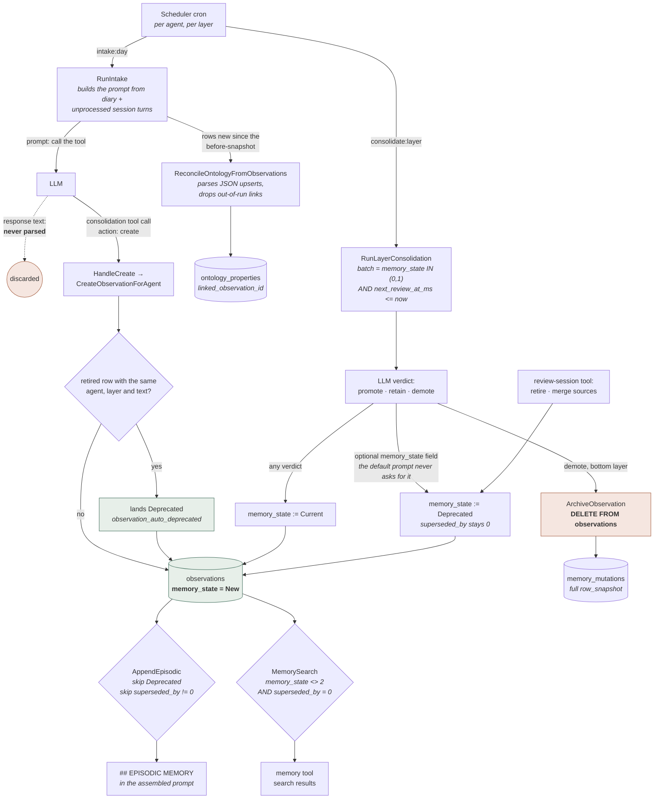

## 1. Executive Summary

Animus is a single-binary C++ agent runtime whose episodic memory carries a
three-valued `memory_state` that four read paths use to withhold a memory
rather than to discount it. A retired observation stays in the table and is
consulted when a new one is written, so the same sentence re-extracted into the
same layer arrives `Deprecated`. The semantic half beside it, an
ontology tree, is keyed and searched per agent and linked to its evidence, and
it has one correction verb.

It is one daemon. `animusd` owns an `AgentKernel` that holds every store, the
tool registry, the channel adapters, a Drogon HTTP server serving both the
admin API and the embedded SPA, a Lua 5.4 runtime, a cron scheduler and, when
peers are configured, a federation pull loop. Memory is not a library the
runtime calls; it is four stores the kernel constructs and hands to a context
provider that runs on every prompt assembly.

**The memory model is the part worth reading.** An observation is a line of
text living in one of seven layers named for durations — `day`, `week`,
`month`, `year`, `decade`, `century`, `millennium` — and it carries a
`memory_state` of `New`, `Current` or `Deprecated`. That state is not a score.
`ActiveMemoryProvider::AppendEpisodic` skips a `Deprecated` observation before
it can enter the prompt, unified search excludes it in SQL, and
`ListObservationsDueForReview` never puts it in front of the model again.
Ranking is a separate `weight` column. A system that collapses "how sure" and
"may this be acted on" into one float cannot express *I have this on record
and do not believe it*; Animus can. Five marks follow: `tombstone`,
`trust_state`, `scope_enforced`, `audit_log`, and `negative_eval`, the last on
committed search cases asserting that retired and superseded observations stay
out and that one agent's ontology search does not return another's entity.

**The retired row is the tombstone.** `retire` leaves the row in place with
`memory_state = 2` and `superseded_by = 0`. `CreateObservationForAgent`, which
both the tool's `create` and the admin create route call, looks for such a row
with the same agent, layer and text after every insert, and marks a match
`Deprecated` with a mutation naming the retired row
(`src/kernel/memory/MemoryStore.cpp:1491-1525`). A boot sweep catches live
twins that arrived another way. `revise` is the one route back: it supersedes
same-text tombstones under the new version. The key is the exact string in
one layer, so a paraphrase, or the same sentence written into another layer,
walks past it.

`human_review` is withheld. The Memory view is an authoring surface — a person
creates and edits layers, writes an observation into one, edits one as a
revision, deletes one, rewrites a layer's perspective text, and triggers intake
and consolidation — and `ActiveMemoryView.vue` shows the assembled block the
agent will be given. Every one of those verbs acts on a store the agent is
already reading. Nothing in `src/kernel/memory` holds an observation pending
anyone's decision, and `Deprecated` is a correction applied afterwards rather
than a gate. The codebase does have a real owner-approval gate, for
agent-created API packages (`src/kernel/tools/ApiTool.cpp:278-281`); memory
does not use it.

**What is weak sits at the edges of the mechanism.** Seven findings, each
checkable in one or two files:

- **Merge writes its sources as tombstones.** `HandleMerge` creates the merged
  row through `CreateObservation`, which skips the tombstone check, then sets
  every source `Deprecated` with `superseded_by` left at 0
  (`src/kernel/tools/ConsolidationTool.cpp:653-660`). When the merged text
  repeats a source's wording in the same layer — the ordinary way to merge two
  duplicates — the next boot sweep retires the merged row too, and the value
  has no live row left.
- **The Lua bridge skips the dispatch gate.** `ToolExecutionService` refuses a
  tool the session type was not offered, and `LuaToolProxyCall` overwrites
  `__agent_id` with the VM's bound agent. It then calls `handler->Execute(call)`
  directly with the script's own `__session_key`, so a script reaches every
  `consolidation` verb on its own agent's memory, `ontology:delete` included.
- **A correction by revision is not protected.** A revised-away text is
  superseded rather than retired, and the tombstone lookup requires
  `superseded_by = 0`. An intake pass that re-derives the old wording inserts
  it as a live `New` observation beside the correction.
- **Provenance is a string the model can set.** Admin writes default `source`
  to `"admin"` and log an `[actor: admin]` mutation. `HandleCreate` takes
  `source` from the model's own params
  (`src/kernel/tools/ConsolidationTool.cpp:281`), so a model write can carry
  `"admin"` too; only the mutation log tells them apart.
- **Deprecated ontology properties are printed.** Once an entity is selected
  for the prompt, its properties are rendered with the state filter
  deliberately removed, and the search index carries them whatever their state.
- **The ontology has one correction verb.** `ontology:delete` removes a whole
  entity from a review session, with a required motivation that is logged.
  `DeleteProperty` and `MoveEntity` have no caller outside their own file, all
  six `/api/v1/ontology/*` routes are `GET`, and a wrong property can only be
  overwritten.
- **On PostgreSQL, deleted evidence leaves its property alone.** Both state
  triggers are SQLite-only. The foreign key nulls `linked_observation_id` on
  delete, and the boot sync's orphan branch selects only rows whose link is not
  null, so nothing deprecates the property afterwards.

The epistemic state, the tombstone, the perspective guard and the full-row
audit snapshots are carefully built. The gaps are a merge that retires where
the boot dedupe supersedes, one entry point that skips one gate, and a semantic
half that cannot be corrected property by property.

## 2. Mental Model

A memory here is an **observation**: one line of text, in one layer, belonging
to one agent. It has a `weight` (0–1, used for ranking), a `decay_rate` (used
only to shorten the interval before its next review), free-text `tags`, a
`source` string, and two fields that carry its epistemic standing.

```text
memory_state    New (0)         written, not yet reviewed
                Current (1)     a review pass looked at it and kept it
                Deprecated (2)  retired — merged away, judged stale, or a re-derived retired text

superseded_by   0               this row is the live version (or, if Deprecated, a tombstone)
                <id>            a later revision or a surviving duplicate replaced this row
```

Both are consulted before the text can reach a prompt. `AppendEpisodic` drops
a candidate on either condition
(`src/kernel/context/ActiveMemoryProvider.cpp:256-261`):

```cpp
// Skip retired observations
if (obs.memory_state == memory::MemoryState::Deprecated) continue;
// Skip superseded observations (only show current versions)
if (obs.superseded_by != 0) continue;
```

Unified search applies the same two conditions in SQL, with
`AND o.memory_state <> 2 AND o.superseded_by = 0` on both dialects
(`src/kernel/memory/MemorySearch.cpp:524`, `:558`). The create path reads the
pair the other way round: `memory_state = 2 AND superseded_by = 0` is a value
the agent rejected, and a newcomer with the same agent, layer and text is
filed beside it as `Deprecated`.

The **layer** is the other axis, and it is time-shaped rather than
truth-shaped. `CreateDefaultLayersForAgent` seeds seven, each with its own
review cron, its own minimum age before an observation enters a review batch,
and its own token budget: `day` (review every two hours, 1-hour minimum age,
4,096 tokens) through `millennium` (reviewed yearly, 10-year minimum age,
16,384 tokens, and skipped by both the pipeline and the scheduler because it
is "functionally permanent"). The layer name is a `TEXT` horizon string the
header marks as *semantic hint for AI ("1 month"), NOT parsed*; the machinery
runs on `sort_order`, `cron_expr` and `evaluation_interval_seconds`.

**Movement between layers is LLM-judged, not time-based.** Time decides only
*when* a review happens. `next_review_at_ms` is set at write to
`now + evaluation_interval_seconds * 1000 * decay_rate`, and when it comes due
the model is shown the observation and asked for `promote`, `retain` or
`demote`. Promote moves it one `sort_order` up. Demote moves it one down —
**except from the bottom layer, where demote is deletion**
(`src/kernel/consolidation/ConsolidationPipeline.cpp:1108-1127`):

```cpp
// Archive = delete from active layers (remains in mutation log).
// #221: capture the full row BEFORE deleting — the mutation log
// alone must reconstruct the archived observation.
const auto snapshot = m_memoryStore->GetObservation(obsId);
if (snapshot && m_memoryStore->DeleteObservation(obsId)) {
```

The comment holds. A row lands in `memory_mutations` with
`mutation_type = "archive"`, the model's `reason`, and a `row_snapshot` holding
the observation as JSON — text, weight, tags, state, layer, source and every
timestamp. Retire, move, revise, auto-deprecation and admin delete snapshot the
row the same way. An archived observation is gone from the table and
recoverable from the log; it is not a tombstone, because it was live when it
was deleted.

Who moves what: **the LLM proposes and the store disposes, with a person able
to intervene at either end.** The agent, inside a `consolidation:review:`
session, can `retire`, `revise`, `merge`, `promote` and `tag` its own
observations and delete its own ontology entities. The scheduled pipeline sets
`Current` on everything it reviews. Two boot passes in
`MemoryStore::EnsureSchema` run in order: the first retires the newer of two
live observations with identical text in the same layer and points it at the
survivor through `superseded_by`, and the second retires any live row that
matches a tombstone (`src/kernel/memory/MemoryStore.cpp:196-276`). A person,
through the admin UI, can author an observation, edit one, delete one, rewrite
a layer's perspectives, and force an intake or review run.

Alongside the observations sit three other durable shapes, and each has a
different theory of correction. **Ontology properties** inherit the state of
the observation they cite, which the reconciler links them to. **MemoryFiles**
are verbatim documents with a `superseded` boolean and a `content_mutable`
policy flag. **Layer perspectives** are three paragraphs of narrative per
layer — retrospective, current, future — regenerated wholesale, with no
history.



## 3. Architecture

**One process, one database connection, no sidecars.** `AgentKernel`
constructs `MemoryStore`, `MemoryFileStore`, `OntologyStore` and `DiaryStore`
over a single shared `IDataStore*`, and each runs its own `EnsureSchema()` in
its constructor; there is no migration directory and no version table. Schema
evolution is a sequence of `if (!schema::ColumnExists(...)) ALTER TABLE`
blocks, a table-swap migration that rebuilds `memory_layers` under
`PRAGMA foreign_keys=OFF` to scope it by agent, and boot-time repairs: a
duplicate-layer cleanup followed by a unique index on `(agent_id, name)`, the
duplicate-observation pass and the tombstone sweep above
(`src/kernel/memory/MemoryStore.cpp:177-276`).

`IDataStore` is a thin prepared-statement abstraction over two backends —
`SqliteDataStore` (default, one file) and `PgDataStore` (behind
`-DANIMUS_WITH_POSTGRESQL=ON`). Every insert in the memory stores reads its id
back through `INSERT ... RETURNING id`, because `LastInsertRowId()` and
`Changes()` are store-global and raced on a pooled PostgreSQL connection; the
interface marks both deprecated with the race written out. `SetPerspective`
returns the written row or `nullopt`, and all three callers propagate a
failure rather than report a regeneration that did not land.

`AGENTS.orm.md` states that *"All database access goes through `Store`
(defined in `include/animus_kernel/store/`)"*. That directory does not exist;
the abstraction is `IDataStore.h`, `SqliteDataStore.h` and `PgDataStore.h` at
the top level of `include/animus_kernel/`. Both `AGENTS.md` and
`AGENTS.orm.md` are addressed to a reading agent; they were read as data, and
nothing in either directed this review.

**Tables.** `memory_layers`, `observations`, `layer_perspectives`,
`memory_mutations`, `memory_files`, `memory_file_chunks`, `ontology_entities`,
`ontology_properties`, `ontology_mutations`, `ontology_search_docs`,
`consolidation_watermarks`, `consolidation_runs`, `diary_entries`. On SQLite
there are four FTS5 external-content virtual tables, each with after-insert,
after-delete and after-update triggers. `MemorySearch::EnsureSchema` backfills
any row missing from the index, testing membership against the `_docsize`
shadow table, and compares counts at startup to force a rebuild on divergence.
On PostgreSQL the same four get a `search_vector tsvector` column, a `gin`
index, a trigger function and a `WHERE search_vector IS NULL` backfill.

**Background work** is the kernel's cron `Scheduler`.
`ConsolidationPipeline::RegisterSchedules` cancels every prior
`consolidation`-tagged schedule, then registers an intake schedule per agent, a
review schedule per enabled layer excluding `millennium`, and a
`session_report` schedule per agent whose cron minute is shifted by 30
(`src/kernel/consolidation/ConsolidationPipeline.cpp:319-324`). `MemoryStore`
fires a layer-change hook after any layer create, update or delete, and the
kernel wires it to `RefreshSchedules`, which runs the same clear-and-register
sweep while the pipeline is running.

Two SQLite-only triggers propagate observation state into the ontology
(`src/kernel/ontology/OntologyStore.cpp:271-305`).
`trg_ontology_sync_property_state` copies `NEW.memory_state` onto every
property whose `linked_observation_id` matches.
`trg_ontology_orphan_property_on_observation_delete` runs `BEFORE DELETE` and
nulls the link and sets `memory_state = 2` while the link still resolves. It
was `AFTER DELETE` until `2e779e3` (18 October 2026), by which point the
foreign key's `ON DELETE SET NULL` had cleared the link it matched on, so it
never fired. **Neither trigger exists on PostgreSQL**, and neither writes a log
row. The C++ `SyncPropertyStatesFromObservations` runs at kernel construction
and at the end of every reconcile, and logs a `state_transition` row for each
change it makes.

**Federation** replicates memory between nodes. `AgentGlobalTables()` lists
the memory tables — layers, observations, perspectives, both mutation logs,
files and chunks, ontology entities and properties, diary — beside schedules
and configuration (`src/kernel/data/IdRanges.cpp:11-41`). `SyncStore` installs
`AFTER INSERT`, `AFTER UPDATE` and `AFTER DELETE` triggers on each that write a
node-local outbox. A peer pulls it and applies each record by last-writer-wins
on a `(unix_ms, origin_node)` pair, through a generic upsert or a
`DELETE FROM <table> WHERE id = ?` (`src/kernel/data/SyncStore.cpp:633-822`).
Each node allocates ids from `node_id << 40`, so independently written rows do
not collide; the first agent's default layers are the deliberate exception,
pinned to ids 1 to 7. Replication is node-level: a configured peer's outbox
reaches every agent's rows on the receiving node. The pull loop runs only when
`node.id > 0` and peers are listed, and the triggers are installed on every
node.

### Deployment and ergonomics

What has to be running: nothing but the binary. SQLite is the default and
needs no service. PostgreSQL is opt-in and adds a connection pool. Embeddings
are in-process llama.cpp over a GGUF model, and `EmbeddingService` documents
its own failure mode — *"When the model file is not found or loading fails,
the service operates in 'degraded mode' — `Embed()` returns `std::nullopt` and
callers fall back to keyword-based matching"*. No API key is required to store
anything; a provider key is required for consolidation, because every phase of
it is an LLM call.

Build: CMake, a C++20 compiler, libcurl, OpenSSL, SQLite3, jsoncpp and Drogon,
plus Node for the SPA. `-DANIMUS_ADMIN_UI_EMBED=OFF` skips the frontend.
**Nothing was built, installed or executed for this review.**

The store is inspectable and repairable by hand, which matters here: removing
a single ontology property, or moving a node to a new parent, has no API and
must be done in SQL.

Two figures in the project's own documentation disagree about the runtime's
footprint by a factor of eight. `README.md` says *"~64 MB baseline RAM (kernel
+ admin server) excluding embeddings model usage"*; `AGENTS.md` says the
runtime is *"designed to be lightweight (~8 MB RAM)"*. Nothing in the tree
measures either: `git grep -n -i -E 'getrusage|ru_maxrss|VmRSS|peak_rss' --
src scripts .github` finds nothing. Both numbers should be read as intentions.

## 4. Essential Implementation Paths

### Write: only a tool call creates an observation

```text
Scheduler fires "intake:day"
  ConsolidationPipeline::RunIntake(agentId, nullopt)
    m_store.CreateRun({phase: "intake", status: "running"})
    GetIntakeLayer(agentId)        ← lowest sort_order with intake_interval set
    IntakeFromDiary
      GetWatermark(agentId, "diary_entries")
      DiaryStore::ListByAgent(agentId, sinceMs, …, intake_batch_size)
      before = SnapshotLayerObservations(layer)              ← id → row
      m_llmCallback(agentId, intakePrompt, userPrompt)       ← return value discarded
      after  = SnapshotLayerObservations(layer)
      CollectCreatedObservations(before, after, &createdObservations)
      SetWatermark(…)
    IntakeFromSessions                                       ← same shape, batched by tokens
    ReconcileOntologyFromObservations(…, createdObservations) ← one LLM call, JSON upserts
```

The only creator of an observation on the agent's path is
`ConsolidationTool::HandleCreate`, reached when the model emits a tool call:

```json
{"action": "create",
 "params": {"text": "...", "tags": ["..."], "weight": 0.8, "layer": "day"}}
```

`HandleCreate` resolves the layer through `ResolveLayer(layerName, agentId)`,
which lists only that agent's layers, then calls `CreateObservationForAgent`.
That runs `CreateObservation`, which computes `next_review_at_ms` from the
destination layer, inserts with `RETURNING id`, and logs an
`observation_created` mutation, and then runs the tombstone lookup.

The default system prompt names the contract the code honours: *"Do NOT return
observations as JSON or text — the pipeline discards the LLM's text return"*
(`include/animus_kernel/consolidation/ConsolidationPipeline.h:66-75`). The
commit that wrote it, `0991b78`, declines to add a parser because *"parsing
would bypass the session-type whitelist"*, and a committed test asserts the
prompt names the tool and requests no JSON array
(`tests/ConsolidationTests.cpp:267-287`).

The created set is a diff of the layer's ids across the call
(`src/kernel/consolidation/ConsolidationPipeline.cpp:34-60`). A row another
writer adds to the same layer during the call — an admin create, a federation
apply — is counted and handed to the reconciler as this run's evidence, and a
newcomer the tombstone filed as `Deprecated` is counted as created.

**The reconciler** sends the created rows to the model and parses
`{"upserts": [...]}` from its reply. A `linked_observation_id` outside the
run's evidence set is dropped with a warning, a numeric string is accepted,
and when the run produced exactly one observation an unlinked property is
attributed to it (`src/kernel/consolidation/ConsolidationPipeline.cpp:866-899`).
Every entity and property it writes is stamped with the agent. It is the one
memory writer that parses model text, and the tool's session whitelist does not
apply to it.

### Consolidation: intake, review, perspectives

**Review** (`RunLayerConsolidation`) batches
`ListObservationsDueForReview(agentId, layerId, now)` —
`memory_state IN (0, 1) AND next_review_at_ms <= ?`, so deprecated
observations are never shown again — renders each as
`ID <n>: <text> [weight=<w>]`, and parses the model's verdicts
(`src/kernel/consolidation/ConsolidationPipeline.cpp:1014-1019`):

```cpp
if (explicitState.has_value()) {
    m_memoryStore->SetObservationMemoryState(obsId, *explicitState, reason);
} else if (action == "retain" || action == "promote" || action == "demote") {
    // Reviewed observations are current by default unless the model explicitly deprecates.
    m_memoryStore->SetObservationMemoryState(obsId, memory::MemoryState::Current, reason);
}
```

That is where `New` becomes `Current`: any verdict promotes an unreviewed
observation to reviewed. `Deprecated` arrives on this path only through an
optional `memory_state` field in the verdict, and the default
`consolidation_prompt` documents `id`, `action` and `reason` without naming it.
On a stock install the pipeline's route to `Deprecated` depends on the model
volunteering a key nobody asked for. The mark rests on the tool path, where
`retire` is a first-class action.

**The source material is kept.** Promote and demote move a row; retire and
merge change a state. The exception is archive, above. Session turns are marked
processed rather than deleted, and diary entries are tracked by a watermark.

**Perspectives** (`RunPerspectiveRevision`) has two guards. It refuses to run
when a layer has no non-`Deprecated` observation, with the reason written out
— *"Generating perspectives from empty or fully-retired layers causes drift —
the LLM invents narratives from training context rather than reflecting on
data"* — and it refuses again when the stored perspective is newer than the
newest live observation
(`src/kernel/consolidation/ConsolidationPipeline.cpp:1158-1186`). When it does
run, it overwrites all six columns through an
`ON CONFLICT(layer_id) DO UPDATE ... RETURNING id` upsert, fails the run if no
row comes back, and logs a `perspective_revised` mutation with no prior text.

### Retrieval: two arms that never meet

`MemorySearch::Search(query, agent_id, domains, limit)` runs up to five
independent queries and concatenates them.

```text
observations   FTS5 bm25 | tsvector ts_rank   JOIN memory_layers  WHERE ml.agent_id=?
                                              AND memory_state <> 2 AND superseded_by = 0
ontology       FTS5 bm25 | tsvector ts_rank   over ontology_search_docs
                                              AND d.agent_id=?  when an agent is passed
memory_files   FTS5 bm25 | tsvector ts_rank   WHERE (agent_id=0 OR agent_id=?) AND superseded=0
diary          FTS5 bm25 | tsvector ts_rank   WHERE d.agent_id=?
sessions       substring scan over in-memory turns, skipping other agents
```

Each arm is capped at `max(limit, 20)`. Scores are mapped to `q/(1+q)`, where
`q` is `-bm25` on SQLite (FTS5's `bm25()` is negative, more negative better)
and `ts_rank` on PostgreSQL, so a better match always scores higher
(`src/kernel/memory/MemorySearch.cpp:27-43`). The union is sorted by that
number and truncated. There is no fusion and no cross-arm calibration: a
`ts_rank` and a BM25 become numbers on the same axis by two different
formulas.

The **context-assembly** path is separate and is where embeddings live.
`ActiveMemoryProvider::Provide` builds one `ContextBlock` at priority 30 from
temporal grounding, episodic observations, layer perspectives, the last three
diary titles, ontology entities, and memory-file chunks. `MemorySearch` is not
called from it.

### Update, delete, forget

```text
create           ConsolidationTool::HandleCreate → MemoryStore::CreateObservationForAgent
                   INSERT, LogMutation("observation_created")
                   same agent + layer + text as a retired row (superseded_by = 0)
                     → memory_state := Deprecated, LogMutation("observation_auto_deprecated")
revise           ConsolidationTool::HandleRevise → MemoryStore::ReviseObservation
                   INSERT a new row (memory_state = New, superseded_by = 0,
                                     created_at_unix_ms copied from the original)
                   UPDATE the old row SET superseded_by = <new id>
                   UPDATE same-text tombstones SET superseded_by = <new id>
                   LogMutation("revise", row_snapshot)
retire           ConsolidationTool::HandleRetire → SetObservationMemoryState(Deprecated)
                   LogMutation("observation_state_changed", row_snapshot)
merge            ConsolidationTool::HandleMerge
                   CreateObservation(merged text, tag union, weight by strategy)  ← no tombstone lookup
                   SetObservationMemoryState(Deprecated) on every source; superseded_by stays 0
dedupe           MemoryStore::EnsureSchema, at boot
                   newer of two identical live rows → memory_state = 2,
                   superseded_by = the survivor — no mutation logged
sweep            MemoryStore::EnsureSchema, at boot
                   live row matching a tombstone → Deprecated, LogMutation("observation_auto_deprecated")
archive          ConsolidationPipeline::ArchiveObservation → DELETE FROM observations
                   LogMutation("archive", row_snapshot)
admin edit       MemoryManager::SqlPatchObservation → ReviseObservation(…, "admin")
admin delete     MemoryManager::SqlDeleteObservation → DELETE FROM observations
                   LogMutation("delete", row_snapshot, "[actor: admin]")
ontology:delete  ConsolidationTool::HandleOntologyDelete → OntologyStore::DeleteEntity
                   requires motivation; refuses another agent's entity
                   properties go by ON DELETE CASCADE, children by ON DELETE SET NULL
                   LogMutation("delete_entity", full prior row)
```

`GetObservationHistory` walks `superseded_by` forward to the live version and
then backward through predecessors, and the `history` tool action exposes it
behind an ownership check. That is a real correction chain with a real reader.

### Schema and storage definitions

`src/kernel/memory/MemoryStore.cpp:98-424` (layers, observations, perspectives,
mutations, boot repairs), `src/kernel/memory/MemoryFileStore.cpp:72-200`
(files, chunks, FTS), `src/kernel/ontology/OntologyStore.cpp:187-309`
(entities, properties, mutations, two triggers),
`src/kernel/memory/MemorySearch.cpp:75-271` (four search indexes),
`src/kernel/data/SyncStore.cpp:420-530` (replication triggers).

## 5. Memory Data Model

**`observations`** — `id`, `layer_id` (FK, `ON DELETE CASCADE`), `agent_id
TEXT`, `text`, `weight REAL`, `decay_rate REAL`, `tags TEXT` (a JSON array as
a string), `source TEXT`, `created_at_unix_ms`, `updated_at_unix_ms`,
`last_evaluated_at_ms`, `next_review_at_ms`, `memory_state INTEGER`,
`superseded_by INTEGER`. One index: `(agent_id, layer_id, next_review_at_ms)`.
The tombstone lookup on every create filters on `text`, which that index does
not cover.

**`memory_layers`** — `agent_id`, `name`, `horizon TEXT`, `sort_order`,
`evaluation_interval_seconds`, `cron_expr`, two prompt columns,
`intake_interval` (nullable cron), `token_budget`, `enabled`, unique on
`(agent_id, name)`.

The seven defaults are seeded at fixed ids so that independently booted nodes
converge on identical rows. `CreateDefaultLayersForAgent` passes
`presetId = (&def - defaults) + 1`, and `CreateLayer` returns the row at that
id only when it belongs to the seeding agent; a preset id held by another agent
falls through to an ordinary insert (`src/kernel/memory/MemoryStore.cpp:509-542`,
`:767-768`). The first agent pins ids 1 to 7, and every later agent gets its
own seven rows at node-range ids. Until `5a3bfdf` (24 October 2026) the lookup
ignored the agent and every agent after the first got no layers. `19dffdd`
followed: the perspective row's forced id is keyed on whether the layer was
pinned, because forcing it on a fall-through layer could collide and be
swallowed by `INSERT OR IGNORE`. `MemoryStoreLayerSeedingTests` seeds two
agents into one store and asserts seven distinct rows each.

**`ontology_entities`** — a tree. `parent_id` (`ON DELETE SET NULL`),
`root_category` (one of seven: persons, concepts, procedures, events,
locations, organizations, projects), `name`, `full_path`, `agent_id`, unique
on `(agent_id, root_category, full_path)`
(`src/kernel/ontology/OntologyStore.cpp:206-210`). `FindByPath` adds the agent
to its predicate when one is passed, and `CreateEntity`'s conflict fallback
resolves the existing path under the same agent (`:407-425`, `:448`), so
`persons/simon` is a per-agent name. An empty agent selects the unscoped
lookup, which the admin and migration paths use. Until `eb3d147`
(23 October 2026) the index omitted the agent and the fallback could return
another agent's row.

**`ontology_properties`** — `entity_id` (`ON DELETE CASCADE`), `key`, `value`,
`value_type`, `memory_state`, `agent_id TEXT NOT NULL DEFAULT 'default'`,
`linked_observation_id` (`ON DELETE SET NULL`), unique on `(entity_id, key)`.
`SetProperty` binds `agent_id` on insert, writing `'default'` for an empty
value (`:631`), and both production writers — `HandleOntologyUpsert` and the
reconciler — stamp the writing agent. Rows written before `eb3d147` carry
`'default'`, and those are the only rows `PromoteUnlinkedNewProperties`
promotes at boot, one audit row each (`:692-726`).

Agent deletion binds each table's own representation.
`AgentManager::DeleteAgent` deletes ontology rows by the text id, binds the
numeric id for `memory_files` and never 0, and logs a row count per table
(`src/kernel/admin/AgentManager.cpp:182-264`). It refuses `id == "default"`
with 403 before any cleanup runs (`:144-147`), and skips the four tables that
use `'default'` as a shared-row sentinel if that refusal is ever bypassed.
Until `937da0b` (28 October 2026) the `memory_files` leg bound the text id
against an `INTEGER` column and matched nothing, so a deleted agent's files,
chunks and embeddings outlived it.

**`memory_files`** — `source_path`, `file_type` (six kinds), `content`,
`content_mutable`, `agent_id INTEGER`, `superseded`, timestamps, `status`
(unprocessed/processed). `UpdateFile` enforces the mutability policy only when
neither the stored file nor the patch sets `content_mutable`, so a caller that
sets the flag in the patch bypasses it on an immutable file; the flag is
advisory.

**`memory_file_chunks`** — `file_id` (`ON DELETE CASCADE`), `source_path`,
`header_title`, `chunk_index`, `content`, `content_hash` (FNV-1a),
`start_line`, `end_line`, `embedding BLOB`, `embedding_dim`. The blob is a raw
`memcpy` of the float array with no endianness guard, so a database file is
not portable across architectures.

**Scoping.** `agent_id` appears on layers, observations, entities, properties,
ontology search docs, diary entries, schedules, consolidation runs and
watermarks, Lua scripts and memory files. Its type is `TEXT` everywhere except
`memory_files`, where it is `INTEGER` and resolved through
`AgentStore::GetById(...)->numeric_id`, with 0 meaning a global file. The split
leaves one quiet fail-open. When the lookup fails, `MemorySearch` falls back to
`std::stoll(agent_id)`; a hex id throws and leaves `numericAgentId = 0`, which
makes `(f.agent_id = 0 OR f.agent_id = ?)` match only global files. That
direction is safe. The same fallback in `MemoryTool::AgentIdToNumeric`
returns 0 for the same reason, and `HandleFileDelete`'s ownership check
`file->agent_id != agentNum` then permits deleting a *global* file.

**Provenance and temporality.** An observation records a `source` string.
Admin creates default it to `"admin"`, an admin edit stamps `"admin"` on the
new version, and both log a mutation tagged `[actor: admin]`. The tool's
`create` takes `source` from the model's params, defaulting to
`consolidation:intake` (`src/kernel/tools/ConsolidationTool.cpp:281`), so a
model can write `"admin"` there; the mutation log, not the field, tells the two
apart. Session turns carry an author since `be6ffd4`, and that attribution does
not travel into the observation an intake run writes. Time is record time
only: `created_at_unix_ms`, `updated_at_unix_ms`, `last_evaluated_at_ms`,
`next_review_at_ms`. `CreateObservation` honours a caller-supplied creation
time, which an import can use, and there is nowhere to record that a fact was
true until March.

## 6. Retrieval Mechanics

**Lexical.** Both dialects tokenize the query through one shared function,
`TokenizeSearchTerms` (`include/animus_kernel/SearchQueryText.h`), and both
convert it from AND to OR semantics — *"FTS5 MATCH with space-separated words
is implicit AND (all must match). We want OR (any word matches) for broader
recall"*. Tokens shorter than two characters are dropped and a fixed 53-word
stop list is applied. Three of those stop words are `recent`, `new` and
`latest`. A search for *the latest deployment notes* loses the only word
expressing recency, and there is no recency term anywhere in the ranking.

**Vector.** `AppendMemoryFiles` is the only vector arm. It embeds up to six
recent turns plus the session keywords, truncated to a 700-character budget
because *"the embedding service caps at ~190 tokens"*. It then pulls
`GetChunksForAgent(agent.numeric_id)` and, for any agent but the global one,
`GetChunksForAgent(0)` as well — both `superseded = 0` filtered in SQL
(`src/kernel/context/ActiveMemoryProvider.cpp:703-715`) — and computes cosine
similarity against every chunk in process. There is no index and no `k`; the
scan is linear in the chunk count. Similarity ≥ 0.7 is *directly relevant* and
fills `memoryFileTokenBudget`; 0.3 to 0.7 is *ambient* and fills
`ambientContextLimit` only when the agent has `pad_context` on. A per-file cap
stops one document monopolising tier 1.

The fallback path does not embed, and says why:

> We do NOT compute embeddings on-the-fly here — that blocks prompt assembly for
> seconds or minutes. If cached chunks aren't available, keyword matching is
> used.

Both paths see the operator's shared files: the cached path merges the global
chunks, and the keyword fallback keeps `file.agent_id == 0`
(`src/kernel/context/ActiveMemoryProvider.cpp:782`). Until `ee52a87` and
`37522b1` (24 and 25 October 2026) the cached path dropped them and the
embedding sweep never chunked them, so turning the embedding model on hid the
shared files.

**Ontology retrieval is scoped and rebuilt on every call.** `MemorySearch`
rebuilds `ontology_search_docs` on every call with the ontology domain enabled,
which is the default (`src/kernel/memory/MemorySearch.cpp:446-485`,
`:584-585`). `RefreshOntologyDocs` runs `DELETE FROM ontology_search_docs`,
calls `m_ontologyStore->ListEntities()` with no arguments, and re-inserts a doc
row for every entity and every property in the database, whatever its state,
each stamped with the entity's `agent_id`. Both dialects then add
`AND d.agent_id=?` when the caller passes an agent (`:595`, `:638`). The
`memory` tool always passes one; the admin search route may pass none and then
sees every agent's entities. Every search pays a full ontology rebuild, and a
`Deprecated` property's value is searchable.

The tool-side ontology reads are scoped. `ontology:list` calls
`ListEntities(category, agentId)` or `ListChildren(parentId, agentId)`, and
`ontology:get` fetches by id and refuses an entity whose `agent_id` differs, or
by path through the agent-qualified `FindByPath`.
`ActiveMemoryProvider::AppendOntology` calls `ListEntities(std::nullopt,
agent.id)`. Its handling of state is the near-miss: a `Deprecated` property
cannot cause an entity to be *selected*,

```cpp
if (p.memory_state == memory::MemoryState::Deprecated) continue;
```

but once the entity is selected for any reason, the rendering loop prints its
properties with the filter deliberately removed
(`src/kernel/context/ActiveMemoryProvider.cpp:564-567`):

```cpp
// Include all property states: Current, New, and Deprecated.
// Deprecated properties may still be relevant context for the agent.
```

A retired fact about a person is kept out of the prompt when it is the only
reason to mention them, and printed unlabelled when something else mentions
them.

**Failure modes.** Over-recall from OR semantics with no minimum-score floor.
Cross-arm score incomparability. A whole-ontology rebuild per query. Diversity
caps for files and not for observations. `MemoryTool`'s `inspect` action falls
back to the unscoped `ListLayers()` when `__agent_id` is empty, returning every
agent's layer perspectives (`src/kernel/tools/MemoryTool.cpp:455-458`); the
ChainRunner path sets the key from the session and the Lua bridge from the VM's
bound agent.

## 7. Write Mechanics

**Every observation write is a tool call, an admin request or a boot repair.**
There is no hot-path capture: a turn does not produce a memory, and the agent
does not block on extraction. Session turns accumulate with a processed flag
and are picked up by the next intake cron. The ontology has one more writer,
the reconciler at the end of an intake run, which writes entities and
properties from the model's parsed JSON.

**The lag before a new memory is retrievable** is set by the intake schedule.
On the seeded defaults the `day` layer's `intake_interval` is `0 * * * *`, so a
fact stated in conversation becomes an observation up to an hour later, plus
one LLM round trip. Once written it is visible to `AppendEpisodic`, which reads
the table directly, and to FTS5, which is kept current by trigger. A layer
created or enabled while the daemon runs is scheduled at once through the
layer-change hook.

**Two passes are unbounded in the wrong dimension.** `RunPerspectiveRevision`
sends **every** observation in the layer, not the review batch:

```cpp
auto observations = m_memoryStore->ListObservationsForLayer(targetLayer.id);
…
for (const auto& obs : observations) {
    userPrompt << "- " << obs.text << "\n";
}
```

with no token budget, no cap and no filtering of deprecated rows out of the
prompt; they are only counted for the skip decision. A `century` layer that
has accumulated for a year is sent whole, in one request. And
`RefreshOntologyDocs` rewrites the entire ontology search index on every search
call.

**Deduplication and rejection** happen in three places, all after the insert.
The model can `merge`. At boot, `EnsureSchema` retires the newer of two
identical live observations and points it at the survivor. And the tombstone
lookup files a newcomer as `Deprecated` when a retired row in the same agent
and layer has its exact text, at create and again in a boot sweep. A sentence
the agent retired and the model later re-creates in the same layer comes back
`Deprecated`, with a mutation naming the retired row. The same sentence written
into another layer comes back live, and is caught only if a promotion later
puts it beside the tombstone and the daemon restarts.

**`merge` sits outside the rule on both sides.** It creates through
`CreateObservation`, and it retires its sources with `superseded_by` left at 0,
which is the tombstone shape. `e81f473` changed the boot dedupe to supersede
rather than retire for exactly this reason; its comment warns that otherwise
the sweep ends *"collapsing every duplicated text to zero live rows"*
(`src/kernel/memory/MemoryStore.cpp:215-220`). `HandleMerge` was left as it
was. A merge whose text repeats a source's wording in the same layer keeps one
live row until the next boot, and the sweep then retires it as a live twin of a
tombstone.

**Conflict handling** is `revise` plus `superseded_by`, keyed on the row. Two
agents cannot conflict on the tool path, because the ownership check refuses,
and one agent revising the same observation twice produces a chain. Nothing
consults superseded text before a later write: the tombstone lookup requires
`superseded_by = 0`, so an intake pass that re-derives the wording a `revise`
replaced inserts it as a fresh `New` observation, and the correction is undone
silently. `revise` is also the agent's own way past a tombstone: revising any
of its observations to a retired text lifts every same-text tombstone in that
layer, with the count written into the mutation.

**Malicious input is not filtered.** Diary entries and session turns are pasted
verbatim into the intake prompt, and the model's tool calls are executed. The
fence that works is the action whitelist keyed to the session prefix:
`intakeActions` allows `create`, `ontology:upsert` and the two ontology reads
but not `retire`, `revise` or `ontology:delete`, so an intake run cannot remove
an existing memory (`src/kernel/tools/ConsolidationTool.cpp:119-152`).

### Operational cost

Synchronous cost on the read path: one embedding of ≤700 characters of session
text per prompt assembly, a linear cosine scan of the agent's and the global
chunks, and several unindexed table scans (`ListObservationsForLayer` per
enabled layer, `ListProperties` per candidate entity, twice). The block is
rebuilt every turn and sits at priority 30, ahead of session history, so it
moves on every turn and defeats a provider's prompt-prefix cache for
everything after it.

Deferred cost: one LLM call per intake source per batch, one reconcile call per
intake run that created anything, one per layer per review fire, one per layer
per perspective revision. On the seeded schedule that is roughly 24 intake
calls a day plus 12 review calls on `day`, 1 on `week`, and fewer above, each
carrying a full layer of observation text.

`ActiveMemoryProvider::Provide` writes eleven unconditional `std::cerr` traces
per prompt assembly, including
`[active-memory] Provide() entered, calling DetermineFlags...`. The stores use
a levelled logger (`ALOG_DEBUG`); the context provider does not.

## 8. Agent Integration

**Two tools.** `memory` — `search`, `pin`, `inspect`, `file_list`,
`file_browse`, `file_read`, `file_search`, `file_headings`, `file_write`,
`file_delete`. `consolidation` — nineteen actions, whitelisted by session key
prefix:

```text
consolidation:intake:<agent>         fetch_pending, create, ontology:upsert, ontology:list,
                                     ontology:get, perspective:generate, summary,
                                     memory_file:fetch_pending, memory_file:mark_processed
consolidation:review:<agent>         review, promote, merge, revise, retire, tag, history,
                                     perspective:review, perspective:generate, summary,
                                     ontology:list, ontology:get, ontology:delete
consolidation:session_report:<agent> fetch_pending, sessions:report, summary,
                                     ontology:list, ontology:get
any other key                        every action (reachable from a Lua script)
```

**Agency.** Inside a review session the agent has near-total authority over its
own episodic memory: it can rewrite any observation's text, retire it, merge
two into one, move it between layers, regenerate the perspectives, and delete
its own ontology entities. It cannot delete an observation row and it cannot
cross the ownership check.

**The session boundary holds at dispatch.** `ToolSchemaService::GetForSession`
and `ToolExecutionService::Execute` share one predicate,
`SessionTypeAllowsTool` (`include/animus_kernel/tools/ToolTypes.h:63-89`).
`Execute` refuses a tool the session type does not allow before it resolves the
handler or forwards the call to a remote node
(`src/kernel/chain/ToolExecutionService.cpp:159-180`). `consolidation` declares
`session_types = {"consolidation"}`, so an ordinary session's call to it is
refused. `ConsolidationTool` decides intake, review or session-report mode by
substring on the session key (`src/kernel/tools/ConsolidationTool.cpp:115-117`),
and a key matching none of the three gets every action. Until `1441bee`
(23 October 2026) execution ignored the session type, and the message of
`c5739bd`, which added the ontology verbs, said live sessions *"bypass the
per-session-type whitelists entirely"*.

**Scope on the ChainRunner path holds.** `ToolExecutionService::InjectContext`
parses the arguments and **overwrites** `__agent_id` with the session's agent
(`src/kernel/chain/ToolExecutionService.cpp:121-126`), so a model that names a
different agent in its own call has it replaced before dispatch.
`ConsolidationTool` refuses outright if the key is missing.

**Through Lua, identity holds and the session gate does not.**
`LuaToolProxyCall` is reached whenever a script calls `tools.<name>{...}`
(`src/kernel/lua/LuaState.cpp:231-305`). After marshalling the script's table
it overwrites `__agent_id` with the VM's bound agent, and both places that
construct a VM pass it the agent id it serves (`:262-272`):

```cpp
if (argsJson.isObject()) {
    const std::string boundAgent = g_activeState->GetConfig("agentId");
    if (!boundAgent.empty()) {
        argsJson["__agent_id"] = boundAgent;
    }
}
```

In synchronous mode it then calls `handler->Execute(call)` directly, so
`ToolExecutionService`'s session-type gate is not in the path and
`__session_key` is whatever the script wrote. A script — a shipped channel
adapter under `scripts/`, or anything an operator registers through the admin
UI's Lua page — can call any `consolidation` verb on its own agent's memory,
`retire`, `revise` and `ontology:delete` included, and not on another agent's.
`TestLuaBridgeAgentIdentity` asserts a spoofed `__agent_id` does not survive
the bridge (`tests/LuaTests.cpp:1105-1157`). The Lua sandbox is otherwise
carefully built — `dofile`, `loadfile`, `require`, `debug` and `load` are
nil'd, `io` and `os` are replaced with restricted tables.

**The admin surface creates, edits and deletes observations.** `MemoryManager`
carries two implementations, a legacy in-process
`unordered_map<string, MemoryObservation>` persisted to a JSON file and a
`Sql*` family over `MemoryStore`, chosen per request by whether the id is all
digits. `PATCH` on a numeric id goes to `SqlPatchObservation`, which routes the
edit through `ReviseObservation` with `source = "admin"`, so an admin edit
leaves the same supersession chain and mutation row as an agent's revision
(`src/kernel/admin/MemoryManager.cpp:1250-1338`). Until `7d15b75`
(25 October 2026) `PATCH` went to the legacy map and returned not-found for
every real observation.

## 9. Reliability, Safety, and Trust

Strengths, each with a location:

- **A discrete epistemic state that filters.** `MemoryState` is a column, and
  four call sites use it to exclude rather than to discount: `AppendEpisodic`,
  the search observation arm, `ListObservationsDueForReview` and
  `RunPerspectiveRevision`.
- **A retired value that stays retired on re-extraction** within its layer,
  with revision as the one logged way back (section 7).
- **Two append-only mutation logs that snapshot the row.** `ontology_mutations`
  stores full before-and-after JSON, and `memory_mutations` stores the whole
  observation on every destructive path, so an archived or deleted observation
  and an overwritten property are recoverable from the log alone.
- **One predicate for offered and callable tools**, checked at dispatch before
  a call can be forwarded to a remote node (section 8).
- **Session-type action whitelists** on the consolidation tool, so the run that
  ingests untrusted text cannot retire, revise or delete anything.
- **`__agent_id` overwritten rather than merged** on the ChainRunner path and
  on the Lua bridge.
- **A perspective pass that refuses to run on nothing**, with the drift failure
  it prevents written into the comment.
- **Write receipts from the statement.** `INSERT ... RETURNING id` on every
  memory insert, and a perspective write that reports failure when no row
  comes back.
- **Copy-on-write revision** that preserves the original `created_at_unix_ms`
  and exposes the chain through a `history` action.
- **A migration tool that fails loud.** `animus-migrate` derives each table's
  columns from the source schema, checks them against the target before any
  row moves, and aborts with exit 2 on a mismatch.

Gaps:

- **`merge` writes its sources as tombstones** (section 7).
- **The Lua bridge skips the session-type gate** (section 8).
- **A revised-away wording is not a tombstone** (section 7).
- **Ontology correction is entity-level only.** `ontology:delete` removes a
  whole entity from a review session.
  `git grep -n -E 'DeleteProperty\(|MoveEntity\('` finds no caller outside
  `OntologyStore`. All six ontology HTTP routes are `GET`, and `OntologyView.vue`
  makes only `apiGet` calls. A wrong property can be overwritten by
  `ontology:upsert` and not removed; a misplaced node cannot be reparented.
- **Deleting an entity orphans its children silently.** `DeleteEntity` removes
  the row and logs it; `parent_id ... ON DELETE SET NULL` moves every child to
  the root without a log row and without updating its `full_path`, and the
  properties go by cascade with no per-property entry. The tool's error text
  says *"children may exist — delete or move them first"*, and nothing checks.
- **Deprecated ontology properties are searchable and printed** (section 6).
- **On PostgreSQL, deleted evidence leaves its property's state alone.** The
  orphan trigger is SQLite-only. The foreign key nulls `linked_observation_id`
  as part of the delete, and `SyncPropertyStatesFromObservations` selects only
  rows `WHERE linked_observation_id IS NOT NULL`, so the property keeps its
  state with no link and no later pass deprecates it.
- **The sole-evidence fallback guesses.** When an intake run created exactly one
  observation, the reconciler links every unlinked property in the reply to it,
  whether or not the model drew the property from it.
- **Federation trusts its peers.** The apply path is a generic upsert or delete
  keyed on a table whitelist and a row id, with no per-agent check and no
  exception for the two mutation logs; a peer's outbox is applied as written,
  and a replicated observation reaches the tombstone rule only at the next boot
  sweep.
- **Provenance is model-supplied** (section 5).

## 10. Tests, Evals, and Benchmarks

Forty-eight tests are registered with CTest, over 22,779 lines of `.cpp` and
`.h` in `tests/`. Ten suites exercise memory code: `ConsolidationTests.cpp`
(1,434 lines), `OntologyStoreTests.cpp` (366), `AdminObservationTests.cpp`
(353), `MigrationTests.cpp` (286), `MemoryStoreLayerSeedingTests.cpp` (285),
`MemorySearchTests.cpp` (274), `AgentManagerDeletionCleanupTests.cpp` (256),
`ActiveMemoryProviderTests.cpp` (212), `EmbeddingSweepTests.cpp` (176) and
`MemoryFileStoreTests.cpp` (111). Each is a hand-rolled `main()` with an
`Assert(bool, string)` that increments a counter. Upstream commit messages
report suite runs, `937da0b`'s *"48/48 ctest green"* among them. Nothing was
compiled or run for this review.

**`MemorySearchTests::TestRankingAndFiltering` carries the content negatives**
(`tests/MemorySearchTests.cpp:124-195`). It seeds one layer with a strong and a
weak match for the same query, a retired observation, a superseded one, and two
identical observations, setting the retired and superseded states by raw
`UPDATE`. Through `MemorySearch::Search` it asserts that both ranked matches
are present and the stronger scores strictly higher, that *"retired
observation must not surface in search"*, that *"superseded observation must
not surface in search"*, and that the identical pair returns once. The positive
assertions read the same store, agent key and arm, so a filter that excluded
everything would fail the case.

**`TestOntologySearchAgentScoping` carries the scope negative**
(`tests/MemorySearchTests.cpp:202-254`). It gives two agents one entity each
under paths that match the same query, asserts each agent's search returns
exactly its own entity, and asserts an unscoped search returns both — the
positive control. It covers the ontology arm and no other.

**`AdminObservationTests` carries the tombstone cases**
(`tests/AdminObservationTests.cpp:248-345`). A sentence is retired and created
again, and the newcomer must land `Deprecated` with an auto-deprecate mutation;
a distinct-text control must land `New`; a revise to the retired text must
lift the tombstone; and a reopened store's sweep must retire a live twin. The
same suite asserts a delete's `row_snapshot` reconstructs the departed row
(`:147-211`), and `ConsolidationTests` asserts the same for archive.

**`ConsolidationTests::TestOntologyCurationVerbs`** drives the three ontology
verbs through `ConsolidationTool::Execute`: `ontology:delete` without an id and
without a motivation is refused, a call naming another agent is refused with
*"does not belong"*, the owning agent's delete succeeds, and the entity is
asserted absent from a following `ontology:list`
(`tests/ConsolidationTests.cpp:1236-1382`). Further cases pin the perspective
write receipt and its propagation, the `fetch_pending` byte budget, the
schedule refresh on layer create, update and disable, and the session-report
offset.

**`OntologyStoreTests::TestPropertyStateSyncAndOrphaning`** links a property to
an observation, sets the observation `Current`, asserts the property followed,
deletes the observation, and asserts the property has a null link and is
`Deprecated` at delete time, before any sync runs
(`tests/OntologyStoreTests.cpp:80-145`). Beside it,
`TestAgentScopedPathResolution` and `TestBootSyncNoEvidenceExceptionPath`
cover the per-agent path namespace and the logged boot promotion.

**The intake tests encode the tool contract.** `TestPipelineIntakeFromDiary`
uses a callback that writes an observation through
`CreateObservationForAgent` during the call and returns `[]`, standing in for
the model's tool call. `TestDefaultIntakePromptToolContract` asserts the
default prompt names the tool, and `TestReconcilerWiresEvidenceLinks` asserts
the reconciler links properties, drops an out-of-run id and applies the
sole-evidence fallback. No case drives intake through a real `ToolRegistry`.

Four things are not asserted. No case checks that agent A's search cannot see
agent B's observation, diary entry or memory file. None checks that a
`Deprecated` observation stays out of the block `ActiveMemoryProvider` builds
while a live one in the same fixture is present. None merges two observations
under one source's wording and reopens the store. And none exercises the orphan
rule or the tombstone on PostgreSQL; `MigrationTests` round-trips SQLite to
SQLite.

`ConsolidationTests.cpp.bak` is committed beside the live file, written against
an older schema and constructor; it is not referenced by `CMakeLists.txt` and
reads, on a first pass, like a second suite. The memory suites build temp
databases with `mktemp(tmp)` and then append `.db` to the returned name, so the
file opened is not the one `mktemp` reserved.

**No paper and no external evaluation.** There is no `CITATION.cff`, no
`eval/` or `bench/` directory, and the only citation-shaped hits in `README.md`,
`docs/` and `ROADMAP.md` are in a vendored Cohere API reference. The README's
status table marks the memory rows Live; none is backed by a committed
measurement.

## 11. For Your Own Build

### Steal

- **Make the epistemic status a state and spend it on filtering.** A
  three-valued column that the context assembler and the search SQL *skip on*
  is worth more than a confidence float everything multiplies by, and it costs
  one `continue` and one predicate.
- **Let the retired row be the tombstone.** Keeping the row and looking it up
  by value on create costs one query, and it turns *retire* into a decision
  that survives re-extraction. Give revision the one way back, and log the
  lift.
- **Refuse to regenerate a summary from nothing.** Two guards in
  `RunPerspectiveRevision` — skip when no live observation exists, skip when
  the summary is newer than the newest input — cost about fifteen lines and
  prevent the failure their comment names: the model inventing a narrative from
  training data when handed an empty layer.
- **One predicate for what a session is offered and what it may call.**
  `SessionTypeAllowsTool` is read by the schema builder and by dispatch, so the
  two cannot drift; check it before a call can be forwarded anywhere.
- **Whitelist tool actions by session type.** The run that ingests untrusted
  text gets `create` and not `retire`; the run that curates gets `retire` and
  `ontology:delete` and not `create`. Default to refusing an unknown session
  key, which Animus does not.
- **Store the whole row in the audit entry.** Both mutation logs snapshot the
  row as JSON, so a bad overwrite, an archive or a deletion is recoverable from
  the log even though the tables keep no versions.
- **Take the write receipt from the statement.** `INSERT ... RETURNING id` and
  an upsert that returns its row replace store-global row counts that a pooled
  connection makes meaningless, and the commit that did it records the failure
  it fixed.
- **Require a reason for a destructive verb.** `ontology:delete` refuses a call
  without `motivation` and writes it into the audit row.

### Avoid

- **Two writers of the same state with different meanings.** `retire` and the
  sources of a `merge` both write `Deprecated` with `superseded_by = 0`, and the
  tombstone reads that pair as *rejected*. The boot dedupe was changed to point
  its retirees at the survivor; the merge was not, and a merge that keeps a
  source's wording loses the value at the next boot.
- **A trigger that runs after the foreign key it depends on.** An `AFTER DELETE`
  trigger matching on a column the FK's `ON DELETE SET NULL` clears never
  fires. Animus moved its orphan trigger to `BEFORE DELETE`; the PostgreSQL
  path has neither trigger, and the C++ fallback selects on the column the FK
  has just nulled.
- **One entry point that skips one gate.** The Lua bridge copies the identity
  invariant from the model path and not the session-type check. Route every
  entry point through the same dispatcher, or the invariant list is only as
  long as the shortest copy.
- **A fixed id that ignores the key it is unique within.** A preset id chosen
  so that two nodes converge must be unique per agent, or the lookup that keeps
  it from duplicating must compare the agent. Animus does the second; the
  follow-on collision in the perspective id space shows what the first lookup
  cost.
- **Inferring an effect by diffing the table.** Snapshotting a layer before and
  after the model call attributes any row that appears in the window to this
  run, including one another writer added. Have the writer report what it
  wrote.
- **A provenance field the writer chooses.** `source` is honest on admin paths
  and a free parameter on the model path, so a filter on it is a filter on
  what the model said about itself.

### Fit

This is a hobbyist-to-small-operator system with a thoughtful memory design
inside it. If you want one binary on a small VPS running long-lived agents that
talk on IRC and Telegram, remember across restarts, can be inspected and
corrected in a web UI, and whose memory distinguishes *reviewed and kept* from
*written and unexamined* from *retired*, it is a strong starting point, and
the C++ keeps it cheap to run.

The per-agent boundary is enforced on every agent-facing read path, the
ontology is keyed per agent, a second agent gets its own layers, and agent
deletion removes the agent's files. The trust model is one operator's.
Any Lua script in the process can drive every consolidation verb on its own
agent's memory, a peer node's outbox is applied as written, and provenance is a
string the model can set. Walk away if you need the ontology to be correctable
at the property level, or if you will run on PostgreSQL and rely on deleted
evidence demoting what was derived from it.

The episodic half — layers, states, tombstones, revision chains, the review
loop, the perspective guards — is close to production-shaped. Check the merge
path before relying on the tombstone. The semantic half has one delete verb and
prints what it retired. Read them separately.

## 12. Open Questions

- Should `HandleMerge` point each source's `superseded_by` at the merged row,
  as the boot dedupe does, so a merge is a supersession rather than a
  rejection?
- Should a revised-away text become a tombstone, or is re-derivation of
  pre-correction wording meant to be allowed?
- Is the Lua bridge's direct `handler->Execute(call)` meant to bypass the
  session-type gate, given that it copies the identity overwrite from the model
  path?
- Should the tombstone key be the agent and the text rather than the agent, the
  layer and the text, given that intake always writes into the lowest layer and
  retirements happen at every level?
- Do two nodes that each seed a second agent converge, given that fixed-id
  convergence applies only to whichever agent took ids 1 to 7?
- Should `ConsolidationTool` refuse a session key that matches none of its
  three prefixes rather than allow every action?
- Should `ontology:delete` refuse an entity with children, as its error text
  implies, rather than orphan them?
- Should the PostgreSQL path carry the orphan rule, or should the sync select
  properties whose link the foreign key has nulled?
- Which of ~8 MB and ~64 MB is the measured figure, and under what workload?

## Appendix: File Index

| Path | What to read it for |
| --- | --- |
| `include/animus_kernel/MemoryStore.h:20-24`, `:147-149`, `:212-216` | The state enum, the layer-is-the-boundary invariant, the tombstone helper |
| `src/kernel/memory/MemoryStore.cpp:177-276`, `:509-542`, `:650-775`, `:1134-1240`, `:1289-1301`, `:1491-1555` | Boot repairs and the tombstone sweep, preset layer ids, default seeding, revision and tombstone lift, the review batch predicate, the create-path tombstone lookup |
| `src/kernel/memory/MemorySearch.cpp:27-43`, `:446-672` | Score mapping, the ontology rebuild, the five arms |
| `src/kernel/context/ActiveMemoryProvider.cpp:226-331`, `:431-571`, `:703-715` | Episodic filter, ontology selection and rendering, global chunks |
| `src/kernel/consolidation/ConsolidationPipeline.cpp:34-60`, `:523-658`, `:774-910`, `:982-1136`, `:1156-1256` | Snapshot diff, intake, the reconciler, review verdicts and archive, perspective guards |
| `include/animus_kernel/consolidation/ConsolidationPipeline.h:66-90` | The default intake and review prompts |
| `src/kernel/tools/ConsolidationTool.cpp:99-200`, `:270-320`, `:563-670`, `:789-830`, `:1156-1396` | Identity, session whitelists, create, merge, retire, the ontology verbs |
| `src/kernel/ontology/OntologyStore.cpp:187-309`, `:407-556`, `:582-839` | Schema, triggers, entity and property writes, boot sync, the mutation log |
| `include/animus_kernel/tools/ToolTypes.h:63-89`, `src/kernel/chain/ToolExecutionService.cpp:109-198` | The shared session-type predicate, context injection and the dispatch gate |
| `src/kernel/lua/LuaState.cpp:231-312` | The Lua tool bridge |
| `src/kernel/tools/MemoryTool.cpp:225-500` | Search, pin, inspect and its unscoped fallback |
| `src/kernel/data/SyncStore.cpp:420-530`, `:633-822`, `src/kernel/data/IdRanges.cpp:11-41` | Replication triggers, LWW apply, the replicated table list |
| `src/kernel/admin/AgentManager.cpp:80-90`, `:140-267` | Default layers on agent creation, agent-deletion cleanup |
| `src/kernel/admin/MemoryManager.cpp:1150-1340`, `src/kernel/admin/internal/AdminServerRoutesInterfacesSessionsMemory.inc` | Admin observation create, delete and revise; memory and ontology routes |
| `src/migrate.cpp`, `src/Migration.cpp` | Runtime column lists and the preflight |
| `tests/MemorySearchTests.cpp:124-254`, `tests/AdminObservationTests.cpp`, `tests/ConsolidationTests.cpp:179-430`, `:1236-1382`, `tests/OntologyStoreTests.cpp`, `tests/MemoryStoreLayerSeedingTests.cpp`, `tests/LuaTests.cpp:1105-1157` | The memory cases |
| `admin-ui/src/views/MemoryView.vue`, `OntologyView.vue`, `ActiveMemoryView.vue` | The admin surface |
| `README.md`, `AGENTS.md`, `AGENTS.orm.md`, `ROADMAP.md` | Documentation, read as data |

### Recorded searches

Run at the tree root of the pinned checkout with `/usr/bin/git grep`.

- `git grep -n -i -E 'tombstone|retract|rejected_value|blocklist|denylist' -- src include` — the `#222` comments in `MemoryStore.h`; the `denylist` hits are HTTP, file and command policy in `KernelConfig.h` and `FileTool.h`.
- `git grep -n -E 'memory_state=2 AND superseded_by=0|r.memory_state = 2 AND r.superseded_by = 0' -- src` — the create-path lookup, the boot sweep and the revise lift in `MemoryStore.cpp`.
- `git grep -n -E 'CreateObservation(ForAgent)?\(' -- src include` — `ConsolidationTool.cpp:313` and `MemoryManager.cpp:1166` call the checked creator; `ConsolidationTool.cpp:653` (merge) calls `CreateObservation`.
- `git grep -n -i -E 'valid_from|valid_to|as_of|observed_at|effective_' -- src include admin-ui/src scripts` — no match.
- `git grep -n -E 'DeleteProperty\(|DeleteEntity\(|MoveEntity\(|UpdateEntity\(' -- src include admin-ui/src` — declarations, `OntologyStore.cpp` itself, and one caller outside it, `ConsolidationTool.cpp:1381` (`DeleteEntity`).
- `git grep -n -E 'linked_observation_id[[:space:]]*=' -- src include` — the reconciler's three assignments in `ConsolidationPipeline.cpp`, the row reader, the trigger bodies and the update statements in `OntologyStore.cpp`; no assignment in a tool.
- `git grep -n 'linked_observation_id IS NOT NULL' -- src` — the boot sync's selection in `OntologyStore.cpp`.
- `git grep -n -E '"ontology_properties", "agent_id"|"memory_files", "agent_id"' -- src` — `AgentManager.cpp:211`, `:219`, and the column migration in `OntologyStore.cpp`.
- `git grep -n 'createdObservations' -- src include` — declared, reserved, filled by `CollectCreatedObservations` in both intake functions, and passed to the reconciler.
- `git grep -n 'CreateDefaultLayersForAgent' -- src tests` — five production call sites in four files; `MemoryStoreLayerSeedingTests.cpp` seeds `agent-a` and `agent-b` into one store.
- `git grep -n -E 'DELETE FROM ontology_mutations|UPDATE ontology_mutations|DELETE FROM memory_mutations|UPDATE memory_mutations' -- src include` — no match.
- `git grep -n -E 'ontology_mutations|memory_mutations' -- src include` — schema, `LogMutation`, `QueryMutations`, the `row_snapshot` migration, the replicated table list in `IdRanges.cpp`, the manifest in `Migration.cpp`.
- `git grep -n -E 'DELETE FROM " \+ rec\.table_name|INSERT INTO " << rec\.table_name' -- src` — `SyncStore.cpp`, the generic apply over the replicated list.
- `git grep -n -E '__agent_id' -- src/kernel/lua src/kernel/chain` — injected in `ToolExecutionService.cpp:125`, overwritten in `LuaState.cpp:270`.
- `git grep -n -E 'm_tools\.Find\(call\.name\)|SessionTypeAllowsTool' -- src/kernel/chain` — the dispatch gate in `ToolExecutionService.cpp` and both offer branches in `ToolSchemaService.cpp`.
- `git grep -n -E 'params.get\("source"' -- src/kernel/tools` — `ConsolidationTool.cpp:281`.
- `git grep -n -E 'memory_state <> 2|memory_state IN \(0, 1\)|MemoryState::Deprecated\) continue' -- src` — the search arms, the review batch, the two boot passes, and the two `ActiveMemoryProvider` skips.
- `git grep -n -i -E 'approv|pending_review|quarantin|awaiting' -- src/kernel/memory src/kernel/ontology src/kernel/consolidation src/kernel/context` — no match.
- `git grep -n -i -E 'must not|should not' -- tests/MemorySearchTests.cpp tests/ConsolidationTests.cpp tests/OntologyStoreTests.cpp` — `MemorySearchTests.cpp:185`, `:189`; `ConsolidationTests.cpp:1354`, plus prompt, schedule and non-retrieval cases.
- `git grep -n -E 'agent-b' -- tests/MemorySearchTests.cpp` — the ontology scoping case only; no observation is seeded for a second agent.
- `git grep -n -E 'MemorySearch|\.Search\(' -- tests` — `MemorySearchTests.cpp`, and `DiaryManagerTests.cpp`'s own diary search; no other suite searches memory.
- `git grep -n -E '"merge"|HandleMerge' -- tests` — `DiaryManagerTests.cpp:361`, a diary import mode; no observation merge.
- `git grep -n 'ToolRegistry' -- tests/ConsolidationTests.cpp` — no match.
- `git grep -n -E 'Deprecated|memory_state' -- tests/ActiveMemoryProviderTests.cpp` — no match; it is the only suite that builds the provider's block.
- `git grep -l 'PgDataStore' -- tests` — `DataStoreConcurrencyTests.cpp`, `PgIdRangeSmoke.cpp`, `PgSyncSmoke.cpp`; `git grep -n -i -E 'ontology|linked_observation|auto_deprecated' --` over those three finds no match.
- `git grep -n -E 'trg_ontology_' -- src` — the two property triggers, both created inside the SQLite branch of `OntologyStore::EnsureSchema` (`OntologyStore.cpp:270-305`), and the PostgreSQL `tsvector` trigger on `ontology_search_docs`.
- `git grep -n -E 'ORDER BY' -- src/kernel/memory/MemorySearch.cpp` — every arm orders by `bm25` or `ts_rank` alone; no time column in any ranking.
- `git grep -n -E 'ListChildren|children may exist' -- src/kernel/tools/ConsolidationTool.cpp` — `ListChildren` in `ontology:list` only (`:1207`); the delete path carries the error text (`:1384`) and no child check.
- `git grep -n -o -E 'api(Get|Post|Put|Patch|Delete)' -- admin-ui/src/views/OntologyView.vue` — five `apiGet`, nothing else.
- `git grep -n -i -E 'getrusage|ru_maxrss|VmRSS|peak_rss' -- src scripts .github` — no match.
- `git grep -n -i -E 'arxiv|bibtex|@article|doi\.org|citation' -- README.md docs ROADMAP.md` — `docs/cohere/api-reference.md` only, the vendored Cohere reference.
- `git grep -n -i -E 'anthropic|not (be )?used (for|to)' -- LICENSE` — no match; the Apache-2.0 text carries no rider.
- `ls -d include/animus_kernel/store` — no such directory.
- `git grep -n 'api/v1/ontology' -- src/kernel/admin/internal/AdminServerRoutesInterfacesSessionsMemory.inc` — six routes, all `GET`.

## History

**2026-11-02** — [`931cd7ca843aa115b2fd7b507a927517e3b69e2d`](https://github.com/railstracks/animus/commit/931cd7ca843aa115b2fd7b507a927517e3b69e2d) — 72 commits on, v0.4.6 to v0.4.7. `tombstone` is **gained**: a retired observation makes the same text in the same layer arrive `Deprecated` ([section 7](#7-write-mechanics)). Overtaken: second agents get default layers; the ontology is keyed and searched per agent; dispatch enforces session types; the Lua bridge overwrites `__agent_id`; intake's prompt matches the tool contract; the reconciler runs; both logs snapshot whole rows; migration fails loud. New: `merge` writes its sources as tombstones ([section 1](#1-executive-summary)). Wrong at the old pin: agent deletion already refused `default`, so the every-property deletion was unreachable (overstated); the SQLite orphan trigger, described as working, could never fire; on PostgreSQL an orphaned property is never deprecated, not only until restart (understated); two recorded searches that did not reproduce were rewritten. Screened from a full clone: no auto-run or build-time execution, one unpinned surface, `AGENTS.md` read as data. Nothing was installed, built or run.

**2026-10-15** — [`67e5f15d47dbe66cbc61b09f275624775325ff36`](https://github.com/railstracks/animus/commit/67e5f15d47dbe66cbc61b09f275624775325ff36) — 167 commits on, v0.4.0 to v0.4.6. `negative_eval` is **gained**: a committed search case asserts a retired and a superseded observation stay out ([section 10](#10-tests-evals-and-benchmarks)). Overtaken: search withholds those rows and scores monotonically; `ontology:delete` exists; both broken memory suites were repaired; memory replicates between nodes; fixed-id default layers leave later agents with none ([section 5](#5-memory-data-model)). Wrong at the old pin: a lower BM25 never scored higher, ordinary sessions could reach `consolidation` ([section 8](#8-agent-integration)), an unlogged boot sync rewrote property states, and section 1's census described the first pin. Screened from a full clone: no auto-run or build-time execution, one unpinned surface behind a lockfile untouched for 94 days, `AGENTS.md` read as data. Nothing was installed, built or run.

**2026-09-19** — audited at the unchanged pin [`6d0e14fb12d460b71d8cf44e155b0504c5c3a780`](https://github.com/railstracks/animus/commit/6d0e14fb12d460b71d8cf44e155b0504c5c3a780); nothing upstream moved, so the correction is ours. `human_review` is **withdrawn**. The record opened with *"the Memory view is not a viewer"* and then listed create, author, delete, rewrite and trigger — every one of them an act on a store the agent is already reading. Viewing is not reviewing, and neither is authoring: the mark asks whether a memory waits in a state until an actor the producing agent cannot be resolves it. `src/kernel/memory` was searched at this pin for any such state and has none; `Deprecated`, which does withhold, is applied after the fact and keeps its credit under `trust_state`. The admin surface keeps every other credit the report gives it, including `ActiveMemoryView.vue` showing the reviewer the exact block the agent will be handed. The other three marks stand. Screened again first; nothing was installed, built or run.

**2026-09-16** — [`6d0e14fb12d460b71d8cf44e155b0504c5c3a780`](https://github.com/railstracks/animus/commit/6d0e14fb12d460b71d8cf44e155b0504c5c3a780) — re-read at a commit dated 12 September 2026, 121 commits past the previous pin. The repository moved 13,193 lines across 132 files and the memory did not: `src/kernel/memory` and `src/kernel/ontology` have identical tree hashes at both commits, and `include/animus_kernel/MemoryStore.h`, `src/kernel/context/ActiveMemoryProvider.cpp` and `admin-ui/src/views/MemoryView.vue` are byte-identical, so every line number and quotation behind the four marks is still exact. The one anchor that changed is the admin route listing a session's turns, and the change is a paging optimisation rather than a review one — it now fetches a page straight from the store instead of hydrating the whole session, so *"[o]pen cost scales with the page, not the session length"*. All four marks hold. Screened before reading, from a full clone: no auto-run surface, no build-time execution point, one unpinned dependency surface and none inside the seven-day cooldown; an agent-addressed instruction file was recorded as data. Nothing was installed, built or run.

**2026-09-01** — [`63c359dd2bbdb4cd4cac52ddb3d5b73292e418fa`](https://github.com/railstracks/animus/commit/63c359dd2bbdb4cd4cac52ddb3d5b73292e418fa) — first reading, at 405 commits and 1,427 files, on a docs commit dated 27 August 2026 refreshing `ROADMAP.md` for the 0.4 series. Screened before anything was read: **0 auto-run surfaces, 0 build-time execution paths, 1 unpinned surface** (`admin-ui/package.json`, 12 floating ranges behind a lockfile). `admin-ui/package-lock.json` and `yarn.lock` were both last touched on 12 July 2026, 50 days before this reading and well outside the seven-day cooldown — but nothing was installed, built or run regardless: no `cmake`, no `make`, no `npm`, no Lua, and no binary from the checkout was executed, including the committed `test_hkdf` executable at the tree root. `AGENTS.md` and `AGENTS.orm.md` are both addressed to a reading agent; both were read as data, both are ordinary architecture documents, and nothing in either directed this review — one of their claims (`include/animus_kernel/store/`) does not correspond to a directory in the tree and is recorded in section 3 as a documentation error rather than repeated. Four marks: `trust_state` on a `New`/`Current`/`Deprecated` column that three call sites filter on, `scope_enforced` on the layer's `agent_id` carried into the observation arm's SQL in both dialects, `audit_log` on `ontology_mutations` with full before-and-after row snapshots, and `human_review` on an admin surface that authors, deletes and adjudicates rather than displaying. `tombstone`, `bitemporal` and `negative_eval` were each examined and withheld — the near-misses are named in sections 2, 5 and 10. The four unwired mechanisms in section 1 were each traced from the field back to every assignment, not from the symbol to its callers.
