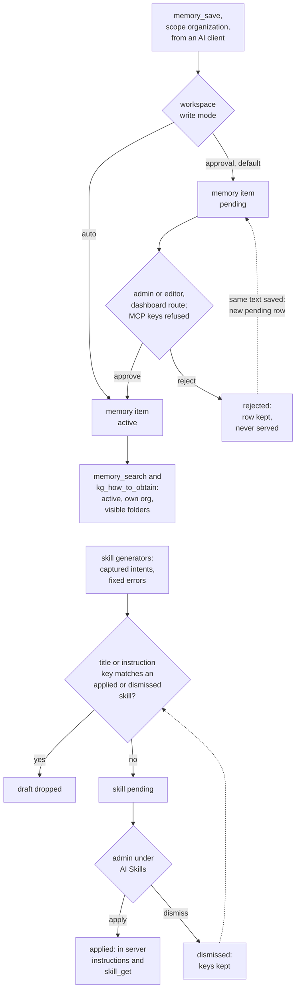

## 1. Executive Summary

AnythingMCP is a self-hosted NestJS gateway from helpcode.ai that turns REST,
SOAP, GraphQL, SQL and other MCP sources into tools for AI clients. Beside the
gateway it keeps what the README calls a company brain. Workspace memory holds
facts, preferences and notes in Postgres. Workspace skills are rules composed
into each MCP server's instructions. A knowledge graph records how connectors'
entities relate. Every memory and skill read filters by organization, owner
and role-limited folder.

What is notable is where the review gate sits. An AI client's `memory_save` to
the company scope lands `pending` by default and stays out of every read until
an admin or editor approves it, on a route that refuses MCP-scoped keys.
Skills a model writes wait the same way. A skill an admin dismisses keeps its
normalised title and instruction as keys the generators check, so the same
rule is not proposed again.

What is weak is around the edges of that gate. An item the agent wrote is
served back as a note *saved by people*. No memory creation, edit, approval or
deletion writes an event. The memory search path is tested only against a
mocked Prisma, so its raw SQL never runs in a test. Learning projects put the
confirm verb on the agent's own tools.

**Licence.** The memory this report is about returns nothing without an
Enterprise key. `MemoryService.accessFor` calls `EditionService.hasMemory`
(`packages/backend/src/ee/licensing/edition.service.ts:219-221`), and that file
is under the AnythingMCP Commercial License, whose list of things a user may
not do includes *"Remove, bypass, or alter any license-checking or
feature-gating mechanism in the EE Code"*. Learning projects sit entirely in
`ee/`, where the grant is to view, audit and contribute back. The README also
caps the AGPL Community edition at *"up to 3 active users"*. The CLA (§2) lets helpcode.ai *"re-license your
Contributions under any license terms"*.

## 2. Mental Model

Three stores hold claims that can turn out to be false, and each has its own
state field.

A **memory item** is a fact, preference or note with a `scope`. A personal
item belongs to one member, is `active` on write and is readable only by its
owner, admins included. A company item written from an AI client is `pending`
unless the workspace switched to automatic, and becomes `active` or `rejected`
only through a curator's review (`packages/backend/src/memory/memory.service.ts:564-567`,
`:650-671`). A rejected row is kept and never served. Nothing else ends a
memory: personal items are hard-deleted by `memory_forget`, company items by a
curator, and no item expires.

A **workspace skill** is a rule with a title, a *when to use* line and an
instruction. It is `pending`, `applied` or `dismissed`, and only applied
skills reach a model (`packages/backend/src/knowledge-graph/kg-skill.service.ts:105-109`).
Applying a merge proposal dismisses the skills it replaces, which keeps them
with their history. A dismissed skill keeps working after it is dismissed: its
keys stop the generators filing the same rule again.

A **knowledge-graph edge** says two entities on two connectors are linked. It
is `suggested`, `active` or `rejected`, only `active` edges are served over MCP,
and the observed and LLM writers leave a rejected edge as it is
(`packages/backend/src/knowledge-graph/kg-observational.service.ts:665-668`,
`packages/backend/src/knowledge-graph/kg-llm.service.ts:229-230`).

Learning lessons (`ee/`) add a fourth: `draft`, `confirmed`, `rejected` or
`superseded`, confirmed by the member's own AI client.

## 3. Architecture

The backend is a NestJS service over PostgreSQL through Prisma, with Redis for
sessions, rate limits and queues, and a Next.js dashboard. Memory, skills,
learning and the graph are tables in the same database as connectors, users
and the tool-call log. Memory search uses Postgres full text with the `simple`
configuration, so no embedding provider is needed. An LLM is needed only for
graph enrichment, skill generation from intents and skill consolidation, all
opt-in per workspace.

Each MCP server has its own endpoint (`/mcp/<serverId>`), and the built-in
memory, skill, graph and learning tools are registered there per caller. The
management API under `/api` is guarded by `JwtOrManagementKeyGuard`, which
accepts a dashboard session or a management-scoped key and refuses a key whose
scope is `MCP` (`packages/backend/src/auth/jwt-or-management-key.guard.ts:78`).
The `amcp` CLI drives the same API with a management key.

### Deployment and ergonomics

The quick start is a Docker Compose file with Postgres and Redis and two
generated secrets. Everything runs locally except the optional LLM. The memory
tools and page appear only with an Enterprise licence key, on Cloud or
self-hosted; without one, stored memory is kept and admins can still erase a
member's personal memory (`packages/backend/src/memory/memory.service.ts:673-693`).
The store is ordinary Postgres rows and readable with SQL. An opt-in
row-level-security script exists, and its table list does not include
`memory_items` (`packages/backend/prisma/rls/enable-rls.sql:23-29`).

## 4. Essential Implementation Paths

- **Save.** `memory_save` (`packages/backend/src/mcp-server/mcp-endpoint.controller.ts:2942-3035`)
  re-reads the caller's access per call when sessions are long-lived, then
  `MemoryService.save` checks the level, refuses secrets and override phrasing,
  enforces the caps and sets `pending` for a company item in approval mode
  (`packages/backend/src/memory/memory.service.ts:508-598`). The source
  (`via: 'mcp'`, server id, API key name) is stored on the row.
- **Search.** `MemoryService.search` builds one Prisma predicate, runs the
  same predicate as raw SQL for ranked full-text ids, then refetches those ids
  through the Prisma predicate, falling back to a substring match
  (`packages/backend/src/memory/memory.service.ts:321-412`). `memoryAsText`
  wraps the hits in markers with a data-not-instructions header
  (`packages/backend/src/mcp-server/mcp-endpoint.controller.ts:3344-3373`).
- **Facts in the graph answer.** `kg_how_to_obtain` adds active items whose
  `about` names a matched entity (`packages/backend/src/mcp-server/mcp-endpoint.controller.ts:2469-2485`,
  `packages/backend/src/memory/memory.service.ts:419-439`).
- **Review.** `POST /api/memory/items/:id/approve` and `/reject`, `ADMIN` or
  `EDITOR` (`packages/backend/src/memory/memory.controller.ts:254-266`).
- **Skill proposals.** `generateForServer` and `applyConnectorResult` send
  captured intents to an LLM and file drafts through `insertSkill`;
  `proposeFromErrors` turns failed-then-fixed calls into drafts without a model
  (`packages/backend/src/knowledge-graph/kg-skill.service.ts:426-649`).
  `skills_save_to_workspace` files a skill the agent found as `pending`
  (`packages/backend/src/mcp-server/mcp-endpoint.controller.ts:2627-2714`).
- **Skill review and delivery.** Apply and dismiss are `ADMIN` routes
  (`packages/backend/src/knowledge-graph/kg.controller.ts:312-324`);
  `activeSkillsText`, `listForCaller` and `getForCaller` read through
  `visibleWhere` (`packages/backend/src/knowledge-graph/kg-skill.service.ts:99-121`, `:848-868`).
- **Learning.** `learning_record`, `learning_review` and `learning_confirm`
  are registered for the project's member (`packages/backend/src/ee/learning/learning-tools.ts:97-264`);
  `LearningService.confirm` publishes when the project's mode is `confirmed`
  (`packages/backend/src/ee/learning/learning.service.ts:980-986`).

## 5. Memory Data Model

`MemoryItem` carries `organizationId`, `scope`, `ownerUserId` (personal only),
`kind`, `content`, `tags`, `status`, `source` as JSON, `about` (a normalised
graph entity name), `folderId` (company only), `createdByUserId`,
`approvedByUserId`, `approvedAt`, `createdAt`, `updatedAt`, and a generated
`search_vector` (`packages/backend/prisma/schema.prisma:1905-1937`). There is
no version chain, no supersession link and no validity time; an edit
overwrites `content`.

`KgSkillSuggestion` carries scope (`connectorId` or `mcpServerId`), `status`,
`source` (`manual`, `llm`, `finder`, `consolidation`, `errors`, `agent`,
`learning`), `replaces` for a merge, `version`, `audienceUserId` for a
learning draft, and a folder (`packages/backend/prisma/schema.prisma:1650-1722`).
An edit to the text writes the previous content to `KgSkillVersion` with the
editor (`:1840-1856`); a status change does not.

`KnowledgeFolder` is one tree per workspace shared by company memory and
skills, with `roleIds` limiting a folder and everything below it
(`:1943-1968`). `LearningLesson` is unique on `(topicId, textHash)`, so the
same lesson said twice is one row with a count (`:1809-1837`). `KgEdge` is
unique on `(organization, source, target, kind)` with `status`, `isManual`,
`confidence` and first and last seen times (`:1599-1630`).

## 6. Retrieval Mechanics

Memory retrieval is a tool call, not injection. `anyWordQuery` turns up to 12
words into a prefix OR query so a partial word matches, ranked by `ts_rank` and
then recency (`packages/backend/src/memory/memory.service.ts:98-103`, `:362-382`).
When full text finds nothing, a case-insensitive substring match runs, and an
empty query returns the newest items. A result is at most 50 items of up to
2,000 characters each, so one call can return about 100,000 characters.

The predicate is stated twice and the second one wins. The raw SQL repeats
the organization, status, owner, folder and `about` conditions, and the ids it
returns are refetched through the Prisma predicate (`:383-390`). A drift in
the SQL can drop hits; it cannot add one.

Skills are injected. On initialize, `activeSkillsText` composes applied skills
into the server's instructions inline up to 6,000 characters, then switches to
an index the model opens with `skill_get` (`packages/backend/src/knowledge-graph/kg-skill.service.ts:25-40`).
The text sits in the MCP server's instructions, so a skill change alters a
prefix a provider may have cached.

## 7. Write Mechanics

Every write is synchronous and the item is searchable when the call returns,
or when a curator approves it. There is no extraction from conversation: the
model decides what to save and writes it in its own words, with tool
descriptions asking for one idea per item and the user's consent before a
company save. No deduplication runs, so saving the same sentence twice stores
two rows. `cleanContent` refuses credential shapes and override phrasing in
five languages, a heuristic the code calls defence in depth
(`packages/backend/src/memory/memory.service.ts:105-129`, `:715-732`).

Skill proposals are the background path. With intent capture on, a tool call
carries a short `_intent` the model writes, stored on the tool-call log
(`packages/backend/prisma/schema.prisma:870`). An opt-in cloud cron or an
admin request sends up to 200 intents to an LLM, which drafts at most six
skills, and each run replaces its own pending drafts
(`packages/backend/src/knowledge-graph/kg-skill.service.ts:542-611`). The
fixed-error path needs no model and may apply a pattern seen three times when
an admin turned auto-apply on (`:494`, `:508`). Neither pass rewrites memory
items.

## 8. Agent Integration

On a per-server endpoint a caller with memory access gets `memory_search`;
from *Personal* up, `memory_save` and `memory_forget`; from *Contribute*, a
`scope` argument on save (`packages/backend/src/mcp-server/mcp-endpoint.controller.ts:2848-3071`).
Company memory has no edit or delete tool; `memory_forget` deletes only the
caller's own personal items. `skills_list`, `skill_get` and `kg_how_to_obtain`
read, and `skills_save_to_workspace` proposes. Memory tools are absent from
the shared `/mcp` endpoint.

A learning-project member also gets `learning_record`, `learning_review` and
`learning_confirm`, with reminders appended to write-tool results
(`packages/backend/src/ee/learning/learning-tools.ts:42-71`). The model is
expected to record a correction when the user makes one and to read lessons
back for confirmation.

## 9. Reliability, Safety, and Trust

### Who can clear the queue

The approve and reject routes need a dashboard session or a management-scoped
key held by an admin or editor. The MCP endpoint registers no approve verb,
and the guard refuses an MCP-scoped key on `/api`. `review` stamps the
authenticated user as approver. It does not check that the item is pending or
that the approver differs from the creator, so a curator approves a proposal
their own AI client made, in the dashboard (`packages/backend/src/memory/memory.service.ts:650-671`).

The `amcp api` command calls the same routes with a management key, and its
README offers that *"for a person or for a connected AI agent"*. An agent
given a shell and an admin's management key can approve; that is a general
credential, not a verb on the agent's tool surface.

### What the agent is told about what it reads

`memory_save` from an AI client stores `via: 'mcp'` on the row, and the text
returned to the next model omits it. `memoryAsText` and the facts note
describe every item as written or saved *by people*
(`packages/backend/src/mcp-server/mcp-endpoint.controller.ts:3363-3368`, `:2483-2485`).
A personal item one session's model saved reads to the next session's model
as something a person wrote.

### What a deletion leaves

`memory_forget` and the dashboard delete remove the row. No event records the
deletion of an item, and nothing stops the same text being saved again.
Rejected company items are kept and count toward the 20,000-item workspace cap
(`packages/backend/src/memory/memory.service.ts:541-557`).

### Marks

- **`tombstone`** — awarded on the skill generators. `knownSkills` collects the
  `skillKey` of the title and the instruction of every applied and dismissed
  skill in the scope, and `insertSkill` drops a model draft that matches either
  (`packages/backend/src/knowledge-graph/kg-skill.service.ts:376-415`,
  `:619-632`). `proposeFromErrors` skips a dismissed title, and its titles are
  derived from the tool and the pattern, not written by a model (`:481-500`).
  The key is exact after case, accent and punctuation folding, so a paraphrase
  passes. The read takes the newest 1,000 rows by `updatedAt`, so in a large
  scope the oldest dismissals drop out. Deleting a dismissed skill deletes the
  key. Manual creation and `skills_save_to_workspace` do not check it. The
  memory store has no equivalent.
- **`trust_state`** — awarded. Company memory is `pending`, `active` or
  `rejected` with only `active` served; skills are `pending`, `applied` or
  `dismissed` with only `applied` served; edges are `suggested`, `active` or
  `rejected` with only `active` served over MCP
  (`packages/backend/src/knowledge-graph/kg.service.ts:540-541`, `:655-661`).
- **`scope_enforced`** — awarded on organization, personal owner and folder
  roles in every memory read, and organization, server or connector, folder
  and audience in every skill read.
- **`human_review`** — awarded on company memory and skill suggestions: the
  producer is the AI client, the queue is filled on its default path, the read
  path consults the state, and the verb is off its surface. Learning lessons
  fail the test. `learning_confirm` is an MCP tool whose description asks the
  model to *"never confirm on their behalf"*, and in publish mode `confirmed`
  its call publishes the topic to everyone
  (`packages/backend/src/ee/learning/learning-tools.ts:221-263`,
  `packages/backend/src/ee/learning/learning.service.ts:980-986`). The default
  mode is `manual`, where an admin or editor publishes.
- **`negative_eval`** — awarded on the learning database test; see section 10.
- **`bitemporal`** — withheld. Memory carries `createdAt`, `updatedAt` and
  `approvedAt`; edges carry first and last seen. All are record time.
- **`audit_log`** — withheld. The security event log records memory access,
  settings and erasure, folder access changes and learning project events
  (`packages/backend/src/memory/memory.service.ts:240`, `:299`, `:682`). A
  memory item's creation, edit, approval, rejection and deletion write none,
  and the built-in memory tools do not pass through the tool-call log, which
  `dynamic-mcp-tools.ts` writes for connector tools. Skill versions keep prior
  text and skip status changes.

### Near-misses in the lesson and edge stores

A rejected lesson keeps its row under the same `(topicId, textHash)`, and
`record` sets it back to `draft` when the lesson is reported again, with the
comment *"brought back if it had been set aside"*
(`packages/backend/src/ee/learning/learning.service.ts:791-803`). The key a
tombstone needs is there, and the writer reverses it. A rejected graph edge
holds against the observed and LLM writers. Rejecting through `updateEdge`
does not mark the edge manual, though, and the static rebuild deletes static
edges it did not rewrite, so a rejected static edge the extractor stops
producing is swept with its status (`packages/backend/src/knowledge-graph/kg.service.ts:442-450`,
`packages/backend/src/knowledge-graph/kg-static.service.ts:298-305`).

## 10. Tests, Evals, and Benchmarks

The backend has 1,340 spec files, and CI runs the jest suite with Postgres 17
and Redis as services on push and pull request to `main`
(`.github/workflows/ci.yml:3-8`, `:53-68`, `:149-151`). I ran none of it.

`negative_eval` rests on `packages/backend/src/ee/learning/learning.database.spec.ts`,
which runs the services against a real database:

- `:98-124` records a lesson, asserts the expert is served the draft, and
  asserts a colleague and a caller with no user are served nothing.
- `:134-156` confirms one lesson, records an unconfirmed one, publishes, and
  asserts the colleague's skill body contains the confirmed hinge and not the
  unconfirmed screws, while the expert's draft contains both.
- `:244` asserts a member holding a limited folder's role is not served
  another member's draft.

The memory service has 30 cases in `packages/backend/src/memory/memory.service.spec.ts`,
built on a hand-written Prisma stand-in whose `$queryRaw` returns what the test
sets (`:14-34`). The scope and folder cases assert the `where` object passed to
`findMany` (`:189-204`, `:291-301`). They hold the shape of the predicate and
never execute the raw SQL, and no test retrieves from populated memory. The
skill dedupe is tested with a control: a dismissed and an applied skill
block two drafts and a third is filed (`packages/backend/src/knowledge-graph/kg-skill.service.spec.ts:644-657`).

No benchmark or retrieval-quality harness is committed. `CITATION.cff` cites
the software, and no paper is associated with the project.

## 11. For Your Own Build

### Steal

- **Put the approve verb behind a credential scope the agent's key cannot
  hold.** A key minted for tool calls is refused on the management API, so the
  queue's drain is unreachable from the producer without a second grant.
- **Refetch raw-SQL hits through the typed predicate.** Ranking in SQL and
  filtering again by id means a drift in the hand-written query loses results
  rather than leaking them.
- **Keep dismissed suggestions as keys the generator reads.** Normalise title
  and instruction, block a draft that matches, and test it with one draft that
  should still pass.
- **Let a rejection outrank later evidence.** The edge writers leave a
  rejected link alone however many times it is observed again.

### Avoid

- **Labelling model-written memory as human.** If the row knows it came from
  an AI client, the text the next model reads should say so.
- **A confirm verb on the learner's own tool list.** A tool description asking
  the model not to confirm for the user is a request, and here the call
  publishes.
- **A rejection that re-recording undoes.** A unique hash that already
  identifies the rejected lesson can refuse it instead of reviving it.
- **Testing a read path against a mock of the store.** Asserting a `where`
  object proves the code built one; it does not prove Postgres returns the
  right rows.

### Fit

This suits a company that already wants its staff's AI clients to reach
internal systems through one governed endpoint, and wants a shared,
role-limited notebook and rule set beside the tools. The memory is a small
part of a large product, so adopting it means running the gateway and buying
the Enterprise edition. A team that wants a memory library, extraction from
conversation, or semantic recall should walk away; one that needs a full
history of who changed what in memory will not find one here.

## 12. Open Questions

- Whether a self-hosted deployment may remove the `hasMemory` call from the
  AGPL memory module, given the commercial licence on the gate it calls.
- Whether `via: 'mcp'` is meant to reach the model's text, given the
  data-not-instructions framing.
- How often Cloud workspaces switch company memory to `auto`, which removes
  the queue.
- Whether the learning `confirmed` mode is meant to publish on the agent's
  call alone.

## Appendix: File Index

- Memory: `packages/backend/src/memory/memory.service.ts`,
  `packages/backend/src/memory/memory.controller.ts`,
  `packages/backend/prisma/migrations/20261019180000_workspace_memory/migration.sql`
- Skills: `packages/backend/src/knowledge-graph/kg-skill.service.ts`,
  `packages/backend/src/knowledge-graph/error-fix.ts`,
  `packages/backend/src/knowledge-graph/kg.controller.ts`
- Graph: `packages/backend/src/knowledge-graph/kg.service.ts`,
  `packages/backend/src/knowledge-graph/kg-observational.service.ts`,
  `packages/backend/src/knowledge-graph/kg-llm.service.ts`,
  `packages/backend/src/knowledge-graph/kg-static.service.ts`
- Folders: `packages/backend/src/knowledge-folders/knowledge-folders.service.ts`
- Learning (`ee/`): `packages/backend/src/ee/learning/learning.service.ts`,
  `packages/backend/src/ee/learning/learning-tools.ts`
- MCP surface and auth: `packages/backend/src/mcp-server/mcp-endpoint.controller.ts`,
  `packages/backend/src/auth/jwt-or-management-key.guard.ts`,
  `packages/backend/src/ee/licensing/edition.service.ts`
- Schema: `packages/backend/prisma/schema.prisma`, `packages/backend/prisma/rls/enable-rls.sql`
- Tests: `packages/backend/src/memory/memory.service.spec.ts`,
  `packages/backend/src/knowledge-graph/kg-skill.service.spec.ts`,
  `packages/backend/src/ee/learning/learning.database.spec.ts`,
  `.github/workflows/ci.yml`

### Recorded searches

Run from the repository root at the pinned commit with `/usr/bin/git grep`.

- **No validity time.**
  `git grep -n -i -E 'valid_from|valid_to|validFrom|validTo|valid_until|validUntil|as_of|asOf|occurred_at|occurredAt' -- packages/backend/prisma/schema.prisma`
  matches only `sessionsValidFrom`, a token cutover on the user, at lines 157
  and 167; `git grep -n -E 'approvedAt|firstSeenAt' -- packages/backend/prisma/schema.prisma`
  matches lines 1588, 1619 and 1926.
- **Memory writes three security events, none per item.**
  `git grep -n -E 'securityEvents\.log' -- packages/backend/src/memory`
  matches `memory.service.ts:240`, `:299` and `:682` (settings, access,
  erasure) and three spec lines.
- **Built-in memory tools are not in the tool-call log.**
  `git grep -n 'logInvocation' -- packages/backend/src/mcp-server/mcp-endpoint.controller.ts packages/backend/src/memory`
  returns nothing; `git grep -c 'logInvocation' -- packages/backend/src/mcp-server/dynamic-mcp-tools.ts`
  counts 5.
- **Save does not consult rejected content.**
  `git grep -n 'rejected' -- packages/backend/src/memory/memory.service.ts`
  matches only the list filter at 463 and the review write at 668.
- **Review verbs are reached only from controllers.**
  `git grep -n -E 'memory\.review\(|skills\.apply\(|kgSkills\.apply\(|skills\.dismiss\(|kg\.updateEdge\(' -- packages/backend/src`
  matches `memory.controller.ts:258`, `:265` and `kg.controller.ts:316`,
  `:323`, `:538`, besides spec files.
- **Memory and graph tests never open a database.**
  `git grep -n -E '\$connect|new PrismaService' -- packages/backend/src/memory packages/backend/src/knowledge-graph`
  returns nothing; the same pattern over `packages/backend/src/ee/learning`
  matches `learning.database.spec.ts:14` and `:49`.
- **The row-level-security script omits memory.**
  `git grep -n 'memory_items' -- packages/backend/prisma/rls` returns nothing;
  `git grep -c 'kg_skill_suggestions' -- packages/backend/prisma/rls` counts
  one line in each of the two scripts.
- **Only memory records an approver.**
  `git grep -n -E 'appliedBy|approvedBy|dismissedBy|reviewedBy' -- packages/backend/prisma/schema.prisma`
  matches line 1925 alone.
- **Only the generators read skill keys.**
  `git grep -n 'skillKey(' -- packages/backend/src/knowledge-graph/kg-skill.service.ts`
  matches the definition at 233, `knownSkills` at 403-404 and `insertSkill` at
  628-629; `create` at 1082 does not call it.
- **No paper.** `git grep -n -i -E 'arxiv|bibtex' -- README.md CITATION.cff`
  returns nothing.

## History

**2026-11-20** — [`88266c5001567fe07f4929d0d7e85209e70b3a86`](https://github.com/HelpCode-ai/anythingmcp/commit/88266c5001567fe07f4929d0d7e85209e70b3a86) — first reading, from a full clone of `main` at release `v0.55.7`, scoped to workspace memory, workspace skills, knowledge folders, the knowledge graph's edge writers and readers, learning projects, the MCP tool registration and the management-API guard, with their tests; the connector catalogue was not read. Screened first: one auto-run surface, `server.json`, an MCP manifest that acts only if a harness installs it; two build-time execution points, a `conftest.py` and an npm `prepublishOnly`; seven manifests inside the seven-day cooldown; nine unpinned surfaces; `AGENTS.md` and `CLAUDE.md` treated as data. AGPL-3.0 with commercially licensed `ee/` directories, no rider against analysis. Nothing installed, built or run. Five marks: `tombstone`, `trust_state`, `scope_enforced`, `human_review`, `negative_eval`.
