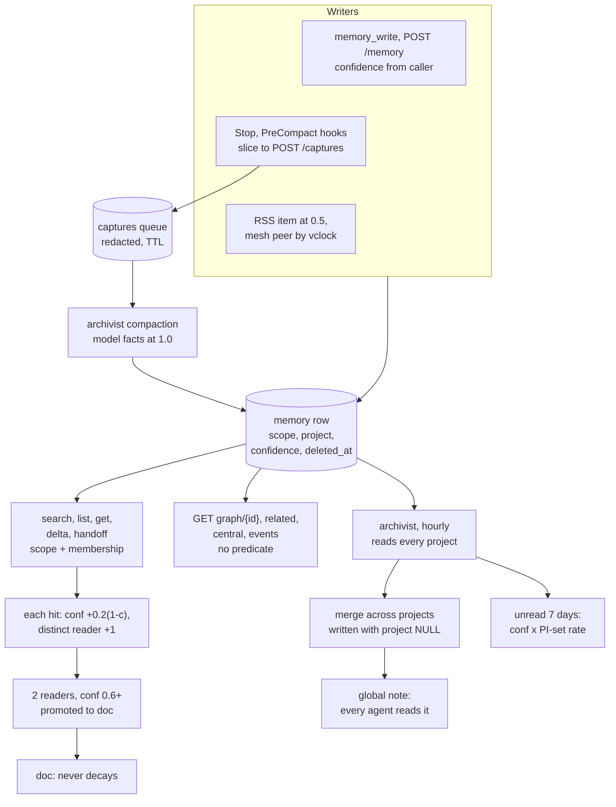

## 1. Executive Summary

Artel is a self-hosted shared notepad for a fleet of coding agents. One
FastAPI server over one SQLite file serves REST and MCP. Claude Code hooks
inject a single relevant note per prompt and per file edit, and an
archivist process merges, decays, promotes and links notes hourly, calling
a model for the merges and the extraction. What is notable is the
restraint of the injection path and the care in its bookkeeping: one line,
a measured distance cut, a capture hook that only appends and forks. What is weak is the scope boundary. Search and
list apply it; the graph route returns any row's content to any reader, and
the archivist publishes a merge of two projects' notes as global.

A note is the row. It is believed from the moment it is written: no status
withholds it, and its confidence is a float that ranks. Every search hit
raises the confidence of what it returned, whether or not the agent saw it,
and two distinct readers are enough for the archivist to promote a note to a
`doc`, which never decays again.

Captured sessions take a longer route. The Stop and PreCompact hooks spool
the transcript, and a detached drainer posts a compressed slice to
`/captures`. The archivist extracts facts and decisions from it with a
model, writing each fact at confidence 1.0 into the project the hook named.

The scope key is real where it is applied. Each row stores `scope` (`agent`
or `project`) and `project`, the caller is resolved from its key, and the
ranked arms carry both predicates. Membership is self-service: any agent may
join any project. A second set of routes applies neither predicate, and the
archivist, which reads every project, writes any merge across two projects
with no project at all.

**Licence.** MIT in `LICENSE.md`, and `pyproject.toml`,
`.claude-plugin/plugin.json` and `.claude-plugin/marketplace.json` say the
same. It restricts nothing. The committed recall labels describe 48 prompts
from the author's own sessions with private names paraphrased, and the
database they were scored against is not in the tree.

Two marks are earned, `scope_enforced` and `negative_eval`, on the read
predicates and the populated isolation tests. Section 9 gives the reason for
each mark withheld.

## 2. Mental Model

A note becomes a belief by being written. `POST /memory` stores it with the
caller's confidence, embeds it and indexes it in one transaction, and it is
searchable on return (`artel/server/routes/memory.py:257-322`). There is no
candidate state. Five types set its lifespan:

- **`memory`** decays when unread and can be merged, pruned, split or
  promoted by the archivist.
- **`doc`** is settled. Decay, synthesis and capture refinement skip it
  (`artel/archivist/synthesis.py:860`, `:1463`). The weekly deep pass and
  the event-driven merge still reach it.
- **`directive`** has confidence forced to 1.0, never decays, and is placed
  in the archivist's system prompt as a standing instruction.
- **`skill`** is skipped by the hourly decay and lowered by the weekly
  utilization prune when unread for 30 days; it is never merged or promoted.
- **`compiled`** is a description derived from a source symbol, pinned to
  its SHA, and flagged `stale` when an anchor it grounds on changes.

Confidence moves five ways. A search hit by any agent but the archivist
raises it by `0.2 * (1 - c)` (`artel/server/routes/memory.py:457-463`).
Hourly decay multiplies it by a rate a PI controller sets, for `memory`
entries not updated for seven days whose read heat, the read count
discounted by 0.9 per week since the last read, is under 1
(`artel/archivist/synthesis.py:1452-1509`). The weekly utilization prune
multiplies a never-read note over 30 days old by 0.7 (`:1384-1428`). The
archivist's prune op drops it to the 0.05 floor and tags it
`archivist-flagged`, and deletes it if it was already there (`:478-495`).
An `adjust_confidence` op sets it to whatever the model says (`:509-518`).

A note stops being served in one way: `deleted_at` is set. That happens on
an owner's delete, on a project clear, when the archivist merges, splits,
prunes at the floor or discards it, and when a peer's replicated delete
dominates. The row stays. `expires_at` is accepted on write and returned,
and no read compares it with the clock. The hooks add a softer exit: they
search with `confidence_min=0.1`, so a note pruned to the 0.05 floor is
still found by search and list and is never injected.

Promotion is the one-way door. `run_promotion` turns a `memory` into a
`doc` when it has three versions and seven quiet days, or when two distinct
agents have read it, provided its confidence is at least 0.6 and it carries
no workflow tag (`artel/archivist/synthesis.py:1667-1711`). A search hit
counts as a read, including hits the recall hook fetched and did not
inject, so two agents' prompt hooks matching the same captured fact can make
it permanent.

## 3. Architecture

One Python package with five entry points: the server, the archivist, a
stdio MCP adapter, an mDNS announcer and a file watcher (`pyproject.toml`).
The server is FastAPI on `0.0.0.0:8000` by default
(`artel/server/config.py:9-10`). It mounts the MCP server at `/mcp`, where
each tool calls the REST API over loopback with the caller's credentials
(`artel/server/app.py:149-209`, `artel/mcp/server.py:32-37`).

Everything lives in one SQLite file in WAL mode with `busy_timeout=5000`.
The schema is `artel/store/schema.py`, with in-place migrations in
`artel/store/db.py:94-357`. The keyword index is an FTS5 table and the
vector index a `vec0` table of 384 floats, both created on first open
(`artel/store/db.py:30-48`, `:458-466`). Embeddings come from fastembed's
`sentence-transformers/all-MiniLM-L6-v2`, loaded in process and retried on a
five-minute cooldown if the load fails, in which case search runs keyword
only (`artel/store/embeddings.py:10-34`).

The archivist is a separate process that talks to the server over HTTP as
the `archivist` agent and also opens the SQLite file directly for its
cursors, its controller state, read counts and graph edges. It holds a
120-second curator lease renewed every 40, so two copies do not both curate
(`artel/archivist/agent.py:88-108`). Its model is Anthropic, OpenRouter, an
OpenAI-compatible endpoint or the Claude Agent SDK. Without one it runs
passively: decay, promotion and utilization prune still happen; compaction,
merges, synthesis and feed extraction do not.

Mesh replication pulls peers' JSON feeds on a poller, compares vector
clocks per row, keeps a deterministic winner and stores the loser as a
`sync-conflict` sibling joined by a `contradicts` edge
(`artel/server/feed_poller.py:140-172`, `:175-330`). Peers are linked by the
owner only (`artel/server/routes/mesh.py:114-115`).

### Deployment and ergonomics

The quick start downloads `docker-compose.yml` and `.env.example` and runs
`docker compose up`: the server, the archivist, a read-only cost ledger, an
mDNS sidecar on host networking, and Watchtower polling the `:edge` image
every 300 seconds with the Docker socket mounted. The four Artel services
pull `ghcr.io/nicolasprimeau/artel:edge`, a tag CI moves on each push to
`master`, so a running install tracks the branch head.

The archivist service in that file has no volume and no `DB_PATH`. Its
direct reads then open a fresh `artel.db` in the container, not the
server's. The committed `docker-compose.override.yml` mounts the volume for
it, and the README's two `curl` lines do not fetch it. Inferred from the
files, not run: on the quick-start path the decay heat check sees every note
as unread, and utilization prune sees zero reads. `link` edges and the
synthesis cursor land in the throwaway file, and `instance_id()` differs
from the server's.

Fully local operation needs no API key to store or search; the archivist
needs one for everything but decay, promotion and the disuse prune. The store is one SQLite
file a person can open, and nothing in the package removes a memory row, so
it only grows.

## 4. Essential Implementation Paths

**Direct write.** `write_memory` refuses a `directive` from a `viewer`,
takes `project` from the body or the caller's most recent membership,
checks membership and forces a directive's confidence to 1.0. It embeds,
then in one transaction inserts the row, the vector, the FTS row and a
`memory.written` event, and broadcasts the event on the SSE stream
(`artel/server/routes/memory.py:257-322`). The MCP `memory_write` tool fills
`project` from the `x-mcp-project` header when the model omits it
(`artel/mcp/server.py:508-565`).

**Capture.** `scripts/artel-capture.sh` appends the hook payload to
`~/.artel/spool/incoming.jsonl` and forks `artel-drain.sh` under `setsid`.
The drainer takes an `flock` and reads each session's transcript from a
byte cursor. It keeps user and assistant text and tool names, drops tool
results, caps the slice at 8,000 characters, and waits for 400 characters
unless the event was PreCompact (`scripts/_artel_hooks.py:436-466`,
`:575-607`). It
posts token rollups to `/usage` and the slice to `/captures`, and advances
the cursor only on success. The server redacts known key formats and
`API_KEY=`, `SECRET=`, `TOKEN=` and `PASSWORD=`-style assignments, and
stores the slice with a TTL of one hour to 30 days
(`artel/server/routes/captures.py:19-46`, `artel/store/redact.py:1-41`).

**Compaction.** Each hourly cycle the archivist lists 20 pending captures,
searches existing memory for the first 400 characters of each, and asks
the model for durable facts, updates to the related notes, and decisions
(`artel/archivist/compaction.py:141-200`). Facts are written tagged
`capture-extracted`, `archivist-extracted` and `session:<id>` into the
capture's project; updates apply only to ids the search returned; decisions
go to the append-only `decisions` table (`:94-138`). The search is the
archivist's, which spans every project, so an update can rewrite another
project's note with content from this capture.

**Refinement.** A later pass takes up to 15 `capture-extracted` notes from
the last six hours and lets the model consolidate, promote (drop the tag) or
discard them, restricted to that set (`artel/archivist/compaction.py:259-325`).

**Event-driven merge.** For each `memory.written` from anyone but the
archivist, `check_and_merge` searches for neighbours within vector distance
0.08 (`1 - conflict_threshold`). It merges the entry with the nearest
through the model, writes the result with both as parents, soft-deletes
both, and messages both authors (`artel/archivist/conflict.py:15-74`). Line 44 sets the merged project to
`None` when the two differ.

**Synthesis.** `run_synthesis` takes the delta since its cursor and drops
directives, docs, skills, compiled notes and peers' rows. It runs a cleanup
pass (merge, prune, split, extract) and an insight pass (promote, tag,
adjust confidence, create or close a task, link) through the model, with
the directives in play prepended (`artel/archivist/synthesis.py:835-1017`). The merge op again writes
`project=None` when its sources span projects (`:434-446`), and a test
requires it (`tests/test_archivist.py:511-522`).

**Retrieval.** `search_memory` runs the vector arm and the FTS arm, each
already filtered on `deleted_at` and private scope, then fuses and scores
them. It applies the project and filter predicates, optionally diversifies
by MMR, flags a project note that shadows a near-identical global one, and
records the reads (`artel/server/routes/memory.py:325-511`).

**Injection.** The UserPromptSubmit hook ignores prompts under 12
characters and a list of acknowledgements. It searches the first 300
characters with `confidence_min=0.1`, `max_distance=1.0`, `diversify=true`
and `context=recall`. At most one note and one skill are injected, each cut
to 120 characters, in 480 characters with any procedure step
(`scripts/_artel_hooks.py:304-330`). The PreToolUse hook on Edit, Write,
MultiEdit and NotebookEdit searches the file name and injects the first hit
whose content or `source_path` names that file (`:333-364`). The
SessionStart hook injects the last handoff if it is under 14 days old, in
600 characters (`:367-390`). Each id is injected once per session, tracked
in temp files.

**Decay control.** Search and get log a `decay_regret_events` row when a
reader hits a note below 0.85 confidence, deduplicated per reader per ten
minutes (`artel/server/routes/memory.py:139-164`). The archivist feeds the
per-cycle count into a PI controller with a deadband and a leak that sets
the decay rate between 0.6 and 0.99 (`artel/archivist/control.py:26-60`,
`artel/archivist/synthesis.py:233-295`).

**Compile mode.** A pre-commit payload, inert until linked into
`.git/hooks`, parses staged sources into symbol units with descriptions and
posts them to `/compile`. The route upserts code anchors by project, path
and symbol, creates or rewrites the grounded `compiled` note, links
`relies_on` edges, and marks dependents `stale` when an anchor's SHA moves
(`artel/server/routes/compile.py:67-192`, `artel/store/graph.py:136-159`).

## 5. Memory Data Model

The `memory` table carries `id`, `type`, `agent_id`, `project`, `scope`,
`content`, `confidence`, `parents`, `tags`, `created_at`, `updated_at`,
`version`, `deleted_at`, `expires_at`, `origin`, read counters, source
fields for compiled notes, `stale`, a model-written `headline`, `vclock`,
`trail`, `author_updated_at` and `content_at`
(`artel/store/schema.py:14-45`). Ids are UUID4 (`artel/server/models.py:9-10`).

Scope has two keys. `scope` is `agent` (the author alone) or `project`;
`project` is a lower-cased name or `NULL`, and a `NULL` project is visible
to every agent. Memberships live in `project_members` with an `owner` or
`member` role; a static key in `AGENT_KEYS` may carry a project list, and a
static key with none is unscoped (`artel/server/auth.py:163-179`). The
`archivist` and `viewer` roles see every project.

Provenance is thin. `agent_id` is the writer, which for every merge,
split, compaction fact and feed fact is the archivist. `parents` lists the
sources of a merge or split. A capture's session id survives only as a
`session:<id>` tag. `origin` is the instance id of the peer a row came from.

Time is record time only. `content_at` is when the content last changed,
`author_updated_at` when the original author last edited, and every read
returns the second as `days_since_author_update`
(`artel/server/routes/memory.py:224-254`, `:958-964`).

Beside the notes sit a typed edge table (`grounds`, `relies_on`,
`applies_to`, `contradicts`, `corroborates`) and a Hebbian table of
co-retrieval weights with a 14-day half-life. Code anchors, decisions,
session handoffs, the captures queue, an `events` table and
`archivist_logs`, capped at 10,000 rows, complete it (`artel/store/schema.py:47-54`,
`:192-202`, `:214-231`, `:244-253`, `:363-371`, `:405-432`).

## 6. Retrieval Mechanics

Search is hybrid and automatic. The vector arm takes `k = limit * 5` when
the caller names a project or has a membership list, and `limit * 2`
otherwise. The FTS arm ORs up to twelve quoted word tokens under BM25, and
RRF adds `1 / (60 + rank)` from each (`artel/server/routes/memory.py:346-396`). The fused score is then
multiplied by `0.4 + 0.6 * confidence`, `1 + 0.2 * ln(1 + trail)` with a
seven-day trail half-life, and `0.3 + 0.7 * recency` with a 90-day half-life
on `content_at` (`:409-416`).

The project, distance, confidence, tag, type and author filters run after
scoring, in `_passes` (`:418-442`). A caller in one project of many can get
fewer than `limit` results when the over-fetch is spent on other projects'
rows; the arms' `k` is the only margin.

Ranking feeds back into itself. Every hit returned to a non-archivist
caller gets a read, a confidence raise, a trail deposit, a distinct-reader
count, and Hebbian reinforcement among the top five
(`artel/server/routes/memory.py:451-483`). The recall hook asks for six and
injects one or two, so up to five notes per prompt are reinforced unseen.
`test_search_hits_count_as_reads` requires the read
(`tests/test_memory_hybrid.py:436`).

A learned ranker is wired to observe and not to rank. With
`recall_bandit_enabled`, off by default, the search logs features per hit
and the archivist resolves a reward from whether the note was read again;
`recall_bandit.predict` has no caller (`artel/store/recall_bandit.py:49-50`,
`artel/server/routes/memory.py:484-501`). `docs/adaptive-control.md:116`
says so.

The graph read paths are separate routes. `/memory/{id}/related` spreads
activation three hops from one note over typed edges, with `contradicts`
inhibiting, plus Hebbian edges at half conductance
(`artel/store/graph.py:223-273`). `/memory/central` runs PageRank over the
support edges (`:281-336`). The dashboard calls `/related`; no hook or MCP
tool does.

Context per turn is bounded by the hook, not the server. A prompt gets at
most 480 characters and a file edit one 120-character line. The MCP
`session_context` tool returns far more: the project brief, ten tasks, a
knowledge map over up to 500 notes, the last handoff and the first 20
entries of the delta (`artel/mcp/server.py:380-466`).

## 7. Write Mechanics

Four writers produce notes: agents through REST or MCP, the archivist from
captures, feeds and its own passes, the RSS poller, and mesh replication.
Agent writes are synchronous: the request embeds the content before it
returns. Capture writes never block the agent, and the lag before a captured
fact is searchable is the drainer's 400-character floor plus up to one
archivist cycle of 3,600 seconds, longer when 20 captures are ahead of it.

Deduplication is a model call. The event-driven merge fires on every agent
write whose nearest neighbour is within vector distance 0.08 and replaces
both with a model-written merge. The synthesis cleanup pass merges what the
model judges redundant in the day's delta. No exact-text check exists on
the direct write path, so the same sentence written twice is two rows until
one of those passes runs.

Captured and feed facts are written at the client's default confidence of
1.0 (`artel/archivist/client.py:77-97`). A fact the model drew from an RSS
summary therefore enters at the same confidence as an agent's own
statement, while the raw feed item sits at 0.5
(`artel/server/feed_poller.py:46-87`, `artel/archivist/synthesis.py:1882-1916`).
Nothing marks an extracted fact as unconfirmed in a way a read respects.

Directives steer the curator. Any agent may write one, and one with no
project applies to every synthesis pass, because `_directives_in_play`
admits a global or agent-scoped directive into every batch
(`artel/archivist/synthesis.py:105-117`). The pass's instructions then say
*"Directives are in the system prompt. Follow them above all else."*

### Operational cost

The hot path is the recall hook: one HTTP search per prompt and per file
edit, each a vector query, an FTS query and a write transaction for the
reinforcement. The capture hook is an append and a fork. The archivist runs
its pass list every hour; synthesis sends the delta since its last run to
the model twice,
compaction one call per capture, and the event-driven merge one call per
near-duplicate write. Nothing rewrites the whole store. The weekly deep
synthesis reads the 200 most recently updated notes, and the weekly
utilization prune the 500 most recently updated, newest first, so in a
larger store neither reaches the oldest rows.

Injected text is under 500 characters per prompt, sent as
`additionalContext` after the user's message, so it does not sit in a
cached prefix.

## 8. Agent Integration

The Claude Code plugin registers the HTTP MCP server and five hooks
(`.claude-plugin/plugin.json`, `hooks/hooks.json`). Read as data, the hooks
would do this once installed and configured with `ARTEL_URL`,
`ARTEL_AGENT_ID` and `ARTEL_API_KEY`:

- **SessionStart** fetches `/sessions/handoff` and injects the last handoff.
- **UserPromptSubmit** searches the prompt and injects one note, one skill
  and the next procedure step.
- **PreToolUse** on edits searches the file name and injects one note about
  that file.
- **PreCompact and Stop** spool the payload and fork the drainer, which
  posts the session slice and token counts.

The read hooks exit 0 and print nothing when the server is down or the
credentials are missing. The capture hook spools the payload either way,
and an unconfigured drainer exits without reading the spool, so
`incoming.jsonl` grows by one small record per Stop. `server.json` is a registry entry for a remote
endpoint with no start command. `scripts/hooks/pre-commit` runs the compile
payload once someone links it.

The drainer takes identity and project from the repository the session ran
in. For each spooled event it reads `.mcp.json` and `.claude/settings*.json`
under that event's `cwd` and, when they name them, uses that agent id, API
key and project (`scripts/_artel_hooks.py:109-140`, `:649-660`). The URL
stays the user's. A cloned repository whose `.mcp.json` names a project
therefore decides which project the user's transcripts are filed under.

The onboarding script at `/onboard` registers an agent and writes the key
to `~/.config/artel/env.sh` and the `env` block of `~/.claude/settings.json`.
It appends a `source` line to `.bashrc`, `.zshrc` and `.profile`, and
installs the plugin from the GitHub marketplace, which is the repository
head rather than the server's version (`artel/server/routes/onboard.py:286-341`).

The model has wide agency. The 47 tools write, update and delete notes,
write directives, add graph edges, join and leave projects, rename the
agent, subscribe the server to feeds, emit arbitrary events, and run
procedures. Agents are told to call `session_context` first and
`session_handoff` last; the hooks make both optional.

## 9. Reliability, Safety, and Trust

### Where scope holds

Search, list, delta, get, the Atom and JSON feeds, the Merkle sync summary
and the session handoff each apply private scope, as
`scope != 'agent' OR agent_id = ?` or its equivalent, and the membership
predicate. The caller is the key's owner: headers, a JWT, or
the UI session (`artel/server/auth.py:49-82`). The tests write to one
project and read from another with populated results
(`tests/scenarios/test_coordination.py:1089-1161`).

The boundary between projects is a convenience, not a wall, because
`POST /projects/{id}/join` admits any agent to any project and replaces its
current one (`artel/server/routes/projects.py:54-68`). The scenario test
that proves isolation does it by joining both projects in turn. Private
scope is the stronger boundary: only the author's key passes it.

### Where it does not

`GET /graph/{node_id}` loads `SELECT * FROM memory WHERE id=?` and returns
the row as `node`, with no scope, membership or `deleted_at` check, to any
caller with the `viewer` role (`artel/server/routes/compile.py:248-265`).
The id is a full UUID, and `GET /events` lists every `memory.written`
event's `memory_id` since any timestamp with no filter
(`artel/server/routes/events.py:41-58`). Together they hand any registered
agent the content of every private, project and deleted note. Not run.

`/memory/{id}/related` filters its result on `deleted_at` alone, and
Hebbian edges join notes that were returned together to one reader,
including that reader's private notes. Inferred, not run: another agent
asking for a global note's neighbours can be handed them
(`artel/server/routes/memory.py:514-543`, `artel/store/hebbian.py:16-34`).
`/memory/central` and `/compile/stale` take any project name with no
membership check (`artel/server/routes/memory.py:546-568`,
`artel/server/routes/compile.py:214-225`).

The archivist reads across every project by role and writes merges
without a project when its inputs span two. Line 44 of
`artel/archivist/conflict.py` does it on every near-duplicate write, and
the synthesis merge op does it at `artel/archivist/synthesis.py:435`. The
merged note has `project NULL`, which every agent's `project IS NULL OR`
clause admits. Two near-identical notes in two private client projects
become one note every agent on the server reads. The test at
`tests/test_archivist.py:511-522` requires the `None`.

Captures are filed under the project the request names, with no
membership check (`artel/server/routes/captures.py:25-46`). The archivist
then writes the extracted facts into that project, so any agent can add
notes to a project it does not belong to by way of the queue.

### Who the server thinks is calling

With `UI_PASSWORD` unset, its default, `verify_ui_session` returns true for
any token, so any request carrying an `X-UI-Session` header authenticates
as `artel-ui`, which the lifespan makes `owner` (`artel/server/auth.py:19-21`,
`:55-60`, `artel/server/app.py:101-115`). `docs/auth.md:75-77` states it:
*"open instance = open owner UI"*. The same unauthenticated `/ui` page then
embeds the registration key (`artel/server/app.py:381-399`). The example
`.env` sets a password of `changeme`.

A request to `/mcp` with no credentials is run as the configured `mcp`
agent with its key from `AGENT_KEYS` (`artel/server/app.py:195-202`). The
example `.env` lists `mcp:changeme` with no project suffix, which
`_memberships` treats as unscoped. Inferred from the code, not run: on the
documented compose an anonymous MCP client reads and writes every project.

### Trust in content

Nothing holds a note back. A model-extracted fact is served at 1.0 the
moment it is written; an RSS-derived fact likewise. A `sync-conflict`
sibling, the losing side of a concurrent edit, is a searchable note until
the archivist resolves it. A compiled note whose source moved is `stale`,
and search returns it with `stale: true` and the same rank. The prompt hook
prints only the content, so the agent never sees the flag.

Directives are the lever an injected instruction would want. A web page
that persuades an agent to write a directive with no project has reached
the system prompt of every subsequent synthesis pass over every project.

### Deletion and privacy

Delete is `deleted_at`. No statement in `artel/` or `scripts/` removes a
memory row, so a deleted note's content stays in the file, in the FTS and
vector tables, and in `/memory/feed.json?include_deleted=true` for readers
in its scope (`artel/server/routes/memory.py:743-805`). Redaction applies
to captures only; a secret typed into `memory_write` is stored as written.
API keys are stored in clear in `agents.api_key`.

### Marks

- **`scope_enforced` — earned.** The stored `scope` and `project` keys are
  applied on the ranked search arms and on list, delta, get, feeds and the
  handoff, with the caller resolved server-side. The graph, related,
  central, compile-stale and events routes bypass them, and the archivist's
  cross-project merges remove the key.
- **`negative_eval` — earned.** Two scenario tests require another
  project's note absent from a result that holds the caller's own. The
  private-scope cases assert over results that can be empty, and
  `test_agent_scoped_memory_not_in_search` is an `all(...)` that passes on
  none.
- **`trust_state` — withheld.** No discrete status excludes a row from a
  read. `stale`, the `capture-extracted` and `archivist-flagged` tags and
  `sync-conflict` siblings are all returned by search; confidence is a
  float, used as a floor of 0.1 by the hook.
- **`tombstone` — withheld.** Deletion is a flag on the row. A capture that
  restates a deleted fact is extracted again. The nearest thing is
  `conflict_sibling_id`, a UUID5 over the memory id and the losing
  content's hash. Its soft-deleted row keeps the same loser from being
  re-inserted as a sibling (`artel/server/feed_poller.py:122-172`), which
  guards one replication conflict, not a value.
- **`bitemporal` — withheld.** `created_at`, `updated_at`, `content_at` and
  `author_updated_at` are all record times.
- **`audit_log` — withheld.** `events` takes `memory.written` on a create,
  a feed item and a replicated write, `memory.deleted` on a replicated
  delete, and nothing on a REST patch or delete. Any agent can
  insert any event type through `POST /events`, and an agent rename
  rewrites `events.agent_id` (`artel/server/routes/events.py:26-38`,
  `artel/server/routes/agents.py:42-52`). `archivist_logs` holds pass
  counts, is capped at 10,000 rows, and any agent can write to it.
- **`human_review` — withheld.** Nothing waits. The archivist messages
  authors after a merge that they *"may want to review it"*, and the owner
  can edit or delete from the dashboard after the fact.

## 10. Tests, Evals, and Benchmarks

I ran none of the suites. The counts are from reading. CI runs
`pytest tests/` on three Python versions after `ruff`
(`.github/workflows/ci.yml`). Every test runs against an in-process ASGI
app with a temporary database, and the root `conftest.py` stubs `embed` to
a zero vector, so vector ranking is exercised only where a test installs
its own embedding table.

Memory behaviour is well covered at the route level: hybrid fusion and
keyword fallback during an embedding outage, private scope on both arms,
project isolation, read counting, shadowing, diversification, stigmergy
trails, Hebbian edges, spreading activation and PageRank. The archivist
tests drive `_execute_operations` and the passes against mocked clients, so
they check which calls are made, not what the model would choose.
`scripts/sabotage.py` reintroduces past silent failures and checks that the
suite goes red; I did not run it.

Missing tests follow the gaps in section 9. No test reads `/graph/{id}`,
`/related` or `/events` as an agent outside the note's scope. No test runs
the archivist's merge with private-scoped or project-scoped inputs and then
searches as an outsider; the one cross-project merge test asserts the
global result. The one `expires_at` test requires the value to be stored
and returned (`tests/scenarios/test_directives.py:103-113`); none requires
an expired note to be hidden, and none would pass.

Two benchmark harnesses are committed. `bench/run.py` runs SWE-bench
Verified with and without the plugin as a non-inferiority test; `runs/` is
gitignored and no result is committed. `bench/recall/run.py` replays 48
labelled prompts, 37 with at least one relevant note and 11 with none,
through the hook's search. The README's table of four distance policies,
with the third at precision 0.65 and 3 of 11 false injections, was measured
against a private backup. The labels are in the tree and the database is
not, so the table does not recompute.

There is no paper reference in the tree.

## 11. For Your Own Build

### Steal

- **Make the capture hook an append and a fork.** A spool file as the
  write-ahead log, a detached drainer under `flock`, a byte cursor per
  session advanced only on a successful post. The agent pays for nothing.
- **Inject one line, and measure silence.** A labelled set with no-answer
  prompts in it scores the injection policy on what it says when it should
  say nothing, and the distance cut was chosen on that column.
- **Control decay on an event, not a population.** Count reads of
  already-decayed notes per cycle, deduplicate per reader, and let a PI
  loop with a deadband set the rate.
- **Mark narrower-scope overrides.** When a project note outranks a
  near-identical global one, return the global id beside it.

### Avoid

- **Derived writes that drop the scope key.** A merge, summary or
  promotion of inputs from two scopes needs the intersection or a refusal.
  `NULL` meaning "everyone" turns every such fallback into publication.
- **A debugging route that returns rows by id.** Any read that loads by
  primary key needs the same predicate as search, and an event stream that
  names ids is a directory for it.
- **Counting retrieval as use.** Reinforcing and promoting on every hit the
  agent never saw makes the injection hook vote for its own choices.
- **A one-way promotion on a cheap signal.** Two readers and confidence
  0.6 moving a note permanently out of decay is a ratchet driven by
  retrieval.
- **Auth that fails open when unset.** An unset password or an absent
  header should refuse, not default to the most privileged identity.

### Fit

This suits one operator running a handful of their own agents on one
private network, who wants notes to surface without being asked for and
accepts that every agent on the server can, with a little effort, read
everything. For that reader the injection path, the capture spool and the
decay controller are a small, careful design that costs almost nothing per
turn.

It does not suit anyone who puts two clients, two teams or a stranger's
agent on one instance. The project boundary is self-service, the graph
route ignores it, and the curator merges across it by design. It also does
not suit a reader who needs to know why a note says what it says: the
archivist rewrites content, the provenance is a parents list and a session
tag, and the change itself leaves no record.

## 12. Open Questions

- Is `project=None` on a cross-project merge meant to publish, or meant to
  keep the merge out of both projects? The test pins the value and not the
  reason.
- Is `GET /graph/{node_id}` meant to return the full row? The MCP tool that
  calls it prints only edges and viability.
- Does the quick-start archivist, with no volume, curate against the
  server's data at all, or does the author always run the override?
- Should `expires_at` be enforced? It was added by migration and is
  accepted and returned on every write.

## Appendix: File Index

| Path | Role |
| --- | --- |
| `artel/store/schema.py` | Every table, including memory, edges, captures, decisions, events |
| `artel/store/db.py` | Connection, migrations, FTS5 and sqlite-vec tables, prefix id resolution |
| `artel/server/auth.py` | Credentials, roles, memberships, the project predicate, the UI session |
| `artel/server/routes/memory.py` | Write, hybrid search, reinforcement, list, delta, get, patch, delete, feeds, related, central |
| `artel/server/routes/projects.py` | Create, join, leave, clear |
| `artel/server/routes/captures.py` | The capture queue |
| `artel/server/routes/compile.py` | Compile mode, the graph node and edge routes |
| `artel/server/routes/events.py` | Event emit, poll and SSE |
| `artel/server/routes/sessions.py` | Handoff write and the scoped delta |
| `artel/server/feed_poller.py` | RSS ingest and mesh replication with conflict siblings |
| `artel/server/app.py` | Lifespan roles, the MCP auth middleware and fallback identity, the UI |
| `artel/store/graph.py`, `artel/store/hebbian.py` | Typed edges, invalidation, viability, spreading activation, PageRank, co-retrieval edges |
| `artel/store/recall_bandit.py`, `artel/archivist/control.py` | The observe-only bandit and the PI decay controller |
| `artel/archivist/agent.py` | Lease, event dispatch, the hourly pass list |
| `artel/archivist/conflict.py` | The event-driven merge |
| `artel/archivist/compaction.py` | Capture compaction and refinement |
| `artel/archivist/synthesis.py` | Synthesis ops, directives, decay, promotion, prune, feed triage |
| `artel/mcp/server.py` | The 47 MCP tools |
| `scripts/_artel_hooks.py`, `hooks/hooks.json` | The plugin hooks and the capture drainer |
| `artel/server/routes/onboard.py` | The onboarding and plugin installer scripts |
| `tests/scenarios/test_coordination.py` | Project isolation and visibility scenarios |
| `tests/scenarios/test_hybrid_retrieval.py`, `tests/test_memory_hybrid.py` | Hybrid search, private scope on both arms, read counting |
| `tests/test_archivist.py` | Archivist ops, including the cross-project merge |
| `bench/recall/` | Recall labels and the replay harness |

### Recorded searches

Run from the repository root at the pinned commit with `/usr/bin/git grep`.

- **Nothing in the package removes a memory row.**
  `git grep -n -E 'DELETE FROM memory([^_]|$)' -- artel scripts` returns
  nothing; `git grep -n -c 'DELETE FROM memory_vec' -- artel` matches three
  files.
- **`expires_at` on a memory is written and returned, and read by nothing.**
  `git grep -n 'expires_at' -- artel/server/routes/memory.py artel/store/schema.py artel/archivist artel/server/routes/sessions.py`
  returns the column, the captures and OAuth columns, and three lines of
  `memory.py` that map, insert and bind it.
- **A REST patch or delete emits no event.**
  `git grep -n -E 'memory\.(deleted|updated|patched)' -- artel` returns one
  line, the replication delete at `artel/server/feed_poller.py:290`.
- **Search does not filter `stale`.**
  `git grep -n 'stale' -- artel/server/routes/memory.py` returns the
  response mapping at `:251` and a comment at `:959`.
- **The provisional tag is read only by refinement.**
  `git grep -n -E 'capture-extracted|_PROVISIONAL_TAG' -- artel` returns
  six lines, all in `artel/archivist/compaction.py`.
- **The bandit's prediction has no caller.**
  `git grep -n 'predict(' -- artel` returns the two definitions and the
  call inside `bandit.update`.
- **The graph routes carry no scope predicate.**
  `git grep -n -E "scope != 'agent'|deleted_at IS NULL" -- artel/server/routes/compile.py`
  returns the anchor lookup at `:106` and the stale list at `:221`;
  `git grep -n -c "scope != 'agent'" -- artel/server/routes/memory.py`
  returns 5.
- **The events routes carry no scope predicate.**
  `git grep -n -E 'project_filter|_memberships|scope' -- artel/server/routes/events.py`
  returns nothing.
- **Captures check no membership.**
  `git grep -n -E '_memberships|project_filter' -- artel/server/routes/captures.py`
  returns nothing; `git grep -n -c '_memberships' -- artel/server/routes/feeds.py`
  returns 3.
- **Join has no invitation or approval.**
  `git grep -n -i -E 'invite|approv|owner' -- artel/server/routes/projects.py`
  returns the import, the role assignment and the clear route's owner check.
- **No review or approval state.**
  `git grep -n -i -E 'pending_review|approved|needs_review|awaiting' -- artel`
  and `git grep -n -i approve -- artel` return nothing.
- **No validity time.**
  `git grep -n -w -i -E 'valid_from|valid_to|valid_until|event_time|occurred_at' -- artel`
  returns nothing; `git grep -n -w -c content_at -- artel/server/routes/memory.py`
  matches.
- **No paper reference.**
  `git grep -n -i -E 'arxiv|bibtex|doi\.org|CITATION' -- . ':!uv.lock' ':!scripts/sandbox_seed.json'`
  returns nothing; `git grep -n -c -i 'swe-bench' -- bench/README.md`
  returns 4.
- **The only `expires_at` test checks storage.**
  `git grep -n 'expires_at' -- tests` filtered of capture, OAuth, lease and
  notification lines returns `tests/scenarios/test_directives.py:103`, `:109`
  and `:113`.
- **No test reads the unscoped routes across scope.**
  `git grep -n -E "scope.*agent" -- tests/test_compile.py tests/test_spreading_activation.py tests/test_hebbian.py tests/test_pagerank.py tests/test_events.py`
  returns nothing.
- **No submodules.** The tree has no `.gitmodules`.

## History

**2026-11-26** — [`65437abc9b2aafda2d59a007a80cd23e59fa64b1`](https://github.com/NicolasPrimeau/artel/commit/65437abc9b2aafda2d59a007a80cd23e59fa64b1). First reading at `65437ab`, read only, from a full clone at the head of `master`. Screened first: five auto-run surfaces (`server.json`, `hooks/`, `hooks/hooks.json`, `.claude-plugin/`, `.claude-plugin/plugin.json`), two build-time execution points (`tests/conftest.py`, `tests/scenarios/conftest.py`), an inert git hook payload in `scripts/hooks/pre-commit`, nothing inside the cooldown, nothing unpinned (`uv.lock`). `CLAUDE.md`, the hooks and docs were read as data. Nothing was installed, built or run, and the 1,246 test functions were not run. Two marks: `scope_enforced` and `negative_eval` ([section 9](#9-reliability-safety-and-trust)).
