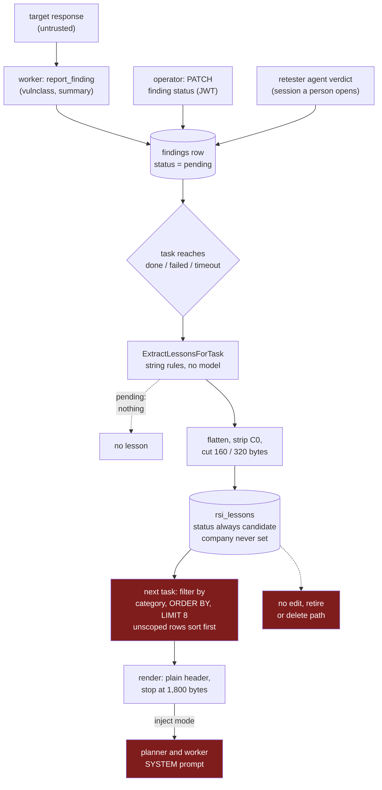

## 1. Executive Summary

ARTEX is a self-hosted penetration-testing platform in Go on PostgreSQL. A
planner splits a goal into intents, workers run tools, and results are written
into two graphs: a global asset graph and a per-task exploration graph. This
report covers only what the system remembers across turns and tasks.

It carries `scope_enforced`, `audit_log` and `negative_eval`. None of them sits
on the lessons subsystem, which is the part named for learning.

**Licence and provenance.** `LICENSE` is the unmodified AGPL-3.0 text. The
README then adds permitted and prohibited uses, calls them additional terms
from the maintainers, and says use of the project means agreement
(`README.md:723-756`); code review and academic research are listed as
permitted. `web/` is MIT, a third party's UI template. The repository is an
English translation and continuation of a project whose original repository is
no longer public (`README.md:698-700`), and its history holds the original
author's commits to 7 October 2026. The Go module path and the agent SDK
dependency still carry the original owner's name, and the SDK was not opened
for this reading.

**Cross-task memory has three forms, and the oldest is the soundest.**

- **Inheritance.** A task may name up to eight source tasks. Its agents then
  read the sources' facts, findings and finished intents, tagged as inherited,
  through one hop of live relations (`db/exploration_sources.go:16-41`). Writes
  cannot cross: every mutation carries the receiving task's `exploration_id`.
- **The asset graph.** One table for the installation. An agent inside a task
  sees only assets within the declared scope of that task and its sources
  (`db/task_assets_context.go:65-90`).
- **Lessons.** When a task ends, a rule turns each triaged finding into one
  line of text for later tasks (`db/lessons.go:81-169`). No model writes it.
  Injection is off unless `ARTEX_RSI_LESSONS=inject`.

**The lesson ranking is inverted.** The selection sorts on
`(l.company_id=$1) DESC, (l.category_id=$2) DESC` (`db/lessons.go:206`). For a
lesson with no company or category that comparison is NULL, and PostgreSQL
sorts NULLs first under `DESC`. Unscoped lessons therefore outrank the task's
own, the comment above the function says the opposite (`:181-183`), and with
`LIMIT 8` and no cursor a category's lessons are unreachable once eight
unscoped ones exist. Re-derived on a scratch PostgreSQL with the lifted DDL and
query: ten unscoped lessons and five matching ones returned eight unscoped.

**Target-derived text reaches the system prompt.** A lesson's cue and action
are a finding's `vulnclass` and `summary`, which a worker wrote from what it
read off the target. In inject mode they are appended to the planner's and the
worker's system prompt in later tasks (`agent/planner.go:514`,
`agent/worker.go:450`). The codebase has a nonce-framed envelope for exactly
this class of text and uses it everywhere else; the lessons block gets a
plain-text header, control-character stripping and a 320-byte cap.

## 2. Mental Model

A lesson is a triaged finding, restated by rule and never revisited.

## 3. Architecture

A Go server, a PostgreSQL schema in one idempotent file of 57 tables, an agent
package (planner, worker, main agent, retester, compactor) on an external SDK,
and a Next.js UI. There is one operator: a single JWT subject guards every API
route but login and health (`server/auth.go:161-164`, `:217-235`). There is no
user or tenant table.

| Memory surface | Scope | Written by |
| --- | --- | --- |
| Asset graph | Installation | Agent tools, scan ingest, HTTP |
| Exploration graph | Task, plus direct sources on read | Planner and worker tools |
| Coverage ledger and history | Task | Worker's `record_coverage` |
| Cold digests | Task | Background model pass |
| Lessons | Category, in effect | Rule-based extraction at task end |
| Task credentials | Task | Agent or operator |
| Skills directory | Installation | The platform agent only |

Planner rounds are stateless: each is a fresh session rebuilt from a graph
overview, the coverage line and the planner's own todo list
(`agent/planner.go:48`, `:137-161`). The todo list lives in a Go map on the
planner struct.

### Deployment and ergonomics

Docker Compose with PostgreSQL, or a single binary with the UI embedded. The
lessons flag appears in `RSI.md` and `docs/rsi-lessons.md` and in no README,
example environment file or UI.

## 4. Essential Implementation Paths

| Path | Location |
| --- | --- |
| Lesson text normalisation | `db/lessons.go:40-52` |
| Lesson scope lookup | `db/lessons.go:61-76` |
| Extraction rules | `db/lessons.go:81-169` |
| Dedupe key and upsert | `db/lessons.go:54-59`, `:171-179` |
| Selection query | `db/lessons.go:192-209` |
| Rendering | `db/lessons.go:249-277` |
| Wiring into the agents | `server/lessons.go:41-70` |
| Lesson tables | `db/schema.sql:1538-1574` |
| Scoped asset read | `db/asset_dsl.go:559-637`, `db/task_assets_context.go:65-90` |
| Task inheritance | `db/exploration_sources.go:16-41`, `:74-81` |
| Fact write and labels | `agent/tools.go:1503-1575` |
| Goal proof refusals | `agent/tools.go:1326-1347` |
| Graph overview windows | `agent/tools.go:450-683` |
| Data envelope | `agent/data_envelope.go:10-57` |
| Coverage ledger and history | `db/coverage_ledger.go:149-187` |
| Cold digests | `agent/compaction.go:55-148`, `db/digest.go:122-221` |
| Finding disposition route | `server/server.go:2469-2511` |

## 5. Memory Data Model

**Asset.** One row per domain, IP, subdomain, app, service or endpoint, unique
on its value with no task or company in the key (`db/schema.sql:84-92`). It
carries `task_ids`, a company, and three record times: `created_at`,
`last_seen`, `updated_at`.

**Exploration node.** `kind` is one of `begin`, `goal`, `intent`, `fact`,
`finding`, `hint`, `digest`, with a JSON payload, a `state` and an `origin`
stamped by the server from the calling agent. Edges are `spawns`,
`derived_from`, `yields`, `proves`, `covers`. An anchor row links a node to an
asset.

**Fact.** A summary, a detail, a one-line evidence string, a `confidence` of
`observed` or `inferred`, and a `source` from a fixed list that includes
`target_response`, `tool_output` and `inference` (`agent/tools.go:1507-1529`).
Both labels are declared by the agent that writes the fact.

**Finding.** A node plus a `findings` row whose `status` starts at `pending`
(`db/schema.sql:1201`) and is the person's disposition: `confirmed`,
`false_positive`, `duplicate`, `ignored`, `risk_accepted` and others. Evidence
binds a finding to content-addressed snapshots of captured requests and
responses.

**Lesson.** `kind` (`positive`, `negative`, `caution`), `cue`, `action`,
optional category and company, a `status`, and a `dedupe_key` that is a hash of
kind, scope, cue and action. Support is not stored; it is the count of
evidence rows at read time. The status column accepts `candidate`, `adopted`
and `retired` and has one writer, its default, so every row is `candidate`.

No field records when something about a target was true, as distinct from when
it was written. `bitemporal` is withheld.

## 6. Retrieval Mechanics

### The planner's view of its own task

`graphOverviewData` is injected into every planner round as windows over the
graph, each newest first: thirty open intents, twelve recent finished ones,
ten findings, twenty facts not folded into a digest, fifteen digests
(`agent/tools.go:450-683`). The rest stay reachable. `list_facts` pages by
cursor, `list_findings` lists up to 500, and a folded region opens with
`expand_digest`.

### Other tasks

`…WithSources` readers append the direct source tasks' nodes, tagged with the
source task id. An inherited intent is visible only once it is terminal, so a
running source task's in-flight work never enters another task's frontier
(`db/exploration_sources.go:74-81`). The overview's share for related tasks is
capped at 48,000 runes, 8,000 per source.

### Assets

`list_assets` inside a task goes through `scopeTargetCTE`: the task and its
direct sources, joined to their declared scope rows by company, root domain,
subdomain, IP range or registration number, and the query adds
`id IN (SELECT id FROM target)` (`db/asset_dsl.go:584`). Membership is by
declared scope, not by which task produced the asset. With no task id, the
platform and chat agents get the unscoped query (`:560-562`).

No read filters on `last_seen`; it orders results only.

### Lessons

One query, shown in section 1, with `LIMIT 8` for injection and 50 for the
HTTP preview. Rendering stops at the first entry that would pass 1,800 bytes
(`db/lessons.go:268-270`), so a long early entry hides shorter later ones. The
block is fixed when the task's agents are built.

## 7. Write Mechanics

### Facts, findings, coverage

Workers call `record_fact`, `report_finding` and `record_coverage`. A fact is
created `confirmed` with its origin stamped by the server; no tool or route
edits or deletes one. A coverage write that exceeds a field limit is refused
instead of truncated (`db/coverage_ledger.go:41-52`).

### Assets

Eight upsert functions. On conflict the last non-null writer wins per scalar
column and arrays are unioned (`db/assets.go:752-776`). When two tasks
disagree about a status code or a page title, the later one replaces the
earlier and nothing keeps the old value.

### Lessons

`ExtractLessonsForTask` reads each finding of the task with its newest retest
and applies four rules (`db/lessons.go:145-166`):

- `confirmed`, `resolved` or `fixed` gives a **positive** lesson, and a second
  one when the latest retest reproduced it.
- `false_positive`, `duplicate`, `ignored` or `risk_accepted` gives a
  **negative** lesson that begins `Do not re-report without new mechanics`.
- A latest retest of `fixed` or `inconclusive` gives a **caution**, whatever
  the finding's status.
- `pending` and `in_progress` give nothing.

A finding's status has two writers in product code: the operator's
authenticated `PATCH`, and a completed retest whose verdict is `fixed`
(`db/finding_retests.go:267-283`). The retest verdict comes from the retester
agent, in a session only a person can open. No planner or worker tool takes a
finding status.

Deduplication needs identical text. Positive and negative actions embed the
finding's free-text summary, so two tasks merge into one lesson only when
their summaries match; cautions hold only the cue and verdict and merge
widely.

### Operational cost

Lessons cost one query per task start and no model call. Digests cost one
model call per folded block, with bodies reused when a block's member set and
content version are unchanged.

## 8. Agent Integration

The lessons block is appended to the system prompt of the planner and the
worker and to no other agent. Every other derived field in a prompt, such as
recent facts, findings, digests, related-task data and hints not written by
the operator, goes in the user message between `[[ARTEX_DATA nonce=…]]`
markers with a fresh random nonce per message, and the marker stem is
rewritten inside the content (`agent/data_envelope.go:27-57`). The file's own
comment prices it: the frame marks data and cannot stop a model from following
it.

**`human_review` is withheld.** A person's disposition is what admits most
lessons, and the agent that wrote the finding holds no tool that sets it. Two
things keep the mark off. A model's retest verdict also admits lessons: `fixed`
sets the finding's status and yields a positive lesson, and `fixed` or
`inconclusive` yields a caution on a finding nobody has triaged. And what is
reviewed is the finding; the lesson's own status column is never written, and
candidates are injected as they stand.

## 9. Reliability, Safety, and Trust

### The company scope of lessons is empty

`taskLessonScope` reads `tasks.company_id` (`db/lessons.go:63-65`). Task
creation inserts no value for that column and stores a task's companies as
scope rows instead (`db/tasks.go:261-263`, `:296-306`). The only product
statements that touch the column clear it or restore an archived value. Every
lesson is therefore stored with no company, and is offered to any task in the
same category, or to every task when the source task had none. A positive
lesson's text is the finding summary, which names the source target's
endpoints.

### A false-positive disposition never reaches the agents

The disposition lives on the `findings` row. The planner and workers read
finding nodes, whose state is `confirmed` from creation; `list_findings` and
the overview return node state and never the row's status
(`agent/tools.go:1024-1067`). A finding the operator marked `false_positive`
stays under confirmed findings for its own task's later rounds and for every
task that inherits it. The node state `dismissed` exists in the schema and has
no writer outside one test.

### A reversed disposition leaves both lessons

Extract with a finding `confirmed`, change it to `false_positive`, extract
again: a negative lesson is inserted under a different key and the positive
one stays. Both render, positive first, citing the same finding id.

### Extraction fires before triage

Extraction runs when the task reaches a terminal status
(`server/manager.go:1501`, `:1533-1535`). A finding nobody has triaged is
`pending` and yields nothing. A disposition set afterwards produces a lesson
only through `POST /api/tasks/{id}/lessons/extract`, which no UI or script in
the tree calls. The committed test passes because it inserts the finding
already confirmed (`server/lessons_test.go:140-142`).

### No lesson can be removed

Nothing outside tests updates or deletes a lesson row, and there is no expiry.
Deleting the source task or finding leaves the lesson with an evidence string
naming an id that is gone. `docs/rsi-lessons.md:80` states the absence as a
choice.

Deleting a category or company widens its lessons: both foreign keys are
`ON DELETE SET NULL` (`db/schema.sql:1546-1547`) and NULL means visible to
all. Re-derived on the scratch database.

### Byte truncation and non-ASCII text

`lessonText` cuts with a byte slice (`db/lessons.go:48-50`). A cut inside a
multi-byte character leaves invalid UTF-8, which PostgreSQL rejects; the
extraction returns the error and skips every later finding of the task. In a
separate script emulating the function, an all-CJK summary produced an invalid
320-byte action in 20 of 30 alignments, and the scratch database rejected such
a value. The Go driver was not run. The original project was Chinese-language,
and the lesson tests use ASCII only.

### The usage log over-reports

`wireTaskLessons` logs every selected id, while rendering stops at 1,800
bytes. In the re-derivation, eight long positive lessons selected gave four
rendered. `rsi_lesson_usage`, the table the docs propose for comparing tasks
that saw lessons, records lessons that never reached a prompt, and nothing
reads it.

### Why four marks are withheld

`human_review` and `bitemporal` are covered above.

**`tombstone`.** The negative lesson is the nearest thing. It is a line of
prompt text, and the write path never consults it: a re-reported finding lands
as a new `pending` row.

**`trust_state`.** Four candidates. The lesson status has one value. The node
state `dismissed` has no writer. The finding disposition gates extraction once
and no agent read consults it. A fact's `confidence` and `source` come closest:
`prove_goal` refuses a fact that is not `observed` or whose source is the
target's own response (`agent/tools.go:1326-1347`). Those are labels the
writing agent declares at write time, they never change, and no read path
filters on them.

## 10. Tests, Evals, and Benchmarks

1,191 `func Test` in 287 files. CI starts PostgreSQL 16 and runs `go test -p 1
./...` with `gofmt`, `go build` and `go vet`
(`.github/workflows/ci.yml:9-51`). I ran none of it.

**The boundary tests are the strong part.**
`TestExplorationDirectSourceReadView` asserts that a source of a source is
invisible, that a live source intent is absent from the frontier, the
inherited list and finding lineage, and that an inherited fact cannot be
mutated through the receiving store (`db/exploration_sources_test.go:92-217`).
`TestInheritedActivityReadsRequireTerminalIntent` asserts five read paths do
not return a reopened intent (`:8-88`). `TestQueryDSLInScopeMembership` tags
in-scope assets with a foreign producer task, to show membership is by scope,
and asserts out-of-scope ids are absent (`db/assets_test.go:1148-1268`).

**Lessons have four tests** and none of them covers ordering, the limit, the
scope predicate, a `pending` finding yielding nothing, injection into a
prompt, or multi-byte text. `TestRenderLessonsDataNotInstructions` checks the
header, flattening and that no NUL survives (`db/lessons_test.go:8-35`).

`RSI.md` cites six arXiv papers as the source of the design's ideas, and the
identifiers resolve to the titles it names. ARTEX has no paper of its own.
`scripts/benchmark/` holds a runner and one ground-truth file; results are
written to an ignored directory and none is committed. Nothing in the tree
measures whether lessons help.

## 11. For Your Own Build

### Steal

**Make cross-task inheritance explicit, one hop and live.** A named relation,
a cap, a query on every read so a deleted source disappears, and only finished
work visible. Read-only falls out of scoping every write to the receiver.

**Frame stored text when it re-enters a prompt.** A per-message random nonce
on both markers, and the marker stem neutralised inside the content.

**Stamp the writer on the server.** A fact's `origin` is never taken from the
tool's input.

**Let summaries hide and never delete.** A digest covers its members while
they stay cold, a revived member reappears, and a re-compression starts from
the source nodes.

**Refuse an over-long field.** Truncating evidence silently changes what was
recorded.

### Avoid

**Do not sort on an equality that can be NULL.** `(col = $1) DESC` puts NULLs
first in PostgreSQL. Write `COALESCE(col = $1, false)` or `IS NOT DISTINCT
FROM`, and test the order.

**Do not exempt one prompt block from the defence the others get.** The
lessons block is the only stored, target-derived text in the system prompt.

**Do not keep the disposition where the agents do not read.** The person's
verdict and the agent's view of a finding are two columns on two rows.

**Do not ship a memory with no removal path.** A wrong lesson stays until
someone runs SQL.

**Do not scope on a column nothing writes.**

### Fit

The inheritance model and the scoped asset read suit any multi-task agent
platform with one operator. The lessons subsystem is a careful sketch: rule
built, evidence linked, off by default, and not yet safe to turn on across
unrelated targets.

## 12. Open Questions

- **Was `tasks.company_id` meant to be filled?** A second reader,
  `db/task_outcome.go:60`, uses the same column.
- **Who retires a lesson?** `RSI.md:53-55` calls status changes owner actions,
  and no owner action exists.
- **Does restoring an archived task renumber its findings?** If it does, a
  second extraction adds evidence for the same underlying finding. Not traced.
- **What does the agent SDK persist?** Session compaction and transcripts live
  in a dependency this reading did not open.

## Appendix: File Index

| File | Role |
| --- | --- |
| `db/lessons.go`, `server/lessons.go` | Lesson extraction, selection, rendering, wiring |
| `db/lessons_test.go`, `server/lessons_test.go` | The four lesson tests |
| `docs/rsi-lessons.md`, `RSI.md` | The project's description of the loop |
| `db/schema.sql` | All 57 tables |
| `db/asset_dsl.go`, `db/task_assets_context.go`, `db/assets.go` | Asset reads and upserts |
| `db/exploration.go`, `db/exploration_sources.go` | The per-task graph and inheritance |
| `db/coverage_ledger.go` | Coverage ledger and its history |
| `db/digest.go`, `agent/compaction.go`, `agent/coldgraph.go` | Cold digests |
| `agent/tools.go` | Graph overview, facts, findings, goal proof |
| `agent/data_envelope.go` | The nonce-framed envelope |
| `agent/planner.go`, `agent/worker.go` | Where the lessons block joins the system prompt |
| `db/findings.go`, `db/finding_retests.go` | Finding status writers |
| `db/exploration_sources_test.go`, `db/assets_test.go` | The boundary tests |

### Recorded searches

Run with `/usr/bin/git` in a full clone at the pinned commit.

- `git grep -c -E '^func Test' -- '*.go'`, summed — 1,191.
- `git grep -n -E 'UPDATE rsi_|DELETE FROM rsi_' -- .` — four lines in `server/lessons_test.go`; no product code.
- `git grep -n -E "'retired'|'adopted'" -- .` — the read predicate at `db/lessons.go:203` and the CHECK at `db/schema.sql:1549`.
- `git grep -n -E 'FROM rsi_lesson_usage|JOIN rsi_lesson_usage' -- .` — nothing.
- `git grep -n -E 'tasks SET|INTO tasks' -- '*.go' '*.sql'` — of the product statements, only `db/task_archives_restore.go:121-124` and `:322` name `company_id`, to clear or restore it.
- `git grep -n -E 'f\.status|findings\.status|FindingFalsePositive|FindingPending' -- 'agent/*.go'` — nothing.
- `git grep -n -E 'SetNodeState\(' -- '*.go'` — one product call, with `met`, at `agent/tools.go:1350`; `dismissed` is passed only at `db/exploration_sources_test.go:212`.
- `git grep -n -E '(UPDATE|DELETE FROM) coverage_ledger_history' -- .` — nothing.
- `git grep -n -i -l lessons -- web extension scripts` — nothing.
- `git grep -n -E 'last_seen' -- 'agent/*.go' 'server/*.go' ':!*_test.go'` — nothing.
- `git grep -n -i -E 'CREATE TABLE IF NOT EXISTS (users|accounts|tenants|orgs)' -- '*.sql' '*.go'` — nothing.

## History

**2026-11-16** — [`9f99b7172aab33512d319f082080cb2892253e91`](https://github.com/BaaRai/ARTEX/commit/9f99b7172aab33512d319f082080cb2892253e91) — first reading, of the memory surfaces only. Screened first: four manifests inside the seven-day cooldown, one build-time script, two unpinned surfaces. Nothing from the tree was built or run; the lesson ordering, scope widening and text truncation were re-derived with lifted SQL on a scratch PostgreSQL and in a separate script.
