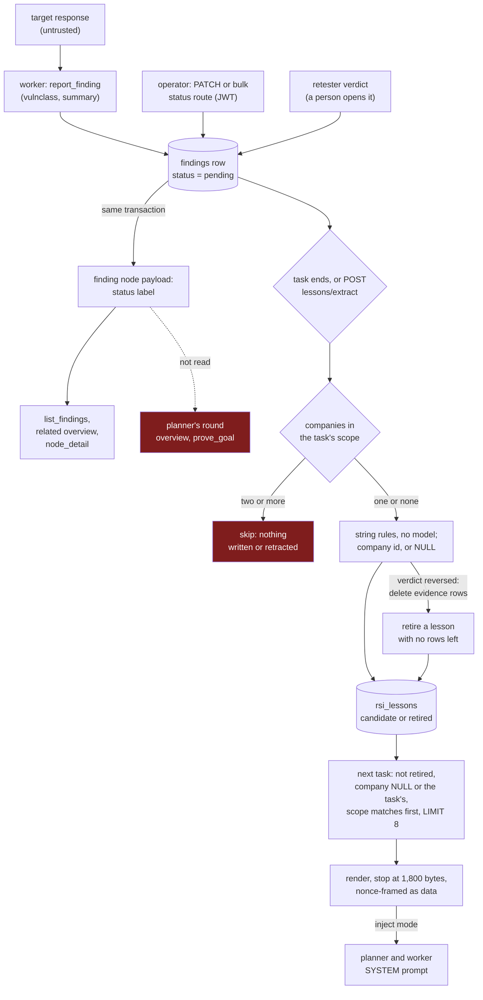

## 1. Executive Summary

ARTEX is a self-hosted penetration-testing platform in Go on PostgreSQL. A
planner splits a goal into intents, workers run tools, and results are written
into two graphs: a global asset graph and a per-task exploration graph. This
report covers only what the system remembers across turns and tasks.

It carries `trust_state`, `scope_enforced`, `audit_log` and `negative_eval`.
The first sits on the lessons subsystem alone, and `audit_log` does not reach
it.

**Licence and provenance.** `LICENSE` is the unmodified AGPL-3.0 text. The
README then adds permitted and prohibited uses, calls them additional terms
from the maintainers, and says use of the project means agreement
(`README.md:771-806`); code review and academic research are listed as
permitted. `web/` is MIT, a third party's UI template. The repository is an
English translation and continuation of a project whose original repository is
no longer public (`README.md:745-747`), and its history holds the original
author's commits to 7 October 2026. The Go module path and the agent SDK
dependency still carry the original owner's name, and the SDK was not opened
for this reading.

**Cross-task memory has three forms, and the oldest is the soundest.**

- **Inheritance.** A task may name up to eight source tasks. Its agents then
  read the sources' facts, findings and finished intents, tagged as inherited,
  through one hop of live relations (`db/exploration_sources.go:16-41`). Writes
  cannot cross: every mutation carries the receiving task's `exploration_id`.
- **The asset graph.** One table for the installation. An agent inside a task
  sees only assets within the declared scope of that task and its sources
  (`db/task_assets_context.go:65-90`).
- **Lessons.** When a task ends, a rule turns each triaged finding into one
  line of text for later tasks (`db/lessons.go:105-206`). No model writes it.
  Injection is off unless `ARTEX_RSI_LESSONS=inject`.

**A lesson follows the verdict behind it.** Each lesson holds evidence rows
naming the finding or retest it came from. When a person reverses a finding's
disposition, the next extraction deletes that finding's rows from the lessons
of the opposite kind and sets a lesson with no rows left to `retired`, which
the selection excludes (`db/lessons.go:183-196`, `:291-302`, `:326`). Three
things limit it. The extraction runs when the task ends or when one HTTP route
is called, and no interface calls that route. The deleted rows are the only
record of what supported the lesson. And a lesson from a task with no company
is stored unscoped and served to every task.

**A false-positive verdict is a label on some reads.** The disposition is
copied into the finding node's payload in the same transaction, so
`list_findings`, the related-task overview and `node_detail` show it. The list
of findings injected into every planner round omits it, and `prove_goal`
accepts any finding node as proof without reading it
(`agent/tools.go:566-579`, `:1330-1354`).

## 2. Mental Model

A lesson is a triaged finding restated by rule, kept while its evidence
stands.

## 3. Architecture

A Go server, a PostgreSQL schema in one idempotent file of 57 tables, an agent
package (planner, worker, main agent, retester, compactor) on an external SDK,
and a Next.js UI. There is one operator: a single JWT subject, bound to a
password version, guards every API route but the auth routes and health
(`server/auth.go:186-194`, `:285-303`). There is no user or tenant table.

| Memory surface | Scope | Written by |
| --- | --- | --- |
| Asset graph | Installation | Agent tools, scan ingest, HTTP |
| Exploration graph | Task, plus direct sources on read | Planner and worker tools |
| Coverage ledger and history | Task | Worker's `record_coverage` |
| Cold digests | Task | Background model pass |
| Lessons | Company and category, or neither | Rule-based extraction at task end |
| Task credentials | Task | Agent or operator |
| Skills directory | Installation | The platform agent only |

Planner rounds are stateless: each is a fresh session rebuilt from a graph
overview, the coverage line and the planner's own todo list
(`agent/planner.go:48-50`, `:137-162`). The todo list lives in a Go map on the
planner struct.

### Deployment and ergonomics

Docker Compose with PostgreSQL, or a single binary with the UI embedded. The
lessons flag appears in `RSI.md` and `docs/rsi-lessons.md` and in no README,
example environment file or UI.

## 4. Essential Implementation Paths

| Path | Location |
| --- | --- |
| Lesson text normalisation | `db/lessons.go:40-55` |
| Lesson scope lookup | `db/lessons.go:64-93`, `db/task_context.go:352-356` |
| Extraction rules | `db/lessons.go:105-206` |
| Dedupe key and upsert | `db/lessons.go:57-62`, `:208-225` |
| Evidence retraction and retirement | `db/lessons.go:230-302` |
| Selection query | `db/lessons.go:307-333` |
| Rendering | `db/lessons.go:375-404` |
| Wiring into the agents | `server/lessons.go:41-66`, `agent/data_envelope.go:59-68` |
| Lesson tables | `db/schema.sql:1543-1579` |
| Scoped asset read | `db/asset_dsl.go:559-637`, `db/task_assets_context.go:65-90` |
| Task inheritance | `db/exploration_sources.go:16-41`, `:74-81` |
| Fact write and labels | `agent/tools.go:1497-1582` |
| Goal proof refusals | `agent/tools.go:1330-1354` |
| Graph overview windows | `agent/tools.go:450-683` |
| Data envelope | `agent/data_envelope.go:10-57` |
| Coverage ledger and history | `db/coverage_ledger.go:149-187` |
| Cold digests | `agent/compaction.go:55-148`, `db/digest.go:122-221` |
| Finding disposition routes | `server/server.go:2534-2575`, `:2649` |
| Disposition write and node mirror | `db/notification.go:557-587` |

## 5. Memory Data Model

**Asset.** One row per domain, IP, subdomain, app, service or endpoint, unique
on its value with no task or company in the key (`db/schema.sql:84-92`). It
carries `task_ids`, a company, and three record times: `created_at`,
`last_seen`, `updated_at`.

**Exploration node.** `kind` is one of `begin`, `goal`, `intent`, `fact`,
`finding`, `hint`, `digest`, with a JSON payload, a `state` and an `origin`
stamped by the server from the calling agent. Edges are `spawns`,
`derived_from`, `yields`, `proves`, `covers`. An anchor row links a node to an
asset.

**Fact.** A summary, a detail, a one-line evidence string, a `confidence` of
`observed` or `inferred`, and a `source` from a fixed list that includes
`target_response`, `tool_output` and `inference` (`agent/tools.go:1508-1533`).
Both labels are declared by the agent that writes the fact.

**Finding.** A node plus a `findings` row whose `status` starts at `pending`
(`db/schema.sql:1201`) and is the person's disposition: `confirmed`,
`false_positive`, `duplicate`, `ignored`, `risk_accepted` and others. A second
column, `report_state`, tracks the report stage after triage and feeds no
lesson.
Evidence binds a finding to content-addressed snapshots of captured requests
and responses.

**Lesson.** `kind` (`positive`, `negative`, `caution`), `cue`, `action`,
optional category and company, a `status`, and a `dedupe_key` that is a hash of
kind, scope, cue and action. Support is not stored; it is the count of
evidence rows at read time. The status column accepts `candidate`, `adopted`
and `retired`. Product code writes `retired` and returns a row to `candidate`;
`adopted` appears only in the CHECK constraint and in a test that sets it with
SQL (`db/schema.sql:1553-1554`, `db/lessons_test.go:808`).

The company comes from the task's `task_scope` rows of kind `company`. A task
with exactly one gets that id on its lessons, and a task with none gets NULL
(`db/lessons.go:88-93`). Scope rows may also be root domains, subdomains,
addresses and ranges (`db/schema.sql:767`), so a task declared by domain alone
has no company.

No field records when something about a target was true, as distinct from when
it was written. `bitemporal` is withheld.

## 6. Retrieval Mechanics

### The planner's view of its own task

`graphOverviewData` is injected into every planner round as windows over the
graph, each newest first: thirty open intents, twelve recent finished ones,
ten findings, twenty facts not folded into a digest, fifteen digests
(`agent/tools.go:450-683`). The rest stay reachable. `list_facts` pages by
cursor, `list_findings` lists up to 500, and a folded region opens with
`expand_digest`.

### Other tasks

`…WithSources` readers append the direct source tasks' nodes, tagged with the
source task id. An inherited intent is visible only once it is terminal, so a
running source task's in-flight work never enters another task's frontier
(`db/exploration_sources.go:74-81`). The overview's share for related tasks is
capped at 48,000 runes, 8,000 per source.

### Assets

`list_assets` inside a task goes through `scopeTargetCTE`: the task and its
direct sources, joined to their declared scope rows by company, root domain,
subdomain, IP range or registration number, and the query adds
`id IN (SELECT id FROM target)` (`db/asset_dsl.go:584`). Membership is by
declared scope, not by which task produced the asset. With no task id, the
platform and chat agents get the unscoped query (`:560-562`).

No read filters on `last_seen`; it orders results only.

### Lessons

One query (`db/lessons.go:315-333`). It keeps rows that are not `retired`,
whose company is NULL or one of the task's, and whose category is NULL or the
task's. It orders company matches first, then category matches, then positive
before negative before caution, then support, with `LIMIT 8` for injection and
50 for the HTTP preview. Both scope terms are written
`col IS NOT NULL AND col = …`, so a NULL never sorts ahead of a match. On a
scratch PostgreSQL with the lifted DDL and query, ten unscoped lessons and five
of the task's company returned the five first and three unscoped, and a task
of a second company received none of the five.

Rendering stops at the first entry that would pass 1,800 bytes
(`db/lessons.go:394-396`), so a long early entry hides shorter later ones. The
function returns the ids it rendered, and those are what the usage log records
(`server/lessons.go:55-65`). The block is fixed when the task's agents are
built.

## 7. Write Mechanics

### Facts, findings, coverage

Workers call `record_fact`, `report_finding` and `record_coverage`. A fact is
created `confirmed` with its origin stamped by the server; no tool or route
edits or deletes one. A fact's asset anchors must name existing assets, checked
under a row lock before the node is created. A coverage write that exceeds a
field limit is refused instead of truncated (`db/coverage_ledger.go:41-52`).

### Assets

Eight upsert functions. On conflict the last non-null writer wins per scalar
column and arrays are unioned (`db/assets.go:754-778`). When two tasks
disagree about a status code or a page title, the later one replaces the
earlier and nothing keeps the old value.

### Lessons

`ExtractLessonsForTask` returns at once for a task with more than one company,
because the row has one company column (`db/lessons.go:110-112`). Otherwise it
reads each finding of the task with its newest retest and applies four rules
(`:173-203`):

- `confirmed`, `resolved` or `fixed` gives a **positive** lesson, and a second
  one when the latest retest reproduced it.
- `false_positive`, `duplicate`, `ignored` or `risk_accepted` gives a
  **negative** lesson that begins `Do not re-report without new mechanics`.
- A latest retest of `fixed` or `inconclusive` gives a **caution**, whatever
  the finding's status.
- `pending` and `in_progress` give nothing and retract nothing.

The first two rules also retract. A positive disposition deletes the finding's
evidence row from negative lessons. A negative one deletes it from positive
lessons, with every retest of the finding (`:183-196`, `:230-269`). A lesson
left with no evidence is set to `retired`, and an upsert that meets a retired
row with no evidence sets it back to `candidate` (`:291-302`, `:213-222`).

A finding's status has three writers in product code, all through
`SetFindingStatusTx`: the operator's authenticated `PATCH`, a bulk route for
several findings, and a completed retest whose verdict is `fixed`
(`db/notification.go:557-587`, `db/finding_retests.go:267-283`). The retest
verdict comes from the retester agent, in a session only a person can open. No
planner or worker tool takes a finding status.

Deduplication needs identical text. Positive and negative actions embed the
finding's free-text summary, so two tasks merge into one lesson only when
their summaries match; cautions hold only the cue and verdict and merge
widely. Text is cut by runes, 160 for the cue and 320 for the action
(`db/lessons.go:48-53`).

### Operational cost

Lessons cost one query per task start and no model call. Digests cost one
model call per folded block, with bodies reused when a block's member set and
content version are unchanged.

## 8. Agent Integration

The lessons block is appended to the system prompt of the planner and the
worker and to no other agent. `frameLessonsBlock` wraps it in the nonce-framed
envelope with a fresh nonce per assembly and the marker stem rewritten inside
the content (`agent/data_envelope.go:59-68`, `agent/planner.go:520`,
`agent/worker.go:470`). Every other derived field goes in the user message
inside the same frame: recent facts, findings, digests, related-task data,
intent summaries and hints not written by the operator (`:27-57`). The file's
own comment prices it: the frame marks data and cannot stop a model from
following it. The lessons block is the one framed field placed in the system
prompt.

**`human_review` is withheld.** A person's disposition is what admits most
lessons, and the agent that wrote the finding holds no tool that sets it. Two
things keep the mark off. A model's retest verdict also admits lessons: `fixed`
sets the finding's status and yields a positive lesson, and `fixed` or
`inconclusive` yields a caution on a finding nobody has triaged. And what is
reviewed is the finding. The lesson's own status is written by the extraction
rule and by nobody else: no route or interface retires or adopts a lesson, and
candidates are injected as they stand.

## 9. Reliability, Safety, and Trust

### A false-positive verdict reaches three reads of five

`SetFindingStatusTx` writes the status to the `findings` row and to the
finding node's payload in one transaction (`db/notification.go:578-587`).
`compactFinding` emits it, so `list_findings` and the related-task overview
carry `status` beside the node's `state`, and `node_detail` returns the whole
payload (`agent/tools.go:1025-1042`, `:874`). An inheriting task reads the same
node and sees the same label.

Two paths do not read it. The overview injected into every planner round lists
the ten newest findings as id, summary and source intent, and counts all of
them in `findings_total`, which its own comment calls the place goal judgment
looks (`agent/tools.go:545-579`). And `prove_goal` checks a fact's confidence
and source and checks nothing on a finding: a finding marked `false_positive`
can mark a goal `met`, and a task whose goals are all met is judged complete
(`:1330-1354`). The node state stays `confirmed`; `dismissed` exists in the
schema and has no writer outside one test.

### Lessons from a task with no company reach every task

A lesson's company is NULL when its source task had no company scope row, and
the selection's `l.company_id IS NULL` matches every task in the category, or
every task when the source had no category (`db/lessons.go:88-93`, `:327-328`).
A positive lesson's text is the finding summary, which names the source
target's endpoints. `TestExtractLessonsGenericWhenTaskHasNoCompany` pins the
behaviour (`db/lessons_test.go:273`).

Three more routes lead to the same state:

- **Rows written before 17 November 2026.** Until that day's change the scope
  lookup read `tasks.company_id`, which task creation does not fill, so every
  lesson was stored with no company. No migration rescopes them, and the
  dedupe key includes the company, so a new extraction writes a scoped twin
  beside the old row.
- **A deleted company or category.** Both foreign keys are
  `ON DELETE SET NULL` (`db/schema.sql:1551-1552`). On the scratch database,
  deleting a company made its five lessons visible to a task of another.
- **A task that gains a second company.** The multi-company skip returns
  before any retraction (`db/lessons.go:110-112`), so lessons extracted while
  the task had one company cannot be retracted afterwards.

### Retraction waits for a call nothing makes

Extraction runs when the task reaches a terminal status
(`server/manager.go:1537`, `:1569-1571`) and on
`POST /api/tasks/{id}/lessons/extract`. A disposition `PATCH` does not run it,
which `docs/rsi-lessons.md:41-42` states, and no UI or script in the tree
calls the route. Between a person's reversal and the next extraction the old
lesson stays `candidate` and selectable. A finding set back to `pending`
retracts nothing even then, by design and under test
(`db/lessons_test.go:820`).

The same timing governs admission. A finding nobody has triaged when the task
ends yields nothing, and the disposition set afterwards produces a lesson only
through that route. The committed end-of-task test inserts its finding already
confirmed (`server/lessons_test.go:142`).

### Retraction deletes its own record

The retraction is a `DELETE` on the evidence rows (`db/lessons.go:232`,
`:253`). A retired lesson keeps its cue, action, status and `updated_at`, and
nothing records which finding supported it or when the support was withdrawn.
Lessons therefore have no mutation history, and `audit_log` rests on the
coverage ledger alone.

No statement edits or deletes a lesson row. Deleting the source task or
finding leaves the lesson with an evidence string naming an id that is gone,
and extraction, which walks the task's existing findings, can no longer
retract it.

### Two lessons for one finding

Both cases were re-derived on the scratch database with the lifted upsert and
retraction statements.

- **A change inside the negative group forks the lesson.** The action text
  ends with the status, and retraction removes evidence only from the opposite
  kind. `false_positive` followed by `duplicate` left two negative lessons,
  each citing the same finding.
- **A retired lesson returns on any matching extraction.** After a reversal
  retired `Confirmed xss: s`, a second finding with the same cue and summary
  set it back to `candidate`. It then rendered ahead of the negative lesson
  for the same text.

### The byte cap and multi-byte text

Fields are cut in runes and the block is capped in bytes. In a script
emulating `RenderLessons`, eight full-length lessons in three-byte characters
rendered one, and eight in four-byte characters rendered none, leaving no
block. The original project was Chinese-language.

The usage table `rsi_lesson_usage` records the rendered ids and has no reader
outside one test.

### Why three marks are withheld

`human_review` and `bitemporal` are covered above.

**`tombstone`.** Two near-misses. The negative lesson is a line of prompt text
that the write path never consults: a re-reported finding lands as a new
`pending` row. The retired lesson is keyed on a hash of its text, and the
upsert does consult it, but a retired row with no evidence is exactly the row
it revives. The branch that keeps a retired row retired applies when evidence
remains, a state only hand-written SQL produces
(`db/lessons.go:215-222`, `db/lessons_test.go:731`).

**`trust_state` is awarded on lessons and stops there.** The finding's triage
status is a label nothing branches on. The node state `dismissed` has no
writer. A fact's `confidence` and `source` are declared by the writing agent
at write time, never change, and filter no read; `prove_goal` refuses on them
(`agent/tools.go:1337-1351`).

## 10. Tests, Evals, and Benchmarks

1,372 `func Test` in 317 test files. CI starts PostgreSQL 16 and runs `go test
-p 1 ./...` with `gofmt`, `go build` and `go vet`, a race-detector pass over
named packages, and an advisory job on the newest Go release
(`.github/workflows/ci.yml:9-119`). I ran none of it.

**The boundary tests are the strong part.**
`TestExplorationDirectSourceReadView` asserts that a source of a source is
invisible, that a live source intent is absent from the frontier, the
inherited list and finding lineage, and that an inherited fact cannot be
mutated through the receiving store (`db/exploration_sources_test.go:92-217`).
`TestInheritedActivityReadsRequireTerminalIntent` asserts five read paths do
not return a reopened intent (`:8-88`). `TestQueryDSLInScopeMembership` tags
in-scope assets with a foreign producer task, to show membership is by scope,
and asserts out-of-scope ids are absent (`db/assets_test.go:1159-1279`).

**Lessons have nineteen tests**: fifteen in `db/lessons_test.go`, three in
`server/lessons_test.go` and one on the frame.

- **Scope and order.** `TestTaskLessonsUsesTaskScopeAndRanksCompanyFirst`
  inserts the generic row last, so that id order alone would rank it first,
  and asserts the company row leads and that neither task sees the other
  company's lesson (`db/lessons_test.go:76-172`).
- **Retraction.** `TestExtractLessonsRetractsReversedDisposition` walks
  confirmed, false positive, confirmed, and fails if the retired positive is
  still selected (`:457-567`). Three more cover a lesson shared by two
  findings, every retest of a reversed finding, and a reopened finding.
- **Text and frame.** A multi-byte cut, the rendered-id return, and a lesson
  that tries to close its own frame (`:47`, `:59`,
  `agent/data_envelope_test.go:203`).

No lesson test fills the selection past its limit, changes a disposition
inside the negative group, deletes a company or category, or renders
multi-byte text against the byte cap. `TestCompactFindingIncludesStatus`
covers the label `compactFinding` emits; no test reads the planner overview or
calls `prove_goal` with a false-positive finding
(`agent/tools_overview_test.go:34`).

`RSI.md` cites six arXiv papers as the source of the design's ideas, and the
identifiers resolve to the titles it names. The lesson admission rule is taken
from [Harness²](../harness2/), which `db/lessons.go:13-18` and the schema
comment name: no lesson without a cue, an action and evidence. ARTEX has no
paper of its own. `scripts/benchmark/` holds a runner and one ground-truth
file; results are written to an ignored directory and none is committed.
Nothing in the tree measures whether lessons help.

## 11. For Your Own Build

### Steal

**Make cross-task inheritance explicit, one hop and live.** A named relation,
a cap, a query on every read so a deleted source disappears, and only finished
work visible. Read-only falls out of scoping every write to the receiver.

**Frame stored text when it re-enters a prompt.** A per-message random nonce
on both markers, and the marker stem neutralised inside the content.

**Key a lesson's support on its sources.** One evidence row per finding or
retest lets a reversed verdict withdraw exactly its own support, and a lesson
shared by two findings survives the loss of one.

**Rank a nullable scope match with `IS NOT NULL AND =`.** A bare
`(col = $1) DESC` sorts NULL first in PostgreSQL. Test the order with the
unscoped row inserted last.

**Log what was rendered, not what was selected.** Have the renderer return the
ids that fitted.

**Stamp the writer on the server.** A fact's `origin` is never taken from the
tool's input.

**Let summaries hide and never delete.** A digest covers its members while
they stay cold, a revived member reappears, and a re-compression starts from
the source nodes.

### Avoid

**Do not put a verdict on the on-demand read alone.** The label is in the list
an agent may ask for and absent from the overview it is given every round and
from the check that closes a goal.

**Do not let NULL mean everyone.** A missing company, a deleted company and a
row written before scoping existed all widen a lesson to every task.

**Do not delete the evidence you retract.** Mark the row withdrawn, so a
retired lesson can say what it rested on.

**Do not make a correction wait for a call nothing makes.** Run the retraction
where the verdict is written.

**Do not cap in bytes what you cut in characters.**

### Fit

The inheritance model and the scoped asset read suit any multi-task agent
platform with one operator. The lessons subsystem is rule built, evidence
linked, company scoped, framed and off by default. It is safe to turn on where
every task declares exactly one company and someone calls the extraction route
after triage, and not across tasks declared by domain alone.

## 12. Open Questions

- **Who retires or adopts a lesson by hand?** `RSI.md:53-55` calls status
  changes owner actions, the tests set both states with SQL, and no route does.
- **How will a multi-company task attribute a finding?**
  `docs/rsi-lessons.md:57-60` calls per-finding company attribution a later
  change.
- **Is the outcome card's company meant to come from `task_scope` too?**
  `db/task_outcome.go:60` reads `tasks.company_id`, the column task creation
  does not fill.
- **Does restoring an archived task renumber its findings?** If it does, a
  second extraction adds evidence for the same underlying finding. Not traced.
- **What does the agent SDK persist?** Session compaction and transcripts live
  in a dependency this reading did not open.

## Appendix: File Index

| File | Role |
| --- | --- |
| `db/lessons.go`, `server/lessons.go` | Lesson extraction, retraction, selection, rendering, wiring |
| `db/lessons_test.go`, `server/lessons_test.go` | Eighteen of the nineteen lesson tests |
| `docs/rsi-lessons.md`, `RSI.md` | The project's description of the loop |
| `db/schema.sql` | All 57 tables |
| `db/asset_dsl.go`, `db/task_assets_context.go`, `db/assets.go` | Asset reads and upserts |
| `db/exploration.go`, `db/exploration_sources.go` | The per-task graph and inheritance |
| `db/coverage_ledger.go` | Coverage ledger and its history |
| `db/digest.go`, `agent/compaction.go`, `agent/coldgraph.go` | Cold digests |
| `agent/tools.go` | Graph overview, facts, findings, goal proof |
| `agent/data_envelope.go`, `agent/data_envelope_test.go` | The nonce-framed envelope and the lessons frame |
| `agent/planner.go`, `agent/worker.go` | Where the lessons block joins the system prompt |
| `db/findings.go`, `db/notification.go`, `db/finding_retests.go` | Finding status writers and the node mirror |
| `db/task_context.go`, `db/task_scope.go` | A task's companies and its scope rows |
| `db/exploration_sources_test.go`, `db/assets_test.go` | The boundary tests |

### Recorded searches

Run with `/usr/bin/git` in a full clone at the pinned commit.

- `git grep -c -E '^func Test' -- '*.go'`, summed — 1,372.
- `git grep -n -E 'UPDATE rsi_|DELETE FROM rsi_' -- . ':!*_test.go'` — `db/lessons.go:232`, `:253` and `:296`: two evidence deletes and the retirement update; no statement edits or deletes a lesson row.
- `git grep -n -E 'rsi_lesson' -- '*.go' ':!*_test.go' ':!db/lessons.go'` — nothing; no task, finding, company or category path touches a lesson.
- `git grep -n -E "'retired'|'adopted'" -- . ':!*_test.go'` — `db/lessons.go:216`, `:297`, `:299`, `:326` and the CHECK at `db/schema.sql:1554`; `adopted` only in the CHECK.
- `git grep -n -E 'FROM rsi_lesson_usage|JOIN rsi_lesson_usage' -- .` — `db/lessons_test.go:423` only.
- `git grep -n -E 'tasks SET|INTO tasks' -- '*.go' '*.sql'` — of the product statements, only `db/task_archives_restore.go:121-124` and `:322` name `company_id`, to clear or restore it.
- `git grep -n -E 'INTO task_scope' -- '*.go' ':!*_test.go'` — `db/tasks.go:303` at creation, `db/task_scope.go:85` afterwards, and the archive restore.
- `git grep -n -E 'f\.status|findings\.status|FindingFalsePositive|FindingPending' -- 'agent/*.go'` — nothing.
- `git grep -n -F '["status"]' -- 'agent/*.go' ':!*_test.go'` — `agent/tools.go:656`, an asset coverage note, and `:1038-1039` in `compactFinding`; no branch on a finding's status.
- `git grep -n -E 'SetNodeState\(' -- '*.go'` — one product call, with `met`, at `agent/tools.go:1354`; `dismissed` is passed only at `db/exploration_sources_test.go:212`.
- `git grep -n -E '(UPDATE|DELETE FROM) coverage_ledger_history' -- .` — nothing.
- `git grep -n -i -l lessons -- web extension scripts` — nothing.
- `git grep -n -E 'last_seen' -- 'agent/*.go' 'server/*.go' ':!*_test.go'` — nothing.
- `git grep -n -i -E 'CREATE TABLE IF NOT EXISTS (users|accounts|tenants|orgs)' -- '*.sql' '*.go'` — nothing.

## History

**2026-11-19** — [`65045efae642159eeef3be5536c262f096f4c08d`](https://github.com/BaaRai/ARTEX/commit/65045efae642159eeef3be5536c262f096f4c08d) — 136 commits, 16 to 18 November 2026. Four pull requests, opened from the list the maintainer confirmed on [issue 269](https://github.com/BaaRai/ARTEX/issues/269), closed the inverted ranking, the unfilled company scope, the byte cut, the over-reporting usage log, the unframed lessons block and the missing retraction, with fifteen new lesson tests. `trust_state` is awarded on the lesson status; `scope_enforced` and `negative_eval` extend to lessons. [Section 9](#9-reliability-safety-and-trust) holds what the fixes leave: the false-positive label misses the planner overview and goal proof, company-less lessons reach every task, and retraction waits for a manual call and deletes its evidence. Screen findings match the first reading. Nothing was built or run; selection and retraction were re-derived with lifted SQL on a scratch PostgreSQL.

**2026-11-16** — [`9f99b7172aab33512d319f082080cb2892253e91`](https://github.com/BaaRai/ARTEX/commit/9f99b7172aab33512d319f082080cb2892253e91) — first reading, of the memory surfaces only. Screened first: four manifests inside the seven-day cooldown, one build-time script, two unpinned surfaces. Nothing from the tree was built or run; the lesson ordering, scope widening and text truncation were re-derived with lifted SQL on a scratch PostgreSQL and in a separate script.
