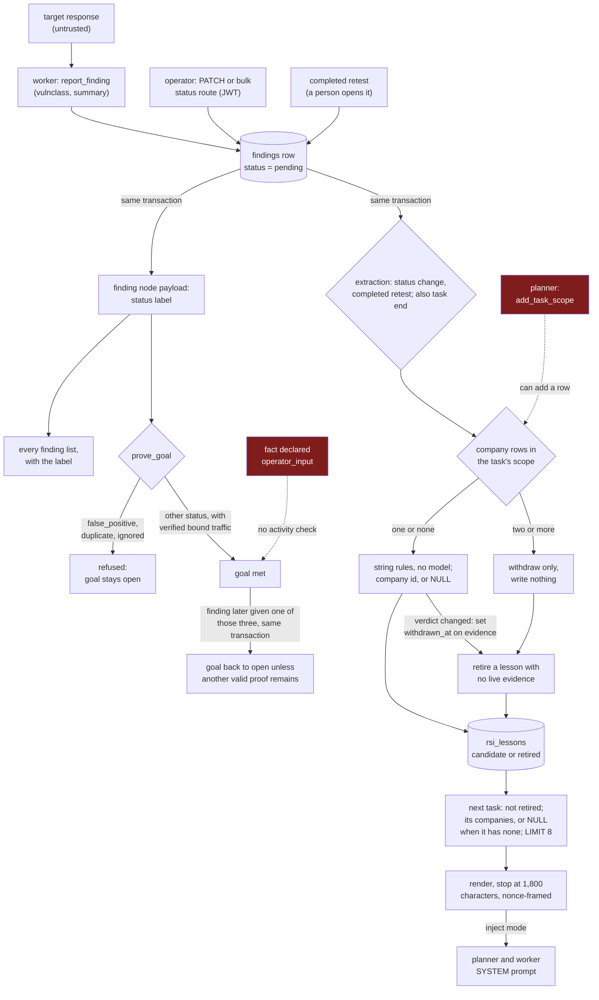

## 1. Executive Summary

ARTEX is a self-hosted penetration-testing platform in Go on PostgreSQL. A
planner splits a goal into intents, workers run tools, and results are written
into two graphs: a global asset graph and a per-task exploration graph. This
report covers only what the system remembers across turns and tasks.

It carries `trust_state`, `scope_enforced`, `audit_log` and `negative_eval`.
`audit_log` sits on the coverage ledger alone.

**Licence and provenance.** `LICENSE` is the unmodified AGPL-3.0 text. The
README then adds permitted and prohibited uses, calls them additional terms
from the maintainers, and says use of the project means agreement
(`README.md:809-844`); code review and academic research are listed as
permitted. `web/` is MIT, a third party's UI template. The repository is an
English translation and continuation of a project whose original repository is
no longer public (`README.md:785`), and its history holds the original
author's commits to 7 October 2026. The Go module path and the agent SDK
dependency carry the original owner's name, and the SDK was not opened for
this reading.

**Cross-task memory has three forms, and the oldest is the soundest.**

- **Inheritance.** A task may name up to eight source tasks. Its agents then
  read the sources' facts, findings and finished intents, tagged as inherited,
  through one hop of live relations (`db/exploration_sources.go:16-41`). Writes
  cannot cross: every mutation carries the receiving task's `exploration_id`.
- **The asset graph.** One table for the installation. An agent inside a task
  sees only assets matched by the scope rows of that task and its sources
  (`db/task_assets_context.go:65-90`).
- **Lessons.** A rule turns each triaged finding into one line of text for
  later tasks (`db/lessons.go:158-309`). No model writes it. Injection is off
  unless `ARTEX_RSI_LESSONS=inject`.

**A lesson follows the verdict behind it, in the verdict's transaction.** Each
lesson holds evidence rows naming the finding or retest it came from. A
disposition change runs the extraction before it commits. The extraction
marks that finding's rows withdrawn on lessons of the opposite kind and sets a
lesson with no live row to `retired`, which the selection excludes
(`db/notification.go:503-520`, `db/lessons.go:337-357`, `:403-417`, `:448`).
Withdrawn rows stay, one per withdrawal, so a retired lesson names what it
rested on and when each support was lost.

**A false-positive verdict stops goal proof and undoes it.** The disposition
is copied into the finding node's payload in the same transaction, every
finding list an agent reads carries it, and `prove_goal` refuses a finding
marked `false_positive`, `duplicate` or `ignored` (`agent/tools.go:1448-1453`).
Writing one of those statuses also sets a goal the finding had proved back to
`open`, unless another valid proof remains (`db/notification.go:590-625`).

**A fact needs recorded work behind it.** The server looks for a fact's
evidence line in the recorded activity of its intent and stores the result as
`provenance`. A fact it cannot tie is `unverified` and proves no goal. One
source is taken on the agent's word: a fact declared `operator_input` is not
checked.

**The scope rows belong to the reader.** The planner holds `add_task_scope`,
which writes a company, domain or address row into its own task's scope. The
asset query and the lesson selection both follow every row of the task,
whoever wrote it.

## 2. Mental Model

A lesson is a triaged finding restated by rule, kept while its evidence
stands.

## 3. Architecture

A Go server, a PostgreSQL schema of 57 tables in one idempotent file with
thirteen numbered migrations beside it, an agent package (planner, worker, main
agent, retester, compactor) on an external SDK, and a Next.js UI. There is one
operator: a single JWT subject, bound to a password version, guards every API
route but the auth routes and the health and readiness probes
(`server/auth.go:188-203`, `:332-340`). There is no user or tenant table.

| Memory surface | Scope | Written by |
| --- | --- | --- |
| Asset graph | Installation | Agent tools, scan ingest, HTTP |
| Exploration graph | Task, plus direct sources on read | Planner and worker tools |
| Coverage ledger and history | Task | Worker's `record_coverage` |
| Cold digests | Task | Background model pass |
| Lessons | Company and category, or the company-less pool | Rule-based extraction |
| Task scope rows | Task | Task creation, the operator, the planner, asset inserts |
| Task credentials | Task | Agent or operator |
| Skills directory | Installation | The platform agent only |

Each planner round is rebuilt from a graph overview, the coverage line and the
planner's own todo list. The todo list lives in a Go map on the planner struct
(`agent/planner.go:49-54`, `:123-132`).

### Deployment and ergonomics

Docker Compose with PostgreSQL, or a single binary with the UI embedded. The
lessons flag appears in `RSI.md` and `docs/rsi-lessons.md` and in no README,
example environment file or UI.

## 4. Essential Implementation Paths

| Path | Location |
| --- | --- |
| Lesson text normalisation | `db/lessons.go:42-57` |
| Lesson scope lookup | `db/lessons.go:76-130` |
| Extraction rules | `db/lessons.go:158-309` |
| Dedupe key and upsert | `db/lessons.go:59-64`, `:311-329` |
| Evidence insert, withdrawal and retirement | `db/lessons.go:238-245`, `:337-417` |
| Selection query | `db/lessons.go:424-477` |
| Extraction inside a verdict's transaction | `db/lessons.go:498-536`, `db/notification.go:503-552` |
| Rendering | `db/lessons.go:543-574` |
| Wiring into the agents | `server/lessons.go:41-66`, `agent/data_envelope.go:59-68` |
| Lesson tables | `db/schema.sql:1545-1587`, `db/migrations/0012_lesson_withdrawn.sql`, `0013_lesson_evidence_history.sql` |
| Scoped asset read | `db/asset_dsl.go:577-655`, `db/task_assets_context.go:65-90` |
| Scope rows and the planner's tool | `db/task_scope.go:154-238`, `agent/tools_insert.go:468-520` |
| Task inheritance | `db/exploration_sources.go:16-41`, `:74-81` |
| Fact write, labels and provenance | `agent/tools.go:1629-1819` |
| Goal proof refusals | `agent/tools.go:1392-1467`, `db/finding_traffic.go:528` |
| Statuses that invalidate a goal, and the reopen | `db/notification.go:566-625` |
| Graph overview windows | `agent/tools.go:488-727` |
| Data envelope | `agent/data_envelope.go:36-57` |
| Coverage ledger and history | `db/coverage_ledger.go:149-187` |
| Cold digests | `agent/compaction.go:55-148`, `db/digest.go:122-221` |
| Finding disposition routes | `server/server.go:2602`, `:2706` |
| Disposition write and node mirror | `db/notification.go:640-691` |

## 5. Memory Data Model

**Asset.** One row per domain, IP, subdomain, app, service or endpoint, unique
on its value with no task or company in the key (`db/schema.sql:84-92`). It
carries `task_ids`, a company, and three record times: `created_at`,
`last_seen`, `updated_at`.

**Exploration node.** `kind` is one of `begin`, `goal`, `intent`, `fact`,
`finding`, `hint`, `digest`, with a JSON payload, a `state` and an `origin`
stamped by the server from the calling agent. Edges are `spawns`,
`derived_from`, `yields`, `proves`, `covers`. An anchor row links a node to an
asset.

**Fact.** A summary, a detail, a one-line evidence string, a `confidence` of
`observed` or `inferred`, and a `source` from a fixed list that includes
`target_response`, `tool_output`, `operator_input` and `inference`
(`agent/tools.go:1629-1640`). The agent declares both. The server adds a
`provenance`: `recorded_activity` when the evidence line appears verbatim in
the recorded activity of the fact's intent, `captured_traffic` when the same
bytes also came back through the capture proxy, `operator_input`, or
`unverified` (`:1642-1651`, `:1702-1729`). An unverified fact is stored with
its source lowered to `inference` and its confidence to `inferred`, and a
captured one is relabelled `target_response` whatever the agent wrote
(`:1777-1789`).

**Finding.** A node plus a `findings` row whose `status` starts at `pending`
(`db/schema.sql:1203`) and is the person's disposition: `confirmed`,
`false_positive`, `duplicate`, `ignored`, `risk_accepted` and others. A second
column, `report_state`, tracks the report stage after triage and feeds no
lesson. Evidence binds a finding to content-addressed snapshots of captured
requests and responses.

**Scope row.** A `task_scope` row is a company, root domain, subdomain,
address, range, registration number or keyword (`db/schema.sql:781-782`), with
a `source` of `auto`, `agent` or `manual`. An agent's addition that widens a
declared scope is stored with `expanded` set (`db/task_scope.go:225-233`).

**Lesson.** `kind` (`positive`, `negative`, `caution`), `cue`, `action`,
optional category and company, a `status`, and a `dedupe_key` that is a hash of
kind, scope, cue and action. Support is not stored; it is the count of
evidence rows with no `withdrawn_at`, taken at read time. A partial unique
index allows one live row per lesson and source and any number of withdrawn
ones (`db/schema.sql:1566-1577`). The status column
accepts `candidate`, `adopted` and `retired`. Product code writes `retired`
and returns a row to `candidate`; `adopted` appears only in the CHECK
constraint and in tests that set it with SQL (`db/schema.sql:1555-1556`).

The company comes from the task's `task_scope` rows of kind `company`. A task
with exactly one gets that id on its lessons, and a task with none gets NULL
(`db/lessons.go:125-130`). A task declared by domain alone has no company.

No field records when something about a target was true, as distinct from when
it was written. `bitemporal` is withheld.

## 6. Retrieval Mechanics

### The planner's view of its own task

`graphOverviewData` is injected into every planner round as windows over the
graph, each newest first: thirty open intents, twelve recent finished ones,
ten findings, twenty facts not folded into a digest, fifteen digests
(`agent/tools.go:488-727`). Each finding in the window carries its triage
status, and `findings_total` counts the findings not marked `false_positive`,
`duplicate` or `ignored` (`:588`, `:613-618`). The rest stay reachable.
`list_facts` pages by cursor, `list_findings` lists up to 500, and a folded
region opens with `expand_digest`.

### Other tasks

`…WithSources` readers append the direct source tasks' nodes, tagged with the
source task id. An inherited intent is visible only once it is terminal, so a
running source task's in-flight work never enters another task's frontier
(`db/exploration_sources.go:74-81`). The overview's share for related tasks is
capped at 48,000 runes, 8,000 per source (`agent/tools.go:737-738`).

### Assets

`list_assets` inside a task goes through `scopeTargetCTE`: the task and its
direct sources, joined to their scope rows by company, root domain,
subdomain, IP range or registration number, and the query adds
`id IN (SELECT id FROM target)` (`db/asset_dsl.go:602`). Membership is by
scope row, not by which task produced the asset, and the join takes every row
whatever its `source`. With no task id, the platform and chat agents get the
unscoped query (`:578-580`).

The query language compiles a disjunction inside one pair of parentheses, so
the scope clause appended with `AND` binds the whole expression
(`db/asset_dsl.go:305-309`). Until
[`84a623bf2deae56a5660108a234fe437dca8e9ef`](https://github.com/BaaRai/ARTEX/commit/84a623bf2deae56a5660108a234fe437dca8e9ef)
on 20 November 2026 it did not: `a OR b` compiled to
`(a) OR (b) AND id IN (…)`, and the first branch returned assets from the
whole installation. v0.6.0 is on the unparenthesised side of that commit.

No read filters on `last_seen`; it orders results only.

### Lessons

One query (`db/lessons.go:435-458`). It keeps rows that are not `retired`,
whose category is NULL or the task's, and whose company is one of the task's.
A row with no company is kept only for a task that has no company either
(`:449-452`). It orders company matches first, then category matches, then
positive before negative before caution, then live support, with `LIMIT 8` for
injection and 50 for the HTTP preview. Both scope terms are written
`col IS NOT NULL AND col = …`, so a NULL never sorts ahead of a match.

On a scratch PostgreSQL with the lifted DDL and query, a store of five lessons
of one company, three of a second and four with none returned five to a task
of the first company, four to a company-less task, and eight to a task holding
both companies.

Rendering stops at the first entry that would pass 1,800 characters
(`db/lessons.go:564-566`). A cue may run to 160 characters and an action to
320, so three full-length lessons fill the block and a long early entry hides
shorter later ones. The function returns the ids it rendered, and those are
what the usage log records (`server/lessons.go:55-65`). The block is fixed
when the task's agents are built.

## 7. Write Mechanics

### Facts, findings, coverage

Workers call `record_fact`, `report_finding` and `record_coverage`. A fact is
created `confirmed` with its origin stamped by the server and its provenance
computed before the node is written (`agent/tools.go:1749-1819`); no tool or
route edits or deletes one. A fact's asset anchors must name existing assets,
checked under a row lock before the node is created. A coverage write that
exceeds a field limit is refused instead of truncated
(`db/coverage_ledger.go:41-52`).

### Assets

Eight upsert functions. On conflict the last non-null writer wins per scalar
column and arrays are unioned (`db/assets.go:754-778`). When two tasks
disagree about a status code or a page title, the later one replaces the
earlier and nothing keeps the old value.

### Scope rows

Task creation writes the company rows the operator chose. After that the rows
have three writers: the operator's route, the automatic row for each host a
worker inserts, and `add_task_scope`, which the planner and the operator's
chat agent hold (`agent/tools.go:2556`, `agent/tools_insert.go:739`). The tool
accepts every kind, including `company` by name or id, and its description
calls the result a coverage scope that is not enforced
(`agent/tools_insert.go:462-476`).

### Lessons

`ExtractLessonsForTask` reads each finding of the task with its newest
completed retest and applies four rules (`db/lessons.go:252-306`):

- `confirmed`, `resolved` or `fixed` gives a **positive** lesson, and a second
  one when that retest reproduced it.
- A retest verdict of `fixed` or `inconclusive` on such a finding gives a
  **caution**.
- `false_positive`, `duplicate`, `ignored` or `risk_accepted` gives a
  **negative** lesson that begins `Do not re-report without new mechanics` and
  ends with the status.
- `pending` and `in_progress` give nothing and withdraw nothing.

The first and third rules also withdraw. A positive disposition marks the
finding's evidence withdrawn on negative lessons. A negative one marks it
withdrawn on positive lessons, on cautions, on every retest of the finding,
and on any negative lesson whose action differs from the one being written
(`:271`, `:289-303`). A lesson left with no live evidence is set to `retired`,
and an upsert that meets a retired row with no live evidence sets it back to
`candidate` (`:403-417`, `:316-326`).

Restoring support inserts a row. The insert conflicts only with a live row
for the same lesson and source, so a finding confirmed again gets a new live
row beside its withdrawn one (`:238-245`).

A task with more than one company writes no lesson, because the row has one
company column, and withdraws as usual (`:163-166`).

The extraction has five callers. The single and the bulk disposition change
and a completed retest run it inside their own transaction, so the verdict,
the goal reopen and the lesson change commit together, and an extraction
error rolls the verdict back (`db/notification.go:512`, `:550`,
`db/finding_retests.go:286`). A terminal task status and
`POST /api/tasks/{id}/lessons/extract` run it on its own
(`server/manager.go:1644-1646`, `server/lessons.go:104`).

A finding's status has three writers in product code, all through
`SetFindingStatusTx`: the operator's authenticated `PATCH`, a bulk route for
several findings, and a completed retest whose verdict is `fixed`
(`db/notification.go:640-691`, `db/finding_retests.go:267-290`). The retest
verdict comes from the retester agent, in a session only a person can open. No
planner or worker tool takes a finding status.

Deduplication needs identical text. Positive and negative actions embed the
finding's free-text summary, so two tasks merge into one lesson only when
their summaries match; cautions hold only the cue and verdict and merge
widely. Text is cut by runes, 160 for the cue and 320 for the action, and a
negative action cuts the summary so the status suffix survives
(`db/lessons.go:42-57`, `:285-288`).

### Operational cost

Lessons cost one query per task start and no model call. Extraction runs
inside every disposition change whatever the lessons flag says. Digests cost one
model call per folded block, with bodies reused when a block's member set and
content version are unchanged.

## 8. Agent Integration

The lessons block is appended to the system prompt of the planner and the
worker and to no other agent. `frameLessonsBlock` wraps it in the nonce-framed
envelope with a fresh nonce per assembly and the marker stem rewritten inside
the content (`agent/data_envelope.go:59-68`, `agent/planner.go:534`,
`agent/worker.go:580`). Every other derived field goes in the user message
inside the same frame: recent facts, findings, digests, related-task data,
intent summaries, the assets an intent targets, and hints and credentials
written by an agent (`:72`, `:82-95`, `:107-230`). The file's own comment
prices it: the frame marks data and cannot stop a model from following it. The
lessons block is the one framed field placed in the system prompt.

**`human_review` is withheld.** A person's disposition is what admits most
lessons, and the agent that wrote the finding holds no tool that sets it. Two
things keep the mark off. A model's retest verdict also admits lessons: `fixed`
sets the finding's status and yields a positive lesson with a caution beside
it. And what is reviewed is the finding. The lesson's own status is written by
the extraction rule and by nobody else: no route or interface retires or
adopts a lesson, and candidates are injected as they stand.

## 9. Reliability, Safety, and Trust

### A triage verdict gates goal proof and undoes it

`SetFindingStatusTx` writes the status to the `findings` row and to the
finding node's payload in one transaction (`db/notification.go:661-674`).
Every finding read an agent has carries it: `list_findings`, the related-task
overview, `node_detail`, and the list injected into each planner round
(`agent/tools.go:1079-1096`, `:1237`, `:613-618`). An inheriting task reads
the same node and sees the same label.

`prove_goal` refuses a finding whose status is `false_positive`, `duplicate`
or `ignored`, and the round overview's `findings_total` leaves those three out
(`agent/tools.go:1448-1453`, `:1098-1120`). A finding must also hold captured
traffic whose host matches its asset, checked on the server
(`:1457-1465`, `db/finding_traffic.go:528`).

Writing one of the three statuses reopens what the finding had closed. In the
same transaction, each goal the finding's node `proves` goes from `met` to
`open`, unless another proof of that goal would pass the gate: a finding
whose status is not one of the three, or an observed fact that is neither
`target_response` nor `unverified` (`db/notification.go:590-625`). The
`proves` edge is kept. `prove_goal` and the reopen read one list of
invalidating statuses (`:566-583`), and
`TestFindingStatusReopensProvedGoals` covers the single, bulk and retest
paths (`db/goal_reopen_test.go:8`).

These refusals are in the agent core and apply with lessons off.

Three limits:

- **`risk_accepted` proves a goal, by decision.** The list's comment says it
  marks a real finding whose risk is accepted, and a test pins that it proves
  a goal and never reopens one (`db/notification.go:563-565`,
  `agent/fact_provenance_test.go:282`). The lesson rule files the same status
  as negative, `Do not re-report without new mechanics`.
- **The reopen changes the goal node only.** The statement touches no task
  row. Whether a task that had finished on that goal runs again was not
  traced.
- **The node state does not move.** A false-positive finding's node stays
  `confirmed`; `dismissed` exists in the schema and has no writer outside one
  test.

### A fact declared as operator input is not checked

`factProvenance` returns `operator_input` for any fact whose declared source
is `operator_input`, before it looks at the evidence or the intent
(`agent/tools.go:1703-1705`). The source is a field of the tool call. A fact
written with that source and `confidence: observed` therefore carries no
activity tie, is not `unverified`, and passes every fact check in `prove_goal`
(`:1421-1446`). The reopen query counts it as a remaining valid proof.

A committed case records exactly this from a worker's tool set, with no
evidence line, and expects the provenance `operator_input`
(`agent/fact_provenance_test.go:129`). Facts written before provenance existed
carry no key and keep their declared labels (`agent/tools.go:1424-1428`).

### The planner writes the rows its reads are scoped by

`add_task_scope` is in the planner's tool list, and `AddAgentScope` inserts
what it is given once a named company exists
(`agent/tools.go:2556`, `db/task_scope.go:154-238`). Neither scoped read asks
who wrote a row. `scopeTargetCTE` joins every scope row of the task, so one
call with `kind=company` brings that company's assets into `list_assets`
(`db/task_assets_context.go:79-88`). The lesson scope lookup returns every company row
(`db/lessons.go:76-94`), so the same call changes the lesson key:

- on a task declared by domain, later lessons are stored under the added
  company, and that company's lessons are selected the next time the task's
  agents are built;
- on a task with one company, a second company's lessons join the selection,
  and the task writes no further lesson.

What stands between target text and that call is a prompt rule: the untrusted
data preamble tells the agent never to call `add_task_scope` because data asks
(`agent/untrusted_prompt.go:34`). An agent's widening row is stored with
`expanded = true` and returned to the caller with the flag
(`db/task_scope.go:225-233`); no query filters on it.

### Lessons of company-less tasks form one pool

A lesson's company is NULL when its source task had no company row, and a
NULL row is selected for every task that has no company row, inside the
category (`db/lessons.go:125-130`, `:450`). Tasks declared by domain alone are
exactly those tasks, so two unrelated engagements declared that way read each
other's lessons. A positive lesson's text is the finding summary, which names
the source target's endpoints. `docs/rsi-lessons.md:84` states the rule, the
maintainer treats the pool as a product decision, and injection is off by
default.

Two more routes lead into the pool:

- **Rows written before 17 November 2026.** Until that day's change the scope
  lookup read `tasks.company_id`, which task creation does not fill, so every
  lesson was stored with no company. No migration rescopes them, and the
  dedupe key includes the company, so a new extraction writes a scoped twin
  beside the old row.
- **A deleted company or category.** Both foreign keys are
  `ON DELETE SET NULL` (`db/schema.sql:1553-1554`). On the scratch database,
  deleting the second company raised the company-less task's selection from
  four lessons to seven.

### What a withdrawal keeps

The withdrawal is an `UPDATE` that sets `withdrawn_at` on the live evidence
row (`db/lessons.go:339-349`, `:363-373`). A retired lesson keeps its cue,
action, status and the rows naming each finding and retest it rested on.

A restored support is a new row, so each withdrawal keeps its own timestamp.
On a scratch PostgreSQL with the lifted DDL and statements, a finding
confirmed, reversed, confirmed, reversed and confirmed again left three
evidence rows, one live, and a second run of the last step added none.

The rows are not a mutation log. An evidence row has no creation time, so it
says when a support was withdrawn and not when it was given, and the lesson's
own status changes are an overwritten column with `updated_at`. `audit_log`
rests on the coverage ledger alone.

Four edges, the first two re-derived on the scratch database:

- **A change inside the negative group replaces the lesson.**
  `false_positive` followed by `duplicate` left the first lesson `retired`
  with its row withdrawn and the second `candidate`.
- **A retired lesson returns when another finding matches it.** A second
  finding with the same cue and summary sets a retired lesson back to
  `candidate`, the withdrawn row beside the live one.
- **A reopened finding withdraws nothing.** Moving a confirmed finding back to
  `pending` leaves its positive lesson selectable, by design and under test
  (`db/lessons_test.go:881`).
- **A deleted source cannot be withdrawn.** No statement edits or deletes a
  lesson row. Deleting the source task or finding leaves the lesson with an
  evidence row naming an id that is gone, and extraction, which walks the
  task's existing findings, cannot reach it.

Because the extraction shares the verdict's transaction, a failure in it
refuses the verdict: the status change, the goal reopen and the lesson change
roll back together (`db/lessons_test.go:1586`). That holds with the lessons
flag off.

The usage table `rsi_lesson_usage` records the rendered ids and has no reader
outside one test.

### Why three marks are withheld

`human_review` and `bitemporal` are covered above.

**`tombstone`.** Two near-misses. The negative lesson is a line of prompt text
that the write path never consults: a re-reported finding lands as a new
`pending` row. The retired lesson is keyed on a hash of its text, and the
upsert does consult it, but a retired row with no live evidence is exactly the
row it revives. The branch that keeps a retired row retired applies when live
evidence remains, a state only hand-written SQL produces
(`db/lessons.go:316-326`, `db/lessons_test.go:790`).

**`trust_state` rests on three fields.** The lesson status filters the
selection. The finding's triage status filters goal proof and the overview
count, reopens a goal it had closed, and is a label everywhere else. A fact's
`provenance` is computed by the server at write time and never changes;
`unverified` is refused as goal proof and filters no read. A fact's
`confidence` and `source` are the agent's declaration, corrected downward by
the provenance check, with `operator_input` as the exception above.

## 10. Tests, Evals, and Benchmarks

1,668 `func Test` in 389 test files. CI starts PostgreSQL 16 and runs `go test
-p 1 ./...` with `gofmt`, `go build` and `go vet`, a race-detector pass over
named packages, and an advisory job on the newest Go release
(`.github/workflows/ci.yml:9-117`). I ran none of it.

**The boundary tests are the strong part.**
`TestExplorationDirectSourceReadView` asserts that a source of a source is
invisible, that a live source intent is absent from the frontier, the
inherited list and finding lineage, and that an inherited fact cannot be
mutated through the receiving store (`db/exploration_sources_test.go:92`).
`TestInheritedActivityReadsRequireTerminalIntent` asserts five read paths do
not return a reopened intent (`:8`). `TestQueryDSLInScopeMembership` tags
in-scope assets with a foreign producer task, to show membership is by scope,
and asserts out-of-scope ids are absent (`db/assets_test.go:1160`).
`TestQueryDSLInScopeOrDoesNotEscape` runs a query whose first branch matches
an asset on each side of the boundary and fails if the outside one returns
(`db/asset_dsl_or_scope_test.go:29`).

**Lessons have thirty-one tests**: twenty-six in `db/lessons_test.go`, three
in `server/lessons_test.go`, one on the frame and one on the migration.

- **Scope and order.** `TestTaskLessonsUsesTaskScopeAndRanksCompanyFirst`
  inserts the generic row last, so that id order alone would rank it first,
  and asserts that a company's task sees its own lesson only, that a
  company-less task sees no company lesson, and that neither company sees the
  other's (`db/lessons_test.go:96`).
- **Withdrawal.** `TestExtractLessonsRetractsReversedDisposition` walks
  confirmed, false positive, confirmed, and fails if the retired positive is
  selected (`:504`). `TestDispositionChangeExtractsLessons` changes the status
  through the product call and checks the lesson without calling the
  extraction (`:925`). `TestReconfirmingFindingPreservesWithdrawalHistory`
  counts the rows after a second confirmation, and
  `TestLessonExtractionFailureRollsBackStatusAndRetest` injects an extraction
  error and expects the old status (`:1491`, `:1586`). Others cover a lesson
  shared by two findings, every retest of a reversed finding, a change inside
  the negative group, a task that gained a second company, and an unfinished
  retest.
- **Text and frame.** A multi-byte cut, full-length CJK lessons against the
  character cap, the rendered-id return, and a lesson that tries to close its
  own frame (`:50`, `:79`, `:62`, `agent/data_envelope_test.go:203`).

**Goal proof.** `TestProveGoalRefusesFalsePositiveFinding` proves a goal with
a false-positive finding, expects the refusal and an open goal, then proves it
with a confirmed one (`agent/fact_provenance_test.go:250`).
`TestFindingStatusReopensProvedGoals` meets a goal, writes each invalidating
status and expects it open, and expects it met when a second finding or an
observed tool-output fact remains (`db/goal_reopen_test.go:8`).
`TestFactProvenanceTiedToRecordedActivity` and
`TestFactProvenancePrefersCapturedTraffic` cover the fact tie
(`agent/fact_provenance_test.go:335`, `:437`).
`TestGraphOverviewFindingListCarriesStatus` checks the label and the count
(`agent/tools_overview_test.go:56`).

No lesson test deletes a company or adds a scope row through the planner's
tool. No test proves a goal with an `operator_input` fact, and none reads a
task's status after its goal reopens.

`RSI.md` cites six arXiv papers as the source of the design's ideas, and the
identifiers resolve to the titles it names. The lesson admission rule is taken
from [Harness²](../harness2/), which `db/lessons.go:15-20` and the schema
comment name: no lesson without a cue, an action and evidence. ARTEX has no
paper of its own. `scripts/benchmark/` holds a runner and one ground-truth
file; results are written to an ignored directory and none is committed.
Nothing in the tree measures whether lessons help.

## 11. For Your Own Build

### Steal

**Make cross-task inheritance explicit, one hop and live.** A named relation,
a cap, a query on every read so a deleted source disappears, and only finished
work visible. Read-only falls out of scoping every write to the receiver.

**Frame stored text when it re-enters a prompt.** A per-message random nonce
on both markers, and the marker stem neutralised inside the content.

**Key a lesson's support on its sources, and withdraw without deleting.** One
evidence row per finding or retest lets a reversed verdict withdraw exactly
its own support, a lesson shared by two findings survives the loss of one, and
a retired lesson can say what it rested on.

**Run the correction in the verdict's transaction.** The status, the lesson
withdrawal and the goal reopen commit together or not at all; the end-of-task
pass is the fallback.

**Undo what a claim closed when the claim falls.** Keep the proof edge, check
for another valid proof, and reopen the goal in the same statement.

**Give a restored support a new row.** A partial unique index over live rows
keeps extraction idempotent and every withdrawal dated.

**Tie a fact to recorded work on the server.** Look for the evidence line in
the activity log before trusting the labels the agent chose.

**Rank a nullable scope match with `IS NOT NULL AND =`.** A bare
`(col = $1) DESC` sorts NULL first in PostgreSQL. Test the order with the
unscoped row inserted last.

**Parenthesise a compiled filter before appending the scope clause.** Test it
with a disjunction whose first branch matches a row on each side.

**Log what was rendered, not what was selected.** Have the renderer return the
ids that fitted.

**Stamp the writer on the server.** A fact's `origin` is never taken from the
tool's input.

**Let summaries hide and never delete.** A digest covers its members while
they stay cold, a revived member reappears, and a re-compression starts from
the source nodes.

### Avoid

**Do not give the reader a tool that writes its own scope.** A filter over
rows the agent can insert is a filter the agent sets.

**Do not let NULL be a scope.** A missing company, a deleted company and a row
written before scoping existed all land in one pool that every company-less
task reads.

**Do not let the agent name its own exemption.** A source label that skips
the check is the label a confused agent will reach for.

**Do not let one status mean two things.** `risk_accepted` proves a goal and
writes a lesson that says not to report it.

### Fit

The inheritance model and the scoped asset read suit any multi-task agent
platform with one operator who trusts the planner with the scope. The lessons
subsystem is rule built, evidence linked, company scoped, framed and off by
default. It is safe to turn on where every task declares exactly one company,
and not across tasks declared by domain alone.

## 12. Open Questions

- **Who retires or adopts a lesson by hand?** `RSI.md:53-55` calls status
  changes owner actions, the tests set both states with SQL, and no route does.
- **How will a multi-company task attribute a finding?**
  `docs/rsi-lessons.md:73-77` calls per-finding company attribution a later
  change.
- **Does a finished task run again when its goal reopens?** The reopen writes
  the goal node and nothing else.
- **Who may declare `operator_input`?** The worker and the operator's chat
  agent hold the same `record_fact` schema, and no check ties the label to an
  operator message.
- **Is `expanded` meant to gate a read?** The flag is written and returned,
  and nothing consults it.
- **Is the outcome card's company meant to come from `task_scope` too?**
  `db/task_outcome.go:60` reads `tasks.company_id`, the column task creation
  does not fill.
- **Does restoring an archived task renumber its findings?** If it does, a
  second extraction adds evidence for the same underlying finding. Not traced.
- **What does the agent SDK persist?** Session compaction and transcripts live
  in a dependency this reading did not open.

## Appendix: File Index

| File | Role |
| --- | --- |
| `db/lessons.go`, `server/lessons.go` | Lesson extraction, withdrawal, selection, rendering, wiring |
| `db/lessons_test.go`, `server/lessons_test.go` | Twenty-nine of the thirty-one lesson tests |
| `docs/rsi-lessons.md`, `RSI.md` | The project's description of the loop |
| `db/schema.sql`, `db/migrations/` | 57 tables and thirteen migrations |
| `db/asset_dsl.go`, `db/task_assets_context.go`, `db/assets.go` | Asset reads and upserts |
| `db/task_scope.go`, `agent/tools_insert.go` | Scope rows and the tools that write them |
| `db/exploration.go`, `db/exploration_sources.go` | The per-task graph and inheritance |
| `db/coverage_ledger.go` | Coverage ledger and its history |
| `db/digest.go`, `agent/compaction.go`, `agent/coldgraph.go` | Cold digests |
| `agent/tools.go`, `db/finding_traffic.go` | Graph overview, facts, findings, goal proof |
| `agent/data_envelope.go`, `agent/data_envelope_test.go` | The nonce-framed envelope and the lessons frame |
| `agent/planner.go`, `agent/worker.go` | Where the lessons block joins the system prompt |
| `db/findings.go`, `db/notification.go`, `db/finding_retests.go` | Finding status writers and the node mirror |
| `db/exploration_sources_test.go`, `db/assets_test.go`, `db/asset_dsl_or_scope_test.go` | The boundary tests |
| `agent/fact_provenance_test.go`, `agent/tools_overview_test.go`, `db/goal_reopen_test.go` | Goal-proof refusals, fact provenance, the overview label and the reopen |

### Recorded searches

Run with `/usr/bin/git` in a full clone at the pinned commit.

- `git grep -c -E '^func Test' -- '*.go'`, summed — 1,668.
- `git grep -n -E 'UPDATE rsi_|DELETE FROM rsi_' -- . ':!*_test.go'` — `db/lessons.go:339`, `:363` and `:408`: two evidence withdrawals and the retirement update; no statement edits or deletes a lesson row.
- `git grep -n -E 'rsi_lesson' -- '*.go' ':!*_test.go' ':!db/lessons.go'` — nothing; no task, finding, company or category path touches a lesson.
- `git grep -n -E "'retired'|'adopted'" -- . ':!*_test.go'` — `db/lessons.go:319`, `:409`, `:411`, `:448` and the CHECK at `db/schema.sql:1556`; `adopted` only in the CHECK.
- `git grep -n -E 'FROM rsi_lesson_usage|JOIN rsi_lesson_usage' -- .` — `db/lessons_test.go:470` only.
- `git grep -n -E 'ExtractLessonsForTask(Tx)?\(|syncLessonsFor(Finding|Findings)Tx\(' -- '*.go' ':!*_test.go'` — the five callers in section 7.
- `git grep -n -E 'INTO task_scope' -- '*.go' ':!*_test.go'` — `db/tasks.go:303` at creation, `db/task_scope.go:86` afterwards, and the archive restore.
- `git grep -n -E 'addTaskScope\(\)' -- '*.go' ':!*_test.go'` — the goal-registration step, `PlannerTools` and `MainAgentTools`, and the definition.
- `git grep -n -E 'expanded' -- 'db/*.go' ':!*_test.go'` — one inheritance comment and `db/task_scope.go`: the field, the insert, the classification and the listing; no `WHERE` names it.
- `git grep -n -E 'FindingFalsePositive|FindingPending|FindingRiskAccepted' -- 'agent/*.go' db/notification.go ':!*_test.go'` — `db/notification.go:563` and `:567` only: the comment excluding `risk_accepted` and the list.
- `git grep -n -E 'factSourceOperatorInput' -- 'agent/*.go' ':!*_test.go'` — the constant, the list of sources and `agent/tools.go:1703`; no other branch reads it.
- `git grep -n -E 'SetNodeState\(' -- '*.go'` — one product call, with `met`, at `agent/tools.go:1467`; `dismissed` is passed only at `db/exploration_sources_test.go:212`.
- `git grep -n -E "SET state *= *'open'" -- '*.go' ':!*_test.go'` — five statements: four with `kind='intent'`, and the goal reopen at `db/notification.go:593`.
- `git grep -n -E 'operator_input' -- 'agent/*_test.go' 'db/*_test.go'` — `agent/fact_provenance_test.go:23` and `:129`, the write; no `prove_goal` call uses such a fact.
- `git grep -n -E 'DELETE FROM companies|DeleteCompany\(|add_task_scope|AddAgentScope' -- db/lessons_test.go server/lessons_test.go` — nothing.
- `git grep -n -E '(UPDATE|DELETE FROM) coverage_ledger_history' -- .` — nothing.
- `git grep -n -E 'FROM coverage_ledger_history|JOIN coverage_ledger_history' -- . ':!*_test.go'` — nothing.
- `git grep -n -i -l lessons -- web extension scripts` — nothing.
- `git grep -n -E 'last_seen' -- 'agent/*.go' 'server/*.go' ':!*_test.go'` — nothing.
- `git grep -n -i -E 'CREATE TABLE IF NOT EXISTS (users|accounts|tenants|orgs)' -- '*.sql' '*.go'` — nothing.

## History

**2026-11-21** — [`c65034c50f946e80f89489d32dd92981f883cb1d`](https://github.com/BaaRai/ARTEX/commit/c65034c50f946e80f89489d32dd92981f883cb1d) — 25 commits on 21 November 2026, after the maintainer's [reply on issue 269](https://github.com/BaaRai/ARTEX/issues/269#issuecomment-7064693921). Three findings of the reading earlier that day are closed, each with a test: a false-positive, duplicate or ignored verdict reopens a goal the finding had proved, a restored support is a new evidence row so each withdrawal keeps its timestamp, and the extraction runs inside the verdict's transaction. `risk_accepted` proving a goal is the project's stated decision and is pinned by a test. Facts gained a server-computed provenance, and `trust_state` extends to it. One gap in that addition: a fact declared `operator_input` skips the check and can prove a goal. [Section 9](#9-reliability-safety-and-trust) holds what remains. Nothing was built or run; the evidence history was re-derived on a scratch PostgreSQL.

**2026-11-21** — [`22ae88afabf66e47e73644a0528d8b427c4c80b8`](https://github.com/BaaRai/ARTEX/commit/22ae88afabf66e47e73644a0528d8b427c4c80b8) — 226 commits, 17 to 21 November 2026, ending at the v0.7.0 release. [Pull request 391](https://github.com/BaaRai/ARTEX/pull/391), answering [issue 269](https://github.com/BaaRai/ARTEX/issues/269), closed five findings of the 19 November reading: goal proof on a false-positive finding, company-less lessons reaching every task, retraction waiting for a manual call, deleted evidence rows, and the byte cap. `trust_state` extends to the finding status at goal proof. Both earlier readings missed two things present at their pins: a top-level `OR` in an asset query escaped the task scope, fixed upstream on 20 November, and the planner holds `add_task_scope`, which writes the rows both scoped reads follow. [Section 9](#9-reliability-safety-and-trust) holds what remains. Nothing was built or run; the lesson SQL was re-derived on a scratch PostgreSQL.

**2026-11-19** — [`65045efae642159eeef3be5536c262f096f4c08d`](https://github.com/BaaRai/ARTEX/commit/65045efae642159eeef3be5536c262f096f4c08d) — 136 commits, 16 to 18 November 2026. Four pull requests, opened from the list the maintainer confirmed on [issue 269](https://github.com/BaaRai/ARTEX/issues/269), closed the inverted ranking, the unfilled company scope, the byte cut, the over-reporting usage log, the unframed lessons block and the missing retraction, with fifteen new lesson tests. `trust_state` is awarded on the lesson status; `scope_enforced` and `negative_eval` extend to lessons. [Section 9](#9-reliability-safety-and-trust) holds what the fixes leave: the false-positive label misses the planner overview and goal proof, company-less lessons reach every task, and retraction waits for a manual call and deletes its evidence. Screen findings match the first reading. Nothing was built or run; selection and retraction were re-derived with lifted SQL on a scratch PostgreSQL.

**2026-11-16** — [`9f99b7172aab33512d319f082080cb2892253e91`](https://github.com/BaaRai/ARTEX/commit/9f99b7172aab33512d319f082080cb2892253e91) — first reading, of the memory surfaces only. Screened first: four manifests inside the seven-day cooldown, one build-time script, two unpinned surfaces. Nothing from the tree was built or run; the lesson ordering, scope widening and text truncation were re-derived with lifted SQL on a scratch PostgreSQL and in a separate script.
