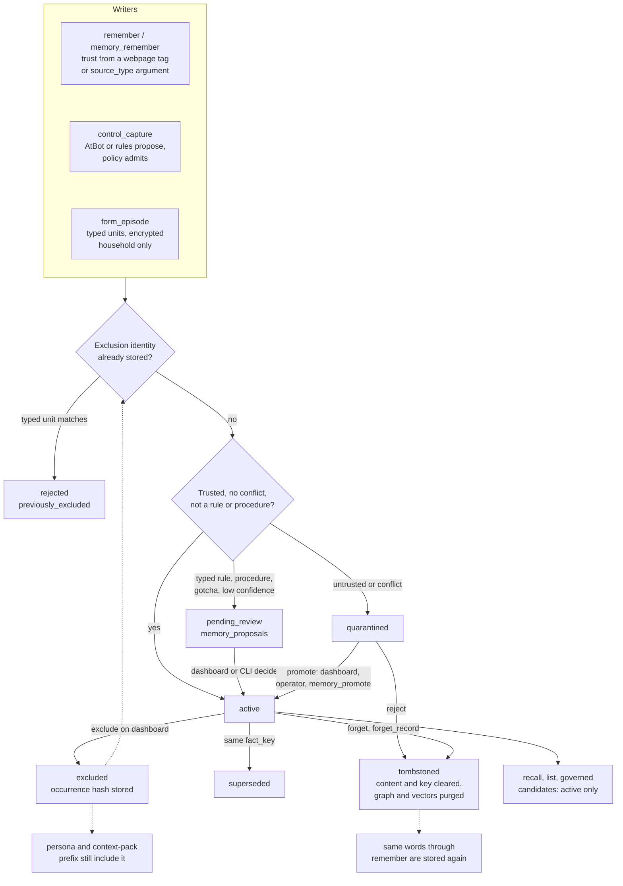

## 1. Executive Summary

AtMem is a local Python memory engine for agents, wrapped in a control plane
that decides whether its context reaches a model. Memory is one SQLite database
of records, each derived from a stored episode. What is notable is how much of
the correction lifecycle is code rather than prose. Untrusted sources land
quarantined and every read arm filters them. Deletion purges the derived graph,
media links and vector entries and returns a receipt. Every mutation lands in a
hash-chained audit log that stores digests, and a typed unit the user excluded
is refused when the same occurrence is formed again, though not when it is
restated with a new timestamp. What is weak is the surface an
agent holds in the simplest deployment: on `atmem mcp` the model chooses the
subject, chooses whether its write is trusted, and can promote its own
quarantined record.

Around the engine sit a stdio MCP server, an OpenClaw bridge, Hermes,
Pydantic AI and LangGraph adapters, a loopback dashboard and an "Agent Black
Box" that records model and tool events. A forgotten text fact restated through
`remember` is stored again, the persona block ignores retrieval exclusions,
and the dashboard's memory routes accept a token any local process can fetch.

The product has two layers that share one database. The memory engine
(`atmem/memory.py`, `atmem/store/sqlite.py`) owns records, extraction, recall,
supersession, deletion and audit. The control plane (`atmem/control/`) owns
whether an integration is in shadow or active mode, a candidate review queue,
topology of agents and workspaces, and the dashboard. A companion package,
AtBot, proposes facts and ranks candidates through a local or hosted model;
AtMem admits or refuses each proposal with deterministic policy.

**Licence.** Apache-2.0, in a root `LICENSE` that both Python manifests, the
OpenClaw bridge, the TypeScript SDK and the ChatGPT plugin repeat. Vendored
Hermes patches and five benchmark result folders carry their own MIT files from
their upstreams, and the LoCoMo result file records the dataset's CC BY-NC 4.0
licence beside per-question rows. Nothing in the tree restricts use.

Five marks are earned: `human_review` on the typed formation path, and
`trust_state`, `scope_enforced`, `audit_log` and `negative_eval` on the
canonical record store. `tombstone` and `bitemporal` are withheld. Section 9 gives the reason for
each and names the parts of the system that fail the same tests.

## 2. Mental Model

A memory is a **record**: one sentence, derived from an **episode** that holds
the source message, with a source type, a trust tier, a status and an optional
`fact_key` slot such as `preferred airport`
(`atmem/store/sqlite.py:5120-5143`). A second unit sits beside it, a
**typed MemoryUnit** of seven kinds with exact evidence spans into the source
(`atmem/extract/models.py:216-233`). Records are what recall reads; typed units
are stored as records once committed.

How a thing becomes believed depends on who said it:

- **A user message** classified as such becomes an `active` record at once.
  `classify_source` calls any message without an embedded `<webpage>` or
  `<tool...>` tag a user message (`atmem/core/policy.py:18-47`), and
  `remember` accepts a `source_type` argument that overrides it
  (`atmem/memory.py:3196`).
- **Embedded third-party content** becomes a `quarantined` record. It is
  invisible to recall, list, persona and the governed candidate path until
  `promote` makes it `active` with trust tier `user_confirmed`
  (`atmem/core/policy.py:56-60`, `atmem/memory.py:4917-4994`).
- **An AtBot proposal** through the control plane is `active` only when the
  source is a host-authenticated user or agent message, the suggested action is
  an add, sensitivity is ordinary, nothing conflicts on the fact key and no
  related record is tainted; otherwise it is `quarantined`
  (`atmem/memory.py:619-640`).
- **A typed unit** is `committed`, `pending_review`, `noop` or `rejected`.
  Rules, gotchas and procedures always wait for review, and a unit whose occurrence
  identity matches an exclusion the user made earlier is rejected
  (`atmem/memory.py:880-935`).

It stops being believed in four ways. A new active record on the same
`fact_key` makes the old one `superseded` with a pointer. An exclusion hides a
record from retrieval and, for a typed unit, remembers its occurrence. A forget
makes it `tombstoned`, clears `content` and `fact_key`, and purges everything
derived from it (`atmem/store/sqlite.py:3843-3960`). A reject purges a
quarantined record outright (`atmem/memory.py:4996-5040`). Nothing decays.

## 3. Architecture

Everything runs on one machine. `Memory(path)` opens a SQLite database through
`SQLiteStore`, applies migrations numbered up to `0425` under a file lock,
and creates a sibling `<path>.vectors.db` for the vector sidecar
(`atmem/memory.py:166-218`, `atmem/semantic/index.py:42-46`). The default
embedder is a 256-dimension feature hash (`HashingEmbedder`,
`atmem/semantic/providers.py:291`); `atmem openclaw install` offers an Ollama
embedding model and the `semantic` extra adds sentence-transformers, each
activated as a new epoch of the index.

The control plane keeps its own store, a mode (off, shadow or active) and an
agent topology, and serves the dashboard on 127.0.0.1:8768. AtBot runs as a
separate process on a loopback protocol and is consulted for proposals, query
expansion and ranking; when it or its model is down, capture falls back to the
deterministic rules (`atmem/control/manager.py:1113-1220`). The Agent Black
Box writes encrypted evidence of model and tool events to a separate vault
under the same AtMem Home. A maintenance runner consolidates the graph,
verifies the audit chain incrementally, optimizes the database and expires
governed tasks (`atmem/maintenance.py:44-94`).

Around the memory engine the repository carries much else that this reading did
not cover in depth: a governed task-state plane, AtMem Code for coding agents, a
retrieval-augmented document service, a feedback and rule system, delegated
context providers that sign their output, a ChatGPT plugin backed by Firestore,
and benchmark harnesses under `benchmarks/` and `research/`.

### Deployment and ergonomics

By the README, `pip install atmem` brings the AtMem and AtBot distributions,
and `atmem init` creates the home and an Administrator account and, on first
run, downloads a pinned Bun runtime for the AtFlows component, verified
against a release-pinned SHA-256. Ordinary memory needs no network, no API key and no model: the rules
extractor, FTS5, the hashing embedder and the graph rules are all local. A model
improves extraction and ranking and is optional. The store is SQLite and can be
opened by hand unless the household is migrated to SQLCipher, which the typed
formation path requires (`atmem/memory.py:906-913`). The README's install
section is long because the product is: an OpenClaw installer that copies,
freezes and can restore the host's native memory files, a dashboard daemon,
user accounts with four evidence roles, and a home-migration procedure.

## 4. Essential Implementation Paths

- **Schema and store.** `atmem/store/sqlite.py`: base tables `:5089-5600`,
  `records` `:5120-5143`, `retrieval_exclusions` `:5212-5221`,
  `media_artifacts` `:5223-5249`, `audit_log` `:5371-5384`, numbered
  migrations from `:5642`, `typed_exclusion_identities` `:7294-7308`.
- **Capture and write.** `Memory.remember` `atmem/memory.py:3177-3456`;
  `extract_facts` `atmem/extract/rules.py:93-111`; `classify_source`,
  `trust_tier_for_source`, `initial_status` `atmem/core/policy.py:34-60`;
  model proposals `submit_proposal` `atmem/memory.py:492-720`; typed formation
  `form_episode` `:1549` calling `submit_extraction_proposal` `:751-1066`;
  media observations `remember_observation` `:3458-3650`.
- **Retrieval.** `Memory.recall` `:3651-3888` over `recall_candidates`
  `atmem/store/sqlite.py:4078-4163` and `rank_records`
  `atmem/retrieve/rank.py:19-21`, `:400-410`; governed candidates
  `eligible_candidates` `atmem/memory.py:2389-2560`, the core-rrf-v1 path in
  `atmem/retrieve/hybrid.py` with `authorized` `:24-34` and
  `atmem/retrieve/fusion.py:1-16`.
- **Context assembly.** `build_recall_block` `atmem/memory.py:4458`,
  `build_persona` `:4554-4616`, `build_context_pack` `:4618`; the control
  plane's `prepare` in `atmem/control/manager.py:4200-4260`.
- **Correction and deletion.** `correct_record` `atmem/memory.py:3942-3995`,
  `set_retrieval_excluded` `:3902-3940`, `forget_record` `:3997-4037`,
  `forget` `:4039-4140`, `forget_artifact` `:4142-4300`, `_purge_record_ids`
  `:4303-4400`, `promote` `:4917-4994`, `reject` `:4996-5040`;
  `tombstone_records` `atmem/store/sqlite.py:3843-3960`.
- **Review.** `ReviewService` `atmem/extract/review.py:164`;
  `decide_extraction_proposal`, `memory_reviews` and `review_memory`
  `atmem/control/manager.py:2821-2960`, `:3875-4000`; dashboard routes
  `atmem/control/web.py:979-1050`.
- **Audit.** `append_audit_event` `atmem/store/sqlite.py:4442-4500`, chain
  verification `:4748`, `:4792`, `Memory.verify` `atmem/memory.py:5403`.
- **Agent surfaces.** `atmem/mcp/server.py` (memory MCP, tool table
  `:128-150`), `atmem/control/server.py` (control MCP, host allow-list
  `:358-374`), `integrations/openclaw/index.ts` (bridge tools),
  `atmem/adapters/` (Hermes, Pydantic AI, LangGraph).

## 5. Memory Data Model

`records` carries `subject_id`, `content`, `content_normalized`,
`source_type`, `trust_tier`, the source session, turn and episode, `created_at`,
`updated_at`, `deleted_at`, `confidence`, a free-text `scope` label, `status`,
`supersedes_id`, `fact_key` and a JSON `raw` (`atmem/store/sqlite.py:5120-5143`).
Later migrations add `authority_workspace_id`, `authority_subject_id` and a
`sensitivity_class` (`:5600-5611`). The `scope` column is a provenance label
such as `atbot_model_proposal` or `host_agent_interpreted`, not an access key;
the access key is `subject_id`, and the governed path's workspace lives in
`raw.authority_scope`.

Episodes keep the source message. A forget purges the linked episodes along
with the record (`atmem/store/sqlite.py:3955-3990`), so the claim and the words
it came from leave together. Entities, aliases and edges form a derived graph
extracted by rules (`graph-rules-v1`) with their own status, mirrored from the
record's. `memory_proposals`, `memory_reviews` and `memory_lineage` hold the
typed pipeline; lineage rows are immutable by trigger (`:6592-6603`).
`memory_lifecycle` and its immutable transition table add `valid_from`,
`valid_to`, `expires_at` and `review_at` per record (`:6976-7020`).

Temporal fields are system time. `created_at`, `updated_at` and `deleted_at`
are stamped by the store. A typed unit has `observed_at`, `event_at`,
`valid_from` and `valid_until`, and the formation code sets only `observed_at`,
from the source part (`atmem/extract/formation.py:293`, `:568`). Section 9
says why that leaves `bitemporal` unearned.

## 6. Retrieval Mechanics

There are two recall paths and they are not the same.

**`Memory.recall`**, behind `memory_recall`, `memory_recall_block` and the
context pack, is lexical with an optional graph arm
(`atmem/memory.py:3651-3760`). `recall_candidates` takes up to 200 records:
FTS5 matches, active records whose `fact_key` shares a query term, then the
most recent active records, each query filtered `subject_id = ? AND status =
'active'` (`atmem/store/sqlite.py:4078-4163`). Excluded ids are dropped next.
With graph recall on, a seed-and-spread over entities may nominate further
active records. `rank_records` scores `0.75 * text + 0.15 * trust + 0.10 *
recency` (`atmem/retrieve/rank.py:19-21`), and every candidate's components are
logged to `retrieval_events`. This path does not read the vector sidecar.

**`eligible_candidates`**, behind the control plane's `prepare` and
`memory_recall_decision`, adds a vector arm when `semantic` is among the
request's signals, as it is by default (`atmem/contracts/models.py:220`,
`atmem/memory.py:2437-2480`). With `retrieval_strategy='core-rrf-v1'` it runs
`hybrid.collect`, which fuses lexical, semantic and graph rankings by
reciprocal rank at k 60 (`atmem/retrieve/fusion.py:5-16`) and passes every
nominee through `authorized`: same subject, status `active` (or `superseded`
on request), not excluded, the same workspace when the record carries `raw.authority_scope`, and no
`sensitive` or `restricted` record when the request's egress is remote
(`atmem/retrieve/hybrid.py:24-34`). The control plane selects `core-rrf-v1`
only for `context_version == "v2"` (`atmem/control/manager.py:4221-4223`).

Context goes out in two halves. `build_context_pack` puts a deterministic
persona of active records, keyed facts first, into `stable_context`, placed as
a stable system prefix so a provider's prompt cache survives, and a query
recall that skips ids already in the persona into `dynamic_context` at the turn
tail (`atmem/memory.py:4618-4700`). The persona half reads `Memory.list`, which
filters on status and not on retrieval exclusions (`:3890-3899`, `:4573`).

## 7. Write Mechanics

`remember` screens the message, the interpreted fact and its metadata for
secrets and "do not remember" signals and refuses before anything is stored,
logging only a digest (`atmem/memory.py:3197-3236`). It then stores the
episode and runs `extract_facts`, which returns at most one candidate per
message from a set of statement patterns, with a fact key. Per candidate it
dedupes by normalized content against active records, or active and
quarantined ones for an untrusted candidate, then inserts the record and
supersedes active records on the same fact key. It appends a
`memory.record_created` or `memory.record_quarantined` event carrying a content
digest and a record-integrity digest, and indexes the graph (`:3330-3440`). A trusted host can pass `interpreted_fact` instead; the
OpenClaw bridge binds that to a user message its hook staged under session
aliases, so the agent cannot invent the source text
(`atmem/mcp/server.py:190-204`).

The control plane's `capture` asks AtBot for proposals, keeps only those that
share a four-letter term with the message, falls back to rule extraction, and
submits each as a `MemoryProposal` with a host-authenticated source binding
(`atmem/control/manager.py:1113-1310`). `submit_proposal` applies the
admission policy in section 2.

### Operational cost

Every write is synchronous: one `BEGIN IMMEDIATE` transaction holds the
episode, record, supersession, graph rows and audit events
(`atmem/memory.py:128-146`). With no model the write is a regex pass and a few
inserts. Through the control plane a capture waits on one AtBot proposal call
before admission. A record is retrievable lexically when the call returns; the
vector sidecar is resynchronized for dirty subjects when the `Memory` is closed
(`:223-229`, `:372-400`), so the vector arm lags a long-lived process until
then. No background pass rewrites record content. The context pack is bounded
by character budgets, 600 for the persona and 1,200 for recall by default, and
its stable half is designed not to move between turns.

## 8. Agent Integration

Four agent surfaces reach the same database, with different authority.

- **`atmem mcp`**, the memory engine's stdio server, exposes 23 tools
  (`atmem/mcp/server.py:128-150`). `subject_id` is an optional argument on each,
  defaulting to `--subject` (`:178-179`). `memory_remember` advertises
  `source_type` as an enum including `user_message` and passes it through
  (`:214`, `:629-634`). `memory_promote` activates a quarantined record; its
  description says the host must enforce any human approval (`:954-960`).
- **The control MCP in host mode** exposes eleven tools: capture, sync,
  prepare, exposure confirmation, task tools, flight events and status
  (`atmem/control/server.py:358-374`). It refuses every other name
  (`:127-128`), so the host cannot review memory, activate injection or export
  evidence. Operator mode, a separate command, exposes those.
- **The OpenClaw bridge** registers `memory_remember`, `memory_search`,
  `memory_get`, `atmem_search`, `atmem_forget`, `atmem_observe` and
  `atmem_forget_artifact` (`integrations/openclaw/index.ts:1978-2523`), and no
  promote.
- **Framework adapters** for Pydantic AI, LangGraph, CrewAI, Google ADK,
  OpenAI Agents, Microsoft Agent Framework and smolagents share a base that
  calls `prepare` and injects nothing unless the result carries `inject`
  (`atmem/adapters/base.py:179`, `:325`), which `prepare` sets only when the
  mode influences the agent (`atmem/control/manager.py:4365`, `:4528`).

Shadow mode is the integration story's centre: a new integration records
candidates and what it would have injected, and injects nothing until
`atmem control activate`. The OpenClaw installer copies `MEMORY.md` and
`memory/*.md`, freezes the native memory during takeover and restores it
byte-for-byte on `atmem control restore`.

## 9. Reliability, Safety, and Trust

### Who decides trust on the memory MCP server

On the control plane and the OpenClaw bridge, trust is bound to the host: a
capture requires `authenticated_user`, an interpreted fact must match a staged
user message, and promotion is off the agent's tools. On `atmem mcp` the model
sets all three. It can write any text as `source_type: user_message` and have
it stored `active` with trust tier `trusted_user`; it can name another
`subject_id` in the same database and read or write there; and it can promote a
quarantined record with `memory_promote`. The quarantine, the scope key and the
trust tier are real mechanisms whose inputs, on this server, come from the
party they are meant to constrain.

### The dashboard's memory routes

The README says the dashboard requires a local AtMem account. The legacy
memory routes — `/api/memory/review`, `/api/memory/proposal-decision` for
non-procedure classes, `/api/memory/correct`, `/api/memory/exclude`,
`/api/memory/forget` and `/api/mode` — check the Host header, an Origin header
that passes when absent, and a server-wide CSRF token
(`atmem/control/web.py:666-672`, `:1530-1539`). `GET /api/session` returns that
token after only a Host check (`:96-98`). Any process on the machine can
therefore fetch the token and approve, reject, exclude or forget memory, or
activate injection, without signing in. The newer identity, evidence, code and
feedback routes do require a session (`:675-690`, `:1410-1430`). The proposal
decision records an `actor` taken from the request body (`:1002-1009`).

### Forgetting leaves no record of the value

`forget` purges a record's content, fact key, episode, FTS rows, graph objects,
media links and vector entries, verifies the vector purge before committing,
and returns a receipt bound to an audit event (`atmem/memory.py:4039-4140`,
`:4303-4400`). It leaves no record of the value. `remember` has no check
against tombstoned content, so the same sentence said again is extracted and
stored `active`. Two narrower refusals exist, and neither is keyed on the
value alone: a typed unit's occurrence identity, and a forgotten media
artifact's digest.

### The persona ignores exclusions

`set_retrieval_excluded` takes a record out of `recall`, the governed
candidates and graph expansion. `build_persona` builds its block from
`Memory.list`, which filters on status only, so an excluded active record still
reaches `memory_persona` and the stable half of `memory_context_pack`
(`atmem/memory.py:3890-3899`, `:4554-4616`). The search behind this is in the
appendix.

### Marks

**`trust_state` — earned.** `records.status` has a state that withholds a
memory, `quarantined`, and every read filters on it: the three arms of
`recall_candidates`, `list`, the graph nomination check, and `authorized` on
the governed path (`atmem/store/sqlite.py:4078-4163`,
`atmem/retrieve/hybrid.py:24-34`). Producers are `remember` for embedded
third-party content, `submit_proposal` for unsafe model proposals and
`remember_observation` for media. `promote` is the only way out.

**`scope_enforced` — earned.** Every record stores `subject_id` and every store
read appends it; the governed path also matches the workspace. The control plane
resolves the subject from the registered agent topology and refuses one outside
it (`atmem/control/manager.py:334-380`). The memory MCP server takes it as a
tool argument, which section 9 names as that surface's weakness.

**`audit_log` — earned.** `audit_log` is appended inside the same transaction
as each mutation, hash-linked per subject, and carries digests and ids rather
than content (`atmem/store/sqlite.py:4442-4500`). `verify` recomputes the
chain and, against anchored checkpoints, detects truncation. Triggers clear the
verification state on any update or delete of a row (`:5586-5598`). The one
`DELETE FROM audit_log` is in `reset_subject` (`:296`), reachable from
`Memory.reset_subject`, which has callers only in tests.

**`tombstone` — withheld: the refusal is keyed on an occurrence, not a
value.** Excluding a typed record writes a SHA-256 into
`typed_exclusion_identities`, and `submit_extraction_proposal` rejects any
later unit with that hash as `typed_occurrence_previously_excluded` before
review or commit (`atmem/memory.py:917-928`). The hash is what its docstring
calls a *"claim occurrence identity"*: it keeps `observed_at`, `event_at`,
`valid_from` and `valid_until` (`atmem/extract/models.py:317-330`). The memory
MCP server and the service pass `observed_at` from the caller's row
(`atmem/mcp/server.py:381`, `atmem/service/application.py:164`), so a host
that timestamps its messages makes every later restatement a new identity that
passes the exclusion. The committed test forms the same sentence twice and
requires the rejection, and holds only because its episode helper sets no
`observed_at` (`tests/test_memory_formation.py:147-166`, `:859-873`).

Forget and reject write no identity, and `remember` reads none. The second near-miss,
`remember_observation` refusing a forgotten artifact's byte-stream digest
(`atmem/memory.py:3489-3497`), is a deletion guarantee for a byte stream rather
than a rejected memory value, and no test pins it.

**`human_review` — earned, on typed proposals.** A rule, gotcha, procedure or
flagged unit waits as `pending_review` with no record, and
`ReviewService.decide` is reached from the dashboard and the `atmem proposals
decide` command only; procedures additionally need a one-use HMAC authorization
issued in-process to a configured principal (`atmem/memory.py:303-375`). No
MCP server or bridge in the tree registers a decide verb. Three things narrow
it. The older quarantine queue fails the same test on `atmem mcp`, where
`memory_promote` is a tool. A Hermes profile on the V3 engine can be provisioned
only with an administrator's history-import authority, and from then on its
observe path approves every pending typed proposal, procedures included, under
that standing principal, so on that profile nothing waits
(`atmem/memory.py:1887-1908`, `atmem/adapters/hermes/v3.py:63-104`,
`atmem/adapters/hermes/service.py:365-375`). And the dashboard routes above
accept any loopback caller holding the public CSRF token.

**`negative_eval` — earned.** `test_correction_and_forgetting_remove_old_graph_paths`
requires a corrected record present and its superseded predecessor absent from
the same graph candidate set (`tests/test_retrieval_graph_fusion.py:136-145`).
`test_webpage_is_not_promoted_to_memory` requires the user's stated preference
in `list()` and the webpage's injected instruction absent
(`tests/test_memory.py:80-104`). A seven-way parametrised case requires a
denied bridge record not to change the graph arm's candidates
(`tests/test_retrieval_graph_fusion.py:58-82`). Several quarantine and forget
cases assert an empty recall over a store holding only the withheld row, which
proves nothing on their own.

**`bitemporal` — withheld.** Validity fields are declared twice and filled
nowhere. On a typed unit, `valid_from` and `valid_until` are assigned only by
`MemoryUnit.from_dict` copying a caller-supplied dict
(`atmem/extract/models.py:470-471`). In `memory_lifecycle`, the insert names
neither `valid_from` nor `valid_to` and the transition updates set the state and
one of `replaced_at`, `archived_at` or `deleted_at`
(`atmem/lifecycle/service.py:40`, `:74-88`). The eligibility check that reads
them is reached from one inspection route (`atmem/service/application.py:378`)
and not from recall.

## 10. Tests, Evals, and Benchmarks

The suite is large and specific: 3,300 test functions under `tests/`, many
named for the invariant they hold. The ones read for this report assert
supersession, quarantine, promotion, rejection, exclusion and its reversal,
correction with lineage, deletion receipts, digest-only audit payloads, typed
re-formation refusal of the same occurrence, and graph arms that drop denied bridges. None were run.

Three benchmark claims have committed artifacts, and each was checked.

- **DolphinBench, 479 passing tasks in 600 (79.83%).** The README and
  `docs/benchmarks/dolphin-routed4-600-20261101.md` report it as self-tested
  against a frozen research artifact on 2.3.10b1, not the current wheel, with
  public tasks informing development. The tree commits only the aggregate
  (`docs/benchmarks/evidence/dolphin-routed4-20261101/action-summary.json`).
  The linked Hugging Face dataset holds `data/tasks.jsonl` with one row per
  task: 600 rows, 479 with `passed` true, so the headline recomputes. The
  benchmark grades task completion with a model judge, so it measures the whole
  agent and harness, not memory alone, which the report itself says.
- **LoCoMo retrieval, exploratory.** `research/production_benchmarks/results/locomo-full-2026-09-19.json`
  records recall@1 0.3399, @5 0.576 and @10 0.6495 over 1,986 questions with
  the deterministic recall path. Recomputed from its per-question rows, these
  are the share of questions with at least one evidence id in the top k, over
  all 1,986 including four with no evidence: 675, 1,144 and 1,290 hits. The
  fraction of evidence recovered at 5 is lower, 0.529 over the 1,982 with
  evidence.
- **The offline gate.** `benchmark.json` at the root records 16 deterministic
  cases passed with no model; the README describes 24 cases.

No paper accompanies the project; `CITATION.cff` cites the software at version
2.3.2. Tests worth adding: a forget followed by `remember` of the same words,
requiring the record to stay out; an excluded record absent from
`build_persona`; `memory_remember` with `source_type: user_message` over
webpage text; and an unauthenticated POST to `/api/memory/review`.

## 11. For Your Own Build

### Steal

- **Quarantine by source, filtered on every arm.** Classify where content came
  from, store untrusted extractions with a withholding status, and put the
  status predicate on lexical, keyed, recency, graph and vector reads alike.
  AtMem's graph test parametrised over seven denial kinds is the shape of test
  to copy.
- **Deletion that proves its derived copies are gone.** Purge content, slot
  name, source episode, graph and vector entries in one transaction, verify the
  vector index reports the ids absent before committing, and return a receipt
  hashed over the audit event.
- **An audit plane that stores digests.** Hash-chain the events, put the
  content and record-integrity digests in the payload, and keep text out; the
  forget event carries the selector's digest, because the selector names what
  is being erased.
- **An identity on exclusion, consulted before admission.** Hash the unit's
  canonical value when the user excludes the record and check it before review
  or commit; leave the time fields out of the hash, which AtMem does not.
- **A stable prefix and a dynamic tail.** Split injected context so the
  persona does not move between turns and the query recall sits at the end.

### Avoid

- **Trust inputs on the tool schema.** A `source_type` enum, a `subject_id`
  argument and a promote tool on the same server as the writer turn the
  quarantine and the scope key into suggestions.
- **A context builder with its own predicate.** The persona builder filters on
  status and forgets the exclusion list every other read applies.
- **A CSRF token served to anyone.** A token any local process can fetch is a
  replay guard against browsers, not authentication.
- **A refusal keyed on an occurrence.** An exclusion hash that includes the
  observation time does not stop the same claim stated tomorrow, and a refusal
  on one write path leaves the older `remember` path, which every simple
  integration uses, storing a forgotten value again.

### Fit

AtMem suits a single operator running agents on one machine who wants to watch
memory before it influences anything: shadow mode, a review queue, receipts and
an audit trail are the product, and they work without a model or network. The
cost is size. The repository is a quarter of a million lines with a task plane,
a code-memory product, a RAG service, a feedback system and benchmark
infrastructure beside the memory engine, and its README is a changelog. A team
wanting only the memory semantics should read `memory.py` and `store/sqlite.py`
and take the mechanisms. Anyone exposing `atmem mcp` directly to a model should
treat its quarantine, scope and promotion as advisory until the host fixes
those arguments.

## 12. Open Questions

- Which integration is the intended default for a new user: the control plane
  with shadow mode, or `atmem mcp`? The README presents both.
- Is `GET /api/session` meant to hand the CSRF token to unauthenticated
  callers, given the README's account requirement?
- Does any host stamp `observed_at` on typed episode parts, and if so, is an
  excluded claim meant to be refused again when restated later?
- Is the typed formation path, gated on an encrypted household, on by default
  for OpenClaw or Hermes installs?
- What does the ChatGPT plugin's Firestore deployment store, and under which
  scope?

## Appendix: File Index

| Path | Role |
| --- | --- |
| `atmem/memory.py` | The engine: remember, proposals, typed formation, recall, persona, context pack, exclusion, correction, forget, promote, reject, verify |
| `atmem/store/sqlite.py` | Schema and migrations, record queries, tombstone and purge, audit chain, exclusion identities |
| `atmem/core/policy.py` | Source classification, trust tier, initial status, normalization |
| `atmem/extract/rules.py` | Deterministic statement extraction |
| `atmem/extract/models.py` | Typed MemoryUnit, semantic and exclusion identities |
| `atmem/extract/review.py` | ReviewService queue, inspect and decide |
| `atmem/retrieve/hybrid.py`, `fusion.py`, `rank.py` | Governed candidate collection, reciprocal-rank fusion, lexical scoring |
| `atmem/semantic/index.py`, `providers.py` | Vector sidecar and embedders |
| `atmem/mcp/server.py` | The memory MCP server |
| `atmem/control/server.py`, `manager.py`, `web.py` | Control MCP, control-plane operations, dashboard |
| `integrations/openclaw/index.ts` | OpenClaw bridge tools |
| `atmem/maintenance.py` | Background maintenance runner |
| `tests/test_memory.py`, `test_retrieval_graph_fusion.py`, `test_memory_formation.py`, `test_benchmark_memory_integrity_contracts.py` | The tests cited above |

### Recorded searches

Run from the repository root at the pinned commit with `git grep`.

- **Only typed formation reads an exclusion identity.**
  `git grep -n 'has_typed_exclusion_identity' -- atmem` returns
  `atmem/memory.py:919` and the definition at `atmem/store/sqlite.py:6037`.
- **`remember` reads no tombstone.**
  `git grep -n tombston -- atmem/memory.py` returns lines 162, 3494, 3516,
  4005, 4178-4221, 4276, 4312-4325, 5388 and 5497-5500, none inside
  `remember` (`:3177-3456`).
- **No test pins the media digest refusal.**
  `git grep -n -E 'previously tombstoned|not implicit' -- tests` returns
  nothing; the same pattern over `atmem` matches `atmem/memory.py:3494-3495`.
- **The persona builder applies no exclusion.**
  `git grep -n excluded_record_ids -- atmem/memory.py` returns lines 847, 2607,
  2963, 3042 and 3669, none inside `build_persona` (`:4554-4616`) or `list`
  (`:3890-3899`).
- **No MCP server or bridge registers a review decision.**
  `git grep -n -E 'ReviewService|decide_extraction_proposal' -- atmem/mcp atmem/control/server.py atmem/adapters integrations/openclaw`
  returns only `atmem/mcp/governed.py:189` and `:196`, which call `propose`.
- **Promote is a tool only on the memory MCP server.**
  `git grep -n -E '(memory|atmem)_promote' -- atmem integrations ':!*test*'`
  returns `atmem/mcp/server.py:144` and `:954`.
- **The only audit deletion has no product caller.**
  `git grep -n -i -E '(DELETE FROM|UPDATE) audit_log' -- atmem` returns
  `atmem/store/sqlite.py:296`, inside `reset_subject`;
  `git grep -n 'reset_subject' -- ':!tests' ':!atmem/store/sqlite.py' ':!atmem/memory.py'`
  returns one line of a spec document.
- **No formation path sets validity time.**
  `git grep -n -E 'valid_(from|until|to)=' -- atmem` returns
  `atmem/extract/models.py:470-471`, inside `from_dict`.
- **Nothing writes the lifecycle validity columns.**
  `git grep -n memory_lifecycle -- atmem/lifecycle` returns two selects, the
  insert at `atmem/lifecycle/service.py:40` naming state, generation and two
  timestamps, the updates at `:81` and `:88`, whose column comes from the map
  at `:74-78`, and the transition table's insert and select at `:92` and `:99`.
- **Lifecycle eligibility is not on the recall path.**
  `git grep -n -E '_eligibility\(|LifecycleService\(' -- atmem` returns the
  service's own call and two routes in `atmem/service/application.py:378`,
  `:388`.
- **The session route has no sign-in check.**
  `git grep -n csrf_token -- atmem/control/web.py` returns the server token at
  `:50`, its return at `:97`, its comparison at `:669` and `:1138`,
  per-session tokens at `:1262`, `:1426` and `:1478`, and the page script
  fetching `/api/session` at `:1631`; `do_GET` reaches `:96` after only the Host
  check at `:59-61`.
- **No paper.** `git grep -n -i -E 'arxiv|bibtex|@article|doi\.org' -- README.md CITATION.cff docs`
  returns nothing; `CITATION.cff` cites the software.
- **One submodule-free tree.** `git ls-files .gitmodules` returns nothing.

## History

**2026-11-26** — [`681c70ee045de863ea7aee56d721bb9da965cc60`](https://github.com/aetna000/atmem/commit/681c70ee045de863ea7aee56d721bb9da965cc60). First reading, from a full clone at the head of `main`, 32 commits past `ed9cbe7a5f8b`, the commit triage selected. Screened first: one auto-run surface, `.vscode/settings.json`; three surfaces inside the seven-day cooldown, `integrations/openclaw/package.json`, its lockfile and `pyproject.toml`; two build-time execution points, `tests/conftest.py` and `tests/chatgpt/conftest.py`; four unpinned surfaces. `AGENTS.md` and the speckit skills under `.agents/skills/` were read as data. Nothing was installed, built or run, and the 3,300 test functions were not run. Five marks ([section 9](#9-reliability-safety-and-trust)); `tombstone` and `bitemporal` withheld.
