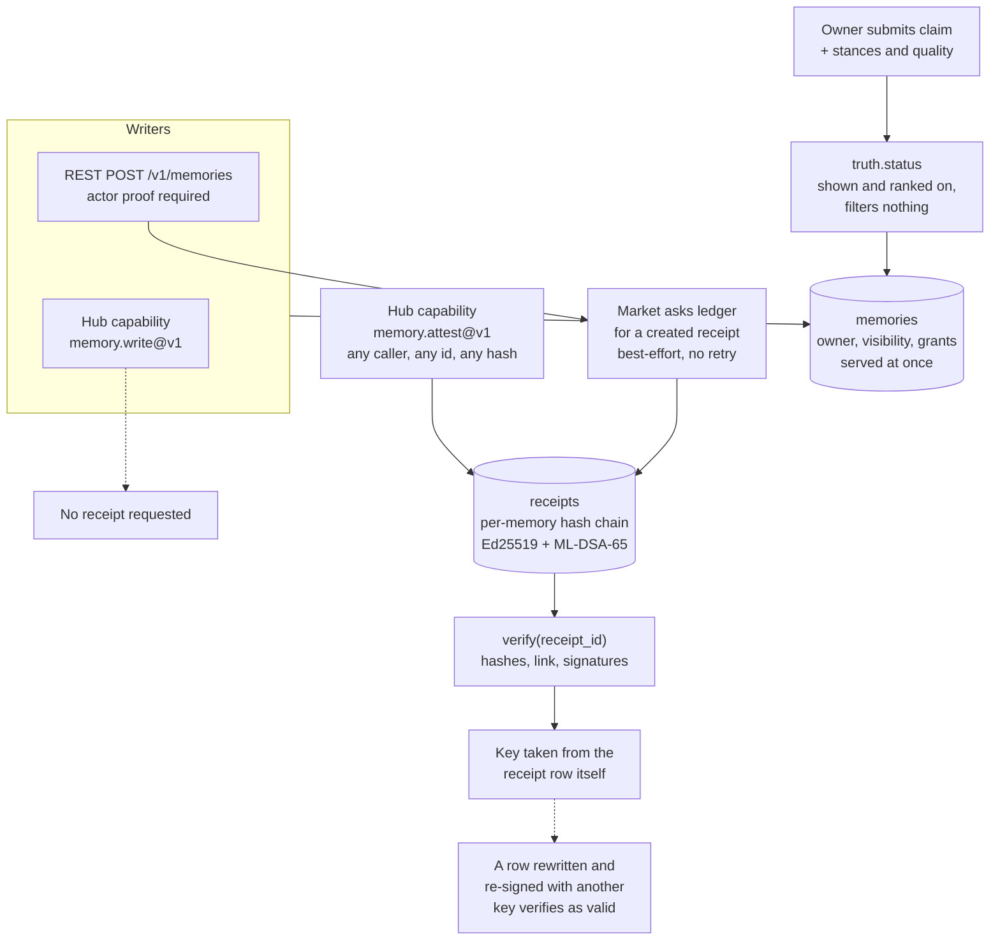

## 1. Executive Summary

Attested Memory is a self-hosted stack of three services around one record,
the Memory Unit: a market that stores and shares units, a truth layer that
scores submitted evidence, and a provenance ledger that issues signed,
hash-chained receipts. What is notable is the access model, where paid content
is listed and cannot be read or probed through search. What is weak is the
receipt check, which verifies each signature against the public key stored in
the receipt it is checking.

A unit is written whole by an authenticated actor and is readable at once. The
market then asks the ledger for a `created` receipt. That call is best-effort:
on any HTTP error the unit stays `unattested` and nothing retries.

The ledger chains receipts per memory. Each receipt hashes its event, links to
the previous root and is signed with Ed25519 and, when enabled, ML-DSA-65.
`verify` recomputes the hashes, checks both signatures and checks the link to
the previous row. It compares the signing key with nothing.

Truth status is arithmetic over the stance and quality numbers the submitter
attaches. The method names itself `submitted-evidence-weight-v1`. No read
filters on the status.

A write through the hub capability, the path an agent on the MCP endpoint
uses, stores the unit and requests no receipt.

**Licence.** The root `LICENSE` is Apache-2.0 and the README says so. The three
product shells under `apps/` each ship their own `LICENSE` file with the MIT
text, and their manifests point at it, so the tree is under two licences where
the README names one. The three services' manifests carry no licence field.
Both licences are permissive and neither restricts use.

Three marks are earned: `scope_enforced` and `negative_eval` on the market's
access model, and `audit_log` on the ledger. Section 9 gives the reason for
each of the four withheld.

## 2. Mental Model

A Memory Unit is **a document with an owner, a price and two attached
judgements**. The public schema lists its fields
(`contracts/memory-unit.schema.json`): id, content, content hash, owner, tags,
visibility, price, a `truth` object and a `provenance` object.

A unit is believed, in the sense of being served, from the moment it is
stored. Nothing gates it. The two judgements arrive afterwards and are
advisory:

- **Provenance** moves from `unattested` to `attested` when the ledger returns
  a receipt, and the unit keeps the latest receipt id and chain root
  (`memory-market/src/memory_market/store.py:393-398`).
- **Truth** moves from `unverified` to `supported`, `contested` or `rejected`
  when the owner submits a claim with evidence
  (`memory-market/src/memory_market/app.py:363-385`).

A unit never stops being served. No route edits or deletes one, and a
`rejected` unit is returned by the same reads as a `supported` one.

## 3. Architecture

Three FastAPI services, each its own package, database and signing key:
`memory-market` on 8810, `truth-layer` on 8811, `provenance-ledger` on 8812.
They talk over HTTP with a shared internal token. `docker-compose.yml` adds
PostgreSQL 16 and an AIMarket hub, and sets `AIFACTORY_PROD=1` on every
service (`docker-compose.yml:140-146`).

Production mode is the default. With neither variable set the services
require strong secrets, a PostgreSQL DSN and both signature schemes
(`provenance-ledger/src/provenance_ledger/config.py:34-44`,
`memory-market/src/memory_market/config.py:68-81`). SQLite runs only under an
explicit `AIFACTORY_DEV=1`.

Two components the stack depends on are outside this tree. The hub runtime is
fetched at a pinned commit by `bootstrap-upstreams.sh`. The SaaS gateway that
the three product shells call for keys and team assertions has no server code
here.

### Deployment and ergonomics

`./start.sh` generates secrets and starts the whole stack in Docker. An
operator runs five containers and a database, and holds three signing keys in
Docker volumes. The repository is a published copy of a private monorepo:
every commit is a sync, so the history shows what changed and not why.

## 4. Essential Implementation Paths

- **Unit schema and store.** `contracts/memory-unit.schema.json`;
  `memory-market/src/memory_market/store.py`: tables `:41-69`, `create`
  `:132-145`, `can_read` `:316-323`, `catalog` `:325-359`, `grant` `:361-378`.
- **Market routes.** `memory-market/src/memory_market/app.py`: actor and team
  checks `:117-203`, create `:310-318`, read `:321-342`, share `:345-352`,
  verify `:363-385`, hub capability dispatch `:512-552`.
- **Ledger.** `provenance-ledger/src/provenance_ledger/store.py`: tables
  `:40-66`, `append` `:102-162`, `lineage` `:184-189`, `verify` `:191-221`;
  signing in `provenance-ledger/src/provenance_ledger/crypto.py:89-147`;
  routes in `provenance-ledger/src/provenance_ledger/app.py:94-117` and
  `:160-200`.
- **Truth.** `truth-layer/src/truth_layer/engine.py:20-85`.
- **The market's calls to the other two.**
  `memory-market/src/memory_market/clients.py:13-53`.

## 5. Memory Data Model

The `memories` row holds the unit and both judgements in place
(`memory-market/src/memory_market/store.py:41-60`): content and its hash,
`owner_id`, tags as JSON, `visibility` under a `CHECK`, `price_usdc`,
`source_refs`, `parent_memory_ids`, then `truth_status`, `truth_confidence`,
`evidence_pack_id`, `provenance_status`, `receipt_id` and `lineage_root`.

Beside it sit `grants` (memory, grantee, grantor, `revoked_at`), `ratings` (one
score of 1 to 5 per actor) and `payment_orders`.

The ledger's `receipts` row is the event: id, memory id, event type, content
hash, actor, source references, parent ids, metadata, `previous_root`,
`event_hash`, `chain_root`, both signatures and both public keys
(`provenance-ledger/src/provenance_ledger/store.py:40-59`). `receipt_heads`
holds the latest root per memory.

Three things the model declares and nothing produces:

- **Event types `derived`, `revoked` and `updated`.** The ledger accepts six
  types (`provenance-ledger/src/provenance_ledger/models.py:10`). The market
  sends `created`, `verified` and `shared`.
- **`revoked_at` on a grant.** Reads honour it; the two writers set it to
  `NULL`.
- **Lineage between units.** `parent_memory_ids` is stored and copied into the
  receipt. No code follows it.

The content hash is computed by the market on write. The unit cannot be
edited, so the hash cannot go stale. The ledger never sees the content and
cannot check a hash it is given.

## 6. Retrieval Mechanics

Retrieval is a filtered listing. `catalog` builds one SQL statement from an
access clause and an optional search clause, ordered by `created_at`
descending with limit and offset (`store.py:325-359`).

The access clause depends on who asks: anyone sees `public` and `paid` rows;
an actor also sees rows they own or hold a grant on; a team context sees rows
tagged `team:<id>` with visibility `shared`, `public` or `paid`.

The search clause matches a case-folded substring against title and tags, and
against content only where the caller could read the row (`:339-353`). The
comment states the reason: *"searching their hidden content would let an
unpaid caller test arbitrary secret substrings."* A paid unit is found by its
title and not by a phrase in its body.

`read_memory` fetches by id and applies `can_read`. A paid unit the caller
cannot read returns HTTP 402 with the price and the order URL
(`app.py:321-342`).

There is no embedding, index or ranking in the services. The Expert Memory
Market shell re-ranks catalogue results with a fixed formula: `supported` adds
up to 0.40, `rejected` subtracts 0.60, an attested unit adds 0.25, ratings and
age add the rest (`apps/expert-memory-market/src/expert_market/app.py:56-105`).
A rejected unit ranks lower and is still listed.

## 7. Write Mechanics

**REST.** `POST /v1/memories` requires the API key and, in production, a
request-bound actor proof: an Ed25519 signature over the method, path, query
and body hash, with a nonce spent once. `create` inserts the row and the
handler asks the ledger for a `created` receipt
(`app.py:310-318`). The actor in the receipt is the market's statement of who
wrote; the actor's own signature is not stored in it.

**Attestation is best-effort.** `attest` posts with a four-second timeout and
returns `None` on any HTTP error (`clients.py:13-38`). The unit is returned as
`unattested`. `attest` has three call sites, each at the moment of its event,
so a unit that missed its receipt never gets one. `docs/architecture.md:24`
says such a unit *"can be reconciled later"*, and line 48 of the same file
lists a reconciliation queue as future work.

**Hub capability.** `memory.write@v1` validates the same fields and calls
`store().create` (`app.py:524-527`). It makes no call to the ledger. Units
written by agents through the hub are unattested unless the caller separately
buys `memory.attest@v1`.

**Sharing.** An owner's grant inserts or revives a `grants` row and writes no
receipt (`app.py:345-352`). A `shared` receipt is written only when a payment
settles (`:66-74`).

**Truth.** The owner posts a claim and a list of evidence items, each with a
source URI, an excerpt hash, a stance and a quality from 0 to 1. The engine
sums quality by stance and picks a status (`engine.py:20-32`). It fetches no
source and checks no hash against anything. The evidence pack is stored whole
with its own hash, and the market writes a `verified` receipt.

### Operational cost

A REST write blocks on one insert and one HTTP call to the ledger, bounded at
four seconds. A unit is retrievable when the insert commits. No background
pass reads or rewrites memories. The only loop is the payment poller.

## 8. Agent Integration

An agent reaches the stack three ways: the REST API with an actor key, the
Python client and CLI in `clients/python`, or the hub's MCP endpoint, which
exposes `market_search` and `market_invoke` over the twelve capabilities.
`server.json` registers a hosted instance of that endpoint.

Through the hub, identity is a buyer reference the hub attaches after it has
authenticated a paying account. A caller without one may read and search
public units and nothing else on the market (`app.py:520-522`).

The ledger's capability route applies no such rule. Section 9 covers it.

The Python client has no receipt, lineage or verification call. A client that
wants to check a receipt asks the ledger to check itself.

## 9. Reliability, Safety, and Trust

### Verification trusts the key in the row

`verify` loads the receipt by id and runs five checks
(`provenance-ledger/src/provenance_ledger/store.py:191-221`): the event hash
recomputes, the chain root recomputes, the Ed25519 signature is valid, the
ML-DSA-65 signature is valid, and `previous_root` equals the previous row's
root. Both signature checks take the public key from the receipt being
checked (`:209-210`). The ledger's own signer key is used in `append` and
appears nowhere in `verify`.

The committed tamper test changes `actor_id` in the row and expects
`event_hash` to fail (`provenance-ledger/tests/test_ledger.py:55-65`). That
shows an edit that leaves the hashes alone is caught. An editor who can write
the row can also recompute the two hashes, sign the new root with a key of
their own and store that key in `public_key`. Every one of the five checks
then passes. This follows from the code and was not run.

The service publishes its key at `/.well-known/ai-market.json`, and each
receipt carries the key it was signed with, so a caller can make the
comparison the service does not. Nothing in the tree does.

Three further limits of the same check:

- **Truncation is invisible.** Deleting the newest receipts of a chain leaves
  every remaining receipt valid. `receipt_heads` is not consulted by `verify`,
  and `_migrate` rebuilds a missing head from whatever receipts remain
  (`:91-100`).
- **It verifies the stored copy.** The request carries a receipt id. A caller
  holding a receipt cannot submit it for comparison.
- **The post-quantum check is read from the environment at verify time.** A
  receipt with no ML-DSA signature passes unless `ATTESTED_PQC_REQUIRE` is set
  (`crypto.py:138-141`); the production config refuses to start without it.

### Any hub caller can write to any chain

`memory.attest@v1` on the ledger takes `memory_id`, `event_type` and
`content_hash` from the caller and appends
(`provenance-ledger/src/provenance_ledger/app.py:183-185`). The ledger does not
know whether the memory exists, who owns it or what its hash is. The actor is
the hub's buyer reference, or the literal `aimarket:anonymous` when there is
none (`:160-169`); the route does not refuse the anonymous case, which the
market's route does.

A caller can therefore append a `verified` or `revoked` receipt, with any
metadata, to another owner's memory. The receipt is validly signed by the
ledger. `lineage.get@v1` returns it in the chain. The market's own
`lineage_root` for that unit then names an older root.

Whether the hub restricts who may invoke this capability cannot be read from
this tree.

### Truth is what the submitter says it is

The status comes from numbers the owner supplies. One evidence item with
stance `supports` and quality 0.9 yields `supported`
(`truth-layer/tests/test_engine.py:16-24`). The project is plain about this:
the method string, a contradiction scanner labelled *"Indicators only"*, and a
status section in the README that calls semantic verification an extension
point.

The ledger then signs a `verified` receipt carrying that status. A reader of
the chain sees a hybrid-signed statement that a unit is supported. The
signature covers the fact that the calculation ran.

### Scope

Access is the strongest part. The actor proof binds a request to its
audience, method, path, query and body, refuses small-order keys, and spends
each nonce once in the database. Team access needs an HMAC assertion naming
the team, the actor and an expiry (`app.py:117-140`). LIKE wildcards in a team
id are escaped, with a test.

Two edges: any owner can tag a unit `team:<id>` and so publish into a team's
catalogue, and a team member reads `paid` units carrying the team tag without
a grant (`store.py:317-318`).

### Marks

- **`scope_enforced` — earned.** Owner, grant, visibility and team keys are
  stored and applied on both read paths.
- **`audit_log` — earned.** The receipts table is an append-only record of
  creation, verification and paid sharing, with a producer on the REST path.
  It does not cover hub writes, owner grants or events whose ledger call
  failed.
- **`negative_eval` — earned.** Three tests require particular paid or
  foreign-team content to be absent from a populated result, each with a
  positive control.
- **`trust_state` — withheld.** `truth.status` is a discrete field with a
  `rejected` value and a producer. No read excludes on it; the one consumer
  subtracts 0.60 from a rank score.
- **`tombstone` — withheld.** Nothing can be deleted or rejected by value. A
  `revoked` event type exists with no producer.
- **`bitemporal` — withheld.** `created_at` and `updated_at` are record times.
- **`human_review` — withheld.** A unit is served before any judgement, and
  verification is requested by its own author.

## 10. Tests, Evals, and Benchmarks

I ran none of the suites. The counts are from reading.

The ledger has seven tests in one file. Three bear on receipts:
`test_append_chain_and_verify` appends two receipts and checks the link, both
verifications and the head row; `test_tamper_is_detected` edits one column;
`test_pq_requirement_fails_closed_for_classical_receipt` sets the requirement
after a classical receipt and expects `pq_signature` to fail
(`provenance-ledger/tests/test_ledger.py:13-33`, `:55-79`). No test re-signs a
changed receipt, deletes a receipt, or appends to a chain as a second actor.

The market has 24 tests in four files: access and search in `test_store.py`,
actor proofs and production gates in `test_security.py`, eight on payment
settlement and four on hub buyer identity. The truth layer has seven,
three on the engine.

No test covers a write through `memory.write@v1` and its provenance state, or
an attestation that fails.

`docs/security-audit-2026-09-06.md` records a review with fixed findings. It
is the project's own document and was read as a claim.

There is no retrieval evaluation, no benchmark and no paper reference in the
tree.

## 11. For Your Own Build

### Steal

- **Search the body only where the caller may read it.** One clause in the
  catalogue SQL stops a priced or private document being probed by substring,
  and the test asserts zero hits for the body and one for the title.
- **Bind the caller's signature to the request.** Audience, method, path,
  query and body hash are signed, and the nonce is spent in the database.
- **Lock the chain head on append.** `receipt_heads` is read `FOR UPDATE` on
  PostgreSQL, so two concurrent appends to one memory cannot share a previous
  root.
- **Name a weak method honestly.** `submitted-evidence-weight-v1` in every
  result tells a consumer what the status is worth.
- **Fail closed on configuration.** Unset means production, and production
  refuses weak secrets and SQLite.

### Avoid

- **Verifying a signature against a key stored beside it.** Pin the verifying
  key outside the row, and check the head against something the database
  writer cannot reach.
- **An attest endpoint that accepts any subject.** A ledger that cannot check
  ownership should be reachable only from the service that can.
- **A best-effort audit write with no retry.** The gap is permanent and looks
  the same as a unit nobody tried to attest.
- **Two write paths with different guarantees.** The agent-facing one is the
  one without the receipt.
- **Signing the output of an unverified calculation** with the same weight as
  a fact.

### Fit

This suits an operator who wants to sell or share documents between agents
with real access control and a payment rail, and who treats the receipts as a
tidy event history kept by a service they run and trust. For that reader the
access model is the thing to study.

It does not suit a reader who needs the ledger to convince a third party.
The receipts prove what the ledger's database says, to a caller who trusts
that database. Anyone who needs memory to be corrected is also in the wrong
place: a unit cannot be edited, withdrawn or marked as not to be served.

## 12. Open Questions

- Does the hub restrict `memory.attest@v1` to particular publishers or
  buyers? The provider route does not.
- Is receipt verification meant to be anchored outside the service? A branch
  of the repository records a Rekor log index for the registry manifest; the
  receipts have no such anchor in this tree.
- What are the `derived`, `revoked` and `updated` events for, given that a
  unit cannot change?

## Appendix: File Index

| Path | Role |
| --- | --- |
| `contracts/memory-unit.schema.json` | The public Memory Unit schema |
| `memory-market/src/memory_market/store.py` | Units, grants, ratings, payment orders, access and catalogue SQL |
| `memory-market/src/memory_market/app.py` | REST routes, actor and team checks, hub capability dispatch |
| `memory-market/src/memory_market/actor_auth.py` | Request-bound actor proofs |
| `memory-market/src/memory_market/clients.py` | Calls to the ledger and the truth layer |
| `provenance-ledger/src/provenance_ledger/store.py` | Receipts, chain heads, append, lineage, verify |
| `provenance-ledger/src/provenance_ledger/crypto.py` | Ed25519 and ML-DSA-65 signing and verification |
| `provenance-ledger/src/provenance_ledger/app.py` | Ledger routes and hub capabilities |
| `truth-layer/src/truth_layer/engine.py` | Evidence weighting and the negation scanner |
| `apps/expert-memory-market/src/expert_market/app.py` | The one consumer of truth status, as a rank term |
| `provenance-ledger/tests/test_ledger.py` | The ledger tests |

### Recorded searches

Run from the repository root at the pinned commit with `/usr/bin/git grep`.

- **Verify does not use the ledger's key.**
  `git grep -n -E 'signer\.public_key|self\.signer' -- provenance-ledger/src/provenance_ledger/store.py`
  returns `:32`, `:130` and `:144`, all in the constructor and `append`.
- **Three callers of attest.** `git grep -n 'attest(' -- '*.py'` returns
  `memory-market/src/memory_market/app.py:69`, `:315` and `:379` and the
  definition in `clients.py:13`.
- **No memory edit or delete, and no receipt update.**
  `git grep -n -E 'DELETE FROM|UPDATE receipts|UPDATE memories' -- '*.py'`
  returns a nonce clean-up, a grant removed on a chain reorganisation, the two
  setters for truth and provenance, and test fixtures.
- **Nothing revokes a grant.** `git grep -n -E 'revoked_at *=' -- '*.py'`
  returns two upserts that set it to `NULL`.
- **Three event types have no producer.**
  `git grep -n -E '"(derived|revoked|updated)"' -- '*.py' '*.js'` returns the
  `Literal` in `provenance-ledger/src/provenance_ledger/models.py:10`.
- **No read filters on truth status.**
  `git grep -n -E 'truth_status|truth\.status' -- '*.py' '*.js' ':!*tests*'`
  returns the column, its mapping, its setter, a count in `stats` and a badge
  in the console script.
- **The client does not verify.**
  `git grep -n -i -E 'receipt|verify|lineage' -- clients/python/src` returns
  nothing; `git grep -n -i 'actor' -- clients/python/src` matches.
- **No gateway server in the tree.**
  `git grep -n -E 'v1/teams|keys/introspect' -- . ':!apps'` returns two lines
  of the console script that call it.
- **No embedding or index.**
  `git grep -n -i -E 'embedding|vector|fts|bm25' -- '*.py'` returns nothing;
  `git grep -n 'LIKE' -- memory-market/src` matches the catalogue.
- **No paper reference.**
  `git grep -n -i -E 'arxiv|bibtex|doi\.org|CITATION' -- .` returns nothing;
  `git grep -n -i 'rekor' -- .github` matches a workflow.

## History

**2026-11-24** — [`ca686945c49234a9e3efac70f7e4587634b52a15`](https://github.com/alexar76/attested-memory/commit/ca686945c49234a9e3efac70f7e4587634b52a15). First reading, from a full clone at the head of `main`. Screened first: one auto-run surface, `server.json`, which registers a remote MCP endpoint and was not connected to; nothing inside the seven-day cooldown; six build-time execution points; six unpinned manifests. Docs were read as data. Nothing was installed, built or run. Three marks: `scope_enforced`, `audit_log` and `negative_eval` ([section 9](#9-reliability-safety-and-trust)). Receipt verification takes the key from the receipt, hub writes get no receipt, and truth status is the submitter's own weights.
