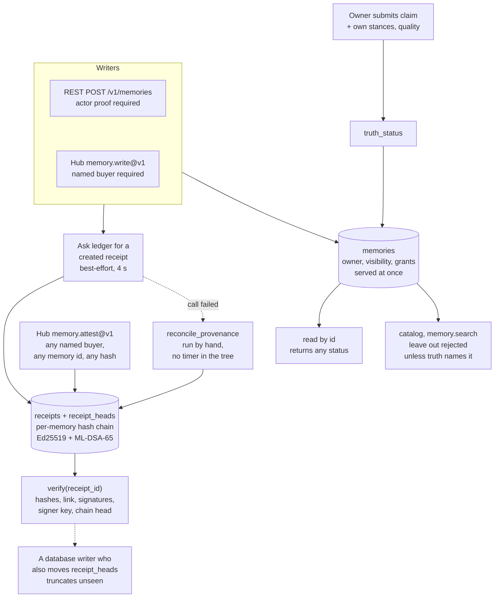

## 1. Executive Summary

Attested Memory is a self-hosted stack of three services around one record,
the Memory Unit: a market that stores and shares units, a truth layer that
scores submitted evidence, and a provenance ledger that issues signed,
hash-chained receipts. What is notable is the access model, where paid content
is listed and cannot be read or probed through search. What is weak is that the
ledger's integrity check compares the ledger's database with itself.

A unit is written whole by an authenticated actor, over REST or through the hub
capability, and is readable at once. Both paths then ask the ledger for a
`created` receipt. That call is best-effort, and a command,
`reconcile_provenance`, finishes the units it missed when an operator runs it.
Nothing in the tree schedules it.

The ledger chains receipts per memory. Each receipt hashes its event, links to
the previous root and is signed with Ed25519 and, when enabled, ML-DSA-65.
`verify` recomputes the hashes, checks both signatures, checks the link,
requires the signing key to be the ledger's own or one listed in its
environment, and requires the memory's newest receipt to equal the recorded
chain head. The head row is in the same database as the receipts.

Truth status is arithmetic over the stance and quality numbers the owner
attaches. The method names itself `submitted-evidence-weight-v1`. A `rejected`
unit is left out of the catalogue and of search unless the caller asks for it,
and stays readable by id.

The ledger's own hub capability appends to any memory id for any buyer the hub
names.

**Licence.** The root `LICENSE` is Apache-2.0 and the README says so. The three
product shells under `apps/` each ship their own `LICENSE` file with the MIT
text, and their manifests point at it, so the tree is under two licences where
the README names one. The three services' manifests carry no licence field.
Both licences are permissive and neither restricts use.

Four marks are earned: `trust_state`, `scope_enforced` and `negative_eval` on
the market, and `audit_log` on the ledger. Section 9 gives the reason for each
of the three withheld.

## 2. Mental Model

A Memory Unit is **a document with an owner, a price and two attached
judgements**. The public schema lists its fields
(`contracts/memory-unit.schema.json`): id, content, content hash, owner, tags,
visibility, price, a `truth` object and a `provenance` object.

A unit is believed, in the sense of being served, from the moment it is
stored. Nothing gates it. The two judgements arrive afterwards:

- **Provenance** moves from `unattested` to `attested` when the ledger returns
  a receipt, and the unit keeps the latest receipt id and chain root
  (`memory-market/src/memory_market/store.py:405-410`). It is advisory.
- **Truth** moves between `unverified`, `supported`, `contested` and `rejected`
  when the owner submits a claim with evidence
  (`memory-market/src/memory_market/app.py:388-410`). `rejected` takes the
  unit out of search.

No route edits or deletes a unit. A `rejected` unit leaves the catalogue and
search, is returned by a read by id with its status, and returns to search if
its owner submits evidence that moves it to another status.

## 3. Architecture

Three FastAPI services, each its own package, database and signing key:
`memory-market` on 8810, `truth-layer` on 8811, `provenance-ledger` on 8812.
They talk over HTTP with a shared internal token. `docker-compose.yml` adds
PostgreSQL 16 and an AIMarket hub, and sets `AIFACTORY_PROD=1` on every
service (`docker-compose.yml:140-146`).

Production mode is the default. With neither variable set the services
require strong secrets, a PostgreSQL DSN and both signature schemes
(`provenance-ledger/src/provenance_ledger/config.py:34-44`,
`memory-market/src/memory_market/config.py:68-81`). SQLite runs only under an
explicit `AIFACTORY_DEV=1`.

Two components the stack depends on are outside this tree. The hub runtime is
fetched at a pinned commit by `bootstrap-upstreams.sh`. The SaaS gateway that
the three product shells call for keys and team assertions has no server code
here.

### Deployment and ergonomics

`./start.sh` generates secrets and starts the whole stack in Docker. An
operator runs five containers and a database, and holds three signing keys in
Docker volumes. The repository is a published copy of a private monorepo:
every commit is a sync, so the history shows what changed and not why.

## 4. Essential Implementation Paths

- **Unit schema and store.** `contracts/memory-unit.schema.json`;
  `memory-market/src/memory_market/store.py`: default truth filter `:24-26`,
  tables `:46-74`, `create` `:137-150`, `can_read` `:321-328`, `catalog`
  `:330-371`, `grant` `:373-390`, `set_provenance` `:405-410`, `unattested`
  `:412-418`, `set_truth` `:420-425`.
- **Market routes.** `memory-market/src/memory_market/app.py`: actor and team
  checks `:117-203`, the `truth` parameter `:288-308`, catalogue `:311-319`,
  create `:335-343`, read `:346-367`, share `:370-377`, verify `:388-410`, hub
  capability dispatch `:537-585`.
- **Reconcile.** `memory-market/src/memory_market/reconcile_provenance.py:24-45`.
- **Ledger.** `provenance-ledger/src/provenance_ledger/store.py`: tables
  `:40-66`, head rebuild `:91-100`, `append` `:102-162`, `lineage` `:184-189`,
  trusted keys `:191-203`, `verify` `:205-253`; signing in
  `provenance-ledger/src/provenance_ledger/crypto.py:89-147`; routes in
  `provenance-ledger/src/provenance_ledger/app.py:94-117` and `:164-209`.
- **Truth.** `truth-layer/src/truth_layer/engine.py:20-85`.
- **The market's calls to the other two.**
  `memory-market/src/memory_market/clients.py:13-74`.

## 5. Memory Data Model

The `memories` row holds the unit and both judgements in place
(`memory-market/src/memory_market/store.py:46-65`): content and its hash,
`owner_id`, tags as JSON, `visibility` under a `CHECK`, `price_usdc`,
`source_refs`, `parent_memory_ids`, then `truth_status`, `truth_confidence`,
`evidence_pack_id`, `provenance_status`, `receipt_id` and `lineage_root`.

Beside it sit `grants` (memory, grantee, grantor, `revoked_at`), `ratings` (one
score of 1 to 5 per actor) and `payment_orders`.

The ledger's `receipts` row is the event: id, memory id, event type, content
hash, actor, source references, parent ids, metadata, `previous_root`,
`event_hash`, `chain_root`, both signatures and both public keys
(`provenance-ledger/src/provenance_ledger/store.py:40-59`). `receipt_heads`
holds the latest root per memory.

Three things the model declares that no code in the tree produces:

- **Event types `derived`, `revoked` and `updated`.** The ledger accepts six
  types (`provenance-ledger/src/provenance_ledger/models.py:10`). The market
  sends `created`, `verified` and `shared`. The ledger's hub capability takes
  the type from its caller, so a hub buyer can send any of the six.
- **`revoked_at` on a grant.** Reads honour it; the two writers set it to
  `NULL`.
- **Lineage between units.** `parent_memory_ids` is stored and copied into the
  receipt. No code follows it.

The content hash is computed by the market on write. The unit cannot be
edited, so the hash cannot go stale. The ledger never sees the content and
cannot check a hash it is given.

## 6. Retrieval Mechanics

Retrieval is a filtered listing. `catalog` builds one SQL statement from an
access clause, an optional search clause and a truth clause, ordered by
`created_at` descending with limit and offset (`store.py:330-371`).

The access clause depends on who asks: anyone sees `public` and `paid` rows;
an actor also sees rows they own or hold a grant on; a team context sees rows
tagged `team:<id>` with visibility `shared`, `public` or `paid`.

The search clause matches a case-folded substring against title and tags, and
against content only where the caller could read the row (`:348-362`). The
comment states the reason: *"searching their hidden content would let an
unpaid caller test arbitrary secret substrings."* A paid unit is found by its
title and not by a phrase in its body.

The truth clause appends `truth_status IN (...)` (`:363-365`). Its default is
every status but `rejected` (`:24-26`). The REST catalogue and
`memory.search@v1` take a `truth` parameter: empty keeps the default, `any`
drops the clause, a comma-separated list replaces it, and an unknown status is
a 422 rather than an empty result (`app.py:288-308`, `:311-319`, `:565-569`).
The discoverable count in `stats` uses the same default (`store.py:428`). The
three product shells, the console script and the Python client send no
`truth`, so all of them get the default.

`read_memory` fetches by id and applies `can_read` and no truth predicate. A
paid unit the caller cannot read returns HTTP 402 with the price and the order
URL (`app.py:346-367`). `memory.read@v1` and `GET /v1/catalog/{id}` also
return a unit whatever its status.

There is no embedding, index or ranking in the services. The Expert Memory
Market shell re-ranks catalogue results with a fixed formula: `supported` adds
up to 0.40, `contested` subtracts 0.15, `rejected` subtracts 0.60, an attested
unit adds 0.25, ratings and age add the rest
(`apps/expert-memory-market/src/expert_market/app.py:56-105`). The shell asks
for the default catalogue, so the `rejected` term is reached by no unit it
lists.

## 7. Write Mechanics

**REST.** `POST /v1/memories` requires the API key and, in production, a
request-bound actor proof: an Ed25519 signature over the method, path, query
and body hash, with a nonce spent once. `create` inserts the row and the
handler asks the ledger for a `created` receipt
(`app.py:335-343`). The actor in the receipt is the market's statement of who
wrote; the actor's own signature is not stored in it.

**Hub capability.** `memory.write@v1` requires a buyer reference from the hub,
validates the same fields, calls `store().create` and asks the ledger for a
`created` receipt under the actor `aimarket:<buyer reference>`
(`app.py:545-559`).

**Attestation is best-effort.** `attest` posts with a four-second timeout and
returns `None` on any HTTP error (`clients.py:13-38`). The unit is returned as
`unattested`.

**Reconcile.** `python -m memory_market.reconcile_provenance` pages through
units whose provenance is `unattested`, oldest id first. For each it first
asks the ledger for the memory's lineage and takes the first `created`
receipt whose content hash equals the unit's, so an attest that landed while
its answer was lost is linked rather than doubled; otherwise it requests a new
receipt under the owner's id. `--count` only counts, and the exit status is 1
when any unit stays unattested (`reconcile_provenance.py:24-57`,
`clients.py:40-59`). No compose service, Dockerfile, workflow or timer in the
tree runs it, and `docs/architecture.md:48` lists a timer as future work.

The match in `created_receipt` is on event type and content hash, not on the
actor. A content hash is computable by anyone who can read the content. A hub
buyer who appends a `created` receipt for an unattested public unit's id and
hash, before the command runs, has that receipt linked as the unit's own. This
follows from the code and was not run.

**Sharing.** An owner's grant inserts or revives a `grants` row and writes no
receipt (`app.py:370-377`). A `shared` receipt is written only when a payment
settles (`:66-74`).

**Truth.** The owner posts a claim and a list of evidence items, each with a
source URI, an excerpt hash, a stance and a quality from 0 to 1. Only the
owner may request it (`app.py:397-398`). The engine sums quality by stance and
picks a status (`engine.py:20-32`). It fetches no source and checks no hash
against anything. The evidence pack is stored whole with its own hash, the
market overwrites the unit's status, and it writes a `verified` receipt.

### Operational cost

A write on either path blocks on one insert and one HTTP call to the ledger,
bounded at four seconds. A unit is retrievable when the insert commits. No
background pass reads or rewrites memories. The only loop is the payment
poller; the reconcile command walks every unattested unit when it is run.

## 8. Agent Integration

An agent reaches the stack three ways: the REST API with an actor key, the
Python client and CLI in `clients/python`, or the hub's MCP endpoint, which
exposes `market_search` and `market_invoke` over the twelve capabilities.
`server.json` registers a hosted instance of that endpoint.

Through the hub, identity is a buyer reference the hub attaches after it has
authenticated a paying account. A caller without one may read and search
public units and nothing else on the market (`app.py:545-547`), and may read
lineage and verify receipts on the ledger.

The ledger's attest capability refuses a caller without a buyer reference and
accepts every caller with one. Section 9 covers it.

The Python client has no receipt, lineage or verification call, and its search
sends no `truth` parameter. A client that wants to check a receipt asks the
ledger to check itself.

## 9. Reliability, Safety, and Trust

### Verification checks the ledger's database against itself

`verify` loads the receipt by id and runs seven checks
(`provenance-ledger/src/provenance_ledger/store.py:205-253`): the event hash
recomputes, the chain root recomputes, the Ed25519 signature is valid, the
ML-DSA-65 signature is valid, `previous_root` equals the previous row's root,
the signing keys are trusted, and the chain head matches.

`signer_key` requires the receipt's Ed25519 key to be the ledger's own or one
listed in `PROVENANCE_TRUSTED_PUBLIC_KEYS`, and its ML-DSA key, when present,
to be the ledger's own or one in `PROVENANCE_TRUSTED_PQ_PUBLIC_KEYS`
(`:191-203`, `:233-235`). `test_a_row_re_signed_with_another_key_is_rejected`
rewrites a row, recomputes both hashes, signs the new root with another key,
moves the head row to match, and requires `signer_key` to fail while the hash
and signature checks pass (`provenance-ledger/tests/test_ledger.py:133-170`).
An editor without the ledger's private key cannot re-sign a receipt.

`chain_head` requires the `receipt_heads` row for the memory to equal the
newest stored receipt's root (`:240-247`). Deleting the newest receipt alone
fails it, with a test (`test_ledger.py:187-201`). Deleting a receipt in the
middle fails `previous_link` on the receipt after it (`:225-230`).

What the checks do not reach:

- **Truncation by a database writer.** The head row and the receipts are in
  one database. A writer who deletes the newest receipts and sets
  `receipt_heads` to the new last root passes every check, which the code's
  own comment states (`:236-239`). Deleting the head row works too, across a
  restart: `verify` fails while it is missing, and `_migrate` rebuilds it from
  the remaining receipts on the next start (`:91-100`), as
  `test_migration_backfills_chain_head` requires (`test_ledger.py:36-52`).
- **The root kept outside the ledger is compared with nothing.** The comment
  recommends checking the chain root returned on append. The market stores
  exactly that as each unit's `lineage_root`, and no code reads it except the
  Expert shell's rank term.
- **The trusted keys are the operator's.** The private key sits in a Docker
  volume on the host that runs the database, and the trusted set is extended
  by an environment variable read at verify time. A receipt convinces a caller
  who trusts the operator.
- **It verifies the stored copy.** The request carries a receipt id. A caller
  holding a receipt cannot submit it for comparison.
- **The post-quantum check is read from the environment at verify time.** A
  receipt with no ML-DSA signature passes unless `ATTESTED_PQC_REQUIRE` is set
  (`crypto.py:138-141`); the production config refuses to start without it.

### Any named hub buyer can write to any chain

`memory.attest@v1` on the ledger refuses the actor `aimarket:anonymous` with a
403 and otherwise takes `memory_id`, `event_type`, `content_hash` and metadata
from the caller and appends
(`provenance-ledger/src/provenance_ledger/app.py:187-194`). The ledger does
not know whether the memory exists, who owns it or what its hash is. The
actor is the hub's buyer reference (`:164-173`).
`test_hub_attest_refuses_an_anonymous_caller_but_reads_stay_open` requires the
403 and then requires a named buyer's append to a memory id it has no relation
to to succeed (`test_ledger.py:204-230`).

A paying hub account can therefore append a `verified` or `revoked` receipt,
with any metadata, to another owner's memory. The receipt is validly signed by
the ledger. `lineage.get@v1` returns it in the chain. The market's own
`lineage_root` for that unit then names an older root, and a `created`
receipt planted this way is linked by the reconcile command (section 7).

`docs/capabilities.md` says trial callers are refused too. The code refuses a
missing or malformed buyer reference; whether the hub withholds one from trial
callers cannot be read from this tree.

### Truth is what the owner says it is

The status comes from numbers the owner supplies. One evidence item with
stance `supports` and quality 0.9 yields `supported`
(`truth-layer/tests/test_engine.py:16-24`). The project is plain about this:
the method string, a contradiction scanner labelled *"Indicators only"*, and a
status section in the README that calls semantic verification an extension
point.

Only the owner can request verification, so `rejected` is the owner's own
retraction by evidence weight. No caller can take another owner's unit out of
search this way, and the owner can move it back with new evidence. The ledger
signs a `verified` receipt carrying the status, so a reader of the chain sees
a hybrid-signed statement that the calculation ran.

### Scope

Access is the strongest part. The actor proof binds a request to its
audience, method, path, query and body, refuses small-order keys, and spends
each nonce once in the database. Team access needs an HMAC assertion naming
the team, the actor and an expiry (`app.py:117-140`). LIKE wildcards in a team
id are escaped, with a test.

Two edges: any owner can tag a unit `team:<id>` and so publish into a team's
catalogue, and a team member reads `paid` units carrying the team tag without
a grant (`store.py:322-323`).

### Marks

- **`trust_state` — earned.** `truth_status` is a stored discrete field whose
  `rejected` value is excluded by the catalogue SQL behind the REST catalogue,
  `memory.search@v1` and the discoverable count, with a producer that moves a
  unit into and out of it. A read by id returns it with its status, and
  `truth=any` lifts the filter. The producer is the owner's own evidence
  arithmetic.
- **`scope_enforced` — earned.** Owner, grant, visibility and team keys are
  stored and applied on both read paths.
- **`audit_log` — earned.** The receipts table is an append-only record of
  creation through either write path, verification and paid sharing. It does
  not cover owner grants, and a failed ledger call leaves a gap until the
  reconcile command is run.
- **`negative_eval` — earned.** Four tests require particular paid,
  foreign-team or rejected content to be absent from a populated result, each
  with a positive control.
- **`tombstone` — withheld.** `rejected` is a status on a record. The same
  text written again is a new unit, `unverified` and served at once. A
  `revoked` event type exists with no producer in the tree.
- **`bitemporal` — withheld.** `created_at` and `updated_at` are record times.
- **`human_review` — withheld.** A unit is served before any judgement, and
  verification is requested by its own author.

## 10. Tests, Evals, and Benchmarks

I ran none of the suites. The counts are from reading. CI runs the service
suites and the client suite on Python 3.12 (`.github/workflows/ci.yml`).

The ledger has eleven tests in one file. Seven bear on receipts:
`test_append_chain_and_verify` appends two receipts and checks the link, both
verifications and the head row; `test_tamper_is_detected` edits one column;
`test_pq_requirement_fails_closed_for_classical_receipt` sets the requirement
after a classical receipt; and four cover the re-signed row, a rotated key
listed as trusted, a deleted newest receipt and the anonymous attest caller
(`provenance-ledger/tests/test_ledger.py:13-33`, `:55-79`, `:133-230`). No test
truncates a chain and moves its head, or deletes a middle receipt.

The market has 28 tests in five files: access and search in `test_store.py`,
actor proofs and production gates in `test_security.py`, eight on payment
settlement, four on hub buyer identity, and four in
`test_truth_and_provenance.py`. Those four cover the default truth filter on
the store and the hub search, the REST `truth` parameter including the 422,
a hub write requesting a receipt from a stub ledger, and the reconcile command
against a stub ledger that has one landed receipt, one missing and one
refusing, run twice (`memory-market/tests/test_truth_and_provenance.py:46-119`).
The file's docstring attributes the two gaps it covers to a review of the
previous revision by this atlas, dated 2026-11-24.

Those tests set truth status with `set_truth` directly; no test drives the
verify route to `rejected` and then searches. No test asserts the provenance
state of a hub write whose ledger call fails. The truth layer has seven tests, three on the engine.

`docs/security-audit-2026-09-06.md` records a review with fixed findings. It
is the project's own document and was read as a claim.

There is no retrieval evaluation, no benchmark and no paper reference in the
tree.

## 11. For Your Own Build

### Steal

- **Search the body only where the caller may read it.** One clause in the
  catalogue SQL stops a priced or private document being probed by substring,
  and the test asserts zero hits for the body and one for the title.
- **Withhold the rejected state by default and name the way back.** One
  default tuple in the store, an explicit `any` for an audit read, and a 422
  for a status that does not exist rather than an empty list.
- **Bind the caller's signature to the request.** Audience, method, path,
  query and body hash are signed, and the nonce is spent in the database.
- **Lock the chain head on append.** `receipt_heads` is read `FOR UPDATE` on
  PostgreSQL, so two concurrent appends to one memory cannot share a previous
  root.
- **Name a weak method honestly.** `submitted-evidence-weight-v1` in every
  result tells a consumer what the status is worth.
- **Fail closed on configuration.** Unset means production, and production
  refuses weak secrets and SQLite.

### Avoid

- **Checking a chain head stored beside the chain.** Compare against a root
  held by a party the database writer cannot reach; here the market holds one
  and nothing reads it.
- **An attest endpoint that accepts any subject.** A ledger that cannot check
  ownership should be reachable only from the service that can.
- **A repair that matches on content alone.** A reconciler that links any
  receipt with the right hash adopts one written by someone else.
- **A retry nobody schedules.** Until a timer runs it, the gap looks the same
  as a unit nobody tried to attest.
- **Signing the output of an unverified calculation** with the same weight as
  a fact.

### Fit

This suits an operator who wants to sell or share documents between agents
with real access control and a payment rail, and who treats the receipts as a
tidy event history kept by a service they run and trust. For that reader the
access model is the thing to study.

It does not suit a reader who needs the ledger to convince a third party.
The receipts prove what the ledger's database says, to a caller who trusts
that database and its operator. A reader who needs memory to be corrected is
served only in part: an owner can take a unit out of search by submitting
refuting evidence, and nothing can edit or delete it.

## 12. Open Questions

- Does the hub restrict `memory.attest@v1` beyond requiring a buyer
  reference, and does it withhold one from trial callers? The provider route
  accepts any reference that matches its pattern.
- Does the hosted deployment run `reconcile_provenance` on a timer? The tree
  does not.
- Is receipt verification meant to be anchored outside the service? A branch
  of the repository records a Rekor log index for the registry manifest; the
  receipts have no such anchor in this tree.
- What are the `derived`, `revoked` and `updated` events for, given that a
  unit cannot change?

## Appendix: File Index

| Path | Role |
| --- | --- |
| `contracts/memory-unit.schema.json` | The public Memory Unit schema |
| `memory-market/src/memory_market/store.py` | Units, grants, ratings, payment orders, access, truth and catalogue SQL |
| `memory-market/src/memory_market/app.py` | REST routes, the `truth` parameter, actor and team checks, hub capability dispatch |
| `memory-market/src/memory_market/actor_auth.py` | Request-bound actor proofs |
| `memory-market/src/memory_market/clients.py` | Calls to the ledger and the truth layer, and the landed-receipt lookup |
| `memory-market/src/memory_market/reconcile_provenance.py` | The command that attests or links unattested units |
| `provenance-ledger/src/provenance_ledger/store.py` | Receipts, chain heads, append, lineage, trusted keys, verify |
| `provenance-ledger/src/provenance_ledger/crypto.py` | Ed25519 and ML-DSA-65 signing and verification |
| `provenance-ledger/src/provenance_ledger/app.py` | Ledger routes and hub capabilities |
| `truth-layer/src/truth_layer/engine.py` | Evidence weighting and the negation scanner |
| `apps/expert-memory-market/src/expert_market/app.py` | The rank formula over truth, provenance, ratings and age |
| `provenance-ledger/tests/test_ledger.py` | The ledger tests |
| `memory-market/tests/test_truth_and_provenance.py` | The truth filter, hub receipt and reconcile tests |

### Recorded searches

Run from the repository root at the pinned commit with `/usr/bin/git grep`.

- **Verify reaches the ledger's key only through the trusted set.**
  `git grep -n -E 'signer\.public_key|self\.signer' -- provenance-ledger/src/provenance_ledger/store.py`
  returns `:32`, `:130` and `:144` in the constructor and `append`, and `:196`
  and `:202` in the two trusted-key sets.
- **Five callers of attest.** `git grep -n 'attest(' -- '*.py'` returns
  `memory-market/src/memory_market/app.py:69`, `:340`, `:404` and `:555`,
  `reconcile_provenance.py:39`, the definition in `clients.py:13` and two test
  stubs.
- **No memory edit or delete, and no receipt update.**
  `git grep -n -E 'DELETE FROM|UPDATE receipts|UPDATE memories' -- '*.py'`
  returns a nonce clean-up, a grant removed on a chain reorganisation, the two
  setters for truth and provenance, and test fixtures.
- **Nothing revokes a grant.** `git grep -n -E 'revoked_at *=' -- '*.py'`
  returns two upserts that set it to `NULL`.
- **Three event types have no producer.**
  `git grep -n -E '"(derived|revoked|updated)"' -- '*.py' '*.js'` returns the
  `Literal` in `provenance-ledger/src/provenance_ledger/models.py:10`.
- **One read filters on truth status.**
  `git grep -n -E 'truth_status|truth\.status' -- '*.py' '*.js' ':!*tests*'`
  returns the column, its mapping, the `IN` clause at `store.py:364`, its
  setter, a count in `stats` and a badge in the console script.
- **No test drives the verify route.**
  `git grep -n -E '/verify|verify_memory' -- memory-market/tests tests`
  returns nothing; `git grep -n 'set_truth' -- memory-market/tests tests`
  matches.
- **No hub-write test asserts provenance on a failed call.**
  `git grep -n -E 'provenance|TrustClients|unattested' -- memory-market/tests/test_hub_buyer.py`
  returns nothing; `git grep -n 'memory.write@v1' -- '*tests*'` matches those
  writes and the stubbed one in `test_truth_and_provenance.py:88`.
- **No ledger test truncates a chain and moves its head.**
  `git grep -n -E 'DELETE FROM receipts|receipt_heads' -- provenance-ledger/tests`
  returns head reads, the head deletion in the migration test at `:45`, the
  re-sign helper's head update at `:154` and the single receipt deletion at
  `:197`.
- **Nothing schedules the reconcile command.**
  `git grep -n 'reconcile_provenance' -- .` returns the module, a comment in
  `app.py`, its test and `docs/architecture.md:24` and `:48`.
- **Nothing compares the market's lineage root with the ledger.**
  `git grep -n 'lineage_root' -- '*.py' '*.js' ':!*tests*'` returns the model,
  the column, its mapping and setter, and the Expert shell's rank term.
- **The client does not verify.**
  `git grep -n -i -E 'receipt|verify|lineage' -- clients/python/src` returns
  nothing; `git grep -n -i 'actor' -- clients/python/src` matches.
- **No gateway server in the tree.**
  `git grep -n -E 'v1/teams|keys/introspect' -- . ':!apps'` returns two lines
  of the console script that call it.
- **No embedding or index.**
  `git grep -n -i -E 'embedding|vector|fts|bm25' -- '*.py'` returns nothing;
  `git grep -n 'LIKE' -- memory-market/src` matches the catalogue.
- **No paper reference.**
  `git grep -n -i -E 'arxiv|bibtex|doi\.org|CITATION' -- .` returns nothing;
  `git grep -n -i 'rekor' -- .github` matches a workflow.

## History

**2026-11-25** — [`25d6b1ab4f0983d2d3c3b35bf03c40535d9c91db`](https://github.com/alexar76/attested-memory/commit/25d6b1ab4f0983d2d3c3b35bf03c40535d9c91db), one sync commit past the previous pin; full clone, screen unchanged, nothing built or run. Four claims stopped being true: `verify` trusted the key in the row (it requires the ledger's own key), truncation was invisible (deleting the newest receipt fails a head check), hub writes were never attested (they request a receipt), and nothing retried (a reconcile command exists, unscheduled). The ledger's attest capability refuses anonymous callers and accepts any named buyer. `trust_state` gained: catalogue and search leave out `rejected` by default ([section 9](#9-reliability-safety-and-trust)). The new test file's docstring cites this atlas. What the fix leaves: the head row lives in the ledger's own database, and the reconcile command links a `created` receipt by hash without checking who wrote it.

**2026-11-24** — [`ca686945c49234a9e3efac70f7e4587634b52a15`](https://github.com/alexar76/attested-memory/commit/ca686945c49234a9e3efac70f7e4587634b52a15). First reading, from a full clone at the head of `main`. Screened first: one auto-run surface, `server.json`, which registers a remote MCP endpoint and was not connected to; nothing inside the seven-day cooldown; six build-time execution points; six unpinned manifests. Docs were read as data. Nothing was installed, built or run. Three marks: `scope_enforced`, `audit_log` and `negative_eval` ([section 9](#9-reliability-safety-and-trust)). Receipt verification takes the key from the receipt, hub writes get no receipt, and truth status is the submitter's own weights.
