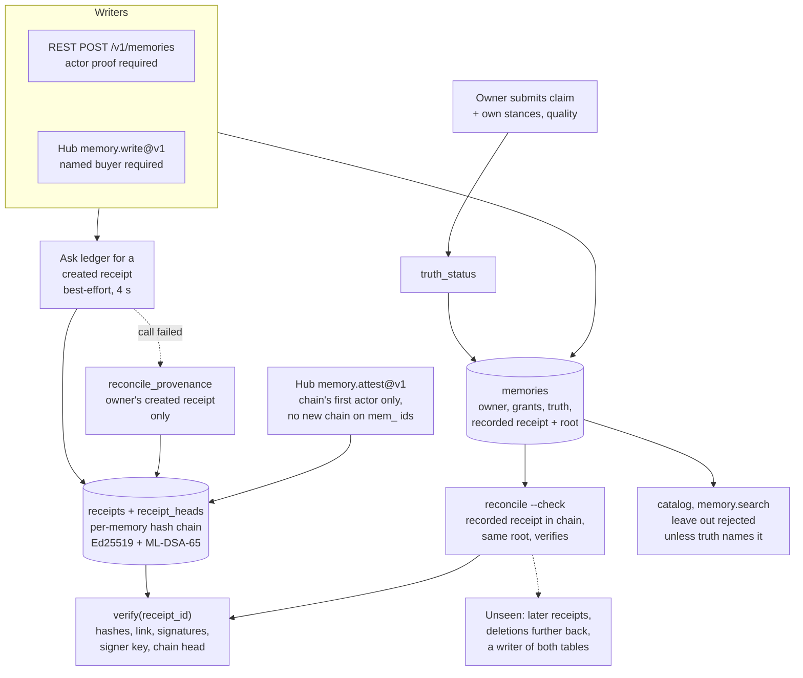

## 1. Executive Summary

Attested Memory is a self-hosted stack of three services around one record,
the Memory Unit: a market that stores and shares units, a truth layer that
scores submitted evidence, and a provenance ledger that issues signed,
hash-chained receipts. What is notable is the access model, where paid content
is listed and cannot be read or probed through search, and a receipt check
that compares the ledger with a chain root kept by the market. What is weak is
how much that comparison covers: one receipt per unit, kept in the same
database as the ledger in the bundled deployment.

A unit is written whole by an authenticated actor, over REST or through the hub
capability, and is readable at once. Both paths then ask the ledger for a
`created` receipt, best-effort. A command, `reconcile_provenance`, attests the
units the ledger missed, and with `--check` compares every attested unit's
recorded receipt and root with the ledger. Systemd unit files run both hourly;
an operator installs them by hand.

The ledger chains receipts per memory. `verify` recomputes the hashes, checks
both signatures and the link, requires the ledger's own signing key, and
requires the memory's newest receipt to equal the recorded chain head. A
deleted head row is not rebuilt, and the ledger refuses to extend a chain that
has lost its head. Through the hub, a buyer extends only a chain whose first
receipt is theirs and starts none under a market id.

Truth status is arithmetic over the stance and quality numbers the owner
attaches. The method names itself `submitted-evidence-weight-v1`. A `rejected`
unit is left out of the catalogue and of search unless the caller asks for it,
and stays readable by id.

**Licence.** The root `LICENSE` is Apache-2.0 and the README says so. The three
product shells under `apps/` each ship their own `LICENSE` file with the MIT
text, and their manifests point at it, so the tree is under two licences where
the README names one. The three services' manifests carry no licence field.
Both licences are permissive and neither restricts use.

Four marks are earned: `trust_state`, `scope_enforced` and `negative_eval` on
the market, and `audit_log` on the ledger. Section 9 gives the reason for each
of the three withheld.

## 2. Mental Model

A Memory Unit is **a document with an owner, a price and two attached
judgements**. The public schema lists its fields
(`contracts/memory-unit.schema.json`): id, content, content hash, owner, tags,
visibility, price, a `truth` object and a `provenance` object.

A unit is believed, in the sense of being served, from the moment it is
stored. Nothing gates it. The two judgements arrive afterwards:

- **Provenance** moves from `unattested` to `attested` when the ledger returns
  the unit's `created` receipt. Every later receipt the market requests
  replaces the recorded receipt id and chain root without touching the status
  (`memory-market/src/memory_market/store.py:440-449`). It is advisory.
- **Truth** moves between `unverified`, `supported`, `contested` and `rejected`
  when the owner submits a claim with evidence
  (`memory-market/src/memory_market/app.py:404-430`). `rejected` takes the
  unit out of search.

No route edits or deletes a unit. A `rejected` unit leaves the catalogue and
search, is returned by a read by id with its status, and returns to search if
its owner submits evidence that moves it to another status.

## 3. Architecture

Three FastAPI services, each its own package, store and signing key:
`memory-market` on 8810, `truth-layer` on 8811, `provenance-ledger` on 8812.
They talk over HTTP with a shared internal token. `docker-compose.yml` adds
PostgreSQL 16 and an AIMarket hub, and sets `AIFACTORY_PROD=1` on every
service (`docker-compose.yml:140-146`).

Each store reads its own DSN variable. `docs/production-postgres.md` says the
stores may point at one database or at separate ones, and the bundled compose
gives the market, the truth layer and the ledger the same database and role
(`docker-compose.yml:139`, `:201`, `:243`). Section 9 says what that does to
the cross-check.

Production mode is the default. With neither variable set the services
require strong secrets, a PostgreSQL DSN and both signature schemes
(`provenance-ledger/src/provenance_ledger/config.py:34-44`,
`memory-market/src/memory_market/config.py:68-81`). SQLite runs only under an
explicit `AIFACTORY_DEV=1`.

Two components the stack depends on are outside this tree. The hub runtime is
fetched at a pinned commit by `bootstrap-upstreams.sh`. The SaaS gateway that
the three product shells call for keys and team assertions has no server code
here.

### Deployment and ergonomics

`./start.sh` generates secrets and starts the whole stack in Docker. An
operator runs five containers and a database, and holds three signing keys in
Docker volumes. The reconcile and cross-check run from
`scripts/systemd/attested-provenance-reconcile.service` and its timer, which
the file's own comment says to copy into `/etc/systemd/system`; their working
directory is a fixed path, `/opt/aicom/attested/attested-memory-hub`, and no
script in the tree installs them. The repository is a published copy of a
private monorepo: every commit is a sync, so the history shows what changed
and not why.

## 4. Essential Implementation Paths

- **Unit schema and store.** `contracts/memory-unit.schema.json`;
  `memory-market/src/memory_market/store.py`: default truth filter `:24-26`,
  tables `:46-74`, `create` `:137-150`, `has_grant` `:180-184`, `can_read`
  `:321-328`, `catalog` `:330-371`, `listing` `:373-380`, `grant` `:382-399`,
  `revoke` `:401-425`, `set_provenance` `:440-449`, `unattested` and
  `attested` `:451-465`, `set_truth` `:467-472`.
- **Market routes.** `memory-market/src/memory_market/app.py`: payment receipt
  `:66-78`, actor and team checks `:121-207`, the `truth` parameter
  `:292-312`, catalogue `:315-336`, create `:339-347`, read `:350-371`, share
  and revoke `:374-393`, verify `:404-430`, hub capability dispatch
  `:557-611`.
- **Ledger calls and commitments.**
  `memory-market/src/memory_market/clients.py`: `commitment`, `receipt_refs`
  and `receipt_parents` `:11-30`, `attest` `:36-61`, `lineage` `:63-77`,
  `verify_receipt` `:79-95`, `created_receipt` `:97-107`.
- **Reconcile and cross-check.**
  `memory-market/src/memory_market/reconcile_provenance.py`: `reconcile`
  `:33-54`, `check` and `_mismatch` `:57-92`, `main` `:95-110`;
  `scripts/systemd/attested-provenance-reconcile.service` and `.timer`.
- **Ledger.** `provenance-ledger/src/provenance_ledger/store.py`: the market id
  pattern `:27-30`, tables `:55-84`, one-time head backfill `:110-132`,
  `append` `:134-220`, `lineage` `:241-246`, `chain_starter` `:248-253`,
  trusted keys `:255-267`, `verify` `:269-319`; signing in
  `provenance-ledger/src/provenance_ledger/crypto.py:89-147`; routes in
  `provenance-ledger/src/provenance_ledger/app.py:94-121` and `:168-220`.
- **Truth.** `truth-layer/src/truth_layer/engine.py:20-85`.

## 5. Memory Data Model

The `memories` row holds the unit and both judgements in place
(`memory-market/src/memory_market/store.py:46-65`): content and its hash,
`owner_id`, tags as JSON, `visibility` under a `CHECK`, `price_usdc`,
`source_refs`, `parent_memory_ids`, then `truth_status`, `truth_confidence`,
`evidence_pack_id`, `provenance_status`, `receipt_id` and `lineage_root`.

Beside it sit `grants` (memory, grantee, grantor, `revoked_at`), `ratings` (one
score of 1 to 5 per actor) and `payment_orders`. A grant row is one per
memory and grantee: a revocation sets `revoked_at`, and a later grant clears
it and replaces `granted_by` and `created_at` (`store.py:382-399`), so the row
keeps the latest state and not the history.

The ledger's `receipts` row is the event: id, memory id, event type, content
hash, actor, source references, parent ids, metadata, `previous_root`,
`event_hash`, `chain_root`, both signatures and both public keys
(`provenance-ledger/src/provenance_ledger/store.py:55-74`). `receipt_heads`
holds the latest root per memory, and `ledger_meta` records that the one-time
head backfill has run.

What the market sends depends on visibility. For a public unit the receipt
carries its source references and parent ids; for any other unit it carries
the SHA-256 of each, and a verification receipt carries the SHA-256 of the
evidence pack id instead of the id. A payment receipt is in the actor
`memory-market:payment` and carries the SHA-256 of the order id, the
transaction hash and the buyer, joined
(`memory-market/src/memory_market/clients.py:11-30`, `app.py:66-78`,
`:420-428`).

Three things the model declares that no code in the tree produces:

- **Event types `derived`, `revoked` and `updated`.** The ledger accepts six
  types (`provenance-ledger/src/provenance_ledger/models.py:10`). The market
  sends `created`, `verified` and `shared`. Through the hub the actor who
  started a chain can append any of the six to it.
- **A revocation receipt.** Revoking a grant writes no `revoked` event.
- **Lineage between units.** `parent_memory_ids` is stored and copied into the
  receipt. No code follows it.

The content hash is computed by the market on write. The unit cannot be
edited, so the hash cannot go stale. The ledger never sees the content and
cannot check a hash it is given.

## 6. Retrieval Mechanics

Retrieval is a filtered listing. `catalog` builds one SQL statement from an
access clause, an optional search clause and a truth clause, ordered by
`created_at` descending with limit and offset (`store.py:330-371`).

The access clause depends on who asks: anyone sees `public` and `paid` rows;
an actor also sees rows they own or hold an unrevoked grant on; a team context
sees rows tagged `team:<id>` with visibility `shared`, `public` or `paid`.

The search clause matches a case-folded substring against title and tags, and
against content only where the caller could read the row (`:348-362`). The
comment states the reason: *"searching their hidden content would let an
unpaid caller test arbitrary secret substrings."* A paid unit is found by its
title and not by a phrase in its body.

The truth clause appends `truth_status IN (...)` (`:363-365`). Its default is
every status but `rejected` (`:24-26`). The REST catalogue and
`memory.search@v1` take a `truth` parameter: empty keeps the default, `any`
drops the clause, a comma-separated list replaces it, and an unknown status is
a 422 rather than an empty result (`app.py:292-312`, `:315-323`, `:585-589`).
The discoverable count in `stats` uses the same default (`store.py:475`). The
three product shells, the console script and the Python client send no
`truth`, so all of them get the default.

Each entry passes through `listing`, which removes the evidence pack id for a
caller who cannot read the unit (`store.py:373-380`); the single-entry route
does the same (`app.py:326-336`). The truth layer's `evidence.pack@v1` returns
the pack, claim included, to anyone holding its id.

`read_memory` fetches by id and applies `can_read` and no truth predicate. A
paid unit the caller cannot read returns HTTP 402 with the price and the order
URL (`app.py:350-371`). `memory.read@v1` and `GET /v1/catalog/{id}` also
return a unit whatever its status.

There is no embedding, index or ranking in the services. The Expert Memory
Market shell re-ranks catalogue results with a fixed formula: `supported` adds
up to 0.40, `contested` subtracts 0.15, `rejected` subtracts 0.60, an attested
unit adds 0.25, ratings and age add the rest
(`apps/expert-memory-market/src/expert_market/app.py:56-105`). The shell asks
for the default catalogue, so the `rejected` term is reached by no unit it
lists.

## 7. Write Mechanics

**REST.** `POST /v1/memories` requires the API key and, in production, a
request-bound actor proof: an Ed25519 signature over the method, path, query
and body hash, with a nonce spent once. `create` inserts the row and the
handler asks the ledger for a `created` receipt (`app.py:339-347`). The actor
in the receipt is the market's statement of who wrote; the actor's own
signature is not stored in it.

**Hub capability.** `memory.write@v1` requires a buyer reference from the hub,
validates the same fields, calls `store().create` and asks the ledger for a
`created` receipt under the actor `aimarket:<buyer reference>`
(`app.py:565-579`).

**Attestation is best-effort.** `attest` posts with a four-second timeout and
returns `None` on any HTTP error (`clients.py:36-61`). The unit is returned as
`unattested`. Only a `created` receipt sets `attested`; a payment or
verification receipt that lands first moves the recorded receipt and root and
leaves the unit for the reconcile command (`store.py:440-449`).

**Reconcile.** `python -m memory_market.reconcile_provenance` pages through
units whose provenance is `unattested`, oldest id first. For each it asks the
ledger for the memory's lineage and takes the first `created` receipt whose
content hash equals the unit's and whose actor is the unit's owner; otherwise
it requests a new receipt in the owner's name (`reconcile_provenance.py:33-54`,
`clients.py:97-107`). `--count` only counts. The exit status is 1 when any
unit stays unattested.

**Cross-check.** `--check` pages through `attested` units. For each it fetches
the lineage and asks the ledger to verify the recorded receipt, and reports a
mismatch when that receipt is missing from the chain, its root differs from
the one the market stored, or the ledger does not verify it; a mismatch exits
2 (`reconcile_provenance.py:57-92`, `:104-107`). The service file runs the
reconcile with its failure ignored, then the check.

**Sharing.** An owner's grant inserts or revives a `grants` row
(`app.py:374-381`). The owner revokes it with `DELETE
/v1/memories/{id}/grants/{grantee}` or `memory.share@v1` with `revoke: true`;
a grant whose id a confirmed payment order holds is refused with 403
(`store.py:401-425`, `app.py:384-393`, `:590-596`). Neither a grant nor a
revocation writes a receipt. A `shared` receipt is written only when a payment
settles (`:66-78`). The Python client 0.3.0 and the Personal Memory shell 1.1.0
add share and revoke calls.

**Truth.** The owner posts a claim and a list of evidence items, each with a
source URI, an excerpt hash, a stance and a quality from 0 to 1. Only the
owner may request it (`app.py:413-414`). The engine sums quality by stance and
picks a status (`engine.py:20-32`). It fetches no source and checks no hash
against anything. The evidence pack is stored whole with its own hash, the
market overwrites the unit's status, and it writes a `verified` receipt.

### Operational cost

A write on either path blocks on one insert and one HTTP call to the ledger,
bounded at four seconds. A unit is retrievable when the insert commits. No
background pass in the services reads or rewrites memories; the payment
poller is the only loop. The hourly unit makes two ledger calls per attested
unit for the check, and one or two per unattested unit for the reconcile.

## 8. Agent Integration

An agent reaches the stack three ways: the REST API with an actor key, the
Python client and CLI in `clients/python`, or the hub's MCP endpoint, which
exposes `market_search` and `market_invoke` over the twelve capabilities.
`server.json` registers a hosted instance of that endpoint.

Through the hub, identity is a buyer reference the hub attaches after it has
authenticated a paying account. A caller without one may read and search
public units and nothing else on the market (`app.py:565-567`), and may read
any memory's lineage and verify any receipt on the ledger.

The Python client has share, revoke and an integrity check of content against
its hash, and no receipt, lineage or verification call; its search sends no
`truth` parameter.

## 9. Reliability, Safety, and Trust

### Two checks of the ledger, one inside it and one beside it

`verify` loads the receipt by id and runs seven checks
(`provenance-ledger/src/provenance_ledger/store.py:269-319`). The event hash
and the chain root recompute, the Ed25519 and ML-DSA-65 signatures are valid,
and `previous_root` equals the previous row's root. The signing keys are the ledger's own or listed in
`PROVENANCE_TRUSTED_PUBLIC_KEYS` and `PROVENANCE_TRUSTED_PQ_PUBLIC_KEYS`
(`:255-267`, `:297-299`), and the `receipt_heads` row equals the newest stored
receipt's root (`:300-313`). A row re-signed with another key fails
`signer_key`, with a test (`provenance-ledger/tests/test_ledger.py:166-203`).

The head row is rebuilt from the receipts once, for a database from before
`receipt_heads` existed, and `ledger_meta` records that it ran
(`:110-132`). A head deleted later stays missing: `verify` fails
`chain_head`, and `append` raises `ChainHeadMissing` instead of starting the
chain again from genesis (`:139-147`), which the REST and hub routes return as
409. `test_a_deleted_head_is_not_rebuilt_and_the_chain_is_not_extended`
deletes the newest receipt and the head, reopens the ledger and requires both
(`test_ledger.py:63-85`). Deleting the `ledger_meta` row re-arms the backfill
for the next start.

A writer of the ledger's database who deletes the newest receipts and moves
the head to match passes every one of the seven checks. The cross-check is the
answer to that: the market stored the receipt id and root the ledger returned,
and `--check` requires that receipt to be in the chain with that root and to
verify. `test_check_finds_a_chain_truncated_with_its_head_moved` does exactly
that truncation against a real `Ledger` object, requires the ledger's own
`verify` to pass, and requires `--check` to name the unit
(`tests/test_provenance_crosscheck.py:71-92`).

What the cross-check does not reach:

- **Receipts after the recorded one.** The market records the receipts it
  requested. A receipt the chain's starter appends through the hub comes
  later, and deleting it is invisible to the check; the module's docstring
  says so.
- **Deletions further back.** The check verifies one receipt per unit, so
  `previous_link` covers only the receipt immediately before it. Deleting a
  receipt two or more places before it breaks the link of a receipt nothing in
  the tree verifies; `receipt.verify@v1` on that receipt would show it.
- **A writer of both tables.** The market's `lineage_root` is a column in the
  market's store. In the bundled compose the market and the ledger use one
  PostgreSQL database and one role (`docker-compose.yml:139`, `:243`), so the
  database writer the check is meant to catch can also rewrite the roots it
  compares against. The check is independent only when the operator splits
  the DSNs.
- **Whether it runs.** The units ship as files to copy by hand, with a fixed
  working directory, and a mismatch is a failed oneshot in the journal.

Two limits of `verify` hold whatever runs it. It checks the stored copy: the
request carries a receipt id, and a caller holding a receipt cannot submit it
for comparison. And a receipt with no ML-DSA signature passes unless
`ATTESTED_PQC_REQUIRE` is set (`crypto.py:138-141`); the production config
refuses to start without it.

### Who may write to a chain through the hub

`memory.attest@v1` on the ledger refuses the actor `aimarket:anonymous`, then
calls `append` with `hub_caller=True`
(`provenance-ledger/src/provenance_ledger/app.py:191-200`). Under the head-row
lock, `append` refuses a chain whose first receipt is another actor's, and
refuses to start a chain under an id of the form `mem_<24 hex>`, the shape the
market gives its units (`store.py:27-30`, `:154-165`).
`test_hub_buyers_extend_only_their_own_chains` covers a buyer extending their
own chain, a second buyer refused, a market id refused to everyone, and the
owner of a market unit extending its chain after the market started it
(`test_ledger.py:266-297`).

The rule binds the actor and not the event. The buyer whose reference wrote a
unit through `memory.write@v1` started that unit's chain, and can append a
`verified` receipt with any status in its metadata, under their own actor
rather than `truth-layer`. Outside market ids the first buyer to attest an id
owns its chain. The reconcile links only a `created` receipt whose actor is
the unit's owner, which `tests/test_provenance_crosscheck.py:58-68` tests with
a receipt planted under another actor.

`docs/capabilities.md` says trial callers are refused. The code refuses a
missing or malformed buyer reference; whether the hub withholds one from trial
callers cannot be read from this tree.

### What a public lineage shows

`lineage.get@v1` returns any memory's chain to any hub caller, so the receipt
is the public record. For a unit that is not public, the receipt carries
SHA-256 hashes of its source references and parent ids, and of the evidence
pack id; a payment receipt carries a hash over order id, transaction hash and
buyer, with tests on each (`memory-market/tests/test_receipt_privacy_and_grants.py:94-151`).
The hashes are unsalted, like the content hash. The payment commitment
includes a random order id and hides its inputs. A parent id is a unit id, and
every public and paid unit id is in the catalogue, so hashing the catalogue's
ids names a hashed parent; a well-known source URL is confirmed the same way.
A verifier without the plaintext checks the receipt's integrity, which the
event hash covers, and learns nothing about its sources.

### Truth is what the owner says it is

The status comes from numbers the owner supplies. One evidence item with
stance `supports` and quality 0.9 yields `supported`
(`truth-layer/tests/test_engine.py:16-24`). The project is plain about this:
the method string, a contradiction scanner labelled *"Indicators only"*, and a
README that says whether content is true is not something the service decides.

Only the owner can request verification, so `rejected` is the owner's own
retraction by evidence weight. No caller can take another owner's unit out of
search this way, and the owner can move it back with new evidence. The ledger
signs a `verified` receipt carrying the status, so a reader of the chain sees
a hybrid-signed statement that the calculation ran.

### Scope

Access is the strongest part. The actor proof binds a request to its
audience, method, path, query and body, refuses small-order keys, and spends
each nonce once in the database. Team access needs an HMAC assertion naming
the team, the actor and an expiry (`app.py:121-144`). LIKE wildcards in a team
id are escaped, with a test. A grant the owner gave can be revoked and paid
access cannot, with a test of both (`test_receipt_privacy_and_grants.py:154-187`).

Two edges: any owner can tag a unit `team:<id>` and so publish into a team's
catalogue, and a team member reads `paid` units carrying the team tag without
a grant (`store.py:322-323`).

### Marks

- **`trust_state` — earned.** `truth_status` is a stored discrete field whose
  `rejected` value is excluded by the catalogue SQL behind the REST catalogue,
  `memory.search@v1` and the discoverable count, with a producer that moves a
  unit into and out of it. A read by id returns it with its status, and
  `truth=any` lifts the filter. The producer is the owner's own evidence
  arithmetic.
- **`scope_enforced` — earned.** Owner, revocable grant, visibility and team
  keys are stored and applied on both read paths.
- **`audit_log` — earned.** The receipts table is an append-only record of
  creation through either write path, verification and paid sharing. It does
  not cover grants or revocations, and a failed ledger call leaves a gap until
  the reconcile command runs.
- **`negative_eval` — earned.** Four tests require particular paid,
  foreign-team or rejected content to be absent from a populated result, each
  with a positive control.
- **`tombstone` — withheld.** `rejected` is a status on a record. The same
  text written again is a new unit, `unverified` and served at once. A
  `revoked` event type exists and the market never sends it.
- **`bitemporal` — withheld.** `created_at` and `updated_at` are record times.
- **`human_review` — withheld.** A unit is served before any judgement, and
  verification is requested by its own author.

## 10. Tests, Evals, and Benchmarks

I ran none of the suites. The counts are from reading. CI runs the service
suites, the cross-service suite under `tests/` and the client suite on Python
3.12 (`.github/workflows/ci.yml`).

The ledger has thirteen tests in one file. Nine bear on receipts: the chain and
its head, the one-time backfill, a deleted head that stays missing and blocks
`append`, a tampered column, the post-quantum requirement, a re-signed row, a
rotated key listed as trusted, a deleted newest receipt, and the hub rules for
anonymous callers and for chain starters
(`provenance-ledger/tests/test_ledger.py:14-112`, `:166-297`).

`tests/test_provenance_crosscheck.py` runs the market's `MemoryStore` against
a real `Ledger`, each on its own SQLite file, through an adapter that calls
the ledger's methods directly in place of HTTP. Its four tests cover a planted
`created` receipt the reconcile refuses, a truncation with the head moved that
`--check` reports, a rewritten column that `--check` reports, and a payment
receipt landing before the creation receipt.

The market has 33 tests in six files. Access and search are in
`test_store.py`, actor proofs and production gates in `test_security.py`;
eight cover payment settlement, four hub buyer identity, and four the truth
filter, the hub receipt and the reconcile against a stub ledger. Five are in
`test_receipt_privacy_and_grants.py` on the created-only status, the payment
commitment, hashed references and parents, the evidence pack id and
revocation. The truth layer has seven tests, three on the engine.

The docstrings of `tests/test_provenance_crosscheck.py` and of two ledger
tests attribute the gaps they cover to this atlas's reading of 25 November
2026. The docstring of `test_receipt_privacy_and_grants.py` attributes its
five to the project's own reading.

No test deletes a receipt more than one place before the recorded one, runs
`--check` with the market and the ledger in one database, or drives the
verify route to `rejected` and then searches; the one test that calls the
verify route stubs a truth layer that answers `supported`. No test asserts
the provenance state of a hub write whose ledger call fails.

`docs/security-audit-2026-09-06.md` records a review with fixed findings. It
is the project's own document and was read as a claim.

There is no retrieval evaluation, no benchmark and no paper reference in the
tree.

## 11. For Your Own Build

### Steal

- **Search the body only where the caller may read it.** One clause in the
  catalogue SQL stops a priced or private document being probed by substring,
  and the test asserts zero hits for the body and one for the title.
- **Withhold the rejected state by default and name the way back.** One
  default tuple in the store, an explicit `any` for an audit read, and a 422
  for a status that does not exist rather than an empty list.
- **Keep the chain root the ledger returned, and compare.** The writer's copy
  of each root is what makes a truncation with the head moved visible, and
  the test runs the comparison against a real ledger.
- **Refuse to extend a chain that lost its head.** Restarting from genesis
  would hide the damage.
- **Bind the caller's signature to the request.** Audience, method, path,
  query and body hash are signed, and the nonce is spent in the database.
- **Fail closed on configuration.** Unset means production, and production
  refuses weak secrets and SQLite.

### Avoid

- **A cross-check that shares a database with what it checks.** Keep the
  roots where the ledger's database writer cannot reach them.
- **Verifying one receipt per chain.** A deletion behind it breaks a link
  nobody reads; walk the chain.
- **Unsalted hashes as privacy.** A value drawn from a listable set, such as
  a unit id, is confirmed by hashing the list.
- **Access changes outside the audit trail.** A revocation that writes no
  event, on a row a re-grant overwrites, leaves no record that access was
  withdrawn.
- **Signing the output of an unverified calculation** with the same weight as
  a fact.

### Fit

This suits an operator who wants to sell or share documents between agents
with real access control and a payment rail, and who treats the receipts as a
tidy event history kept by a service they run and trust. For that reader the
access model is the thing to study, and the cross-check is a cheap way to
notice a ledger that lost rows.

It does not suit a reader who needs the ledger to convince a third party.
The receipts prove what the ledger's database says, to a caller who trusts
that database and its operator, and the cross-check is independent only if
the operator gives the market's store its own database. A reader who needs memory to
be corrected is served only in part: an owner can take a unit out of search
by submitting refuting evidence, and nothing can edit or delete it.

## 12. Open Questions

- Does the hub withhold a buyer reference from trial callers? The provider
  route refuses only a missing or malformed one.
- Is the cross-check meant to run with the market's store split from the
  ledger's? The bundled compose shares one database.
- Is receipt verification meant to be anchored outside the service? A branch
  of the repository records a Rekor log index for the registry manifest; the
  receipts have no such anchor in this tree.
- What are the `derived`, `revoked` and `updated` events for, given that a
  unit cannot change and a revocation sends none?

## Appendix: File Index

| Path | Role |
| --- | --- |
| `contracts/memory-unit.schema.json` | The public Memory Unit schema |
| `memory-market/src/memory_market/store.py` | Units, grants and revocation, ratings, payment orders, access, truth and catalogue SQL |
| `memory-market/src/memory_market/app.py` | REST routes, the `truth` parameter, actor and team checks, hub capability dispatch |
| `memory-market/src/memory_market/actor_auth.py` | Request-bound actor proofs |
| `memory-market/src/memory_market/clients.py` | Calls to the ledger and the truth layer, receipt commitments, the landed-receipt lookup |
| `memory-market/src/memory_market/reconcile_provenance.py` | The reconcile command and the `--check` cross-check |
| `scripts/systemd/attested-provenance-reconcile.service` | The hourly reconcile and check, with its timer beside it |
| `provenance-ledger/src/provenance_ledger/store.py` | Receipts, chain heads, the hub append rule, lineage, trusted keys, verify |
| `provenance-ledger/src/provenance_ledger/crypto.py` | Ed25519 and ML-DSA-65 signing and verification |
| `provenance-ledger/src/provenance_ledger/app.py` | Ledger routes and hub capabilities |
| `truth-layer/src/truth_layer/engine.py` | Evidence weighting and the negation scanner |
| `apps/expert-memory-market/src/expert_market/app.py` | The rank formula over truth, provenance, ratings and age |
| `provenance-ledger/tests/test_ledger.py` | The ledger tests |
| `tests/test_provenance_crosscheck.py` | The market against a real ledger |
| `memory-market/tests/test_truth_and_provenance.py` | The truth filter, hub receipt and reconcile tests |
| `memory-market/tests/test_receipt_privacy_and_grants.py` | Created-only status, commitments, pack id visibility and revocation |

### Recorded searches

Run from the repository root at the pinned commit with `/usr/bin/git grep`.

- **Verify reaches the ledger's key only through the trusted set.**
  `git grep -n -E 'signer\.public_key|self\.signer' -- provenance-ledger/src/provenance_ledger/store.py`
  returns `:47`, `:187` and `:201` in the constructor and `append`, and `:260`
  and `:266` in the two trusted-key sets.
- **Five callers of attest, none on a grant or revocation.**
  `git grep -n 'attest(' -- '*.py'` returns
  `memory-market/src/memory_market/app.py:72`, `:344`, `:423` and `:575`,
  `reconcile_provenance.py:48`, the definition in `clients.py:36` and test
  code.
- **No memory edit or delete, and no receipt update.**
  `git grep -n -E 'DELETE FROM|UPDATE receipts|UPDATE memories' -- '*.py' ':!*tests*'`
  returns a nonce clean-up, a grant removed on a chain reorganisation, and the
  two setters for provenance and truth.
- **One writer sets a grant's revocation.**
  `git grep -n -E 'revoked_at *=' -- '*.py' ':!*tests*'` returns two upserts
  that set it to `NULL` and the update in `revoke` at `store.py:420`.
- **The market sends three event types.**
  `git grep -n -E '"(derived|revoked|updated)"' -- '*.py' '*.js' ':!*tests*'`
  returns the `Literal` in `provenance-ledger/src/provenance_ledger/models.py:10`.
- **One read filters on truth status.**
  `git grep -n -E 'truth_status|truth\.status' -- '*.py' '*.js' ':!*tests*'`
  returns the column, its mapping, the `IN` clause at `store.py:364`, its
  setter, a count in `stats` and a badge in the console script.
- **No test drives the verify route to rejected.**
  `git grep -n -E '/verify|verify_memory' -- memory-market/tests tests`
  returns `test_receipt_privacy_and_grants.py:132`, whose stub truth layer
  answers `supported`.
- **No test deletes an older receipt.**
  `git grep -n 'DELETE FROM receipts' -- '*tests*'` returns three deletions,
  at `provenance-ledger/tests/test_ledger.py:75` and `:230` and
  `tests/test_provenance_crosscheck.py:84`, each of the newest receipt of a
  two-receipt chain.
- **No hub-write test asserts provenance on a failed call.**
  `git grep -n -E 'provenance|TrustClients|unattested' -- memory-market/tests/test_hub_buyer.py`
  returns nothing; `git grep -n 'memory.write@v1' -- '*tests*'` matches those
  writes and the stubbed one in `test_truth_and_provenance.py:88`.
- **The check verifies one receipt per unit.**
  `git grep -n 'verify_receipt' -- memory-market/src` returns the definition
  in `clients.py:79` and one call in `reconcile_provenance.py:67`.
- **Nothing installs the systemd units.**
  `git grep -n -E 'scripts/systemd|attested-provenance-reconcile' -- . ':!scripts/systemd'`
  returns `docs/architecture.md:24` and the module docstring at
  `reconcile_provenance.py:12`.
- **The backfill flag lives in the ledger's database.**
  `git grep -n -E 'heads_backfilled|ledger_meta' -- '*.py'` returns the table
  at `provenance-ledger/src/provenance_ledger/store.py:81`, its read and write
  at `:114` and `:129`, and a test deleting it.
- **The client does not verify.**
  `git grep -n -i -E 'receipt|verify|lineage' -- clients/python/src` returns
  nothing; `git grep -n -i 'actor' -- clients/python/src` matches.
- **No gateway server in the tree.**
  `git grep -n -E 'v1/teams|keys/introspect' -- . ':!apps'` returns two lines
  of the console script that call it.
- **No embedding or index.**
  `git grep -n -i -E 'embedding|vector|fts|bm25' -- '*.py'` returns nothing;
  `git grep -n 'LIKE' -- memory-market/src` matches the catalogue.
- **No paper reference.**
  `git grep -n -i -E 'arxiv|bibtex|doi\.org|CITATION' -- .` returns nothing;
  `git grep -n -i 'rekor' -- .github` matches a workflow.

## History

**2026-11-25** — [`84e7057bd2ed88344d99066f1827933a5cb6cda5`](https://github.com/alexar76/attested-memory/commit/84e7057bd2ed88344d99066f1827933a5cb6cda5), one sync commit past 25d6b1a; full clone, the screen adds two client manifests inside the cooldown, nothing built or run. Stopped being true: nothing compared the market's chain root with the ledger (`reconcile_provenance --check` does, tested against a real ledger), and a deleted head was rebuilt at start (once only, then `append` refuses). Any hub buyer could append to any chain (only its starter, none on market ids), and reconcile linked a receipt by hash alone (owner only). Nothing scheduled it (systemd units, installed by hand), and no grant could be revoked. The storage line was wrong at both earlier pins: the bundled compose shares one database, which limits the check. The commit also closed gaps no reading here found: public payment receipts naming buyer and transaction, and paid units' evidence pack ids in the catalogue. Marks unchanged ([section 9](#9-reliability-safety-and-trust)).

**2026-11-25** — [`25d6b1ab4f0983d2d3c3b35bf03c40535d9c91db`](https://github.com/alexar76/attested-memory/commit/25d6b1ab4f0983d2d3c3b35bf03c40535d9c91db), one sync commit past the previous pin; full clone, screen unchanged, nothing built or run. Four claims stopped being true: `verify` trusted the key in the row (it requires the ledger's own key), truncation was invisible (deleting the newest receipt fails a head check), hub writes were never attested (they request a receipt), and nothing retried (a reconcile command exists, unscheduled). The ledger's attest capability refuses anonymous callers and accepts any named buyer. `trust_state` gained: catalogue and search leave out `rejected` by default ([section 9](#9-reliability-safety-and-trust)). The new test file's docstring cites this atlas. What the fix leaves: the head row lives in the ledger's own database, and the reconcile command links a `created` receipt by hash without checking who wrote it.

**2026-11-24** — [`ca686945c49234a9e3efac70f7e4587634b52a15`](https://github.com/alexar76/attested-memory/commit/ca686945c49234a9e3efac70f7e4587634b52a15). First reading, from a full clone at the head of `main`. Screened first: one auto-run surface, `server.json`, which registers a remote MCP endpoint and was not connected to; nothing inside the seven-day cooldown; six build-time execution points; six unpinned manifests. Docs were read as data. Nothing was installed, built or run. Three marks: `scope_enforced`, `audit_log` and `negative_eval` ([section 9](#9-reliability-safety-and-trust)). Receipt verification takes the key from the receipt, hub writes get no receipt, and truth status is the submitter's own weights.
