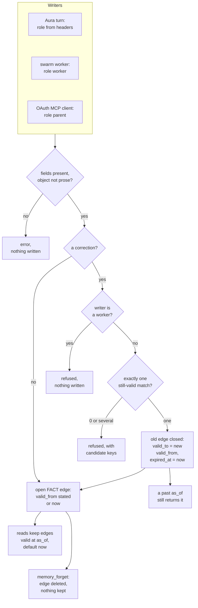

## 1. Executive Summary

Aura is a self-hosted, multi-user AI agent platform in Go by Davide Marchetto.
One binary hosts the agent runtime, tools, CLI, Telegram gateway and a web
cockpit, with Postgres, ArcadeDB, an object store and sidecars beside it in
Docker Compose. Its long-term memory is a graph of facts in ArcadeDB, served to
the agent by a separate MCP server, `cmd/arcadedb-mcp`. That subsystem is what
this report covers.

What is notable is the correction path. A fact is an edge whose valid window is
stated by the writer and whose record window is stamped by the store. A
correction closes exactly one still-valid edge, at the new fact's `valid_from`,
and refuses rather than guesses when the subject and predicate match zero or
several facts. Who wrote a fact is derived from the connection, not from a model
argument, and a swarm worker may add facts but not supersede them. Each person's
memory is a separate ArcadeDB database with its own derived credential, so the
server refuses a cross-tenant read.

What is weak is that nothing in memory can be doubted. A fact has no candidate,
disputed or rejected state, and the system prompt tells the model to treat
recalled facts as reliable knowledge. `memory_forget` deletes and keeps no
record, so the same value can be written again. The worker rule is enforced on
supersede and in `memory_batch`, and not on the direct merge tool. Every
automatic capture loads the identity's whole fact graph to apply one fact.

**Scope.** The memory subsystem is `internal/arcadedb` and `cmd/arcadedb-mcp`,
about 17,700 lines of non-test Go of which about 2,100 are document retrieval,
plus about 2,200 lines of wiring in `cmd/aura` and `internal/runner`. Together they are about
7.7% of the repository's 259,324 non-test Go lines, beside a React cockpit and a
Python ingest service. Document retrieval shares the per-identity databases and
some of the package, and is read here only where it shares code.

**Licence.** MIT, in `LICENSE`, copyright 2026 Davide Marchetto, and no manifest
or README disagrees. Nothing in it restricts use. Two skills in the tree,
`.claude/skills/mcp-builder/` and `internal/skills/embed/web-artifacts-builder/`,
carry their own Apache-2.0 files, and `THIRD_PARTY_NOTICES.md` lists the adapted
sources and their terms. The memory store is ArcadeDB, a separate Apache-2.0
server pinned by digest in `compose.yaml`;
`docs/adr/0038-graph-store-license-neo4j-gplv3-vs-arcadedb-apache.md` records
the move away from Neo4j Community's GPLv3. `CONTRIBUTING.md` asks for no
contributor agreement.

## 2. Mental Model

A memory is an assertion of the form *subject, predicate, object*, with a
sentence that says it, stored on a `FACT` edge between two `Entity` vertices
(`internal/arcadedb/memory.go:38-62`, `:124-146`). The statement is the text
that is embedded and searched. The object must name an entity and not be prose:
over 80 characters, a line break or closing punctuation refuses the write
(`:189-219`, `:251-253`).

Each edge carries two windows (`memory.go:13-26`). `valid_from` and `valid_to`
say when the fact was true in the world; the writer may state them, and
`valid_from` defaults to now (`:295-298`). `created_at` and `expired_at` say when
the store learned it and when it stopped believing it. A fact is live while
`expired_at` is null and its valid window contains now.

A fact stops being believed in one of two ways. A **correction** writes a new
fact with `supersedes` or `supersedes_fact_key`; the old edge's `valid_to` is
set to the new fact's `valid_from`, its `expired_at` to now, and its `fact_key`
to null, and the row stays (`internal/arcadedb/memory_supersede.go:24-37`). A
**forget** deletes the edge outright (`internal/arcadedb/forget.go:108-114`).
The tool descriptions draw the line: supersede for what *stopped* being true,
forget for what *was never* true (`cmd/arcadedb-mcp/tool_forget.go:42-48`).
There is no third way to mark a fact as wrong while keeping it.

A correction is resolved before anything is written. With an explicit
`fact_key` it closes that one edge or refuses. Without one, it resolves the
still-valid facts sharing subject and predicate, and closes only when there is
exactly one (`memory_supersede.go:79-122`, `:154-174`). A refused correction
writes neither the close nor the new fact, and returns the candidates with
their keys so the caller can retry (`memory.go:345-369`). The writer's role is
checked first: a `worker` is refused before any query touches the old fact
(`internal/arcadedb/fact_authority.go:47-54`).

Nothing gives a fact a status. Every write is believed on arrival, every read
treats a live fact as true, and the prompt says so (`internal/agent/prompt.go:93`).

## 3. Architecture

Memory is a separate process. `cmd/arcadedb-mcp` is a Go MCP server on the
official SDK that verifies OAuth tokens against the Aura daemon's JWKS, resolves
the caller's identity from the token, and opens that identity's database
(`cmd/arcadedb-mcp/main.go`, `cmd/arcadedb-mcp/tenant.go`). The Aura daemon
mounts it as a trusted recipe and bridges its tools to the agent
(`internal/agent/mcptools/bridge_risk.go:129-157`). The daemon also writes to
ArcadeDB directly, through the same client package, for conversation
projection, automatic capture and erasure (`cmd/aura/chat_memory_projection.go:118`).

Each identity is a database named `mem_<uuid>`, reachable only with a server
user `u_<uuid>` whose password is an HMAC of the database name under one
server secret (`internal/arcadedb/tenant.go:37-54`, `:105-116`). The secret must
be at least 32 characters or the sidecar refuses to start (`:84-95`). The
source's rationale is that a forgotten `WHERE` clause leaks silently, while a
credential that cannot reach the database fails loudly (`:14-28`). Erasing a
person drops the database and then the user
(`cmd/aura/serve_deprovision_purgers.go:102`, `:139`).

Retrieval runs inside ArcadeDB: a Lucene full-text index on `FACT.statement`
with the English analyzer (`memory.go:55-60`), an LSM vector index of
EmbeddingGemma vectors, and the engine's `vector.fuse` with RRF
(`internal/arcadedb/memory_recall.go:25-44`). The embedder is an HTTP sidecar;
without it every read degrades to lexical and says so.

### Deployment and ergonomics

The supported install is the Docker Compose appliance: Postgres, ArcadeDB,
Garage, the embedding sidecar, the memory MCP server, the ingest service and
more, on a machine the README sizes at 14 GiB of usable RAM. Memory needs
ArcadeDB, the MCP sidecar, the derivation secret and an Aura-issued OAuth
token; it needs no model API key to store a fact. The store is a graph database
an operator can query by hand with ArcadeDB's SQL or Cypher, and the CLI exposes
search, facts, entities, digest, remember, merge and forget
(`cmd/aura/memory.go:32-33`).

## 4. Essential Implementation Paths

- **Explicit write.** `memory_upsert_fact` resolves the caller and derives the
  actor from the `X-Aura-Actor-Run-Id` and `X-Aura-Actor-Role` headers or, for
  an external client, from the OAuth session as `parent`
  (`cmd/arcadedb-mcp/tool_memory.go:78-97`). The write schema has no `run_id`
  field at all (`:45-47`). `UpsertFact` validates, takes a per-`fact_key` lock,
  and attaches the source to an existing identical fact or creates a new edge
  with its vector in the same statement (`internal/arcadedb/memory.go:290-400`).
- **Batch.** `memory_batch` applies upserts, supersedes, merges and forgets as
  one ArcadeDB transaction under an idempotency key, refuses supersede, merge
  and forget for a worker, and stores a `MemoryBatchReceipt` with the result
  (`internal/arcadedb/memory_batch.go:301-438`, `:465-486`).
- **Automatic capture.** After a successful `memory_upsert_fact`, or a
  `write_file` or `patch` under `/workspace/`, the runner builds an
  `AcceptedCapture` and queues it; the turn waits at its end for the queue to
  flush (`internal/runner/runner_memory_capture.go:291-305`, `:309-374`). A file
  write becomes a fact with the path as subject and `durable_artifact` as
  predicate (`:353-368`). Text the secret redactor would change is dropped
  (`:380-389`).
- **Conversation projection.** A reconciler projects user and assistant turns
  from Postgres into `ConversationTurn` vertices, embeds changed turns, links
  them in order, and deletes the projection of a deleted conversation
  (`internal/arcadedb/memory_conversation.go:173-246`, `:349-365`,
  `internal/runner/runner_memory_projection.go:270-320`).
- **Recall.** `memory_recall` runs semantic, recent, period, open, scroll or
  reasoning modes; semantic ranks facts and turns separately and merges them by
  quota (`internal/arcadedb/memory_recall.go:73-187`).
- **Context.** Every turn carries a pointer with the fact and entity counts and
  the names of the read tools (`cmd/aura/serve_memory_context.go:60-93`,
  `:141-152`). A per-message recall preload exists and is off by default
  (`internal/config/config.go:425`, `cmd/aura/serve_memory_context.go:174-206`).
- **Forget, merge, erase.** `Forget` detaches one source run or deletes
  matching edges and prunes orphan entities (`internal/arcadedb/forget.go:62-122`);
  `MergeEntities` copies each edge onto the survivor and deletes the original
  (`internal/arcadedb/merge.go:117`); identity erasure drops the database.

## 5. Memory Data Model

`FACT` properties are `statement`, `predicate`, `valid_from`, `valid_to`,
`created_at`, `expired_at`, `fact_key` and `sources`, a `LIST OF MAP`
(`memory.go:45-53`). `fact_key` is a SHA-256 over subject, predicate, object
and statement (`internal/arcadedb/memory_provenance.go:207-217`), set only
while the fact is active and nulled when it closes (`:219-222`). A source is a
run id, the memory ids the model cited and a writer role
(`memory.go:115-121`). A capture adds its idempotency key, source kind,
conversation, tool call, observation time and a confidence the runner always
sets to 1 (`internal/arcadedb/memory_capture.go:51-61`,
`internal/runner/runner_memory_capture.go:321`). Entities are typed into six
POLE+O classes, and the first class an entity is written with wins
(`memory.go:305-316`).

Facts carry no scope key: the database is the scope. Projected turns carry
`identity_id`, `conversation_id`, `turn_seq`, `role`, `content`,
`content_hash`, `occurred_at`, `source_ref`, `deleted_at`, an embedding and
routing metadata (`memory_conversation.go:97-117`). `MENTIONS` edges link
facts to the entities their statements name and keep a `fact_rid`, so a closed
fact still supports a historical path (`docs/ARCHITECTURE.md:107-109`).
Reasoning traces are a third kind, stored with mandatory identity and source
fields, read only in `reasoning` mode, and expired on a schedule
(`internal/arcadedb/memory_reasoning.go:18-60`,
`internal/arcadedb/memory_reasoning_lifecycle.go:19-49`).

`ConversationTurn.deleted_at` is declared (`memory_conversation.go:106`),
cleared to null on every projection write (`:141`), and filtered on by every
turn read (`memory_recall.go:38`, `:41`, `:54`, `:65`). Nothing outside a test
sets it. The predicate excludes nothing in production; deleted conversations
are removed by a hard delete instead.

## 6. Retrieval Mechanics

When the question names an entity, `memory_facts_about` walks that entity's
edges in both directions, filtered to the valid window at `as_of`, and depth 2
adds facts reached through `MENTIONS` (`internal/arcadedb/memory_facts_about.go:22-82`).
Otherwise `memory_search` and `memory_recall` run full-text and dense legs per
kind, each leg already restricted to facts valid at `as_of`. They fuse with
RRF, apply relevance floors, and require any technical identifier in the query
to appear as a token in the hit (`memory_recall.go:25-33`, `:123-187`,
`memory.go:468-476`). A query with no qualifying candidate returns an explicit
abstention. Facts and turns are ranked in separate statements because a fused
pool was losing facts below the candidate cut (`memory_recall.go:20-24`).

`as_of` defaults to now on every fact read (`memory.go:456-458`,
`memory_recall.go:136-138`), so a closed fact drops out of present-tense
answers and returns for a past instant. It is a valid-time query only. No read
asks what the store believed at a past record time; `expired_at` is read only
as an `IS NULL` guard on writes (see Recorded searches).

`memory_recall` excludes the active conversation's turns when the bridge sends
its id in a host-only header, so a turn is not recalled into itself
(`cmd/arcadedb-mcp/tool_memory_recall.go:310-340`). Turn recall for reasoning
effort and tool preloading is a separate read over the identity's own past user
turns, filtered by context, route and policy (`internal/arcadedb/turn_recall.go:13-18`,
`:76-86`); it decides effort, not what the agent believes.

The per-turn context carries only counts and tool names
(`cmd/aura/serve_memory_context.go:141-152`). With the preload enabled, at most
five ranked statements, three conversation lines of 240 runes and a short
outline per reached entity are injected
(`cmd/aura/serve_memory_preload.go:13-28`, `:93-115`).

## 7. Write Mechanics

The model writes explicitly; there is no extraction model. `memory_upsert_fact`
is synchronous and a fact is retrievable as soon as the call returns, with its
vector written in the same statement when the embedder answers
(`memory.go:393-396`). When it does not, the fact is stored without a vector,
a backfill pass fills it later, and lexical recall finds it meanwhile.

Deduplication is by identity: a write whose `fact_key` names an active edge
attaches its source to that edge instead of creating one (`memory.go:331-344`).
A write of an already-closed historical fact is matched by content, so replays
do not duplicate it (`:328-334`). A reply lists newly coined entity names with
the nearest existing ones, because a measured memory held 211 entities for 107
facts (`cmd/arcadedb-mcp/tool_memory.go:162-168`).

The capture queue re-applies each accepted fact through `applyMemoryBatch`. That
opens a transaction and loads every `Entity` and every `FACT` row of the
identity, embeddings included, before applying one operation
(`internal/arcadedb/memory_batch.go:406`, `internal/arcadedb/memory_batch_store.go:155-216`).
The cost of one capture therefore grows with the store, not with the write.
The turn blocks at its end until the queue flushes or its timeout expires
(`internal/runner/runner_memory_capture.go:291-305`).

The per-`fact_key` lock is per process (`internal/arcadedb/fact_lock.go:5-33`).
Its comment argues that only one process writes a tenant database. The MCP
sidecar and the Aura daemon both write facts, the first through `UpsertFact`
and the second through the capture batch. The batch's transaction retries on a
conflict, so a collision fails over rather than losing a write.

### Operational cost

- **Write latency.** Explicit writes are synchronous and add one embedding call.
  Captures run off the tool call and block the end of the turn.
- **Background passes.** The projection reconciler replays turns once a minute
  and re-embeds only turns whose content hash changed
  (`memory_conversation.go:195-197`). No pass rewrites or summarises the fact
  store; ADR 0042 rules out unowned consolidation
  (`docs/adr/0042-memory-provenance-and-erasure.md:25-27`).
- **Per turn.** One `memory_digest` call for the pointer, plus one
  `memory_recall` when the preload is on, each under a two-second default
  timeout (`cmd/aura/serve_memory_context.go:14-17`).

## 8. Agent Integration

The agent reaches memory through bridged MCP tools named `memory__<tool>`.
`memory_recall`, `memory_upsert_fact`, `memory_batch` and `memory_entities` ride
in every manifest; the rest are deferred behind `tool_search`
(`internal/agent/mcptools/bridge_policy.go:53-58`). The
`memory-aura` skill teaches writing, correction and the batch semantics
(`internal/skills/embed/memory-aura/SKILL.md`). External MCP clients, such as a
coding agent, connect with an Aura-issued OAuth token and write as `parent`.

The bridge classifies each memory tool for the gateway. Writes and merges are
`Mutate` and run without a stop; `memory_forget` is `Destructive`, except a dry
run, which is a read (`internal/agent/mcptools/bridge_risk.go:138-157`). Under
the strict profiles, which are the default, a destructive call asks the person
in an interactive turn and is denied in a run with nobody present. Under `dev`
and `local_trusted` the gateway allows everything (`internal/gateway/decide.go:69-75`,
`internal/config/config_runtimeprofile.go:31`, `:55-57`). External clients do
not pass through this gateway.

## 9. Reliability, Safety, and Trust

### Who may change a fact

`maySupersede` refuses a worker (`fact_authority.go:47-54`), and
`authorizeMemoryBatch` refuses a worker's supersede, merge and forget
(`memory_batch.go:465-486`). The direct `memory_merge_entities` and
`memory_forget` handlers resolve the caller and never read the actor
(`cmd/arcadedb-mcp/tool_browse.go:102-129`, `cmd/arcadedb-mcp/tool_forget.go:57-91`).
A worker's tool registry is the parent's minus `swarm_spawn`
(`internal/swarm/runner_adapter.go:21-22`), so wherever the parent's registry
carries the memory tools, a worker can merge two entities through the direct
tool that the batch would refuse; I did not trace which registries carry them. The merge tool declares `DestructiveHint` in its MCP
annotations and the bridge classifies it `Mutate`, so the gateway does not
stop it either.

### What a recalled fact is

Memory tool results are marked `TrustTrusted` by the bridge
(`internal/agent/mcptools/bridge_call.go:120-123`), and the prompt tells the
model to treat them as *"your own reliable recalled knowledge"*
(`internal/agent/prompt.go:93`). A fact the model wrote from a web page, a
mistaken inference, or a file path it saved is recalled with the same standing
as one the person dictated. The source records which run wrote it and which
messages it cited. That is enough to forget a bad run and not enough to weigh a
fact.

### What a forget prevents

Nothing after the delete. `Forget` removes the edge and keeps no value-keyed
record (`forget.go:101-114`), and the write path consults no list of refused
values, so the next turn that infers the same fact writes it again. Conversation
deletions are synced through tombstones in Postgres
(`internal/conversations/store_projection.go:45-47`), which are keyed on a
conversation id and only drive the projection delete.

### Marks

- **`bitemporal`** — awarded. Valid time is caller-stated on the MCP write path
  (`tool_memory.go:134-135`) and carried through the capture path
  (`runner_memory_capture.go:345-350`); record time is the write clock, and a
  supersede writes both in one statement. Reads query valid time only.
- **`negative_eval`** — awarded; see section 10.
- **`trust_state`** — withheld. `FACT` has no status field; the only discrete
  fields on a fact are its windows and `fact_key`. A reasoning trace's `status`
  is the trace's lifecycle, not a judgement of a fact.
- **`tombstone`** — withheld. Forget deletes, supersede closes a record, and the
  projection tombstones are delete-sync markers on conversations.
- **`scope_enforced`** — withheld. Isolation is a physical partition: one
  database and one credential per identity, refused by the server. Facts carry
  no scope key. Turns carry `identity_id` and every turn query filters on it,
  but the projector routes each identity to its own database and refuses a turn
  whose identity differs from the projection's (`memory_conversation.go:306-307`),
  so the predicate cannot exclude a row. The recall handler says a foreign row
  *"cannot happen by construction"* (`tool_memory_recall.go:322-325`).
- **`audit_log`** — withheld. `MemoryBatchReceipt` stores each batch's request
  hash and result, written with `UPDATE ... UPSERT` and only for batch and
  capture writes (`memory_batch_store.go:336-359`); a direct upsert, forget or
  merge writes no record in the memory store. Postgres keeps an append-only
  `tool_invocations` ledger of agent tool calls, but it records calls rather
  than mutations, misses external clients and captures, and its rows cascade
  away when their conversation is deleted while the facts stay
  (`internal/db/migrations/0016_tool_invocations_allow_cascade.up.sql:3-5`).
- **`human_review`** — withheld. No fact waits for anyone. The approval the
  gateway asks for `memory_forget` gates a deletion, not an admission, and the
  cockpit's memory displays show results.

### Other risks

- **Profile-dependent deletion guard.** The person-in-the-loop for forget exists
  only in the strict profiles and only for calls through Aura's own agent.
- **Erasure scope.** A database drop removes facts, turns and traces together.
  `memory_forget` on a subject removes edges and orphaned entities, and leaves
  the conversation turns the fact was learned from.

## 10. Tests, Evals, and Benchmarks

The memory packages hold 708 Go test functions, 101 of them behind the
`arcadedb_integration` tag. The live helper fails instead of skipping when
`CI` is set and `ARCADEDB_URL` is not (`internal/arcadedb/memory_integration_test.go:29-37`).
CI's `arcadedb-integration-test` job brings up ArcadeDB, the embedder and the
MCP sidecar built from the commit and runs `make agent-memory-eval`
(`.github/workflows/ci.yml:772`, `:945`). That evaluator runs the deterministic
suites and the live tiers and scores named test functions into a weighted
"memory reliability score" with a pass line above 96.5
(`scripts/agent_memory_eval.py:31`, `:51-55`, `:57-98`). I ran none of it.

`negative_eval` rests on two populated cases:

- `TestFactsAboutAnswersExactlyAndRespectsTime` writes one open `works_for` fact
  and one `lives_in` fact that expired three years earlier for the same
  subject, and asserts the present-tense traversal returns exactly one fact and
  that it is `works_for` (`internal/arcadedb/memory_integration_test.go:506-546`).
- `TestAgentMemoryMCPLiveInitializeListCallAndIsolation` writes a fact in tenant
  alpha and asserts beta's `memory_facts_about` for that entity is empty. It
  then writes a fact in beta, asserts alpha reads none of it while beta reads
  its own, and asserts that client metadata naming the other tenant changes
  nothing (`cmd/arcadedb-mcp/memory_live_integration_test.go:70-166`).

The evaluator's labels run the other way. It scores the first case as positive
(`scripts/agent_memory_eval.py:90`). The case it scores as negative,
`TestExpiredFactIsExcludedFromAPresentTenseSearch`, writes only the expired fact
and asserts it is absent, which a search returning nothing would also pass
(`memory_integration_test.go:390-409`, `scripts/agent_memory_eval.py:88`).
The supersede refusals are covered live, including an eight-sibling replay of
the incident where a broad match closed all eight
(`internal/arcadedb/memory_supersede_integration_test.go`). No test asserts
that a forgotten value stays out after the model writes it again, which section
9 shows it does not.

The validation documents in `docs/` record operator-run checks: a mounted MCP
acceptance of 11 of 11 cases, 18 of 18 guided answers that the document calls
*"not a blind benchmark"*, and abstention on six invented-identifier queries
rising from 2 of 6 to 6 of 6 (`docs/memory-graph-validation.md:19-43`,
`docs/memory-retrieval-validation.md:27-44`). Their raw captures are not
committed, and the first document says they were removed. A comment in
`memory.go:25-26` cites LOCOMO temporal scores for other systems; the project
declined to fetch LOCOMO and deleted its LOCOMO tests
(`docs/adr/0045-evaluation-corpora-licensing.md:8-26`). No paper is associated
with the project.

## 11. For Your Own Build

### Steal

- **Close one window, and refuse the rest.** Let a correction name the exact
  fact it replaces by a content-derived key. Without the key, close only on a
  unique subject-and-predicate match and return the candidates otherwise. A
  refusal must write nothing, including the new endpoints.
- **Close the old fact at the new fact's valid time.** Setting `valid_to` from
  the correction's `valid_from` and `expired_at` from the clock keeps "where did
  she live in 2024" and "when did we learn she moved" separate in one statement.
- **Take the writer from the connection.** Remove `run_id` and role from the
  write schema so the model cannot assert them, and refuse a write whose role
  is missing or unknown.
- **One credential per tenant database.** A derived password per database
  makes a wrong tenant name an authentication failure, and erasure a drop.

### Avoid

- **A status filter with no writer.** A `deleted_at` that every read checks and
  nothing sets reads as soft deletion in review and does nothing.
- **An authority rule in two of three doors.** If workers may not merge in a
  batch, the direct merge tool needs the same check; put it in the store
  function both call.
- **Reading the whole store to apply one fact.** A final-state batch engine is
  simple to reason about, and it makes every capture's cost proportional to the
  memory's size.
- **Telling the model memory is reliable** when nothing in memory can be marked
  doubtful.

### Fit

This fits a person or a small group running their own agent on their own
hardware who want long-lived facts with history, correction that keeps the
past, and hard tenant isolation, and who will operate a Compose stack of a dozen
services. The memory is the model's to write and the model's to trust. Walk
away if facts arrive from untrusted sources and need review or a disputed state
before they are acted on. Walk away too if you want the memory without the
platform: the client package could be lifted, but its writer roles, capture
queue and deletion guard live in the daemon.

## 12. Open Questions

- Whether the direct `memory_merge_entities` and `memory_forget` handlers are
  meant to accept a worker, given that `authorizeMemoryBatch` refuses both.
- What `ConversationTurn.deleted_at` is for, since no production path sets it.
- How long a capture takes on a large identity, since each one loads every fact
  and embedding; nothing in the tree measures it.
- Whether record-time reads ("what did Aura believe on a date") are planned;
  the store keeps `created_at` and `expired_at` and no read selects by them.

## Appendix: File Index

- Storage and schema: `internal/arcadedb/memory.go`,
  `internal/arcadedb/memory_provenance.go`, `internal/arcadedb/memory_conversation.go`,
  `internal/arcadedb/memory_reasoning.go`, `internal/arcadedb/tenant.go`
- Write path: `internal/arcadedb/memory.go`, `internal/arcadedb/memory_supersede.go`,
  `internal/arcadedb/fact_authority.go`, `internal/arcadedb/fact_lock.go`,
  `internal/arcadedb/memory_batch.go`, `internal/arcadedb/memory_batch_store.go`,
  `internal/arcadedb/memory_capture.go`, `internal/runner/runner_memory_capture.go`
- Retrieval: `internal/arcadedb/memory_recall.go`,
  `internal/arcadedb/memory_facts_about.go`, `internal/arcadedb/turn_recall.go`
- Delete and merge: `internal/arcadedb/forget.go`, `internal/arcadedb/merge.go`,
  `cmd/aura/serve_deprovision_purgers.go`
- MCP and integration: `cmd/arcadedb-mcp/tool_memory.go`,
  `cmd/arcadedb-mcp/tool_forget.go`, `cmd/arcadedb-mcp/tool_browse.go`,
  `cmd/arcadedb-mcp/tool_memory_recall.go`, `internal/agent/mcptools/bridge_risk.go`,
  `cmd/aura/serve_memory_context.go`, `cmd/aura/serve_memory_preload.go`,
  `internal/agent/prompt.go`
- Tests and evals: `internal/arcadedb/memory_integration_test.go`,
  `internal/arcadedb/memory_supersede_integration_test.go`,
  `cmd/arcadedb-mcp/memory_live_integration_test.go`, `scripts/agent_memory_eval.py`,
  `.github/workflows/ci.yml`

### Recorded searches

Run from the repository root at the pinned commit with `/usr/bin/git grep`.

- **No status field on a fact.**
  `git grep -n -E 'factEdgeType \+ "\.(status|state|trust|verified|pending|confidence) IF' -- internal/arcadedb`
  returns nothing; `git grep -n -c -E 'factEdgeType \+ "\.(valid_from|expired_at) IF' -- internal/arcadedb`
  counts 2 in `internal/arcadedb/memory.go`.
- **No value-level tombstone in the memory store.**
  `git grep -n -i 'tombstone' -- internal/arcadedb cmd/arcadedb-mcp` returns
  nothing; `git grep -l -i 'tombstone' -- internal/runner internal/conversations`
  lists `internal/conversations/store_projection.go` and
  `internal/runner/runner_memory_projection.go`.
- **Nothing sets a turn's `deleted_at`.**
  `git grep -n -E 'deleted_at = :' -- internal cmd` matches only
  `internal/arcadedb/memory_recall_period_live_test.go:43`.
- **Only two handlers derive an actor.**
  `git grep -n 'hostDerivedActor(req)' -- cmd/arcadedb-mcp` matches
  `tool_memory.go:223`, `tool_memory_batch.go:125` and one test.
- **No read selects by record time.**
  `git grep -n -E 'expired_at (<|>|<=|>=)' -- internal/arcadedb cmd/arcadedb-mcp`
  returns nothing; `git grep -n -c -E 'valid_to (<|>|<=|>=)' -- internal/arcadedb/memory.go`
  counts 1, the `asOfCondition`.
- **No mutation audit table in the memory store.**
  `git grep -n -i -E 'audit|event_log|mutation_log' -- internal/arcadedb cmd/arcadedb-mcp ':!*_test.go'`
  matches only comments in `cmd/arcadedb-mcp/auth.go`,
  `internal/arcadedb/document_lexical.go` and
  `internal/arcadedb/memory_reasoning_hydrate.go`; `git grep -l -i 'audit' -- internal/share`
  lists `internal/share/audit.go`.
- **No paper.** `git grep -n -i -E 'arxiv|bibtex|@misc|@article' -- README.md docs/ARCHITECTURE.md docs/TECHNICAL_OVERVIEW.md`
  returns nothing and the tree has no `CITATION.cff`; the same pattern over
  `docs/recon-2026-08-02-document-indexing-at-scale.md` matches the papers it surveys.

## History

**2026-11-20** — [`f1ebda534d9b5c510f9d3f98f8b40320dec5ac66`](https://github.com/chetto1983/Aura/commit/f1ebda534d9b5c510f9d3f98f8b40320dec5ac66) — first reading, from a full clone of `master`, scoped to the memory files of `internal/arcadedb`, `cmd/arcadedb-mcp`, the memory wiring in `cmd/aura` and `internal/runner`, the bridge and gateway classification of memory tools, and their tests; document retrieval read only where it shares code. Screened first: one auto-run surface, `.claude/settings.json` agent-harness hooks, not triggered since no harness ran in the clone; build-time execution in two Makefiles and `services/ingest/tests/conftest.py`; `go.mod`, `go.sum` and the npm manifests inside the seven-day cooldown. MIT, no rider. Nothing installed, built or run. Two marks: `bitemporal`, `negative_eval`.
