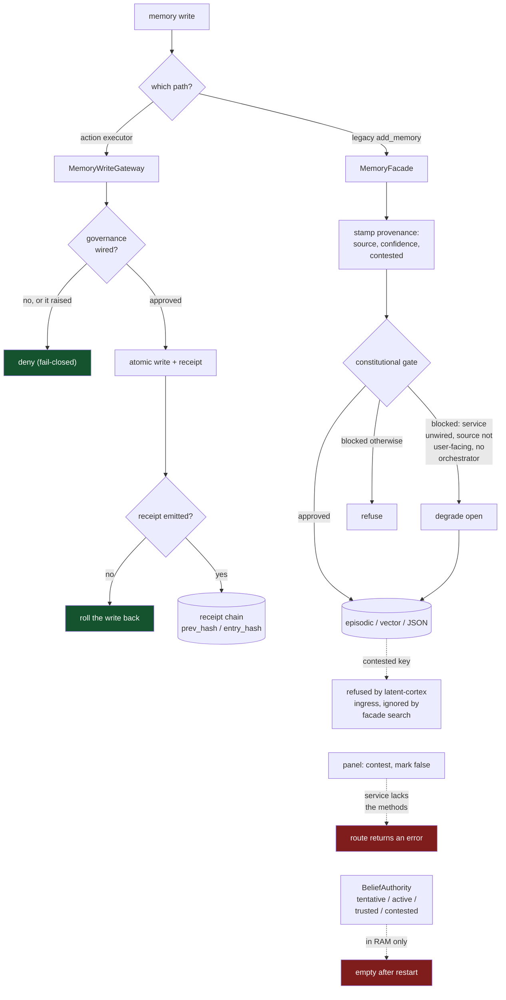

## 1. Executive Summary

Aura is a self-hosted cognitive runtime in Python, and two of its mechanisms
point in opposite directions: a receipt chain that a rewritten audit trail
cannot pass, and a belief-status machine held in a dictionary that a restart
empties.

**Almost none of it was written by a person, and the repository says so in its
own metadata.** Of the 13,475 commits reachable from this pin, 5,437 are
authored `Claude`, 4,335 `Codex`, 3,623 `Zenflow`, 63 `ChatGPT` and one
`ChatGPT Codex`; sixteen carry the owner's name or handle. Run
`git log --format='%an' | sort | uniq -c | sort -rn` and that is the whole
table.

This bears on how the report reads the tree rather than on whether the design
is good: a mechanism here can be elaborate, tested and documented and have had
no human decide it. That is the most plausible account of the trust
representations described below, which do not share a schema, and of an
operator control wired to a class the runtime never builds. It is also why the
dated incident comments quoted later matter more than usual — they are the
places where something observed in production, rather than generated, entered
the code.

**Licence.** `LICENSE` is all rights reserved with one grant. Commit
`851c438d4`, on 9 November 2026, added a research-use grant: a reader may
download, install and run the code, changing it only as far as running it
requires, to reproduce, verify or test the results of the project's preprint,
and may publish what the runs find with a citation. The grant is personal and
revocable, and ends on breach with a duty to delete every copy. It excludes
copying or hosting beyond those private copies, any product or service,
derivative works, and training or tuning a model on the code, its data or its
outputs; no patent licence is given.

Until that commit the text permitted
reading only, and the README badge reads *All Rights Reserved (Read-Only)* at
this pin. Everything below analyses a design that may be studied and not
adopted, the position the atlas records for [OptMem](../optmem/) — see also
[Empryo](../empryo/) under BSL and [Dexto](../dexto/) under ELv2.

Both mechanisms are worth the read.

**The receipt chain is tamper-evident.** Every receipt the
runtime emits gets a link in `root/_chain.jsonl` carrying `seq`, `receipt_id`,
`content_hash`, `prev_hash` and `entry_hash`, where the entry hash covers the
previous one. The module docstring states the properties it buys: *"Deletion
shows up as a seq gap; insertion shows up as a broken link because entry_hash is
over prev_hash."* An audit that is append-only by file handle cannot see an
edit — [Palazzo](../palazzo/)'s WAL is opened `O_APPEND` and nothing would
notice one. Aura's, like [aimee](../aimee/)'s and [Midas](../midas/)'s, is a
chain, and it re-hashes the on-disk receipt bodies during verification, so an audit trail that has been rewritten fails a check rather
than reading clean.

I ran it at the first pin, [`e8866f43c54677d3f2877820cd74cf915af6fbb7`](https://github.com/youngbryan97/aura/commit/e8866f43c54677d3f2877820cd74cf915af6fbb7):
`python -m pytest tests/test_audit_chain.py` gave **16 passed** on Python 3.14
with `pydantic`, `pydantic-settings` and `psutil` installed. The passing cases
include `test_detects_modified_receipt_body`,
`test_detects_modified_chain_entry`, `test_detects_broken_link`,
`test_detects_deleted_entry`, `test_chain_persists_across_restart` and
`test_exported_chain_can_be_independently_verified`. The tamper-evidence is tested, not merely claimed. The later
readings read the suite and did not run it. At this pin the test file is
byte-identical to the one that ran, while `core/runtime/audit_chain.py` has grown
from 611 to 709 lines, adding `refresh_from_disk` among other changes, so the
passing run predates the module as it stands.

**The belief machine is the most complete in this atlas and it does not survive
a restart.** `BeliefAuthority` in `core/constitution.py` runs an epistemic
state machine over four statuses. A belief starts `tentative` and becomes
`active` on agreement. It becomes `trusted` only with confidence at 0.75 or
above **and** two distinct evidence references, or when the state authority
holds the key as a hard fact. A contradiction against a belief below 0.75 marks
it `contested`.

A contradiction against a belief at 0.75 or above is refused outright — the
stored value does not change and the record is stamped `allowed=False` with
reason `contradicted_trusted_belief`. `reconcile(affirmed | retired)` is the
resolution path for a contested belief, and a contest expires after six hours
under a constant whose comment records why it exists.

**Repetition cannot promote, and the code records the day it could.** The
comment at `core/constitution.py:201-220` describes the defect: four
repetitions of one unsupported assertion walked its confidence from 0.35 past
the 0.75 line. Since `5200f0229`, on 2 August 2026, reinforcement needs an
evidence reference the belief has not been credited with, and a belief with
fewer than two distinct references is capped at 0.70 and stays `active`.

**What the status is for is deferring the agent's own writes, and the gate
records the day it was too blunt.** `executive_core.py:801-817`, and its
synchronous twin at `:1003-1015`, defer any non-user `WRITE_MEMORY` or
`UPDATE_BELIEF` intent below priority 0.9 while a fresh contest touches its
topic, with the reason string `epistemic_reconciliation_required:<n>`. It was a
global switch, and the docstring on `_intent_touches_contested_topic` says what
that cost:

> *"The live 2026-07-25 hour deferred 71 autonomous knowledge writes on
> `epistemic_reconciliation_required:2` — two contested claims blocking every
> unrelated fact and concept she learned."*

The gate compares the intent's goal, topic, key, namespace, content and summary
against `fresh_contested_keys` and defers only on a match. Two fallbacks keep it
conservative: no keys, or nothing in the intent to judge relevance by, and the
old global behaviour stands. The comment beside `summary()` states the general
form of the lesson — *"A count can only gate globally … Relevance needs the
keys"* — which is the rarer half of an epistemic status: knowing not only that
something is disputed but what it is disputed about.

A deferral is handed on rather than dropped: `_surface_research_trigger` passes
the contested topic to the research pipeline. An intent from
`AUTONOMOUS_RESEARCH` is not deferred at all; it is tagged
`confidence_tier: provisional` and `requires_reconciliation: True`. Five modules
write that second tag and no Python file outside `tests/` reads it.

`self._beliefs` is a plain dictionary (`core/constitution.py:155`). There is no
`save`, no `load`, no snapshot of it on any boot path, and `ConstitutionalCore`
constructs a fresh `BeliefAuthority()` at line 366. Restart the process and
every belief is unknown again at confidence 0.35: what was trusted is not
trusted, what was contested is not contested, and the contradiction that
produced the contest is gone. The one other module that names the dictionary,
`core/subject/carrier_reads.py:72`, lists it among the state an experiment
harness copies between forks of a running process.

Aura does have a belief store that persists. It is a different one.
`WorldModelEngine` (`core/final_engines.py:50`) writes to
`data/world/beliefs.json` on every addition and loads it at construction — and
its `BeliefNode` is `claim`, `confidence`, `evidence_count`, `last_updated`,
`tags`, `source_ids`. **No status field at all.** The store with
`tentative | active | trusted | contested` does not survive a restart, and the
store that survives has no notion of contested.

**A second `contested` does persist, and the operator's button for it does not
land.** `MemoryFacade.add_memory` stamps a provenance envelope on every
long-term write — `source`, `confidence`, `identity_relevant` and `contested`
(`core/memory/memory_facade.py:1471-1491`) — and its welfare check sets a
top-level `contested` key on an identity-relevant or relational write made
under integrity strain (`:1840-1850`).

One reader consults that key. `SelectiveMemoryBridge._normalize` refuses a
record whose metadata carries it, before the record can become context for a
latent-cortex reasoning episode
(`core/brain/llm/latent_cortex/epistemic_memory.py:670-672`), and a committed
test asserts the refusal. The facade's own `search` does not consult it.

The operator's control is the other half. The memory panel has freeze, contest
and mark-false buttons (`interface/static/memory_panel.html:938-966`) posting
to five routes. Each route takes a Will decision and then calls
`getattr(sem, method_name)` on the `semantic_memory` service
(`interface/routes/memory.py:414`).

`core/providers/memory_provider.py:104` registers that name as the
`BlackHoleVault`, which defines none of `edit_memory`, `delete_memory`,
`freeze_memory`, `contest_memory` or `mark_false`. The class that defines all
five, and hides `contested`, `false` and `deleted` records from its own search,
is `SemanticMemory` in `core/brain/semantic_memory.py`, and the only code that
constructs it is under `tests/`. Read, not run: by that wiring each route
answers `semantic_memory missing <method>` and no flag is set.

**The contested flag with a restart-proof reader has no working setter for the
operator; the contested status with a working machine does not survive a
restart.**

## 2. Mental Model

Trust in Aura lives in five places that do not share a representation.

| Where | Shape | Survives restart |
| --- | --- | --- |
| `BeliefMutationRecord.status` | `tentative`, `active`, `trusted`, `contested` | No |
| `WorldModelEngine.BeliefNode` | a confidence float, no status | Yes |
| Memory metadata `contested` | a boolean, top-level and inside the provenance envelope | Yes; one ingress refuses it, facade search ignores it |
| `SemanticMemory` tags | `frozen`, `contested`, `false`, `deleted` | It would, in a class only tests construct |
| `scar_formation` | a durable marker per failure class, healing over time | Yes, and it gates planning |

The belief ladder is the one with the semantics the atlas asks for:

```python
if existing.value == normalized_value:
    fresh = [ref for ref in evidence_refs if ref not in prior_evidence]
    confidence = min(0.98, existing.confidence + 0.12) if fresh else existing.confidence
    if distinct_sources >= 2 and confidence >= 0.75:
        status = "trusted"
    else:
        confidence = min(confidence, 0.70)          # uncorroborated ceiling
        status = "active"
else:
    contradictions.append(str(normalized_value)[:180])
    if existing.confidence >= 0.75:
        normalized_value = existing.value           # the old value stands
        status = "trusted"
        reason = "contradicted_trusted_belief"      # allowed=False
    else:
        status = "contested"
```

Two properties are worth separating. Promotion needs corroboration: a fresh
evidence reference raises confidence by a fixed step and `trusted` needs two
distinct references. A reference is any string the caller passes, the free-text
`note` included, so `trusted` means *asserted with two citations* rather than
*verified*.

And a trusted belief is **immune to contradiction**: the contradicting value is
appended to a list and the belief does not move. That is a strong stance, and
its failure mode is the obvious one. A wrong belief that reached 0.75 has no
exit inside `BeliefAuthority`: `reconcile` returns `False` for any status but
`contested` (`:287`), and a hard fact from the state authority that differs
from the stored value takes the same refused branch.



Green is the behaviour worth copying; red is where the epistemics leak out.

## 3. Architecture

An operator runs one process. There is no external database to stand up, no
vector service, no broker: SQLite, a local vector store, JSON families under a
memory root, and the receipt store with its chain sidecar, all under the
runtime's own directory. The desktop app, the daemon (`main_daemon.py`) and the
CLI all drive the same core.

`core/memory/` is 124 Python files, 110 of them at its top level, and the
naming is heavily metaphorical —
`hippocampus.py`, `black_hole.py`, `horcrux.py`, `memory_civilization.py`,
`conceptual_gravitation.py`, `physics.py`, `scar_court.py`. A reader should
check each against its implementation rather than its name; several are thin
(`source_provenance.py` is 20 lines, `memory_court.py` is 42) while the load
comes from `memory_facade.py` (1,882), `episodic_memory.py` (2,072) and
`vector_memory_engine.py` (1,740).

The documentation set is unusual enough to be part of the architecture.
Alongside the code sit `MEMORY_CARD.md`, `DATA_CARD.md`, `MODEL_CARD.md`,
`AI_SYSTEM_CARD.md`, `KNOWN_FAILURE_MODES.md`, `AUTONOMY_BOUNDARIES.md`,
`HUMAN_OVERRIDE_POLICY.md`, and three claims files. `CLAIMS_MATRIX.md` gives
each claim a status, an evidence path, **a command that reproduces it**, a
pass/blocked verdict and a falsifier — the condition under which the claim would
fail. Twelve of its 36 ledger rows are marked `blocked`, each with the reason
no honest test can run.

`CLAIMS_NOT_SUPPORTED.md` is the part other projects should copy. It declares
subjective consciousness, AGI, metaphysical free will, recursive
self-improvement, indefinite autonomy, external validation and legal personhood
as `not proven` or `strictly unsupported`. The RSI entry does not stop at the
disclaimer: it separates what is demonstrated from what is not, and reports its
own ledger's verdict of `BOUNDED_SELF_OPTIMIZATION` with the capability curve
going **down**, 0.667 to 0.625. A repository containing `test_consciousness.py`
and a module named `recursive_self_knowing.py` also containing a document that
refuses those readings is a combination this atlas has not seen before.

## 4. Essential Implementation Paths

| Path | Location |
| --- | --- |
| Hash chain: seq, content_hash, prev_hash, entry_hash | `core/runtime/audit_chain.py:10` |
| Receipt emission, chained after the body is durable | `core/runtime/receipts.py:611`, `:661` |
| Belief status machine and trusted-immunity rule | `core/constitution.py:199`–`:251` |
| The belief store, unpersisted | `core/constitution.py:155` |
| Contest freshness window, with its live-defect comment | `core/constitution.py:268`–`:272` |
| `reconcile(affirmed \| retired)` | `core/constitution.py:274` |
| The contested-belief gate on autonomous writes | `core/executive/executive_core.py:801`–`:817` |
| Write gateway, fail-closed with no authority | `core/memory/memory_write_gateway.py:277` |
| Fail-closed when the governance call raises | `core/memory/memory_write_gateway.py:320` |
| Receipt failure rolls the write back | `core/memory/memory_write_gateway.py:157` |
| Quarantine verb, with no caller | `core/memory/memory_write_gateway.py:188` |
| Provenance envelope stamped on every facade write | `core/memory/memory_facade.py:1471` |
| The bounded degrade-open rule | `core/memory/memory_facade.py:398` |
| Contested, expired and mis-scoped records refused at ingress | `core/brain/llm/latent_cortex/epistemic_memory.py:670` |
| Memory control routes | `interface/routes/memory.py:392`–`:490` |
| The service those routes resolve | `core/providers/memory_provider.py:104` |
| Epistemic firewall admission control | `core/brain/epistemic_firewall.py:1` |
| RAM-scaled retention policies | `core/memory/retention_policy.py:56`–`:276` |
| Scars, persisted and healing | `core/memory/scar_formation.py:438` |

## 5. Memory Data Model

There is no single memory record; there are tiers with different shapes.

**Gateway records** are per-family JSON envelopes — `content`, `metadata`,
`cause`, `governance_receipt_id`, `written_at` — written atomically under a
schema version, with families `user_model`, `principle`, `episodic`,
`skill_memory`, `movie_session` and a default. The `governance_receipt_id` on
each record is the link back to the decision that permitted it, which is a
provenance property most systems here do not have: the record can name its own
authorisation.

**Facade records** carry the provenance envelope described above, an
`importance` float, and flags including `identity_relevant`, `relational_bonding`
and `contested`. `identity_relevant` is the one that does work: it protects a
record from trimming.

**Belief records** are `BeliefMutationRecord(namespace, key, value, reason,
status, confidence, evidence, contradictions, allowed)`, keyed
`namespace:key`. The `contradictions` list is the interesting field — it stores
the *rejected value*, truncated to 180 characters, on the belief that rejected
it.

That is one condition short of a tombstone, and the gap is the decisive one.
The atlas requires a durable record of a rejected value, keyed on the value, so
later extraction cannot silently re-assert it. Aura stores the rejected value
but keys it on the belief, and nothing in `core/constitution.py` reads
`.contradictions` back to refuse an incoming claim; the evaluator only copies
the list forward. Re-assertion is blocked by
re-running the confidence comparison, not by consulting the list, so the list is
a record of what happened rather than a constraint on what happens next. Add a
membership test against it and the mark would be earned; without one it is
evidence, not enforcement. See
[rejected-value tombstone](../../patterns/rejected-value-tombstone/).

**`BeliefNode`** is the persisted counterpart and it is deliberately simpler:
`claim`, `confidence`, `evidence_count`, `last_updated`, `tags`, `source_ids`,
keyed on the lower-cased claim text. Repetition averages rather than
accumulates — `(existing + new) / 2` — so one confident assertion moves a belief
halfway to itself in a single step, and the top five by confidence are injected
into the prompt.

The comment above that averaging line is the best defect record in the
repository and worth reading in full:

> "Belief confidence accepts non-finite and out-of-range values… a NaN reached
> `get_context_injection`'s sort — and because every comparison with NaN is
> False, a corrupt belief does not merely rank badly, it wins the top-5 slot and
> is injected into the prompt as her most confident belief. The running average
> below then makes it permanent: `(nan + x) / 2` is nan forever."

A single unvalidated float becomes the system's most confident stated belief and
cannot be averaged back out. The fix is a `validated_unit` call on the way in.
That is a failure mode worth carrying to any system that ranks memories by a
caller-supplied score, and it is the kind of thing a project usually fixes
silently.

There is no validity-time column in the memory tiers — `written_at`,
`recorded_at` and `when_created` are all record time, and the search under
Recorded searches returns nothing — so `bitemporal` is withheld.

## 6. Retrieval Mechanics

Recall is hybrid dense-plus-lexical scoring over the vector and semantic stores,
wired into live turns through a RAG bridge with recall telemetry. That part is
conventional. What is not conventional is what sits in front of it.

`core/brain/epistemic_firewall.py` is 575 lines of admission control between
retrieval and reasoning, and its docstring states the problem it exists for:
*"Deep latent reasoning amplifies whatever it is seeded with. Internally
consistent recurrence over bad evidence produces confident, well-structured
wrongness."* Before retrieved content may seed a reasoning slot it:

1. clusters near-duplicate reports so corroboration is counted by **independent
   sources, never by repetition**;
2. ranks provenance kinds — observed fact outranks claim, claim outranks
   inference;
3. builds a conflict graph between cluster representatives;
4. resolves conflicts only by defensible rules and **otherwise refuses both
   sides**;
5. estimates whether coverage of the objective is sufficient;
6. forces explicit abstention when contradictions remain unresolved.

Point 1 is the answer to a problem [CLIO](../clio/) has and does not solve:
counting corroborations without first collapsing duplicates lets one source
vouch repeatedly. Point 4 is rarer still — most conflict resolution in this
atlas picks a winner, and refusing both sides is the honest move when neither
rule applies. Point 6 is the "retrieval can decline" property the comparison
keeps looking for.

The module is also candid about its own limits, in a way that is worth quoting
because it is the tone of the whole project: *"The detectors are honest about
being lexical: the receipt names the method that fired ('numeric_disagreement',
'polarity_disagreement'), and nothing claims semantic understanding the code
does not have."*

**A second admission layer sits on the latent-cortex path.**
`SelectiveMemoryBridge` queries the memory tiers through bounded adapters for
one reasoning episode. Per record it refuses empty or control-character
content, a `contested` key, an `expires_at` in the past, and a `tenant_id`,
`user_id` or `session_id` that is present and differs from the query's
(`epistemic_memory.py:662-685`). What it admits enters the episode as
context-only evidence, with a receipt counting retrieved, admitted and refused.

**Recall checks a memory about code against the tree.** `_verify_memory_result`
(`core/memory/memory_about_code.py:84`) resolves a file path named in a record,
reads the file, and stamps `verified_live`, `stale`, `missing`, `unverified` or
`not_applicable`. `MemoryFacade.search` sorts on that state
(`memory_facade.py:72-78`, `:1319-1327`), so a stale code memory sinks below a
verified one and is still returned. That is ranking, not a status that
withholds.

**`scope_enforced` is withheld.** `user_id` is normalised and stamped on
chat-turn and episode records (`core/memory/chat_turn_logger.py:149`). The
bridge's comparison is the only scope predicate on a read path, and it passes
any record that carries no key; its callers default the query to `local`,
`owner` and `local` (`core/brain/cognitive_ingress.py:1455-1457`).
`MemoryFacade.search` takes no scope at all. Aura is a single-operator runtime
with no tenancy model: a key is refused on mismatch at one ingress and required
nowhere.

## 7. Write Mechanics

Two write paths with opposite failure policies, and the difference is the most
instructive thing in the codebase.

**`ConcreteMemoryWriteGateway` fails closed, everywhere.** Its docstring
promises *"governance check (fail-closed if no authority is wired)"* and the
code delivers on both branches: no governance authority returns `(False, None)`
with a warning naming the family
(`core/memory/memory_write_gateway.py:277`), and a governance call that *raises*
also returns `(False, None)` after recording a degradation (`:320`). The second
is the one that usually goes the other way in practice.

It also treats its own receipt as a precondition, by a different route than
Palazzo. The write lands first; if `receipt_store.emit` then fails, the gateway
restores the previous payload and raises
`memory_write_receipt_failed_rolled_back`. If the rollback *also* fails it
records a critical degradation and raises a distinguishable error naming both
failures. An unreceipted memory does not remain on disk.

**A quarantine verb exists and nothing calls it.**
`ConcreteMemoryWriteGateway.quarantine` (`:188-258`) takes a governance
decision, moves the record into `_quarantine/`, emits a receipt, and rolls the
move back if the receipt fails. The gateway record index does not list that
directory (`core/memory/gateway_record_index.py:170`), and a committed test
asserts a quarantined record is not found. Outside the gateway and its abstract
base (`core/runtime/gateways.py:44`), no file under `core/` or `interface/`
calls it.

**`MemoryFacade.add_memory` can degrade open, under bounded conditions.** The
constitutional gate is consulted, and a block can be downgraded by
`_should_degrade_add_memory_block` (`core/memory/memory_facade.py:398`). Read
the conditions before judging it: the degrade returns `False` — meaning the
block stands — whenever an orchestrator is attached, whenever the write is an
explicit memory request, and whenever the source is user-facing. It applies only
to five named reasons, all of the form *a governance service is not wired*:
`self_model_required`, `executive_core_required`, `authority_gateway_required`,
`authority_gateway_unavailable`, `constitutional_gate_unavailable`. A
substantive policy denial is never degraded.

That is a defensible rule, honestly documented, and it is still the softer of
the two policies in the same system for the same operation. A reader deciding
which pattern to copy should note that the gateway's stricter version costs
nothing extra.

Before the gate, the facade runs several refusals that are worth naming
individually: a welfare block, a probe-harness hygiene check that refuses test
content into long-term memory, and a deferral when a unity metric indicates a
draft conflict. Writes that fail any of these return `False` and set a
`_last_add_memory_status` naming the reason, so a caller can distinguish *not
stored* from *stored*.

**Forgetting is capacity, not epistemics.** `core/memory/retention_policy.py`
computes keep-counts from `physical_ram_gb()` — separate policies for the black
hole, long-term, episodic, hybrid, working history, state log and training
buffer tiers. Memories
leave because the machine is small, not because they turned out to be wrong.
Nothing in the retention path consults `contested`, `confidence` or the belief
ledger, and the vault's disposal module (`black_hole_vault_disposal.py`) emits
no receipt for what it removes.

The exception is `scar_formation.py`, which is the only durable negative memory
here. A crash, a revoked capability or a repeated failure leaves a marker —
`camera_unreliable`, `tool_X_volatile` — that persists to JSON (`_save`, line
438), influences future planning, and heals if the threat stops recurring. It is
keyed on a failure class rather than on a value, so it is not a tombstone; it is
the closest thing in the repository to one, and unlike the belief ledger it
survives a restart.

## 8. Agent Integration

Aura is the agent, so there is no provider interface to evaluate. Memory reaches
reasoning through the RAG bridge and the epistemic firewall; the model does not
call memory tools in the MCP sense.

`HUMAN_OVERRIDE_POLICY.md` states a strong principle — *"A human operator can
always override, disable, or roll back any Aura behavior. The system must never
resist, circumvent, or delay human override commands"* — and backs it with
process-level mechanisms: signals with a stated shutdown budget, `AURA_MODE=safe`
to disable autonomous behaviour, and per-capability runtime disable.

That is control over the *runtime*. Control over memory content is drawn and
not connected, which is why `human_review` is withheld. The panel's edit,
delete, freeze, contest and mark-false verbs are gated to local requests
(`_require_internal`) and to a Will decision, and they resolve a service whose
class lacks all five methods (section 1).

`reconcile` has one caller outside tests, and the caller is the agent.
`core/capabilities/conversation_revision.py:531-546` contests one of its own
self-model claims and affirms the revision in the same function, after a web
conversation changed its position. No route and no panel calls `reconcile`.

`tests/test_deletion_guard.py` covers a genuine approval flow — protected paths
require confirmation, a non-owner forced delete is blocked, a deletion storm
freezes the guard — but it governs file deletion by the agent's tools, not
memory records.

## 9. Reliability, Safety, and Trust

The receipt chain is the centre of the safety story and it is unusually complete:
verification walks from genesis, recomputes entry hashes *and* re-hashes the
on-disk receipt bodies, so a modified body, a modified link, an inserted entry
and a deleted entry are each distinguishable. Export produces a bundle that
verifies independently, and there is a test asserting exactly that.

The chain is a sidecar, which the module says plainly, and that has one
consequence worth stating. When the body is durable but the chain append fails,
the runtime records a degradation whose action text is *"receipt body persisted
but audit-chain append failed; verify_chain will fail"* — it does not roll back.
That is a different choice from the memory gateway's rollback in the same
codebase, and it is the right one for an audit sidecar: the discrepancy is
preserved and detectable rather than papered over.

Against that: the epistemic state that would let the system distrust its own
memory is the part with no durability. A restart is not an edge case for a
desktop runtime — it is Tuesday — and after one, every belief the system had
reasoned its way to is gone while every memory record it wrote remains. The
system keeps what it stored and forgets what it concluded about it.

Prompt injection has a real path here and a real gate: injected text can reach
`add_memory`, and the epistemic firewall is what stands between a poisoned
retrieval and the reasoning loop. Since the firewall's detectors are lexical by
its own admission, the defence is against confidently repeated agreement and
numeric or polarity conflict, not against a well-formed lie from a single
plausible source.

## 10. Tests, Evals, and Benchmarks

56,513 test functions across 5,583 files under `tests/`, and the naming is a map of the
project's concerns: `test_epistemic_firewall.py`,
`test_retrieval_and_lease_integrity.py`, `test_bypass_proof.py`,
`test_authorization_receipts_fail_closed.py`,
`test_closed_loop_receipt_failures_are_visible.py`,
`test_episodic_memory_runtime_hardening.py`.

I ran one file, at the first pin, [`e8866f43c54677d3f2877820cd74cf915af6fbb7`](https://github.com/youngbryan97/aura/commit/e8866f43c54677d3f2877820cd74cf915af6fbb7). `tests/test_audit_chain.py` gave
**16 passed** in about a second, on Python 3.14 with `pydantic`,
`pydantic-settings` and `psutil` added to a clean virtualenv — the suite needs
those three before it will import. Nothing ran at this pin, where two
dependency manifests sit inside the screening cooldown: the file was read, it
is byte-identical here, and the module it tests has changed. I did not run the
rest: at this scale, and with several suites gated behind model weights and
artifact directories, a full run is a research project rather than a smoke
test.

**Committed cases assert that named material must not come back, on two read
paths.** In `tests/test_rlc_epistemic_memory.py`,
`test_expired_and_contested_memories_are_not_admitted` feeds the bridge an
expired note, a contested note and a fresh one and asserts the fresh one is the
only candidate. `test_cross_tenant_user_and_session_records_are_refused` does
the same with three mismatched scope keys and one match. In
`tests/test_recall_follows_the_disk.py`,
`test_a_quarantined_record_is_not_recalled` writes one record under
`_quarantine/` and one beside it and asserts the index finds only the second.

Each case pairs the refusal with a record that must survive, so a filter that
drops everything fails. `negative_eval` is earned on those paths. None of the
three exercises `MemoryFacade.search`, which is the limit the mark's subsystem
field states. `test_inner_monologue_does_not_leak_into_chat.py` and the leakage
scans are about output channels rather than recall.

**The preprint is not a memory evaluation.** `CITATION.cff` and the README cite
*A preregistered test of computational subjecthood in a running AI system*
(Zenodo, 9 November 2026), released as tag `isc-preprint-2026-11`. Its Zenodo
record carries no abstract and the PDF was not read for this report. By the
README's account it reports a preregistered 24-line battery run on saved copies
of the system, the work of the `core/subject/` harness, and makes no claim
about subjective experience.

**One outside audit exists, and the tree answers it.** *Real Computation or
Merely Naming?* ([arXiv:2610.41604](https://arxiv.org/abs/2610.41604), Chen,
Zhang, Xu and Zhang, 30 October 2026) checks one Aura mechanism in depth, the
IIT φ core, by running the project's own pre-committed criteria on CPU. It
reports the null test sound when run alone and never attached on the live
path: the hook knew two of four estimators, so memoryless noise scored φ of
0.42 to 0.46 and was called a complex. Two of its five criteria were falsified.
The paper names no commit, and it gave the other 40 consciousness modules
keyword-level checks only. None of it concerns memory.

Commit `864179c50`, on 11 November 2026, cites the paper and closes the gap.
`_NULL_INPUTS` lists all four estimators
(`core/consciousness/phi_core.py:1779-1788`), `is_complex` stays false until a
null is measured (`:442-452`), and
`tests/test_phi_null_reaches_every_winner.py` adds four cases. I read the fix
and ran none of it.

The claims apparatus deserves separate credit and a separate caution.
`CLAIMS_MATRIX.md` pairs each claim with a reproduce command and a falsifier,
which is the structure this atlas asks benchmark authors for and rarely gets.
Twelve of its rows are marked `blocked` with the reason named, and
`CLAIMS_NOT_SUPPORTED.md` puts recursive self-improvement in the unsupported
column while reporting a *declining* capability curve from its own ledger. A
project that publishes the number that undercuts its most marketable claim is
doing something the field mostly does not.

The caution is that every one of the matrix's runs is local and self-administered.
Entry 6 of `CLAIMS_NOT_SUPPORTED.md` says so — external validation is
`not proven` — and row 12 of the matrix is blocked on it. So the matrix is a well-structured record of what the author has
checked, not evidence that has survived anyone else checking it. Read it as the
former; it is unusually good at being that.

## 11. For Your Own Build

### Steal

**Chain your audit entries.** `seq`, `content_hash`, `prev_hash`, `entry_hash`,
one line of JSONL per entry, verification that re-hashes the bodies. It is a few
hundred lines and it converts an append-only log — which detects nothing — into
one where deletion is a gap and insertion is a broken link. An unchained log
would pass verification after being rewritten.

**Fail closed on the exception, not just on the absence.** The write gateway
denies when no authority is wired *and* when the authority call raises. The
second branch is the one that decides what happens during an incident, and it is
the one usually written as `except: pass`.

**Put the authorising receipt id on the record.** Each gateway record carries
`governance_receipt_id`, so a memory can name the decision that permitted it.
Provenance about *why this was allowed to be stored* is rarer here than
provenance about where the content came from.

**Cluster before you count corroboration.** The epistemic firewall collapses
near-duplicates first so that agreement is counted by independent sources. A
corroboration threshold without this step counts repetition, which is the
failure it was meant to prevent.

**Let the resolver refuse both sides.** When no defensible rule separates two
conflicting reports, the firewall admits neither and forces abstention. Picking
a winner by recency or score is the easy default and it manufactures confidence
the evidence does not support.

**Write down what you cannot prove.** `CLAIMS_NOT_SUPPORTED.md`, and the
falsifier column in `CLAIMS_MATRIX.md`. A claim with a stated way to break it is
a different kind of object from a claim without one, and a project that lists
its own declining metric has bought credibility for everything else on the page.

### Avoid

**Do not put epistemic state somewhere the process boundary erases.** The belief
ledger is the most complete trust machine in this atlas and it is a dictionary.
Everything it computes — what became trusted, what was contested, which value
was rejected — is gone at the next start, while the memories it was reasoning
about persist. Durability of memory without durability of judgement leaves the
system holding what it stored and none of what it concluded. Note that this is
not an oversight about persistence in general: a second belief store in the same
codebase writes to disk on every addition. It is the *status* that keeps landing
on the wrong side of the boundary.

**Do not rank memories by a float you did not validate.** One NaN confidence
wins every comparison in a descending sort, takes the top prompt slot as the
system's most confident belief, and survives every subsequent averaging pass.
The repository records this happening and fixes it with one range check at the
door.

**Do not dispatch an operator's verb by name to whatever the container holds.**
Five routes and a panel reach their methods through `getattr` on a service
name. The registered class has none of the five and the class that has them is
built only in tests, so the route answers with an error string and nothing
fails loudly. A typed interface on the service would have refused to start.

**Do not run two write paths with different failure policies.** One gateway
fails closed on every branch; one facade degrades open under five named
conditions. The facade's rule is carefully bounded and honestly documented, and
it is still a second answer to "what happens when governance is unavailable" in
the same system for the same operation.

**Do not make a trusted belief unfalsifiable by construction.** A contradiction
against a belief at confidence ≥ 0.75 is discarded and the old value stands.
`reconcile` acts only on a contested belief, so one that reaches the threshold
wrongly has no exit short of a restart.

**Do not let capacity be the only reason a memory leaves.** Retention is
RAM-scaled keep-counts per tier, and no retention path consults confidence,
contest status or the belief ledger. The system can tell you a memory is
disputed and will still evict a different one because the machine has 16 GB.

### Fit

Study Aura if you are building a single-operator runtime and want the audit and
admission-control mechanisms — the chain, the fail-closed gateway, the
firewall's independent-source counting. Those three are the transferable parts
and each is small enough to lift on its own.

Do not treat it as a memory system you can evaluate quickly. Three and a half
million lines with 124 memory files, heavily metaphorical naming, and mechanisms that are
individually strong but not converged on one representation of trust is a lot of
surface to hold. The claims matrix is the right entry point, because it tells you
which parts the author considers demonstrated and gives you the command to check.

And you cannot adopt it. The licence permits reading, and running only to
reproduce the preprint — no copying, no derivative works, no use in your own
projects. Take the
ideas, write your own.

## 12. Antipatterns / Risks

- **The belief ledger with the status machine does not persist**
  (`core/constitution.py:155`), while the belief store that does persist
  (`core/final_engines.py:50`) has no status field.
- **The operator's contest and mark-false verbs do not land**: the routes
  resolve `semantic_memory`, registered as a vault without those methods.
- **The persisted `contested` key is refused at one ingress and ignored by
  `MemoryFacade.search`.**
- **`contradictions` stores the rejected value and nothing consults it**, so
  rejection is not enforcement.
- **Two write paths, two failure policies** — fail-closed in the gateway,
  bounded degrade-open in the facade.
- **A trusted belief cannot be contradicted**, and `reconcile` does not act on
  one.
- **`requires_reconciliation` is written by five modules and read by none.**
- **The gateway's quarantine verb has no caller.**
- **Retention is RAM-scaled only**, with no receipt for what was dropped and no
  input from trust state.
- **Metaphorical module names outrun their implementations** in several places
  — `memory_court.py` is 42 lines, `source_provenance.py` is 20.
- **The claims matrix is self-administered**, which the project states in entry
  6 of its unsupported-claims ledger; the one outside audit covers the φ core.

## 13. Build-vs-Borrow Takeaways

You cannot borrow this — the licence forecloses it — so the question is what to
rebuild. Rebuild the chain: it is the highest ratio of safety property to code in
the repository, and the design is fully described in one module docstring.
Rebuild the fail-closed gateway's two branches. Rebuild the firewall's
cluster-then-count rule, which is the fix for a defect
[CLIO](../clio/) demonstrates and [Graphify](../graphify/) solves differently by
requiring two distinct results.

Do not rebuild the trust topology. Representations of trust that do not share
a schema — a status enum in RAM, a flag on disk that one ingress refuses,
operator tags in a class nothing constructs, and scars keyed on failure
classes — are the shape to avoid. It is it is what a system
converges to when each mechanism is added where it was needed rather than to one
model. The atlas's better examples put the status on the record and the record in
the store: [Daimon](../daimon/) does, and [Core Memory](../core-memory/)'s 1.x line did.

## 14. Open Questions

- **Was the belief ledger meant to persist?** `BeliefMutationRecord` carries
  `recorded_at` and an `evidence` list, both of which only pay for themselves
  across sessions, so the in-memory lifetime reads as unfinished rather than
  chosen.
- **Which class was the memory panel written against?** `SemanticMemory`
  implements every verb the panel posts and is covered by
  `tests/runtime/test_memory_controls.py`; the container registers the vault
  under the same name.
- **Why does only the latent-cortex ingress refuse `contested`?** The same
  records reach the prompt through `MemoryFacade.search`, which does not look.
- **How much of `core/memory/`'s 124 files is live?** Several are small enough
  that their names promise more than they hold, and the facade does not route
  through most of them.
- **What would the claims matrix look like if someone else ran it?** Every
  verdict in it is local and self-administered, which the project says; the
  commands are committed, so the check is available to anyone who accepts the
  licence's read-only terms.

## 15. Appendix: File Index

| File | Role |
| --- | --- |
| `core/runtime/audit_chain.py` | The hash chain: append, verify, export |
| `core/runtime/receipts.py` | Receipt store and emission, chain sidecar |
| `core/constitution.py` | `BeliefAuthority`, the status machine, `reconcile` |
| `core/memory/memory_write_gateway.py` | Fail-closed gateway, receipt rollback |
| `core/memory/memory_facade.py` | The main write path, provenance stamp, degrade rule |
| `core/memory/episodic_memory.py`, `vector_memory_engine.py` | The bulk stores |
| `core/brain/epistemic_firewall.py` | Admission control before reasoning |
| `core/memory/retention_policy.py` | RAM-scaled keep-counts per tier |
| `core/memory/scar_formation.py` | Durable failure markers that heal |
| `core/memory/provenance.py` | The provenance envelope |
| `tests/test_audit_chain.py` | 16 tamper-evidence tests |
| `core/executive/executive_core.py` | The contested-belief gate on autonomous writes (`_intent_touches_contested_topic`) |
| `tests/test_contested_belief_gate_is_relevant.py` | The relevance case for that gate |
| `core/brain/llm/latent_cortex/epistemic_memory.py` | `SelectiveMemoryBridge`, the ingress that refuses contested, expired and mis-scoped records |
| `core/brain/cognitive_ingress.py` | Builds the adapters and the query scope for that bridge |
| `tests/test_rlc_epistemic_memory.py` | 16 cases, two of them must-not-admit |
| `core/memory/gateway_record_index.py`, `tests/test_recall_follows_the_disk.py` | The index over gateway records, and its quarantine case |
| `interface/routes/memory.py`, `interface/static/memory_panel.html` | The operator's memory verbs |
| `core/providers/memory_provider.py` | Registers `semantic_memory` as the vault |
| `core/brain/semantic_memory.py`, `tests/runtime/test_memory_controls.py` | The class with the control verbs, and its test |
| `core/capabilities/conversation_revision.py` | The one caller of `reconcile` |
| `core/memory/memory_about_code.py` | Live verification of a memory that names a file |
| `CLAIMS_MATRIX.md`, `CLAIMS_NOT_SUPPORTED.md` | Claims with falsifiers, and the disclaimers |
| `HUMAN_OVERRIDE_POLICY.md`, `KNOWN_FAILURE_MODES.md` | Operator control and stated failure modes |

### Recorded searches

Run with `/usr/bin/git` in a full clone at the pinned commit. A test function is
a line opening `def test_` or `async def test_` in a tracked `.py` file under
`tests/`; a file counts when it holds at least one.

- `git grep -c -E '^[[:space:]]*(async[[:space:]]+)?def test_' -- 'tests/*.py' | awk -F: '{n++; s+=$NF} END {print n, s}'` — 5,583 files, 56,513 functions.
- `git rev-parse e8866f43c54677d3f2877820cd74cf915af6fbb7:tests/test_audit_chain.py HEAD:tests/test_audit_chain.py` — the same blob, `625600bb`, with 16 `def test_` lines.
- `git grep -n -E 'belief_authority\._beliefs|"_beliefs"' -- 'core/*.py' 'interface/*.py'` — `core/subject/carrier_reads.py:72` and `core/self/mind_state_export.py:170`, the second on the `world_state` service; no boot path.
- `git grep -n -E "\(['"]contested['"]\)|\[['"]contested['"]\]" -- 'core/memory/*.py' 'core/brain/*.py' 'core/phases/*.py'` — the reader at `epistemic_memory.py:671` and the writer at `memory_facade.py:1849`.
- `git grep -n -E 'def (edit_memory|delete_memory|freeze_memory|contest_memory|mark_false)\(' -- '*.py' ':!tests' ':!archive' ':!dev_archive' ':!scratch'` — the five in `core/brain/semantic_memory.py`, and an unrelated `mark_false` in `core/epistemics/truth_engine.py`.
- `git grep -n -E '(^|[^[:alnum:]_])SemanticMemory\(' -- '*.py'` — three under `tests/`, and `core/cybernetics/knowledge_continuity.py:59`, which constructs a class of the same name defined at line 10 of that file.
- `git grep -n -E "register(_instance)?\([[:space:]]*['"]semantic_memory['"]" -- '*.py' ':!tests'` — `memory_provider.py:104`, and `vector_memory_engine.py:1736` inside `register_vector_memory`, which `git grep -n register_vector_memory` shows has no caller.
- `git grep -n -E '[[:alnum:]_]\.quarantine\(' -- 'core/*.py' 'interface/*.py'` — four hits, none on a memory gateway.
- `git grep -n requires_reconciliation -- '*.py' ':!tests'` — eight assignments in five modules and three unrelated error strings; no read.
- `git grep -n -i -E 'tombstone|rejected_values?|valid_(from|to|until|at)|event_time|occurred_at|valid_time' -- 'core/memory/*.py' 'core/world_model/*.py' core/constitution.py` — nothing.

## History

**2026-11-16** — [`19cf16e8450f30396013e3ccaefdf9fdbad03b77`](https://github.com/youngbryan97/aura/commit/19cf16e8450f30396013e3ccaefdf9fdbad03b77) — re-read 3,673 commits on; `negative_eval` added, on tests committed since 22 July 2026. Four statements were wrong at every earlier pin. The persisted `contested` key has a reader, the latent-cortex ingress, and [section 10](#10-tests-evals-and-benchmarks) cites its must-not-admit cases. Repetition has not promoted a belief to `trusted` since 2 August. `reconcile` has a caller. And the operator's memory panel exists, dispatching to methods the registered service lacks ([section 1](#1-executive-summary)). The licence gained a research-use grant on 9 November and the project published a preprint. Screened first, two manifests inside the cooldown; nothing installed or run. [Section 10](#10-tests-evals-and-benchmarks) also records an outside audit of the φ core, [arXiv:2610.41604](https://arxiv.org/abs/2610.41604), and the upstream fix that cites it.

**2026-10-01** — [`cf84a733c4bcf174646bc2a955d996ed170b990e`](https://github.com/youngbryan97/aura/commit/cf84a733c4bcf174646bc2a955d996ed170b990e) — read again at the same commit; no mark moved. Sections 1 and 10 said *"I ran it"* without naming the commit: the 16 audit-chain tests ran at the first pin, `e8866f4`, and later readings ran nothing. The test file is byte-identical here, while `core/runtime/audit_chain.py` grew from 611 to 692 lines, so the run predates the module. The page called this the only hash-chained audit in the atlas; [aimee](../aimee/) and [Midas](../midas/) carry chains too, and the claim is now scoped to Aura. Section 1 and section 10 gave two different test censuses, neither from this pin; both now give 46,060 functions in 4,077 files, by the method under Recorded searches.

**2026-09-19** — re-pinned to [`cf84a733c4bcf174646bc2a955d996ed170b990e`](https://github.com/youngbryan97/aura/commit/cf84a733c4bcf174646bc2a955d996ed170b990e), read as part of a corpus re-test of `trust_state` against the filtering-versus-ranking line. **The mark holds, and the vocabulary was under-reported.** The gate itself is where it was and still fails closed: an autonomous `WRITE_MEMORY` or `UPDATE_BELIEF` intent below priority 0.9 whose topic matches a contested key is deferred (`core/executive/executive_core.py:858-871`), and `_intent_touches_contested_topic` returns true — the global block — when contests exist but no keys or no comparable text are available. What the previous record missed is that `BeliefMutationRecord.status` defaults to `tentative` (`core/constitution.py:115`, assigned at `:171`), so the vocabulary is four values rather than the three the record named; `trusted`, `active` and `contested` are then assigned by the evaluator at `:190-249`. The two qualifications already on the record were re-checked and stand: the status filters writes rather than reads, and it does not survive a restart. Every cited line was re-mapped. Screened again first; nothing installed or run.

**2026-09-14** — [`165f29a83b47362fccf0cddca4b3322fcb597a7a`](https://github.com/youngbryan97/aura/commit/165f29a83b47362fccf0cddca4b3322fcb597a7a) — second reading, 5,339 commits on. Screened first: no auto-executing surface, nine build-time execution points, two dependency manifests inside the seven-day cooldown; nothing was installed and nothing was run, so unlike the first reading the audit-chain suite was read rather than executed. The pin is an ancestor of `HEAD` and the history was not rewritten — the drift is real, and the authorship table behind it is now in section 1. All three central findings hold at this commit and their line numbers are corrected: `self._beliefs` is still a bare dictionary with no `save` or `load`, `BeliefNode` still has no status field, and the persisted provenance `contested` flag still has no reader. Both marks were re-tested at the producer and both hold, and each now carries the evidence record it had been asserted without; `trust_state` is recorded as guarding the *write* path, which is where the gate sits. The gate itself is the addition: it defers only intents that touch a contested key, under a docstring naming the live hour when the global form deferred 71 unrelated writes.

**2026-07-31** — [`e8866f43c54677d3f2877820cd74cf915af6fbb7`](https://github.com/youngbryan97/aura/commit/e8866f43c54677d3f2877820cd74cf915af6fbb7) — first reading.
