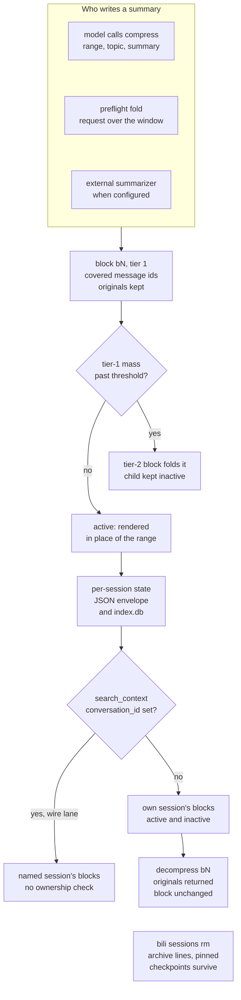

## 1. Executive Summary

billion-context is a context-compression proxy and host plugin that sits
between a coding agent and its model API. It injects four tools so the model
folds consumed message ranges into summaries it writes itself, and restores
them on demand. It enters this atlas because those summaries outlive the
session: each is a persisted claim about what happened, keyed to the messages
it covers. Its strength is reversibility, since every fold keeps its originals
and session identity refuses to attach without the history. Its weakness is a
cross-session search that takes a session id from the model's tool arguments on
the wire lane and checks nothing else.

The code's centre of mass is the proxy, not the memory. Most of `src/` is wire
translation, launch lanes for about two dozen agents, prefix-cache bookkeeping
and storage migration. The memory-relevant core is the acp-kernel
`CompressionState` and the per-session store under it. The kernel holds the
blocks, the ref ledger and an opt-in rule list. The store adds a SQLite index of
messages, blocks and content-addressed bodies, plus archive logs.

No capability mark is earned. The cross-session read is the deciding finding
for `scope_enforced`. Block lifecycle flags are not epistemic states, and
search ignores them. The SQLite `blocks` table is upserted and pruned on every
save, so it is a mirror of state rather than a log. No committed test asserts
that particular material stays out of a populated search result.

The licence is MIT with an added term: a product end users can see that
incorporates the software must name billion-context and acp-kernel, with
links, on its home page, its documentation or a credits page; a server-side use
satisfies it in shipped documentation (`LICENSE`, mirrored in `kernel/LICENSE`).
The term does not restrict reading or analysis. GitHub reports the licence as
`NOASSERTION` because of it.

## 2. Mental Model

A memory here is a **compression block**: `blockId`, `runId`, `tier` (1 to 3),
an optional `topic`, a `summary`, the raw message ids it directly and
effectively covers, the block ids it consumed, `createdAt`, a survival counter,
a `young`/`old` generation and `active` (`kernel/src/types.ts:68-112`). The
summary is written by a model: the agent's own model through the `compress`
tool, the upstream model in a proxy-run preflight fold, or a configured
external summarizer. Nothing compares it with the range it replaced.

A block is born active and renders in place of its range. It leaves the active
set three ways:

- a tier-2 or tier-3 block consumes it, and it stays as inactive lineage;
- block sync finds its messages gone from the inbound view and deactivates it,
  unless a host marked it `expanded` because the user decompressed it;
- `bili sessions foreign-blocks --apply` archives it to `block-archive.jsonl`
  when its messages never belonged to the session.

`decompress` does not change state. Its comment calls it *"copy-paste — the
block stays active"* (`src/decompress-shared.ts:150`), and `deactivateBlock`
in `kernel/src/decompress.ts:62` is reached only from the orphan reaper, which
passes it by value to `reapOrphanBlocks` (`src/server.ts:4597`). The one
correction path is model-driven: an inline decompress marks the block
`restoredInline`, and a later `compress` over its whole span replaces the
summary under the same id (`kernel/src/types.ts:93-99`).

The originals are the ground truth, and they are kept. Each block's covered
messages are cached in `blockContents`. Oversized tool results sit in a
per-session content store keyed by `mNNNNN` ref, append-only and first write
wins (`kernel/src/content-store.ts:3-27`). Refs are never re-issued.

A second, smaller memory is opt-in. With `rules.enabled`, an `acp_rule` tool
records up to 50 reminders of 300 characters, re-injected into the system prompt
every turn (`kernel/src/rules.ts:17-35`). Rules live in the session's state and
fork adoption does not copy them.

Nothing is treated as verified, and nothing is withheld for being doubtful.
Search returns active and inactive blocks alike.

## 3. Architecture

**Proxy.** An HTTP server that parses Anthropic, OpenAI chat, OpenAI Responses
and Google requests, runs the kernel's `processTurn` pipeline on the history,
injects the tools and the compression doctrine, forwards the request, and
rewrites the response. When the model calls one of its tools, the proxy
executes it and re-requests, up to `MAX_LOOP_ROUNDS = 10`
(`src/loop/core.ts:52`). Clients reach it through a `/bili/<upstream>` URL
prefix, a TLS-intercepting `CONNECT` lane for whitelisted model hosts, or a
launcher that sets either up.

**Plugin lane.** Native plugins and the MCP shell call
`POST /__bili/plugin/tool` with a conversation id and the tool arguments
(`src/server/admin.ts:797-801`, `src/plugin.ts:2044`). Management paths under
`/__bili/` answer loopback only (`src/server/admin.ts:148-149`).

**Kernel.** `acp-kernel` (in `kernel/`, consumed as a `file:` dependency) is a
pure library: state types, the per-turn pipeline, compression, search and
the content store, with no I/O.

**Store.** `sessionsDir()` resolves to `$XDG_DATA_HOME/billion-context/sessions`
or `BILI_SESSIONS_DIR` (`src/paths.ts:44-47`). Each session is a JSON envelope
written atomically after a 500 ms debounce, with no fsync and no cross-process
lock (`src/persist.ts:51-108`, `src/knobs.ts:377-380`). Beside it,
`index.db` holds the unified schema (`src/storage/schema.ts:123-287`):

- `sessions`, `messages`, `blocks`, `refs`, `dead_refs`;
- `content`, a refcounted CAS of bodies;
- `checkpoints`, frozen session records, with `pinned`;
- `conversations`, `session_ext`, `kv_store`.

The default mode is `full`: reads come from the index and envelopes are
written too (`src/knobs.ts:873-885`). `storage.backend: "mysql"` moves the same
tables to MySQL (`src/storage/mysql.ts`). Files are plaintext by default.
`BILI_PERSIST_ZSTD=1` and `BILI_ENCRYPTION_KEY` add compression and
AES-256-GCM.

### Deployment and ergonomics

`npm install -g billion-context` gives the `bili` command; the README asks for
Node 22 or later for the SQLite engine. Nothing else has to run, and no API key
is needed beyond the one the agent sends upstream. The proxy binds
`127.0.0.1` by default. `--host 0.0.0.0` and the shipped `Dockerfile` serve
other machines with *"no authentication"* (`README.md:486`, `:508-512`;
`Dockerfile:33`).

Installing into a host writes that host's configuration.
`bili plugin install claude` pins `ANTHROPIC_BASE_URL`, sets
`DISABLE_AUTO_COMPACT=1`, and adds a `SessionStart` hook and a `SubagentStart`
hook to `~/.claude/settings.json` (`src/plugin-install.ts:677-724`). The
repository's own `.claude-plugin/` manifests declare no hooks or MCP servers.
Their `/billion-context:bili-setup` command runs the installer
(`commands/bili-setup.md`).

Self-update is on by default outside the container image, with a staggered
rollout and a remote hold file. An advisory channel can force-install a named
version even with auto-update off (`README.md:530`, `:550`).

The store is human-readable JSON, but the `full` mode loads from `index.db`, so
hand edits to an envelope do not reach a running proxy without the index.

## 4. Essential Implementation Paths

- **Turn intake.** The proxy request handler in `src/server/handle.ts` resolves
  the session, then calls the kernel `processTurn` (`kernel/src/compress.ts:947`),
  which assigns refs, syncs blocks, prunes covered messages, filters, injects the
  nudge and renders `<acp>` ref tags.
- **Compress.** On the wire lane, the model's `tool_use` arguments are parsed
  with `JSON.parse` and dispatched (`src/loop/core.ts:1276-1289`,
  `src/stream.ts:50-66`, `src/compress-loop-responses.ts:108-122`).
  `applyConfiguredCompression` (`src/external-summary-compress.ts:37`) either
  applies the model's summary or replaces it with an external summarizer's, and
  `applyCompression` (`kernel/src/compress.ts:343`) creates the block.
- **Preflight.** `src/preflight.ts` folds before forwarding when the request
  would overflow the window, calling the upstream with the compress prompt.
- **Search.** `executeSearchContextTarget` (`src/decompress-shared.ts:950-995`)
  picks the target state, and `executeSearchContext` (`:821-937`) ranks.
- **Decompress.** `resolveDecompress` (`src/decompress-shared.ts:171`), with the
  `toFile` writer at `:122-147`.
- **Fork and resume.** `maybeAdoptForkBlocks` (`src/fork-adoption.ts:347-376`),
  and the resume inheritance path in `src/server/handle.ts:1862-1907`.
- **Persist.** `SessionStore` in `src/persist.ts`; unified ingest in
  `ingestSession` (`src/storage/store.ts:861`).
- **Delete.** `removeSession` (`src/persist.ts:1489-1507`) and
  `deleteSession` (`src/storage/store.ts:1810-1850`); archive and restore at
  `:1989-2170`; GC in `src/session-gc.ts`.

## 5. Memory Data Model

The block (section 2) is serialized verbatim into `blocks.payload_json`, with
projections into `tier`, `start_seq`, `end_seq`, `summary_hash`, `one_hash`,
`supersedes_block_id`, `active` and `created_at` (`src/storage/schema.ts:172-189`).
The schema header calls messages, content and blocks *"append-only facts
(UPDATE is a bug)"* (`:3-6`). The block ingest does not keep that promise. A
stored block absent from the saved state is deleted and its bodies released
(`src/storage/store.ts:1134-1139`). Every other block is upserted, overwriting
`summary_hash`, `active` and `payload_json` (`:1198-1209`). So the table is
the current block set, and a refold leaves no trace of the summary it replaced.

**Scope** is the session. A session's id is the client's own conversation id
where one is sent, used verbatim (an `x-claude-code-session-id` header, a Codex
`session_id`, an OpenCode session header). With none, prefix affinity hashes the
replayed history progressively from position 0 and attaches only on a byte-exact
match with a stored chain's head, minting a fresh `pfa-` id otherwise
(`SESSION-IDENTITY.md`, `src/prefix-affinity.ts`). There is no user, project or
tenant key. `sessions.namespace` defaults to `'proxy'`, and the foreign read
does not consult it (`src/persist.ts:2023-2032`).

**Temporal fields** are the block's `createdAt` and each message's first-sight
`ts`. Neither is a validity time.

**Lineage.** `metadata.derivedFromSessionId` links a fork, a resumed session or
a ZCode memory sub-session to its parent (`src/fork-adoption.ts:371-375`,
`src/server/handle.ts:1830-1832`, `:1906-1907`).

## 6. Retrieval Mechanics

There are two retrievals, and neither is automatic in the memory sense.

**The fold itself.** Every request re-renders the history with active block
summaries in place of their ranges. That is context assembly, bounded by the
window and, per the paper's section 3.3, by protected zones: the recent tail,
the first and last user messages and the compression calls themselves.

**`search_context`** is the model's lookup. Its schema takes `query` and
`limit` (`kernel/src/compress-tools.ts:393-408`). It runs the kernel's
`substring` algorithm with a near-zero floor over `blockDocs`, which builds one
document per block from topic and summary, **active and inactive alike**
(`kernel/src/search/index.ts:22-33`, `src/decompress-shared.ts:845-849`).
A second pass searches the verbatim originals of blocks no summary matched,
capped at `limit` (`:868-894`). The default limit is 5, and a truncation note
reports how many candidates were cut. An opt-in plan-aware re-rank reorders
hits by the session's latest todo state, and only for its own session.

An empty result is worded as scoped: *"Scope = compressed topics/summaries
(active + folded-away) … NOT visible messages or other sessions; absence here ≠
never-discussed"* (`src/decompress-shared.ts:901`).

**`decompress`** returns a block's cached originals, or its full transitive
originals with `full`, or a ref range with `startId`/`endId`. It returns the
summary when no originals survive. With `toFile`, it writes the body to any
path the model names, creating directories as needed (`:122-147`).

The kernel ships an embedding algorithm as a reference and registers none
(`kernel/src/search/algorithms/semantic.ts:1-8`).

## 7. Write Mechanics

A block is created when the model calls `compress` with one or more ranges, each
a start ref, an end ref, a topic and a summary. The proxy validates the range
against the kernel's boundaries and protected zones, applies a summary length
window of 50 to 20,000 characters by default (`CONFIGURATION.md:287-288`), and
records the block. A preflight fold does the same with a summary the proxy
requested. When tier-1 mass passes its threshold, the nudge offers block ranges,
and a tier-2 block consumes the tier-1 blocks it covers.

Nothing deduplicates or reconciles summaries. Two blocks describing the same
decision differently are both kept and both searchable. Agent-written content
is the norm here: the model decides what to fold, and its summary is what later
turns see.

**Fork adoption** is the one cross-session write, and it is guarded by holding.
When an anonymous history diverges, or a client resumes under a new id, the
child copies only parent blocks whose every effective message id appears in the
incoming request (`src/fork-adoption.ts:13-60`). Rules, nudge state and stats
are not inherited. The copy is deep, so the branches never mutate each other.

### Operational cost

A model-initiated compress is synchronous inside the model round trip. The
proxy executes it and re-requests before the client sees a response, so the
fold costs one extra upstream call. A preflight fold blocks the forwarded
request until the summarizer answers. A new block is searchable immediately in
memory and on disk within the 500 ms debounce. No background pass rereads or
rewrites the store. Injection per turn is the whole rendered view, which is the
product: the doctrine text, the tool schemas, every active summary and the raw
tail. The design keeps the prefix byte-stable between folds, through latches on
transformed bytes and ref numbering fixed at first sight (`kernel/src/types.ts:287-424`).

## 8. Agent Integration

The model holds four verbs on every lane: `compress`, `decompress`,
`search_context`, `acp_status`. `acp_cache` and `acp_retrieve` are added where
enabled, and `acp_rule` and `absorb` when configured. The model chooses what to
fold and when, prompted by a nudge carrying recommended ranges with sizes. The
paper says the nudge is removed once the fold lands, so it leaves nothing in
the cached prefix.

There is no session-start recall. A resumed session sees its own folded view
because the history it replays matches. A new session sees nothing of an older
one unless a fork or resume link adopts blocks, or a search names the older id.

Adapting it to another agent needs only a configurable base URL. The launcher
lanes for agents without one use TLS interception with a local CA, scoped to
whitelisted model hosts (`README.md:508-512`).

## 9. Reliability, Safety, and Trust

### The cross-session read takes its target from the call

`executeSearchContextTarget` reads `args.conversation_id`. When it names another
session, the function loads that session's state, resident or from the store,
and returns its matching summaries under *"Read-only search of historical
session …"* (`src/decompress-shared.ts:944-948`, `:957`, `:986-995`). For a
resident session the verbatim folded originals are searched too. The only check
is that the id exists.

Which callers can supply the id at this pin:

- **The model, on the wire lane.** The proxy parses the model's tool arguments
  and passes every key through (`src/loop/core.ts:1281`, `src/stream.ts:65`,
  `src/compress-loop-responses.ts:112`). No wire path strips
  `conversation_id`. The schema the model sees omits the parameter
  (`src/compress-tool.ts:148-153`), so a model sends it only if trained on the
  old schema or told to by text in its context.
- **Not through the plugin endpoint.** `handlePluginTool` deletes
  `args.conversation_id` before executing (`src/plugin.ts:2262-2267`). The MCP
  shell's deliberate keep for `search_context` (`src/mcp.ts:364-405`), and
  the shim test asserting it (`tests/mcp-native-thread.test.ts:346`, `:363`),
  therefore end at that delete.
- **The derived-ancestor fallback.** A search with no target that finds nothing
  walks `derivedFromSessionId` up to eight parents and answers from the first
  that matches (`src/decompress-shared.ts:496-511`, `:971-983`). Fork links are
  written even when no block was adoptable, and the code says so: *"a
  mis-guessed parent can at most be searched read-only"*
  (`src/fork-adoption.ts:335-344`).
- **`bili export <id>`**, the operator's CLI, which the result note points to.

On a single-user loopback proxy this reaches nothing the user's own shell could
not read from `sessionsDir()`. On `--host 0.0.0.0` or the container image, every
remote client's model shares one store, and an id is the only credential. Client
ids are conversation UUIDs, so the exposure is to an id leaked into a context,
not to a guessed one.

The identity design states the opposite principle for adoption: *"matching
requires holding a byte-identical head, so folded state reveals nothing the
requester does not already hold"* (`SESSION-IDENTITY.md`). Fork adoption keeps
that principle, and the foreign search does not.

### Deletion stops at the session's own rows

`bili sessions rm` removes the envelopes, the content-store sidecar and every
index row, and releases the bodies (`src/persist.ts:1489-1507`,
`src/storage/store.ts:1810-1850`). Four things survive it:

- **Pinned checkpoints** keep their rows and a CAS reference to a full frozen
  session record, by design (`src/storage/store.ts:1829-1836`).
- **An archived session's line** in `archive/archive.jsonl` holds its messages,
  blocks and bodies. Restore rewrites the log without that line (`:2170`), but
  `rm` on an archived session does not touch it.
- **Fork and resume children** hold deep copies of adopted blocks and originals.
- **Exports and body dumps** the user wrote, and the rotating log.

The opt-in GC (`BILI_SESSION_GC=1`) deletes only session files older than seven
days that were never compressed and stayed under one million tokens
(`src/session-gc.ts:14-40`). The README calls every deletion audit-logged. That
means one `info` line per file in `bili.log`, which rotates at 10 MB
(`src/session-gc.ts:272-274`). The sweep names no index call, so whether a
removed file's `index.db` rows survive in `full` mode is an open question.

### What the model can write outside the store

`decompress` with `toFile` writes to any path the model supplies, with
`mkdir -p`, as the proxy's user (`src/decompress-shared.ts:122-147`). An agent
harness that sandboxes the model's own file tools does not sandbox this one.

### Trust in the summaries

A summary is the model's account of a range, and nothing checks it against the
originals. The originals stay recoverable, which is the defence: a doubted
summary can be checked by `decompress`. A summary steered by injected text in a
tool result is stored and rendered at the head of every later turn until
refolded.

### Concurrency

There is no per-session request lock on the wire path, and the persist header
says two concurrent requests for one session *"can interleave processTurn and
corrupt in-memory state"* (`src/persist.ts:111-114`). Two proxies sharing a
sessions dir race on every write, behind a monotonic-counter guard.

### Marks

None is carried.

- **`scope_enforced`** — the session is the partition, and the foreign path
  filters on whatever session id the caller passes. On the wire lane that is the
  model, with no ownership check. There is no user, project or tenant key.
- **`audit_log`** — the `blocks` table is upserted and pruned on save, and the
  GC's audit line is a rotating log entry. Nothing records a compress, refold or
  deletion as an event.
- **`trust_state`** — `active`, `expanded`, `restoredInline` and `generation`
  are lifecycle flags. Search reads active and inactive blocks alike, so none
  even filters.
- **`tombstone`** — `deadRefs` records refs whose messages vanished and lifts
  when they reappear; an archived session row is called a tombstone and is keyed
  on the session. Neither names a rejected value.
- **`bitemporal`** — `createdAt` and `ts` are record times.
- **`human_review`** — the web panel lists sessions and stats, and the model
  writes, refolds and folds away summaries with no queue.
- **`negative_eval`** — see section 10.

## 10. Tests, Evals, and Benchmarks

The suite is large: 1,299 `*.test.ts` files run by `node:test`, and the
repository carries 29 GitHub workflows, including end-to-end lanes per host. I
did not run them.

Memory-relevant coverage:

- `tests/search-context-cross-session.test.ts` pins the foreign read as a
  feature. It asserts the schema omits `conversation_id` (`:64-117`). It asserts a
  resident or cold-loaded foreign session is searched and its file left
  byte-identical (`:176-224`). No case refuses a foreign id.
- `tests/search-context.test.ts:105-112` asserts an inactive block is
  searchable and marked inactive.
- `tests/prefix-affinity.test.ts` and `tests/truncation-fork.test.ts` cover
  identity, including that an exact self-replay does not inherit from itself
  (`tests/prefix-affinity.test.ts:231`).
- `tests/foreign-block-sweep.test.ts:82-115` archives a foreign block and
  asserts it is gone from the store's live set while a healthy sibling stays.
- `tests/session-gc.test.ts` covers the GC conditions.

`negative_eval` is withheld. The foreign-block case asserts a store listing,
not a search result. `tests/zcode-memory-isolation.test.ts:167` asserts
folded originals stay out of the forwarded wire body, which is the assembled
window. `tests/search-context-2751.test.ts:60` asserts a low-ranked block is
cut by the limit, which is truncation. No committed case shows a search
returning hits while a named block or another session's block is absent.

**Paper.** `paper/` holds *Model-Driven Incremental Hierarchical
Compression*, preprint v0.2 dated 7 September 2026, in-repo under MIT and
described as a living document anyone may edit. I found no arXiv id for it.
Its claims rest on production logs and a pilot, and its artifact map says the
data and the experiment harness are *"not yet public"*. Only
`paper/figures/make-figures.py` is committed, so no figure can be recomputed
here. The pilot does carry an ablation of sorts. A quiescent control that never
compressed reproduced almost all the re-fetch reduction from the doctrine text
and tags alone, and a fixed-cadence arm beat the default on one workload.

Two of the paper's mechanism statements disagree with the code at this pin.
Its section 3.2 says `decompress` *"re-activates a block's sources and
deactivates the block"*; the code leaves the block active. It says
`search_context` covers block summaries *"plus recent messages"*. The code
searches summaries and folded originals, and its own empty-result text says
*"NOT visible messages"*.

**Third-party benchmark.** `benchmarks/third-party-1500/` holds two READMEs and
seven PNG charts, added in commit
[`81c5466a7fb0de9d9bac52be1064e82355bb3ee8`](https://github.com/ranxianglei/billion-context/commit/81c5466a7fb0de9d9bac52be1064e82355bb3ee8)
by Wang Tian Yi on 31 October 2026. It reports LongMemEval-S, ContextBench and
MemoryAgentBench at 500 items each for `v0.1.202` against a full-context arm and
three RAG arms. No per-item result, prompt or harness is committed, so none of
its figures can be recomputed from this tree. `kernel/bench/search/` is a
search-quality benchmark over a committed 289-line corpus that reports MRR and
recall per algorithm, with no committed output.

Missing before trusting it as memory: a case where a foreign or named block is
absent from a populated search, a wire-lane case refusing a `conversation_id`,
and a deletion case covering archive lines and forks.

## 11. For Your Own Build

### Steal

- **Keep the original beside every summary, and give the model the way back.**
  A fold the model can undo is cheaper to get wrong, and `decompress` with a
  file target keeps the restore out of the context window.
- **Make identity something the requester has to hold.** Attaching an
  anonymous request only on a byte-exact prefix from position 0 means state
  cannot leak to a request that does not contain it.
- **Adopt a derived record only when every source it covers is present.** Set
  membership on content-hash ids is position-free and rejects a block straddling
  the fork.
- **Word an empty search result as scoped.** Naming what was searched, and that
  absence is not proof, stops a model from reading a miss as a fact.

### Avoid

- **A parameter removed from the schema but not from the handler.** Stripping
  it on one lane and honouring it on another leaves the read open wherever the
  arguments arrive raw. Strip it at the dispatcher every lane shares.
- **A table documented as append-only and written by upsert.** A reader
  trusting the comment expects history the rows do not keep.
- **Calling a rotating log line an audit trail.**
- **A model-chosen output path written by a process outside the agent's
  sandbox.**

### Fit

This suits one developer who runs long coding sessions on one machine and wants
them to stop dying at the window, with every fold reversible. As memory it is
thin by design: per-session summaries with no cross-session recall a person can
steer, no correction verb and no notion of a summary being wrong. Do not run it
as a shared service, because the store has no owner key and the cross-session
read trusts the call. The maintenance surface is large: a self-updating proxy
across about two dozen agents and four wire protocols, changing many times a day.

## 12. Open Questions

- Whether any shipped model emits `conversation_id` on `search_context` in
  practice, and whether a prompt-injected id has been observed in the wild.
- Whether the GC's file deletion leaves the session's `index.db` rows in `full`
  mode, where reads prefer the index.
- Whether a request carrying another conversation's client id, without its
  history, is ever rendered that conversation's active summaries.
- How the README's "audit-logged" GC claim is meant to survive the 10 MB log
  rotation.
- Whether the paper's production corpus will be published, which the artifact
  map says is planned.

## Appendix: File Index

- State and kernel: `kernel/src/types.ts`, `kernel/src/state.ts`,
  `kernel/src/compress.ts`, `kernel/src/decompress.ts`,
  `kernel/src/content-store.ts`, `kernel/src/rules.ts`,
  `kernel/src/search/index.ts`, `kernel/src/compress-tools.ts`
- Tool execution: `src/decompress-shared.ts`, `src/stream.ts`,
  `src/loop/core.ts`, `src/compress-loop-responses.ts`,
  `src/external-summary-compress.ts`, `src/preflight.ts`,
  `src/compress-tool.ts`
- Plugin and MCP lanes: `src/plugin.ts`, `src/mcp.ts`, `src/server/admin.ts`,
  `src/plugin-install.ts`, `hermes-plugin/__init__.py`, `plugins/codex/`
- Identity: `SESSION-IDENTITY.md`, `src/prefix-affinity.ts`,
  `src/fork-adoption.ts`, `src/server/handle.ts`
- Storage: `src/paths.ts`, `src/persist.ts`, `src/storage/schema.ts`,
  `src/storage/store.ts`, `src/storage/mysql.ts`, `src/session-gc.ts`,
  `src/storage-maintenance.ts`
- Tests: `tests/search-context-cross-session.test.ts`,
  `tests/search-context.test.ts`, `tests/mcp-native-thread.test.ts`,
  `tests/foreign-block-sweep.test.ts`, `tests/session-gc.test.ts`,
  `tests/prefix-affinity.test.ts`
- Paper and benchmarks: `paper/`, `benchmarks/third-party-1500/`,
  `kernel/bench/search/`

### Recorded searches

Run from the repository root at the pinned commit with `/usr/bin/git grep`.

- **No wire path strips `conversation_id`.**
  `git grep -n -E 'conversation_id' -- src/stream.ts src/loop/ src/compress-loop-responses.ts src/stream-google.ts src/server/handle.ts`
  returns nothing; the same pattern over `src/plugin.ts` matches the delete at
  `:2267` and two comments.
- **`deactivateBlock` runs only from the orphan reaper.**
  `git grep -n -w deactivateBlock -- 'src/*.ts' 'kernel/src/*.ts' ':!*.test.ts'`
  matches its definition, the kernel export, the import in `src/server.ts`,
  two comments and the by-value call at `src/server.ts:4597`.
- **No event or audit table.**
  `git grep -n -i -E 'CREATE TABLE IF NOT EXISTS [a-z_]*(event|audit|journal|history|log)' -- 'src/*.ts' 'kernel/src/*.ts'`
  returns nothing; `git grep -n -E 'CREATE TABLE IF NOT EXISTS' -- src/storage/schema.ts`
  matches seventeen lines: the twelve DDL tables, four migration statements and
  one comment.
- **The GC names no index call.**
  `/usr/bin/grep -n -E 'shadow|unified|removeSession|deleteSession|index\.db' src/session-gc.ts`
  returns nothing.
- **No validity time.**
  `git grep -n -i -E 'valid_?(from|to|until)|validfrom|validTo|valid_at' -- 'src/*.ts' 'kernel/src/*.ts' ':!*.test.ts'`
  returns nothing.
- **No embedding retrieval registered.**
  `git grep -n -i -E 'embedding|cosine' -- 'src/*.ts' 'kernel/src/*.ts' ':!*.test.ts'`
  returns the unregistered reference algorithm, two search-module comments
  naming it, and uses of the word for embedding hosts and embedded text in
  `ccr.ts`, `config.ts`, `launcher.ts`, `server/admin.ts` and `web/`.
- **No committed benchmark results.**
  `git ls-files | /usr/bin/grep -i -E 'bench|eval|longmem|locomo'` returns the
  nine files under `benchmarks/third-party-1500/` and the two under
  `kernel/bench/search/`.

## History

**2026-11-07** — [`83bddaa0670baf36facc25688b29355f5c59fa91`](https://github.com/ranxianglei/billion-context/commit/83bddaa0670baf36facc25688b29355f5c59fa91). First reading, from a depth-1 clone. Screened first: one auto-run surface, the `.claude-plugin/` marketplace and plugin manifests, which declare no hooks or MCP servers; the `SessionStart` and `SubagentStart` hooks are written into `~/.claude/settings.json` by `bili plugin install claude`. A Codex plugin under `plugins/codex/` starts an MCP server and the screen does not parse it. Eight dependency files inside the cooldown, all dated to the tip by the shallow clone; one `prepare` script; four unpinned surfaces, two of them `file:` packages in the tree. MIT with an attribution rider that does not restrict analysis. Nothing installed, built or run. No marks: the cross-session search takes its target from the model on the wire lane ([section 9](#9-reliability-safety-and-trust)).
