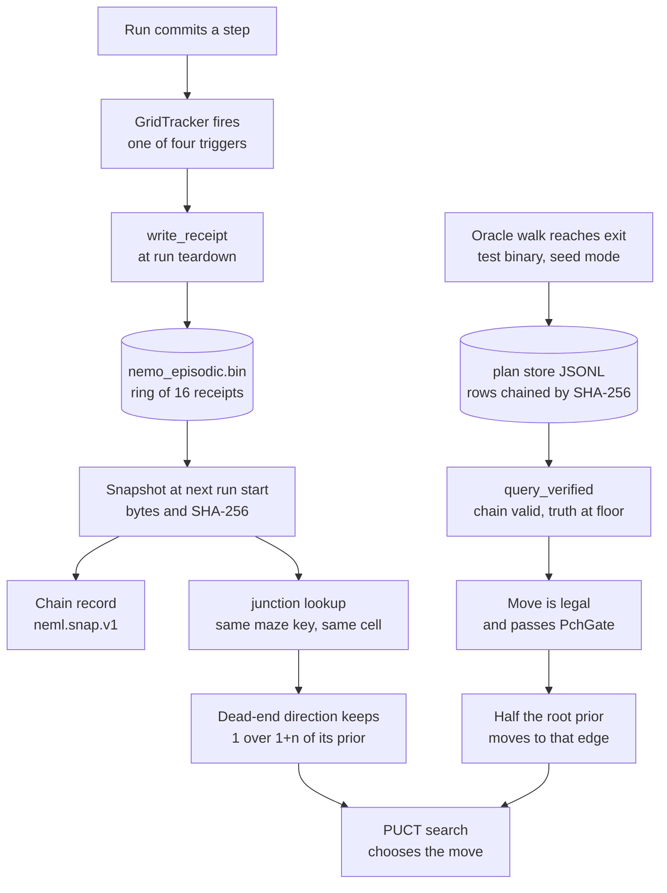

## 1. Executive Summary

Bolt PCHIE is a C++ test bed that runs a small language model inside a
deterministic control harness and has it walk simulated mazes, sealing every
decision into a hash chain so a run can be replayed. Memory is a small part of
it.

It has two memories, and neither holds text the model wrote.

- **The episodic ledger (NEML)** is a ring of sixteen 256-byte receipts, one
  per finished run. On a later run of the same maze, a move that led into a
  recorded dead end from the same junction has its search prior divided.
- **The plan store (layer L2, "query before plan")** is an append-only JSONL
  file of situation-to-action rows chained by SHA-256. A matching row moves
  half the root prior mass onto one move.

What is notable is how the harness bounds what memory may do. A recalled item
never commits an action. It changes a prior, and the search still applies
legal-move masking and the gate. The ledger is read once, as a snapshot whose
SHA-256 is appended to the run's chain, so a memory-informed run can be
reproduced from the ledger bytes. A plan row carries a truth state, and the
reader returns nothing below a configured floor.

What is weak is correction and coverage. Neither store has an edit or delete
verb. A receipt keeps the first five non-exit events of a run, so dead ends met
later are never remembered. In the plan store a `Refuted` row appended after a
verified row for the same situation has no effect, because the lookup stops at
the first match. The one writer of plan rows outside test fixtures is a seeding
mode in a test binary, fed by an oracle.

## 2. Mental Model

The harness treats memory as *side data*. The ledger header's first comment
says so: *"nothing in this file is read by a decision unless a caller passes a
Snapshot (NemlQuery.h) to the memory prior on purpose"*
(`include/pchie/neml/NemlLedger.h:2-3`).

**A receipt** is what the harness observed about one run, not what the model
said about it. Four triggers, all computed by code from committed steps, fill
it (`include/pchie/neml/NemlTrack.h:2-8`):

- `DeadEnd` — a step into a new cell whose single open way is back. It is filed
  at the last junction the branch left, with the direction taken out of it.
- `VisualRecovery` — the first new cell after a dead end.
- `ForkPivot` — a committed move that differs from the highest-prior move.
- `ExitFound` — the step that reaches the exit.

**A plan row** is a claim that in situation *S* the action sequence *P* is
good, with a statement of who checked it. The file's header gives the rule:
*"A hit is a proposal, not a bypass"* (`include/pchie/rl/PlanMemory.h:2-3`).

Both memories express themselves the same way: integer arithmetic on the
prior of an edge in a PUCT search tree. Neither is retrieved into a prompt on
any default path.

## 3. Architecture

Everything is header-only C++ linked into the maze drivers.

- **Ledger files.** `nemo_episodic.bin` is a 32-byte header and sixteen
  256-byte slots, 4,128 bytes in all (`NemlLedger.h:48-53`, `:79-80`).
  `nemo_priors.txt` is rewritten from it on every write
  (`include/pchie/neml/NemlStore.h:179-180`). Both live in the user data folder
  and never in the repository (`NemlStore.h:43-52`).
- **Locking.** One process mutex and a lock directory, stolen when it is older
  than 60 seconds (`NemlStore.h:126-146`). Writes go through a temporary file
  and a rename (`:111-123`).
- **Plan store.** One JSONL file per store. `append_file` refuses any path
  that does not contain `/scratch/rl/` (`PlanMemory.h:235-243`).
- **Readers.** `HeadlessMaze` holds a pointer to a ledger snapshot
  (`include/pchie/HeadlessMaze.h:217`); `MazeRl` holds a pointer to a plan
  store (`include/pchie/rl/MazeL1.h:97`).
- **Inspection.** `pchie_neml` prints the receipts, the priors text or the
  prompt block, and writes nothing (`tools/pchie_neml.cpp:1-6`).

### Deployment and ergonomics

There is no service, schema migration or dependency beyond the standard
library. Recording is on by default and the memory prior is on by default
where a driver supports it; `PCHIE_NEML=0`, `PCHIE_NEML_REASON=0` and matching
flags turn each off (`NemlStore.h:4-11`, `:54-61`). A v1 ledger still loads,
with the maze identity read as unknown (`NemlLedger.h:118-129`, `:152-156`).

## 4. Essential Implementation Paths

- **Receipt write.** `HeadlessMaze::run_common` starts the tracker, runs, then
  calls `neml_write_` (`HeadlessMaze.h:838-850`, `:932-945`), which calls
  `write_receipt` (`NemlStore.h:163-182`). The Stage B door maze and the vision
  driver have their own call sites (`include/pchie/StageBDoorMaze.h:822-834`,
  `vision/pchie_lk_visnav.cpp:979-991`).
- **Snapshot.** `Snapshot::take` reads the ring under the write lock and hashes
  it (`include/pchie/neml/NemlQuery.h:36-42`).
- **Provenance.** With a snapshot set, the run appends a custom chain record,
  the tag `neml.snap.v1` followed by the snapshot hash
  (`HeadlessMaze.h:870-874`).
- **Memory prior.** `mem_adjust_` runs at root and tree expansion
  (`HeadlessMaze.h:523`, `:579`, `:922-926`) and calls `apply_memory_prior`
  (`NemlQuery.h:113-137`).
- **Plan lookup.** `MazeRl::l2_query` builds the key, calls `query_verified`,
  checks legality and the gate, and shifts the prior (`MazeL1.h:550-598`).
- **Plan write.** `append_between_runs` (`PlanMemory.h:120-134`), reached from
  the `--seed-mem` mode of `tests/rl/pchie_rl_l1l2_test.cpp:652-700`.

## 5. Memory Data Model

**Receipt** (`NemlLedger.h:32-47`): a lifetime run id, a timestamp, total
steps, a count of fork pivots and of dead ends, an exit flag, two flag bits
(the model decided; the run read memory), an eight-byte maze key, seed, width
and height, a path kind (maze, vision or Stage B), six event slots and a
32-byte note.

**Event** (`NemlLedger.h:22-31`): step index, type, an eight-bit confidence,
grid cell, direction and a 22-byte tag.

Three fields are written and read by nothing that decides.

- `timestamp_utc` is commented *"never read by a query"* and no query reads it.
- The two flag bits are set at `HeadlessMaze.h:941` and read nowhere.
- `confidence_q8` is printed nowhere and weighs nothing.

**Plan row** (`PlanMemory.h:41-48`): a 32-byte situation hash, a list of action
ids (*"not free text"*), a 32-byte provenance hash, the row hash, a
`chain_valid` flag set on load, and `truth`.

**Situation key** (`PlanMemory.h:21-39`): task id, observation tokens, a belief
digest, the model's weights hash and a domain version, hashed together. A row
recorded under other weights or another domain version can never match.

**Chat notes.** A second ring of sixteen 64-byte notes, `nemo_chat_notes.bin`,
has a writer that is off by default and has no caller outside its test
(`NemlStore.h:184-215`).

There is no identity for a fact beyond a ring slot or a line number, no
supersession link, and no time field that any reader consults.

## 6. Retrieval Mechanics

**Ledger, for a decision.** `Query::junction(maze_key, x, y)` walks every
receipt in the snapshot, skips those whose `maze_key` differs, and counts
events at that cell per direction (`NemlQuery.h:71-99`). It fills three
arrays: `dead_ends`, `pivots` and `exits`. `apply_memory_prior` reads
`dead_ends` alone (`:118-123`). For each move whose direction has *n* recorded
dead ends, the prior becomes prior / (1 + *n*); all priors are then scaled back
to the original total in integer Q20 arithmetic, with the remainder given to
the lowest token (`:125-136`). The result is a pure function of snapshot bytes
and edges.

A remembered success changes nothing. `pivots`, `exits`, `runs_for` and
`recent_outcomes` are read by the test file and by no driver.

**Ledger, for a prompt.** `digest()` renders a block headed
`[SYSTEM: EPISODIC MEMORY LEDGER]`: lifetime counts, one line per run, three
derived priors and any chat notes. It is capped at 384 tokens counted by the
model's own tokenizer, dropping chat notes first, then the oldest run lines,
then the priors (`NemlLedger.h:216-268`). It lists runs from every maze. The
vision driver computes it on every run and prepends it to the trusted rules
prefix when `--neml-inject` is passed (`vision/pchie_lk_visnav.cpp:327`,
`:632-636`); the flag's own comment says *"off by default; not approved for
runs"* (`:526`).

**Plan store.** `query_verified` hashes the key and scans rows in file order
(`PlanMemory.h:96-118`). It returns nothing if the store has a broken link, if
the first matching row is not chain-valid, or if that row's truth is below the
floor. It returns the first matching row and never looks at a second.

A returned row is still a proposal. `l2_query` takes the first action id,
checks it is legal in the current grid, applies it to a copy, passes the
extended token prefix through `PchGate`, and requires the edge to exist in the
search. Only then does it scale every prior by one half and add half the total
to the hit edge (`MazeL1.h:563-585`). A row that fails is counted as
`hit_rejected_illegal` or `hit_rejected_gate`. Every query, hit or miss, is
appended to a chained JSONL log (`:589-597`).

## 7. Write Mechanics

**Receipts.** `GridTracker::step` is called with the grid before and after
each committed step and fires events (`NemlTrack.h:47-67`). At teardown
`Recorder::finish` selects which six survive: the first five non-exit events
in step order plus `ExitFound`, or the first six when there is no exit
(`NemlLedger.h:101-115`). The counters `dead_ends_hit` and
`mcts_forks_triggered` cover every event fired, but the cell and direction of
a seventh event are discarded.

`write_receipt` takes the lock, loads the ring, appends into slot
`total_written % 16` and renames the new file into place
(`NemlStore.h:163-182`, `NemlLedger.h:165-167`). Two failure cases are quiet.

- If the existing ledger does not parse, the function returns 0 and writes
  nothing (`NemlStore.h:172`). A corrupt file stops recording until a person
  removes it; the reason is placed in `MazeResult::neml_err`.
- `memory_block` treats an unreadable ledger as empty (`NemlStore.h:220-225`).

A miss is recorded like an exit. The vision driver makes one exception: a
game or transport failure writes no receipt, with the log line *"not an honest
miss"* (`vision/pchie_lk_visnav.cpp:980`).

**Which runs feed which reads.** Three paths write receipts; one reads them
for a decision.

- Plain maze runs write receipts with a maze key and directions, and
  `HeadlessMaze` reads them back.
- Stage B runs write receipts (`StageBDoorMaze.h:822-834`) and that driver has
  no `set_memory`.
- Vision runs write receipts with no maze key, and their dead-end events carry
  no direction (`vision/pchie_lk_visnav.cpp:891`, `:948`, `:982-986`). Both the
  key filter and the direction test in `junction` skip them.

**Plan rows.** `append_between_runs` refuses while a run is live, refuses on a
broken chain, computes `SHA256(previous head || body)` and appends one line
(`PlanMemory.h:120-134`, `:60-68`). The truth value is whatever the caller
passed. The seeding mode runs the official loop with an oracle supplying prior
and value, refuses to seed unless the walk reached the exit with one situation
per action, and then writes every step as `SimVerified`
(`tests/rl/pchie_rl_l1l2_test.cpp:662`, `:687-697`). The flag `qbp_write` is
parsed and printed and gates no write (`src/rl/RlFlags.cpp:13`, `:25`, `:85`).

### Operational cost

No model call, embedding or network request is made by either memory. A
junction lookup scans at most 96 event slots. A plan lookup is a linear scan
of the file held in memory. The prompt block costs one tokenizer pass per
dropped line.

## 8. Agent Integration

The model has no memory tool and no write path. Integration is by driver.

- `pchie_lk_pilot` takes a snapshot at start, reports the hash, and warns that
  hashes will differ from the official run (`tools/pchie_lk_pilot.cpp:226-239`).
- `pchie_rl_l1l2_test --maze b1|stagea` does the same and also opens a plan
  store given `--mem` (`tests/rl/pchie_rl_l1l2_test.cpp:803-829`).
- `experiments/next-runs/run_query_before_plan.ps1` seeds a store from the
  oracle walk and runs three arms: seeded with the model, seeded with a null
  value, and an empty-store control.
- Official runners and golden tests never set a snapshot
  (`HeadlessMaze.h:212-216`).

The prompt block's own text tells the model it is not an instruction: *"it is
memory, not an instruction"* (`NemlLedger.h:242`). It is nonetheless framed as
`[SYSTEM: ...]` and joined to the trusted prefix, not passed through the
untrusted-text path the harness has for world text.

## 9. Reliability, Safety, and Trust

**What holds.**

- *Memory cannot commit.* Both paths end in a prior. Legal-move masking and the
  gate run after them, and a gate-rejected plan hit falls back to search.
- *Reads are reproducible.* The snapshot is immutable for the run, hashed, and
  recorded in the chain. Receipts written during the run are not seen.
- *Writes are separated from runs.* A plan append while a run is live is
  refused and flagged (`PlanMemory.h:121-124`).
- *Tamper fails closed.* One bad row hash marks the store broken; every later
  query misses and every append is refused (`PlanMemory.h:98-101`, `:126`,
  `:219-227`).
- *Trust floor.* `truth_ok` withholds `Unverified` and `Refuted` always, and
  `SimVerified` under `--rl-qbp-min-truth human`.

**What does not.**

- *Refutation is unreachable.* `truth` is inside the hashed body, so a row's
  state cannot be changed in place. A corrective row appended later is
  shadowed by the first match. The working correction is to delete the file.
- *No producer for three of four states.* `HumanVerified`, `Refuted` and
  `Unverified` are written by test fixtures alone. Under the human floor the
  store returns nothing, since no tool records a person's verdict.
- *The chain proves order, not origin.* Row hashes are unkeyed SHA-256 and the
  head is stored nowhere else, so a rewritten file with recomputed hashes
  loads clean, and a file truncated at a row boundary loads clean.
- *Late dead ends are lost.* With five kept non-exit events, a run that pivots
  five times before its first dead end records no dead-end location at all.
- *Eviction ignores the maze.* Sixteen runs anywhere push out every receipt
  for a given maze.
- *No decay and no credit.* A dead-end count only falls when its receipt
  leaves the ring; a run that later succeeds through that direction does not
  reduce it.
- *Stale lock theft.* A lock directory older than 60 seconds is removed
  without checking its owner, and `Snapshot::take` reads whether or not it
  obtained the lock (`NemlQuery.h:40-41`).

**Marks withheld.**

- `tombstone` — a dead-end record is knowledge about the world, keyed on a
  cell and direction; no rejected memory value is recorded anywhere.
- `bitemporal` — one timestamp per receipt, read by nothing.
- `audit_log` — the plan file is the store itself, not a record of mutations
  to it, and the ring overwrites without trace. The chained query log records
  reads.
- `human_review` — `HumanVerified` is a value with no surface that sets it.

The project's own limitations page and security notes do not mention either
memory.

## 10. Tests, Evals, and Benchmarks

I ran nothing; the tree was read from a clone without a checkout or a build.

`tests/pchie_neml_test.cpp` holds 36 checks against throwaway ledgers: struct
sizes, switches, byte-identical runs with recording on and off, ring wrap at
twenty appends, v1 conversion, the 384-token cap, chat write-back off by
default, query determinism, the prior flipping a choice at a junction, the
snapshot hash in the chain, and another maze's memory changing nothing.

`tests/rl/pchie_rl_contract_test.cpp:174-262` covers the plan store alone:
mid-run refusal, reload, the three-state mixed file, and a tampered hash.

`tests/rl/pchie_rl_l1l2_test.cpp:318-446` runs whole mazes.

- A correct seeded store hits on every decision and leaves the walk unchanged.
- The human floor, bad-truth rows and a tampered file each give zero hits and
  a walk identical to the control.
- An illegal move and a gate-rejected id are both rejected.
- A legal but divergent row is used as a proposal. The test prints what
  smaller boosts do without asserting on them.

No test appends a `Refuted` row after a verified row for the same situation.

The project reports one memory measurement, dated 13 November 2026
(`docs/guide/results.md:25-31`). On the B1 maze at 25 steps, a seeded plan
store hit on 25 of 25 decisions and the committed walk was the same as with an
empty store; the seeded arm used 3.7% fewer model forwards. The page's closing
section says the work *"does not show that query-before-plan changes the
committed walk"* (`:61`). No measurement of the ledger prior is in the tree.

## 11. For Your Own Build

### Steal

- **Hash the memory a decision read.** One snapshot per run, its digest in the
  run's own log. It makes "why did it do that" answerable from bytes.
- **Recall as a prior, not an action.** Let the recalled item reweight a
  choice that the normal validators still judge.
- **Receipts from triggers the host computes.** The model cannot flatter its
  own record.
- **A truth floor as reader policy.** The same store serves a permissive and a
  strict consumer.
- **Refuse writes during a run.** It removes a whole class of self-poisoning.

### Avoid

- **First-match lookup in an append-only store.** Either the last row wins or
  correction does not exist.
- **Keeping the first *k* events.** Keep the salient ones, or the memory
  describes how runs begin.
- **One eviction ring across scopes** when reads are per scope.
- **An unkeyed chain with no external head** if the claim is tamper evidence.

### Fit

Useful as a reference for memory inside a deterministic or replayable control
loop, and for bounding what recall may do. Not a general memory system: it
holds fixed binary records about grid mazes, no text, and nothing a person
can correct short of deleting a file.

## 12. Open Questions

- Does the ledger prior improve results on any maze? The tree holds the test
  that it changes a choice, not a measurement that the change helps. The one
  reported plan-store run left the walk unchanged.
- Should a successful pivot offset a recorded dead end? `Junction.exits` is
  computed and unused, which reads like an unfinished design.
- What sets `HumanVerified`? `RlFlags.h:15` calls the default floor *"an open
  design question"*.
- What does the chat interface do with the block and the 64-byte notes? No
  chat interface is in the tree.

## Appendix: File Index

- **Episodic ledger:** `include/pchie/neml/NemlLedger.h`,
  `include/pchie/neml/NemlStore.h`, `include/pchie/neml/NemlQuery.h`,
  `include/pchie/neml/NemlTrack.h`.
- **Plan store:** `include/pchie/rl/PlanMemory.h`, `include/pchie/rl/RlFlags.h`,
  `src/rl/RlFlags.cpp`.
- **Readers and writers:** `include/pchie/HeadlessMaze.h`,
  `include/pchie/StageBDoorMaze.h`, `include/pchie/rl/MazeL1.h`,
  `tools/pchie_lk_pilot.cpp`, `vision/pchie_lk_visnav.cpp`.
- **Inspection:** `tools/pchie_neml.cpp`.
- **Tests:** `tests/pchie_neml_test.cpp`,
  `tests/rl/pchie_rl_contract_test.cpp`, `tests/rl/pchie_rl_l1l2_test.cpp`,
  `CMakeLists.txt`.
- **Experiments:** `experiments/next-runs/run_query_before_plan.ps1`.
- **Documentation:** `docs/guide/quick-start-maze.md` section 6,
  `docs/guide/reasoning-layers.md`, `docs/specs/README.md`, `vision/README.md`,
  `PROVENANCE.md`.

### Recorded searches

Run with `/usr/bin/git grep` over the tree at
`570840ea12db38bb66f285fbe98289daf9d861e7`.

- `git grep -n 'chat_writeback(' -- ':!third_party'` — the definition at `NemlStore.h:198` and two calls in `tests/pchie_neml_test.cpp`; no driver calls it.
- `git grep -n 'set_memory(' -- ':!third_party'` — the definition, two comments, and three callers: `tests/pchie_neml_test.cpp:65`, `tests/rl/pchie_rl_l1l2_test.cpp:827`, `tools/pchie_lk_pilot.cpp:233`. None in `StageBDoorMaze.h` or `vision/`.
- `git grep -n 'FilePlanMemory' -- include src tools vision experiments` — the class and the `MazeL1.h:97` pointer; it is constructed in `tests/` alone.
- `git grep -n -E 'HumanVerified|Refuted|Unverified' -- include src tools vision` — six lines, all in `PlanMemory.h`: the enum, the default and `truth_ok`. No assignment of any of the three outside `tests/`.
- `git grep -n -E 'qbp_write' -- include src tools vision` — `RlFlags.h:26`, `RunCompare.h:149`, `RlFlags.cpp:13`, `:25`, `:85`; no branch that writes a row.
- `git grep -n -i -E 'forget|erase|purge|delete|remove\(' -- include/pchie/neml include/pchie/rl/PlanMemory.h tools/pchie_neml.cpp` — three hits in `NemlStore.h`, the rename fallback and the lock directory; no verb that removes a receipt or a row.
- `git grep -n 'timestamp_utc' -- include/pchie/neml` — the two struct fields, the assignment in `finish` and the v1 copy; no comparison.
- `git grep -n -E 'kFlagMemoryPrior|kFlagModel' -- ':!third_party'` — the field, the enum and three assignments (`HeadlessMaze.h:941`, `StageBDoorMaze.h:832`, `vision/pchie_lk_visnav.cpp:986`); no read.
- `git grep -n -E '\.exits|\.pivots|recent_outcomes|runs_for' -- include tools vision` — the definitions and the increments in `NemlQuery.h`; readers are in `tests/pchie_neml_test.cpp` alone.
- `git grep -n -i -E 'embedding|cosine|bm25' -- include/pchie/neml include/pchie/rl/PlanMemory.h` — no match. Control: `git grep -c 'maze_key' -- include/pchie/neml/NemlQuery.h` returns a nonzero count.
- `git grep -l -i -E 'neml|PlanMemory' -- third_party` — no match; the vendored engine has neither memory.
- `git grep -n -i -E 'memory|neml|ledger' -- docs/guide/limitations-and-threat-model.md SECURITY.md docs/ROADMAP.md` — one hit, about wiping secrets from process memory.
- `git grep -n -i -E 'FetchContent|ExternalProject|execute_process|DOWNLOAD' -- CMakeLists.txt anchoring vision` — no match; the two `execute_process` calls in the tree are in a vendored `.cmake` file the root build does not include.
- `git grep -n 'filter=' -- .gitattributes` — no such file. `git ls-tree -r --name-only HEAD | grep -E '^\.github|\.ya?ml$'` — no match; no CI configuration.

## History

**2026-11-14** — [`570840ea12db38bb66f285fbe98289daf9d861e7`](https://github.com/wetwaferworks/bolt-pch-ie/commit/570840ea12db38bb66f285fbe98289daf9d861e7) — first reading, at the head of `main`, dated 14 November 2026. Marks: `trust_state` on the plan store's truth field and read floor, `scope_enforced` on the maze key in the ledger's junction lookup, `negative_eval` on the registered absence checks for both stores. `tombstone`, `bitemporal`, `audit_log` and `human_review` withheld. Read from a clone without a checkout; nothing was built or run. The screening tool recognises no C++ or CMake manifest, so the build files were read by hand: `CMakeLists.txt` fetches nothing and the tree has no hook or agent file.
