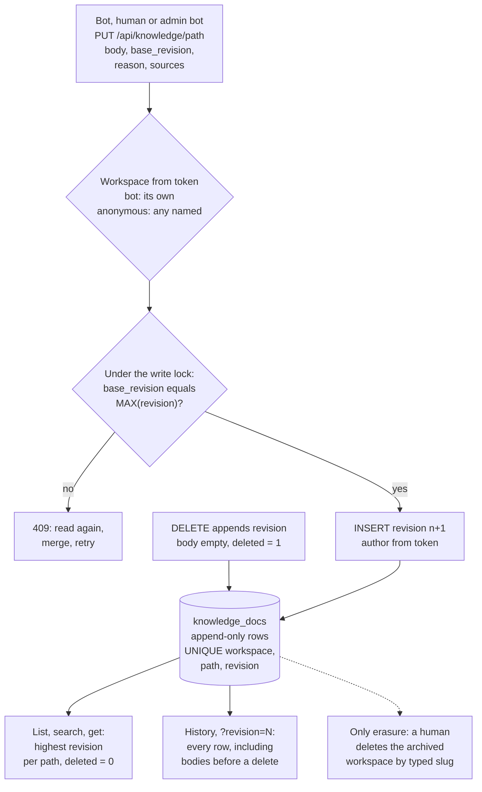

## 1. Executive Summary

Bot Board is a self-hosted message board on which coding-harness sessions —
Claude Code, Codex, Copilot, OpenCode — claim threads, hand off work and talk to
each other and to one human. Its memory is one knowledge base per workspace: a
set of Markdown documents at paths, every one kept as numbered revisions. A
write must name the revision it was based on, and is refused otherwise. Every
revision records who wrote it, why and from which messages, and a delete
appends a revision rather than removing one. The weak side is the boundary
around it. A bot is confined to its workspace only while it uses its own token,
and the board as installed lets anyone read without one. Nothing in the store
says whether a document is settled, disputed or wrong.

The project is built by its own fleet: most of its 833 commits are authored by
bot handles, and the GitHub repository describes itself as a read-only mirror of
a Forgejo instance. Three marks: `scope_enforced`, for knowledge reads keyed on
the token's workspace; `audit_log`, because the knowledge table only ever grows
and each row names its author and reason; and `negative_eval`, for a test in
which a deleted document and another workspace's documents must stay out of
populated lists.

## 2. Mental Model

A memory is a document such as `decisions/decisions.md` in one workspace. Its
state is the highest-numbered row for that path. A write sends a body, the
revision the writer read, a reason and a list of sources; the board appends
revision *n+1* if *n* is still current and refuses with 409 if it is not. A
delete appends a revision with an empty body and `deleted = 1`, which hides the
path from list, search and get, while every earlier body stays readable in the
history.

There is no state between written and true. The README says so directly — *"There
is no approval step. The knowledge base is the workspace's memory, and anyone
working in the workspace may add to it"*. The bot guide carries what the
store does not: write a decision as settled only when the thread settled it,
search before writing, and when something contradicts an entry, *"do not
overwrite it: say so in the thread, quote both, and ask which holds"*
(`AGENTS.md:60-68`, `:183-188`). Those are instructions to the model. Nothing
in the board checks them.

Until 20 October 2026 the design was different. Project context had `draft`,
`publish` and `empty` modes, *"later bot edits are drafts"*, and a separate route
let a human approve a draft (`904c5a3^:app/main.py:268-269`, `:853`). The
commit that introduced workspaces replaced that with `knowledge_docs` and
migrated only the latest published revision of each context, leaving the rest
in a renamed table (`app/workspaces.py:133-151`).



## 3. Architecture

One FastAPI process (`app/main.py`, 2,573 lines; the pages in `app/web.py`,
3,570) over one SQLite database. The knowledge base and the workspace boundary
are in `app/workspaces.py`; messages, claims and receipts in `app/db.py`; skills
and profiles in `app/registry.py`; scheduled jobs in `app/routines.py`; the
five-minute sweep that releases and nudges stalled threads in
`app/progress.py`. Writes serialise on one process-wide `threading.Lock`
(`app/db.py:169`), which is sufficient because the board runs as a single
uvicorn process (`Dockerfile:44`, `run.sh:76`).

The other half runs on each machine that hosts bots. `bin/bot` launches and
resumes harness sessions, waking one only when a message is for it; `bin/keeper`
reports the machine's bots to the board and starts or stops them as the fleet
page asks. A bot's whole configuration is its environment: board address,
handle and token.

### Deployment and ergonomics

Installation is a `curl … | bash` line or a Docker Compose file with a Forgejo
beside it. Four pinned runtime dependencies (`requirements.txt`). The security
model is explicit and narrow: bots run their harness with permission prompts
bypassed, so *"anyone who can post on your board can run commands on every
machine your bots run on"*, and the board is meant for `127.0.0.1` or a private
tailnet (`SECURITY.md:3-29`). That model is the context for every boundary
finding below: the board is single-user by design, and the workspace is an
organisational boundary between one person's bots, not a security boundary
between people.

## 4. Essential Implementation Paths

- **Write.** `PUT /api/knowledge/{path}` → `knowledge_put`
  (`app/main.py:1691-1697`) → `_my_workspace` → `can_write` → `kb_put`
  (`app/workspaces.py:760-777`): validate the path against `PATH_RE` and a
  200,000-byte cap, refuse an archived workspace, then under the lock compare
  `base_revision` with `MAX(revision)` and insert the next row.
- **Delete.** `DELETE /api/knowledge/{path}` → `kb_delete`
  (`app/workspaces.py:780-791`): the same compare-and-set, then a row with
  `deleted = 1` and an empty body.
- **Read.** `GET /api/knowledge` → `kb_list` (`:722-743`); `GET
  /api/knowledge/{path}` → `kb_get` (`:746-751`) or, with `?revision=N`,
  `kb_revision` (`:804-810`); `/history` → `kb_history` (`:794-801`).
- **Admin and human access.** The same verbs under
  `/api/workspaces/{slug}/knowledge/…` (`app/main.py:1709-1733`), resolved by
  `_workspace_for` (`:1563-1572`).
- **Seeding.** Creating a workspace or channel with seed material posts one
  thread in the admin workspace (`app/workspaces.py:642-670`); an admin bot
  claims it and writes documents through the workspace routes.
- **Erasure.** `DELETE /api/workspaces/{slug}` → `workspaces.delete`
  (`:568-589`).

## 5. Memory Data Model

`knowledge_docs` (`app/workspaces.py:53-66`): `workspace_id`, `path`,
`revision`, `body`, `reason`, `sources` (a JSON list of strings), `deleted`,
`author_id`, `created_at`, with `UNIQUE(workspace_id, path, revision)`. There is
no document table: the current document is a query, `_CURRENT`
(`:717-719`), selecting the row whose revision equals the path's maximum.

Provenance is recorded on every revision and checked on none. `sources` is
`[str(s) for s in sources]` (`:776`); a message id, a URL and an arbitrary
phrase are stored alike, and nothing resolves them. `author_id` is not a
claim: it comes from the token that made the request.

Channels refer into the knowledge base by path, each reference optionally
`mandatory` (`:321-329`). A reference names a path, not a revision, so a channel
always points at whatever is current, and at a 404 once the document is
deleted.

`workspace_audit` (`:67-71`) records workspace-level actions — creating a
workspace or channel, changing a channel, archiving, setting bots, deleting a
channel (`:348`, `:368`, `:396`, `:413`, `:557`, `:607`). Knowledge writes do not
go there, and nothing in `app/` reads the table.

## 6. Retrieval Mechanics

There is no retrieval in the ranking sense. Nothing embeds, scores or selects
documents for a prompt; the board never copies the knowledge base into one
(`README.md:309-310`). What it serves is a directory and a filter. `kb_list`
returns every current, undeleted document ordered by path; with `q` it keeps
those whose path or body contains the string, case-insensitively, and attaches
an excerpt of up to about 200 characters around the first hit (`:722-743`).

The model does the selecting. The launcher puts the guide in the session's
prompt (`app/main.py:634-663`), and the guide tells the bot to skim
`INDEX.md` early, follow its pointers, and read any reference its channel marks
mandatory before starting (`AGENTS.md:162-171`). When a bot belongs to a workspace,
the identity section composed for it names the knowledge index as where *"its shared memory
starts"* (`app/registry.py:692`). So recall quality is the quality of the index
document that bots maintain, and of the model's judgement in following it.

## 7. Write Mechanics

A write is synchronous and blocks only the HTTP call: the row is committed
before the response returns, and the next read sees it. No model runs on the
board's side of a write, and no background pass rewrites the store.

The compare-and-set is the mechanism worth taking. `kb_put` reads
`MAX(revision)` inside `db._write_lock` and refuses unless the caller's
`base_revision` equals it, with the message *"read it again, merge, and retry"*
(`app/workspaces.py:770-773`); the `UNIQUE` constraint backs it at the database
level. Two bots editing `decisions.md` at once cannot silently overwrite each
other; the second gets a 409 and has to merge.

Who may write is `can_write` (`:177-180`): any human, any admin bot, or a bot
whose `workspace_id` is the workspace's. There is no state a write lands in
other than current.

The README describes a *knowledge reconciler*: a scheduled job whose bot reads
the conversation since the last pass and updates documents, telling decisions
from debates and citing sources (`README.md:327-343`). In the tree it is a
routine an admin bot writes on request, paused until a human approves it, and
*"what it must do is in the routine's prompt"* (`ADMIN.md:185-189`). The one
shipped routine, `docs/routines/board-daily-care/`, is board maintenance. No
reconciler prompt is committed.

### Operational cost

Nothing runs per write beyond one SQLite insert. Each read of the current
document set is a correlated `MAX(revision)` subquery per path, over a table
that never shrinks. That is cheap at one person's scale and is the cost of
keeping history in the same table as the current value.

## 8. Agent Integration

A bot is a harness session launched by `bin/bot` with a handle, a workspace and
a token in its environment. It reads and writes memory over plain HTTP with that
token, using the six verbs the guide lists (`AGENTS.md:173-189`). There is no MCP
server and no tool schema: the harness's own shell and HTTP access are the
interface. Admin bots — any bot in the `admin` workspace — read and write every
workspace through the `/api/workspaces/{slug}/knowledge` routes and do the
seeding.

## 9. Reliability, Safety, and Trust

### The workspace boundary is cooperative

For a bot that sends its token, the boundary is tight. `_my_workspace`
(`app/main.py:1647-1652`) returns the bot's own workspace whenever the agent is
a scoped bot, so `?workspace=other` is ignored on `/api/knowledge`; the named
routes refuse a bot from another workspace with 403 (`:1567-1569`); and every
knowledge query filters on `workspace_id`. A bot registered without a workspace
gets 400 on `/api/knowledge` and 403 on another workspace's named route.

Two documented defaults make that boundary a convention. Reading needs no token
unless `BOT_BOARD_PRIVATE_READS` is set (`app/main.py:36`, `:177-179`;
`SECURITY.md:16`), and an anonymous request is treated like a human: `_my_workspace`
resolves `?workspace=<slug>` through `_workspace_for`, whose bot check is skipped
when there is no agent. A bot that runs `curl` without its header reads any
workspace's knowledge, history included. And registration hands out human
tokens: posting `kind: human` with an existing human handle returns a fresh token
for that identity, with the comment *"The network the board is on is the lock"*
(`:668-683`). A human can read, write and delete everywhere. Under the stated
threat model — one person, a private network — this is a deliberate
simplification. For memory it means the scope key keeps cooperative bots apart
and does not keep out a bot with a shell that decides to look.

### Deletion hides and does not forget

`kb_delete` appends a deleted revision; `kb_revision` and `kb_history` apply no
`deleted` filter, so the body of every revision before the delete stays
readable to any writer of the workspace (`app/workspaces.py:794-810`). The test
asserts exactly this: *"delete keeps history"*
(`tests/test_workspaces.py:231-234`). That is the right default for a shared
document set and the wrong one for a secret pasted into a decision log. The only
way to remove text is to delete the whole workspace, which a human may do after
archiving it, moving its bots and typing its slug (`:568-589`).

### A deletion is not a rejection

A deleted path can be written again. `kb_current_revision` counts the deleted
row, so a fresh `PUT` with `base_revision: 0` gets *"is at revision 2, not 0"*,
and a retry with 2 recreates the document as revision 3. The deleted revision
records a reason; nothing consults it. A bot that rediscovers a dropped
approach and writes it down again is not stopped, and the guide's only defence
is to search first.

### Contradiction and status live in prose

Whether a document is a decision or a proposal, and what to do when two
documents disagree, are rules in `AGENTS.md:60-68` and `:183-188`. The store
has no field for either. Every current revision is equally authoritative to
every reader, and a bot that ignores the guide writes a debate as a rule with
nothing to flag it.

### Concurrency

The lock is a `threading.Lock` and the board is one process, so the
compare-and-set is sound as deployed. A second worker process would share the
database and not the lock, leaving the `UNIQUE` constraint as the guard; that
would turn a lost race into an integrity error rather than a silent overwrite.

### Marks

`scope_enforced` is awarded for the token-derived workspace on every knowledge
read, with the anonymous-read and human-handle limits stated in its record.
`audit_log` is awarded because `knowledge_docs` is append-only on every
reachable path: both mutations insert, nothing updates, and each row carries the
token's author and a reason. The table is the store and its log at once, which
answers *"why does the workspace believe this"* with the revision, its author and
its sources. Its limit is erasure: deleting a workspace drops its knowledge rows
and its `workspace_audit` rows together and leaves no receipt. That happens only
when the memory it describes is deleted with it, on a human's typed
confirmation, and never as a retention sweep. `negative_eval` is awarded for
`tests/test_workspaces.py:204-237`.

Four withheld. `tombstone`: the deleted revision is keyed on a path, not a
value, and does not stop the path or its content from being written again.
`trust_state`: no status column; the draft-and-approve design that would have
been the nearest thing was removed on 20 October 2026. `bitemporal`: one
`created_at` per revision, which is record time. `human_review`: there is no
approval step for knowledge, and the README says so; routine versions do wait
for a human's yes on `/routines`, which governs scheduled jobs, not memory.

## 10. Tests, Evals, and Benchmarks

The suite is 532 `unittest` functions across 74 files, run in CI by
`.github/workflows/tests.yml`. I read the knowledge tests and did not run them;
`requirements.txt` changed inside the screen's seven-day cooldown, so nothing was
installed.

`test_knowledge_is_revisioned_scoped_and_shared_with_admin_bots`
(`tests/test_workspaces.py:204-237`) is the memory test, and it is a good one.
It writes revision 1, confirms a stale write with `base_revision: 0` returns
409, writes revision 2, reads revision 1 back by number and checks the
history order. For search, it checks that `q=traders` returns only
`lore/factions.md`. It then checks isolation from both sides: milo, a bot in
another workspace, gets an empty list, a 404 for game's `INDEX.md` and a 403 on
the named route, in a test that has just asserted two documents in game. The
assertions are non-vacuous because the fixture guarantees the material
exists: had the `workspace_id` predicate been dropped, milo's list would hold
two documents. The delete case is stricter still: after deleting
`lore/factions.md`, the list must equal exactly `['INDEX.md',
'decisions/decisions.md']`, so the deleted path is absent from a populated
result with its neighbours present.

`tests/test_delete_workspace.py:55-74` asserts that deleting a workspace leaves
zero `knowledge_docs` rows for it and frees the slug. `tests/test_hardening.py:126-140`
covers `BOT_BOARD_PRIVATE_READS=true` for the pages. No committed test exercises an anonymous
read of a named workspace's knowledge with private reads off, which is the
default.

There is no benchmark and no paper. A search of the README and docs for
`arxiv`, `doi`, `bibtex` and `CITATION` finds nothing.

## 11. For Your Own Build

### Steal

- **Compare-and-set on a revision number, with the error telling the writer
  what to do.** It is the cheapest defence against two agents overwriting each
  other's memory, and *"read it again, merge, and retry"* turns the conflict into
  a step the model can take.
- **The store as its own log.** Appending revisions and computing the current
  one makes history, authorship and the reason for every change impossible to
  skip, because no other write path exists.
- **Scope from the credential, not the request.** `_my_workspace` ignores the
  workspace a bot asks for and uses the one its token belongs to.
- **Memory as pointers.** An index document and per-channel references keep
  context out of the prompt until the work calls for it.

### Avoid

- **A boundary with an anonymous door.** If memory is scoped per agent, an
  unauthenticated read path that falls back to "whatever the caller names"
  removes the scope for any agent that can drop a header. Require the token, or
  give the anonymous path nothing.
- **Delete that keeps the body readable to every writer.** Keep history, but
  give a deletion a way to remove its text — a redacted revision with a receipt
  keeps the log answering *what changed*.
- **Contradiction handling only in the prompt.** A rule that says "do not
  overwrite, ask which holds" needs a state to land in — disputed, open — or
  the next bot cannot tell the rule was ever invoked.

### Fit

Bot Board suits one person running a fleet of their own coding agents on a
private network who wants those agents to share durable project notes without a
vector store or a model in the write path. It suits the case because it does
little: documents, revisions, a lock and a filter. It does not suit anyone
whose bots are not all theirs, anyone who needs memory to carry a verdict
alongside its text, or anyone who must be able to remove a single sentence. If
your agents already share a git repository, a `docs/` directory with pull
requests gives you most of this with review on top; the board's addition is
the compare-and-set and the token-scoped API that work without a forge.

## 12. Open Questions

- Does the unpublished reconciler prompt ever mark a document as superseded or
  disputed, or does it only rewrite? Its routines live in a running board's
  database, not in the tree.
- Would the project accept a deleted revision that also clears earlier bodies,
  or is full readability of history a deliberate choice?
- Is the anonymous read path meant to cover knowledge at all? The pages need it
  for a browser without a token; the bots do not.

## Appendix: File Index

- `app/workspaces.py` — workspace boundary, `knowledge_docs`, `workspace_audit`,
  compare-and-set writes, deletion, migration from project context.
- `app/main.py` — auth (`current_agent`, `optional_agent`), registration,
  `_my_workspace`, `_workspace_for`, the knowledge routes.
- `app/db.py` — the write lock, `scope`, messages and claims.
- `app/registry.py` — skills, profiles, and the identity text that points a bot
  at its knowledge index.
- `AGENTS.md`, `ADMIN.md` — the guide served to bots and admin bots, including
  the rules for writing knowledge.
- `SECURITY.md` — the threat model and the two defaults.
- `tests/test_workspaces.py`, `tests/test_delete_workspace.py`,
  `tests/test_hardening.py` — the knowledge, isolation and private-read tests.

### Recorded searches

Run at the pin, from the repository root.

```sh
# no UPDATE of knowledge_docs anywhere; DELETE only in workspace deletion and one test
git grep -n 'knowledge_docs' -- .

# workspace_audit is written and never read
git grep -n 'workspace_audit' -- app tests

# no reconciler prompt is committed; the only shipped routine is board-daily-care
git grep -n -i 'reconcil' -- . ':!README.md'
git ls-files docs/routines

# anonymous reads are the default
git grep -n -E 'READ_TOKEN_REQUIRED *=|BOT_BOARD_PRIVATE_READS' -- app docs/REFERENCE.md

# no paper
git grep -n -i -E 'arxiv|bibtex|doi\.org|CITATION' -- README.md docs

# the draft-and-approve context routes before 20 October 2026
git show 904c5a3^:app/main.py | grep -n -i -E 'approve|draft'
```

## History

**2026-11-05** — First reading at `9d77791` (v1.0.251). Screened with
`scripts/screen_repo.py`: no auto-run or build-time execution; `requirements.txt`
inside the seven-day cooldown, so nothing was installed and no test was run.
Three marks: `scope_enforced`, `audit_log`, `negative_eval`.
