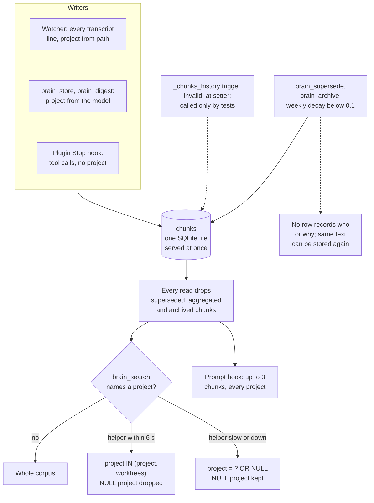

## 1. Executive Summary

BrainLayer is a local memory layer for Claude Code and other MCP clients.
A Python package indexes every Claude Code, Codex and T3 transcript line into
one SQLite file with FTS5, sqlite-vec vectors and a knowledge graph. BrainBar,
a macOS Swift menu-bar app with a headless daemon, is the only MCP server and
writes the same file. What is notable is the project scope on search: a stored
key in SQL on both arms, with a role policy tested against exact populated
sets. What is weak is correction, a pointer on a row that nothing records, and
a search whose treatment of chunks with no project depends on which of two
code paths answered.

Most of what the store holds is transcript, not curated memory. The watcher
ingests every message of every session under `~/.claude/projects/`. Agent
notes through `brain_store` are a small share. The README describes a live
database of about 360,000 chunks; that is the author's install, read as a
claim.

The schema carries more than the code wires. `chunks` has `valid_from`,
`invalid_at` and `sys_period_start`/`_end`, and `bitemporal.py` defines a
trigger-kept `_chunks_history` table; the only callers of its migration are
tests. `epistemic_level` has no filtering reader and `user_verified` no
producer of 1.

Two marks: `scope_enforced` and `negative_eval`. Section 9 gives the reasons
for the five withheld.

## 2. Mental Model

A memory is **a chunk**: a transcript message, a tool observation, a note an
agent stored, or a digested document. It is served from the moment it is
written. There is no candidate or pending state.

A chunk leaves default retrieval in three ways, each a column rather than a
status:

- **Superseded.** `brain_supersede` sets `superseded_by` to a newer chunk's id
  and `status = 'superseded'`
  (`brain-bar/Sources/BrainBar/BrainDatabase.swift:6052-6064`).
- **Aggregated.** Write-time de-duplication folds a loser into a survivor
  through `aggregated_into`.
- **Archived.** `brain_archive` stamps `archived_at`
  (`BrainDatabase.swift:6034-6050`), and the weekly decay job stamps it on any
  chunk whose score falls below 0.1 (`src/brainlayer/decay_job.py:10`,
  `:117-127`).

Every read path drops all three through one predicate
(`src/brainlayer/archive_lifecycle.py:10-17`), and `include_archived` brings
them back. Nothing records who moved a chunk or why: the archive reason is
accepted and discarded (`BrainDatabase.swift:6035-6036`). The text survives,
so the same claim stored again, or said again in a transcript, is a new active
chunk.

Two signals look like belief and are not. Chunks tagged `quarantine` are
multiplied by 0.05 and still returned (`src/brainlayer/search_repo.py:82`,
`:2629-2633`). Chunks from desktop apps and agents' thinking are stored and
kept out of default search by `source_class`, a provenance rule rather than a
judgement of truth.

## 3. Architecture

Four kinds of process share the database file:

- **BrainBar** (`brain-bar/`, Swift 6, macOS 14 and later). Two executables
  from one package: `BrainBar`, the menu-bar UI, and `BrainBarDaemon`, which
  owns the MCP server on `/tmp/brainbar.sock`, a single writer queue and a
  pub/sub stream (`brain-bar/Package.swift`). Fifty-eight of the daemon's
  source files are symlinks to the app's.
- **The hybrid search helper**, a long-lived Python subprocess
  (`python -m brainlayer.brainbar_hybrid_helper`) that BrainBar starts and asks
  for every eligible `brain_search`
  (`brain-bar/Sources/BrainBar/HybridSearchHelperClient.swift:289`). It holds
  the embedding model.
- **launchd agents** rendered from `scripts/launchd/`: the watcher, a drain
  that writes queued rows every 500 ms, an embedding hot lane, decay,
  maintenance, FTS repair, WAL checkpoints, watchdogs and backups.
- **Claude Code hooks**, Python scripts under `hooks/` wired into
  `~/.claude/settings.json`, and a plugin under
  `extensions/brainlayer-plugin/` whose hooks call BrainBar through `socat`.

Vectors are `BAAI/bge-large-en-v1.5`, 1024 dimensions, computed locally
(`src/brainlayer/embeddings.py:25`) and stored as float and binary `vec0`
tables (`src/brainlayer/vector_store.py:1174-1192`). LLM enrichment, which
filled summaries and `epistemic_level` with Gemini, is retired; its columns
remain.

### Deployment and ergonomics

Storing and searching need no API key and no network once the model is
cached. The MCP server needs macOS: the PyPI package's only MCP entry point is
`brainlayer-mcp-stdio-bridge`, which connects to BrainBar's socket
(`pyproject.toml`, `server.json`), and the README directs MCP clients to a
Homebrew keg path. On Linux the CLI, watcher and search run without an agent
surface. A full install is a Homebrew keg, `bash brain-bar/build-app.sh`, which
builds, signs and installs two LaunchAgents, and `brainlayer setup --launchd`
for the rest. The store is a SQLite file and inspectable by hand.

The 1.3 GB checkout is 545 MB of `.git` and 768.6 MB of tracked files. Code is
a small part: 14.1 MB of Python and 5.4 MB of Swift. `brain-bar/docs/ui-renders`
holds 261 PNG screenshots of the menu-bar UI, 2.4 MB each on average and 625 MB
in all, and `tests/fixtures/observability/db/` holds 89.5 MB of SQLite
fixtures, fifteen of them the same 5.2 MB blob.

## 4. Essential Implementation Paths

- **Schema.** `src/brainlayer/vector_store.py`: `chunks` `:899-928`, added
  columns from `:955`, vectors `:1174-1192`, FTS tables and triggers from
  `:1235`, `chunk_events` `:1719-1731`, KG tables `:1767-1910`. BrainBar
  creates `chunks` if absent (`brain-bar/Sources/BrainBar/BrainDatabase.swift:1055`).
- **MCP write.** `brain-bar/Sources/BrainBar/MCPRouter.swift`: dispatch
  `:824-860`, `handleBrainStore` `:1158-1269`; `BrainDatabase.store`
  `:1702-1841`, exact-content reuse `storedChunk` `:5199-5248`.
- **Transcript write.** `src/brainlayer/watcher.py` tails files;
  `src/brainlayer/watcher_bridge.py:333-351` derives the project from the path;
  `src/brainlayer/drain.py` writes; `src/brainlayer/chunk_write.py:309-314`
  fills `valid_from` and `sys_period_*` from the insert time.
- **Search.** `handleBrainSearch` `MCPRouter.swift:863-1022`, helper arguments
  `:1123-1150`; `BrainDatabase.search` `:1508-1595`, `runFTSSearch`
  `:1598-1695`, `searchableChunkWhereClause` `:2685-2717`;
  `src/brainlayer/brainbar_hybrid_helper.py:404-438`;
  `src/brainlayer/mcp/search_handler.py:922-980`;
  `src/brainlayer/search_repo.py`: `search` `:1158`, `hybrid_search` `:1877`,
  project clause `:464-478`.
- **Scope policy.** `src/brainlayer/scoping.py:151-279`.
- **Lifecycle.** `MCPRouter.swift:1656-1721`;
  `BrainDatabase.swift:6034-6064`; Python twins at
  `src/brainlayer/vector_store.py:3025`, `:3045-3060`;
  `src/brainlayer/decay_job.py:29-155`.
- **Injection.** `hooks/brainlayer-prompt-search.py:990-1125`, `:1344`;
  `hooks/brainlayer-session-start.py:241-310`;
  `extensions/brainlayer-plugin/scripts/brainbar-hook.py:141-240`.
- **Unwired history.** `src/brainlayer/bitemporal.py:104-183`.

## 5. Memory Data Model

`chunks` carries the content and around seventy columns. The ones that decide
behaviour: `project`, `source`, `source_class`, `content_type`, `tags`,
`importance`, `conversation_id`, `content_hash` and `dedupe_hash`, the three
lifecycle columns, `status` (`active` or `superseded`), and `decay_score`,
`half_life_days`, `retrieval_count`, `last_retrieved` and `pinned` for decay.

**Time.** `created_at` is the insert time. `valid_from` defaults to
`created_at` and `sys_period_start` to now (`chunk_write.py:309-314`;
`src/brainlayer/store.py:328-331`). `invalid_at` has one setter,
`bitemporal.supersede_chunk` (`src/brainlayer/bitemporal.py:164-183`), with
no caller outside tests. The read paths filter `invalid_at IS NULL`
(`search_repo.py:510-512`), which every row passes. KG entities and relations
carry `valid_from`, `valid_until` and `expired_at`, and no caller passes
`valid_from` or `valid_until` to `add_relation`.

**Scope.** One key, `project`, nullable. Watcher rows take it from the
transcript path. MCP rows take it from the model's argument. Plugin
observations have none, because the hook sends the working directory as
`context`, which `brain_store` does not read
(`extensions/brainlayer-plugin/scripts/brainbar-hook.py:180-196`).

**Provenance.** BrainBar stamps every MCP write `chunk_origin = 'user_explicit'`,
`content_type = 'user_message'` and `source = 'mcp'`
(`BrainDatabase.swift:1740-1743`). That covers a note the agent chose to store
and a tool call the plugin captured. `caller_model` is the caller's own claim,
kept in metadata.

**Declared without effect.** `epistemic_level` (`hypothesis`, `substantiated`,
`validated`) was filled by the retired enrichment and no search reads it.
`user_verified` on KG entities is read by the entity cache and KG cleanup, and
nothing in the tree sets it to 1.

## 6. Retrieval Mechanics

`brain_search` first checks whether the query is a chunk id. Otherwise
BrainBar sends it to the helper unless the call names `agent_id`,
`unread_only` or the unadvertised `include_hidden_source_classes`
(`MCPRouter.swift:954`). It passes `consumer: orchestrator` when no project is
named and `worker` when one is (`:1140`).

**The helper path.** `hybrid_search` runs a vector arm, binary first with a
float rerank, and an FTS5 arm, fuses them by reciprocal rank, and applies
importance, recency, KG-link (×1.3) and agent-profile boosts. Quarantine and
pre-compact signals are multiplied by 0.05, then MMR removes near-duplicates
(`search_repo.py:2580-2640`). The worker scope appends `c.project IN (...)` to
both arms and leaves NULL-project chunks out (`:464-478`, `:1209-1212`).
Results are cached for 60 s, keyed on the reader's connection state so a write
from another process invalidates them (`:40`, `:1979-1994`).

**The fallback.** When the helper is not ready, busy, past its 6 s budget or
empty, BrainBar answers itself with FTS5 BM25 and then trigram FTS
(`BrainDatabase.swift:1508-1595`). Its project clause is
`(c.project = ? OR c.project IS NULL)` (`:1623`). The two are tested apart:
`testProjectScopedSearchIncludesGlobalChunks` requires a NULL-project chunk in
a project-scoped fallback search
(`brain-bar/Tests/BrainBarTests/DatabaseTests.swift:1079-1094`), and
`test_worker_consumer_scope_closes_null_project_fts_only_leak` requires the
helper to drop one (`tests/test_consumer_scoping.py:374-391`). Every plugin
tool observation has a NULL project, so it reaches a scoped search only when
the helper was too slow.

**Automatic injection.** The prompt hook runs on every user prompt with a
450 ms deadline. It embeds the prompt, searches vectors and FTS with no project
filter beyond excluding `eval-sandbox`, and injects up to three chunks within
600 characters (`hooks/brainlayer-prompt-search.py:79`, `:948`, `:990-1050`, `:1287`).
The session-start hook searches by the working directory's name as an FTS term
across all projects unless `~/.golems/config.yaml` marks the project as scoped
(`hooks/brainlayer-session-start.py:263-302`); its alias tables name the
author's own repositories (`:69-101`). The plugin's session-start hook recalls
by session id, which a new session has nothing under.

## 7. Write Mechanics

**Agent notes.** `brain_store` scrubs secrets from content, tags and metadata
before anything is derived (`BrainDatabase.swift:1724-1731`), then inserts.
The only de-duplication is exact content within the same project, content type
and server-assigned conversation, returned as `DUPLICATE` (`:5199-5248`). A
busy database queues the write to a file and answers `DEFERRED`. The tool
description lists `MERGED` as an outcome; only the Python handler, which no
agent reaches, produces it.

**Transcripts.** The watcher polls `~/.claude/projects/` at 30 s or more,
applies content filters and a path denylist, and queues rows for the drain.
De-duplication in `src/brainlayer/dedupe.py` folds near-copies and records each
merge in `dedupe_audit` (`:259-266`, `:635-655`).

**Tool observations.** The plugin's PostToolUse hook appends each non-BrainLayer
tool call, input and response, to a JSONL queue, and the Stop hook stores each
through `brain_store` at importance 5, or 8 for a failure
(`brainbar-hook.py:141-200`). It then calls `brain_sleep`, which BrainBar
does not serve; the hook reports it unavailable.

**Correction.** The agent stores the new chunk and calls `brain_supersede` with
both ids. For an old chunk of type journal, note or bookmark, or containing one
of seven keywords, the tool asks for `safety_check: "confirm"` and
`confirm: true` from the same caller (`MCPRouter.swift:1674-1692`,
`:1750-1759`). Neither supersede nor archive checks the chunk's project.

### Operational cost

An MCP write blocks on one SQLite insert and returns; FTS triggers make it
searchable by text at once. Its vector waits for the hot-lane job, a
`KeepAlive` process with no stated lag. Transcript lines lag by the poll
interval plus the drain. The decay job walks every unarchived chunk each
Sunday at 04:15 (`scripts/launchd/com.brainlayer.decay.plist`), arithmetic
only. Injection costs at most 600 characters per prompt, placed in the user
turn, so it does not touch the system-prompt prefix.

## 8. Agent Integration

BrainBar defines 16 tools with MCP tool annotations. A session starts with
five, `brain_search`, `brain_store`, `brain_recall`, `brain_expand` and
`expand_palette`, and calling a gated tool before expanding returns an error
saying so. `brain_ack` is advertised and throws `notImplemented`
(`MCPRouter.swift:1740-1748`). `brain_recall` serves stats, one session's
chunks or injection events, and names any other mode as unimplemented
(`:1494-1533`).

The model drives every memory verb: store, digest, update, supersede and
archive, and two maintenance tools that write a backup to a path it names or
rebuild the trigram index. The Python package keeps a second palette of
handlers under `src/brainlayer/mcp/` with legacy `brainlayer_*` names; its
module docstring calls it library-only, and no entry point serves it.

## 9. Reliability, Safety, and Trust

**Scope is enforced on the tool path and not on the automatic one.** The
watcher's project is derived, and the model's is a string it may omit or
choose. Hooks inject from every project. Supersede and archive take any id.

**Writes are trusted on arrival.** Nothing distinguishes a tool response the
plugin captured from an instruction the user gave: both become
`user_explicit` `user_message` chunks, and a prompt-injected line in a tool
response is a chunk the next prompt hook may inject. The secret scrubber is
the one filter on content.

**Four records each cover one kind of change, and none covers correction.**
`chunk_events` is written only by the Python digest pipeline with a fixed
`by_whom` (`src/brainlayer/pipeline/digest.py:317-330`), which BrainBar's own
`brain_digest` does not call. `dedupe_audit` records merges. `kg_cleanup_log`
records a KG cleanup run (`src/brainlayer/kg_cleanup.py:79`).
`_chunks_history`, a full row image per update and delete kept by trigger,
would cover all of it, and `apply_bitemporal_migration` has no caller outside
tests (`src/brainlayer/bitemporal.py:131-161`).

**KG review.** `kg_review_session.py` and `scripts/kg_cleanup_apply.py` let a
person decide merge or keep for flagged duplicate entities, by dashboard or
voice, and apply the decisions with a rollback log. The flagged entities are
live meanwhile, and it covers the graph, not chunks.

### Marks

- **`scope_enforced` — earned.** `project` is stored on each chunk and applied
  in SQL on both arms of the helper and on the fallback, when the caller names
  it.
- **`negative_eval` — earned.** Three populated tests require a foreign-project
  or superseded chunk absent with a positive control present (section 10).
- **`trust_state` — withheld.** `status` holds `active` or `superseded`, a
  lifecycle pointer. Quarantine is a ranking factor, `epistemic_level` is read
  by no search, and `user_verified` has no producer of 1.
- **`audit_log` — withheld.** No append-only record covers supersede, archive,
  update or MCP writes; the history trigger that would is unwired.
- **`bitemporal` — withheld.** `valid_from` defaults to the insert time and no
  caller passes another; `invalid_at` is set only in tests.
- **`tombstone` — withheld.** `tag_tombstones` holds tag names and the
  watcher's tombstones hold file offsets. A superseded text stored again is a
  new active chunk.
- **`human_review` — withheld.** Every chunk is served at once, the
  supersede confirmation is a flag the caller sets, and KG review acts on live
  entities after the fact.

## 10. Tests, Evals, and Benchmarks

I ran none of the suites; counts are from `git grep`. The README badge says
4,386 Python and 890 Swift tests. CI runs the Python suite on Ubuntu with
`-m "not integration and not live and not crash_sweep"`, a doctor fixture gate
and hook routing tests, the Swift suite on macOS 15 only when `brain-bar/`
changes, and TLA+ model checks of the backup verdict and ingest coverage
(`.github/workflows/ci.yml`). A committed pre-push hook runs
`scripts/run_tests.sh` once `core.hooksPath` points at `.githooks`.

The negative cases that carry the mark:

- `test_worker_worktree_consumer_scope_includes_worktree_and_main_only` writes
  one sentence under five projects into a real `VectorStore` and requires the
  worker's hybrid search to return exactly the two allowed ids
  (`tests/test_consumer_scoping.py:343-371`).
- `test_superseded_excluded_from_text_search` requires the superseded chunk
  absent and its replacement present (`tests/test_chunk_lifecycle.py:175-183`).
- `testSearchFiltersByProject` requires one `alpha` result where a `beta` chunk
  also matches (`DatabaseTests.swift:1682-1688`).

`test_worker_consumer_scope_blocks_foreign_and_null_projects_across_rrf`
asserts only absences and a subset, which an empty result passes
(`tests/test_consumer_scoping.py:264-297`), and the NULL-project FTS case
asserts an empty list. Neither carries the mark.

`tests/test_bitemporal_phase1.py` installs the history trigger itself, so the
history it checks is one no production database has. No test drives
`brain_store` from the plugin and then a scoped search.

There is no retrieval benchmark with committed results named in the README,
and no paper. `src/brainlayer/eval/` scores the retired enrichment.

## 11. For Your Own Build

### Steal

- **A role policy that fails closed.** An unknown or missing consumer role
  becomes `worker`, and a worker with no project gets `0 = 1`
  (`scoping.py:163-178`, `:243-253`, `search_repo.py:468-469`).
- **One lifecycle predicate, imported everywhere.** `archive_lifecycle.py` is
  the single definition the helper, the hooks and de-duplication import, and
  the Swift `searchableChunkWhereClause` repeats it.
- **Scrub before deriving.** Secrets leave the text before the row, its FTS
  copies, the preview and the content hash are computed, so de-duplication keys
  on what is stored.
- **Name each write outcome.** `STORED`, `DUPLICATE` and `DEFERRED` tell the
  agent whether to retry, and a committed row is never reported as failed.

### Avoid

- **Two read paths with two scope rules.** A fallback that widens scope
  makes the leak depend on latency. Share the predicate, or fail the search.
- **Schema ahead of producers.** Columns named for validity time and a
  history trigger that only tests install read as bitemporal and audited to
  anyone who opens the database.
- **Capturing tool output as the user's word.** A hook-captured response
  stamped `user_explicit` loses the one distinction an injection defence needs.
- **Shipping UI renders in the source tree.** 625 MB of screenshots make
  every clone of a memory library a 1.3 GB download.

### Fit

This is one developer's working memory system, built around his Mac, his
repositories and his launchd jobs, and it is unusually instrumented for that:
watchdogs, model-checked backup rules, a pre-push gate. It suits a reader on
macOS who wants every Claude Code session indexed and searchable, and who will
run a dozen background agents to have it.

It does not suit a reader who needs memory to be corrected and to stay
corrected, to know who changed it, or to run an agent surface off macOS.
Someone who wants a small curated store should take the scope policy and leave
the rest.

## 12. Open Questions

- Is `apply_bitemporal_migration` run against live databases by a script or
  hand step outside this tree? Nothing inside it calls it.
- What lag does the hot lane add before a BrainBar write is searchable by
  vector?
- How often does the helper miss its 6 s budget in practice, and so how often
  does a scoped search return NULL-project chunks?
- Is the plugin's `context` argument meant to become a project? BrainBar
  ignores it.

## Appendix: File Index

| Path | Role |
| --- | --- |
| `src/brainlayer/vector_store.py` | Schema, migrations, Python supersede and archive, `record_event` |
| `src/brainlayer/search_repo.py` | `search`, `hybrid_search`, project and lifecycle clauses, cache |
| `src/brainlayer/scoping.py` | Consumer roles and project sets |
| `src/brainlayer/brainbar_hybrid_helper.py` | The helper BrainBar calls for search |
| `src/brainlayer/bitemporal.py` | History table, triggers and `invalid_at` setter, unwired |
| `src/brainlayer/chunk_write.py` | Row preparation, `valid_from` default |
| `src/brainlayer/decay_job.py` | Weekly decay and auto-archive |
| `src/brainlayer/dedupe.py` | Write-time de-duplication and `dedupe_audit` |
| `brain-bar/Sources/BrainBar/MCPRouter.swift` | The 16 MCP tools |
| `brain-bar/Sources/BrainBar/BrainDatabase.swift` | Swift store, fallback search, supersede, archive |
| `hooks/brainlayer-prompt-search.py` | Per-prompt injection |
| `hooks/brainlayer-session-start.py` | Session-start injection |
| `extensions/brainlayer-plugin/scripts/brainbar-hook.py` | Plugin capture and recall |
| `tests/test_consumer_scoping.py` | Scope tests |
| `tests/test_chunk_lifecycle.py` | Lifecycle tests |
| `brain-bar/Tests/BrainBarTests/DatabaseTests.swift` | Swift search tests |

### Recorded searches

Run from the repository root at the pinned commit with `/usr/bin/git grep`.

- **The history migration has no production caller.**
  `git grep -n 'apply_bitemporal_migration' -- . ':!*.md'` returns its
  definition at `src/brainlayer/bitemporal.py:131`, a list entry in
  `scripts/prepush_unmapped_legacy.json` and test files only.
- **No code outside `bitemporal.py` creates the history table or trigger.**
  `git grep -n -E '_chunks_history|chunks_bitemporal_update' -- src brain-bar/Sources hooks scripts ':!*.md'`
  returns `bitemporal.py` and three reads in `scrub_at_rest.py`.
- **One setter for `invalid_at`.**
  `git grep -n -E 'SET invalid_at|invalid_at = COALESCE' -- src brain-bar/Sources hooks scripts`
  returns `bitemporal.py:174`.
- **No caller states a validity time.**
  `git grep -n -E '(valid_from|valid_until)=' -- src scripts hooks` returns
  nothing; `git grep -n -E 'importance=' -- src/brainlayer/pipeline/digest.py`
  matches.
- **One producer of `chunk_events`, and none in BrainBar.**
  `git grep -n 'record_event(' -- src scripts hooks brain-bar/Sources` returns
  `pipeline/digest.py:325` and the definition;
  `git grep -n 'chunk_events' -- brain-bar` returns nothing, while
  `git grep -n 'injection_events' -- brain-bar/Sources/BrainBar/BrainDatabase.swift`
  matches.
- **Nothing sets `user_verified` to 1.**
  `git grep -n -E 'user_verified[^,]{0,6}(1|True|true)' -- . ':!tests' ':!*.md'`
  returns three comparisons in the KG cleanup scripts and one in
  `src/brainlayer/kg_cleanup.py:49`.
- **No search reads `epistemic_level`.**
  `git grep -n 'epistemic_level' -- src/brainlayer/search_repo.py src/brainlayer/mcp/search_handler.py brain-bar/Sources/BrainBar hooks`
  returns nothing; `git grep -n 'archived_at IS NULL' -- src/brainlayer/search_repo.py`
  matches.
- **No value-keyed tombstone.**
  `git grep -n -i -E 'tombstone|rejected_value|do_not_remember|never_store' -- src brain-bar/Sources hooks`
  returns `tag_tombstones` in `tag_normalization.py` and file-offset
  tombstones in `watcher.py`.
- **BrainBar does not serve `brain_sleep`.**
  `git grep -n 'brain_sleep' -- brain-bar/Sources` returns nothing;
  `git grep -n '"brain_ack"' -- brain-bar/Sources/BrainBar/MCPRouter.swift`
  matches.
- **BrainBar never reports `MERGED`.**
  `git grep -n -E 'outcome: \.' -- brain-bar/Sources/BrainBar` returns one
  line, `.duplicate` at `BrainDatabase.swift:5241`.
- **No paper.** `git grep -n -i -E 'arxiv|bibtex|doi\.org|CITATION' -- .`
  returns citations of other papers in `docs/archive/` only, and no
  `CITATION` file is tracked.

## History

**2026-11-25** — [`3e25ceeef6496cd39ae2eb269d35824cc4fd9e90`](https://github.com/EtanHey/brainlayer/commit/3e25ceeef6496cd39ae2eb269d35824cc4fd9e90). First reading, at the head of `main` (v1.6.12); triage selected `983d28262294`, an earlier commit. The clone was shallow because the repository is about 716 MB packed, so commit counts, dates and authors come from the GitHub API. No submodules. Screened first: eight auto-run surfaces (marketplace and plugin manifests, plugin `.mcp.json` and hooks, `hooks/`, `server.json`, a committed `.githooks/pre-push`), three manifests inside the cooldown, four build-time execution points and two unpinned surfaces; a SwiftPM build-tool plugin also runs a script at build. Docs read as data. Nothing installed, built or run; test counts not run. Two marks: `scope_enforced`, `negative_eval` ([section 9](#9-reliability-safety-and-trust)).
