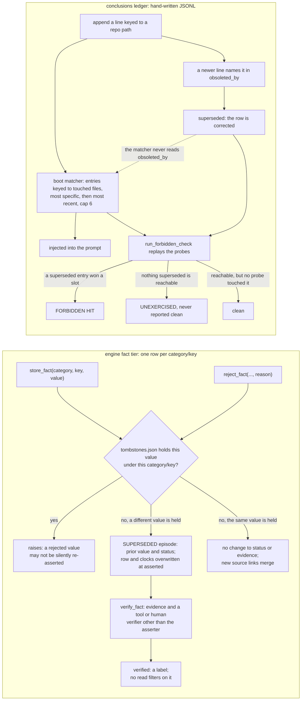

## 1. Executive Summary

breadcrumbs is a **copy-and-adapt kit**, not a library you install. Most of its
files are markdown: templates for a rules file, a
session handoff, a decisions ledger and a settled-facts store; a CI kit of lint
guards and a fail-closed merge gate; pattern essays explaining each piece. MIT
licensed, no package manifest, no dependencies — every executable here is
stdlib Python 3 or POSIX shell. There being nothing to install is a stated
position rather than an omission: [`kit.json`](https://github.com/The-825/breadcrumbs/blob/f07fbd51cbe22321005bdcbd05e48582281bf7ec/kit.json)
argues that *"a package would make our release cadence your dependency and fight
the adapt step"*, and offers a machine-readable inventory instead — sixteen
problem statements routed to artifacts, and per-artifact `assumes` and
`selftest` fields.

Two clusters of those files are a memory system, and they are the reason for
this report. The **ledger tools**, which is where the correction machinery
lives:

- [`templates/ledger-tools/memory_engine.py`](https://github.com/The-825/breadcrumbs/blob/f07fbd51cbe22321005bdcbd05e48582281bf7ec/templates/ledger-tools/memory_engine.py)
  — 1,101 lines of three-tier file-native memory (working state, append-only
  episodes, semantic facts) for an agent loop you write yourself, carrying a
  rejected-value tombstone and an as-of replay.
- [`templates/ledger-tools/conclusions_audit.py`](https://github.com/The-825/breadcrumbs/blob/f07fbd51cbe22321005bdcbd05e48582281bf7ec/templates/ledger-tools/conclusions_audit.py)
  — asks whether every ledger entry is still **true**.
- [`templates/ledger-tools/retrieval_exam.py`](https://github.com/The-825/breadcrumbs/blob/f07fbd51cbe22321005bdcbd05e48582281bf7ec/templates/ledger-tools/retrieval_exam.py)
  — 1017 lines asking whether any entry can ever be **seen**.
- [`templates/ledger-tools/capture_nudge.py`](https://github.com/The-825/breadcrumbs/blob/f07fbd51cbe22321005bdcbd05e48582281bf7ec/templates/ledger-tools/capture_nudge.py)
  — a prompt hook that fires when the operator's own wording looks like a
  ruling.

And the **memory desk**
([`templates/memory-desk/`](https://github.com/The-825/breadcrumbs/tree/f07fbd51cbe22321005bdcbd05e48582281bf7ec/templates/memory-desk)),
a second and separate store built for the read side: a kernel capped at 60 lines, a
tab-separated fact index, an append-only capture journal, a file of retired
answers, a 536-line `mem` CLI,
three harness hooks that push rows into context, and a written weekly curation
contract. Section 6 covers why it exists; the short version is in its own
essay, which designs *"for the weakest reader on their worst day"* and moves
every judgement call out of retrieval and into maintenance.

**The finding worth the reader's time is `run_forbidden_check()`**, landed in
[PR #22](https://github.com/The-825/breadcrumbs/pull/22) on 9 August 2026, five
days after the repository's first commit. It takes the entries marked
`obsoleted_by`, replays the boot
matcher against simulated session-start conditions, and names any superseded
entry that still wins a slot. The docstring states the argument: *"Correction
that stops at the ledger row and never reaches the retrieval lane is not
correction; the descent has to complete."* Several systems here test that a
corrected value stays out of a *query result* — [Verel](../verel/)'s suite
asserts a rejected fact is *"invisible to EVERY recall path"*. This one tests
the other read surface: the ranked, capped packet a session is handed **before
it asks anything**, where an entry can be missed by losing a tie-break rather
than by failing a filter. And the could-not-run case is a named verdict in the
tool's own output (`UNEXERCISED`) rather than a property of a fixture, so a
superseded entry nothing in the tree can reach never reads as clean. One that
is reachable but touched by no probe does report clean, which makes the probe
set the coverage claim.

Two more things are unusually well judged. The exam's **survey mode**
(`--survey`) needs no ledger and no adoption at all: it walks a repo's markdown,
computes link distance from the boot surface (`CLAUDE.md`, `AGENTS.md`,
`GEMINI.md`, `README.md`, `.cursorrules`, `.github/copilot-instructions.md`), and reports
the *orphan* — a document nothing links, which a session never opens on its
own. And `memory_engine.verify_fact()` raises rather than writes unless it is
handed evidence and a named verifier of `tool` or `human` authority other than
the actor that asserted the fact, which is the shortest possible statement of
oracle-gated trust.

Five of the seven marks hold. `trust_state` is withheld: the `asserted` /
`verified` field is real and its promotion is gated, but `build_context()`
renders every fact whatever its status and no read in the tree filters on it,
so the state is a label rather than a withholding (section 9). `bitemporal` is
withheld too: the engine stamps learned-at and valid-at separately on a fact,
but one key holds one row and a correction overwrites it, clocks included, so
no replay can return the value the store believed before it was corrected
(section 5).

**Where it is weakest is the distance between the prose and the tree.**
[`docs/floating-memory.md`](https://github.com/The-825/breadcrumbs/blob/f07fbd51cbe22321005bdcbd05e48582281bf7ec/docs/floating-memory.md)
describes a production memory layer in detail — an orphan git branch, a capped
head file, per-session append-only fold files, a projection computed at read
time, a trust rank, a reaper that greps merged history to check a fold's own
claim, an orphaned-branch matcher, a mishandled-claim SLA. None of that is in
this repository: in the `.py` and `.sh` files `fold` occurs as a whole word
nowhere, `reaper` nowhere, and `projection` only in unrelated catalog and
lineage code. What ships is the smaller kit; what is described is the system
the kit was extracted from.

The essay itself says so, in a bolded paragraph before its first section: the
fleet machinery *"runs in the system this pattern came out of and does NOT ship
in this kit"*, followed by a link to the ledger tools a reader can copy today.
That is a rule rather than a habit — D-16 requires every doc describing a
mechanism to state in its header whether it ships, and fifteen docs under
`docs/` say in so many words that something they describe does not ship.
[`docs/breadcrumbs-whitepaper.md`](https://github.com/The-825/breadcrumbs/blob/f07fbd51cbe22321005bdcbd05e48582281bf7ec/docs/breadcrumbs-whitepaper.md)
is the exception: it presents five mechanisms as the system with no such
statement, and two of them have no code path in the tree: the recorder that
refuses a completion claim while obligations dangle (3.2), and the versioned handoff where a session acknowledges the state
version it booted on (3.4).

## 2. Mental Model

A memory here is **one line of JSON keyed to a repo path**. The schema is in
[`templates/CONCLUSIONS_TEMPLATE.md`](https://github.com/The-825/breadcrumbs/blob/f07fbd51cbe22321005bdcbd05e48582281bf7ec/templates/CONCLUSIONS_TEMPLATE.md):
`path`, `when`, `what` (one sentence, the durable fact), `evidence` (a PR
number, a commit SHA, a doc pointer), with optional `tags`, `relates_to`,
`obsoleted_by`, `supersedes`, and three provenance fields from
[`PROVENANCE.md`](https://github.com/The-825/breadcrumbs/blob/f07fbd51cbe22321005bdcbd05e48582281bf7ec/templates/ledger-tools/PROVENANCE.md)
— `src` (how it got into the ledger), `verified` (last checked against
reality), `by` (which surface wrote it, *"never a model identifier"*).

Nothing is extracted. A session writes a line because a human or the session
decided a fact would cost real time to re-derive. There is no embedding, no
consolidation pass, no summarizer.

**How a claim becomes a belief.** In `memory_engine.py` the semantic tier
carries a discrete `status` field. `store_fact()` writes `"asserted"`
unconditionally — the docstring is *"Nothing an agent stores starts verified."*
`verify_fact(category, key, evidence, verified_by, verification_authority)` is
the only promotion path. It refuses six ways before it writes
(`memory_engine.py:429-452`): empty evidence, an empty `verified_by`, an
authority outside `agent` / `tool` / `human`, `agent` authority —
*"agent authority may assert but may not promote a claim to verified"* — no
fact at that key, and a verifier equal to the fact's `asserted_by`. Every one
of those is a check over strings the caller supplies; nothing authenticates the
verifier. The first refusal carries the rule:

> "verified requires naming the oracle (a CI run, a data assertion, a human
> ruling); an agent may not mark its own claim verified with nothing behind it"

`build_context()` renders the state inline — `fact.env.python: >=3.11
[verified (ci run 4412 green on 3.11)] asserted_by=… verified_by=tool:ci` — so
a reader of the prompt sees the oracle next to the claim, and an `asserted`
fact is visibly one nobody checked. Visibly is all: the `asserted` fact is in
the same block, and nothing withholds it.

**How a belief stops being one.** Never by editing. A wrong entry gets a newer
entry that names it: `obsoleted_by` on the old line (forward half),
`supersedes` on the new one (back half), in a dated pointer grammar
(`path`, `path@date`, `path@date#n`). The only sanctioned in-place edit on the
ledger is bumping `verified` on an unchanged claim, which records a
re-check rather than a rewrite. Two clocks then run over the survivors:
`conclusions_audit.py` marks an entry `STALE` when its keyed path is gone from
the tree and `AGING` when nothing re-verified it inside 180 days.

**How a value stops being admissible at all.** Supersession retires a *record*;
`reject_fact(category, key, value, reason)` retires a *value*. It writes a row
into `.memory/tombstones.json` keyed by `category/key` and then by the rejected
value itself, deletes the fact entry when that value is the one currently held,
and logs a `REJECTED` episode. From then on `store_fact()` raises rather than
writes when the same value arrives — after it validates the actor, authority
and sources, and before it reads `facts.json` at all. Lifting is a deliberate act with its own
required reason and its own `TOMBSTONE_LIFTED` episode, so the rejection and
the reversal both survive in the episodic trail even after the tombstone row is gone. The
docstring gives the reason a supersession alone is not enough: *"the next
session that re-derives the old value writes it right back, and nothing
remembers it was ever wrong."*

**And the part most designs skip.** Marking a row superseded does not remove it
from the lane. `CONCLUSIONS_TEMPLATE.md` tells adopters their matcher *should*
treat an `obsoleted_by` entry as excluded, and the exam's own model of a matcher
deliberately does not — `injected_for()` filters only `UNREACHABLE` — because
the exam exists to catch matchers that forgot. Running it against the shipped
sample reproduces the failure it was written for:

```
PART 4  FORBIDDEN HITS
  superseded=1  forbidden_hits=1
  FORBIDDEN: line 6 (key=templates/ledger-tools/union-merge.md) is
  obsoleted_by docs/removed-note.md and still injected on probe 'session
  editing the merge-behavior note'. The model sees the old ruling.
```

The check keys on the supersession marker, never on the value, and the reason is
pinned by a selftest: in a revert chain where a value goes A → B → A, the final
entry restating A is a legitimately current entry, and a check that tombstoned
by value would suppress it. That is a real distinction, correctly reasoned, and
it is why the two tiers are keyed differently — the hand-authored ledger on the
record, the engine's semantic store on the value. Section 5 is where that split
is worth arguing about.



## 3. Architecture

There is no server, no database, no daemon and no external dependency. The
runtime is `python3` and a git repository.

**What has to be running: nothing.** Adoption is copying files. The stores are
a `CONCLUSIONS.jsonl`, a `DECISIONS.md`, a `SESSION_STATE.md` at the repo root;
if you use the engine, a `.memory/` directory holding `session_state.json`,
`episodes.jsonl`, `facts.json` and `tombstones.json`; and if you use the desk, a
`memory/` directory holding `MEMORY.md`, `index.tsv`, `journal.jsonl`,
`tombstones.tsv` once anything is retired, and the gardener's
`consolidation-proposals.jsonl`. Every
one is human-readable and repairable with a text editor, which is stated as a
design goal rather than an accident: retrieval is *"deterministic and
inspectable with cat and grep."* The desk states the same rule as a fallback
that its tests pin — *"grep -i '&lt;word&gt;' memory/index.tsv reads the same
rows; the tsv is the interface, mem is convenience."*

**Runtime shape.** Three things, with different lifetimes:

1. **A library.** `MemoryEngine` is imported into an agent loop you own. Its
   header says so first: *"ASSUMES an agent execution loop you control (you
   build the prompt, you call the model, you log what happened)."* It does not
   wrap a provider, does not ship an MCP server, and does not hook a harness.
2. **Harness hooks.** The memory-relevant ones span four events.
   `capture_nudge.py` (UserPromptSubmit),
   `templates/hooks/pre-compact-save.sh` (PreCompact),
   `post-compact-pointer.sh` (SessionStart, matcher `compact`), and the desk's
   trio: `session-start-memory.sh` (SessionStart), `prompt-index-hits.sh`
   (UserPromptSubmit) and `path_note_guard.py` (PostToolUse, matcher
   `Edit|Write|MultiEdit`). All fail open; the nudge catches every exception and
   returns 0 on principle, and the desk's hooks exit 0 on a missing desk, a
   missing `python3` and an unparsable payload alike.
3. **Report-only sweeps and one gate.** `conclusions_audit.py` and
   `retrieval_exam.py` are CLIs you run on a cadence or in CI. Neither writes to
   the ledger. The auditor exits 0 whatever it finds *"(this is a report, not a
   gate)"*; the exam exits nonzero only under `--fail-on-regression` or
   `--fail-on-forbidden`. The desk's `mem check` is the exception in posture —
   it exits 2 on a duplicate key, a dead source path, a malformed row, a bad
   journal line, a retired answer that returns or a kernel past its 60-line cap, and it runs in this
   repository's own CI against this repository's own index.

**Concurrency.** Deliberate and honestly bounded. Episodes are append-only JSONL
so parallel writers do not contend, paired with a `merge=union` gitattributes
setting documented in
[`union-merge.md`](https://github.com/The-825/breadcrumbs/blob/f07fbd51cbe22321005bdcbd05e48582281bf7ec/templates/ledger-tools/union-merge.md).
`_write()` is atomic against a crash (temp file plus `os.replace`) and the
module header refuses to let that be mistaken for a lock: *"They do NOT make
concurrent read-modify-write safe: two agents updating session_state.json can
still lose an update."* The prescription is per-agent memory directories with a
shared episodic ledger.

**Cost to an operator:** an afternoon, and no infrastructure. That is the whole
pitch, and it is accurate.

## 4. Essential Implementation Paths

- **Capture (engine)** — `memory_engine.py`: `set_goal()`, `note(key, value)`,
  `log_episode(action, outcome, tags)`, `store_fact(category, key, value)`.
  `note()` re-inserts an updated key at the end of the dict so compaction's
  oldest-first flush orders by last update rather than first insertion.
  `store_fact()` on a key that already holds a *different* value writes a
  `SUPERSEDED` episode carrying the prior value and prior status before it
  overwrites, and the replacement re-enters at `asserted`; on a key that already
  holds the *same* value it returns without touching status or evidence.
- **Rejection (engine)** — `reject_fact(category, key, value, reason)` and
  `lift_tombstone(category, key, value, reason)`, at
  `templates/ledger-tools/memory_engine.py:356` and `:396`. Both refuse an empty
  reason, on the stated parallel that *"an unexplained rejection is as
  unauditable as an unexplained verification"*, and both log an episode.
  `store_fact()` consults `tombstones.json` at line 295, after validating the
  actor, authority and sources and before it reads `facts.json`; the `scope`
  argument is validated at `:338`, after the `SUPERSEDED` episode is written.
- **Capture (ledger)** — by hand, prompted by `capture_nudge.py`, which regexes
  the submitted prompt for ruling-shaped language (`\bruling\b`,
  `\bfrom now on\b`, `\bgoing forward\b`, clause-initial `always|never` with
  "never mind" excluded) and prints a same-turn reminder into the harness's
  context.
- **Compaction / promotion** — `MemoryEngine.compact()`: at
  `MAX_WORKING_ENTRIES = 8` the overflow is written to the episodic ledger as a
  `COMPACTION` row *before* the working file shrinks. The comment names the
  ordering guarantee: *"if the process dies between the two writes, the worst
  case is a duplicate episode, never a lost one."*
- **Retrieval / context assembly** — `MemoryEngine.build_context(query,
  max_episodes, as_of, valid_at, audience)` at `memory_engine.py:547`: episodes
  ranked by reciprocal-rank fusion over lexical, action/tag and recency signals,
  capped at `MAX_EPISODES_IN_CONTEXT = 5`, under a header that names its own
  limit — *"no paraphrase match"*. The goal and every working-tier entry are
  emitted first, under any mask and any audience (`:613-616`). Every fact is
  emitted unless one of three masks drops it: `recorded_at` after `as_of`, a validity window excluding
  `valid_at`, or a scope above the audience (`:620-631`). Status is not a mask;
  it is read at `:632` only to choose the label.
- **Retrieval (desk)** — `templates/memory-desk/mem`: `lookup()` matches the
  normalised query against keys and aliases exactly; on a miss it prints a
  retired key's tombstone (`RETIRED`, the old answer, the reason) before any
  ranked guess; then it falls back to a token score weighting key and alias
  overlap 3× against answer overlap, plus 2 when the query is a substring of a
  key or alias (`mem:188-195`), and prints at most `MAX_HITS = 3` rows of three
  lines each. `--stdin` is the hook form and raises the floor to
  `MIN_HOOK_SCORE = 3`, which one key token reaches and so do three answer
  tokens — the constant's own comment, *"answer-only matches stay out of
  hooks"*, is not what the arithmetic does.
- **Correction** — append a line with `obsoleted_by` on the old entry.
  `conclusions_audit._chain_issue()` resolves every pointer against the other
  ledger paths, the special paths, and the tree, and reports the ones that
  dangle.
- **Staleness** — `conclusions_audit._verdict_for()`: `SPECIAL` for
  `operations`/`domain`/`process`, `STALE` when `os.path.exists` fails on the
  key, `AGING` past `AGING_DAYS = 180` from `verified or when`, else `OK`.
- **Reachability** — `retrieval_exam.classify_reachability()` over
  `matched_files()`: glob keys via `fnmatch`, directory keys by prefix, exact
  paths by membership. More than `broad_fanout = 8` hits is `BROAD`; zero hits
  with no special key is `UNREACHABLE`.
- **Lane simulation** — `injected_for(probe, results, matcher)` ranks eligible
  entries by `(len(hits), -date.toordinal(), line_no)` and truncates at
  `injection_cap = 6`. `run_lane_probe()` diffs the injections across probes and
  reports `stuck` only when the lane was actually exercised.
- **Forbidden hits** — `run_forbidden_check()`, described above.
- **Survey** — `survey_repo()` builds a markdown link graph, BFS from the boot
  files, and classifies each document `booted` / `linked` / `deep` / `island` /
  `orphan`. `boot_weight()` reports the bytes and lines every session pays
  before any work happens.
- **Merge gating** — `ci-kit/workflows/greenlight_tiers.classify(files)` returns
  `AUTO` only when every changed file is an addition or modification inside
  `docs/` or `checklists/`, or is one of the three in `SAFE_EXACT` —
  `README.md`, `planning/DECISIONS.md`, `SESSION_STATE.md`; every deletion,
  every rename, an empty list and everything else returns `GATED`, which means
  the human approval label is required. `.github/workflows/automerge.yml` runs
  it from the base branch's checkout, so a PR editing the policy cannot loosen
  the gate on itself. Worth reading the safe set against the memory model: the
  JSONL ledgers and the TSV index live under `templates/`, which is *always*
  gated because there the `.md` files "ARE behavior-bearing product, not prose"
  — but the decisions ledger and the `SESSION_STATE` handoff are in the safe
  set, and those are memory too.
- **Integrity** — `mem check`: duplicate keys or aliases across rows, empty
  fields, a key beginning with a reserved subcommand word, a `checked` value
  that is neither a date nor `-`, a `source` path that resolves at neither the
  desk directory nor the repo root, a malformed `tombstones.tsv` line, a row
  carrying an answer retired under its key (`mem:474-484`), a malformed journal
  line, a kernel missing or past its cap. Exit 2 on any of them.
- **Tests** — eight memory `--selftest` entry points, one unittest suite and a
  six-case golden corpus, all offline against `tempfile` fixtures or the
  shipped kit itself; CI runs all but the gardener's (section 10).

### Two clocks, a trust mask and an audience filter

`build_context` takes `as_of`, `valid_at` and `audience`: three read-time masks
over the fact rows as they stand.

`as_of` replays the **learned-at** axis and `valid_at` the **valid-at** axis;
the docstring states the composed question — *"as_of + valid_at asks 'what did
we believe at T about what was true at T2', the stale-belief postmortem
query"*. Facts with no stamp are always included rather than silently dropped,
and the assembled header announces which filters ran, so a reader of the
context can tell it is a partial view.

**The masks can only choose among rows that still exist, and a correction
does not leave one.** `facts.json` holds one row per `category/key`, and
`store_fact()` with a different value replaces it (`memory_engine.py:353`),
`recorded_at`, `valid_from` and `valid_until` included. The `SUPERSEDED`
episode keeps the prior value, status and sources, not the prior clocks, and
`build_context` never reads it back as a fact. So a replay at a cutoff before
a correction finds the replacement learned too late, drops it, and returns
nothing for that key — not the value the store then believed. The golden case
that demonstrates valid-time selection has to store its two values under two
different keys, `term/past` and `term/current`, because one key cannot hold
both. That is why `bitemporal` is withheld: the two clocks exist on a row, and
correcting the fact destroys them, which is the case the mark exists for.

The detail that makes the replay honest is on the trust axis. A fact whose
status is `verified` but whose `verified_at` is absent or later than `as_of`
renders as `asserted`. The comment gives the reasoning: the memory knew the
*value* by then, and verification either has no timestamp *"(unknown, so never
assume it)"* or happened afterwards, so *"replay the honest state."* Most
as-of replays in this corpus rewind the value and leave the confidence at
today's level, which is the anachronism that makes a postmortem flattering.
The mask errs in one direction only: it can hide a verification that did
exist at the cutoff (section 5), and it never shows one that did not.

`audience` filters a three-level scope lattice — `public < internal <
regulated` — at assembly. Two decisions in it are worth taking. A fact carrying
no scope field **counts as internal**, so pre-scope data fails closed against a
public audience rather than defaulting to the most permissive value. And when
any audience is set, the episodic tier is omitted **entirely**, because
supersession episodes embed prior values and would leak a regulated fact through
the audit trail — a side door the module's own selftest found, with the date in
the comment.

**`scope_enforced` holds on this filter, with three limits.** The `scope` key is
on every fact `store_fact()` writes, and the predicate applies whenever the
audience is one of the three scope names. The first limit is stated in the
source: `audience=None` applies none, and the docstring says *"A caller that
may choose audience may also widen it."* The other two are not.


`clearance = self.SCOPE_ORDER.get(audience) if audience else None` (`:617`)
gives any other non-empty string — `Public`, a typo — no clearance, so no fact
is filtered, while the header still prints *"higher scopes excluded"* and the
episodes are still dropped: the output looks filtered and is not. And the
working tier carries no scope at all, so the goal and every scratchpad entry
reach every audience until compaction moves them into an episode
(`:613-616`). The caller that cannot choose is
`scoped_context.ScopedContextService`, whose `build_context` derives the
audience from a host-authenticated principal and calls the engine with it
(`scoped_context.py:69-79`); `ScopePolicy` admits only the three names
(`:46`), which closes the second limit for its callers and not the third. The
engine still ships as a library, so whether an adopter's loop goes through that
service is a decision this repository does not make.

### Replay that is not allowed to conclude anything

`governed_replay.py` selects episodes for offline review and turns an external
evaluator's output into a typed proposal — and spends its docstring refusing the
implications of its own metaphor: *"The 'dreaming' analogy means replay during
an offline maintenance window. It does not imply feeling, consciousness, or
permission to trust the replay's own conclusions."* Every proposal preserves its
source episodes, carries `mutates: false`, and must pass a later authority gate
before anything durable changes; a missing or failed evaluation stays `unknown`
rather than becoming an absence. Several systems in this atlas run a nightly
"dream" pass that writes straight into the store; this is the same idea with the
write end removed and the reason written down.

## 5. Memory Data Model

Eight stores, all flat text, plus the gardener's queue of duplicate proposals.

| Store | Shape | Correction model |
| --- | --- | --- |
| Conclusions (`CONCLUSIONS.jsonl`) | One JSON object per line, keyed by repo path | Append + `obsoleted_by` / `supersedes` pointers |
| Decisions (`DECISIONS.md`) | Numbered prose entries, newest last | A "Superseded by D-n" line added to the old entry |
| Corrections (`CORRECTION_LEDGER`) | JSONL: `date`, `zone`, `oracle`, `tier`, `ref`, `note` | Append-only, never edited |
| Search misses (`SEARCH_MISSES`) | JSONL: `query` verbatim, `where_searched`, `suggested_home` | Append-only, never edited |
| Engine (`.memory/`) | `session_state.json`, `episodes.jsonl`, `facts.json`, `tombstones.json` | Working tier rewritten, episodes appended, a fact overwritten in place behind a `SUPERSEDED` episode, a rejected value refused at the door |
| Desk index (`memory/index.tsv`) | Five tab-separated fields: `key`, `aliases` (pipe-separated), `answer` (one line), `source`, `checked` | A row's answer overwritten in place when the gardener promotes a journal entry on its key; a row removed by `mem reject` |
| Desk tombstones (`memory/tombstones.tsv`) | Four tab-separated fields: `key`, `value`, `reason`, `date` | Append-only; `mem check` fails when a retired answer returns under its key |
| Desk journal (`memory/journal.jsonl`) | One JSON object per line: `ts`, `type` in `fact\|decision\|gotcha\|todo\|state`, `text`, optional `key` and `source` | Append-only; the gardener promotes and never rewrites |

**Temporal fields.** In the ledger, `when` (the date the conclusion was reached)
and `verified` (the date it was last checked). `CONCLUSIONS_TEMPLATE.md`
describes a believed-as-of-X filter over them — *believed at X iff `when <= X`
and (no `obsoleted_by`, or its date is absent or later than X)* — which is the
shape of a bi-temporal query, and no code implements it over the ledger. The
engine carries both axes on the stored fact: `store_fact()` stamps
`recorded_at` unconditionally and takes optional `valid_from` / `valid_until`,
and `build_context()` filters them independently through `as_of` and
`valid_at` (section 4). "What did we know on Tuesday" and "what was true on
Tuesday" are separate questions there for a fact that has never been
corrected; section 4 covers why a corrected one loses both, and why the mark
is withheld.

**The trust axis replays from one stamp, so it replays conservatively.**
`verify_fact()` writes `verified_at` beside the status (`memory_engine.py:457`),
and under `as_of` a `verified` fact whose `verified_at` is absent or later than
the cutoff renders as `asserted` with no oracle (`:632-643`). A fact verified
after the cutoff therefore never replays with the later oracle; the selftest
pins that case with controlled timestamps.

What the row cannot hold is a sequence. A second `verify_fact()` overwrites
`evidence`, `verified_by` and `verified_at` in place and writes no episode.
Take the engine's own worked example — store `env/python`, verify it against `ci run 4412`, take a cutoff,
verify it again against a later run. A replay at the cutoff renders the fact
`[asserted]`; that is read from the code at this commit, not run. The fact was
verified at that moment and the replay cannot say so, and the first oracle is
gone. An episode on promotion, the piece section 9 names, would make the
sequence reconstructable; nothing writes one.

**Scoping.** In the conclusions ledger the `path` key is a *relevance* key.
`injected_for()` applies it as a read-path predicate against the files a
session touched, which is mechanically the same operation a scope filter
performs, but it answers "is this about what I am working on", never "am I
allowed to see this", and the ledger schema has no user, tenant, project or
agent key. The engine is where scope lives: a `public` / `internal` /
`regulated` field on every fact, filtered by audience at assembly, which is
what the `scope_enforced` mark rests on (section 4).

**The tombstone, in two tiers.** The engine's `tombstones.json` is a durable
record keyed on the rejected value, consulted on the write path, and it earns
the mark: `store_fact()` reads it before it reads `facts.json` and raises
rather than writes when the incoming value matches. Refusal is the whole
mechanism — there is no silent drop, no shadow row, no status the caller has to
remember to check — and the error text names the reason recorded at rejection
and the deliberate way out. The tombstone is scoped to the `category/key` it was
written for, which is right: I rejected `postgres 14` under `env/db` and the
same value still stored under `infra/db` and under `env/database`, because the
rejection was a statement about that key and not about that string.

**The desk has a second, keyed on key and answer.** `mem reject "<key>"
--reason` (`mem:338-399`) removes the row, appends the key, the retired answer,
the reason and the date to `tombstones.tsv`, and journals the correction; the
reason is mandatory because *"a tombstone with no reason is a deletion"*.
`mem check` then fails when that key comes back carrying that answer, while a
different answer under the same key passes as a correction (`:474-484`).
`gardener/promote.py` reads the file before it proposes a row and refuses a
matching candidate (`:217`), and `lookup()` answers an exact miss on a retired
key with the tombstone instead of a ranked guess.

Its reach is narrower than
the engine's. `mem add` never reads it, and the session-start hook prints the
last three raw journal lines, so a re-asserted retired answer reaches each boot
until newer lines push it out. The tombstone stores the canonical key only, so
a journal entry keyed on the retired row's old alias passes both promotion and
`check`. And `promote.py` normalises by case and whitespace (`:67`) where `mem`
normalises to alphanumeric tokens, so a punctuation variant is written first
and caught only by the `check` that runs after the write. Those three are read
from the code, not run.

**Neither reaches the store the kit is named around.** The conclusions ledger — the artifact the kit is named around, the one
`retrieval_exam.py` audits — keys corrections on the *record*, through
`obsoleted_by`, and the project reasons about the value-keyed alternative there
explicitly and rejects it. From the revert-case selftest comment: a value that
flips A → B → A ends with a current entry restating A, so *"tombstoning by value
would be wrong and the check keys on supersession markers instead."* That
reasoning is correct for a hand-written ledger where nothing re-extracts. It
stops being correct the moment a model mines facts back into the store, and the
schema anticipates exactly that case — `PROVENANCE.md` describes a backfill pass
mining facts out of git history, and `CONCLUSIONS_TEMPLATE.md` warns that one
such backfill *"swamped the session-verified entries and wrecked lookup
precision."* A re-mining pass that re-derives a superseded fact writes a new line
with a new date and walks past every `obsoleted_by` in the file. The engine's
tombstone does not reach it: they are different stores with different write
paths, and nothing in the ledger tooling consults either tombstone file.

So the honest reading of this repository is a split. It is the clearest case in
the corpus of a project that reached the value-keyed question, answered *no* for
a store where the answer is defensible, and *yes* for the two stores where
re-derivation is the actual risk — the engine, and the desk whose gardener
exists to re-derive — and the revert-chain argument is why the answers are not
a contradiction. What remains is that the backfill hazard the
project documents lives on the side that answered no.

Two boundaries on the engine's tombstone, both narrow. It binds `store_fact()`
only: `note()` will still put a rejected string in the working scratchpad, which
is a scratchpad and not a claim. And the key is `str(value)`, so `3` and `"3"`
are one entry — conservative in the safe direction, since the collision refuses
more than it admits. The match is otherwise exact, so `Postgres 14` passes a
rejection of `postgres 14`; the desk's normalised match would not.

## 6. Retrieval Mechanics

Three retrievers, all keyword-exact, all deterministic, none semantic.

**The engine's.** `_rank_episodes()` tokenises the query on `[a-z0-9_]+`,
ranks every episode three ways — token overlap with the outcome, with the action
and tags, and recency — and fuses the ranks by reciprocal-rank fusion at weights
3, 2 and 1 with list position breaking ties, so identical inputs render
identically; `build_context()` keeps five. The header string tells the model
what it is not getting. There is no embedding, and the docstring says to add
semantic recall as a separate layer rather than pretend this one has it. Facts
are not ranked at all: every fact that survives the three masks is emitted.

**The modelled one.** `retrieval_exam.Matcher` is not a retriever; it is a model
*of* the reader's retriever, and the script is unusually careful that the
difference stays visible:

> "If your real matcher diverges from the model, the numbers describe the model
> and not your system, which is worse than no numbers."

The four config keys (`special_paths`, `injection_cap`, `recency_field`,
`broad_fanout`) are the whole surface, and `docs/memory-measurement.md` names
the cap as the number to check first because *"it is almost always smaller than
people remember."*

**The desk's, which is the design argument rather than an implementation
detail.** `mem <words>` normalises the query, tries an exact match against every
key and alias, and only then falls back to a token score that weights key and
alias overlap three times as heavily as answer overlap. A hit is three lines:
answer, source, checked date. Three hits maximum. Everything about it is an
answer to a stated failure — [`docs/memory-desk.md`](https://github.com/The-825/breadcrumbs/blob/f07fbd51cbe22321005bdcbd05e48582281bf7ec/docs/memory-desk.md)
argues that *"every memory system in this kit was written by strong models on
high effort, and most of it will be read by weak ones on low"*, and that the
weak session fails at judgement rather than at execution, so *"take every
judgment out of retrieval and move it into maintenance."*

Two consequences are worth lifting whatever you think of the premise. **A miss
is an instruction, never a bare "not found":** a failed lookup prints
`grep -ril '<token>' . | head -5` seeded with a query token, then a narrow read, then the exact `mem add` line that
writes the answer back, because a dead end invites a guess. And **the push
half** carries the retrieval the model never asks for: the kernel, the last
three raw journal lines and the row count are injected at `SessionStart`, the
prompt is run through the index at `UserPromptSubmit`, and a row aliased
`file:<repo-relative-path>` is injected after each `Edit`, `Write` or
`MultiEdit` against that file, which is when a gotcha about it matters. The
docstring says the first write; the hook keeps no state, so it fires on every
one.

`path_note_guard.py` explains its own event choice: `PostToolUse` rather than
`PreToolUse` because on this harness a pre-hook's plain stdout never reaches the
model and the JSON form that does would also carry a permission decision, *"which
an informational hook must not touch."*

The lookup and prompt-hook paths are where the freshness discipline lands on
the reader: each row prints its `checked` date, and a row older than the
staleness horizon prints `STALE, re-verify at the source` inline (`mem:178`).
The file-note hook prints the answer and source with no date. The horizon is
adaptive — three times the median gap between `checked` dates, clamped to 14
and 90 days — and falls back to `STALE_DAYS = 30` when fewer than three rows
are dated or no two dates differ (`mem:135-165`). The shipped index has
thirteen rows all checked on 2026-08-08, so it takes the fallback, and every
shipped row has printed `STALE` since 2026-09-07; the shipped row that
describes the horizon still says 90 days.

`mem recheck` (`:402`) adds the
evidence half: it lists rows whose source's last git commit is later than
their `checked` date, and *"reports suspicion, never a verdict."* Nothing
re-verifies an answer, and the essay says so in its section on what the desk is
not: *"the desk does not verify its own answers beyond dates and dead links; a
row is as good as its last gardening."*

**The failure modes this is built around are stated better than most systems
state their successes.** An `UNREACHABLE` entry is *"correct, well written, and
silently absent from every session that needed it"* — worse than no entry,
because no entry leaves a visible hole. A `BROAD` key fires constantly and
therefore *"wins the lane on traffic rather than on relevance."* A `stuck` lane
means a corpus scoring healthy while every session receives the same handful of
entries. And `run_use_readout()` names dead weight: an entry injected on every
probe with no `use_count`, paying boot tokens forever.

**Token budgeting** is a first-class concern and measured rather than estimated.
Survey mode's `boot_weight()` prints what the boot surface costs. The recorded
run of this repo against itself, in `docs/memory-measurement.md`, is dated
2026-08-20: 133 markdown documents, two booted, 131 linked, and zero orphans,
islands or deep documents. The tree has grown since — 192 tracked markdown
files at this commit, and `AGENTS.md` joined `CLAUDE.md` and `README.md` on the
boot surface on 28 August, for 508 lines and 29,714 bytes between them. I did
not run the survey, so the current link, orphan and island counts are not
measured here. The desk's
kernel cap is the same concern enforced instead of measured: `mem check` fails
the build past 60 lines, and the shipped kernel sits at 47.

## 7. Write Mechanics

**Nothing extracts.** Every write is a human or a session choosing to write, so
the entire class of extraction failures — hallucinated facts, over-eager
summarization, a consolidation pass rewriting a claim — does not exist here.
Neither does the coverage those mechanisms buy: what nobody writes down is not
remembered.

**What the desk changes is the price of writing, not who writes.** Its argument
is that same-turn capture is the right rule and fails for a specific reason:
*"capturing well is expensive"*, and choosing the right ledger, phrasing the
entry and finding the source mid-task is exactly the load that gets dropped
under pressure. So `mem add` has no quality bar beyond one typed sentence, the
journal is append-only, and a weekly gardener pass promotes durable entries into
index rows, dedupes, re-verifies stale rows at their sources and retires rows
with stated reasons.

The contract is written down in
[`gardener/GARDENER.md`](https://github.com/The-825/breadcrumbs/blob/f07fbd51cbe22321005bdcbd05e48582281bf7ec/templates/memory-desk/gardener/GARDENER.md)
with an ordered pass, a watermark appended last so nothing is processed twice,
and one boundary that is the reason the split works: *"Retire, never
silently"*, through `mem reject` with a mandatory reason, listed in the PR body
too. Steps 1 and 2 ship as
[`gardener/promote.py`](https://github.com/The-825/breadcrumbs/blob/f07fbd51cbe22321005bdcbd05e48582281bf7ec/templates/memory-desk/gardener/promote.py),
dry-run by default: it promotes `fact`, `decision` and `gotcha` entries past
the watermark, refuses tombstoned answers, writes possible semantic duplicates
to `consolidation-proposals.jsonl` as pending proposals, runs `mem check` after
writing and appends the watermark last. Refresh, retire and kernel trimming
stay with a person, and the script names each one it declines. The companion
`gardener.yml` template does the zero-dependency thing on a weekly cron: count
the journal entries past the watermark and open an issue.

**Nothing blocks.** `store_fact()` and `log_episode()` are file appends and a
JSON rewrite, no model call on the path. Lag from write to retrievable is a
filesystem write. No background pass re-reads or rewrites the store; the two
sweeps are read-only and invoked by hand.

**Append vs update.** Append-only for episodes, corrections, search misses and
the desk journal. The conclusions ledger is append-only by convention with one
sanctioned in-place edit (`verified`). The desk index is rewritten by
`promote.py --apply` and by `mem reject`, and neither requires a PR: the review
is whatever gate the change meets on its way to `main`. The engine's `facts.json` is the exception in shape —
`store_fact()` overwrites `facts[category][key]` outright — but the overwrite is
not a silent one.

When the incoming value differs from the stored one, the prior
value and prior status go to `episodes.jsonl` as a `SUPERSEDED` row first, and
the replacement re-enters at `asserted` rather than inheriting the oracle that
vouched for a value it no longer holds. That is the supersession discipline the
rest of the kit is built on, reaching the tier that sits furthest from the
ledger, and three selftests pin it. One ordering defect sits in the same
function: the `SUPERSEDED` episode is written at `:327` and the `scope`
argument is validated at `:338`, so a differing value with an unknown scope
logs a supersession and then raises, and the log records an overwrite that did
not happen. That is read from the code, not run.

**Restating an unchanged value leaves the trust fields alone.** The same-value
branch returns before touching status, evidence or `recorded_at`
(`memory_engine.py:306-323`), so a fact verified against a named oracle
survives being written again with the value it already holds. New source links
still merge, under a `PROVENANCE_LINKED` episode, because *"a second
independent observation is useful provenance even when it does not change the
answer."* Two committed checks pin the trust half: that the restatement is
not a supersession, and that it keeps the status and the evidence. The
docstring's claim that *"a verified fact cannot vanish without a trace"* holds on
every path through the setter.

**Conflict handling.** In the ledger, none automatic: two contradicting lines
both live until a human writes the pointer. `docs/memory-measurement.md` calls this out as the
fifth thing, the one that corrupts every other measurement — an entry whose
prose says it corrects an earlier one but carries no machine-readable pointer
*"is still live. It still ranks. It still competes for a capped injection lane
against the very entry that replaced it."* The prescribed fix is a scan that
**proposes** pointers for a human to rule on, restricted to the same key with a
strictly earlier date, *"because a wrong supersession pointer silently deletes a
live fact from every future injection."* That scan is described and not shipped.

The engine ships the proposal step for its own fact tier, and nothing calls it.
`propose_contradiction()` (`memory_engine.py:200-251`) compares a candidate
value against the stored fact without writing: a normalised exact match is
corroboration, fully bounded disjoint validity windows coexist, and every other
case goes to a caller-supplied evaluator, with a missing, failing or malformed
evaluator returning `unknown`. Even a `contradiction` verdict comes back as
`review_replacement`, never as a write. Its only callers are the module's own
selftests (`:941-976`); `store_fact()`, the `mem` CLI and the hooks never
reach it, so a differing value supersedes the stored one directly.

The desk resolves by key. When `promote.py` meets a journal entry whose key
matches a row, it overwrites that row's answer, source and `checked` date in
place (`promote.py:222-226`), so the newest capture wins and the `checked`
date now records the promotion rather than a check at the source. The
displaced answer survives only in git history. A different key whose answer
overlaps an existing row by 0.6 or more becomes a pending proposal instead.

**Filtering hostile input.** The kit's answer is at the write boundary, not the
read one:
[`SEARCH_MISSES.md`](https://github.com/The-825/breadcrumbs/blob/f07fbd51cbe22321005bdcbd05e48582281bf7ec/templates/ledger-tools/SEARCH_MISSES.md)
requires screening the verbatim `query` field before append, because it is the
one field that captures whatever the user typed. `templates/hooks/outbound-pii-screen.sh`
is the shipped screen. On the read side the only guard is a threshold: `mem`'s
hook mode requires a score of 3 before it will inject a row — one key or alias
token, or three answer tokens. That is a noise floor rather than a defence.
The rows it gates passed through curation; the three raw journal lines the
session-start hook prints did not.

## 8. Agent Integration

Claude Code is the assumed harness and the integration is entirely
convention-plus-hooks. `CLAUDE.md` is the boot surface; `SESSION_STATE.md` is
read first and refreshed on a spoken trigger word (*"Refresh it on a trigger
word you say out loud, not on 'keep it updated,' which means never"*);
`planning/DECISIONS.md` takes rulings the same turn they land.
`templates/commands/` holds 30 slash-command definitions, `templates/hooks/` and
`templates/memory-desk/hooks/` the harness-side scripts, and the desk ships a
`settings-snippet.json` wiring its three so adoption is a paste rather than a
transcription.

**A second, machine-facing surface.** `llms.txt` is the same map written for an
agent reading the repository — eight problem-shaped headings, one line per
artifact, the boot-file convention followed rather than described — and
`kit.json` is its structured twin, carrying an `assumes` string and a `selftest`
command per artifact.

`ci-kit/kit_manifest_check.py` runs in CI and fails when
any artifact path, problem route or selftest script in the manifest does not
resolve, on the stated reasoning that *"manifest rot is silent because nothing
reads the manifest in this repo's own workflow."* It holds the manifest to its
promises in three further ways. Every selftest script named in `kit.json` must
appear in `.github/workflows/ci.yml`. `check_coverage()` fails when a direct
child of `templates/`, `ci-kit/` or `benchmarks/` has no manifest row or
problem route. And `--run-selftests` executes every manifest selftest under
the interpreter that started it, which CI does a second time under
`python3.9` to prove the floor `kit.json` claims (`ci.yml:126-133`). D-76
gives the reason: three claims had no check behind them, including fifteen
shipped artifacts with no manifest row.

**Agency over memory is direct at the desk and reviewed at the branch.** A
session writes a ledger line or journals a fact with no gate in the way; the
refusals inside the code are `verify_fact()` declining an empty oracle, an
unnamed verifier, agent authority and self-verification,
`reject_fact()` declining an empty reason and `store_fact()` declining a
tombstoned value. What sits above all of them is the merge gate in section 9.
The heavier refusals the whitepaper describes — a done-claim refused while
obligations dangle, a park requiring exactly one named accountable owner —
belong to the fold CLI, which is prose here.

**Compaction is handled explicitly**, and it is the neatest piece of harness
work in the repo. `pre-compact-save.sh` copies the full transcript JSONL to
`$HOME/.claude/compaction-saves` before every compaction, keeps the twenty
newest, and writes a `LATEST` pointer. `post-compact-pointer.sh` fires on
`SessionStart` with matcher `compact` and tells the fresh context where the save
landed, closing with the right instruction: *"Repo files stay the source of
truth for anything the summary paraphrases; trust them over the summary wherever
they disagree."* Saves live outside the repo on purpose, because a transcript
can contain anything the session touched.

**Portability.** The `BOOT_FILES` list in `retrieval_exam.py` covers
`CLAUDE.md`, `AGENTS.md`, `GEMINI.md`, `.cursorrules` and
`.github/copilot-instructions.md`, so survey mode is genuinely harness-neutral.
The hooks are Claude Code event names and would need porting. The whitepaper
bounds the cross-vendor claim in its limitations section: everything it reports
describes Claude Code sessions sharing memory for one repository, and *"This is
one continuity system, not evidence for cross-vendor orchestration."*

## 9. Reliability, Safety, and Trust

**The trust ladder is the design's spine, and in this tree it is prose.**
`docs/floating-memory.md` ranks human ruling, then oracle-verified, then
asserted by a capable tier, then asserted by a working tier, then unattributed.
Only the unattributed rank is quarantined, on the argument that quarantining
most of the fleet's memory *"would train everyone to ignore the lane, which is
worse than no lane."* That is a judgement about adoption, made explicitly, and
it is right. It belongs to the fleet system the essay's header says does not
ship: `git grep -i -E 'quarantin|trust ladder|trust rank'` over the
`.py`, `.sh`, `.js` and `.yml` files at this commit returns nothing.

**Explicit trust state is withheld, and the near-miss is close.** The engine
stores a discrete `status` — `asserted` or `verified` — and gates the promotion
hard (section 2). But no read decides on it what is emitted. The engine reads
the field three times: into the `SUPERSEDED` payload (`memory_engine.py:331`),
to select facts for `backfill_verified_at()` (`:481`), and as the label in
`build_context()` — `tag = e["status"]` at `:632`, after the three masks at
`:620-631` have already decided what is emitted — so an `asserted` fact
reaches the prompt beside a `verified` one. `scoped_context.py` passes through
to the same function, and `memory_engine_exam.py:44` reads `status` from
fixture input to decide whether to call `verify_fact()`. A state that withholds nothing is a label. The one
state that would withhold — the quarantine rank — is the one that does not ship.

The
[correction ledger](https://github.com/The-825/breadcrumbs/blob/f07fbd51cbe22321005bdcbd05e48582281bf7ec/templates/ledger-tools/CORRECTION_LEDGER_TEMPLATE.md)
sharpens it into an admission rule with four oracles — `ci_failure`,
`data_assertion`, `operator_ruling`, `reverted_pr` — and one exclusion that
several systems in this atlas would benefit from adopting:

> "Model-vs-model disagreement is never a correction. A stronger model
> 'disagreeing' with a cheaper one has no ground truth behind it, and neither
> does a model's own audit pass."

**Provenance.** `by` records the writing *surface*, never the model, on the
reasoning that model names date fast while a surface name tells you which
workflow to distrust when a class of entries turns out bad. `src` and `evidence`
are kept distinct — how the entry got in versus how a reader checks it — which
matters exactly once, when a backfill pass mines old facts and the two diverge.

**Prompt-injected false memory** is not defended against and the kit does not
claim otherwise: the whitepaper lists adversarial settings as addressed *"only
by the trust ladder's quarantine rank and the append-only forensic trail"* and
says they deserve fuller treatment.
[`docs/memory-threat-model.md`](https://github.com/The-825/breadcrumbs/blob/f07fbd51cbe22321005bdcbd05e48582281bf7ec/docs/memory-threat-model.md)
names four failure modes — unauthorized leakage, stale propagation,
contradiction persistence, provenance collapse — and maps each to the mechanism
answering it. It is a documentation pattern, not a mechanism, and says so.

**An audit log of memory mutations, covering the value axis and not the trust
axis.** `episodes.jsonl` is append-only and lives in the engine's own store,
which the module header expects to be committed with `merge=union`. It carries five kinds of mutation row. `COMPACTION` names
the keys a working-tier flush evicted; `SUPERSEDED` names a semantic fact's
prior value, prior status and replacement; `REJECTED` and `TOMBSTONE_LIFTED`
name a value refused and a refusal reversed, each with its required reason;
`PROVENANCE_LINKED` names source episodes added to an unchanged fact. That is a
record of what changed, in the store, and it earns the mark.

What it does not cover is the trust axis: `verify_fact()` promotes a fact to
`verified` and writes no event, and neither does `backfill_verified_at()`,
which stamps an inferred `verified_at`. `REJECTED` records the value and the
reason but not the status or evidence of the fact it deletes, and the
`SUPERSEDED` row can describe an overwrite that then fails (section 7). In a design whose spine is the trust ladder, the ladder is the one
thing the log does not watch. Section 5 is where that costs something: the
replay reads trust from a single `verified_at` stamp on the row, so a
re-verification after the cutoff hides the earlier one and its oracle is gone.
Git history covers the file-based ledgers and is a different mechanism.

**The review surface is the merge gate, and it is fail-closed.**
[`.github/workflows/automerge.yml`](https://github.com/The-825/breadcrumbs/blob/f07fbd51cbe22321005bdcbd05e48582281bf7ec/.github/workflows/automerge.yml)
squash-merges a `claude/*` or `codex/*` PR only when an approval label —
`ship-it`, with `greenlight` kept as an alias (`:84`) — sits on top of green
required checks. Four properties make the label mean what it says:

- **The label must be newer than the head it approves.** `greenlightIsFresh()`
  (`:132-176`) takes the head time from the earliest `pull_request` run GitHub
  created for that SHA, moves it later on any force-push event, and requires
  the latest `labeled` event to be strictly newer. It reads server timestamps
  only — *"Commit dates are set by the pusher and are never consulted"* — and
  a missing or unparseable timestamp counts as stale.
- **The merge is bound to the checked head.** `pulls.merge` carries
  `sha: pr.head.sha` (`:326`), and a 405 or 409 is reconciled by re-reading the
  PR, never by retrying the merge.
- **The privileged job never runs PR code.** The gate triggers on
  `pull_request_target` (`:28`), checks out the base branch for the tier
  policy, and skips anything that is not a same-repository PR against `main`
  (`:248-252`).
- **A missing labels array counts as unlabeled**, and every trigger path is
  funnelled through one `considerPR()`.

The memory here is files in git, so that label is a person approving what goes
into the shared store, and the desk's curation contract routes through it:
*"The gardener proposes; a human merges."* The mark is earned on that, for the
ledgers.

**The gate checks when the label was applied, not who applied it.** The comment
command labels only for an allowlisted login
(`.github/workflows/greenlight-command.yml:63`), and the batch-sweep template
requires `github.actor` to be on an allowlist and equal to
`github.triggering_actor` (`ci-kit/workflows/greenlight-all.yml:59-61`). But
`considerPR()` accepts the label from any account that can apply one. An agent
session holding a token with label rights could approve its own branch through
a general shell. Nothing points it there, and the evidence record carries the
limit.

**It is not earned for all of the store, and the tier list is where that
shows.** An unlabeled PR still merges when
[`greenlight_tiers.classify()`](https://github.com/The-825/breadcrumbs/blob/f07fbd51cbe22321005bdcbd05e48582281bf7ec/ci-kit/workflows/greenlight_tiers.py)
returns `AUTO`, which it does only when every changed file is an addition or
modification inside `docs/` or `checklists/` or one of
`SAFE_EXACT = ("README.md", "planning/DECISIONS.md", "SESSION_STATE.md")`
(`:37-54`). The JSONL ledgers and the TSV index live under `templates/`, which
is always gated because there the files *"ARE behavior-bearing product, not
prose"*. The decisions ledger and the cross-session handoff are memory, and an
agent branch that only appends a ruling or refreshes the handoff merges on
green with nobody labelling anything. Both exemptions are rulings: D-12 puts
`planning/DECISIONS.md` in the safe set beside the documentation, and D-13 adds
`SESSION_STATE.md` because *"The handoff refresh is routine, reviewed by its
own next reader"*.

It is worth being exact about what it is. It is a repository gate, not a
memory gate: there is no reviewer field on a row, no approved status,
nothing in any store recording that an adjudication happened. It governs
what reaches `main`, not what the session that wrote the line reads back
from its own working tree.

The argument for tiering is stated and good — *"a blanket approval-label
gate scales the operator, not the system. Past a few PRs a day the label
becomes a rubber stamp applied in batches, which is worse than no gate,
because it still LOOKS like review"* — and everything else fails closed:
deletions and renames always gate, an unreadable input gates, an empty
changed-files list gates, and the gate runs the base branch's copy of the
policy so a PR cannot loosen the rule on itself. The exemption is a
deliberate line drawn at a store rather than at a risk, and it is the one
place the policy and the memory model disagree.

Beside it the kit ships `greenlight-all.yml`, which batch-applies the label to
every green agent PR on one dispatch. It is a template and is not installed
here, and its header argues the dispatch *is* the operator's approval action —
but it is also, precisely, the batch rubber stamp the tiering rationale names.
Shipping both is coherent only if an adopter reads the second argument before
copying the first file.

The report-only posture holds everywhere else and is the reason the gate
carries the weight: *"the auditor never writes"*, *"propose rather than apply"*,
*"Humans move the dials"*. The auditor's `--file-tasks` flag prints the issues a
tracker integration *would* file and `file_tasks()` is labelled a stub seam.

**Race conditions** are named rather than solved, which is the correct outcome
for a file-native design and is documented at the point of the danger rather
than in a footnote.

## 10. Tests, Evals, and Benchmarks

**No paper about this system.** The tree's arXiv links are citations of other
work, in the research ledgers under `docs/` and in
`benchmarks/outcome-evidence/README.md`, and no `CITATION.cff`, BibTeX entry or
DOI describes breadcrumbs itself. `docs/breadcrumbs-whitepaper.md` is a
570-line self-published working paper (version 1.5, 20 August 2026), not an
indexed preprint, and it carries no evaluation.

**A golden retrieval corpus, which the corpus above mostly lacks.**
`memory_engine_golden.json` holds six synthetic cases and
`memory_engine_exam.py` replays them through the real engine in a temporary
directory. The shape is the part worth copying: **every case names an `expect`
list and a `forbid` list** — strings that must appear in the composed context
and strings that must not — so each case is a positive and a negative
assertion over the same assembly. `repeat: 2` demands identical rendering, which
turns determinism into a checked property rather than an assumption. The cases
cover fusion preferring a relevant older event, a public audience failing
closed against a regulated fact and the episodic tier, learned-time replay,
valid-time selection, and a verification that must not travel back in time.

The sixth case is the supersession test at the surface a user actually hits.
It stores `theme: dark mode`, then `light mode`, asks four differently worded
questions — *"Do I still want dark mode?"* among them — and requires every
answer to carry `light mode`, none to carry `dark mode`, and the episode
history to keep `SUPERSEDED` with both values. The exam checks `expect` and
`forbid` against every query variant, and the new `history_expect` checks the
retained trail independently of the context. The file states its own limit:
*"The corpus is synthetic and public-safe."* Six hand-written cases measure
that the pipeline does what its author intended, not that recall is good.

**What is tested, counted from the source.** None was run for this reading.
Every entry point below runs in `.github/workflows/ci.yml` except one.

| Entry point | Committed cases |
| --- | --- |
| `templates/ledger-tools/memory_engine.py --selftest` | 73 `ok()` checks |
| `templates/ledger-tools/retrieval_exam.py --selftest` | 27 named cases |
| `templates/ledger-tools/conclusions_audit.py --selftest` | 8 named cases |
| `templates/ledger-tools/scoped_context.py --selftest` | 7 `ok()` checks |
| `templates/ledger-tools/memory_engine_exam.py` | 6 golden cases |
| `templates/memory-desk/gardener/promote.py --selftest` | 21 `ok()` checks, run by no CI step |
| `templates/memory-desk/tests/test_mem.py` | 38 unittest cases in 7 classes |
| `ci-kit/workflows/greenlight_tiers.py --selftest` | 12 named cases |
| `ci-kit/kit_manifest_check.py --selftest` | 15 named cases |

**The desk's suite is subprocess-driven end to end**, which is the right choice
for a tool whose contract includes exit codes: each test runs the real
executable against a throwaway desk and asserts the code a session would
actually get — 0 on a hit, 1 on a miss, 2 on a usage error or an integrity
failure. `TestShippedKit` runs the *shipped* kit through its own gate, so the
template cannot rot without failing the build that carries it, and `TestReject`
pins the desk's tombstone from both sides — a retired answer returning fails
`check`, a different answer for the same key passes. One case is a negative
assertion on an unfamiliar surface: `test_stdin_hook_mode_is_quiet_on_miss`
asserts that a prompt with no index overlap produces empty stdout, a committed
case that material must not be injected into a turn's context.

**The negative assertions are real and specific.** Four of the exam's 27 cases
assert about material that must *not* surface (`retrieval_exam.py:747-801`):

- a superseded entry keyed to a touched file **is** a forbidden hit;
- a superseded entry keyed to an untouched file is **clean**;
- a superseded entry that is unreachable reports **unexercised, never clean**;
- a revert chain (A → B → A) injects the *current* entry and reports **no** hit.

The third is the one worth copying. Several suites here defend against a vacuous
pass through fixture design — [Omi](../omi/) asserts the memory a user reviewed
away is absent *while the other three are present*. This one puts the
distinction in the verdict vocabulary instead, so "the bad thing did not happen"
and "the bad thing could not have happened" stay separate even after somebody
edits the fixture.

**The memory checks are inside the gate.** The `Ledger-tool self-tests` step
runs every ledger-tool selftest, and a comment above the manifest step carries
the argument: *"The memory tools guard everything else, so they cannot live
outside the gate that guards everything else… A report that exists only when
someone remembers to run it is not a safeguard, and neither is a selftest."*
A second step runs every manifest selftest again under Python 3.9. One memory
selftest is outside both: `gardener/promote.py --selftest`, which carries the
check that a tombstoned answer is refused before promotion (D-19), is named in
no CI step and in no `kit.json` selftest field, so neither step reaches it.

**One tool runs against live data and the sharper one does not.** `mem check`
runs in CI against `templates/memory-desk/index.tsv`, the repository's own
thirteen-row fact index, so a source path that stops resolving, a key that
collides or a retired answer that returns breaks the build. No step runs
`retrieval_exam.py --fail-on-forbidden` against a ledger. The tree's two
conclusions files are `templates/conclusions.jsonl`, three rows marked
*"EXAMPLE, delete"*, and `sample_conclusions.jsonl`, a fixture built to produce
exactly one forbidden hit. The repository keeps no conclusions store of its
own, so the kit ships the ratchet and cannot run it on itself; the tool's
sharpest mode is proven against fixtures and unproven against a live corpus.

**Nothing here is measured.** The whitepaper's evidence is *"incidents caught
and work not redone, counted by hand"*, its limitations section says numbers
*"will follow rather than be promised"*, and section 4.5's archive audit (216
conversations, roughly 1,300 turns) counts re-derivations in the operator's own
history rather than evaluating the system.

The README describes a probe that
would bear on the desk's central claim: planted-trap questions put to a light
tier and a heavy one, with the light tier reported to answer *"the traps the
system carries as well as the heavy one does"*. The protocol is committed as
[`docs/trap-fixtures.md`](https://github.com/The-825/breadcrumbs/blob/f07fbd51cbe22321005bdcbd05e48582281bf7ec/docs/trap-fixtures.md):
routing-shaped rather than fact-shaped traps, a `FINAL:` line exact-matched
against an answer written before the runs, no model judge, two tiers minimum.
It reports its first 16-run pass in one sentence. The traps, the expected
answers and the per-run results are not in the repository, so there is no
retrieval-quality result to report.

## 11. For Your Own Build

### Steal

- **Test that the correction reached the prompt, not just the row.** Replay your
  boot matcher against a handful of realistic session-start conditions and
  assert that no entry you have marked superseded wins a slot. This is a few
  dozen lines against a store you already have, and it catches the failure where
  the correction landed, the row is right, and the model still answers from the
  old value.
- **Keep "could not run" separate from "passed."** `UNEXERCISED` for a lane no
  probe touched, `unexercised` for a forbidden check with nothing reachable to
  catch. A negative suite that reports green when it had no opportunity to fail
  is worse than none, because it retires the question.
- **Refuse `verified` without a named oracle and a second party, in the
  setter.** `verify_fact()` raises before it writes on empty evidence, an
  unnamed verifier, an unknown authority class, `agent` authority, and a
  verifier equal to the asserting actor, which converts "the model said so"
  from a default into something a caller has to lie about deliberately. Know
  where the lie is cheap: the authority class and both names are strings the
  caller supplies, so the self-verification check is string inequality against
  `asserted_by`. And pair the gate with a read that filters on it — here
  nothing does, so the gate decides a label.
- **Measure reachability, not just truth.** A staleness sweep and a reachability
  sweep catch disjoint failures; an entry can be perfectly true and structurally
  invisible, and only the second sweep can tell you.
- **Ratchet reachability in CI, and watch the subtle regression.** More
  unreachable entries is obvious. *Fewer precise entries at the same total* is
  the one people miss, because re-keying a specific entry to something broad
  reads as tidying up and is a downgrade.
- **State the retrieval limit inside the injected block.** The engine's header
  names its limit — *"no paraphrase match"* — and appends each mask that ran,
  which costs one line and tells the model what it is not being shown.
- **Exclude model-vs-model disagreement from your correction signal.** A
  self-improvement loop trained on opinion optimizes a proxy.
- **Record the writing surface, not the model.** When a class of entries turns
  out unreliable you need to know which workflow produced them.
- **Log the prior value before an overwrite, in the same call.** Six lines in
  `store_fact()` turn a destructive write into a supersession with a trace, and
  they belong beside the assignment rather than in a wrapper a caller can skip.
  Log the prior row's clocks too, or keep the row: this engine logs the value
  and loses `recorded_at` and the validity window, which is what keeps a replay
  from returning the value it is replaying. Reset the replacement to your lowest trust state while you are there: a new
  value inheriting the old value's oracle is the quietest way a store starts
  lying. Then check for the adjacent case, which is the one that bites: a write
  that changes nothing must change *nothing*, not silently reset the fields the
  differing-value branch was written to reset.
- **Make a rejection refuse, and make it require a reason.** `reject_fact()`
  raises on an empty reason on the stated parallel that an unexplained rejection
  is as unauditable as an unexplained verification, and the value it wrote
  makes the next `store_fact()` of that value raise rather than quietly drop.
  Loud refusal on the write path is what turns a tombstone from a record into a
  guarantee, and the deliberate `lift_tombstone()` — with its own reason and its
  own logged event — is what keeps it from becoming a wall.
- **A miss should print the next command, not a dead end.** The desk's failed
  lookup emits a scoped grep, then a narrow read, then the exact write-back
  line. A bare "not found" is an invitation to answer from recall, and the
  cheapest sessions accept it.
- **Split capture from curation when capture keeps not happening.** One
  unpolished journal line in the turn, a scheduled pass that promotes,
  deduplicates and sources it later. The quality bar that was blocking the
  write moves to where someone has time for it, and the fact survives the turn
  it appeared in — which is the only thing that was ever at risk.
- **Tier your review gate by diff, and write the tiers as code.** A blanket
  approval label becomes a batch rubber stamp that still looks like review.
  `greenlight_tiers.py` is 111 lines that decide which PRs still need a
  person, fails closed on every unknown, always gates deletions and renames, and
  runs from the base branch so a PR cannot widen its own safe set. Check the
  safe set against your *stores*, not just against your risk: a memory ledger
  that lands unreviewed because it looks like documentation is the failure this
  otherwise-careful policy makes easy.
- **Bind an approval to the head it approved, by server time.** A label applied
  before the last push approves code nobody looked at. `greenlightIsFresh()`
  takes the head time from GitHub's own run and force-push records, never from
  a commit date the pusher sets, requires the label event to be strictly
  newer, treats every gap as stale, and the merge call names the checked SHA.
  Then check who may apply the label, which this gate does not.
- **A manifest that routes problems to files beats a package, for a kit meant to
  be edited.** `kit.json` gives an agent a machine-readable path from "my agent
  forgets everything between sessions" to four files and their selftests,
  without making the author's release cadence an adopter's dependency — and a CI
  check that every path in it resolves is what keeps it from rotting into a
  wild-goose chase.

### Avoid

- **Do not let a "should" in your schema doc stand in for a filter in your
  matcher.** `CONCLUSIONS_TEMPLATE.md` tells adopters to exclude superseded
  entries from current knowledge. The exclusion exists in exactly one place at
  this commit — the check that detects its absence.
- **Do not let a gate that runs your selftests stand in for a gate that runs
  your tool.** Every ledger-tool selftest is wired into CI and the forbidden
  check is not run against any ledger, because the tree's only conclusions
  files are three example rows and a fixture engineered to fail. `mem check` is the counterexample in the
  same repository — it runs in CI against the real index — and the contrast is
  the lesson: a tool whose fixtures are gated and whose live use is not is
  halfway to the argument it makes about reports.
- **Do not model a component you cannot read without labelling every number it
  produces.** The exam does this correctly and it is the harder discipline: a
  configured model of someone else's matcher will be wrong for some readers, and
  a wrong number that looks like evidence is worse than no number.
- **Do not describe a production system in a public kit without saying, at the
  top of each essay, which parts ship.** `floating-memory.md` carries that
  header and it is the model to copy — a bolded paragraph before the first
  section, naming the machinery that does not ship and linking what does. The
  whitepaper beside it presents five mechanisms with no such header and two of
  them have no code path, which is what the fix looks like when it is applied
  per-file rather than per-shelf.
- **Do not keep the trust axis in one overwritable stamp.** The replay here
  masks a `verified` status whose `verified_at` postdates the cutoff, which is
  exactly right and never shows an oracle that did not exist yet. But
  `verify_fact()` overwrites the stamp, the verifier and the evidence in place,
  so a re-verification hides the earlier one and a timeline query cannot
  recover it. Log the transition as an event, or keep the stamps as a list.
- **Do not draw an automation boundary at a file class when your stores are
  spread across classes.** The tier policy's safe set is documentation-shaped —
  `docs/`, `checklists/`, `README.md` — plus two exact paths, and both are
  memory: the decisions ledger and the session handoff. The category
  "low-risk prose" and the category "not a memory store" look identical until
  they diverge on one path.

### Fit

This is for **one person, or a small team, running many agent sessions against
one repository they cannot afford to break**, who is willing to treat memory as
a documentation and CI problem rather than an infrastructure one. If that
describes you, the cost is genuinely an afternoon and the ceiling is real: exact
keyword matching over a hand-written ledger, no semantic recall, no scope
boundary on the ledger (the engine has one, section 4), and every write
depending on someone deciding to write.

There are two entry points and they suit different problems. Take the **ledger
tools** if your problem is that corrections do not stick — the supersession
grammar, the two sweeps and the forbidden check are the answer to that, and they
are where the thinking is deepest. Take the **memory desk** if your problem is
that a cheap session never finds what is already written down: it is a smaller
idea, thirteen rows, one lookup verb and a `reject` that tombstones, and it
assumes a curator will visit weekly.
The desk depends on that visit; adopting it without scheduling the gardener
buys you an index that rots with a `checked` date printed next to every stale
row.

**Walk away if** you need multi-tenant isolation, if your memories are extracted
from conversation rather than authored, if the corpus will exceed what a person
can curate by hand, or if you were hoping to install the fleet architecture the
whitepaper describes — that system is not here, and the kit is what one operator
found portable out of it.

**Take the exam even if you take nothing else.** `retrieval_exam.py --survey`
runs against any repository, needs no adoption, and answers a question most
teams have never asked about the memory they already have.

## 12. Open Questions

- Does the production system the docs describe exist as code anywhere, and is
  the fold CLI, the projection script or the reaper intended to ship? The
  extraction-boundary discipline in `docs/memory-threat-model.md` suggests parts
  of it are deliberately withheld, which is a legitimate answer, but the repo
  does not say which parts.
- Has `--fail-on-forbidden` ever been run against a real ledger, and did it find
  anything? The tree's conclusions files are three example rows and a fixture
  built to produce exactly one hit, and `planning/DECISIONS.md` runs to D-77
  without ruling on whether the repository should keep a conclusions store of
  its own — even though the desk's `index.tsv` shows the repository is willing
  to keep a live memory store and gate it.
- Which accounts can apply `ship-it` in practice? The comment command and the
  sweep template check an allowlist and the merge gate does not, so the answer
  depends on who holds label rights on this repository and on whether an agent
  session's token is one of them.
- Should the engine's tombstone reach the conclusions ledger, given that the
  documented backfill hazard lives there and not in the engine? The revert-chain
  argument says no for hand-authored entries; the backfill pass the provenance
  doc describes is not hand-authored.
- Does the operator's own conclusions store carry `use_count` stamps in
  practice? The readout exists; the discipline that feeds it is admitted to be
  leaky, and the repo keeps no conclusions ledger of its own to check against.
- What does the boot matcher in the production system actually do, and how far
  does the exam's four-key model diverge from it?
- What did the planted-trap probe in the README actually measure? The claim that
  a light tier answers carried traps as well as a heavy one is the desk's whole
  premise; `docs/trap-fixtures.md` commits the protocol, and the traps, expected
  answers and per-run results are not in the tree.

## Appendix: File Index

**Memory tools**
- `templates/ledger-tools/memory_engine.py` — three-tier engine, asserted/verified, compaction, `SUPERSEDED` episodes, value tombstones, as-of and valid-at masks
- `templates/ledger-tools/memory_engine_exam.py`, `memory_engine_golden.json` — six golden cases with `expect`, `forbid`, query variants and `history_expect`
- `templates/ledger-tools/scoped_context.py` — principal-derived audience in front of `build_context`
- `templates/ledger-tools/governed_replay.py`, `governed_learning.py` — review-only proposals that never mutate memory
- `templates/ledger-tools/conclusions_audit.py` — STALE / AGING / SPECIAL / OK plus chain resolution
- `templates/ledger-tools/retrieval_exam.py` — reachability, lane probe, use readout, forbidden hits, survey mode
- `templates/ledger-tools/capture_nudge.py` — UserPromptSubmit capture nudge

**The memory desk**
- `templates/memory-desk/mem` — lookup, `add`, `reject` (tombstone), `recheck` (source drift) and the `check` integrity gate
- `templates/memory-desk/index.tsv` — thirteen live rows, five tab-separated fields
- `templates/memory-desk/MEMORY_TEMPLATE.md` — the 60-line kernel, floor section frozen
- `templates/memory-desk/gardener/GARDENER.md`, `gardener.yml`, `promote.py` — the curation contract, its weekly trigger, and the mechanical promote-and-dedupe step
- `templates/memory-desk/hooks/` — session-start kernel inject, prompt-time index hits, first-edit file notes, plus the settings snippet
- `templates/memory-desk/tests/test_mem.py` — 38 subprocess tests in seven classes, one against the shipped kit

**Schemas**
- `templates/CONCLUSIONS_TEMPLATE.md` — the line format, dated supersession grammar, curation rules
- `templates/ledger-tools/PROVENANCE.md` — `src` / `verified` / `by`
- `templates/ledger-tools/CORRECTION_LEDGER_TEMPLATE.md` — the four-oracle admission rule
- `templates/ledger-tools/SEARCH_MISSES.md` — the miss ledger
- `templates/AUTHORITY_LEDGER_TEMPLATE.md`, `templates/authority_ledger.jsonl` — standing grants

**Fixtures**
- `templates/ledger-tools/sample_conclusions.jsonl` — six lines, every verdict
- `templates/conclusions.jsonl` — three rows marked `EXAMPLE, delete`
- `templates/ledger-tools/sample_probes.json` — four session-start conditions

**Harness**
- `templates/hooks/pre-compact-save.sh`, `templates/hooks/post-compact-pointer.sh`
- `templates/hooks/outbound-pii-screen.sh`
- `templates/commands/` — 30 slash commands, including `recall.md` and `checkpoint.md`

**Adoption surface**
- `kit.json` — problem-to-artifact routing, per-artifact `assumes` and `selftest`
- `llms.txt` — the same map for an agent reading the repository
- `ci-kit/kit_manifest_check.py` — fails CI when a manifest path or selftest script does not resolve, a named selftest is absent from `ci.yml`, or a shipped artifact has no row; `--run-selftests` runs the set

**Reasoning**
- `docs/floating-memory.md` — the fleet architecture, prose only, behind a what-ships header
- `docs/memory-measurement.md` — the four instruments and their limits
- `docs/memory-threat-model.md` — four failure modes, mapped
- `docs/memory-desk.md` — the read side designed for the cheapest session
- `docs/breadcrumbs-whitepaper.md` — five mechanisms, the case study, the limitations
- `docs/trap-fixtures.md` — the planted-trap protocol, without traps or results

**Repo-level**
- `CLAUDE.md`, `SESSION_STATE.md`, `planning/DECISIONS.md` — the kit run on itself
- `.github/workflows/ci.yml` — what is actually gated
- `.github/workflows/automerge.yml`, `ci-kit/workflows/greenlight_tiers.py` — the label gate, its head-freshness check, and the diff tiers that decide when it applies
- `.github/workflows/greenlight-command.yml` — the allowlisted `ship it` comment that applies the label

## Appendix: Recorded Searches

Run from the root of a clone at `f07fbd51cbe22321005bdcbd05e48582281bf7ec`.
Each backs an absence claim in the body.

| Claim | Command | Result |
| --- | --- | --- |
| No read path filters on the engine's `status` | `git grep -n -e 'status' -- templates/ledger-tools/memory_engine.py templates/ledger-tools/scoped_context.py` | outside the selftest, reads at `:331`, `:481`, `:632`; none gates emission |
| No fold, reaper or projection mechanism ships | `git grep -l -w -e fold -e reaper -- '*.py' '*.sh'` | nothing |
| No CI step runs the forbidden check against a ledger | `git grep -n -e 'fail-on-forbidden' -- .github` | nothing |
| No CI step or manifest selftest runs the gardener's selftest | `git grep -n -e 'promote.py' -- .github kit.json` | nothing |
| `mem add` does not consult the desk tombstone | `sed -n '245,281p' templates/memory-desk/mem` | no reference to `TOMBSTONES` or `load_tombstones` |
| Nothing calls `propose_contradiction()` outside its selftests | `git grep -n -e 'propose_contradiction' -- '*.py'` | the definition and selftest calls in `memory_engine.py` only |
| No trust ladder or quarantine in code | `git grep -i -l -e quarantin -e 'trust ladder' -e 'trust rank' -- '*.py' '*.sh' '*.js' '*.yml'` | nothing |
| No code refuses a completion claim while obligations dangle | `git grep -n -i -e obligation -e dangl -- '*.py' '*.sh' '*.js'` | only `conclusions_audit.py`'s dangling `obsoleted_by` check |

## History

**2026-11-12** — [`f07fbd51cbe22321005bdcbd05e48582281bf7ec`](https://github.com/The-825/breadcrumbs/commit/f07fbd51cbe22321005bdcbd05e48582281bf7ec), 49 commits on; `memory_engine.py`, `retrieval_exam.py`, `scoped_context.py` and `mem` are byte-identical. `bitemporal` withdrawn, to five: a correction overwrites the fact row and both its clocks, so no replay can return a corrected value ([section 4](#4-essential-implementation-paths)). The merge gate now requires the label to postdate the head it approves and merges only the checked SHA; who applied the label is unchecked ([section 9](#9-reliability-safety-and-trust)). Wrong at the old pin and corrected: the desk's tombstone and `promote.py` were missing, `STALE_DAYS` is a 30-day fallback, and the test counts, boot surface and "only header" claim were stale. New: an unknown audience filters nothing, the working tier reaches every audience, `SUPERSEDED` is logged before scope validation, and CI never runs `promote.py`'s selftest. Screened; nothing run.

**2026-10-01** — audited at the same commit [`bf0b6a2b6aa23c01ca30a40c1aa6466844d3cf73`](https://github.com/The-825/breadcrumbs/commit/bf0b6a2b6aa23c01ca30a40c1aa6466844d3cf73); `trust_state` withdrawn, to six. `build_context()` emits every fact that passes its time and scope masks and reads `status` only for the label (`memory_engine.py:620-632`); no other read filters on it, so `asserted` withholds nothing ([section 9](#9-reliability-safety-and-trust)). Section 5 said an as-of replay shows a later oracle; `verify_fact()` stamps `verified_at` and the replay masks it to `asserted`, so the error runs the other way — a re-verification hides the earlier one. `verify_fact()` refuses five ways, not on empty evidence alone. Sections 4 and 5 also still argued `scope_enforced` and `bitemporal` were withheld, named a `compose_context` that does not exist, and described the pre-fusion ranker; all now match the code and the marks. Nothing was installed or run. The file index's links now point at the pin, and `propose_contradiction()`, shipped and called only by its selftests, is described.

**2026-09-19** — audited at the unchanged pin [`bf0b6a2b6aa23c01ca30a40c1aa6466844d3cf73`](https://github.com/The-825/breadcrumbs/commit/bf0b6a2b6aa23c01ca30a40c1aa6466844d3cf73); nothing upstream moved. `human_review` stands, with a correction to what it covers. The previous record cited the merge gate over "the git-resident ledgers" without reading `SAFE_EXACT` against the memory model. Reading it: the JSONL ledgers and the TSV index live under `templates/`, which the policy always gates because those files "ARE behavior-bearing product, not prose" — so the mark holds there — but `SAFE_EXACT` is `("README.md", "planning/DECISIONS.md", "SESSION_STATE.md")`, and the decisions ledger and the markdown handoff are memory that merges on green with no label. Section 4's list of the safe set had omitted `SESSION_STATE.md` entirely. The batch labeller was checked too and does not weaken the gate: `greenlight-all.yml` is `workflow_dispatch` only and states that dispatching it is the operator's approval action. Screened again first; nothing was installed and no suite was run.

**2026-09-16** — [`bf0b6a2b6aa23c01ca30a40c1aa6466844d3cf73`](https://github.com/The-825/breadcrumbs/commit/bf0b6a2b6aa23c01ca30a40c1aa6466844d3cf73) — re-read at a commit dated 14 September 2026, 29 commits past the previous pin. The change to `templates/ledger-tools/` is purely additive: `memory_engine.py`, `retrieval_exam.py` and `scoped_context.py` are byte-identical, so all seven marks and every line number behind them stand unchanged. What arrived beside them is `shared_work_checkpoint.py`, 1,244 lines with a 338-line JSON Schema and a fixture, storing bounded control evidence in an adopter-owned JSONL file and stating its own limits in the docstring: it holds no prompts, transcripts, provider output, personal records or credentials, makes no network call, and does not *"push, approve, merge, or deploy."* Its epistemic rule is the part worth naming — *"[a] requested or configured model is not observed evidence"*, and *"[s]essions that do not call this tool remain uninstrumented and cannot be claimed as checkpointed"*, so the artefact refuses to speak for what it did not see. Its `--selftest` carries twenty-four checks that are mostly refusals with a positive control beside them: an unknown observed model, a configured model substituted for the observed one, and a stale plan revision each have to raise, and a session without a receipt has to come back unclaimable. Screened before reading, from a full clone: no auto-run surface, no build-time execution point, no unpinned dependency surface and nothing inside the seven-day cooldown; two agent-addressed instruction files were recorded as data. Nothing was installed, built or run.

**2026-08-27** — [`ec38f156aac78174901c6aae2e63e0aa7be3878b`](https://github.com/The-825/breadcrumbs/commit/ec38f156aac78174901c6aae2e63e0aa7be3878b) — re-pinned thirteen commits on. Screened again: no auto-run surface, no build-time execution, no unpinned surface; nothing was installed and nothing was run. `scope_enforced` is added, to seven.

Most of the range is documentation — a collaboration research ledger, a cooperative-intelligence evaluation template. One commit carries the mark: `scoped_context.py`, a 165-line authorization seam in front of the existing audience filter. The filter itself already existed and the report already described it as a relevance key rather than a boundary; what changed is that a caller can no longer name its own audience. `ScopedContextService` takes a host-owned `PrincipalProvider`, maps the principal through a frozen `ScopePolicy`, and refuses a principal with no grant instead of falling back to a default.

The engine states the division in its own docstring rather than leaving a reader to infer it: `build_context` is *"a low-level storage primitive, not an authorization boundary. A caller that may choose audience may also widen it. Put untrusted callers behind scoped_context.ScopedContextService."* That is precisely the line this atlas's `scope_enforced` definition draws — the mark certifies that the key reaches the query, not that a caller cannot widen it — written into the source by the project.

The sharper property is older and was found by the module's own selftest: when an audience filter is active the **entire episodic tier is omitted**, because episodes carry no scope field and supersession episodes embed prior values, so filtering them imperfectly would leak a regulated value through its own history. Dropping a whole tier rather than filtering it is the fail-closed answer to the lane problem — a value suppressed on one path re-entering through another.

**2026-08-21** — [`8f034fc952cb9d10c32f53f4caa20a161f7c1a9f`](https://github.com/The-825/breadcrumbs/commit/ec38f156aac78174901c6aae2e63e0aa7be3878b) — re-pinned 14 commits on, and unlike the previous re-read these are code. Screened again: nothing scanned beyond a single manifest, no auto-run surface, nothing installed. **`bitemporal` is awarded**, which the previous entry explicitly withheld on the ground that the `as_of` cutoff *"filters the learned-at axis only"*. `store_fact` now takes `valid_from`/`valid_until` beside the unconditional `recorded_at`, and `compose_context` filters the two independently, with the composed postmortem query named in its docstring and a golden case pinning it. Taking the report to six of seven marks; `scope_enforced` remains the only substantive gap and section 5 records why the reason is unusual — the audience filter exists and nothing in the repository calls it, because the engine ships as a library.

Also new: a golden retrieval corpus with a `forbid` list on every case (section 10), an offline replay path that produces proposals carrying `mutates: false` and is not permitted to conclude anything (section 5), a scoped scoring template, and consolidation persisted as review proposals rather than writes.

**2026-08-20** — [`e398e3521b8eaaecc726d4f4587f69ebb35de58e`](https://github.com/The-825/breadcrumbs/commit/e398e3521b8eaaecc726d4f4587f69ebb35de58e) — six commits on, and **not one line of code among them**: README, `SESSION_STATE.md`, the whitepaper, four new essays, `planning/DECISIONS.md`, `llms.txt` and a CI-kit note. Every mechanism claim in this report was made against a tree that is byte-identical here, so the marks stand at five without a re-derivation. Screened again: one `CLAUDE.md` addressed to a reading agent, recorded as data; no auto-run surface, no dependency manifest, nothing installed.

**One of those commits is a disclosure worth recording as a fact about the repository.** [`4d1b5dd4d95504cc8d72904286502102ec2e1c6b`](https://github.com/The-825/breadcrumbs/commit/4d1b5dd4d95504cc8d72904286502102ec2e1c6b) adds eight lines to `docs/prospective-memory-watches.md`: *"Pattern only. None of this ships as code in this kit. The watch table, the event log, and the freshness gate are each a schema plus a scheduled job against your own store."* Its message states why the line was added — the doc had grown two mechanism sections that day, *"A reader could reasonably have finished it thinking the kit contained a watch engine"* — and names this atlas's rubric as the prompt: *"A correction-adjacent mechanism described with no code behind it and no statement saying so is precisely what that rubric exists to catch, and it would have been a fair finding."* It would have been. This report never claimed a watch engine, because the reading found none; what changed is that the repository now says so where a reader meets the pattern rather than leaving it to be discovered.

**2026-08-19** — [`abd08addf5f778fc8050894fe57eb1b0b57a8710`](https://github.com/The-825/breadcrumbs/commit/abd08addf5f778fc8050894fe57eb1b0b57a8710) — re-read 29 commits on. Most are essays added to a repository whose documentation is a substantial part of what it is, and none of them changes a claim here. Two additions are mechanism.

**`templates/memory-desk/gardener/promote.py` is the gardener's mechanical half, and it says where it stops.** `mem add`'s help text promises that the gardener promotes durable entries to `index.tsv` on its next pass; GARDENER.md documents seven steps; this script implements the one that is genuinely mechanical — promote, plus the exact-key half of dedupe — and refuses the rest by name. Refresh is left alone because *"a stale row needs a human to re-read the source and judge whether the answer still holds"*, and retire because it is *"a reviewed act, not a side effect"*. Both are flagged rather than acted on. A script that automates the mechanical steps and enumerates the judgement it declines to make is the human-review posture this atlas asks for, written as a boundary in the tool rather than as a policy beside it.

`templates/ledger-tools/memory_engine.py` grew 281 lines and `templates/memory-desk/mem` 64, with `templates/memory-desk/tests/test_mem.py` added beside them. Marks unchanged.

**2026-08-09** — [`5d49be8f96b38051e2c0ed2435453d6d246d07e7`](https://github.com/The-825/breadcrumbs/commit/5d49be8f96b38051e2c0ed2435453d6d246d07e7)
— re-pinned six commits past the previous reading. Two marks added and one
published claim corrected.

`tombstone` is earned at
[`8ddb75865be4bd6e248de88847eb05d942f2dd66`](https://github.com/The-825/breadcrumbs/commit/8ddb75865be4bd6e248de88847eb05d942f2dd66):
`reject_fact()` writes `.memory/tombstones.json` keyed on the rejected value and
`store_fact()` raises on a match, pinned by five new checks. The same commit
added an `as_of` cutoff to `build_context()`; it filters the learned-at axis
only and says so, so `bitemporal` stays withheld.
[`1bdd8fe5a927d8d852fa85cca7a5f35c7432009a`](https://github.com/The-825/breadcrumbs/commit/1bdd8fe5a927d8d852fa85cca7a5f35c7432009a)
closed the same-value demotion this report named — a restatement is now a no-op
on status and evidence — and taught `kit_manifest_check.py` to fail when a
selftest named in `kit.json` is absent from `ci.yml`, closing the second. Both
commits' comments cite this atlas by name.

`human_review` was wrong as a dash, and wrong at both previously published
pins rather than overtaken. `.github/workflows/automerge.yml` has required a
human `greenlight` label on every agent-branch merge since before the first
reading; the mechanism was in `.github/workflows/` and the reading looked in the
memory tooling. What changed upstream is the shape rather than the existence:
[`20dcf8fe25d47b08c6c56bdb2d5801e13bde2f84`](https://github.com/The-825/breadcrumbs/commit/20dcf8fe25d47b08c6c56bdb2d5801e13bde2f84)
tiers the gate by diff, and its safe set includes `planning/DECISIONS.md`, one
of the memory stores.
[`37e3ea3e1a190eff987dbc50fbfb1eb5a20b2ab5`](https://github.com/The-825/breadcrumbs/commit/37e3ea3e1a190eff987dbc50fbfb1eb5a20b2ab5)
added the memory desk, a second store with its own index, journal, CLI, three
push hooks, a curation contract and an integrity gate that runs in CI against
the repository's own thirteen rows. New findings: an as-of replay renders each
fact's current status and oracle, so a fact verified after the cutoff replays
with an oracle that did not exist at it; and the README claims a planted-trap
comparison across model tiers with no trap set, protocol or result committed.

Screened before reading: 0 auto-run surfaces, 0 build-time exec, 0 unpinned
dependency surfaces, 1 `AGENT` file (`CLAUDE.md`, read as data). Nothing was
installed. Six `--selftest` runs, one unittest suite, one fixture run and one
`--survey` run of `retrieval_exam.py`, one real run each of
`kit_manifest_check.py` and `mem check`, and one scripted probe of
`store_fact`/`verify_fact`/`reject_fact`/`build_context(as_of=…)` against a
`tempfile` directory were executed with the system `python3`.

**2026-08-09** — [`e7940f325d6e102f53b782d50fc95ae75d9cdefa`](https://github.com/The-825/breadcrumbs/commit/e7940f325d6e102f53b782d50fc95ae75d9cdefa)
— re-pinned two commits past the previous reading, both landed the same day.
[`9573123920dd0bf552a15275834a3e519e65e9bf`](https://github.com/The-825/breadcrumbs/commit/9573123920dd0bf552a15275834a3e519e65e9bf)
closed three of the five weaknesses this report named, and its commit message
and three in-code comments cite this atlas by name: the four `--selftest` entry
points joined `.github/workflows/ci.yml`, `store_fact()` gained a `SUPERSEDED`
episode carrying the prior value and status before it overwrites (pinned by
three new checks, 15 in that script), and `docs/floating-memory.md` gained a
what-ships header. The pinned commit added `kit.json`, `llms.txt` and
`ci-kit/kit_manifest_check.py`.

The `audit_log` mark is earned at this commit: `episodes.jsonl` records a
semantic-tier mutation with its prior value and prior status, not only a
working-tier flush. Two claims corrected that were wrong at the previous pin,
both in the direction of understating the repository: `templates/commands/`
holds 29 command definitions, not 27, and `planning/DECISIONS.md` ran to D-10,
not D-5. `run_forbidden_check()` landed on 9 August 2026, not six days before
the first reading. Two new findings that survive the fixes: a same-value
`store_fact()` still drops a `verified` status and its oracle with no episode
logged, contradicting the new docstring, and `kit_manifest_check.py` proves
every manifest path resolves without checking the manifest's own claim that CI
runs the same selftests.

Screened before reading: 0 auto-run surfaces, 0 build-time exec, 0 unpinned
dependency surfaces, 1 `AGENT` file (`CLAUDE.md`, read as data). Nothing was
installed. Five `--selftest` runs, one fixture run and one `--survey` run of
`retrieval_exam.py`, one real run of `kit_manifest_check.py`, and one scripted
probe of `store_fact`/`verify_fact` against a `tempfile` directory were executed
with the system `python3`.

**2026-08-09** — [`9252553434e01cfb4058df797470c72645eef3fc`](https://github.com/The-825/breadcrumbs/commit/9252553434e01cfb4058df797470c72645eef3fc)
— first reading, at a commit dated 9 August 2026, 26 commits into the
repository's life. Screened before reading: 0 auto-run surfaces, 0 build-time
exec, 0 unpinned dependency surfaces (there is no package manifest of any kind),
1 `AGENT` file (`CLAUDE.md`, read as data). Nothing was installed. Three
`--selftest` runs and one fixture run of `retrieval_exam.py` were executed
directly with the system `python3`, which is safe here because every script is
stdlib-only and writes solely to `tempfile` directories.
