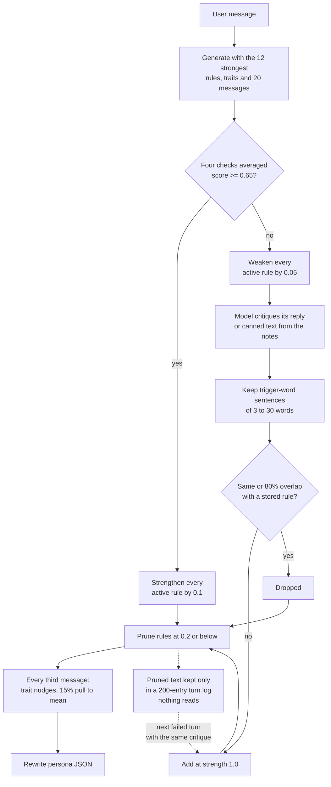

## 1. Executive Summary

Butterfly is the reference implementation of RJ Thomas's white paper on a
self-correcting constraint layer: a Python engine, a FastAPI server and a
React inspector that sit between a user and a local model. What it keeps
between sessions is a set of behaviour rules and a personality profile for
each persona, saved to one JSON file. Every reply is scored on four checks. A
reply that passes strengthens every active rule and teaches nothing. A reply
that fails weakens them, and new rules are mined from the model's own critique
of that reply. That gate is the notable part: it is a stated, tested refusal
to learn from success.

The weak part is that forgetting is not durable. A rule weakened to the floor
is pruned and leaves nothing behind that the deduplicator reads, so the next
failed turn whose critique says the same thing adds it back at full strength
(`butterfly/constraints.py:99-117`, `:127-142`). The test that sustained
failure empties the set feeds a critique containing no rule, so it cannot see
this (`tests/test_agent_api.py:130-135`). Credit is also global. Every active
rule moves with every turn's single score, whatever the reply was about, which
the author lists as a known limitation (`docs/IMPLEMENTATION_NOTES.md:31-36`).

The licence is Apache-2.0, in `LICENSE` and `pyproject.toml`.

No marks. Strength is a ranked score with no state that withholds a rule,
pruning keeps no rejection record, the turn log is capped and read by nothing,
and the inspector only displays. Section 9 gives the reason for each of the
seven.

## 2. Mental Model

A rule becomes a belief the moment it is extracted, and stops being one only
when its strength falls to the floor or the persona is reset.

- **Birth.** On a failed turn the model is asked for one to three rules about
  its reply, written with *should*, *must*, *need to*, *avoid* or *ensure*
  (`butterfly/prompts.py:45-55`). Each sentence of that critique that carries
  a trigger word, runs three to thirty words, is not a question and does not
  match a stored rule becomes a rule at strength 1.0
  (`butterfly/extractor.py:41-82`, `butterfly/constraints.py:109-117`). There
  is no candidate stage. At 1.0 the rule is tier *Usually* and enters the
  system prompt on the next turn if it ranks in the top twelve
  (`butterfly/prompts.py:14-42`).
- **Life.** Every later turn moves every stored rule by the same amount: +0.1
  after a reply scoring 0.65 or more, -0.05 after one below it
  (`butterfly/agent.py:129-146`). Five passing turns in a row lift a new rule
  to *Always*. A rule at the 2.0 cap needs 36 net failures to reach the floor.
- **Death.** After every update, rules at or below 0.2 are dropped
  (`butterfly/constraints.py:75-83`). A new rule needs sixteen net failures, and
  a test pins that number (`tests/test_constraints_traits.py:33-42`). An
  optional `max_constraints` cap drops the weakest first, and `POST
  /api/reset` deletes everything.
- **Return.** Nothing records the pruned text where `is_duplicate` looks, so
  death lasts until the critique repeats.

The trait profile runs beside the rules on its own clock. Every third message,
traits are nudged by counts over the last three replies (questions asked,
length, contractions, hedges), then each is pulled 15% toward the profile's
mean (`butterfly/agent.py:183-234`, `butterfly/traits.py:45-64`). The traits
reach the model as one line of the system prompt, which for Nova at its
starting values reads *"fairly curious, not very formal, moderately verbose"*
(`butterfly/traits.py:66-79`).

## 3. Architecture

Three processes in the documented setup: Ollama serving the model (default
`llama3.1`), the Butterfly server on `127.0.0.1:8000`, and the built React UI
it serves (`butterfly/__main__.py:14-47`, `butterfly/server.py:158-163`). The
server holds one `ButterflyAgent` per persona in memory, created on first use
from the persona's seed rules and traits and then overwritten by its saved
file if one exists (`butterfly/server.py:42-74`). The model backend is chosen
by environment variable: Ollama, any OpenAI-compatible endpoint, or a mock
that needs no model (`butterfly/llm.py:123-206`).

Storage is a directory of JSON files, one per persona, under `data/` or
`BUTTERFLY_DATA`. A persona key must match `^[a-z0-9_-]{1,40}$` before it
becomes a path (`butterfly/store.py:11-22`). Custom personas come from
`data/personas.json`, merged over the two built-ins, Nova and Echo
(`butterfly/personas.py:12-49`).

### Deployment and ergonomics

`start.ps1` creates a virtual environment, installs the package, builds the UI
and opens a browser; the README's manual setup is four commands on any OS.
Dependencies are four floating ranges (FastAPI, uvicorn, httpx, pydantic) with
no lockfile; Kokoro voices are an optional extra of about 350 MB. Nothing
else runs: no database, no queue, no worker. An operator's whole state is the
`data/` directory, and backing it up is copying it.

## 4. Essential Implementation Paths

**One turn** is `ButterflyAgent.turn` (`butterfly/agent.py:123-168`). It
snapshots the active rules, generates a reply with the system prompt built
from the twelve strongest, and scores it. On a pass it strengthens the
snapshot. On a fail it weakens the snapshot, asks for a critique and adds what
the extractor returns. Rules added on a failed turn are not in the snapshot,
so they are not weakened at birth. Then it prunes, appends the exchange to
history, runs the mirror loop if the message count is a multiple of three, and
logs a summary.

**Scoring** is four booleans averaged, so three of four passes and two of four
does not (`butterfly/quality.py:133-138`). The heuristic checks are: a vague
request got a question and a clear one got more than a question; the length
fell in a band derived from the request; no rule of the form *avoid*, *never*,
*don't* or *stop* X was broken by X appearing in the reply; and a speculative
question got a hedge (`butterfly/quality.py:145-202`). `--evaluator llm` asks
the generating model to grade its own reply as JSON and falls back to the
heuristics when the answer does not parse (`butterfly/quality.py:236-259`).

**The critique** is a second model call with the user's message, the reply and
the heuristic notes. If it raises or returns nothing, `fallback_self_eval`
writes one canned sentence per note, such as *"I should ask a clarifying
question when the request is vague."* (`butterfly/agent.py:58-72`, `:171-180`).

**Extraction** splits the critique into sentences, strips bullets and leading
subjects such as *I*, *you* or *the assistant*, and keeps a sentence of three
to thirty words with a whole-word trigger that is not a question and does not
mention *as an AI* (`butterfly/extractor.py:15-82`). The extractor
deduplicates within the batch, and `ConstraintSet.add` deduplicates against
stored rules by normalised equality or Jaccard overlap of 0.8 or more
(`butterfly/constraints.py:99-117`).

**Persistence** is one call in the chat route: `pool.store.save(persona,
agent.to_dict())` after the turn returns (`butterfly/server.py:116-125`).

## 5. Memory Data Model

A rule is a `BehavioralConstraint`: `id` (eight hex characters), `text`,
`strength`, `successes`, `failures` and `created_turn`
(`butterfly/constraints.py:36-72`). `created_turn` is a message count, not a
time, and nothing reads it except the `max_constraints` tie-break, which drops
the newest of two equally weak rules (`butterfly/constraints.py:134-140`).

A persona file holds a version number, the name, the message count, the rule
list, the traits with their baseline, the last 40 messages, the last mirror
reflection and up to 200 turn summaries (`butterfly/agent.py:274-293`). A
summary records the turn number, score, whether it reinforced, the texts of
rules added and pruned, the rule count and the traits
(`butterfly/agent.py:237-248`). Per-rule strength changes are not logged. They
survive only as each rule's success and failure counts.

A trait profile is a name-to-value map clamped to [0, 1] plus the persona's
starting values. Adjusting a trait the profile does not have raises
`UnknownTraitError` rather than creating it (`butterfly/traits.py:12-40`).

## 6. Retrieval Mechanics

There is no retrieval in the query sense. `system_prompt()` sorts all rules
by strength, takes twelve, and writes them under *"Behavior rules you have
learned:"* with a tier label each, followed by the instruction not to mention
them (`butterfly/agent.py:109-115`, `butterfly/prompts.py:22-42`). The same
twelve go into every turn whatever the user asked. The last twenty messages
of history follow (`butterfly/agent.py:117-120`).

The cost of this design is predictability: a reader can say exactly which rules
the model saw on any turn from the strengths alone. It is also why credit is
global. A rule that has nothing to do with a question is still in the prompt
for it, so the paper's rule of crediting every active rule is consistent with
what the model was shown.

## 7. Write Mechanics

Writes block the request. A turn makes one generation call, one more in
`--evaluator llm` mode, a critique call on every failed turn and a reflection
call every third message, all inside the persona's lock in `POST /api/chat`.
The file is rewritten in full afterwards through `tempfile.mkstemp` and
`os.replace`, so a crash leaves the previous file whole
(`butterfly/store.py:35-40`). A new rule is retrievable on the very next turn.
No background pass exists.

The mirror loop's reflection call does not feed the nudges. `_mirror_loop` asks
the model how its personality came across, stores the answer as
`last_reflection`, and computes the trait changes from `_trait_nudges`, which
reads the heuristic signals and reply text of the last three turns
(`butterfly/agent.py:218-234`). The reflection reaches the inspector
(`frontend/src/components/Inspector.tsx:70`) and nothing else. The
implementation notes describe the heuristic nudges, so this matches the
author's account, but the model call costs a request every third turn and
changes no state. One nudge, `cautious`, fires only for a persona with that
trait, and neither built-in persona has one (`butterfly/agent.py:213-215`,
`butterfly/personas.py:19`, `:29`).

Used as a library, nothing is saved: `ButterflyAgent` keeps state in memory and
the caller must persist `to_dict()` itself.

### Operational cost

On the default local model, the price is extra model calls, not storage. A
run of failing turns doubles the calls, and the mirror loop adds one in three.
The file grows with the rule set, which has no cap by default, while history
is held to 40 messages and the log to 200 entries.

## 8. Agent Integration

The integration is the system prompt. The model is never given a tool to read,
add or remove a rule, and is told not to mention them. The React inspector
shows each rule's text, a strength bar with the prune floor marked, its up and
down counts, the traits, the last score and the reflection
(`frontend/src/components/RuleList.tsx:10-38`). Its one action on memory is
Reset, behind a confirmation dialog, which clears rules, traits and history
for the persona and deletes its file (`frontend/src/App.tsx:105-114`,
`butterfly/server.py:127-134`).

A persona's voice choice is kept in the browser's `localStorage` under
`butterfly.voice.<persona>` (`frontend/src/App.tsx:69`, `:125`), not in the
persona file.

## 9. Reliability, Safety, and Trust

### Forgetting that lasts one turn

`prune` returns the removed rules, and the turn records their texts in
`rules_pruned` and the turn log (`butterfly/constraints.py:127-142`,
`butterfly/agent.py:147`, `:243`). `is_duplicate` compares a candidate only
with `self.items`, the rules still stored (`butterfly/constraints.py:99-107`).
So a rule pruned on one failed turn is added again at 1.0 on the next failed
turn whose critique produces it. With a real model this depends on how often
the critique repeats itself. With the canned fallback it is certain: the same
heuristic note always produces the same sentence (`butterfly/agent.py:58-72`),
and so does the mock backend's critique (`butterfly/llm.py:157-170`).

### Credit and grading

One score per turn moves every active rule, so a rule's strength measures how
the conversation went while it was stored, not whether it helped. The
heuristic grader checks compliance only for rules phrased as a prohibition
(`butterfly/quality.py:45-47`, `:84-94`). A positive rule, such as the
fallback's *"Should ask a clarifying question when the request is vague"*, is
always counted as followed. The implementation notes state both limits. The
LLM grader is the generating model grading its own reply; for a design that
caps a self-graded score with a check that cannot share the grader's bias, see
[LUCID](../lucid/).

### What enters the prompt

Every rule is model-written text, mined from a prompt that quotes the user's
message verbatim, and it reaches the next turn's system prompt with no review.
The extractor's only content filter is the trigger word and a short list of
phrases such as *as an AI* (`butterfly/extractor.py:60-72`). It is an
inference, untested here, that a user or pasted text can shape the critique
into a *should* sentence and so plant a standing instruction. On a
single-user local install the user is planting it on themself. There is no
user identity, so any client of the server shares a persona's rules and
history, and the server binds `127.0.0.1` by default with no authentication
(`butterfly/__main__.py:19`).

### Failure handling

A persona file that fails to parse is moved to `<key>.corrupt.json` and the
persona starts again from its seeds (`butterfly/store.py:24-33`). A second
corruption overwrites the first copy. A model error during generation returns
502 before any state changes (`butterfly/server.py:120-123`), and errors in
the critique, the reflection and the LLM grader are caught and fall back.

### Marks

- **`tombstone` — no.** Pruning deletes the rule. Its text survives in a
  turn log capped at 200 entries, and the deduplicator does not read it, so
  the rule can return (above).
- **`trust_state` — no.** The tiers *Always*, *Usually* and *When possible*
  are a strength score in three bands that sets the wording. Every stored rule
  that ranks in the top twelve reaches the prompt. The only thing that
  withholds a rule is deleting it.
- **`bitemporal` — no.** `created_turn` is a message count, and no time is
  stored on a rule.
- **`scope_enforced` — no.** Each persona has its own file, a physical
  partition with no key on a rule and no predicate on a read.
- **`audit_log` — no.** The turn log records added and pruned rule texts per
  turn, but it is trimmed to 200 entries, cleared by Reset, omits per-rule
  strength changes, and nothing reads it except the state endpoint.
- **`human_review` — no.** The inspector displays rules and offers only a
  whole-persona reset. There is no route to edit, delete or approve one rule.
- **`negative_eval` — no.** The nearest case asserts that a failed reply's own
  *"You should restart the computer."* is not learned while the critique's
  rule is (`tests/test_agent_api.py:44-52`). It is populated and can fail, but
  it tests extraction from one write, not material kept out of what reaches
  the model. No test asserts that a pruned or weakened rule is absent from a
  system prompt.

## 10. Tests, Evals, and Benchmarks

The suite is 60 test functions in four files, 63 cases once the gate test's
four parameters expand, which matches the README's count. No CI workflow is
committed, and none were run for this reading.

The constraint tests pin the paper's arithmetic and can fail.
`test_fresh_rule_pruned_after_sixteen_failures` counts weakenings until the set
is empty and asserts exactly sixteen. `test_asymmetry_alternating_trends_upward`
asserts 1.5 after twenty alternating turns. `test_dedupe_against_stored_rules`
adds an exact and a near duplicate and asserts one rule
(`tests/test_constraints_traits.py:26-55`). The gate test covers four, three,
two and zero passing checks (`tests/test_quality_extractor.py:23-27`). The
agent tests drive whole turns through a fake model. They cover the mirror
cadence at messages three, six and nine, a learned rule appearing in the next
system prompt, persistence across two app instances on one directory, and
reset (`tests/test_agent_api.py:62-74`, `:174-185`).

Two cases are weaker than their names.
`test_sustained_failure_prunes_everything_eventually` sets the critique to
*"Nothing useful here."*, which has no trigger word, so no rule can be
re-learned and the case cannot see the return described in section 9
(`tests/test_agent_api.py:130-135`). `test_repeated_bad_turns_do_not_bloat_rules`
runs five failed turns, fewer than the sixteen a prune needs, so it shows
deduplication against a rule that is still stored and nothing about one that
was pruned (`tests/test_agent_api.py:55-59`).

The white paper is in the tree as `docs/Butterfly_White_Paper.rtf`. Its
section 7 says it *"does not include a formal evaluation against benchmark
datasets"* and asks that its claims be read as architectural. No arXiv or DOI
identifier and no result file is committed.

## 11. For Your Own Build

### Steal

- **Learn only from failure, and from a critique.** A passing turn extracts
  nothing, and a failing one mines the model's review of the reply rather
  than the reply. The test that the reply's own *should* sentence stays out is
  the check to copy with it.
- **Deduplicate against the store, not the batch.** Normalised equality plus
  Jaccard 0.8 against every stored rule is twenty lines and stops the same
  lesson accumulating.
- **Asymmetric steps as a named, tested parameter.** +0.1 against -0.05 makes
  one bad turn cheap and a run of them decisive, and the tests pin the
  consequence: sixteen failures to prune, 1.5 after twenty alternations.
- **Refuse an unknown key.** Raising on a misspelt trait instead of creating it
  is one line that keeps a typo from becoming state.
- **Atomic save, with the damaged file kept.** `mkstemp` and `os.replace`, and
  a parse failure moved aside rather than overwritten.

### Avoid

- **Pruning without a rejection record.** If a rule was weakened out, record
  its normalised text where the deduplicator looks, or it comes back on the
  next failed turn. See [the rejected-value tombstone](../../patterns/rejected-value-tombstone/).
- **Crediting every rule with every outcome.** Strength then measures the
  conversation, not the rule; tie the update to the rules the grader actually
  checked.
- **Model-written instructions straight into the system prompt.** A rule
  should spend at least one turn as a candidate a person or a second check
  can see.
- **A model call whose output changes nothing.** The mirror reflection is
  displayed and never read. Either feed it into the nudges or drop the call.

### Fit

Butterfly suits one person running a local model who wants to watch a
persona's prompt adjust itself, and who will read 1,700 lines in an
afternoon to see exactly how. Every behaviour maps to a numbered paper section
and a test. It does not suit anyone who needs memory of facts, since nothing
is recalled by query, or a shared deployment, since there is no user identity
and no review. The parameters are the paper's starting values, untuned by the
author's own account. Treat it as a readable control loop to borrow pieces
from, not a memory layer to adopt.

## 12. Open Questions

- With a real model, does the rule set settle, or does it cycle through
  prune and re-learn as the critique repeats?
- How often do two critiques of different failures produce rules within 0.8
  Jaccard of each other, so that one blocks the other?
- Do the *Always*, *Usually* and *When possible* labels change what the model
  does, or only what the inspector shows?
- In `--evaluator llm` mode, how much more often does a reply pass when the
  model that wrote it grades it?

## Appendix: File Index

- Turn loop, mirror loop, critique, persistence shape: `butterfly/agent.py`
- Rules, strength, pruning, deduplication: `butterfly/constraints.py`
- Extraction from the critique: `butterfly/extractor.py`
- Scoring and the LLM grader: `butterfly/quality.py`
- Traits and drift correction: `butterfly/traits.py`
- Prompts: `butterfly/prompts.py`
- Parameters: `butterfly/config.py`
- Store: `butterfly/store.py`
- Server and personas: `butterfly/server.py`, `butterfly/personas.py`,
  `butterfly/__main__.py`
- Model backends and mock: `butterfly/llm.py`
- Inspector: `frontend/src/App.tsx`, `frontend/src/components/RuleList.tsx`,
  `frontend/src/components/Inspector.tsx`
- Tests: `tests/test_constraints_traits.py`, `tests/test_quality_extractor.py`,
  `tests/test_agent_api.py`, `tests/test_tts.py`
- Paper and notes: `docs/Butterfly_White_Paper.rtf`,
  `docs/IMPLEMENTATION_NOTES.md`

### Recorded searches

Run from the repository root at the pinned commit with `/usr/bin/git grep`.

- **Deduplication reads only stored rules.**
  `git grep -n -w is_duplicate -- butterfly` returns
  `butterfly/constraints.py:99` (the definition, which loops over
  `self.items`) and `:111`, its one caller.
- **Nothing reads the turn log.**
  `git grep -n -w events -- butterfly frontend/src` returns only
  `butterfly/agent.py:104`, `:238`, `:248`, `:254`, `:270`, `:283` and `:293`:
  creation, append, trim, reset, the state and save dictionaries, and load.
- **Pruned texts are kept nowhere else.**
  `git grep -n -w -E 'pruned|removed' -- butterfly` returns
  `butterfly/agent.py:243` (the turn log), comments in `config.py` and
  `constraints.py`, and `constraints.py:133-142`, the return value of
  `prune`.
- **No per-rule route.**
  `git grep -n -E '@app\.(get|post|put|patch|delete)' -- butterfly` returns
  eight routes, all in `butterfly/server.py`: health, personas, state, chat,
  reset, two TTS routes and the index page.
- **The reflection feeds no state.**
  `git grep -n -w -E 'reflection|last_reflection' -- butterfly` returns only
  `butterfly/agent.py`, at the call (`:221`), its storage (`:227`), its return
  (`:234`), reset, state, save and load.
- **No built-in persona carries `cautious`.**
  `git grep -n -w cautious` returns only `butterfly/agent.py:215`.
- **No test asserts an absence from a prompt.**
  `git grep -n -E 'not in|assert not' -- tests` returns five lines: a gate
  flag, a misspelt trait, two ambiguity checks and a voice filter in
  `tests/test_tts.py:41`.
- **No paper identifier.**
  `git grep -n -i -w -E 'arxiv|doi|bibtex|citation'` returns nothing; the
  control `git grep -n -i -w patent` matches `LICENSE`, `README.md:147` and
  the paper.
- **No CI.** `git ls-files .github` returns nothing.

## History

**2026-11-26** — [`2c290aee381004e49f4e9dd31a41d8d83f26094a`](https://github.com/ButterflyRSI/butterfly-v2/commit/2c290aee381004e49f4e9dd31a41d8d83f26094a). First reading, from a full clone at the head of `main`; no submodules. Screened first: no auto-run surface, nothing inside the seven-day cooldown, no build-time execution, two unpinned surfaces (`pyproject.toml` with no lockfile, `requirements.txt` with five floating ranges), and `frontend/package-lock.json` unchanged for 27 days. `CLAUDE.md` is addressed to a reading agent and was read as data. Nothing was installed, built or run, and none of the tests were run. No marks: pruning keeps no rejection record that deduplication reads, strength is a ranking score with no withholding state, and the inspector only displays ([section 9](#9-reliability-safety-and-trust)).
