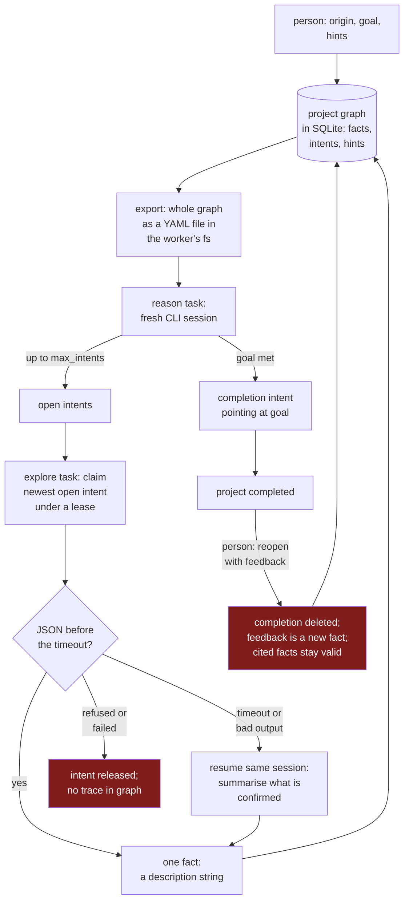

## 1. Executive Summary

Cairn is a blackboard for agents searching toward a goal: a FastAPI server
keeps one graph per problem in SQLite, and a dispatcher runs Claude Code, Codex
or Pi as fresh headless sessions that read the whole graph, then either propose
directions or explore one and return a single new fact. Every session forgets
everything except that graph, so the graph is the memory. What is notable is
the discipline of the model: facts are never edited, a change of state is a new
fact, and every fact hangs off the intent that produced it. What is weak is
correction. Nothing can withdraw a wrong fact or hint, a fact carries no mark of
how it was obtained, and the one correction verb, reopen, deletes the claim it
corrects while the facts that supported it stay valid.

It carries `scope_enforced`.

**Licence.** The README narrows a licence the file does not narrow. `LICENSE`
is the unmodified AGPL-3.0 text, while `README.md:220` grants it *"for personal
and educational use"* and asks commercial users to buy a separate licence
(`:222`). The file sets no such limit, and its section 7 lets a recipient remove
a term that is a *"further restriction"* (`LICENSE:376-380`). `pyproject.toml`
declares no licence. The contribution clause at `README.md:224` takes every
pull request under the commercial licence as well, with no agreement document
in the tree and nothing offered in return.

**The memory is per problem.** A project is one origin and one goal. Its facts
survive server and dispatcher restarts, a stop and resume, and a reopen after
completion, and every later session reads them. No project reads another's
facts, so nothing learned in one engagement reaches the next.

**Facts are append-only by code, not only by convention.** No statement updates
the `facts` or `hints` tables, and no route deletes from them except the
project-wide cascade. The design document's example is a shell that drops: the
loss is a new fact, `f025`, beside the `f003` that recorded gaining it, and the
reader works out which holds (`docs/specs/server-protocol.md:25-31`).

## 2. Mental Model

A fact is a description string an agent returned and the dispatcher posted.
Nothing marks it as verified, inferred or summarised; the README calls it *"a
confirmed, objective finding"* and the prompts ask the model to write only
confirmed results. An intent is a direction one session declared and another
explores; when it concludes, it points at the fact it produced. A hint is text
a person adds. The goal is met when a reason session, or the bootstrap session
in one step, says so and names the facts it rests on.

A fact never changes state. It stops mattering only when a later fact makes it
moot in the eyes of the next reader, or when the whole project is deleted. The
completion edge is the one thing that dies: reopen deletes it.

## 3. Architecture

Two processes and, in container mode, one Docker container per project
(`docker-compose.yaml`):

| Process | Holds |
| --- | --- |
| `cairn serve` (FastAPI, uvicorn) | The SQLite file and every graph rule: leases, claims, completion, reopen |
| `cairn dispatch` | Polling, worker selection, prompt rendering, container lifecycle; in-process reason checkpoints |
| Worker container per project | A Kali image running `sleep infinity`, into which the dispatcher `exec`s each CLI session |

The server is the only writer to SQLite and the dispatcher is its only
programmatic client (`cairn/src/cairn/dispatcher/protocol/client.py`). Workers
never call the server: they receive a prompt, run, and print JSON that the
dispatcher validates and posts. A person drives the same API from the web UI
served at `/`.

### Deployment and ergonomics

`docker compose up --build` starts both, after the operator fills
`dispatch.yaml` with model endpoints and keys. Local mode runs the CLIs on the
host instead, each project in `<workspace_root>/<project_id>`, using the host's
logged-in CLIs. Nothing needs a vector store or an embedding model.

The store is plain SQLite with eight tables and is repairable by hand. The API
has no authentication of any kind, and Compose binds the server to `0.0.0.0`
and publishes port 8000 (`docker-compose.yaml:9`, `:23`); `cairn serve` alone
defaults to `127.0.0.1` (`cairn/src/cairn/cli.py:17`).

## 4. Essential Implementation Paths

| Path | Location |
| --- | --- |
| Schema | `cairn/src/cairn/server/db.py:12-82` |
| Create project: origin and goal as facts, hints | `cairn/src/cairn/server/routers/projects.py:77-121` |
| Read the graph | `projects.py:124-144`, `services.py:150-173` |
| Export the graph as YAML | `cairn/src/cairn/server/routers/export.py:22-98` |
| Create, claim, release and conclude intents | `cairn/src/cairn/server/routers/intents.py:28-147` |
| Add a hint | `cairn/src/cairn/server/routers/hints.py:10-25` |
| Complete and reopen | `projects.py:257-358` |
| Lease expiry | `cairn/src/cairn/server/services.py:222-257` |
| Scheduling and reason triggers | `cairn/src/cairn/dispatcher/scheduler/loop.py:254-338`, `:704-718` |
| Reason task | `cairn/src/cairn/dispatcher/tasks/reason.py:83-273` |
| Explore task and conclude fallback | `cairn/src/cairn/dispatcher/tasks/explore.py:89-384` |
| Bootstrap task | `cairn/src/cairn/dispatcher/tasks/bootstrap.py` |
| Graph snapshot file | `cairn/src/cairn/dispatcher/tasks/common.py:17`, `:56-70` |
| Output contracts | `cairn/src/cairn/dispatcher/contracts.py:62-170` |
| Prompts | `cairn/src/cairn/dispatcher/prompts/default/*.md` |
| CLI drivers | `cairn/src/cairn/dispatcher/workers/adapters/` |
| Containers and local workspaces | `cairn/src/cairn/dispatcher/runtime/containers.py`, `local_backend.py` |

## 5. Memory Data Model

- **`facts`**: `id`, `project_id`, `description`, primary key `(id,
  project_id)` (`db.py:32-37`). No timestamp, author, source or status; a
  fact's time and author are those of the intent whose `to_fact_id` names it.
  `origin` and `goal` are facts with fixed ids.
- **`intents`**: `id`, `project_id`, `to_fact_id` (null while open, `goal` for
  the completion), `description`, `creator`, `worker`, `last_heartbeat_at`,
  `created_at`, `concluded_at` (`db.py:39-50`).
- **`intent_sources`**: the facts an intent starts from, so an intent is a
  hyperedge from several facts to one (`db.py:52-58`).
- **`hints`**: `content`, `creator`, `created_at` (`db.py:60-67`).
- **`scoped_counters`**: per-project sequences behind `f001`, `i001`, `h001`.

`creator` and `worker` are strings the caller supplies. The web UI sends a
local display name, `Human` by default; the dispatcher sends the worker's
configured name. Nothing distinguishes the two except the string.

**`scope_enforced` is earned on `project_id`.** Every row carries it inside its
primary key, which makes the predicate load-bearing: `f001` is a row in every
project, and a read without the filter would mix them. The two reads the
dispatcher turns into prompts, `get_project` and `_load_project_data`, filter
`facts`, `hints`, `intents` and `intent_sources` on it (`projects.py:131-137`,
`export.py:27-45`, `services.py:151-153`, `:169-171`), and every write that
cites facts checks them within the project (`services.py:79-87`). The key
is a path segment any caller may name, so this separates problems, not
principals. No committed test reads a second project.

**`trust_state` is withheld.** A fact has no status. Project status (`active`,
`stopped`, `completed`) and intent state (open, claimed, concluded) are the
state of the work, and none of them withholds a fact from the next prompt.

**`bitemporal` is withheld.** Intents carry record times only. The design's
answer to time is that the order of facts carries state change, and a fact has
no time of its own.

## 6. Retrieval Mechanics

There is no retrieval in the search sense. Before each reason or explore task
the dispatcher fetches `GET /projects/{id}/export?format=yaml`
(`loop.py:291`, `:296`, `:317`), writes it to
`/tmp/cairn-prompts/<phase>-<random>/graph.yaml` in the worker's filesystem,
and puts the path in the prompt with an instruction to read the entire file
(`common.py:56-70`). The YAML holds the project's origin and goal, every hint,
every fact and every intent with its sources, creator, worker and timestamps
(`export.py:50-98`). The reason prompt adds the list of fact ids it may cite,
which is every fact but `goal` (`reason.py:93`), and the open intents.

Nothing bounds the file. No filter, cap or summary sits between the table and
the prompt, so a project's tenth reason pass reads everything the first nine
produced. The design document names the cost, graph growth diluting the useful
facts, and proposes that workers write situation assessments as hints
(`docs/specs/server-protocol.md:95`). The dispatcher's client has no hint
method, so only a person writes hints.

The bootstrap task reads less: origin, goal and hints as JSON in the prompt
(`bootstrap.py:383-399`).

## 7. Write Mechanics

Agents never write to the store directly. Each task's CLI prints one JSON
object; `contracts.py` validates its shape and the dispatcher posts it.

- **Explore** returns `{"description": ...}` and the dispatcher concludes the
  claimed intent, which inserts the fact and points the intent at it in one
  transaction (`intents.py:118-147`).
- **Reason** returns a completion citing fact ids, a list of intents truncated
  to `max_intents` (`contracts.py:95`), or nothing.
- **Bootstrap** returns a fact and a completion together; the dispatcher writes
  the fact through the bootstrap intent and then completes from it, so the
  session that found the result also declares the goal met.
- **The conclude fallback.** When an explore or bootstrap session times out or
  returns unparseable output, the dispatcher resumes the same CLI session with a
  prompt to stop and summarise what is already confirmed, and stores the answer
  as the fact (`explore.py:241-384`). The phase is passed as `source` to the
  logger and nowhere else (`common.py:145-179`), so the graph cannot tell a
  summary written under a deadline from a finished exploration.
- **Failure leaves nothing.** A refused or failed explore releases the intent
  (`explore.py:173-184`, `:220-232`); the next scheduling pass picks the newest open intent
  again, and the graph holds no record that a direction was tried and failed.

**No write blocks an agent.** The session has ended before the dispatcher
posts. A fact is in the next export as soon as the post returns, and the
dispatcher polls on its configured interval, 3 seconds in both example
configurations.

### Correction and deletion

Correction is append-only in all but one place. A person adds a hint, which
every later prompt includes, or concludes an intent by hand to add a fact. No
route edits or deletes a fact or hint.

**Reopen** is the exception. On a completed project it deletes the completion
intent, inserts the caller's description as a new fact, and adds a concluded
intent named `external_feedback` from the completion's source facts to it
(`projects.py:303-358`). The completion's own description, which said why the
goal was met, is gone; the specification says the edge is removed without
keeping any in-graph history that the project was ever completed
(`docs/specs/server-protocol.md:604`), and the timeline export drops the event
(`:786`). The source facts stay, unmarked, in the list the next reason pass may
cite. Re-derived on lifted SQL: after a reopen the valid ids are `origin`,
`f001` and `f002`, where `f001` is the fact that reported the rejected flag.

**Deleting a project** cascades its rows in SQLite (`projects.py:147-151`).
Section 9 covers what stays behind.

### Operational cost

No model call on the write path beyond the worker itself. On the read path each
task's CLI reads the whole graph, and a reason pass runs whenever the fact or
hint count grows (`loop.py:704-718`), so across a project the tokens read for
the graph grow roughly with the square of its fact count. That is an inference
from the trigger and the export; nothing in the tree measures it. The snapshot
is a file the agent reads with its own tools, not a prompt prefix, so its
placement does not touch a provider's prompt cache.

## 8. Agent Integration

The model sees memory only as a file it is told to read and a JSON shape it is
told to return. It cannot search, cannot edit, and cannot reach the server
through any tool Cairn gives it. Each task is a new CLI session with a fresh
session id; only the conclude fallback resumes one, within the same task.

The CLIs run with approval bypassed: `--dangerously-skip-permissions` for
Claude Code (`claudecode.py:45`, `:58`) and
`--dangerously-bypass-approvals-and-sandbox` for Codex (`codex.py:43`,
`:53`). In container mode the boundary is the per-project container, with
`network_mode: host` in the example configuration; in local mode it is the
operator's own account.

**`human_review` is withheld.** A person can add hints, intents, facts and
completions, and reopen a completed project, from the web UI. None of these is
a state an agent's write waits in. Facts and completions take effect when
posted, and reopen corrects after the fact.

The driver layer makes the design portable. Adding a backend is a class with
`build_execute`, `build_conclude` and a response extractor
(`workers/base.py:18-55`).

## 9. Reliability, Safety, and Trust

### Fact text from the target reaches agents running unsandboxed

An explore session's description is written from what it saw on the system
under test, and it is stored verbatim and placed in the file every later
reason and explore session reads in full. The YAML is a plain dump with no
framing that marks it as data (`export.py:98`). Those sessions run with
approvals bypassed. A target that wants to steer later agents has only to make
its output worth summarising. [ARTEX](../artex/), also a penetration-testing
platform, wraps the stored fields it injects in a nonce-framed data envelope;
Cairn has no equivalent.

### Nothing can be withdrawn

A wrong fact, or a hint written in error, stays in every later prompt until the
project is deleted. In [REDCELL](../redcell/) a person can dismiss a finding and
the next run's recap leaves it out; here the only tool is a contradicting fact,
and whether the next model weighs it correctly is up to the model.

### Reopen keeps the evidence and deletes the conclusion

Covered in section 7. The rejected completion is the one record of which facts
a model judged sufficient and why, and it is the record removed. The feedback
fact is prose, so nothing keyed on the rejected value stops the next reason
pass completing again from the same facts. The design document describes the
graph as both a knowledge base and an audit log of the reasoning path
(`docs/specs/server-protocol.md:17`), which holds until the first reopen.

### Deletion stops at SQLite

`DELETE /projects/{id}` removes the rows. Every graph snapshot written for the
project remains: inside its container in container mode, and in the host's
`/tmp/cairn-prompts` in local mode, which no code cleans (`common.py:17`, `:63`).
Both specifications say the dispatcher removes a deleted project's container
(`docs/specs/server-protocol.md:328`, `docs/specs/dispatcher-design.md:34`);
`cleanup_orphan` exists and nothing calls it (`containers.py:137-150`), so the
container keeps running. In local mode `completed_action: remove` deletes the
project's workspace directory and not the snapshots, which sit outside it
(`local_backend.py:71-76`).

Local mode also shares that directory across projects. Every project's full
graph lands under one host path with no project segment, readable by any
session the dispatcher starts on the host. The server's scope predicate does
not reach it.

Containers are keyed on the project id alone (`containers.py:31-33`) and an
existing one is restarted rather than recreated (`:40-48`). A fresh database
numbers projects from `proj_001` again (`db.py:74`), so its first project is
handed the previous `proj_001` container, with that project's files and
snapshots inside.

### No authentication

Any caller that reaches the port can read every graph, add hints that enter
every later prompt, conclude intents, complete or reopen a project, change the
lease timeouts and delete projects. A search of the server package finds no
authentication, token or dependency check. The unmerged `dev-0.3.0` branch adds
one.

### What holds up

- Claims are leases. An intent's worker must heartbeat within
  `intent_timeout`, 15 seconds by default, or any worker may take it
  (`services.py:222-237`); the reason pass is a single project-wide lease with
  the same rule (`projects.py:191-216`).
- A conclude is refused with 409 while another worker holds the intent, and
  a concluded intent cannot be concluded again (`services.py:112-121`).
- Explore and reason writes are refused on a stopped or completed project
  (`services.py:58-62`), and stopping releases every claim
  (`projects.py:181-186`).
- The graph snapshot travels as a file rather than an argument, which avoids
  argument-length limits on large graphs (commit
  `3e0b1493abff9813e7d8b5bb124812d9759ea39f`).

## 10. Tests, Evals, and Benchmarks

96 test functions in 12 files. The server tests run the real routers on a
temporary SQLite file; the scheduler and task tests run the real dispatcher
against a mock driver whose outcomes come from configuration. They need no
Docker, no model and no network, and none skips. No workflow runs them; the one
workflow builds the worker image. I ran none of it.

The memory property the design rests on is tested end to end.
`test_mock_scheduler_runs_reason_explore_reason_complete_chain` seeds a fact,
lets reason propose an intent, lets explore conclude it, and asserts that the
next reason snapshot contains the new fact `f002` and the explore snapshot the
earlier `f001` (`cairn/tests/test_mock_end_to_end.py:317-352`). Reopen is
tested for its return value only: the new fact, the inherited source and the
active status (`cairn/tests/test_server_api.py:64-73`).

**`negative_eval` is withheld.** No test asserts that anything is absent from
an export or a prompt. The one negative assertion near memory checks that the
graph YAML is not inlined into the prompt text
(`cairn/tests/test_worker_tasks.py:67`). Not covered: a second project, what a
reopen leaves in the export, deletion residue, and whether a fallback fact can
be told apart.

No paper is cited. The README reports a competition result, every problem
solved and third place in the second Tencent Cloud Hackathon AI
penetration-testing challenge, and links two postmortem articles on WeChat;
nothing in the tree records the runs.

## 11. For Your Own Build

### Steal

**Make the shared graph the only channel between agent sessions.** Each worker
is stateless and every hand-off is a row a person can read, which makes a
multi-agent run inspectable after the fact.

**Record change as a new fact rather than an edit.** A dropped shell is a fact
beside the one that recorded gaining it. Nothing is lost, and a reader sees the
sequence.

**Tie every fact to the intent that produced it.** The edge carries who, when
and from which facts, so provenance costs no extra table.

**Lease claims with heartbeats and refuse a stale conclude.** Two workers can
never both land a result for one intent.

**Salvage a timed-out session by resuming it with a summarise-only prompt**,
rather than discarding its work.

### Avoid

**Do not store a salvage summary and a finished result in the same shape.**
Record which path produced a fact; the cost is one column.

**Do not correct by deleting the conclusion and keeping its premises valid.**
Keep the rejected claim with a rejected state, and mark the facts it cited.

**Do not make append-only mean un-retractable.** A person needs a way to take
a fact or a hint out of the next prompt without deleting the project.

**Do not inject a growing graph whole.** Bound it, or summarise the settled
part, before it reaches every session.

**Do not hand unframed, target-derived text to agents running with approvals
bypassed.**

**Do not stop deletion at the database when the same content was written to
the workers' filesystems.**

### Fit

It fits a team running time-boxed, single-problem searches, such as a CTF or
an authorised test with an external verifier, on a private network, who want
to watch and steer the agents and do not need anything to carry over to the
next problem. The memory lives as long as the problem and is meant to.

It does not fit anywhere the store must be shared with untrusted callers,
where a wrong finding must be retractable, where facts should outlive the
problem, or where the graph will grow past what a model reads well in one
pass.

## 12. Open Questions

- **Does the `dev-0.3.0` branch reach `main`?** It adds authentication on
  every endpoint; it was not read beyond its file list.
- **Was orphan cleanup removed deliberately?** Commit
  `d1a221b096398ac8d6777babd0ce3706ff65e878` is titled *"keep orphan containers
  for inspection"*; both specifications still say they are removed.
- **How large did graphs get in competition?** The design names dilution;
  nothing committed shows a fact count or a token bill.
- **Is the conclude fallback's output meant to be distinguishable?** The phase
  is logged and dropped.

## Appendix: File Index

| File | Role |
| --- | --- |
| `cairn/src/cairn/server/db.py` | Schema and connection |
| `cairn/src/cairn/server/routers/projects.py` | Create, read, delete, status, reason lease, complete, reopen |
| `cairn/src/cairn/server/routers/intents.py` | Intent create, heartbeat, release, conclude |
| `cairn/src/cairn/server/routers/hints.py` | Hint create |
| `cairn/src/cairn/server/routers/export.py` | YAML and timeline export |
| `cairn/src/cairn/server/services.py` | Ids, validation, lease expiry |
| `cairn/src/cairn/dispatcher/scheduler/loop.py` | Scheduling, reason triggers, cleanup |
| `cairn/src/cairn/dispatcher/tasks/` | Bootstrap, reason, explore, snapshot writer |
| `cairn/src/cairn/dispatcher/contracts.py` | Output validation |
| `cairn/src/cairn/dispatcher/prompts/default/` | The five prompt templates |
| `cairn/src/cairn/dispatcher/workers/adapters/` | Claude Code, Codex, Pi and mock drivers |
| `cairn/src/cairn/dispatcher/runtime/containers.py`, `local_backend.py` | Per-project container or workspace |
| `cairn/src/cairn/server/static/index.html` | Web UI |
| `docs/specs/server-protocol.md`, `docs/specs/dispatcher-design.md` | Design documents, in Chinese |
| `cairn/tests/test_server_api.py`, `test_mock_end_to_end.py` | Server and end-to-end tests |

### Recorded searches

Run with `/usr/bin/git` in a full clone at the pinned commit.

- `git ls-files 'cairn/src/*.py' | xargs wc -l` — 6,430 lines in 43 files; the same over `cairn/src/cairn/server/*.py` gives 1,380 and over `cairn/src/cairn/dispatcher/*.py` 4,982.
- `git grep -c -E '^[[:space:]]*(async )?def test_' -- cairn/tests`, summed — 96 in 12 files.
- `git grep -n -E '@router\.(get|post|put|delete|patch)' -- cairn/src` — the only delete route is `DELETE /projects/{project_id}`; no route edits a fact or a hint.
- `git grep -n -E 'DELETE FROM|UPDATE facts|UPDATE hints' -- cairn/src` — two deletes, the project at `projects.py:151` and the completion intent at `:325`; no update of either table. Control: `git grep -n -E 'UPDATE intents' -- cairn/src` finds `intents.py:85` and `:107`.
- `git grep -n -i -E 'auth|token|api.?key|Depends\(' -- cairn/src/cairn/server ':!cairn/src/cairn/server/static'` — nothing. Control: `git grep -c -i -E 'auth|token' -- cairn/src/cairn/dispatcher` matches in `config.py` and two adapters.
- `git grep -n -E 'hint' -- cairn/src/cairn/dispatcher/protocol/client.py` — nothing. Control: `git grep -n -E 'def conclude' -- cairn/src/cairn/dispatcher/protocol/client.py` finds line 110.
- `git grep -n -E 'cleanup_orphan|needs_orphan_cleanup|managed_container_names' -- cairn/src` — definitions in `containers.py` and `local_backend.py` only.
- `git grep -n -E 'GRAPH_SNAPSHOT_ROOT|cairn-prompts' -- cairn/src` — the constant at `common.py:17` and its one use at `:63`; no cleanup.
- `git grep -n -E 'source=' -- cairn/src/cairn/dispatcher/tasks` — keyword arguments and log format strings; `client.py:110-115` posts `worker` and `description` only.
- `git grep -n -E 'LIMIT|\[-?[0-9]*:[0-9-]*\]' -- cairn/src/cairn/server cairn/src/cairn/dispatcher/tasks cairn/src/cairn/dispatcher/prompting.py ':!cairn/src/cairn/server/static'` — a log preview limit and a slice of a random hex id; nothing bounds the graph.
- `git grep -n -E 'proj_00[2-9]' -- cairn/tests` — the migration test only; no test reads a second project.
- `git grep -n -E 'pytest' -- .github` — nothing; `.github/workflows/build-container-ghcr.yml` builds the worker image.
- `git grep -n -i -E 'arxiv|doi\.org|bibtex|@article|@misc|CITATION' -- . ':!cairn/src/cairn/server/static/vendor'` — nothing. Control: `git grep -n -i -c 'license' -- README.md` matches.
- `git ls-files | grep -i -E '(^|/)(licen[sc]e|copying|notice|contributing|third.party)'` — `LICENSE` only; `git grep -n -i -E '"licen[sc]e"|^licen[sc]e *=' -- '*.json' '*.toml' '*.cfg'` — nothing.
- `grep -c -i -E 'license|copyright'` over each file in `cairn/src/cairn/server/static/vendor/` — zero in seven files out of eleven; `elk.bundled.js` declares EPL-2.0.
- `git log --oneline main..origin/dev-0.3.0 | wc -l` — 10 commits; `git diff --stat main...origin/dev-0.3.0` lists `cairn/tests/test_auth.py`.

## History

**2026-11-17** — [`8e7e0ea67552383851dfcabfba0c4e9c8d007878`](https://github.com/oritera/Cairn/commit/8e7e0ea67552383851dfcabfba0c4e9c8d007878) — first reading, from a full clone holding 70 commits on `main`. Screened before reading: the screen found a `cairn/tests/conftest.py` that executes on pytest collection and a `uv.lock` unchanged for 170 days, and nothing that auto-runs; nothing was installed or run. The reopen effect was re-derived on SQL lifted from `db.py` and `projects.py` in a scratch in-memory SQLite database. The unmerged `dev-0.3.0` branch was listed, not read. Marks: `scope_enforced`.
