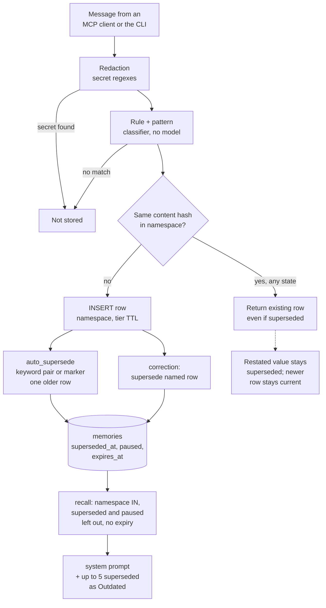

## 1. Executive Summary

CarryMem is a local Python package and stdio MCP server that keeps one user's
preferences, corrections and decisions in one SQLite file, so that Cursor,
Claude Code, TRAE and other MCP clients read the same memory. A message is
typed by a rule and pattern classifier with no model call, stored in a
namespace, recalled through trigram FTS5 with expansion, and rendered into a
system prompt with a token budget. Supersession keeps the old row and labels
it outdated. What is notable is how much of the write path is deterministic
and tested. What is weak is correction: a value the user restates after it was
superseded is absorbed by deduplication, keyword-pair supersession crosses
topics, and the rule engine beside the memory has no namespace.

The memory is the row a classifier admits. `classify_and_remember` redacts,
classifies and stores each match synchronously; a message the classifier
does not match is reported as `should_remember: False` and kept nowhere
(`src/carrymem/core/_memory_crud.py:223-313`). Before inserting, the adapter
looks for the same content hash in the namespace and returns that row
instead, whatever its state (`src/carrymem/adapters/sqlite/crud.py:61-66`,
`:164-185`). A new preference, decision or fact then supersedes at most one
older row of its type when a contradiction pair or an update marker matches
(`src/carrymem/adapters/sqlite/supersede.py:56-90`, `:169-189`).

Recall always opens with a namespace predicate from server configuration and
drops superseded and paused rows; the prompt builder then brings up to five
superseded rows back under *Outdated (superseded, do NOT use)*
(`src/carrymem/adapters/sqlite/recall_engine.py:227-269`,
`src/carrymem/prompt_builder.py:105-115`, `src/carrymem/prompt.py:248`).
Expiry is stamped by tier and not read by recall.

Around the store sit three ledgers that were built and not wired into a
serving path. Observations carry `valid` and `unsupported` and are written on
corrections, and nothing outside the adapter lists them. A reflection proposal
queue with `proposed`, `approved`, `rejected`, `applied` and rollback is
reached only from tests. Evidence links flag a derived memory
`provenance_unsupported` when its last source is deleted, and no read
consults the flag.

**Licence.** MIT, in `LICENSE` and in every manifest that names a licence. The
README's citation block gives a `@software` entry under a different
organisation URL (`github.com/carrymem/carrymem`) from the repository's.
Nothing restricts use.

Three marks are earned: `scope_enforced`, `audit_log` and `negative_eval`.
Section 9 gives the reason for each and for the four withheld.

## 2. Mental Model

A memory is **a classified sentence with a type**. The seven user-facing types
come from rule detectors (`src/carrymem/layers/memory_pattern_detectors.py`);
`session_summary` is an eighth, excluded from recall unless asked for. The
store treats an admitted row as true from the moment it is written. There is
no candidate state for a memory.

A row can stop being served in four ways, each a separate column:

- **Superseded.** `superseded_at` and `supersedes` are set by auto-supersede on
  insert, by a correction naming it, or by consolidation. The row stays,
  leaves default recall, and returns in the prompt as outdated. No serving
  path clears the stamp.
- **Paused.** `paused = 1`, set and cleared by the user or the agent through
  `pause_memory` and `resume_memory`. Recall and graph reads skip it.
- **Expired.** `expires_at` is stamped from the tier: 24 hours, 90 days, a
  year, or never (`src/carrymem/utils/helpers.py:183-188`). Preferences and
  corrections are tier 2. Recall does not read the column; only
  `carrymem clean --expired` and `forget_expired` delete expired rows.
- **Forgotten.** A hard delete of the row, its vector and its graph rows.

Supersession is decided by keywords, not by meaning. A contradiction pair
found across the two texts (`like`/`dislike`, `dark`/`light`, `yes`/`no`,
`new`/`old`, `now`/`previously` among seventeen) supersedes with no topical
overlap required; an update marker (`now`, `switched`, `instead`) needs a word
Jaccard of 0.4 (`src/carrymem/adapters/sqlite/supersede.py:15-50`,
`:169-189`, `:246-257`). Corrections take a second path: the correction is
stored, the most recent preference, decision or fact sharing two keywords is
found by recall, and that row is superseded
(`src/carrymem/core/_classification.py:637-666`).

The restatement case is where the model fails. The content hash is the dedup
key and is computed over content and type without the supersession state, so
"I prefer dark mode" restated after "I prefer light mode" superseded it
returns the superseded row, inserts nothing and runs no supersede. Light mode
stays current; the user's latest statement is reported as stored and is
outdated. Read from the code, not run.

## 3. Architecture

A library, `CarryMem`, composed from eight mixins over a `StorageAdapter`
(`src/carrymem/core/`). The SQLite adapter (`src/carrymem/adapters/sqlite/`) is
the default and the only one with versioning, supersession, graph and
ledgers; a JSON-file adapter and an Obsidian vault adapter exist beside it.
Everything runs in the caller's process.

Entry points:

- `carrymem mcp`, a stdio MCP server whose namespace comes from
  `CARRYMEM_NAMESPACE` (`src/carrymem/integration/layer2_mcp/server.py:62`),
  with 35 tools in `src/carrymem/integration/layer2_mcp/tools.py`.
- `carrymem serve`, the same handlers over HTTP and SSE on 127.0.0.1:8765,
  with a bearer key if one is set; `/health`, `/healthz` and `/metrics` are
  public (`src/carrymem/integration/layer2_mcp/http_server.py:13-20`).
- A CLI the README counts at more than fifty commands, a Textual TUI, a VS Code extension under
  `extensions/vscode-carrymem/`, and `AsyncCarryMem`.

Persistence is one SQLite file in WAL mode. `memories` holds the rows with an
FTS5 index using the `trigram` tokenizer, kept in step by insert, delete and
update triggers (`src/carrymem/adapters/sqlite/schema.py:19-54`, `:70-87`).
The rule engine opens the same file for `rules` and `promotion_audit`
(`src/carrymem/core/_lifecycle.py:293-300`,
`src/carrymem/rules/storage.py:116-142`). The audit log is a second SQLite
file, `<db>.audit.db` (`src/carrymem/adapters/sqlite/__init__.py:288-311`).
Vector search needs `sqlite-vec` and `sentence-transformers` and is off unless
`CARRYMEM_ENABLE_VECTOR_SEARCH=1`.

Model calls are optional and borrowed: P2 consolidation and session summaries
send `sampling/createMessage` to the MCP client
(`src/carrymem/integration/layer2_mcp/server.py:375-416`). The write path
makes none.

### Deployment and ergonomics

`pip install carrymem`, `carrymem init`, `carrymem setup-mcp --all --global`.
Nothing else has to run: no service, no API key, fully offline with vector
search off. The store is a SQLite file a person can open; content is plain
unless an encryption key is set, in which case `content`, `raw_text` and
`original_message` are Fernet ciphertext. `carrymem pack` writes a `.carry`
file with a SHA-256 checksum and optional password encryption for moving the
store between machines. Python 3.12 or later.

## 4. Essential Implementation Paths

**Capture.** MCP `classify_and_remember` →
`handle_classify_and_remember` (`src/carrymem/integration/layer2_mcp/handlers/write.py:18-36`)
→ `CarryMem.classify_and_remember` with busy retry
(`src/carrymem/core/_memory_crud.py:192-221`) → `_classify_and_remember_impl`:
write permission, validation, `_validate_and_resolve` (coreference and
redaction), `_classify_message`, `_store_entries`, and an audit event
(`:223-313`). `declare` stores at confidence 1.0 and falls back to
`user_preference` when nothing matches (`:444-518`).

**Store.** `_store_single_entry` finds a correction's target first, stores the
entry, supersedes the target, and extracts graph entities
(`src/carrymem/core/_classification.py:544-575`). `CRUDOperations._remember_impl`
dedups by hash, inserts, embeds if enabled, audits and auto-supersedes
(`src/carrymem/adapters/sqlite/crud.py:58-162`). Corrections also write an
observation and a resolved conflict record
(`src/carrymem/core/_classification.py:578-635`).

**Recall.** MCP `recall_memories` passes `query`, `filters` and `limit`
(`src/carrymem/integration/layer2_mcp/handlers/read.py:156-166`) to
`RecallEngine.recall` (`src/carrymem/adapters/sqlite/recall_engine.py:125-187`):
the WHERE clause (`:227-269`), FTS with BM25 (`:655-686`), LIKE fallback
(`:688-717`), context rebuild and expansion (`:283-403`), optional vector and
RRF (`:578-643`). The plan-based `recall_all` adds graph, time and entity
modes (`src/carrymem/core/_recall.py:110-160`).

**Context.** `get_system_prompt` → `PromptBuilder.build_context` splits the
budget 20/60/20 between rules, memories and knowledge
(`src/carrymem/prompt_builder.py:531-551`) and assembles base, superseded and
summary rows (`:89-143`).

**Correction and deletion.** `update_memory` writes a `memory_versions` row
and overwrites content (`src/carrymem/adapters/sqlite/crud.py:557-650`);
`forget` deletes the row, vector and graph rows and flags derived rows and
observations (`:312-349`); `forget_expired` (`:432-460`); pause and resume
(`:463-540`).

**Background.** `consolidate` applies supersede pairs, deletes, and decays
below a floor, then runs rule promotion and host-LLM merge
(`src/carrymem/core/_maintenance.py:143-239`); `schedule_consolidation` runs
it on a thread.

**Rules.** `RuleEngine` (`src/carrymem/rules/__init__.py`), the promotion
pipeline (`src/carrymem/rules/promotion_pipeline.py:126-294`), the injector,
and the MCP rule tools in `src/carrymem/integration/layer2_mcp/handlers/rule.py`.

## 5. Memory Data Model

`memories` (`src/carrymem/adapters/sqlite/schema.py:19-45` plus migrations at
`:89-181`): `id`, `type`, `content`, `raw_text`, `original_message`,
`confidence`, `tier`, `source_layer`, `reasoning`, `metadata` JSON,
`storage_key` (globally unique, carries a namespace tag), `namespace`,
`created_at`, `updated_at`, `expires_at`, `access_count`, `content_hash`,
`importance_score`, `last_accessed_at`, `version`, `paused`, `paused_at`,
`pause_reason`, `superseded_at`, `supersedes`, `memory_nature`,
`version_chain_id`, `version_number`, entity columns and a summary.

`memory_versions` keeps prior content and confidence per edit
(`:252-261`). `memory_entities` and `memory_relations` carry the graph, each
with a namespace.

The ledgers added in the 2.x migrations (`:266-390`):

- `memory_evidence_links`: source, snapshot hash, target and relation,
  written for aggregated memories and memify output.
- `memory_observations`: subject, predicate, value, source, confidence,
  `observed_at`, `expires_at`, and `status IN ('valid','unsupported')`.
- `memory_conflicts`: candidates, `resolution_status IN ('unresolved',
  'resolved','user_decided','expired')`, selected id, reasoning.
- `memory_reflection_runs` and `memory_reflection_outputs`: proposals of eight
  types with risk level, a status machine through `proposed`, `approved`,
  `rejected`, `applied`, `rolled_back`, and CHECK constraints requiring a
  rollback reference to apply and an approver to reject.

Each of these migrations is recorded in `carrymem_migrations` with a
checksum, and a non-success status refuses to proceed
(`src/carrymem/adapters/sqlite/schema.py:697-729`).

Temporal fields are record times: `created_at`, `updated_at`,
`superseded_at`, and `observed_at`, which its only writer sets to now.
Nothing records when a preference held.

## 6. Retrieval Mechanics

Retrieval is tool-mediated. Every recall builds `namespace IN (...)` from the
adapter's namespace, excludes `session_summary` unless a type is asked for,
and excludes superseded and paused rows unless `include_superseded` or
`include_paused` is in `filters` (`src/carrymem/adapters/sqlite/recall_engine.py:227-269`).
The MCP handler passes the model's `filters` dict through unchanged, so the
model can ask for either; it cannot name a namespace.

Order of arms: FTS5 `MATCH` over a stop-word-reduced query, ranked by BM25 then
importance and confidence; LIKE when FTS returns nothing; a rebuilt query
when fewer than a quarter of the limit came back; synonym, spelling and
cross-language expansion; vector search fused by reciprocal rank when
enabled. Results update `access_count` and `last_accessed_at`, throttled per
row, which feeds the importance score
`confidence × type_weight × recency × access` with a 30-day half-life.

Graph reads (`query_graph`, `shortest_path`, entity recall) filter
`paused = 0` and namespace and do not filter `superseded_at`
(`src/carrymem/layers/knowledge_graph.py:155-172`, `:407-428`), so a
superseded preference is returned by entity traversal as current.

Expiry does not reach recall: the recall engine has no `expires_at`
predicate, so a 90-day preference is served until someone runs `clean
--expired`.

With an encryption key, `content`, `raw_text` and `original_message` are
encrypted before the INSERT and the FTS triggers index what the INSERT wrote
(`src/carrymem/adapters/sqlite/crud.py:92-94`,
`src/carrymem/adapters/sqlite/schema.py:70-87`). The recall engine has no
decryption branch, so a query is matched against ciphertext. The encryption
tests recall with an empty query (`tests/e2e/test_e2e_encryption_full_chain.py:35-80`,
`:349-370`). Read from the code, not run.

The prompt builder takes up to `max_memories` rows, adds five superseded rows,
summaries and extra preferences, and gives preferences 60 percent of the
memory budget (`src/carrymem/prompt_builder.py:290-323`). Superseded rows
render under a do-not-use heading rather than being dropped, which gives the
model the history and the instruction together.

## 7. Write Mechanics

Writes are synchronous and model-free. The classifier runs rule detectors for
the types and a noise detector, and no module on that path imports a model
client. Redaction matches the regexes in `SENSITIVE_PATTERNS` (`src/carrymem/security/redaction.py:22-89`) and returns
`type: auto_redacted` without storing. A message the rules do not match is not
stored, so capture depends on phrasing.

Deduplication is the content hash per namespace. The hash covers content and
type, not state, so a superseded or paused row absorbs its own restatement.
For corrections the code says so in a comment: identical corrections never
insert a new row, and a repetition counter in metadata stands in
(`src/carrymem/core/_classification.py:336-340`).

Auto-supersede reads the 20 newest unsuperseded rows of the type and marks the
first that matches. Contradiction pairs need no shared topic, so "I prefer
dark mode" can supersede "I prefer light roast coffee", and a decision
containing `yes` can retire one containing `no`. The test file pins the case
it fixed, two flight preferences that share words, and the dark/light pair
(`tests/e2e/test_e2e_supersede_preference.py:88-136`); no case there pairs a
contradiction word across unrelated topics.

Agent-generated facts are handled as user statements: the tool takes a
message and the classifier types it. `_ASSISTANT_PREFIXES` keeps rows starting
with `[assistant said]` out of supersession and nothing else
(`src/carrymem/adapters/sqlite/supersede.py:51`, `:154-158`).

### Operational cost

The agent blocks on classification and one SQLite transaction; the README's
measurement on 8 November 2026 is a 26.8 ms warm average, with vector search
adding about 40 ms per write and 11 s at startup. A memory is retrievable on
return. Nothing rewrites the store unless consolidation is scheduled. Every
recall that updates access counts fires the update trigger, which deletes and
re-inserts the row's FTS entry. Injection happens only when the client asks
for a system prompt; its size is bounded by `max_tokens`.

## 8. Agent Integration

The model holds most verbs: `classify_and_remember`, `declare_preference`,
`recall_memories`, `recall_all`, `update_memory`, `forget_memory`,
`pause_memory`, `resume_memory`, `get_system_prompt`, `consolidate_memories`,
`schedule_consolidation`, `add_rule`, `update_rule`, `delete_rule`,
`promote_rules`, graph queries and health. In a non-default namespace without
a configured owner, the handler injects the namespace as `user_id` on every
write and delete, so the access policy passes for the agent automatically
(`src/carrymem/integration/layer2_mcp/handlers/__init__.py:216-243`,
`:379-383`).

Nothing is injected without a call. The Claude Code `mcp.json` sets
`CARRYMEM_AUTO_INJECT=true`, which only `carrymem doctor` reads
(`integrations/claude_code/mcp.json`, `src/carrymem/cli/_stats.py:662-671`);
the server sends no instructions or resources on initialise. Adapting it to
another agent is a stdio entry and a prompt telling the model to call
`get_system_prompt`.

`promote_rules` returns `promoted` from `result.get("accepted")`, a key the
pipeline never returns (`src/carrymem/integration/layer2_mcp/handlers/rule.py:273-277`,
`src/carrymem/rules/promotion_pipeline.py:175-180`), so the agent is told
zero rules were promoted, including after auto-accepting them.

## 9. Reliability, Safety, and Trust

### A restated value goes back to sleep

Supersession is keyed on the row and deduplication on the value, and the two
do not consult each other. The result is a block nobody chose: an exact
restatement of a superseded value returns the old row
(`src/carrymem/adapters/sqlite/crud.py:61-66`, `:164-185`), the insert and
the auto-supersede that would have retired the newer value never run, and
`declare` and `classify_and_remember` report success with the old key. A
paraphrase walks past it, so it stops nothing deliberately either. `forget`
removes the row and with it the block.

### Rules cross namespaces

`rules` has no namespace column, and the prompt builder injects active rules
with no namespace argument (`src/carrymem/rules/storage.py:116-142`,
`src/carrymem/prompt_builder.py:325-368`). A rule promoted from project A's
preferences is injected into project B's prompt in the same file. A rule
accepted through `promote_rules` with `auto_accept: true` is created with
`confirmed_by_user` at its default, true
(`src/carrymem/rules/promotion_pipeline.py:253-294`,
`src/carrymem/rules/models.py:90`). A rejected candidate is not consulted when
the next run queues candidates (`src/carrymem/rules/promotion_pipeline.py:182-221`),
so a rejected rule returns as pending on the next pass.

### Deletion

`forget` deletes the row, vector, entities and relations, and leaves
`memory_versions` rows holding every earlier content, the audit `details`
holding the first 100 characters of the message, up to five backups made by
`VACUUM INTO`, and any `.carry` pack. A derived memory whose last source is
deleted gets `provenance_unsupported` in its metadata
(`src/carrymem/adapters/sqlite/evidence.py:227-276`) and stays in recall,
since no reader checks the flag.

### Ledgers without a reader

`memory_observations.status`, the reflection proposal queue and
`get_unsupported_targets` are reached from tests and the adapter only. The
reflection queue is the most complete: approval, rejection with a required
approver, apply with a rollback reference, rollback, and auto-apply of
low-risk proposals with `approved_by = "auto"`
(`src/carrymem/adapters/sqlite/reflection.py:571-717`). No CLI command, MCP
tool or core method calls it.

### Scope

The namespace is server configuration, which is the stronger form: the model
has no argument to name another one. One file can hold several namespaces,
each MCP server bound to one. The Python API's `namespaces=[...]` reads any
listed set, as `recall_all` and `merge_memories` do on request. The HTTP
server has no per-request identity; the bearer key admits a caller to the
server's namespace.

### Marks

- **`scope_enforced` — earned.** Every memory row stores `namespace`; every
  recall arm and graph read applies it from the adapter; MCP tools cannot set
  it. The rule engine beside it is unscoped.
- **`audit_log` — earned.** `audit_log` in `<db>.audit.db` is an
  AUTOINCREMENT table of mutation events with an insert writer and a `clear`
  method nothing calls. Remember, declare, update, forget, expiry, pause and
  resume write events, and remember, update and forget write two each because
  the facade and the CRUD layer both log. Supersession writes none, and no
  event names an actor.
- **`negative_eval` — earned.** A two-namespace case requires an own row
  present and the other absent; a correction case requires the superseded
  key absent from a non-empty default recall.
- **`trust_state` — withheld.** A memory has no status field. Superseded,
  paused and expired are three stamps, and the two that recall filters are
  lifecycle rather than belief. Observation status and the reflection queue
  have no serving reader; rule candidates live in `promotion_audit`, which
  recall and injection never read.
- **`tombstone` — withheld.** Forget is a hard delete with no record. The
  dedup block on superseded rows is keyed on exact content, is not a
  rejection record, and blocks the user rather than an extractor. Rejected
  rule candidates are not checked on requeue.
- **`bitemporal` — withheld.** No validity time; `observed_at` is stamped now.
- **`human_review` — withheld.** `carrymem rules review-promotions --accept` is a person
  surface, and `promote_rules` with `auto_accept` and `add_rule` put the same
  outcome on the agent's tool list. The reflection approval is unwired.

## 10. Tests, Evals, and Benchmarks

5,161 test functions in 170 files cover the classifier, adapter, recall,
supersession, versioning, encryption, audit persistence, MCP handlers, rules,
CLI and the migration ledger. CI runs them excluding `slow`, plus a blocking
run of `tests/migration/` and `tests/evidence/`. I ran none.

The mark-bearing cases are in section 9. Two other isolation cases are weak:
`tests/e2e/test_e2e_security.py:235-260` asserts only on results that carry a
`namespace` key, and `tests/e2e/test_e2e_user_journey.py:102-110` asserts
the result is a list. The first two supersede tests check `superseded_at`
inside default recall and guard the check with `if len(results) > 1`, which
default recall's superseded filter makes false
(`tests/e2e/test_e2e_supersede_preference.py:41-78`).

The README's 83.0% PrefEval figure has a committed harness and no result:
`benchmarks/*.json` and `benchmarks/PrefEval_official/` are in `.gitignore`.
The harness's CarryMem condition stores the item's preference with
`force_type="user_preference"`, bypassing the classifier, into a fresh
database per item, skips the inter-turns, and asks `build_qa_prompt`
(`benchmarks/prefeval_official_v2.py:378-427`); its default endpoint is a
third-party OpenAI-compatible proxy (`:51-56`). It measures prompt
formatting of one known preference, not capture or retrieval. The README
links PrefEval to [arXiv:2410.01373](https://arxiv.org/abs/2410.01373), an astrophysics paper on CO and OH
reactions on ice dust; PrefEval is
[arXiv:2502.09597](https://arxiv.org/abs/2502.09597) (Zhao et al., submitted
13 February 2025, ICLR 2025), and the README's BibTeX gives a different
title and first author. The LaMP, LoCoMo, MSC and LongMemEval scripts in
`benchmarks/` have no committed results either.

Wanted before trusting it: a restatement of a superseded value; a
contradiction pair across unrelated topics; a namespace-B prompt after a
namespace-A rule; a query recall with encryption on; an expired row in recall.

## 11. For Your Own Build

### Steal

- **Namespace from configuration, never from the tool.** Bind each MCP server
  process to one namespace from its environment and give the tools no scope
  argument; one file can still hold several.
- **Superseded rows as labelled history in the prompt.** Leave them out of
  recall and add a few under a do-not-use heading when building context, so
  the model sees the change and not only the result.
- **A migration ledger that refuses to proceed.** Record each schema step with
  a checksum and stop on a non-success row.
- **Redact before the durable write**, and report the refusal to the caller.

### Avoid

- **A dedup key that ignores state.** If equality on content returns an
  existing row, check whether that row is superseded, paused or rejected and
  decide; otherwise a restatement is silently swallowed.
- **Keyword-pair contradiction without a topic.** Require shared subject terms
  before a pair like dark/light retires a row.
- **A side table outside the scope key.** Anything injected into a scoped
  prompt needs the same predicate as the memories.
- **A stamp nothing enforces.** An expiry column recall ignores tells the
  operator something that is not happening.

### Fit

For one developer who wants the same preferences in several local MCP
clients with no services, no keys and a file they can copy, this is a light
and well-tested choice, provided corrections are made by editing or
forgetting rather than by restating. It is a poor fit for anything that must
honour the user's latest word, for several projects in one file with rules,
or for encrypted search. The ledgers point at a design heading toward
governed reflection; at this commit that design is schema and tests.

## 12. Open Questions

- Does an encrypted store return anything for a non-empty query? Needs a run.
- Is the content-hash absorption of superseded rows intended? The comment at
  `src/carrymem/core/_classification.py:336-340` treats deduplication as
  deliberate for corrections and does not discuss supersession.
- Which commit produced the 83.0% PrefEval run, with which dataset slice and
  which model, and was the inter-turn noise in the message history?
- Will the reflection queue be wired to a CLI or to MCP, and with whose
  approval?

## Appendix: File Index

| Path | Role |
| --- | --- |
| `src/carrymem/adapters/sqlite/schema.py` | Tables, FTS triggers, migrations and the migration ledger |
| `src/carrymem/adapters/sqlite/crud.py` | Insert, dedup, forget, expiry, pause, update, with audit events |
| `src/carrymem/adapters/sqlite/supersede.py` | Keyword-pair and marker supersession |
| `src/carrymem/adapters/sqlite/recall_engine.py` | WHERE clause, FTS, LIKE, expansion, vector and RRF |
| `src/carrymem/layers/knowledge_graph.py` | Entity and relation reads, no superseded filter |
| `src/carrymem/core/_memory_crud.py` | Facade write, declare, forget, update, rollback, audit |
| `src/carrymem/core/_classification.py` | Store, correction supersede, observations and conflicts |
| `src/carrymem/core/_recall.py` | Plan-based multi-mode recall and evidence expansion |
| `src/carrymem/prompt_builder.py`, `src/carrymem/prompt.py` | Context budget, superseded rows as outdated |
| `src/carrymem/security/audit.py` | Audit logger and its SQLite table |
| `src/carrymem/adapters/sqlite/reflection.py` | Reflection runs and proposals, unwired |
| `src/carrymem/adapters/sqlite/evidence.py` | Evidence links and the unsupported flag |
| `src/carrymem/rules/storage.py`, `src/carrymem/rules/promotion_pipeline.py` | Unscoped rules and the candidate queue |
| `src/carrymem/integration/layer2_mcp/` | Tool schemas, handlers, stdio and HTTP servers |
| `tests/test_carrymem.py` | The namespace isolation case |
| `tests/evolution/test_observation_conflict_phase2.py` | The correction supersede case |
| `tests/test_encryption_backup_audit.py` | Audit events from remember and forget |
| `benchmarks/prefeval_official_v2.py` | The PrefEval harness |

### Recorded searches

Run from the repository root at the pinned commit with `git grep`.

- **No validity-time field.**
  `git grep -n -i -E 'valid_from|valid_to|valid_until|valid_at|event_time|occurred_at|as_of' -- src`
  returns nothing; `git grep -c -i expires_at -- src/carrymem/adapters/sqlite/schema.py` returns 4.
- **No tombstone vocabulary.**
  `git grep -n -i -E 'tombstone|blocklist|denylist' -- src` returns nothing;
  `git grep -c -i superseded_at -- src/carrymem/adapters/sqlite/supersede.py` returns 6.
- **The reflection queue has no caller outside the adapter.**
  `git grep -n -E 'reflect_(decay|consolidation)|reflection_proposal|apply_auto_low_risk' -- src ':!src/carrymem/adapters/sqlite'`
  returns nothing; the same pattern over `tests` matches
  `tests/e2e/test_e2e_reflection_proposal.py`,
  `tests/evolution/test_reflection_proposal_phase4.py` and
  `tests/test_sqlite_adapter.py`.
- **Observations have no reader outside the adapter.**
  `git grep -n list_observations -- src ':!src/carrymem/adapters'` returns nothing.
- **Recall has no expiry predicate.**
  `git grep -n -i expires -- src/carrymem/adapters/sqlite/recall_engine.py`
  returns nothing; `git grep -c 'paused = 0' -- src/carrymem/adapters/sqlite/recall_engine.py` returns 3.
- **Graph reads have no superseded filter.**
  `git grep -n superseded -- src/carrymem/layers/knowledge_graph.py` returns
  nothing; `git grep -n 'paused = 0' -- src/carrymem/layers/knowledge_graph.py`
  returns `:168`, `:237` and `:420`.
- **Rules have no namespace.**
  `git grep -n -i namespace -- src/carrymem/rules` returns nothing;
  `git grep -c -i scope -- src/carrymem/rules/storage.py` returns 15.
- **Supersession writes no audit event.**
  `git grep -n -i audit -- src/carrymem/adapters/sqlite/supersede.py` returns
  nothing; `git grep -c -i audit -- src/carrymem/adapters/sqlite/crud.py` returns 21.
- **Nothing clears the audit log.**
  `git grep -n -E '[.]clear[(]older_than|_audit[.]clear' -- src` returns the
  docstring example at `src/carrymem/security/audit.py:106`.
- **Auto-inject is read by doctor only.**
  `git grep -n CARRYMEM_AUTO_INJECT -- src` returns `src/carrymem/cli/_stats.py:663` and `:671`.
- **The unsupported flag has no reader.**
  `git grep -n provenance_unsupported -- src ':!src/carrymem/adapters/sqlite/evidence.py' ':!src/carrymem/adapters/async_sqlite.py'`
  returns nothing.
- **Only supersession writers set superseded_at.**
  `git grep -n 'SET superseded_at' -- src` returns `reflection.py:176`,
  `:189` and `supersede.py:127`, `:218`.
- **The promotion pipeline does not read rejections.**
  `git grep -n -E 'PROMOTION_STATUS_REJECTED|rejected' -- src/carrymem/rules/promotion_pipeline.py`
  returns the constant, the set, the CHECK and the writer at `:311`.
- **The recall engine does not decrypt.**
  `git grep -n -i -E 'encrypt|decrypt' -- src/carrymem/adapters/sqlite/recall_engine.py src/carrymem/adapters/sqlite/query_builder.py`
  returns nothing; `git grep -c -i decrypt -- src/carrymem/adapters/sqlite/serializer.py` returns 5.
- **No model on the classification path.**
  `git grep -n -i -E 'llm|sampling|openai|anthropic' -- src/carrymem/coordinators/classification_pipeline.py src/carrymem/layers/memory_pattern_detectors.py`
  returns nothing; `git grep -n -i createMessage -- src` matches `server.py`.
- **No benchmark result committed.**
  `git ls-files benchmarks | grep -i -E 'result|[.]jsonl$|[.]csv$'` returns
  nothing; `git grep -n PrefEval_official -- .gitignore` returns `:137` and `:165`.
- **The paper link.** `git grep -c 2410.01373 -- README.md` returns 3 and
  `git grep -n 2502.09597 -- .` returns nothing.
- **The promote count key.**
  `git grep -n '"accepted"' -- src/carrymem/rules/promotion_pipeline.py src/carrymem/rules/__init__.py`
  returns only the status constant at `promotion_pipeline.py:27`;
  `git grep -n candidates_auto_accepted -- src/carrymem/rules/promotion_pipeline.py`
  returns `:150` and `:179`.

## History

**2026-11-26** — [`efb76e61d080f1621600528cdc0ecac9b13dce70`](https://github.com/lulin70/carrymem/commit/efb76e61d080f1621600528cdc0ecac9b13dce70). First reading, from a full clone at the head of `main`, dated 26 November 2026 and 12 commits past `e667945`, the commit triage selected, dated 7 November. Screened first: two auto-run surfaces (`server.json` and `smithery.yaml`, MCP start commands), three build-time execution points (`setup.py`, `tests/conftest.py`, `tests/e2e/conftest.py`), two unpinned surfaces (the VS Code extension's `package.json` under a lockfile, `pyproject.toml` with none), nothing inside the cooldown; `CLAUDE.md` addresses agents and was read as data. Nothing was installed, built or run, and the 5,161 test functions were not run. Three marks: `scope_enforced`, `audit_log` and `negative_eval` ([section 9](#9-reliability-safety-and-trust)). A restated superseded value is absorbed by deduplication, rules cross namespaces, and the README's PrefEval link resolves to another paper.
