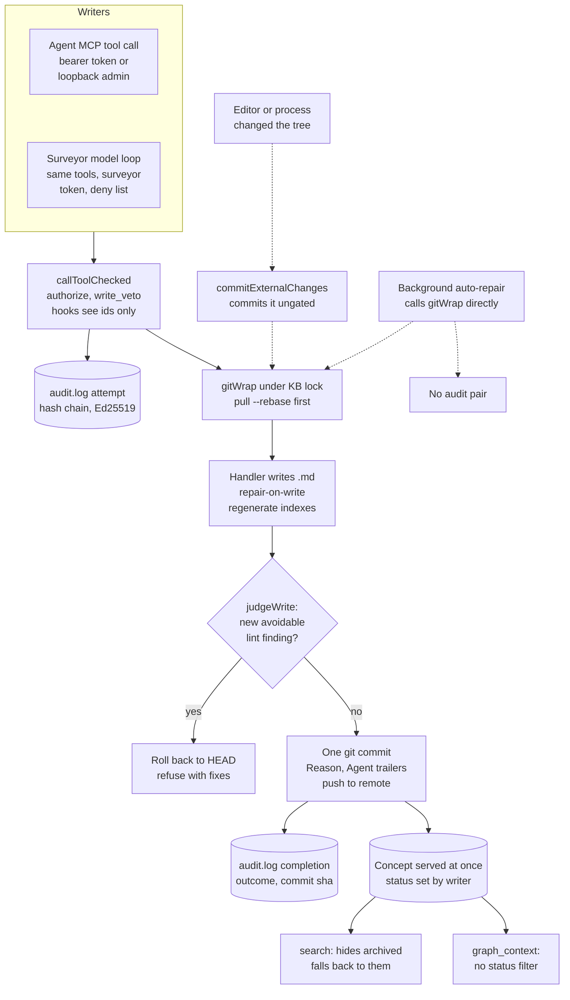

## 1. Executive Summary

Cartographer is a Go server, Meridian, that holds one or more team wikis
as git repositories of Markdown pages and is their only writer: agents in
Claude Code, Codex, OpenCode and other MCP clients read and write pages
through its tools, and every write is linted, committed and pushed. What is
notable is the write path and the audit: a write that adds a lint finding it
could have avoided is rolled back and refused, and every tool call leaves a
signed, hash-chained attempt and completion pair. What is weak is what the
wiki believes. A page is served the moment it is committed, its status is a
field the writing agent sets, and `graph_context`, one of the four entry
tools the server asks clients to keep loaded, returns archived and superseded
pages that `search` hides.

The "can't break" in the README is a claim about structure, not truth. The
gate checks links, frontmatter contracts, index entries, templates and
secrets (`internal/mcpserver/writegate.go:114`). It never asks whether a
statement is correct, and no person approves a page before it is served.

The same binary is also a configurator. Compass syncs a KB's skills,
subagents, hooks and MCP descriptors into each client. A person must approve
anything that executes, bound to its content hash. A skill or subagent made
only of text installs on every teammate's client without approval.

**Licence.** Apache-2.0 in the root `LICENSE`, with a `NOTICE` naming the
copyright holder and the bundled `gopkg.in/yaml.v3`; `CITATION.cff` states
the same licence. `web/package.json` carries no licence field. Nothing
restricts use.

Three marks are earned: `scope_enforced` on the token's map and type
selectors, `audit_log` on the audit trail, and `negative_eval` on populated
search tests. Section 9 gives the reason for each of the four withheld.

## 2. Mental Model

A memory is **a concept**: one Markdown page with YAML frontmatter, in a map
(grouped by theme) or a journal (dated entries) of a KB. The only required
field is `type`. The documented frontmatter adds `status`, `provenance`,
`confidence`, `valid_from`, `valid_to`, `superseded_by` and `review_after`,
and says the server ignores `confidence`, `valid_from` and `valid_to`
(`docs/data-plane.md:162-168`). Links between pages are the graph.

A concept is believed, in the sense of being served, from the commit that
writes it. There is no candidate state the server holds a page in:

- **Written.** An agent calls `concept_write`, `concept_new`, `concept_patch`
  or `concept_batch`. The write gate judges structure; if it passes, the page
  is committed and readable on the next call.
- **Retired.** `supersede` sets `status: superseded` and `superseded_by`
  (`internal/mcpserver/tools_write.go:1844-1846`). `concept_archive` moves the
  page to an archive map with `status: deprecated` by default, or `archived`.
  `kb.IsRetired` names those three statuses as "no longer current"
  (`internal/kb/linkgraph.go:29-31`).
- **Hidden.** Only `archived` is hidden from `search`, and `search` brings
  archived pages back when nothing live matches
  (`internal/mcpserver/tools_search.go:155`, `:168-173`).
- **Gone.** `concept_delete` removes the file. Git history keeps it, and
  `concept_history` reads it back.

`disputed` and `draft` are values in the documented vocabulary. Lint knows
`disputed` is not retired, and no read path excludes either.

Every move between these states is made by the same tools the writing agent
holds. The Surveyor, the optional model loop, holds them too, minus a deny
list of destructive tools (`internal/surveyor/allow.go:25-28`).

## 3. Architecture

One Go binary, `cartographer`, deployed as four components
(`README.md`, *The four components*). **Meridian** (`cartographer serve`) is
the server: MCP over HTTP or stdio, a REST API, and the **Atlas** web UI as a
switch of the same process. **Compass** (`cartographer connect`, `sync`) runs
on each developer machine and writes client configuration. The
**Surveyor** (`cartographer surveyor`) is a headless agent that calls a
model and the same MCP tools.

Persistence is a git working tree per KB, under the server's data directory,
pushed to a remote the operator gave it. Beside each tree sits a disposable
SQLite FTS5 index at `.cartographer/index.db` (`cmd/cartographer/serve.go:540-541`),
rebuilt from the files when its schema version changes
(`internal/sqlindex/sqlindex.go:1-21`). The link graph is an in-memory cache
re-validated by file stat on every read (`docs/data-plane.md:192`). The audit
trail is a JSONL file, `audit.log` or `<data>/audit/audit.log`, with rotated
segments and a signed checkpoint index (`cmd/cartographer/serve.go:1280-1333`).

Concurrency is serialised per KB. Every committing tool runs inside
`k.WithGitLock`, which pulls with rebase before the handler and pushes after
the commit, inline or on a debounced worker
(`internal/mcpserver/gitwrap.go:51-170`). A rebase conflict marks the files
degraded and surfaces as a guided workflow with its own tools
(`conflicts_list`, `git_conflict_resolve`).

Meridian calls no model. Search is keyword-only since 0.8.0, which removed
semantic search and the Ollama dependency (`CHANGELOG.md`, *Migration note*).
The Surveyor is the only component with a model client, for Anthropic,
OpenAI-compatible and HTTP providers (`internal/surveyor/anthropic.go`,
`openai.go`, `httpmodel.go`).

### Deployment and ergonomics

A single machine runs `cartographer setup`, which installs a local service,
creates the first KB against an empty git remote and connects every agent
client it detects (`README.md`, *Install and quick start*). Nothing else has
to run: no database server, no vector store, no API key. A shared server
needs bearer tokens; the server refuses to listen on a non-loopback address
without them (`cmd/cartographer/serve.go:1172-1183`). The store is plain
Markdown and YAML in git, readable in an editor or Obsidian and repairable by
hand, and a hand edit is committed by the server before its next write
(section 7).

## 4. Essential Implementation Paths

- **Dispatch and audit seam.** `internal/mcpserver/sdkbridge.go:258` is
  `callToolChecked`: authorization, the identity requirement for writes, the
  `write_veto` hooks, then `beginAuditCall` at `:355`, the handler, and
  `call.end` with the outcome. The audit record shapes are
  `internal/mcpserver/audit.go:37-90` (the resource allow-list), `:252`
  (attempt) and `:300-317` (completion, with `CommitSHA`).
- **Write wrapper.** `internal/mcpserver/gitwrap.go:51`: identity refusal
  `:60`, sync-in, re-authorization under the lock, `commitExternalChanges`
  `:85`, gate precheck `:99`, handler, index regeneration, `judgeWrite` `:119`,
  commit as the token's person `:138`, push `:159`.
- **Write gate.** `internal/mcpserver/writegate.go`: `gatedTool` `:41` (every
  `concept_*` tool but `concept_transfer`, plus `supersede` and
  `source_register`), `judgeWrite` `:114`, which stages the write into a
  quarantine object directory so a refused write leaves no blob behind.
- **Concept writers.** `internal/mcpserver/tools_write.go`: `concept_write`
  `:27`, `writeConceptAndLog` `:526`, `concept_patch` `:572`, `supersede`
  `:1789`, `concept_batch` `:3245`, `concept_delete` `:3703`;
  `internal/mcpserver/tools_archive.go:24` for `concept_archive`;
  `internal/kb/kb.go:1400-1416` for `WriteConcept` and its `if_match` rule.
- **Search.** `internal/mcpserver/tools_search.go`: handler `:117-256`,
  archived default and fallback `:155-173`, the backend filter `:568-586`,
  the centrality prior `:637`; FTS5 schema in `internal/sqlindex/sqlindex.go`.
- **Graph reads.** `internal/mcpserver/tools_graph.go`: `visibleGraph` `:38`,
  `rankNeighbours` `:79`, `graph_context` `:133-251`, `link_suggest` with its
  retired filter `:298`, `:367`; the related block in
  `internal/mcpserver/search_related.go:62-113`.
- **Access policy.** `internal/auth/auth.go:57-141`;
  `internal/mcpserver/policy.go:598-604` (`Visible`), `:747-785`
  (`allowedID`, `conceptClass`).
- **Audit store.** `internal/audit/audit.go`: `Entry` `:59-96`, `AppendEvent`
  `:576`, `appendDurable` `:658`, rotation `:710`, `VerifyAudit` `:1237`;
  opened in `cmd/cartographer/serve.go:1287`.
- **Background repair.** `internal/mcpserver/autorepair.go:743-800`.
- **Client provisioning and approval.**
  `internal/provisioning/provisioning.go:1622-1626`, `:3252-3291`;
  `internal/provisioning/approvalmigration.go:13-18`.

## 5. Memory Data Model

A KB is a directory with `data/<map>/<concept>.md`, journals with dated
slugs, an optional `services/` namespace, `skills/`, `agents/` and `hooks/`
for provisioning artifacts, a `glossary.yaml`, a root `log.md` and an
`instructions.md` (`docs/data-plane.md:19-70`). A concept id is its path
without the extension, so the map is the id's first segment. An expanded
concept is a directory whose `index.md` is the page, with satellites and
assets beside it.

Each map's `_map.md` can declare a contract: a type palette, required fields
per type, allowed values per field, forbidden fields, templates and
`read_whole` types (`docs/data-plane.md:133-142`). The contract is enforced by
lint, and lint is enforced on write by the gate.

Provenance is three things. The frontmatter `provenance` list is free text
the writer supplies. Each commit carries `Reason`, `Agent` and
`Cartographer-Token` trailers and is authored as the person behind the token
(`internal/mcpserver/gitwrap.go:124-138`, `internal/mcpserver/writerauthor.go:92`).
The `Agent` trailer is the MCP client's self-declared name, which the code's
own comment calls "an attribution hint, not an identity"
(`internal/mcpserver/gitwrap.go:378-384`). The audit trail is the third.

Temporal fields are record time only. `timestamp` and git commit dates are
what the server reads. `valid_from` and `valid_to` appear in Go only in two
frontmatter parse tests.

Scope has two layers. Across KBs it is a physical partition: one repository
each. Inside a KB the token's permission rules name maps, journals and types,
covered in section 9.

## 6. Retrieval Mechanics

Retrieval is tool-mediated. Four entry tools carry an always-load flag that
Claude Code and Antigravity honour: `atlas_overview`, `search`,
`concept_read` and `graph_context` (`docs/control-plane.md:57`). Nothing injects KB content into
a session automatically. The session-start hook syncs client configuration,
not pages (`docs/sync.md:48`).

**`search`** is keyword-only (`internal/mcpserver/tools_search.go:93-112`). On
FTS5 the index is a trigram tokenizer with diacritics removed and bm25 weights
5, 2 and 1 for title, metadata and body (`internal/sqlindex/sqlindex.go:1-10`);
without it, an in-memory index. All terms are required first; with fewer than
three full matches an any-term pass appends partial hits after them. A
glossary expands aliases into at most eight queries. A personalized-PageRank
percentile lifts a score by at most 20% (`:50`, `:637`). Twenty hits by
default, each with a 200-character snippet and the page's byte size so the
agent can choose an outline or a section read.

Archived pages are dropped inside the backend filter before the cut, so the
page of results stays full (`:568-586`). When nothing live matches and the
caller did not pass `include_archived`, the search runs again with archived
pages and flags the answer `archived_fallback` (`:168-173`). `superseded` and
`deprecated` pages are ordinary hits.

**The related block** under a search is `graph_context`'s ranking seeded from
the top hits, with every retired page left out
(`internal/mcpserver/search_related.go:98-100`).

**`graph_context`** takes a query or up to ten ids, seeds personalized
PageRank from keyword hits, and returns up to 30 neighbours over links in both
directions (`internal/mcpserver/tools_graph.go:133-251`). It seeds with
`skipArchived` false and calls `rankNeighbours` with no skip predicate
(`:183`, `:230`). An archived, deprecated or superseded page is returned like
any other, with no status field in the result.

So three read paths built on one ranking hold three different rules: search
hides archived, its related block hides all three retired statuses, and
`graph_context` hides none.

The read side records what it touched. `search` stamps the hits as surfaced,
`concept_read` stamps a read, and a whole-KB search with no hits is recorded
as a miss for `kb_status` (`tools_search.go:196-216`). Those records drive the
maintenance list, not ranking.

## 7. Write Mechanics

Writes happen on the hot path, synchronously, through MCP tools. The agent
blocks while the server pulls, writes, lints, commits and pushes; the push can
be moved to a debounced worker (`gitwrap.go:152-159`). The server calls no
model on the write path, so the lag before a page is searchable is the
duration of the call: the next search reconciles the index with the files.

The write sequence inside the lock (`internal/mcpserver/gitwrap.go:68-163`):

1. Pull with rebase. A conflict aborts the write.
2. Re-authorize the call against state the pull may have changed.
3. Commit any uncommitted changes in the tree as "external changes"
   (`:354-367`). This is how an edit made in an editor reaches history.
4. Refuse if an earlier failed write left files behind.
5. Run the handler. `concept_write` overwrites without a check unless the
   caller passes `if_match` (`internal/kb/kb.go:1400-1404`).
6. Repair what the write can fix safely, regenerate generated indexes.
7. `judgeWrite`: stage the result into a quarantine object store, lint the
   changed pages, and compare their findings with the findings at `HEAD`. A
   new finding of a check marked `AvoidableAtWrite` rolls the tree back and
   refuses with each finding and its fix. No setting turns the gate off and
   nothing accepts a finding (`writegate.go:18-27`).
8. Commit, authored as the token's person, with the caller's `reason`.
9. Push.

Three properties of step 7 matter. The gate fails open on a git problem that
leaves the tree intact, and it is skipped when the tree was not clean or the
repository has no commit (`writegate.go:67-79`, `:105-114`). In a KB that is
not a git repository there is no gate at all (`:46-50`). And a finding on a
page the caller cannot see is neither judged nor named, so a map-scoped
writer is not refused for what its write does to pages outside its maps
(`:110-113`).

The write response carries advice the gate does not act on. A new page whose
title nearly matches an existing one gets a `similar` list, archived pages
included. A written line already carried by enough other pages gets a
`repeated_fact` finding (`internal/mcpserver/factfinder.go:61`,
`internal/mcpserver/tools_review.go:166-188`). Both are review items, and
neither refuses.

Contradiction is a page type. A `Contradiction` concept with
`resolution_status: open` is reported by `contradiction_report` and blocks
`commit_gate`, which is a tool an agent calls, not a step of the write path:
`CommitGate` has callers only in `commit_gate` and `gate_check`
(`internal/mcpserver/tools_governance.go:370`, `:570`). `conflict_resolve`
closes one, and the Surveyor may call it.

### Operational cost

Every write costs a pull, a lint of the changed pages against `HEAD` and a
commit, under a lock that serialises writers on that KB. No background pass
rewrites the store. The periodic auto-repair applies a quota of safe fixes
per run in one commit (`internal/mcpserver/autorepair.go:743-800`). The
Surveyor's token spend is bounded per run by step and token limits
(`internal/surveyor/loop.go:20-36`). Reads inject nothing unless called; a
default search answer is held under 5 KB on average by a test
(`docs/control-plane.md:736`).

## 8. Agent Integration

Meridian registers about seventy tools (`internal/mcpserver/tools.go:50`), and
the default agent profile hides the operator ones from `tools/list` while
keeping them callable (`internal/mcpserver/visibility.go`, `advancedToolNames`).
The agent is expected to search before it writes and to write what it learns;
the operating guide arrives in the MCP `initialize.instructions`
(`docs/control-plane.md:66`).

Compass makes the integration portable. It writes MCP entries, a session-start
hook that runs `cartographer sync` at most every ten minutes, and a
`PostToolUse` hook that returns write findings to the agent as feedback it
must act on, in each client's own channel (`docs/sync.md:48-50`). It also
projects the KB's skills, subagents, hooks and MCP descriptors into each
client's format. A KB artifact waits for a person's `cartographer approve`
only when it is an MCP descriptor, a hook, ships an executable file, or
declares hooks or MCP servers (`internal/provisioning/provisioning.go:3252-3291`).
Everything else, including a skill an agent just wrote with `artifact_write`,
is installed at the teammate's next sync.

The Surveyor is the same integration with a model inside the server's trust
boundary: a loop of at most 30 steps and 200,000 tokens by default that sees
the read tools and the write tools a task allows
(`internal/surveyor/loop.go:20-36`, `internal/surveyor/allow.go:25-40`).

## 9. Reliability, Safety, and Trust

### The gate guards structure, not belief

The write gate is the strongest part. It is one enforcement point for every
concept writer, it judges the final diff rather than the request, and a
refusal leaves no object in the repository, not even the blob of the refused
text (`writegate.go:115-121`). Twenty-nine tests are named for it.

What it guards is that the wiki stays well-formed: links resolve, contracts
hold, indexes list their pages, no secret is committed. A wrong statement with
good links passes, and is served on the next call to every agent of the team.
`write_veto` hooks can refuse a write, but they see the tool name, the
principal and the allow-listed identifiers, never the content
(`internal/mcpserver/writeveto.go:52-80`, `docs/hooks.md:70-88`).

### The sole writer has a side door

The README calls Meridian the only writer of a KB. Inside the server that
holds: every committing tool goes through `gitWrap`. Two paths reach the
history without the gate. An edit made in the working tree by an editor or
another process is committed by `commitExternalChanges` before the next tool
call, under the server's name with the reason `uncommitted changes found
before <tool>` (`gitwrap.go:354-367`). And a commit pushed to the remote by
anyone with push access arrives through the pull at the start of every write.
Lint reports both afterwards; neither is refused.

### Status is a lifecycle field the writer sets

Retirement is written by the same agent tools as content, and its effect on
reads depends on the tool. `graph_context` returns retired pages with no
marker (section 6), so an agent that follows the documented one-call reading
path can be handed the superseded page as context.

### Audit

The audit trail is on by default (`serve.go:1280`) and records every tool
call, reads and refusals included, as an attempt and a completion. Entries
chain by hash and are signed; rotated segments are checkpointed before
retention may delete them, and the checkpoint index is signed too
(`internal/audit/audit.go:185-203`). `cartographer audit verify` takes the
public key from the operator. In `required` mode a failed attempt append
rejects the call before it runs (`internal/mcpserver/audit.go:252-287`).

Four limits:

- **No content.** An entry holds the tool, the principal hash, allow-listed
  identifiers and the commit sha. What changed is in git, linked by the sha.
- **`concept_batch` records no ids.** It has no entry in
  `auditResourceFields`, so a batch of many writes is one pair naming only the
  commit (`internal/mcpserver/audit.go:37-90`).
- **Background auto-repair is not audited.** It wraps the handler in
  `gitWrap` and calls it directly, outside `callToolChecked`
  (`internal/mcpserver/autorepair.go:767-773`). Its runs go to a separate
  pruned log (`:157-175`).
- **`graph_context`'s free-text query is recorded.** The allow-list's own
  comment excludes "free-text query strings", and the `graph_context` entry
  lists `query` (`audit.go:30`, `:56`).

### Scope

Inside a KB, a token's rules select maps, journals and concept types, and
`Policy.Allows` requires one rule to match all three
(`internal/auth/auth.go:127-141`). The map comes from the concept id and the
type from the page's frontmatter (`policy.go:763-785`), and the predicate runs
inside the search backend filter and in the construction of every graph view.
A hidden page is indistinguishable from a missing one on `concept_read`
(`policy_retrieval_test.go:74-83`). The values come from server-side token
configuration, not from the model.

Two edges. On a loopback listener with authentication off, every caller is
the local admin (`internal/auth/auth.go:520-523`). And because the type
selector reads the page's own `type`, a writer allowed to change a page's
type within a map it may write can move the page into or out of another
token's view.

### Marks

- **`scope_enforced` — earned.** Map, journal and type keys are applied as a
  predicate on every concept read, from token configuration.
- **`audit_log` — earned.** An append-only, signed hash chain of every tool
  call in the server's own data, with the commit sha of each write. It does
  not cover background auto-repair, external edits swept into a commit, or
  the content of a change.
- **`negative_eval` — earned.** Populated tests require an archived page, a
  hidden page and a deprecated neighbour to be absent, each beside a positive
  control.
- **`trust_state` — withheld.** `status` is a discrete field with retired
  values and a producer, and two reads exclude on it. It is a lifecycle state
  the writing agent sets, `disputed` excludes nothing, and the entry tool
  `graph_context` filters none of it.
- **`tombstone` — withheld.** Supersede, archive and delete act on a page path;
  the root `log.md` records retirements by path
  (`internal/kb/retirements.go:10-27`). Nothing keyed on a value stops the
  same statement being written again.
- **`bitemporal` — withheld.** `valid_from` and `valid_to` are documented free
  fields that no code reads.
- **`human_review` — withheld.** A page is served from its commit. The one
  approval a person gives, `cartographer approve`, is for executable
  artifacts on a client machine, not for memory content. The Atlas is
  read-only for concepts, and `conflict_resolve` is on the agent's surface.

## 10. Tests, Evals, and Benchmarks

I ran none of the suites. The counts are from reading: 7,607 Go test
functions in 1,054 files, 1,558 of them in `internal/mcpserver`.

Memory-specific tests that can fail:

- **Archived exclusion.** `TestSearch_ArchivedHiddenByDefault` seeds a live
  and an archived page that both match `gateway`, requires exactly the live
  one, then both with `include_archived`; `TestSearch_ArchivedFallback`
  requires the fallback flag and its absence under an explicit false
  (`internal/mcpserver/archived_test.go:40-71`).
- **Scope leaks.** `TestSearchSectionNeverLeaksAHiddenConcept` requires a
  map-scoped search to omit a hidden page that shares the query term and to
  contain the visible one (`internal/mcpserver/searchsection_test.go:132-151`).
  `TestPolicyRetrievalFiltersMixedVisibility` checks six tools for hidden ids
  but asserts nothing present, so it would pass on empty answers
  (`internal/mcpserver/policy_retrieval_test.go:56-72`).
- **Retired neighbours.** The related block must omit a deprecated neighbour
  and include a live one (`internal/mcpserver/search_related_test.go:122-146`).
- **Audit chain.** Hash chain, tamper detection, invalid signature and
  incomplete-attempt cases in `internal/audit/audit_test.go:121-381`; the
  attempt and completion pair in `internal/mcpserver/audit_test.go:57-93`.
- **Write gate.** Twenty-nine `TestWriteGate_*` cases across the
  `internal/mcpserver` tests.

No test found asserts what `graph_context` returns for an archived or
superseded page.

`test/usage/` is an agent-level harness: seven task files, each run by a
headless agent CLI against the binary, judged by shell assertions on the
transcript and the KB rather than by a second model
(`test/usage/run.sh:1-30`). It runs on a maintainer's machine, not in CI, and
no result is committed. `docs/control-plane.md:736` cites a benchmark behind
restoring the 20-hit default; its data is not in the tree.

`CITATION.cff` cites the software. No paper is referenced.

## 11. For Your Own Build

### Steal

- **Gate the final diff, not the request.** Run the write, lint what changed
  against `HEAD`, and refuse only findings the write introduced and could have
  avoided. Pre-existing debt never blocks an unrelated edit.
- **Quarantine the refused write's objects.** Staging into a throwaway object
  directory means a refused secret never lands as a blob.
- **Audit as an attempt and a completion pair.** An attempt with no
  completion is evidence the server stopped mid-call, and the next start
  closes it as `interrupted`.
- **Hand the verifying key to the operator.** The verifier takes the public
  key as an argument rather than reading it from the log it checks.
- **Make hidden and missing the same answer.** A scoped caller cannot probe
  for a page by the error it gets.

### Avoid

- **Several read paths with their own status rule.** Put the retired filter in
  the shared ranking, or the most convenient tool becomes the one that serves
  the superseded page.
- **Sweeping external edits into a commit before the gate.** If the store is
  editable outside the gateway, either refuse to write over unexplained
  changes or lint them as part of the next write.
- **An audit seam that background jobs walk around.** The unattended writer is
  the one most worth recording.
- **A text artifact that installs on every machine without review.** Skills and
  subagents steer agents as much as hooks do.

### Fit

This suits a team that wants its agents' notes as a wiki people can also read
and repair, with git as the backup and sync layer and an audit an operator
can verify, and that accepts the agents as the editors. The cost is
operational: a single binary, but a git remote per KB, tokens per person and
client, and a server that serialises writes per KB.

It does not suit a reader who needs memory to be reviewed before it is
believed, or a correction to stay corrected. The design governs whether the
wiki is well-formed and who changed it, and leaves what it says to whoever
writes next.

## 12. Open Questions

- Is `graph_context`'s lack of a status filter intended? Its shared ranking
  is credited to D242 and D781 in code comments, and no comment states a
  reason for leaving retired pages in.
- How often does the external-changes commit fire on a shared server? It
  depends on whether operators edit the working tree directly.
- Does any deployment use `write_veto` hooks to route writes to a person? The
  hook sees no content, so it could only gate by tool, principal and id.
- What did the benchmark behind D1354 measure, and on which KB?

## Appendix: File Index

| Path | Role |
| --- | --- |
| `internal/mcpserver/sdkbridge.go` | `callToolChecked`: authorization, veto hooks, audit seam |
| `internal/mcpserver/gitwrap.go` | The write wrapper: lock, pull, external changes, gate, commit, push |
| `internal/mcpserver/writegate.go` | `gatedTool`, `judgeWrite` |
| `internal/mcpserver/tools_write.go` | Concept writers, supersede, delete, batch |
| `internal/mcpserver/tools_archive.go` | `concept_archive` |
| `internal/mcpserver/tools_search.go` | Search, archived filter and fallback, centrality prior |
| `internal/mcpserver/tools_graph.go` | `graph_context`, `link_suggest`, `rankNeighbours` |
| `internal/mcpserver/search_related.go` | The related block and its retired filter |
| `internal/mcpserver/policy.go`, `internal/auth/auth.go` | Token policy and the visibility predicate |
| `internal/mcpserver/audit.go`, `internal/audit/audit.go` | Audit events, chain, signatures, rotation, verify |
| `internal/mcpserver/autorepair.go` | Background repair |
| `internal/kb/kb.go`, `internal/kb/linkgraph.go`, `internal/kb/retirements.go` | Concept storage, status predicates, retirement log |
| `internal/sqlindex/sqlindex.go` | FTS5 index |
| `internal/provisioning/provisioning.go` | Client artifact install and approval gate |
| `internal/surveyor/allow.go`, `internal/surveyor/loop.go` | Surveyor tool allowlist and limits |
| `docs/data-plane.md`, `docs/control-plane.md`, `docs/sync.md`, `docs/hooks.md` | Project documentation, read as claims |

### Recorded searches

Run from the repository root at the pinned commit with `git grep`.

- **Validity fields are read by no code.**
  `git grep -n -E 'valid_from|valid_to|ValidFrom' -- '*.go'` returns four
  lines, all in `internal/okf/frontmatter_test.go`;
  `git grep -n 'review_after' -- 'internal/*.go' ':!*_test.go'` matches
  production code.
- **`disputed` filters nothing.**
  `git grep -n -w 'disputed' -- 'internal/*.go' 'cmd/*.go' ':!*_test.go'`
  returns two comments, in `internal/kb/linkgraph.go:27` and
  `internal/lint/structure.go:44`.
- **Retired-status filters are on three reads.**
  `git grep -n -E 'IsRetired\(|retired\(' -- 'internal/*.go' 'cmd/*.go' ':!*_test.go'`
  outside `internal/lint` returns `search_related.go:98`, `tools_graph.go:298`,
  `:367`, the web UI's retired listing and the test KB generator.
- **The commit gate is advisory.**
  `git grep -n -E 'GateBlockers|CommitGate\(|commitGate' -- 'internal/*.go' ':!*_test.go'`
  returns the definitions in `internal/kb/gate.go` and the two tool callers in
  `tools_governance.go:370` and `:570`.
- **No approval of memory content.**
  `git grep -n -i -E 'approv|proposal|pending_review|awaiting' -- 'internal/*.go' ':!*_test.go'`
  returns client configuration, MCP and artifact approvals in
  `internal/clientconfig` and `internal/provisioning`, and an HTTP timeout
  message.
- **The web UI has no concept write route.**
  `git grep -n -E 'MethodPost|MethodPut|MethodPatch|MethodDelete|"POST"|"PUT"' -- 'internal/mcpserver/*.go' ':!*_test.go'`
  returns component, client-settings, Surveyor, usage and MCP handlers.
- **`concept_batch` and `kb_repair` have no audit resource entry.**
  `grep -n -E 'concept_batch|kb_repair' internal/mcpserver/audit.go` returns
  nothing; `grep -n 'concept_merge' internal/mcpserver/audit.go` matches.
- **Auto-repair bypasses the audit seam.**
  `git grep -n -E 'beginAuditCall\(' -- 'internal/*.go' ':!*_test.go'`
  returns the definition and two calls, both in `sdkbridge.go`.
- **No paper.**
  `git grep -n -i -E 'arxiv|bibtex|@article|@misc|doi\.org' -- README.md 'docs/*.md' CITATION.cff`
  returns nothing; `git grep -n -i 'benchmark' -- README.md 'docs/*.md'`
  matches `docs/control-plane.md:736`.
- **No submodules.** `.gitmodules` is absent.

## History

**2026-11-24** — [`98be02aab51f557700ad6476f7af5d263c4776d1`](https://github.com/BeppeTemp/cartographer/commit/98be02aab51f557700ad6476f7af5d263c4776d1). First reading, from a full clone at the head of `main`; triage had selected `5a3a39085751`, 53 commits earlier. Screened first: one auto-run surface, `server.json`, an MCP registry manifest declaring a start command, which was not run; nothing inside the seven-day cooldown; one build-time execution point, the `Makefile`; one unpinned surface, `web/package.json`, with a lockfile. `AGENTS.md`, `CLAUDE.md` and the docs were read as data. Nothing was installed, built or run, and the test counts were not run. Three marks: `scope_enforced`, `audit_log` and `negative_eval` ([section 9](#9-reliability-safety-and-trust)).
