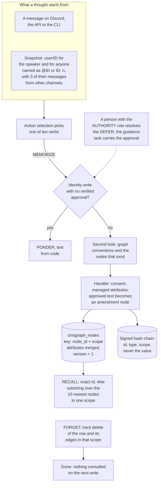

## 1. Executive Summary

CIRIS Agent is a Python agent runtime whose memory is a typed graph of nodes
and edges, stored by a separate Rust engine. The agent writes memory by
choosing a `MEMORIZE` action and supplying the whole node; a context builder
reads parts of the graph into every thought. What is notable is the governance
around identity: a write to the agent's identity is refused in code unless a
person holding the AUTHORITY role has resolved a deferral and the approval
verifies, and every action lands in an Ed25519-signed hash chain. What is weak
is retrieval and forgetting. The model's search sees only the ten newest rows
in a scope, a hard delete leaves nothing behind, and the 14-day consent expiry
and the DSAR deletion path delete no data.

The project is large and mostly not about memory. It ships a multi-pass
decision pipeline (several decision-making passes, action selection, then
conscience checks), a Discord moderator, mobile apps, federation between nodes,
and localisation into 29 languages. The graph also holds configuration,
telemetry, audit summaries and consent records. The licence is AGPL-3.0, and the NOTICE file asserts patent-pending
technology and requires a CLA from contributors.

Five findings shape the rest of this report.

- **Search reads a window, not the store.** A model `RECALL` that misses on an
  exact id falls back to `search`, which fetches the newest rows of one scope,
  up to the recall limit of 10, and substring-filters them
  (`ciris_engine/logic/handlers/memory/recall_handler.py:79-92`,
  `ciris_engine/logic/services/graph/memory_service.py:744-777`). Telemetry
  writes metric nodes into the same local scope on every thought.
- **Naming someone loads their memory.** The context builder enriches a user
  profile for every `<@ID>` or `ID: n` in the thought text, with up to three
  of that user's messages from other channels
  (`ciris_engine/logic/context/system_snapshot_helpers.py:1463-1480`,
  `:1756-1786`).
- **The approval and the stored text are separate events.** A person approves
  a deferral; the amendment text is whatever the model then writes in the
  guidance task (`ciris_engine/logic/infrastructure/handlers/shared_helpers.py:242-302`).
- **Forgetting is a hard delete with no residue.** `cirisgraph_delete_node`
  with `hard=true` deletes the row and its edges in that scope and writes no
  record (ciris-persist `src/graph/sqlite.rs:521-561`).
- **Expiry is declared, not run.** `GraphNode.expires_at` never reaches
  storage, and the cleanup that would delete expired consent searches for a
  node shape no writer produces
  (`ciris_engine/logic/services/governance/consent/service.py:818-881`).

One mark, `audit_log`. Section 9 names the six withheld.

## 2. Mental Model

A memory is a node the agent decided to write. The decision pipeline evaluates
each thought, action selection picks one of ten verbs, and `MEMORIZE` carries a
complete `GraphNode` — id, type, scope and attributes — in its parameters
(`ciris_engine/schemas/actions/parameters.py:106-116`). A second pass then
shows the model the graph's addressing conventions and the nodes that already
exist, and it re-decides; the code calls this a second opinion and refuses to
rewrite the node for it (`ciris_engine/schemas/dma/msaspdma.py:1-37`).

Once stored, a node is believed. There is no candidate state, no confidence
field the reads consult, and no distinction between a fact a user stated and
one the model inferred. The node's `version` counts upserts and the
`updated_by` string names the writer, and nothing reads either to decide what
is true.

The scopes are kinds of memory, not owners. `local` holds what the agent
learns, including user profiles and telemetry; `identity` holds the agent's
identity and its approved amendments; `environment` holds deployment
configuration; `community` is defined and rarely written
(`ciris_engine/schemas/services/graph_core.py:39-45`). Only the transition into
`identity` or `environment` is governed. A local write needs no approval, and
any read may name any scope.

A memory stops being believed in one of three ways. An upsert merges new
attributes over the old ones and keeps no prior version. `FORGET` deletes the
row. Expired consent blocks further writes to that user's node and records a
decay that never completes. Nothing supersedes, nothing decays by age, and
nothing marks a node as disputed.

## 3. Architecture

The agent is one Python process with a service registry and typed buses; the
memory bus routes `memorize`, `recall`, `search` and `forget` to
`LocalGraphMemoryService` (`ciris_engine/logic/buses/memory_bus.py`,
`ciris_engine/logic/services/graph/memory_service.py:48-70`). Since release
2.9.0 that service holds no SQL. Every graph call goes through
`ciris_engine/logic/persistence/models/graph.py` to a module-level PyO3
`Engine` from the `ciris-server` wheel, falling back to the standalone
`ciris_persist` wheel (`ciris_engine/logic/persistence/_substrate.py:22-35`).

The engine is CIRISAI/CIRISPersist, read here at tag `v59.1.2`, commit
`94a7b15793772543a4a987e447e0b7a1a79e48e0`, the version CIRISServer
`v0.5.243` pins in its `Cargo.toml`. It owns the schema, the paging, the
delete semantics and the audit chain, and it runs on SQLite or Postgres. The
same engine stores tasks, thoughts, correlations, federation rows and the
audit log, so memory shares a database and a writer with everything else.

Background work runs as services on fixed cadences. TSDB consolidation
summarises telemetry every six hours, weekly and monthly, and prunes summaries
past retention through `engine.tsdb_prune_summaries`
(`ciris_engine/logic/services/graph/tsdb_consolidation/service.py:115-140`,
`:345-375`). The cognitive states — wakeup, work, play, dream, solitude,
shutdown — schedule their own thoughts; the dream state's consolidation edges
go through `DreamMemorizeHandler`
(`ciris_engine/logic/handlers/memory/memorize_handler.py:63-82`).

### Deployment and ergonomics

- **What runs:** the agent process and its embedded Rust engine. SQLite is the
  default; Postgres is supported by DSN. No vector service and no queue.
- **Local and offline:** storage is local. Every thought calls an LLM several
  times through the decision pipeline, so nothing useful happens without a
  model endpoint, local or hosted.
- **API key:** none is needed to store a node, but nothing stores a node
  without a thought, and a thought needs a model.
- **Install:** a Python package, Docker compose files, installers for desktop
  and mobile. The engine arrives as a prebuilt abi3 wheel; building it means
  building CIRISServer.
- **Repairable by hand:** the store is a SQLite file with readable JSON
  attributes. The rows carry signature and hash columns that a hand edit does
  not update, but nothing in the graph code verifies them (ciris-persist
  `src/graph/` holds no verifier).

## 4. Essential Implementation Paths

**Capture and write.** `MemorizeHandler.handle` validates `MemorizeParams`,
checks consent and managed attributes for user nodes, refuses identity writes
without `wa_authorized`, converts an approved identity write into an amendment
and has the node sign it, transforms config nodes, then calls
`bus_manager.memory.memorize`
(`ciris_engine/logic/handlers/memory/memorize_handler.py:53-158`).
`LocalGraphMemoryService.memorize` replaces secrets in the attributes with
references, then runs `add_graph_node` on a worker thread
(`memory_service.py:72-91`, `:272-316`). `add_graph_node` reads the stored
row, merges attributes, and calls `cirisgraph_upsert_node` with the stored
version as `expected_version` (`ciris_engine/logic/persistence/models/graph.py:240-344`).

**The gate before the handler.** When action selection picks `MEMORIZE`,
`_maybe_run_msaspdma` first refuses an identity write with no verified
approval, replacing it with a `PONDER` whose text comes from code, and only
then runs the second pass
(`ciris_engine/logic/processors/core/thought_processor/main.py:784-911`).
Conscience checks run on `MEMORIZE` and `FORGET` and skip `RECALL`
(`ciris_engine/logic/processors/core/thought_processor/conscience_execution.py:154-161`).

**Retrieval.** `RecallHandler._perform_recall_query` tries an exact
`(node_id, scope)` recall, then `search`, then a typed wildcard
(`recall_handler.py:55-109`). Search parses `type:` and `scope:` prefixes out
of the query, fetches nodes, and keeps those whose id or serialised attributes
contain any term (`memory_service.py:744-777`, `:1170-1208`).

**Context assembly.** `build_system_snapshot_with_batch` gathers identity,
channel and user profiles per thought; `_extract_user_ids_from_context` takes
ids from the task, the thought context, the correlation and the thought text
(`ciris_engine/logic/context/batch_context.py:794-805`,
`system_snapshot_helpers.py:1450-1545`). `_enrich_single_user_profile` recalls
`user/ID` with edges to depth 2 and `preferences/ID`, and creates the user
node if it is missing (`system_snapshot_helpers.py:1789-1842`). Identity comes
from `export_identity_context`, the core node plus every amendment
(`memory_service.py:237-270`).

**Correction and deletion.** `ForgetHandler` refuses identity and environment
scope without approval and calls `bus_manager.memory.forget`
(`ciris_engine/logic/handlers/memory/forget_handler.py:50-107`), which calls
`delete_graph_node` with `hard=True` (`graph.py:401-417`).

**Schema.** ciris-persist
`migrations/sqlite/lens/V013__cirisgraph_nodes_edges.sql:34-79`; the agent's
pydantic types in `ciris_engine/schemas/services/graph_core.py:127-178`.

**Background.** `TSDBConsolidationService`
(`ciris_engine/logic/services/graph/tsdb_consolidation/service.py`); consent
decay in `ciris_engine/logic/services/governance/consent/decay.py:55-166`.

**API.** `ciris_engine/logic/adapters/api/routes/memory.py` for store, query,
delete, timeline, stats, visualisation and edges;
`ciris_engine/logic/adapters/api/routes/wa.py:310-471` for resolving a
deferral.

## 5. Memory Data Model

A node is `(node_id, scope)` with `node_type`, an `attributes` JSON document,
`version`, `updated_by`, `updated_at` and `created_at`, plus five envelope
columns for a signature and hashes (ciris-persist
`V013__cirisgraph_nodes_edges.sql:34-54`). The table has no status, no
validity interval, no expiry, no deletion marker and no owner or tenant key.
Edges carry source, target, scope, relationship, weight and attributes, and
have no foreign key, so an edge can outlive the node it names (`:62-79`).

The pydantic `GraphNode` declares two fields the table does not have:
`consent_stream`, defaulting to `TEMPORARY`, and `expires_at`
(`graph_core.py:143-149`). `add_graph_node` does not put either in the payload
(`graph.py:324-338`), and `_node_from_persist_json` does not read them back
(`graph.py:189-208`). So every node returns with the defaults, whatever its
writer set.

Twenty-two node types share the table (`graph_core.py:48-73`). A user is
`user/ID` of type `user`; the setup wizard's preferences are
`preferences/ID` of type `concept`; consent records live under two different
ids, `consent_user/ID` from the user-creation side effect (`graph.py:346-373`)
and `consent/ID` from `ConsentService` (`consent/service.py:138`, `:200`).
Telemetry metrics and log lines are `tsdb_data` nodes in local scope
(`memory_service.py:576-630`, `:657-742`). Several user attributes are
managed — `last_seen`, `trust_level`, `oauth_email` and others — and the
handler refuses a write that changes one (`shared_helpers.py:357-400`).

The engine's upsert is `INSERT … ON CONFLICT(node_id, scope) DO UPDATE …
WHERE version = expected` and overwrites the row in place (ciris-persist
`src/graph/sqlite.rs:384-481`). A soft delete exists in the engine
(`hard=false` sets `attributes._deleted`), and nothing reads `_deleted`; the
agent always passes `hard=True` (`sqlite.rs:551-556`, `graph.py:411`).

## 6. Retrieval Mechanics

Retrieval is lookup and substring match. There are no embeddings, no lexical
index and no ranking. Three paths exist.

- **Exact:** `cirisgraph_get_node(node_id, scope)`.
- **Wildcard:** `cirisgraph_query_nodes` with a scope and an optional type,
  paged at up to 100 rows (`graph.py:520-586`).
- **Search:** the same paged query, cut at the caller's limit, then a Python
  substring test on the id and the attribute JSON (`memory_service.py:744-777`,
  `:1190-1208`).

The engine pages `ORDER BY updated_at DESC, node_id DESC` (ciris-persist
`src/graph/sqlite.rs:861-862`), so a search sees the most recently updated
rows of one scope and nothing older. The model's `RECALL` passes its `limit`,
default 10, into the search filter (`parameters.py:119-128`,
`recall_handler.py:83-86`). The telemetry service writes every operational
metric as a local-scope node (`ciris_engine/logic/services/graph/telemetry_service/service.py:225-230`),
and the comment at `memory_service.py:82-84` puts metric writes at about forty
per thought. Inferred from those three facts, without running it: on a busy
agent, an untyped `RECALL` over local scope searches ten metric nodes. A
`RECALL` naming a `node_type` searches the ten newest of that type, and an
exact id works at any age.

The context builder does not search. It recalls by constructed id —
`user/ID`, `preferences/ID`, `channel/ID`, `agent/identity` — so what reaches
every prompt is decided by who appears in the thought, not by relevance. The
user ids come from four places, one of which is a regex over the thought text
for Discord mentions and `ID: n` (`system_snapshot_helpers.py:1463-1480`). For
each id, the profile carries connected nodes to depth 2 and up to three of
that user's messages from other channels, found by paging the correlation
store newest-first in pages of 200 and filtering tags in Python
(`:1756-1786`, `:2215-2305`). The cost is that any participant who writes
`<@ID>` in one channel places that user's recent messages from other channels
in the thought; nothing checks that the speaker could see those channels.

Recall bounds its output by marking a result `truncated` past 10,000
characters (`recall_handler.py:149-157`). The snapshot sits in every decision
prompt and changes with every message, so it is outside any provider's prompt
prefix cache by construction.

## 7. Write Mechanics

Writes are explicit and synchronous inside the thought. The model chooses
`MEMORIZE` and authors the node; the second pass, the conscience checks and
the handler each cost an LLM call or a check before the upsert, and the node is
retrievable by exact id as soon as the upsert returns. No extraction runs over
conversations. The context builder writes too: it creates a `user/ID` node with
defaults the first time it sees an id it cannot recall
(`system_snapshot_helpers.py:1684-1753`), and that write passes no consent or
managed-attribute check.

An update is a merge. `add_graph_node` reads the stored attributes, overlays
the new ones, and upserts with the stored version, so a write can add or
change keys and cannot remove one (`graph.py:284-341`). Concurrent writers
collide on `expected_version` and the second one raises. There is no
deduplication beyond the primary key; the second pass exists because the model
used to invent a fresh UUID for every fact, which nothing would ever read back
(`msaspdma.py:12-31`).

The writer of a fact about a user is not checked against the user.
`_validate_user_node` checks the subject's consent and the managed attributes,
and nothing compares the node's user to the speaker
(`memorize_handler.py:252-292`). Consent decides whether the subject may be
written about; it does not decide who may write.

Secrets are the one input filter. Attributes are serialised and passed through
`SecretsService.process_incoming_text`, which replaces detected secrets with
references; they are decrypted again only for `speak` and `tool` actions
(`memory_service.py:272-363`). Without a secrets service the write proceeds
with a warning.

### Operational cost

- **Synchronous:** yes. A memory write is a thought's action, and the agent
  does nothing else in that thought. The write itself is a read and an upsert
  on a worker thread.
- **Lag:** none for exact recall. A node is visible to search only while it is
  among the newest rows of its scope.
- **Whole-store passes:** none over memory content. Telemetry consolidation
  runs every six hours over the period's metrics.
- **Read cost:** the snapshot is built for every thought, including a recall
  per named user, a depth-2 edge walk, and a correlation scan that can page
  through the whole message history when a user has fewer than three messages
  elsewhere.

## 8. Agent Integration

The agent has three memory verbs among ten and no memory tools in the MCP
sense. `MEMORIZE`, `RECALL` and `FORGET` are action types the decision
pipeline selects, with typed parameters (`parameters.py:106-142`). The model
has full authority over local memory: it names the node, the scope, and every
attribute. `ForgetParams` declares `no_audit`, and nothing reads it
(`parameters.py:138`; the search is in the appendix).

Memory reaches the model in two ways: the snapshot, assembled for every
thought, and the follow-up thought a `RECALL` creates with its results. The
agent identity block is the core `agent/identity` node with every approved
amendment folded into its description (`memory_service.py:237-270`).

People reach memory through the API. ADMIN users store and delete nodes
directly; OBSERVER users query, browse a timeline and recall by id, filtered to
nodes whose `created_by` is their own; any OBSERVER can request the
visualisation and edge listings unfiltered (`routes/memory.py:328-844`). The
`ciris_sdk` package wraps the same routes.

Adapting the memory layer to another agent would mean taking the Rust engine
and the graph conventions without the decision pipeline. The handlers assume
`DispatchContext`, the thought lifecycle and the bus manager throughout.

## 9. Reliability, Safety, and Trust

**Identity is the governed part, and the governance is real.** An identity
write is refused before any model judges it unless the task carries a
`WAAuthorization` (`thought_processor/main.py:851-911`). That object has one
constructor, `WiseAuthorityService.resolve_deferral`, which builds it only
when the resolution verifies, and attaches it to a new guidance task
(`ciris_engine/logic/services/governance/wise_authority/service.py:854-1101`).
The only caller is `POST /wa/deferrals/{id}/resolve`, which requires the
AUTHORITY role (`routes/wa.py:310-471`,
`ciris_engine/logic/adapters/api/dependencies/auth.py:730`). No action
parameter carries an approval, so the model cannot grant one. Where the node
authors deferral rows, it signs `identity_amendment:v1` before the write and
refuses a second amendment on one approval (`memorize_handler.py:160-223`).

**`human_review` is withheld, and the reason is what gets approved.** The
person resolves a deferral and writes guidance. The amendment text is then
composed by the model in the guidance task — the node's `content`, or every
authored attribute joined — and nothing compares it with what the person saw
(`shared_helpers.py:242-302`). Every thought of that task is authorised
(`ciris_engine/logic/utils/context_utils.py:119-126`). Without deferral rows
the one-approval rule is not enforced and the amendment is written unsigned
(`memorize_handler.py:187-201`). The rubric's test is whether a memory waits
until an actor the agent cannot be resolves *it*; here the actor resolves the
request, and the memory is written afterwards by the producer.

**`audit_log` holds on the action loop.** The dispatcher audits every handler
completion, failure, refusal and timeout
(`ciris_engine/logic/infrastructure/handlers/action_dispatcher.py:543-599`),
and `log_action` appends to the engine's `cirislens_audit_log`: SHA-256 entry
hash, `prev_hash`, an Ed25519 signature from the node's key, and a sequence
the engine requires to be tail+1 (`audit_service/service.py:275-337`,
`:1236-1375`; ciris-persist `src/audit/sqlite.rs:350-450`). The record names
the node id, type and scope as the model proposed them, never the value
(`shared_helpers.py:779-814`). Two limits matter. Append-only is enforced in
application code with no trigger, so a direct `UPDATE` goes through and only
`verify_chain` notices. And the ADMIN `/memory/store` and `DELETE /memory`
routes call the memory service directly, with no audit entry.
`cleanup_old_entries` would prune the chain and has no caller
(`audit_service/service.py:877-1005`).

**`scope_enforced` is withheld: the scopes are not a boundary between
people.** The engine requires a scope on every query and applies it; the model
chooses that scope on every read (`recall_handler.py:58`). The OBSERVER filter
on the API is a real per-user predicate on `created_by`, applied after the
fetch on the query, timeline and recall routes (`routes/memory.py:369-425`,
`:752-824`). `build_user_filter_sql`, the "Layer 1" SQL predicate those routes
cite, has no caller (`routes/memory_filters.py:32-55`). The visualisation
returns up to 1,000 node ids, types and scopes, and the edge listing returns
edges, with no user filter (`routes/memory.py:659-750`). The agent's own reads
have no user predicate at all, and the snapshot pulls other users' messages
by mention (section 6).

**`tombstone` is withheld.** A hard delete removes the row and its edges and
writes nothing; a later write of the same id is a fresh insert, and nothing
records the forgotten value (ciris-persist `src/graph/sqlite.rs:521-561`).
The audit entry for a `FORGET` keeps the id and the model's reason.

**`trust_state` and `bitemporal` are withheld.** The table has no status
column and no validity time. `version` counts writes, and `updated_at` is
record time.

**Consent expiry and deletion do not delete.** On an expired TEMPORARY
consent, the handler blocks the write and calls `revoke_consent`
(`shared_helpers.py:439-452`), which starts the decay protocol: three new
nodes and no deletion (`consent/decay.py:55-166`). The phases that would
anonymise have no caller. `cleanup_expired` searches for `concept` nodes in
identity scope carrying `service: consent`, which no consent writer produces,
and only an admin route calls it (`consent/service.py:818-881`). The README
and route docstrings describe a 14-day hard delete and a 90-day anonymisation.

**Smaller hazards.** `delete_graph_node` reports success for a missing node,
because the engine returns `false` rather than raising `NotFound`
(`graph.py:407-417`). Graph `audit_entry` mirror nodes are local scope, so an
agent `FORGET` can remove them; the chain row stays. An ADMIN can store any
identity-scope node except an amendment, including over `agent/identity`
(`routes/memory.py:342-350`).

## 10. Tests, Evals, and Benchmarks

The suite is large: 14,113 pytest functions in 905 files, run in CI. Memory
coverage is mostly handler logic against mocked buses. I read the tests and ran
nothing.

The strongest negative cases do not reach a populated store.
`test_filter_by_created_by` keeps one node and excludes another user's, with
both in the same input, over a pure function on a list
(`tests/ciris_engine/logic/adapters/api/routes/test_memory_filters.py:48-77`).
The consent cleanup test returns two expired nodes and asserts the valid one
absent, over a mocked bus and a node shape no production writer produces
(`tests/ciris_engine/logic/services/governance/test_consent_service_graph_cleanup.py:129-152`).
`test_memory_service_forget` uses the real engine and has no positive control:
nothing is recalled before the delete, and `recall` turns any exception into
`[]` (`tests/ciris_engine/logic/services/graph/test_memory_service.py:106-124`,
`memory_service.py:110-112`). That is the vacuous shape, and it is why
`negative_eval` is withheld.

No test asserts that an unapproved amendment is not loaded, that a deleted
user's data is absent from recall, or that a mention cannot pull another
user's messages.

The memory benchmark measures process RSS growth over 100 and 1,000 messages
(`tools/memory_benchmark.py:1-5`); its workflow uploads results as a 90-day CI
artifact and commits none (`.github/workflows/memory-benchmark.yml:277-293`).
`benchmark_results/` holds HE-300 ethics runs, not memory. Nothing measures
retrieval quality. The README's paper badge links a Zenodo record titled
*Coherence Collapse Analysis* (4 January 2026), a risk framework for
coordinating systems; it does not evaluate memory.

## 11. For Your Own Build

### Steal

- **Decide authorisation facts in code before any model sees them.** The
  identity gate replaces the action with a `PONDER` whose text is fixed, after
  a model, asked to judge a claimed approval, told the user a change had been
  applied (`thought_processor/main.py:851-875`).
- **Derive an amendment's id from the approval, not from the write.**
  `agent/identity/amendment/<deferral>/<digest>` keeps two approvals side by
  side where model-invented ids would overwrite each other.
- **Compare a guarded field against what is stored, not against its presence.**
  The managed-attribute check refuses a change and lets an unchanged value
  through, so a read-modify-write works (`shared_helpers.py:357-400`).
- **Give the writer the existing nodes before it writes.** A second pass that
  lists candidate nodes stops a model from minting ids nothing will read.

### Avoid

- **A search that pages newest-first and filters afterwards.** Every result
  older than the page is unreachable, and the page fills with whatever writes
  most. Filter in the query or index the text.
- **Telemetry in the memory table.** Metrics written beside user facts
  compete for the same window and the same scope.
- **Loading a person's memory because their id appears in text.** Who appears
  in a message is attacker-controlled; who may see what has to be decided by
  the speaker's access, not by a regex.
- **Approving a request and storing whatever comes next.** If a person
  approves, bind the stored bytes to what they approved, or show them the bytes.
- **Declaring expiry on a model the storage layer does not carry.** A pydantic
  field that the payload builder drops looks like a feature in every reader of
  the schema.

### Fit

This is not a memory system to adopt. It is an agent runtime with a firm
opinion about governance, and its memory is a typed key-value graph serving
that runtime: identity, configuration, user profiles and telemetry in one
table. A reader building a governed agent should study the identity-amendment
path and the action-level audit chain. A reader who needs recall — finding the
right fact among thousands — will find no retrieval here to borrow. The
maintenance budget is a team's: a Rust engine pinned through a wheel with its
own release cadence, which moved from persist v40 to v59 between September and
November 2026.

## 12. Open Questions

- How much of local scope is telemetry on a running agent? The window
  argument in section 6 is read from code; one count of `tsdb_data` against
  other types in a live store would settle it.
- Does TSDB consolidation delete raw `tsdb_data` nodes, and on what cadence?
  The agent side prunes summaries; raw deletion would sit in the engine's
  `tsdb_consolidate_*` paths, not read here.
- What does the person resolving a deferral see — the proposed node, or only
  the agent's deferral reason?
- Is `<@ID>` enrichment intended in community deployments, and do the Discord
  adapter's channel permissions bound which messages the correlation store
  holds?
- Do the deployed nodes author deferral rows (persist ≥ 0.5.234), so that the
  one-approval rule is enforced in practice?

## Appendix: File Index

- **Schema and storage:** `ciris_engine/schemas/services/graph_core.py`,
  `ciris_engine/logic/persistence/models/graph.py`,
  `ciris_engine/logic/persistence/_substrate.py`; ciris-persist v59.1.2
  `migrations/sqlite/lens/V013__cirisgraph_nodes_edges.sql`,
  `src/graph/sqlite.rs`, `src/graph/types.rs`.
- **Write path:** `ciris_engine/logic/handlers/memory/memorize_handler.py`,
  `ciris_engine/logic/infrastructure/handlers/shared_helpers.py`,
  `ciris_engine/logic/processors/core/thought_processor/main.py`,
  `ciris_engine/schemas/dma/msaspdma.py`,
  `ciris_engine/logic/services/graph/memory_service.py`.
- **Retrieval and context:** `ciris_engine/logic/handlers/memory/recall_handler.py`,
  `ciris_engine/logic/context/system_snapshot_helpers.py`,
  `ciris_engine/logic/context/batch_context.py`,
  `ciris_engine/logic/context/identity_amendments.py`.
- **Deletion and consent:** `ciris_engine/logic/handlers/memory/forget_handler.py`,
  `ciris_engine/logic/services/governance/consent/service.py`,
  `ciris_engine/logic/services/governance/consent/decay.py`.
- **Approval and audit:** `ciris_engine/logic/services/governance/wise_authority/service.py`,
  `ciris_engine/logic/adapters/api/routes/wa.py`,
  `ciris_engine/logic/utils/context_utils.py`,
  `ciris_engine/logic/infrastructure/handlers/action_dispatcher.py`,
  `ciris_engine/logic/services/graph/audit_service/service.py`; ciris-persist
  `src/audit/sqlite.rs`, `src/retention/sqlite.rs`.
- **API:** `ciris_engine/logic/adapters/api/routes/memory.py`,
  `ciris_engine/logic/adapters/api/routes/memory_filters.py`.
- **Background:** `ciris_engine/logic/services/graph/tsdb_consolidation/service.py`,
  `ciris_engine/logic/services/graph/telemetry_service/service.py`.
- **Tests and benchmarks:** `tests/ciris_engine/logic/adapters/api/routes/test_memory_filters.py`,
  `tests/ciris_engine/logic/services/governance/test_consent_service_graph_cleanup.py`,
  `tests/ciris_engine/logic/services/graph/test_memory_service.py`,
  `tools/memory_benchmark.py`, `.github/workflows/memory-benchmark.yml`.

### Recorded searches

Checked against the agent checkout at the pinned revision and the ciris-persist
checkout at `94a7b15`, from each tree root.

- Agent: `git grep -n 'no_audit' -- . ':!tests'` — only the declaration, `parameters.py:138`.
- Agent: `git grep -n -E 'build_user_filter_sql' -- 'ciris_engine/*.py'` — only the definition, `memory_filters.py:32`.
- Agent: `git grep -n -E 'maintenance_prune_audit_chain|cleanup_old_entries|_cleanup_audit_graph_nodes' -- 'ciris_engine/*.py'` — the definitions, and the rate limiter's unrelated `_cleanup_old_entries`.
- Agent: `git grep -n -E '\.cleanup_expired\(' -- .` — the admin route, the SDK and tests.
- Agent: `git grep -n -E 'complete_decay_phase|cleanup_completed_decays' -- 'ciris_engine/*.py'` — the definitions only.
- Agent: `git grep -n -E '(expires_at|consent_stream)\s*=' -- 'ciris_engine/*.py'` — assignments on other schemas (ConsentStatus, IdentitySnapshot, WAPermission, tokens), none on a `GraphNode`.
- Agent: `git grep -n -E '"wa_authorized"|wa_authorized=' -- 'ciris_engine/*.py'` — readers, and a hard-coded `False` in database maintenance; no writer of `True` besides `context_utils.py:123-126`.
- Agent: `git grep -n -i -E 'audit' -- ciris_engine/logic/adapters/api/routes/memory.py ciris_engine/logic/services/graph/memory_service.py` — no match.
- Agent: `git grep -l -i -E 'locomo|longmemeval' -- '*.py' '*.md' '*.yml' '*.yaml' '*.json'` — an emoji table and a decision-pipeline test; no memory benchmark.
- Persist: `git grep -n -i -E 'deleted_at|expires_at|valid_from|valid_to|tombstone|status|tenant_id|agent_id|owner'` over the V013 and V019 migrations — no match.
- Persist: `git grep -n -i -E 'cirisgraph[._]?(node_)?(history|versions|tombstones?)|nodes_history|node_history'` — no match.
- Persist: `git grep -n -E '_deleted' -- src/graph` — the two soft-delete writers and a comment; no reader.
- Persist: `git grep -n -E '\b(CREATE TRIGGER|CREATE RULE|REVOKE (UPDATE|DELETE|ALL))\b' -- $(git grep -l -E 'audit_log' -- migrations)` — no match.
- Persist: `git grep -n -i -E 'verify|ed25519|verifying_key' -- src/graph` — a doc comment only.
- Persist: `git grep -n -E '\.archive_audit_range\(|archive_audit_range_(sqlite|pg)\('` — the engine dispatch and tests; nothing in `src/ffi/pyo3.rs`.

## History

**2026-11-01** — [`7de0d36eee7fda81d6415c100002fbc9663a5568`](https://github.com/CIRISAI/CIRISAgent/commit/7de0d36eee7fda81d6415c100002fbc9663a5568) — first reading, at the head of `main`, the 2.19.0 merge, from a shallow clone (`--depth 1`); history from the GitHub API. The storage engine was read at CIRISAI/CIRISPersist `v59.1.2` (`94a7b15793772543a4a987e447e0b7a1a79e48e0`), the version CIRISServer `v0.5.243` pins. One mark, `audit_log`. Screened before reading: one committed git-hook directory, inactive since `core.hooksPath` is unset; no checkout filter in `.gitattributes`; seven `setup.py` and twenty conftest execution points; five dependency surfaces inside the cooldown, inflated because the shallow clone dates every file to the tip; five unpinned surfaces with no lockfile; `AGENTS.md` and `CLAUDE.md` read as data. The archive holds a fork, taken once: the history is 9 GB, over GitHub's push limit for a standalone copy. Nothing was installed, built or run.
