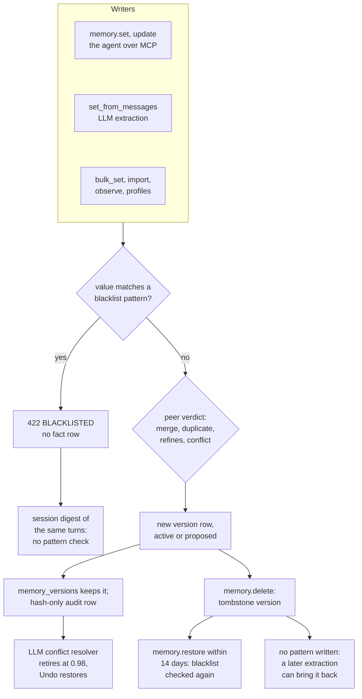

## 1. Executive Summary

Loom is a self-hosted memory server for teams of agents, from ClickHouse, Inc.
It stores keyed facts, documents and a code index in ClickHouse and serves them
over a streamable-HTTP MCP endpoint, an HTTP API and SDKs. Plugins wire it into
Claude Code, Codex, Cline and Cursor, and a dashboard shows memories, reviews,
the audit log and code links.

What is notable is how much of the correctness work happens at write time. Each
`memory.set` is judged against its nearest peers before the insert, and the
verdict is one of merge, duplicate, conflict or refines. Every change is a new
version, and every retirement the background LLM resolver makes can be undone.
A memory can point at files and symbols, and it leaves search when that code is
removed. Derived planes inherit status: a chunk or session digest whose source
fact is retired leaves search with it. All seven marks rest on mechanisms with a
producer on a reachable path, each with limits stated in section 9.

What is weak sits at the seams between those mechanisms. The blacklist refuses a
matching value on every fact intake and restore path, and no delete, forget or
erasure writes a pattern, so a removed value can be extracted again. The session
digest extraction drafts from the raw turns is checked against no pattern. The
verb that accepts a proposed fact is an agent's to call, and audit rows are
best-effort.

**Licence.** Apache-2.0, with a NOTICE and a THIRD_PARTY_NOTICES file that agree
with the manifests. No clause restricts use or analysis.

## 2. Mental Model

A memory is a row identified by its key under an identity tuple: org, namespace,
agent, user and session (`schemas/schema.sql:2447-2527`). The table is a
`ReplacingMergeTree` on a nanosecond `version`, and a materialized view copies
every insert into `memory_versions`, so the current row is the newest version and
the old ones stay readable through `memory.history`
(`schemas/schema.sql:3161-3232`, `server/memory/store/history.py:127`).

A value becomes a belief through a judgement. `memory.set` fetches the live row,
refuses a blacklisted value, embeds, and reads the closest active peers of the
same type (`docs/architecture/memory-architecture.md` §`memory.set`). A canonical
match merges, a close peer with the same content words is a duplicate, a
templated substitution under `newest_wins` refines and retires the peer, and any
other close peer marks both rows `conflicted`. No verdict on the write calls a
model. A write marked `proposed` lands outside the served set until a writer
accepts it (`server/memory/domain/temporal_sql.py:38-47`).

A belief stops being served in five ways: a same-key or resolver supersession, a
writer's `reject`, a `delete` or `clear` tombstone, an expiry, or an erasure.
Each writes a new version row, never an in-place edit, except the redaction,
which scrubs the value in place (`server/memory/store/lifecycle.py:1004-1069`,
`server/memory/store/redaction.py:89-92`). What was derived from a fact follows
it out: a chunk or a session digest whose known source is retired, or rewritten
after the digest was drafted, is withheld on read.

## 3. Architecture

Loom runs as three containers in the shipped Compose file: ClickHouse, the
server and a document extractor (`compose.yaml:14-152`). The server is one Python
process with workers elected to a leader. The default storage authority is
ClickHouse (`server/settings/catalog.py:5609`). The `postgres` authority moves
current heads, revisions, locks and idempotency to Postgres and publishes
ClickHouse rows as projections; vectors and every search leg stay in ClickHouse
(`docs/architecture/storage-authority.md:20-34`). On the ClickHouse authority
every memory version insert takes a per-identity Keeper fence, and a copy that
must not overwrite an intervening write re-reads the head inside it
(`server/memory/store/write_fence.py:33-63`).

There is no vector index. The fact leg sorts by exact `cosineDistance` over
`loom.memory_embeddings`, optionally a quantized shortlist rescored at full
precision (`server/memory/app/retrieval/fact_sql.py:87`, `:138-153`). The
embedding mirror carries the columns search filters on, so no leg joins back to
`loom.memory`. An embedding server and a chat model are external; the
conflict resolver defaults to a strong model, one call per row with its peers.

### Deployment and ergonomics

`install.sh` or `loom up` starts the stack and mints a writer token for the agent
(`server/cli/up.py:397-410`). A Codespaces definition starts the released stack
for a try-out. Single-user mode runs with auth off, which the authorizer treats
as allow-all (`server/auth/authz.py:239-240`). An operator stands up ClickHouse,
an embedder and a model, and about 3 GB of images.

For reporting, the operator documentation describes a read-only SQL surface:
five views, `sql_v1_memories`, `sql_v1_memory_history`,
`sql_v1_conversations`, `sql_v1_agent_events` and `sql_v1_usage_daily`, read by
a ClickHouse user granted `SELECT` on those views alone under the
`loom_sql_surface` settings profile
([`docs/reference/sql-surface.md`](https://github.com/ClickHouse/loom/blob/47318f3c852096c1aa717cd72d9a23994e716cf9/docs/reference/sql-surface.md)).
A worked report of active memories by agent and provenance class reached the
self-hosted guide on 25 November 2026, after this pin
([`docs/use-cases/self-hosted-clickhouse.md` at `eccfd7f`](https://github.com/ClickHouse/loom/blob/eccfd7f44fa7cc166f2e6bbd75d7f42b50b2f4d5/docs/use-cases/self-hosted-clickhouse.md#count-active-memories-by-agent-and-source));
every column its query reads is on `sql_v1_memories` at this pin.

## 4. Essential Implementation Paths

- **The write.** `_handle_memory_set` runs named phases over one request state
  (`server/memory/app/write.py`, `server/memory/app/set_commit.py`): resolve
  type, fetch the live row, guard lock and pin, expiry, prepare and blacklist
  (`write.py:402-412`), proposal and precondition checks, build the version row,
  embed, conflict verdict, dual write, then supersession and the audit row.
- **Extraction.** `set_from_messages` runs the model over a transcript and hands
  the facts to `bulk_set` (`server/memory/app/pipeline.py`), then drafts a
  session digest from the same turns and records as its lineage the keys the
  batch wrote (`server/memory/app/session_summary.py:182-244`). The Claude Code
  and Codex SessionEnd hooks send `defer=true`, which queues the run on the
  `extraction_queue` worker
  (`integrations/claude-code-plugin/lib/session-memory.mjs:7`, `:220`).
- **Search.** `vector_search` runs the fact leg with BM25 in the same SQL, then
  chunk, record, graph, summary, anchor, key-match and definition legs
  (`server/memory/app/retrieval/search.py:374-418`). RRF scores
  `1/(60+sem_rank) + w_lex/(60+lex_rank)`
  (`server/memory/app/retrieval/fusion.py:47-72`).
- **Ask.** `memory.ask` runs the same retrieval and an LLM answers with cited
  keys, dropping superseded rows and masking chunk sentences that restate them
  (`server/memory/app/ask/synthesis.py:601`,
  `server/memory/app/ask/supersession.py:249-266`).
- **Delete.** `memory.delete` writes a tombstone version and `_retire_derived`
  retires embeddings, chunks, procedure runs, decision records and consolidated
  summaries (`server/memory/app/handlers.py:605-664`, `:1108-1200`).
  `memory.clear` pages the current heads of a scope and writes a complete
  tombstone version for each, skipping locked heads and yielding to writes above
  its cutoff (`server/memory/store/lifecycle.py:946-1069`).
- **The resolver.** `memory/workers/conflict_resolver.py` judges flagged rows on
  the leader, re-reads each row under its key lock, and writes a
  `memory.auto_supersede` audit row for every retirement
  (`server/memory/app/auto_resolution.py:31`, `:154-188`).
- **Erasure.** A saga of about thirty steps per scope reaches memory,
  embeddings, chunks, shared copies, summaries, graph links, evidence, code
  links, caches and the webhook outbox (`server/erasure/app/saga_steps.py:271-406`).

## 5. Memory Data Model

`loom.memory` carries `status` with seven values: active, conflicted,
tombstoned, duplicate, superseded, rejected and proposed
(`schemas/schema.sql:2470`). The served set is active and conflicted
(`server/memory/domain/temporal_sql.py:38`). Provenance is server-stamped:
`actor` from the token and `source_class` from the server, which a caller may
only downgrade (`server/memory/app/write.py:547-552`, `:569-570`). `verified_by`
and `verified_sha256` hold an attestation, and `memory.verify` takes its actor
from the token (`server/memory/app/verify.py:52-55`).

Time has two axes, which the project's own table states
(`docs/concepts/memory.md` §Time). `valid_at`, `valid_to` and `temporal_anchor`
are world time. `memory.set` takes them from the caller and stores NULL when
none is given (`write.py:576-577`). Extraction takes the date the model read
from the text, then the fact's anchor, then the observation date, which defaults
to the request's day (`server/memory/app/pipeline.py:926-937`). `created_at`,
`version`, `tombstoned_at`, `invalid_at` and `expires_at` are record time, and
`memory_versions` keeps each version's record time. Intra-batch supersession
stamps `invalid_at` with the write clock
(`server/memory/domain/conflicts.py:327`).

Sensitivity is a tier. A `high` row gets no embedding row, so no search leg sees
it, and a key read of it is audited as `memory.sensitive_read`
(`server/memory/domain/memory_types.py:72-79`,
`server/memory/app/handlers.py:459-472`).

`loom.session_summaries` holds one model-written digest per session and
identity, with `derived_from`, the memory keys that session's extraction wrote
(`schemas/schema.sql:4134`, `server/memory/app/session_summary.py:205-213`).
Refused facts are not in it, since lineage is taken from the batch's written
rows less the refused verdicts (`server/memory/app/pipeline.py:1024`).

`loom.blacklist` holds patterns, substring or RE2, scoped to a namespace, an org
or the whole server, matched against the stored value text
(`schemas/schema.sql:332-348`, `server/memory/app/blacklist_guard.py:378-390`).

## 6. Retrieval Mechanics

The fact leg filters `tombstoned_at IS NULL`, expiry, `valid_to` and the served
statuses, and leaves episodic, profile and reflection types out unless named
(`server/memory/domain/search_sql.py:50-163`). It over-fetches
`max(4*top_k, 60)` and ranks by the mode: RRF, or a hybrid of BM25 and cosine
at alpha 0.5 (`server/memory/app/retrieval/fact_rank.py:425-434`). A
correctness tail follows: demoted tags, a conflict penalty, a 0.1 sensitivity
demotion, a capped reinforcement term and trust (`fact_rank.py:185-239`,
`:524-570`). The wire default is `rrf`; an unpinned call is filled from the
deployment default, `semantic` (`server/settings/catalog.py:3764-3769`).

Search explains itself. `_finalize_abstain` returns `no_match`,
`below_threshold` or `low_calibrated_confidence`, and calibration reports a
retrieval risk (`server/memory/app/search/verdict.py:81-142`,
`server/memory/domain/retrieval_calibration.py:46-51`).

The derived legs inherit their sources' state. The chunk leg drops a chunk whose
known parent is not served: on every read, both stages and the neighbour windows
exclude chunks whose parent row under the same identity fails the fact leg's
tombstone, status and `as_of` predicates, and hard tags additionally require a
matching searchable parent (`server/memory/app/retrieval/chunks.py:98-131`).

The summary leg over-fetches four times its N, then reads each digest's lineage keys
under the digest's full identity and withholds it if any source is missing,
unserved, expired, past `valid_to`, `high`, or at a version newer than the
digest (`server/memory/app/retrieval/summaries.py:186-195`,
`server/memory/store/summary_sources.py:24-84`). A failed source read withholds
every digest. A chunk with no parent row and a digest with empty lineage stay
eligible as session evidence. The lineage check runs on this leg alone; the
other readers of digest text are listed in section 9.

`memory.ask` masks restated superseded sentences again at synthesis; its header comment, which says the chunk and summary planes
never hear about supersession, predates both filters
(`server/memory/app/ask/supersession.py:17-22`).

The entity-graph leg reads edges and triples by namespace only, so it runs only
where the read is namespace-wide: any `user_id`, `session_id`, `run_id` or
session list, or a private read with a named agent, skips both graph stages
(`server/memory/app/search/graph.py:123-135`).

Memories linked to code surface through `memory.for_file`, which reads
`loom.memory FINAL` by path, basename or code link with tombstone, expiry,
`valid_to`, sensitivity and status filters (`server/memory/app/for_file.py:67-92`).
Under the default `retire_removed` policy, a memory whose links are all missing
leaves search, ask and the pack.

## 7. Write Mechanics

A tool write blocks the agent for one embedding call, a peer read and the
insert. An embed failure fails the call and writes nothing; writers that can
wait write a zero-vector stub the `embedding_worker` fills
(`docs/architecture/memory-architecture.md` §`memory.set`). A point write is
readable on the next call, search included. Deferred extraction lags until the
`extraction_queue` worker reaches the session. The resolver judges after the
write, on the leader, at one model call per flagged row. No pass rewrites the
whole store.

The write guards stack. A byte-identical value is a restatement that raises
`reinforcement_count`. A lock answers 423, a pin 409, an `if_match_sha256`
mismatch 409, a value over the char limit 422, a blacklisted value 422, and a
proposal over an established fact 409 `KEY_HOLDS_FACT` (`write.py:92-135`,
`:389-412`, `:464-507`, `:806-819`). A same-key write retires the live rows of
that key within the write's own user, so a namespace-wide token writing for one
user does not retire another's (`server/memory/app/key_supersession.py:189-200`,
`:257-271`).

### Operational cost

Every version is a row in `memory_versions`, with no TTL on that table, so storage
grows with every restatement (`server/storage/retention_overrides.py:50-98`).
ClickHouse merges `ReplacingMergeTree` parts in the background, and every read of
current state uses `FINAL`. The resolver's cost is one strong-model call per
flagged row; a row is judged once per version. Each extraction run with facts
costs one more model call and one embedding for the session digest.

## 8. Agent Integration

The MCP server exposes toolsets. `core` carries `memory.set`, `pin`, `update`,
`delete`, `get`, `history`, `apply`, `lock`, `blacklist.add` and `context.pack`,
and `memory.search` is reached through a synthetic `loom_search` tool
(`server/operations/toolsets.py:98`, `:147-169`). `coding` adds working memory
and code-intelligence ops (`:185-204`). Any write op that is not hidden is
callable by name through `loom_op` (`server/transport/mcp_op.py:100-102`).

The Claude Code plugin's hooks run the loop (`integrations/claude-code-plugin/hooks/hooks.json`):

- **SessionStart** packs context; **UserPromptSubmit** recalls on the first prompt
  only when memory is not abstaining and confidence is at least 0.5, capped at
  1,200 characters (`hooks/loom-prompt-recall.mjs:35`, `:80-84`).
- **PreToolUse on Edit and Write** calls `memory.for_file` over the person's
  namespace and the repository's team-rules namespace
  (`lib/file-context.mjs:160-183`).
- **PostToolUse** records each call with `observe.record`; **SessionEnd** sends
  the transcript to deferred extraction.

## 9. Reliability, Safety, and Trust

### The blacklist holds at fact intake and at restore, and nothing writes one for you

A pattern refuses a matching value on `memory.set`, `update`, `bulk_set` and so
on every extraction and import, on observe, decisions, evidence import and
`copy_to` (`server/memory/app/bulk_rows.py:252-276`). The agent can add one
mid-conversation, and only an admin can lift one. Adding a pattern sweeps the
live `loom.memory` rows it matches, whatever their status, into tombstones
(`server/memory/app/blacklist_sweep.py:1-21`, `:170-176`).

The paths that put a value back check it too. `enforce_rows` runs the same match
over every live row a restore, a namespace snapshot, a rollback or a
consolidation is about to write, before any write, and under the Postgres
authority binds the commit to the policy generation it checked
(`server/memory/app/blacklist_guard.py:479-506`). `memory.restore`, a WRITER op
with a 14-day window, refuses a value blacklisted after the delete
(`server/memory/app/restore.py:109`, `:375`, `:647-692`); `namespace.rollback`
checks every reinstated slice before writing the first
(`server/memory/app/namespace_rollback.py:89-98`); `namespace.restore` checks
the payload before it creates the namespace or its grants
(`server/identity/app/namespace_snapshot.py:163-181`); and a model-written
consolidated summary that matches is dropped and its sources kept
(`server/memory/app/consolidate.py:489-492`, `:613`). Other writers that write a
version row over an existing head carry a value already in the store. Delete,
forget and erasure never add a pattern, so a deleted value can be extracted
again.

The session digest that extraction drafts is the model-written text the
blacklist does not reach. It is drafted from the raw turns, inserted with no
pattern check, and left alone by the sweep
(`server/memory/app/session_summary.py:133-244`); `memory.import_evidence`, the
other writer of digests, drops one that matches
(`server/memory/app/evidence_transfer.py:398-402`). Its lineage cannot
catch a refused value either, because a refused fact never enters
`derived_from`. A session in which the extractor's fact was refused with 422 can
put the same value into search through its digest, served beside an accepted
fact or with empty lineage. The operator's `period-digest` maintenance command
compresses windows of those digests, read with only their tombstone filter, into
`loom.memory` rows with one model call each and writes them with no pattern
check either (`server/memory/app/period_digest.py:345-356`, `:495-550`).

### What a proposal and a conflict wait for

`proposed` keeps a fact out of every default read. `memory.proposal_decide`
accepts it, a WRITER op with no actor check
(`server/memory/api/ops_proposals.py:28-37`), whose module says *"a person or an
agent decides"* (`server/memory/app/proposals.py:12-13`). A conflicted row is
served, and `memory.update`, on the core toolset, resets it to active when the
new value checks clear (`server/memory/app/update.py:545-548`). The LLM resolver
retires at 0.98, flags at 0.95 and clears at 0.90 with no person
(`server/memory/domain/conflict_resolution.py:37-38`, `:288-321`).

### What the reads leave out

- **The runs section of `context.pack`**, opt-in through `include_runs`, renders
  the recent sessions' digest text with the tombstone filter alone, so a digest
  the summary leg withholds for a retired source reaches the pack there
  (`server/memory/app/runs_manifest.py:203-215`,
  `server/memory/app/context_pack.py:871-891`). `memory.digests`, a VIEWER
  listing for auditing digests, reads them the same way
  (`server/memory/app/curation.py:131-157`).
- **A digest with empty lineage** is served by the summary leg with no state to
  inherit; one is written when every fact its session extracted was refused.

### Marks

- **`tombstone`** — awarded on `loom.blacklist`: keyed on the value text,
  consulted by every fact intake writer, extraction included, and by every
  restore path. Its limits are that no delete, forget or erasure writes one and
  that the session digest extraction drafts is not checked against it.
- **`trust_state`** — awarded on `proposed` and `rejected`, excluded by every
  default read, `memory.list` included, and inherited by chunks and session
  digests through their sources on the search path. A digest with empty
  lineage carries no state, and the runs section of the pack skips the check.
- **`bitemporal`** — awarded on world-time validity beside record time and the
  kept versions. The project calls it *"valid time plus a retirement stamp, not a
  bi-temporal model"*, meaning supersession, not date, decides which row is
  current; the rubric asks only that the axes be tracked apart.
- **`scope_enforced`** — awarded on org, namespace and user predicates on every
  served leg. The graph leg, which has no user key, is skipped on every read
  bounded to one identity.
- **`audit_log`** — awarded on `loom.audit_log`. Rows are hash-only and
  best-effort, the plain-row receipt for a non-embedded or `high` set on the
  ClickHouse authority included: it is emitted after the insert and a failure
  only logs (`server/memory/app/set_commit.py:440-468`, `:502-510`). A
  per-namespace `retention_days` applies to the audit table like every
  managed table (`server/storage/retention_overrides.py:15`, `:50-56`).
- **`human_review`** — awarded on the learnings queue: drafted definitions and
  assistant rules no read serves until `learnings.review`, ADMIN and hidden from
  MCP, promotes them. With default settings only an admin's draft request fills
  it. Proposals and conflicts are not on it.
- **`negative_eval`** — awarded; see section 10.

### Other risks

- **Erasure without purge** keeps the value in the tombstoned row, and
  `memory.restore` can revive it within 14 days; a running saga re-tombstones
  it (`server/erasure/store/mutations.py:414-435`). `loom.blacklist` survives
  erasure, and a pattern can itself hold the person's data
  (`server/erasure/store/census.py:769`).

## 10. Tests, Evals, and Benchmarks

CI runs the unit suite in random order with a 40% coverage floor, `pytest
bench`, and the integration suite in four parts against a real ClickHouse with a
fake embedder and model, plus auth-on isolation gates
(`.github/workflows/ci.yml:139-263`, `:615-876`). Locally the integration suite
skips without `LOOM_BASE_URL` or `LOOM_CH_HOST`
(`tests/integration/conftest.py:83-97`). I ran none of it.

`negative_eval` rests on populated cases:

- `tests/integration/test_graded_runs_proposals.py:70-76`: the proposal is
  served under `include_proposed`, then absent from the default read of the
  same query.
- `tests/integration/test_read_scope_isolation.py:1346-1385`: a token pinned to
  user U must return U's rows and none of V's nonce or ids, beside a
  namespace-wide control. The op walk at `:374-424` re-runs each body with a
  namespace token; that set leaves out `memory.search` and `memory.ask`.
- `tests/integration/test_memory_code_links.py:1117-1136`: top-1 is the linked
  memory, and after its code is removed the result is exactly the sibling, not
  an abstention.
- `tests/integration/test_knowledge_delete.py:66-93`: a deleted document is
  absent while an identical-text document is served.
- `tests/integration/test_chunk_parent_status.py:165-166`: the chunk read
  returns exactly the active, conflicted, session-only and point-write chunks,
  with rejected, superseded, proposed and duplicate parents populated beside
  them. It runs the leg's predicate against ClickHouse rather than through the
  search service.
- `tests/integration/test_memory_read_lifecycle.py:89-143`: the summary leg
  returns exactly the digests over an active source, a conflicted source and no
  source, with nine digests over rejected, proposed, superseded, tombstoned,
  rewritten, `high`, expired, past-validity and missing sources populated beside
  them, and the same key under another user neither suppresses nor revives one.
  It calls `fetch_session_summaries` against ClickHouse, not the search route.
- `tests/integration/test_memory_read_lifecycle.py:37-64`: `memory.list` over
  six statuses returns only the active and conflicted rows, by recency and by
  score, and the count agrees.

`tests/integration/test_memory_graph_scope.py:47-91` holds the graph leg's
boundary: inserted namespace edges and triples change nothing for a read bounded
to one user and change the namespace-wide control.

No case asserts that a deleted or forgotten value re-extracted in a later
session is refused; nothing writes the pattern that would refuse it.
`tests/unit/test_import_evidence_refuses_blacklisted.py:58-102` drops a
blacklisted digest on import, and no case feeds a blacklisted value through
extraction and checks the digest it drafts.
`tests/integration/test_blacklist.py:133-178` refuses a restore of a value
blacklisted after its delete, checks that the refusal changed no persisted
memory or search row, and restores an unrelated value beside it; the rollback,
snapshot and consolidation checks are unit-tested against stubs
(`tests/unit/test_blacklist_restore_paths.py`). The fact leg's served-status set
is unit-tested at the predicate (`tests/unit/test_superseded_served.py`).
`bench/fama_forgetting.py` is a paired forgetting check run outside CI with no
committed result.

Benchmarks are committed with per-question CSVs under `bench/results/`. I
recomputed the headlines from them: LongMemEval-S at 96.6%, 483 questions right across the 500-question set, through
`memory.ask` and 92.0% with an external reader over the top 200, and LoCoMo
categories 1–4 at 89.6% through `memory.ask` and 79.7% with an external reader.
The judges are models. The Recall@30 of 98.6% comes from
`longmemeval_s_ingest.csv`; the `recalled` column of `longmemeval_s.csv` is all
zero. No paper is associated with the project; `CITATION.cff` cites the
software.

## 11. For Your Own Build

### Steal

- **Judge a write against its peers before the insert.** A cheap cosine read with
  canonical, duplicate and refines rules catches most of what a background
  resolver would otherwise have to undo, and it calls no model.
- **Make every automatic retirement undoable, and audit the Undo strictly.**
  Loom's resolver writes a record per retirement, and the Undo fails if its own
  audit row cannot be written.
- **Link memories to code and retire them when the code goes.** A fact about a
  function that no longer exists is the stalest kind; a fingerprinted link with
  moved, changed and missing states turns that into a filter.
- **Carry the filter columns on the vector row.** Search never joins back, so a
  status or scope predicate cannot be forgotten in a join.
- **Give every derived row its sources and check them on read.** A digest that
  records the keys it compressed can be withheld when any of them is retired or
  rewritten later, at the cost of one bounded lookup per shortlist.
- **Check every path that puts a value back, not only the ones that take values
  in.** Loom runs one guard over restore, rollback, snapshot restore and
  consolidation before any of them writes, and binds the commit to the policy it
  checked.

### Avoid

- **A forget that leaves no refusal behind.** Delete, forget and erasure retire
  the row and write no pattern, so the next extraction of the same sentence
  stores it again.
- **A refusal that covers the fact and not its summary.** When a model writes
  two artefacts from the same turns, a rejected-value check on one of them is a
  check the other walks past.
- **A review verb on the reviewed party's surface.** `proposal_decide` as a
  WRITER op makes a proposal a request the agent can grant.

### Fit

This suits a team that wants one memory service for several agents and people,
with real scope, version history and audit, and has the operations budget for
ClickHouse, an embedder and a strong model for the resolver. The engineering is
deep where a shared service fails: identity predicates on every leg, a peer
check on every write, a strict Undo, an erasure saga with a census. Walk away if
the deployment is one developer on a laptop; the stack is three services and
3 GB of images for a store a SQLite file would hold. Walk away too if a
forgotten value must stay forgotten without an administrator writing a pattern
for it.

## 12. Open Questions

- How often search serves a session digest with empty lineage, or one restating
  a refused value; the plane is read, not measured.
- Whether `proposal_decide` is meant to be callable by the agent that proposed.
- What the agent sign-up flow mints; `loom up` mints a writer, and the security
  document says sign-up tokens are writer-only.

## Appendix: File Index

- Write: `server/memory/app/write.py`, `server/memory/app/set_commit.py`,
  `server/memory/app/bulk_set.py`, `server/memory/app/bulk_rows.py`,
  `server/memory/app/pipeline.py`, `server/memory/app/update.py`,
  `server/memory/app/key_supersession.py`, `server/memory/store/write_fence.py`
- Schema: `schemas/schema.sql`, `server/memory/store/rows.py`,
  `server/memory/store/inserts.py`
- Lifecycle: `server/memory/app/handlers.py`, `server/memory/store/lifecycle.py`,
  `server/memory/app/restore.py`, `server/memory/app/auto_resolution.py`,
  `server/memory/domain/conflict_resolution.py`
- Blacklist: `server/memory/app/blacklist.py`,
  `server/memory/app/blacklist_guard.py`, `server/memory/app/blacklist_sweep.py`
- Session digests: `server/memory/app/session_summary.py`,
  `server/memory/app/retrieval/summaries.py`,
  `server/memory/store/summary_sources.py`
- Retrieval: `server/memory/app/retrieval/`, `server/memory/domain/search_sql.py`,
  `server/memory/domain/temporal_sql.py`, `server/memory/app/search/verdict.py`,
  `server/memory/app/search/graph.py`, `server/memory/app/ask/`,
  `server/memory/app/for_file.py`, `server/memory/app/context_pack.py`,
  `server/memory/store/reads.py`
- Scope and review: `server/auth/authz.py`, `server/identity/domain/read_scope.py`,
  `server/transport/gates.py`, `server/operations/toolsets.py`,
  `server/memory/api/ops_learnings.py`, `server/memory/api/ops_proposals.py`,
  `server/memory/app/proposals.py`
- Audit and retention: `server/observability/audit.py`,
  `server/transport/post_rows.py`, `server/storage/retention_overrides.py`
- Erasure: `server/erasure/`
- Integration: `integrations/claude-code-plugin/hooks/`,
  `integrations/claude-code-plugin/lib/`
- Tests: `tests/integration/test_graded_runs_proposals.py`,
  `tests/integration/test_read_scope_isolation.py`,
  `tests/integration/test_memory_code_links.py`,
  `tests/integration/test_knowledge_delete.py`,
  `tests/integration/test_blacklist.py`,
  `tests/integration/test_memory_read_lifecycle.py`,
  `tests/integration/test_memory_graph_scope.py`,
  `tests/unit/test_namespace_rollback_unembedded.py`

### Recorded searches

Run from the repository root at the pinned commit with `/usr/bin/git grep`.

- **Which writers consult the blacklist.**
  `git grep -n -E 'enforce_on_insert\(|enforce_rows\(|find_match\(' -- server`
  lists the guard calls in fifteen files: write, bulk rows, update, copy,
  decisions, evidence transfer, learnings, assistant learnings, observe,
  restore, rollback, snapshot rows, namespace restore, consolidate and the guard
  itself. `git grep -n -E 'insert_memory_versions\(|insert_versions_over_heads\(' -- server`
  lists the row writers; the rest write a version over an existing head.
- **No delete, forget or erasure path writes a pattern.**
  `git grep -n 'blacklist' -- server/erasure server/memory/app/handlers.py server/memory/domain/forget_requests.py`
  matches only the two census descriptions in `server/erasure/store/census.py`.
- **The digests extraction and the period pass write are not checked against the blacklist.**
  `git grep -n -i 'blacklist' -- server/memory/app/session_summary.py server/memory/app/retrieval/summaries.py server/memory/store/summary_sources.py server/memory/app/period_digest.py`
  returns nothing, and so does
  `git grep -n 'session_summaries' -- server/memory/app/blacklist.py server/memory/app/blacklist_guard.py server/memory/app/blacklist_sweep.py`;
  the first pattern over `server/memory/app/write.py` matches lines 29 and 77,
  and over `server/memory/app/evidence_transfer.py` it matches the import check.
- **No test checks an extracted digest against the blacklist.** Files under
  `tests` matching both `git grep -l -i 'blacklist'` and
  `git grep -l -E 'session_summar|summary_text'` were read: the import test
  above asserts the refusal, and the rest stub the guard or the digest out.
- **Nothing outside the guard reads the blacklist on a read path.**
  `git grep -n -E 'loom\.blacklist' -- server/memory/app/retrieval server/memory/app/search server/memory/domain/search_sql.py`
  returns nothing; the same pattern over `server/memory/store` matches the
  blacklist store.
- **No server statement deletes or alters the audit table.**
  `git grep -n -i -E '(DELETE FROM|ALTER TABLE)[[:space:]]+loom\.audit_log' -- server`
  returns nothing; `git grep -n 'loom.audit_log' -- server/storage/retention_overrides.py`
  matches line 53, the retention target.
- **The summary leg reads source status through its lineage.**
  `git grep -n -E 'status_predicate|tombstone_predicate' -- server/memory/store/summary_sources.py`
  matches the import at lines 10 and 11 and the two predicates at 43 and 44;
  `git grep -n 'current_summary_sources' -- server/memory/app/retrieval/summaries.py`
  matches lines 191 and 193.
- **Only the summary leg checks a digest's sources.**
  `git grep -n 'current_summary_sources' -- server` matches only
  `server/memory/app/retrieval/summaries.py` besides its definition;
  `git grep -n 'summary_sources' -- server/memory/app/runs_manifest.py server/memory/app/curation.py`
  returns nothing, while `git grep -n 'tombstoned_at IS NULL' -- server/memory/app/runs_manifest.py`
  matches lines 186 and 212.
- **The review verbs' roles.**
  `git grep -n -E 'required_role' -- server/memory/api/ops_learnings.py server/memory/api/ops_proposals.py`
  gives ADMIN for `learnings.review` and WRITER for `memory.proposal_decide`;
  `git grep -n -E '"learnings\.review"|"blacklist\.remove"|"blacklist\.add"' -- server/operations/toolsets.py`
  matches lines 65 and 82 in the hidden set and 159 in the core toolset.
- **No paper.** `git grep -n -i -E 'arxiv|doi\.org' -- CITATION.cff README.md docs`
  returns nothing; the only `arxiv` in the tree is a test forbidding paper
  citations in public copy, `tests/unit/test_public_copy.py:144`.

## History

**2026-11-21** — [`47318f3c852096c1aa717cd72d9a23994e716cf9`](https://github.com/ClickHouse/loom/commit/47318f3c852096c1aa717cd72d9a23994e716cf9) — 82 commits on, 40 files under `server/memory/` changed. Pull request 1056 (`ef3a196`) makes session digests inherit their sources' serving state, keeps rejected rows out of `memory.list`, applies `valid_to` to `memory.for_file`, skips the graph leg on identity-bounded reads, writes `memory.clear` as tombstone versions and stamps `invalid_at` on the record clock, with populated integration cases; the opt-in runs section of `context.pack` reads digests without the lineage check. Pull request 752 (`551f0b3`) confines same-key supersession to the write's user, a cross-user retirement no earlier reading named. Open: no forget writes a pattern, `proposal_decide` is WRITER, audit rows age out; and the digest extraction drafts is checked against no pattern, true at both earlier pins ([section 9](#9-reliability-safety-and-trust)). The proposal docstring was cited in the wrong file. Marks unchanged. Screened: the same ten auto-run surfaces and eleven build-time points, 32 FRESH manifests; nothing installed or run.

**2026-11-19** — [`fc930e0c8d11c9b6865b7d210f42080bea6575ff`](https://github.com/ClickHouse/loom/commit/fc930e0c8d11c9b6865b7d210f42080bea6575ff) — re-read at the tip of `main`, 79 commits past the first pin. Three findings of the first reading were fixed upstream: pull request 923 (`06775eb`) puts the blacklist check on `memory.restore`, `namespace.rollback`, `namespace.restore` and consolidation, with an integration case; pull request 922 (`9522b2b`) gives plain-row writes their audit receipt; and the release 1.3.0 squash (`08eeb3d`) excludes chunks whose known parent is not served, the change pull request 924 proposes. The tombstone's remaining limit is that no delete, forget or erasure writes a pattern, and session summaries are the plane that reads no status ([section 9](#9-reliability-safety-and-trust)). Marks unchanged. Screened again: the same ten auto-run surfaces; nothing installed, built or run. Every line citation was re-checked against the new tree.

**2026-11-18** — [`39243b1731b3e0b2ce8a1a287957e4e9d4f3a8fc`](https://github.com/ClickHouse/loom/commit/39243b1731b3e0b2ce8a1a287957e4e9d4f3a8fc) — first reading, from a depth-one clone of `main` with history from the GitHub API, scoped to `server/memory/`, the identity, auth, erasure and transport paths it relies on, the Claude Code plugin and the tests. Screened first: ten auto-run surfaces, each read (harness permissions, a reviewer subagent's read-only command hook, a Codespaces try-out, a localhost MCP manifest, the plugin's hooks); eleven build-time execution points, among them two Makefiles, two `conftest.py` files and an npm `prepublishOnly`; FRESH findings on every manifest, inflated by the shallow clone. Apache-2.0, no rider. Nothing installed, built or run; benchmark headlines recomputed from the committed CSVs. Seven marks, each with its limits in [section 9](#9-reliability-safety-and-trust).
