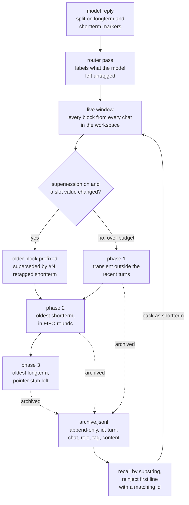

## 1. Executive Summary

clm-mem is **a memory harness for open chat models**. The model that writes
each reply also classifies it: a system preamble asks it to wrap durable content
in `<longterm>` and working state in `<shortterm>`, and the harness splits each
reply on those markers into tagged blocks. A deterministic engine then holds the
window to a token budget. It deletes transient blocks first, then evicts
short-term ones oldest first in rounds, then offloads the oldest long-term
blocks to `archive.jsonl`, leaving a pointer stub. It is MIT licensed, needs only
the `openai` client, and runs against any OpenAI-compatible server. The design
credits *Context Language Models* ([arXiv:2609.37725](https://arxiv.org/abs/2609.37725),
Shao et al., submitted 29 September 2026).

It is in scope by a narrow margin, and the margin is two mechanisms. Long-term
blocks outlive any one chat: a workspace keeps one harness, every chat in it
reads the same live window, and opt-in supersession labels and demotes a
long-term block when a newer one changes its value. And every evicted block
survives a restart in an append-only archive that an MCP client or a person can
search and pull back into the window. Without those two, this would be
conversation-window management.

What is good:

- **The model decides what matters at write time, and code decides what fits.**
  Eviction is ordered by tag, then turn, so the hardware load is predictable and
  the model's judgement is still the input.
- **Nothing evicted is destroyed.** Every phase routes through `_drop` or
  `_archive`, which append the block to the archive before removing it
  (`shatterling/engine/harness.py:598-619`).
- **The forgetting strategies are named, opt-in and tested.** Decay with three
  reheating scopes, and slot-keyed supersession, each have their own cases in
  `tests/test_forgetting.py`.

What is weak:

- **Archive identity does not survive a process.** Block ids start at 0 in every
  new harness (`harness.py:103`) while the archive in that directory persists,
  and `reinject` returns the first line with a matching id. In a reused
  workspace, recalling block 5 can bring back another run's block 5.
- **Reverting a value is dropped as a duplicate.** With supersession on, a
  fact that changes from one value to another and back is matched against the
  superseded block holding the first value, and the third write never enters
  the window.
- **The server answers any web origin.** It sends
  `Access-Control-Allow-Origin: *`, checks no inbound credential, accepts
  `tools_enabled` as an open-time option, and runs `sandbox/exec` with no
  approval step, in a jail its own docstring says has no filesystem or network
  isolation.

## 2. Mental Model

A memory is **a tagged block in the live window**. The window is the prompt; the
tag decides how long a block survives pressure on it; the archive is where a
block goes when it stops fitting. There is no separate store that a query
searches before generation. Recall is a person's or a client's act, not the
model's: the model's own tool list carries no recall tool.

### How a thing becomes a belief

`step` appends the user message as `transient` (or as whatever a decision server
pre-classifies it to), evicts to make room, calls the model, and splits the reply
on `<longterm>…</longterm>` and `<shortterm>…</shortterm>`
(`harness.py:752-839`). Each tagged span becomes its own block; untagged prose
stays `transient`. If the model used any marker, the turn's user message is
promoted to `shortterm`. When the model tagged nothing, a post-turn router pass
asks the same model, at temperature 0, to label the turn's transient blocks as
JSON, or asks the decision server the same question as typed choices
(`harness.py:175-272`).

Base importance follows the tag — 1.0, 0.6 and 0.3 (`harness.py:25`) — and
matters only when decay is on. Two other writers exist: `remember` seeds a
long-term block directly, optionally pinned, which is how the REST surface opens
a chat with facts (`harness.py:963-987`); and `reinject` adds an archived block
back as `shortterm` with a `[recalled #id]` prefix.

The classifier prompts send credentials to long-term memory on purpose: the
router is told that *"durable facts, decisions, requirements, identifiers,
credentials"* are `longterm` (`shatterling/engine/tagging.py:59`), and the
supersession slots include `password`, `secret`, `token` and `api_key`.

### How a belief stops being one

*Eviction* runs before and after each generation (`harness.py:434-538`). Phase 1
drops every transient block older than the last `keep_recent_turns` turns. Phase
2 evicts short-term blocks oldest first, keeping the newest
`shortterm_keep_pct` of them per round, for up to ten rounds. Phase 3 offloads
the oldest long-term block, or the lowest effective importance when decay is on,
to the archive and replaces its content with
`[offloaded longterm #id -> archive.jsonl]`, retagged short-term so the stub can
go later. A decision server, when configured, can veto any phase's candidates.

*Decay* (opt-in) discounts importance by a half-life in turns since the block was
last touched, and demotes a long-term block below the threshold to short-term,
where FIFO can reach it. *Reheating* raises importance when the block's
identifiers or slot values appear in a user message, under one of three scopes:
global, own-chat only, or freshness without lift (`harness.py:297-366`).

*Supersession* (opt-in) reads named slots — `codename`, `password`, `secret`,
`token`, `api_key`, `version`, `port` — from each new long-term block. An older
block sharing a slot with a different value is prefixed
`[superseded by #N]` and demoted to short-term; a new block whose shared slots
all agree with an older one is dropped as a duplicate, to the archive
(`harness.py:368-432`). The superseded block stays in the prompt, labelled,
until FIFO evicts it.

## 3. Architecture

One Python package, `shatterling`, in four parts. `engine/` holds the block,
the harness, the token counter, the tagging prompts and the backend clients.
`purslane/` is the server: a threaded HTTP proxy that looks like one llama.cpp
endpoint to clients, spawns or attaches a chat backend and an optional decision
server ("System One"), and exposes `/v1/clm/*` and an MCP endpoint. `campion/`
is the web studio. `tools/` is the agent tool loop, with web search and fetch,
file tools, and command execution in a sandbox.

`clm-mem serve --use-mock` runs the whole topology against bundled fake backends,
with no GPU and no weights. Against a real model it execs a binary or attaches to
a URL the operator names; it downloads nothing.

**State is per workspace and in process.** The supervisor keeps one
`MemoryHarness` per `ws:<name>` session id, each with its own directory under
`<workdir>/workspaces/<name>` (`shatterling/purslane/server.py:1345-1455`).
Session opens must use a `ws:` id (`server.py:763-820`). The live window lives
in the harness object; `mirror_files` writes it to `context.md` and
`context.jsonl` after every turn, and nothing in the package reads either file
back (Recorded searches), so a restart starts every workspace empty beside its
old archive.

**Chats are slots, not partitions.** A workspace holds many chats, and the
source states the intent: *"The harness keeps one shared memory per project;
chats partition who *sees* what (turns, activity, approvals, drafts) without
splitting the memory"* (`server.py:105-108`). The partition is in the UI.
`serialize_messages` sends every live block to the model with no slot filter
(`harness.py:657-667`), so a chat's transient small talk is in another chat's
prompt until phase 1 removes it.

**Turns on one workspace are not serialised.** The server is a
`ThreadingHTTPServer` and nothing locks `step`, while `self.turn` and `self.slot`
are harness-wide, so two chats posting at once can stamp one turn's blocks with
the other chat's slot.

### Deployment and ergonomics

`pip install -e .` and an OpenAI-compatible endpoint. The CLI chat works against a
local harness; `serve` defaults to `127.0.0.1`. The archive is JSON lines a person
can grep; the mirror is Markdown in the paper's `[[CTX_TURN …]]` form. There is
no migration story because there is no schema beyond the block's fields.

## 4. Essential Implementation Paths

**Turn** — `MemoryHarness.step` (`shatterling/engine/harness.py:752-839`): add,
reheat, evict, generate (or the tool loop), split tags, router pass, evict,
mirror.

**Classification** — `split_tagged`, `MEMORY_PREAMBLE` and `CLASSIFIER_SYSTEM`
in `shatterling/engine/tagging.py`; `classify_new` and
`_classify_with_systemone` (`harness.py:175-272`).

**Forgetting** — `eff_importance`, `reheat`, `_decay_demote`,
`_supersede_pass`, `evict`, `_maintain`, `_backstop_eviction`
(`harness.py:274-596`).

**Archive** — `_drop`, `_archive`, `recall`, `reinject`
(`harness.py:598-655`).

**Server** — `Supervisor.harness_for` (`shatterling/purslane/server.py:1345-1455`),
the session-open handler (`:763-820`), the archive read (`:725-738`), the tool
surface `_clm_tools_post` (`:1040-1130`), and the CORS headers (`:264-270`).
MCP tools `clm_recall` and `clm_reinject` in `shatterling/purslane/mcp.py`.

**Tools** — `ToolManager.execute` (`shatterling/tools/manager.py:465-511`) and
`Sandbox` (`shatterling/tools/sandbox.py`).

## 5. Memory Data Model

`Block` carries `id`, `role`, `content`, `tag`, `turn`, `chat_slot`, `pinned`,
`importance`, `last_access` and `last_seen` (`shatterling/engine/blocks.py`).
The id is a per-harness counter starting at 0; the turn is a per-harness counter
starting at 0. Neither is unique across processes, and nothing persists either
counter.

An archive line holds `id`, `turn`, `chat_slot`, `role`, `tag` and `content`
(`harness.py:603-619`), so the archive keeps the tag the block had when it left
and drops its importance and access times. A pointer stub offloaded in phase 3
and later dropped in phase 2 is archived a second time under the same id, with
the stub as its content; `reinject` returns the first line with that id, which
is the original.

The only structured fields read from content are the seven supersession slots,
parsed by a regular expression (`harness.py:31-36`), and free-standing versioned
identifiers like `Nova-7` for reheating. Everything else a block says is opaque
text.

There is no provenance beyond role and chat slot, no source pointer, no
validity time, and no status besides the tag and the `[superseded by #N]`
prefix written into the content.

## 6. Retrieval Mechanics

**The prompt is the window.** Every live block, in order, is sent to the model on
every turn (`harness.py:657-667`). There is no query, no ranking, and no
selection at read time; what the model sees is whatever eviction left.

**Recall is a substring scan.** `recall` reads `archive.jsonl` line by line and
returns up to 50 records whose content contains the query, case-insensitively
(`harness.py:622-637`). It is reachable from the CLI's `/recall`, the REST
archive route, the web studio and the MCP tool `clm_recall`. **`reinject`**
copies one archived record back as a `shortterm` block by id, reachable the same
ways. The model inside the harness cannot call either; the preamble tells it that
offloaded items *"can be retrieved on request"*, which means a person or a client
has to make the request.

Failure modes:

- **Reinject resolves the wrong block in a reused directory.** Ids restart at 0
  with each process and the archive does not, so the first line matching an id
  can belong to a previous run or a previous CLI session pointed at the same
  `--workdir`.
- **A superseded fact keeps arguing.** The demoted block stays in the prompt,
  labelled, beside the block that replaced it, until short-term FIFO reaches it.
- **Every chat reads every chat.** A workspace's prompt is shared, so a fact or a
  credential stated in one chat is in the next chat's context.

## 7. Write Mechanics

Writes are part of the turn: the reply is split and stored before the response
returns, and a block is in the next prompt with no lag. The router pass adds a
second model call on turns where the model used no marker, and is skipped on
turns where it did, so the inline contract saves a call every turn it is kept.

**Reverting a value is swallowed as a duplicate.** `_supersede_pass` builds its
candidate list from every older non-pinned block, *including* ones already
demoted, as its comment says: *"a restatement of a fact that already lost its
long tag is still a duplicate write"* (`harness.py:379-385`). Take three
long-term writes in order: `codename Nova-1`, then `codename Nova-2`, then
`codename Nova-1` again. The second supersedes the first. The third is compared
against the first before the second, all shared slots agree, and it is dropped as
a duplicate of the superseded block. `Nova-2` stays long-term, and the
user's correction reaches only the archive. The tests cover update, duplicate,
partial match and unrelated slots, and not a return to an earlier value. I
traced this in the code and did not run it.

**Supersession can promote a transient block.** Candidates are any older block,
so a transient user message that states a slot value is retagged `shortterm` when
a newer long-term block changes it, which moves it out of phase 1's reach.

Nothing rewrites the whole store, and nothing runs in the background.

### Operational cost

One model call per turn, plus a router call when the model skipped the markers,
plus decision-server calls when one is configured: one pre-classification per
user message and one batched backstop per eviction phase. Recall reads the whole
archive file on every query and the archive is never compacted, so recall cost
grows with everything a workspace has ever evicted.

## 8. Agent Integration

Three front doors onto one harness: the CLI chat, the
`/v1/clm/sessions/<id>/turns` REST verb, and an MCP endpoint whose 14 tools
include `clm_chat`, `clm_recall`, `clm_reinject`, `clm_set_forget`,
`clm_tool_call` and `clm_sandbox_exec`. `/v1/chat/completions` is a plain
passthrough to the backend with no memory, and a client still sending the old
session header gets a 410 pointing at the turns verb (`server.py:1285-1288`).

The agent inside the harness is the chat model with an optional tool loop: web
search and fetch, file read, write and list, `run_command` and `run_python`. Tool
results enter the window as short-term blocks and compete for the same budget.
`tools_enabled` is off by default; `approval_mode` defaults to `auto`, under
which mutating tools run inside the sandbox without asking
(`shatterling/engine/config.py:64-69`).

## 9. Reliability, Safety, and Trust

### The server and the browser

The proxy sends `Access-Control-Allow-Origin: *`, allows `GET`, `POST`,
`DELETE` and `OPTIONS` with `Content-Type` and `Authorization` headers, and
answers every preflight (`server.py:264-270`, `:432-435`). No handler checks an
inbound credential: the `Authorization` header is relayed to the backend rather
than verified (`server.py:307-319`). The default bind is `127.0.0.1`.

Three properties then compose:

1. A session can be opened with `tools_enabled`, `sandbox_mode` and
   `approval_mode` as options, because all three are in `OPEN_KNOBS`
   (`server.py:62-90`).
2. `POST …/sandbox/exec` builds a `run_command` call with `origin="user"`, and
   `execute` skips the approval broker for user-origin calls
   (`server.py:1095-1118`, `shatterling/tools/manager.py:488-491`).
3. The default `jail` sandbox is, in its own docstring, *"NOT a security
   boundary against a hostile script (no network or filesystem isolation)"*
   (`shatterling/tools/sandbox.py:8-13`).

So while `clm-mem serve` runs, a page in the operator's browser can reach
command execution on the host as the operator — and the MCP endpoint's
`clm_sandbox_exec` reaches the same handler — unless the browser's
local-network protections block requests to localhost. It can also read every
workspace's archive through the archive route, and the archive holds what the
classifier was told to keep long-term, credentials included. I traced this from
the code and did not exercise it. The project's own
`test_serve_sandbox_exec_files_write_read` drives the exec route over HTTP.

### Scope

A workspace is a physical partition, a directory per `ws:` name, with no key on a
record and no predicate on a read, so `scope_enforced` does not apply. Inside a
workspace the chat slot is attribution only. The model's prompt carries every
chat's blocks (§3).

### Correction

The archive is a durable record of what left the window, and that is the whole
of the history. A supersession label is written into the demoted block's
content in place; a retag, a decay demotion and a reheat leave no record outside
the in-memory event list. There is no delete verb for a block, and nothing
removes a value from the archive, so a credential the model tagged long-term
stays on disk for the life of the workspace directory.

### Marks

No capability mark is earned.

- `audit_log` is withheld. The archive is append-only, but it records evictions
  and nothing else, so the edits that change what a block says — supersession
  labels, retags, demotions — are not in it.
- `trust_state` is withheld. The superseded label and the demotion change how
  long a block survives, and no read keeps it out of the prompt.
- `negative_eval` is withheld. The eviction tests assert that transient or old
  short-term blocks leave a populated live window while newer ones stay
  (`tests/test_harness.py:60-91`). That is a test of what the assembled context
  holds, not of what a retrieval returns, and the dedup case is a write decision.
  The scope test on what each mark rests on, in the
  [atlas rubric](../../methodology/atlas-rubric/), draws that line.
- `tombstone`, `bitemporal`, `scope_enforced` and `human_review` have no
  mechanism.

## 10. Tests, Evals, and Benchmarks

119 pytest functions in seven files cover tag splitting, the three eviction
phases, the decision-server backstop, the forgetting strategies, the server
routes, the tool loop and the web studio's layout. They run against stub and mock
backends, so they need no GPU and no model. A GitHub Actions workflow runs them
on push and pull request. Its matrix lists `python-version: [3.9, 3.10, 3.11]`
unquoted, which YAML reads as 3.9, 3.1 and 3.11.

The negative cases are about eviction order. Phase 1 must leave no old transient
block; phase 2 must remove the two oldest short-term blocks; decay must not demote
a reheated block; supersession must not fire when it is off or when slots are
unrelated.

What the suite does not reach:

- **A return to an earlier value under supersession** (§7).
- **Reinject identity across processes.** `test_phase3_offloads_longterm_with_pointer`
  asserts that `reinject` returns true for the first recall hit
  (`tests/test_harness.py:107-120`), not which content came back, and every test
  uses a fresh directory.
- **Cross-origin requests** to the server.

The paper cited in the README reports its results on BrowseComp-Plus,
EdgeBench and a multi-repository agent-swarm task with a model that edits its
own context file. The README states the difference itself: *"the paper's headline
result comes from letting the model *edit* the context file itself"*, while here
eviction is harness-defined and the model only tags. No benchmark or result is
committed to this repository. I read the tests and did not run them, because
`pyproject.toml` changed inside the seven-day dependency cooldown.

## 11. For Your Own Build

### Steal

**Let the writer classify at write time and let code enforce the budget.** Asking
the model to mark durable spans while it decodes costs nothing extra on turns it
complies, and a deterministic evictor keyed on that tag makes the window's size a
guarantee rather than a hope.

**Evict in phases ordered by declared durability.** Transient first, working
state next in FIFO rounds that keep a fraction, long-term last and only to an
archive with a pointer left behind. Each phase is simple enough to test alone,
and the suite does.

**Never delete on eviction.** Routing every removal through one archive append
means a wrong tag costs a recall rather than a fact.

**Separate freshness from value when several sessions touch one store.** The
three reheating scopes let another chat keep a fact from going stale without
letting it raise the fact's importance, which is a clean answer to cross-session
reinforcement.

### Avoid

**Don't key an archive on a counter that restarts.** If records outlive the
process, their ids must too: a UUID, or a counter persisted beside the archive.

**Don't match duplicates against superseded records.** A value that returns after
a change is an update; compare a new fact against the live, unsuperseded holder
of each slot.

**Don't answer every origin on a localhost server that executes commands.** A
wildcard CORS header plus an unauthenticated exec route is reachable from any
page the operator visits. Check the `Origin`, require a token, and keep
`tools_enabled` out of what a client can set at open time.

**Don't tell the classifier to keep credentials.** A memory that is shared across
chats, mirrored to disk and never purged is the wrong place for a secret.

### Fit

This suits **a single developer experimenting with a self-managed context window
on a local open model**, who wants a predictable token budget and a
human-readable record of what was dropped. The mock topology makes it easy to
study and the eviction engine is small enough to read in an evening.

It does not suit anyone who needs memory to be correct across restarts, shared
between people, or held apart between conversations: the live window does not
survive a restart, chats inside a workspace share it, and archive identity is
unreliable once a directory is reused. Run it with tools off, or behind an
origin check, before it is reachable from a browser.

## 12. Open Questions

- **Is reloading the mirror planned?** `context.jsonl` is written every turn in
  the block's full dataclass form and read by nothing, which looks like the
  first half of a restart path.
- **Should chats see each other?** The source says chats partition who *sees*
  what; the prompt carries every chat's blocks. Which of the two is intended for
  the model is not stated.
- **What does the decision server change in practice?** Pre-classification and
  the eviction backstop run only when one is configured, and the tests use a
  mock, so how often a real one vetoes eviction is not measurable from the tree.

## Appendix: File Index

**Engine** — `shatterling/engine/blocks.py`, `harness.py`, `tagging.py`,
`config.py`, `llm.py`, `tokens.py`.

**Server** — `shatterling/purslane/server.py`, `routes.py`, `mcp.py`,
`processes.py`, `mock_backends.py`.

**Tools** — `shatterling/tools/manager.py`, `sandbox.py`, `spec.py`, `web.py`.

**Clients** — `shatterling/cli.py`, `shatterling/clients/sdk.py`,
`shatterling/campion/app.js`.

**Tests** — `tests/test_harness.py`, `test_forgetting.py`, `test_server.py`,
`test_tools.py`, `test_web.py`, `test_backend_api_key.py`, `test_ui_layout.py`;
`.github/workflows/test_and_lint.yml`.

**Design notes** — `docs/refactor-plan.md`, `docs/library-migration.md`.

### Recorded searches

Run from the repository root at the pinned commit with `/usr/bin/git grep`.

- **Nothing reads the mirror back.**
  `git grep -n -E 'context_jsonl_path|context\.jsonl' -- 'shatterling/*.py'`
  returns the help text at `cli.py:486`, the config comment at `config.py:78`,
  the docstring at `harness.py:60`, the property at `:120-121` and the write at
  `:682`, and no read.
- **The model's tool list has no recall.**
  `git grep -n -E 'recall|reinject' -- shatterling/tools` returns nothing; the
  same pattern over `shatterling/purslane/mcp.py` returns the MCP tools at `:220`
  and `:235`.
- **No inbound credential check.**
  `git grep -n -i 'headers.get(.authorization' -- shatterling/purslane/server.py`
  returns `:319`, inside `_auth_header`, which relays the header to the backend,
  and `:482`, which copies it onto the MCP layer's own HTTP client.
- **No lock around a turn.** `git grep -n -w lock -- shatterling/purslane/server.py`
  returns only `self.lock` uses inside `Supervisor` session bookkeeping
  (`:500`, `:651`, `:804`, `:1325`, `:1371`, `:1423`, `:1453`, `:1457`, `:1546`)
  and none around `h.step`.
- **No test returns to an earlier slot value.**
  `git grep -n -i -E 'nova-1.*nova-2.*nova-1|revert' -- tests` returns nothing.
- **No paper result is committed.**
  `git grep -n -i -E 'browsecomp|edgebench|contextbench'` returns the README
  line naming ContextBench and a section comment at `harness.py:621`.

## History

**2026-11-09** — [`433bce18f67060c657be274d4ffdfb49c9bb2b60`](https://github.com/GentianLine/clm-mem/commit/433bce18f67060c657be274d4ffdfb49c9bb2b60). First reading, from a full clone of `main`. Screened first: no auto-run or build-time execution; `pyproject.toml` inside the seven-day cooldown with no lockfile beside it, and `AGENTS.md` read as data. I installed and ran nothing; the suite was read, not run. The cited paper, [arXiv:2609.37725](https://arxiv.org/abs/2609.37725), was checked to resolve to *Context Language Models* by Shao et al. No capability mark is earned (§9).
