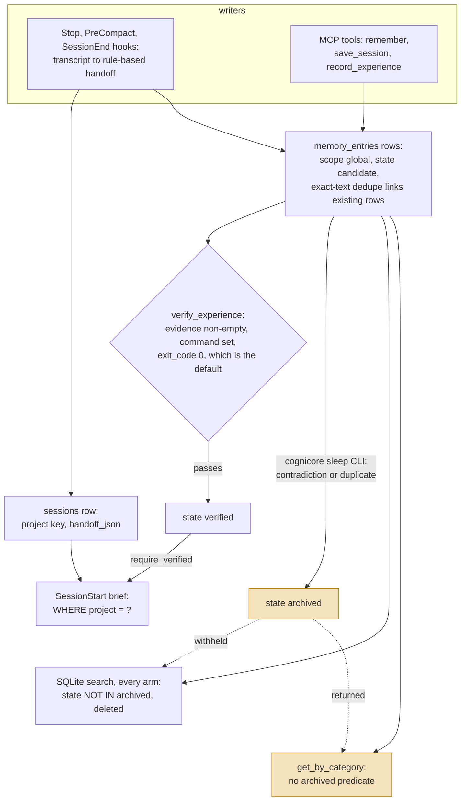

## 1. Executive Summary

CogniCore is **memory that moves between coding agents**. Claude Code and Codex
hooks turn each session's transcript into a rule-based handoff — goal, current
state, decisions with reasons, open tasks, facts, exact values — stored beside a
SQLite `memory_entries` table whose rows carry a lifecycle `state`, a scope pair,
provenance columns and outcome counters. The package also ships a local MCP
server, a hosted multi-tenant MCP server with a memory marketplace, a ChatGPT
connector, and a research programme of benchmarks and RL environments.

**A row arrives as `candidate`, and two read paths act on its state.** Every arm
of `SQLiteMemoryBackend.search` excludes `archived` and `deleted`, and
structured-experience retrieval withholds any experience not `verified`,
`promoted` or `transferable` when `require_verified` is set, which the
session-start brief sets. The gate that writes `verified` is self-attested:
evidence is a list the agent supplies, `exit_code` defaults to 0 and the
timestamp to now, so `[{"command": "x"}]` promotes.

**The scope predicate is real on two read paths, and the wrapper that looks like
the boundary has no caller.** `cognicore-extension` hashes the git root into a
project id and passes it to SQLite search, which applies `scope = ? AND
scope_id = ?` on every arm; the session-start hook selects `WHERE project = ?`.
`ScopedMemoryBackend`, the class that forces a scope onto any backend, is
constructed by one test and by no product path.

**The utility ledger is schema and scorer, with retrieval counting as its only
live input.** `used_count`, `ignored_count` and the outcome counters are written
only by `MemoryLifecycleManager.record_outcome`, and the only writer that moves a
row from `candidate` to `active` or `verified` by utility is `run_lifecycle_pass`.
Neither has a caller anywhere in the tree, tests included.

## 2. Mental Model

A memory is **a row that starts as a candidate**, and a session is **a handoff
document keyed to a project**. The two are written together: a save stores the
handoff on the `sessions` row and each of its statements as a `memory_entries`
row, so the brief reads the first and recall searches the second.

| Group | Columns |
| --- | --- |
| Content | `text`, `category`, `memory_type`, `embedding_json` |
| Epistemic | `state`, `correct`, `confidence`, `importance`, `relevance` |
| Scope | `scope`, `scope_id`, `session_id` |
| Lineage | `supersedes`, `invalidated_by`, `invalidated_reason` |
| Provenance and utility | `creation_reason`, `source_component`, `source_agent`, `source_task`, `retrieval_count`, `used_count`, `ignored_count`, `positive_outcomes`, `negative_outcomes`, `utility_score`, `last_accessed` |
| Session row | `handoff_json`, `conversation_hash`, `agent`, `client`, `external_id`, `project` |

`creation_reason` is set on every handoff row (`session_state`, `session_detail`,
`session_summary`), and `source_agent` to the saving agent, so a fact can be
traced to the session that produced it.

### How a thing becomes a belief, and how it stops being one

The utility ladder — `candidate` to `active` on a first retrieval, `active` to
`verified` above a promotion threshold, `archived` on decay or negative transfer
(`cognicore/memory/utility.py:224-275`) — is absent from the diagram because
nothing calls it.

## 3. Architecture

One memory contract (`cognicore/memory/base.py`) with six backends behind it —
`sqlite_backend`, `chroma_backend`, `tfidf_backend`, `graph_backend`,
`multihop_backend` and `hybrid_backend` — and every shipped surface opens SQLite:

| Surface | Store |
| --- | --- |
| `cognicore` plugin hooks and `cognicore-mcp` | `~/.cognicore/mcp/mcp_memories.db` |
| `cognicore-extension` | `~/.cognicore/extension/memory.db` |
| Hosted server, `cognicore/connectors/remote.py` | `memory_<sha256 of account id>.db` per account, plus one shared `commerce.db` |
| `cognicore-experience` plugin | `~/.cognicore/experience_memory.db` |

`cognicore/sync.py` pushes each saved handoff to the hosted account and pulls
other apps' sessions back, so a session saved in Claude Code can be resumed from
claude.ai. `cognicore/research/persistent_store.py` keeps `episodes`,
`strategies` and `reflections` for the research programme, apart from the agent
memory.

### Deployment and ergonomics

The Dockerfile and `deploy/docker-compose.yml` start `cognicore.connectors.remote`
behind Caddy, the hosted endpoint every plugin and editor config names; the
Procfile, `fly.toml` and `render.yaml` start the ChatGPT connector instead. Local
installation is `cognicore install`, which writes the Claude Code plugin and the
Codex hooks. An operator choosing the hosted server gets isolation by file rather
than by predicate, and no account-wide erasure tool, which only the ChatGPT
connector carries.

## 4. Essential Implementation Paths

- **Schema:** `cognicore/memory/sqlite_backend.py:36-68` — `memory_entries`;
  `:131-146` `sessions` and `session_memories`, with the handoff columns migrated
  in at `:150-169`.
- **State predicate:** `sqlite_backend.py:332`, `:424`, `:455`, `:608`, `:625`
  on search; `:674` on count, `:729` on the type read; none on
  `get_by_category` (`:656-670`); `get_all` (`:734-741`) excludes `deleted` only.
- **Experience ladder:** `cognicore/experience/manager.py:91-120` (record as
  `candidate`), `verification.py:32-106` (gate and promote), `retrieval.py:54-140`.
- **Scope:** `cognicore/extension/server.py:52-65`, `:151-217`; the hook's
  project read at `cognicore/hooks.py:59-65` and
  `cognicore/memory/context_preservation.py:850-852`.
- **Handoff:** `cognicore/memory/handoff.py`, `transcript.py`, `redact.py`,
  `context_preservation.py:455-652` (save), `:819-931` (resume).
- **Hosted:** `cognicore/connectors/remote.py:199-243` (per-account file),
  `:612-681` (marketplace), `:1134-1160` (verify).

## 5. Memory Data Model

`MemoryState` (`cognicore/memory/base.py:64-80`) declares nine values in two
families: `unverified`, `observed`, `verified`, `promoted` and `transferable` for
experiences, and `candidate`, `active`, `archived` and `deleted` for the utility
lifecycle. The writers with callers are `ExperienceManager.record` (`candidate`,
with failed attempts as `observed`), `VerificationGate.promote` (`verified`),
revalidation through the hosted `cognicore_check_experience` (`verified` or
`archived`), and the sleep pass (`archived`). `promote_to_transferable` and
`TranscriptExtractor`, which writes `active`, are exported with no product
caller. No writer sets `promoted` or `deleted`; the mem0 importer passes an
imported record's state through.

`correct` is a separate integer flag recording an outcome, and the DDL carries no
`CHECK` relating it to `state`. `memory_type` defaults to `semantic` and is orthogonal to
`state`; `experience` and `failure` are the types the experience retriever reads.

A handoff (`docs/handoff-schema.json`, `cognicore.handoff/v1`) carries goal,
current state, decisions with a `made` or `rejected` status, open tasks, key
facts, exact values, files, code, environment and provenance.

## 6. Retrieval Mechanics

**Lifecycle state is a predicate on search and not on the category read.** The
five search arms exclude `archived` and `deleted`, added in `11e46955` on
1 November 2026 under a commit message stating that archived text could resurface
through search and the empty-query listing. `get_by_category` takes no state
argument. The local MCP server's `cognicore_recall` falls back to it when search
returns nothing (`cognicore/mcp/server.py:373`), and `cognicore_recall_failures`
and `cognicore_recall_successes` read it directly (`:433`, `:478`), so an archived
row reaches the agent through those three.

**Scope is a predicate where it is passed.** The extension server passes it on
recall and list, the hook passes a project key to the session read, and SQLite
applies both in SQL. The BM25 fallback loads every live row and computes IDF over
the whole table before dropping out-of-scope rows (`sqlite_backend.py:606-615`,
`:546-549`), so another project's text shapes the ranking and never the result
set. The local `cognicore_recall` (`mcp/server.py:364`) passes no scope, and
handoff rows are stored as `scope=global` with no project, so recall in one
project returns facts saved in another.

**The session-start brief reads the handoff, not the rows.** `resume_session`
selects session rows, loads `handoff_json`, and fills goal, state, open tasks,
decisions, facts and verified experiences in priority order until
`COGNICORE_RESUME_TOKENS` (default 1,000) is spent; omitted sections are named so
the agent can fetch them by `session_id` and `section`. Two parts of it cross the
project key by construction. The experiences section searches the whole store,
matching on environment and not on repository (`context_preservation.py:757-780`),
and with sync on, `pointer_text` lists up to three sessions from other apps whose
project is not this one (`cognicore/sync.py:383-397`).

## 7. Write Mechanics

The Stop, PreCompact and SessionEnd hooks read the transcript
(`cognicore/memory/transcript.py`), dropping injected context, hook output and
CogniCore's own brief, and `handoff.py` classifies sentences into goal, state,
tasks, decisions and facts with regular expressions and no model call.
`redact.py` replaces credential-shaped strings before anything is stored.
`COGNICORE_AI_COMPRESS` optionally sends a long session to the Claude API for a
summary, at most once per `COGNICORE_AI_MIN_TOKENS` of new conversation.

Each statement is stored once: `_existing_ids_by_text`
(`context_preservation.py:438-447`) links a statement already in
`memory_entries` instead of copying it, and it matches by exact text with no state
predicate. A re-saved statement whose row was archived stays linked to the
archived row and out of search; one whose row was deleted is stored again.

`cognicore sleep` (`cognicore/cli.py:328`) runs `SleepProcessor`, which merges
near-duplicates and archives the lower-utility member of a contradictory pair;
with utility scores at their default, list order decides, newest first. Its one
caller is the `cognicore sleep` command.

### Memories cross agents, and half the trust surface crosses with them

`cognicore/commerce/transfer.py` copies memories between two backends, directly
(`share`, `clone`) or through a marketplace in `marketplace.py`. The read is
`search(query='', top_k=…, scope=None)`, so it draws from every scope in the
source store, and each entry is rebuilt in the target with the **sender's**
`scope` and `scope_id`, `source_agent`, `creation_reason="shared"`, and
`confidence` copied verbatim.

**`state` does not travel**, so an imported memory lands as `candidate`, which is
the shape [Portable Handoff](../portable-handoff/) argues for. **`confidence`
does**, so a memory the sender scored 0.95 arrives unverified carrying 0.95,
without the evidence behind the score.

**A listing covers the whole store.** `cognicore_list_for_sale` takes a category,
memory type and confidence floor, but persists only a per-account `for_sale`
flag (`marketplace.py:105-108`); the `memory_prices` table a listing would need
is declared and never written. `MemoryTransfer.purchase` then reads the seller's
entire store and keeps every entry at confidence 0.7 or above, filtered only by
the **buyer's** arguments (`transfer.py:211-223`). `confidence` defaults to 1.0,
so a seller who listed one category has listed everything. `PRIVACY.md` describes
the copied set as *"memories you list"*.

Until `d33dda44` on 19 October 2026, the hosted purchase checked only that the
seller was registered, and read-only tools registered every caller, so any
account's memories could be copied; `cognicore_share_experience` could also write
into another account. Both refuse at this pin, under
`tests/test_remote_tenant_isolation.py`.

## 8. Agent Integration

Three plugins under `plugins/`, read as data:

| Plugin | MCP | Hooks |
| --- | --- | --- |
| `cognicore` | stdio `cognicore-mcp`, `COGNICORE_TOOLSETS=search` | SessionStart on startup, clear or compact runs `cognicore-hooks session-start`; Stop, PreCompact and SessionEnd run `cognicore-hooks save`; each falls back to `python -m cognicore.hooks` |
| `cognicore-memory` | HTTP, `https://mcp.cognicoree.tech/mcp/stream` | none |
| `cognicore-experience` | `python ${CLAUDE_PLUGIN_ROOT}/scripts/server.py` | SessionStart runs `hooks/session_start_hook.py`; PostToolUse on `Bash` runs `hooks/evidence_collector.py` |

`.claude-plugin/marketplace.json` lists the first two. `.cursor/mcp.json`,
`.vscode/mcp.json` and `server.json` name the same hosted endpoint, and
`cognicore setup codex` writes the equivalent Codex hooks. The experience
plugin's PostToolUse hook appends each Bash command, an output hash, the exit
code and the git commit to `.cognicore/session_evidence.json` in the working
directory, keeping the last 50.

The hosted server checks a bearer JWT in ASGI middleware on every `/mcp`, `/sse`,
`/messages` and `/sync` path, issued by its own OAuth layer over GitHub or Google
sign-in, and resolves the account's file from the `sub` claim. Its recall
defaults to `scope="all"`, which passes no scope predicate within that file
(`remote.py:447-465`).

`cognicore/connectors/chatgpt.py:332` carries `cognicore_delete_all_data`, which
authenticates *"exclusively through the validated Context/sub claim"*, deletes
the user's records, runs `VACUUM`, attempts to remove the database, WAL and SHM
files, and states that this *"does not guarantee cryptographic erasure"*. It
erases a user wholesale and records nothing about what was rejected, so it is
not a tombstone. The hosted Claude server has per-id `cognicore_forget` and no
account-wide equivalent.

## 9. Reliability, Safety, and Trust

**`trust_state` — earned.** A discrete `state` defaulting to `candidate`, with
`archived` and `deleted` withheld from every search arm and unverified
experiences withheld from the session-start brief. Two qualifications travel with
it: the verify gate accepts any non-empty command with a zero exit code, which is
the default, and the category read returns archived rows.

**`scope_enforced` — earned**, on the extension server's project id and the
session-start project key, both SQL predicates on a runtime-derived key. The
brief's experiences section and sync pointer cross that key, the local MCP recall
and the hosted recall apply none, and the hosted per-account file is a physical
partition: a real boundary, and not the one this mark measures.

**`negative_eval` — earned, on the hook test.** `tests/test_hooks.py:61-79`
saves a session, requires seven named values in that project's brief and the
fake key `sk-test-FAKE` absent from the same brief, then asserts a second
project's session start against the same store injects nothing. The
state-filtering tests are weaker than they look: each exclusion case's database
holds only the archived or deleted row, so `== []` would also pass against a
search returning nothing, and the active-entry control runs in a separate test
on a separate database (`tests/test_sqlite_state_filtering.py:40-73`).

**`tombstone` — not found.** `supersedes` and `invalidated_by` are record-keyed,
forget hard-deletes, and a `rejected` decision in a handoff is displayed as
*"Rejected: …"* in the brief without gating any write. The exact-text dedupe
above is the near-miss: it keeps an archived statement archived on re-save, and
forgets a deleted one.

**`audit_log` — not found.** `events.py` is an in-process publish/subscribe
bus, `replay/store.py` records agent trajectory events, and the safety layer's
audit is an in-memory list of action decisions; none records a memory mutation.

**`bitemporal` — not found.** `temporal.py` carries no valid-time field, and the
schema's `timestamp` and `last_accessed` are record time.

**`human_review` — not found.** `cognicore_verify_experience` is a tool on the
agent's own surface (`remote.py:1134`, `chatgpt.py:274`), and its evidence is
the agent's own JSON, so the producer clears its own candidate state. The viewer
(`cognicore/memory/viewer.py`) is read-only.

## 10. Tests, Evals, and Benchmarks

`tests/` holds 1,189 test functions, run in CI on three Python versions, plus a
fault-injection harness: `tests/test_mem0_bridge.py::TestVerifierDefeatVector`
re-runs the import reachability test under a patched recall seam and asserts it
goes red. I ran nothing from the repository for this reading.

**The 0.9.3 memory ablation is not in the tree at this pin.**
`benchmark_output/benchmark_report.md` and its CSV were untracked as generated
data in `de8183da` on 16 October 2026. At
[`08d91395a5d4c6e714a141b2f42d91deb4030c88`](https://github.com/cognicore-dev/cognicore-env/commit/08d91395a5d4c6e714a141b2f42d91deb4030c88)
the report's figures recompute exactly from `benchmark_results.csv`, which I
aggregated with a short script of my own: 90 runs per arm, solve rate 1.1% →
12.2%, accuracy 12.6% → 19.9%, repeated failures 76 → 91.

The breakdown is the finding. `SafetyClassification` moves 7% → 73% solve,
`RealWorldSafety` moves accuracy 33% → 37%, and four of six environments are 0%
on both arms. The headline gain is one environment, and repeated failures — the
metric the stated hypothesis names — rose under memory.

The artifacts committed at this pin report without raw outputs: the LongMemEval
recall table in `docs/benchmarks.md` has no per-question results beside it, and
`docs/transfer-audit.md` reports fact-recovery and token figures from
`scripts/bench_transfer.py`, which CI runs without committing its output. No
figure from either is repeated here.

## 11. For Your Own Build

### Steal

- **`state DEFAULT 'candidate'`.** One line of DDL that makes "not yet assessed"
  representable, which a confidence float cannot do.
- **A handoff with a priority order and a budget.** Goal, state, open tasks,
  decisions, facts, filled until the budget is spent, with the omitted sections
  named so the agent can fetch them — a brief whose size the caller controls.
- **Negative tests on every search arm.** One fixture, one state change, one
  `== []` per arm, and an active entry as the control.
- **Reading the transcript in the hook.** Capture does not depend on the agent
  remembering to save.

### Avoid

- **A counter with no writer.** `used_count` and `ignored_count` are the
  interesting signal, and nothing in the shipped paths increments them.
- **A predicate on some reads.** Search withholds archived rows; the category
  read beside it does not, and an agent tool reads the category.
- **A sale flag in place of a listing.** Persist what was listed, or the listing
  arguments are a preview.

### Fit

This suits a developer who wants **Claude Code and Codex sessions to resume each
other** with no model call at save time, locally or through a hosted account.
Poor fit if the project boundary has to hold on recall, if verification must mean
something an agent cannot type, or if you want the memory library without the
research programme around it.

## 12. Open Questions

- **Is the utility ladder meant to run?** `run_lifecycle_pass` and
  `record_outcome` are complete and called by nothing, tests included.
- **Should the hosted recall default to a scope?** The comment beside
  `scope="all"` says it exists so remembered notes and session facts are both
  found; within one account file that is a design choice rather than a leak.
- **Which backends filter scope natively?** SQLite does on every search arm and
  Chroma takes `scope` as metadata; the TF-IDF, graph and multihop backends were
  not traced.

## Appendix: File Index

**Storage and schema**
- `cognicore/memory/sqlite_backend.py` — `memory_entries`, `sessions`,
  `session_memories`
- `cognicore/memory/base.py` — the backend contract, `MemoryState`, `MemoryScope`
- `cognicore/research/persistent_store.py` — episodes, strategies, reflections

**Backends**
- `chroma_backend.py`, `graph_backend.py`, `hybrid_backend.py`,
  `multihop_backend.py`, `tfidf_backend.py`, `vector_memory.py`, `scoped.py`

**Sessions and handoff**
- `cognicore/hooks.py`, `cognicore/sync.py`
- `cognicore/memory/context_preservation.py`, `handoff.py`, `transcript.py`,
  `redact.py`, `ai_compress.py`, `viewer.py`

**Lifecycle, experience and utility**
- `cognicore/memory/lifecycle.py`, `sleep.py`, `utility.py`, `temporal.py`
- `cognicore/experience/manager.py`, `verification.py`, `retrieval.py`,
  `revalidation.py`, `schema.py`

**Integration**
- `cognicore/mcp/server.py`, `cognicore/extension/server.py`,
  `cognicore/connectors/remote.py`, `cognicore/connectors/chatgpt.py`
- `cognicore/commerce/transfer.py`, `marketplace.py`
- `plugins/cognicore/`, `plugins/cognicore-memory/`,
  `plugins/cognicore-experience/`, `.claude-plugin/marketplace.json`, `server.json`

**Evals**
- `tests/test_sqlite_state_filtering.py`, `tests/test_hooks.py`,
  `tests/test_remote_tenant_isolation.py`, `tests/test_mem0_bridge.py`
- `benchmarks/`, `docs/benchmarks.md`, `docs/transfer-audit.md`,
  `scripts/bench_transfer.py`

### Recorded searches

Run from the repository root at the pinned commit with `/usr/bin/git grep`.

- **`ScopedMemoryBackend` has no product caller.**
  `git grep -n -w ScopedMemoryBackend -- .` returns the class at
  `cognicore/memory/scoped.py:8` and two lines of `tests/test_persistence_fixes.py`.
- **The utility pass and outcome recorder have no caller.**
  `git grep -n -E '\.(run_lifecycle_pass|batch_score)\(|memory\.record_outcome\(|lifecycle\.record_outcome\(' -- .`
  returns nothing; `git grep -n -w -E 'run_lifecycle_pass|batch_score' -- .`
  returns only the two definitions, and `git grep -n -w record_outcome -- cognicore`
  the definition at `cognicore/memory/lifecycle.py:99` and the unrelated
  `cognicore/decision/` controller.
- **No archived predicate on the category read.**
  `git grep -n -E 'state NOT IN' -- cognicore/memory/sqlite_backend.py` returns
  lines 332, 424, 455, 608, 625, 674, 729 and 738, none inside
  `get_by_category` (656-670).
- **No tombstone vocabulary.**
  `git grep -n -i -E 'tombstone|suppress' -- 'cognicore/memory/*.py' 'cognicore/experience/*.py' 'cognicore/connectors/*.py' 'cognicore/mcp/*.py'`
  returns nothing.
- **No valid-time field.**
  `git grep -n -i -E '(^|[^[:alnum:]_])(valid_(from|to|at|until)|effective_(from|at|date))' -- '*.py'`
  returns nothing.
- **No persisted listing.** `git grep -n -w memory_prices -- .` returns only the
  `CREATE TABLE` at `cognicore/commerce/marketplace.py:62`.
- **One account-wide erasure tool.**
  `git grep -n -E 'def cognicore_delete_all_data' -- .` returns
  `cognicore/connectors/chatgpt.py:332` alone.
- **No test of the extension server's project scope.**
  `git grep -n -E 'MemoryScope\.PROJECT|scope="project"' -- tests` returns nothing.
- **The verify verb is on the agent surface.**
  `git grep -n -E 'def cognicore_(verify|promote|approve|review)' -- 'cognicore/*.py'`
  returns `cognicore/connectors/chatgpt.py:274` and
  `cognicore/connectors/remote.py:1134`.
- **The used and ignored counters have one writer.**
  `git grep -n -E 'on_used\(|on_ignored\(' -- cognicore` returns the calls inside
  `record_outcome` at `cognicore/memory/lifecycle.py:111-115`, the definitions,
  and a docstring.
- **No writer of `promoted` or `deleted`.**
  `git grep -n -E "verification_status[[:space:]]*=[^=]" -- 'cognicore/*.py'`
  returns `CANDIDATE`, `VERIFIED`, `INVALID` and `TRANSFERABLE` assignments only;
  `git grep -n -E 'DELETED\.value' -- 'cognicore/*.py'` returns only
  `is_searchable` at `cognicore/memory/base.py:260`.
- **No state constraint in the DDL.**
  `git grep -n -E 'CHECK[[:space:]]*\(' -- cognicore/memory/sqlite_backend.py`
  returns nothing.
- **The sleep pass has one caller.**
  `git grep -n -E 'SleepProcessor\(|trigger_sleep\(' -- cognicore` returns
  `cognicore/cli.py:349` and `trigger_sleep` itself, which
  `git grep -n -w trigger_sleep -- .` shows has no caller.
- **No raw outputs beside the new benchmark tables.**
  `git ls-files 'benchmarks/longmemeval/*.json' 'benchmarks/longmemeval/*.jsonl' 'benchmarks/longmemeval/*.csv'`
  returns nothing, and `git ls-files '*bench_transfer*'` returns only
  `scripts/bench_transfer.py`.
- **No product caller of the two uncalled state writers.**
  `git grep -n -w -E 'TranscriptExtractor|promote_to_transferable' -- . ':!cognicore/memory/extractor.py' ':!cognicore/experience/verification.py'`
  returns the package export in `cognicore/memory/__init__.py` and
  `tests/test_memory_extractor.py`.

## History

**2026-11-07** — [`6fc657d0f9554235993f55d5f2e9136d82a12fd2`](https://github.com/cognicore-dev/cognicore-env/commit/6fc657d0f9554235993f55d5f2e9136d82a12fd2) — 174 commits on, release 0.12.0: session handoffs captured by Claude Code and Codex hooks, a hosted multi-tenant server, and Apache-2.0 in place of MIT. `negative_eval` added on the hook test's populated brief, not on the single-row state-filtering cases; the other two marks hold on corrected bases, [section 9](#9-reliability-safety-and-trust). Wrong at the previous pin, in the overstating direction: the scope record rested on `ScopedMemoryBackend`, which nothing called; the trust record's `:643` was the type read, while search filtered no state until `11e46955`; and the used/ignored ledger had no writer. The 0.9.3 ablation left the tree and recomputes from its old CSV, [section 10](#10-tests-evals-and-benchmarks). Screen: 15 auto-run surfaces against 8, hooks named in [section 8](#8-agent-integration); 5 FRESH, 2 genuine. Nothing installed or run.

**2026-11-02** — [`08d91395a5d4c6e714a141b2f42d91deb4030c88`](https://github.com/cognicore-dev/cognicore-env/commit/08d91395a5d4c6e714a141b2f42d91deb4030c88) — re-screened at the same pin with plugins below the checkout root followed. The screen had not counted 6 auto-run surfaces, 8 in all: hooks registered in `cognicore-experience/hooks/hooks.json` on SessionStart and PostToolUse; MCP servers declared in `claude-plugin/.mcp.json` and `cognicore-experience/.mcp.json`. The hook and MCP files were read at the pin as data; nothing was installed or run, and no mark changes.

**2026-09-19** — re-pinned to [`08d91395a5d4c6e714a141b2f42d91deb4030c88`](https://github.com/cognicore-dev/cognicore-env/commit/08d91395a5d4c6e714a141b2f42d91deb4030c88), one commit on, touching one file. Re-read as part of a corpus re-test of `trust_state` against the line this atlas drew during the `human_review` sweep: a state is used for filtering, a number for ranking. **The mark holds** — `state NOT IN ('archived', 'deleted')` is a real predicate on the count (`cognicore/memory/sqlite_backend.py:588`) and on the category read before its `LIMIT` (`:643`), so an archived entry does not reach those callers. What the re-read adds is that the predicate is not uniform across the three reads that carry one: `get_all` (`:648-655`) filters only `deleted` and therefore returns archived entries, under a docstring that describes its result as *"all active entries"*. That is now stated in the record. The mark rests on the two paths that do withhold; a reader wiring this backend should not assume the third does. Screened again first; nothing installed or run.

**2026-09-13** — [`cfe1fd11e08b2be9774789ce7f11f15c6083c87e`](https://github.com/cognicore-dev/cognicore-env/commit/cfe1fd11e08b2be9774789ce7f11f15c6083c87e) — re-read, 23 commits past the previous pin. Both marks stand, and all three files they rest on — `cognicore/memory/base.py`, `sqlite_backend.py` and `scoped.py` — are byte-identical across the range, checked by diff. The work is in `cognicore/integrations/`: a hosted ChatGPT surface with Supabase auth, OAuth authorize, token and register proxy endpoints for MCP client auto-registration, secured remote MCP transport routes, and deployment configs for three hosts. A `cognicore_delete_all_data` erasure tool arrives with it, and section 8 records what it refuses to claim rather than what it claims. `tombstone` stays withheld: wholesale erasure of a user's records is not a record of a rejected value, and nothing prevents the same content being written again. Screened again first: two auto-run surfaces, one build-time execution surface and two unpinned dependency surfaces; nothing was installed and no suite was run.

**2026-09-13** — the repository was renamed from `cognicore-dev/cognicore-my-openenv` to `cognicore-dev/cognicore-env`, upstream of the pinned commit and after the reading below. No re-reading: the pin, `analyzed_at` and every finding are unchanged, and only `source_name`, `source_url`, `revision_url`, `archive_name` and the repositories-inspected entry moved. The slug is unchanged, so no published URL moved. The archive fork was renamed to `agent-memory-atlas-archive/cognicore-dev--cognicore-env` to match.

**2026-08-21** — [`4f6bd9d0c8e4c6050504a47eb027791875043d46`](https://github.com/cognicore-dev/cognicore-env/commit/4f6bd9d0c8e4c6050504a47eb027791875043d46) — re-pinned 24 commits and roughly +8,900 lines on. Screened again: two auto-run surfaces (`.claude-plugin/`, `.cursorrules`), one build-time `Makefile`, two unpinned surfaces and two files inside the cooldown; nothing was installed and nothing was run. Marks unchanged at `trust_state` and `scope_enforced`.

**One correction, from an artifact that was committed at the previous pin and not opened.** Section 10 listed the repository's benchmark *files* and did not read `benchmark_output/benchmark_report.md`, which holds a completed run: version 0.9.3, seed 42, six environments, 90 task runs per condition, one variable. Its numbers are now in section 10, including the two that cut against its own headline — the aggregate gain comes from one environment of six, and repeated failures rose from 76 to 91 under the condition whose hypothesis is about not repeating failures.

The scope description is also sharpened rather than corrected: `ScopedMemory.search` forwards the wrapper's scope into the backend as a predicate, and it is `get_by_category` that over-fetches `top_k * 5` and filters in Python. The published risk read as though both paths were the weak one.

New at this pin: a commerce layer (`cognicore/commerce/`) that shares and clones memories between backends and prices them in a marketplace, described in section 8 — an imported memory resets to `candidate` and keeps the sender's `confidence`; structured experience extraction; Figma and ElevenLabs integrations; and a five-layer architecture refactor.

**2026-08-04** — [`760cdde49328a6cca8c430256b072cc1c4f48247`](https://github.com/cognicore-dev/cognicore-env/commit/760cdde49328a6cca8c430256b072cc1c4f48247) — first reading.
