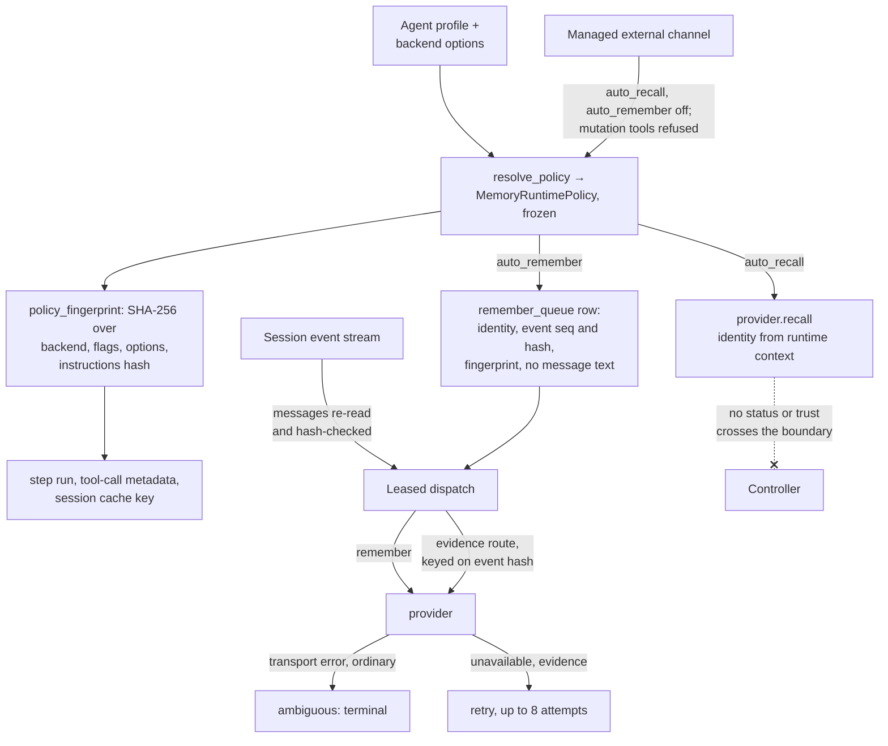

## 1. Executive Summary

Cognis is an agent OS that separates a controller from executors, and it owns
no memory store. The controller owns users, agents, conversations, workflows,
routing and the UI; memory is a mounted provider behind `MemoryProvider`, with
a [Mnemory](../mnemory/) backend and a `null` backend shipped. What the host
contributes is the seam: a policy per turn, an identity per request, and a
durable queue between a turn and the provider.

**Licence.** Business Source License 1.1, with the same text in the root and in
`packages/common` and `packages/executor`. The additional-use grant allows
internal business use free of charge and distribution of modifications that is
not a Commercial Use, defined as use *"as part of, or in conjunction with, a
product or service that is offered to third parties for a fee or other
consideration"*, SaaS and managed services included. The change date is 15
March 2030 and the change licence Apache-2.0. A hosted product built on this
code needs a separate licence from the author until then.

**The policy that governed a turn is fingerprinted.** `MemoryRuntimePolicy` is
frozen and provider-neutral — `enabled`, `bootstrap_instructions`,
`bootstrap_core`, `auto_recall`, `auto_remember`, `tools_enabled`, the
instruction text, a mode and a profile — and `fingerprint_policy` hashes the
backend id, the options, every flag and a SHA-256 of the instruction text into
one `policy_fingerprint`. The value is stamped on the turn's runtime info, on
every queued write, on the metadata sent to the guardrails service with each tool call, and
on the session cache entry, where a changed fingerprint discards the cached
prompt prefix.

**Writes do not go from the turn to the provider.** A turn enqueues a row in
`remember_queue` and a leased worker dispatches it. The row holds identity,
event sequence numbers and hashes; the message text is read back from the
session event stream at dispatch. A transport failure on the ordinary route
parks the row in `ambiguous`, which nothing reclaims.

**Identity is attached to every provider request.** Each call signs a service
JWT whose subject is the session user, and a call with no user in scope raises
instead of falling back to a service account.

What the boundary does not carry is anything epistemic. No status, no trust and
no tombstone crosses it: the host mediates whether memory runs and under which
policy, and takes no position on whether what comes back is true.

## 2. Mental Model

The controller decides, the provider remembers, and the policy is the contract
between them for one turn.

**A turn resolves a policy first.** `MemoryBackendOptionsProvider` is
provider-owned: it validates options, publishes `MemoryModeDescriptor` entries
with UI metadata and a `behavior` dict, and resolves them into the frozen
runtime policy. The provider defines which modes exist and the host enforces
the resolved policy.

**Memory then happens by flag.** `auto_recall` and `auto_remember` are policy
fields, so turning memory off for a profile is one resolved value. A managed
external channel is the same mechanism: `restrict_external_memory_policy`
returns a copy of the policy with both flags off.

**Identity is ambient on the read and explicit on the write.** `recall` takes
no user or agent argument; `_headers()` reads `current_user_email` and
`current_agent_id` from the turn's runtime context. `remember`, `add_memory`,
`search` and both deletes take `agent_id` and `user_email` as arguments, which
is what lets the queue dispatch a write outside the turn that produced it.

## 3. Architecture

A controller process, executors that connect to it, Postgres for the
controller's own state, and companion services for memory and guardrails.
`Dockerfile`, `Dockerfile.executor` and `Dockerfile.mock-llm` ship in the tree
beside a Makefile and six GitHub Actions workflows.

The screen found 0 auto-run surfaces, 5 build-time execution paths and 3
unpinned dependency surfaces, with `uv.lock` and `ui/package-lock.json`
unchanged for nine days and nothing inside the seven-day cooldown. Nothing was
built or run.

## 4. Essential Implementation Paths

- **Contract** — `cognis/providers/base.py`, `class MemoryProvider(Protocol)`:
  `load_session_identity`, `recall`, `remember`, `add_memory`, `search`,
  `delete_memory`, `delete_memory_tool`, `bootstrap_agent`, `health`.
- **Policy** — `cognis/providers/memory/policy.py`: `MemoryRuntimePolicy`,
  `MemoryModeDescriptor`, `MemoryBackendOptionsProvider`, `fingerprint_policy`,
  `audit_metadata`; and `cognis/core/external_managed_policy.py` for the
  external-conversation restriction.
- **Backends** — `cognis/providers/memory/mnemory.py` (1,073 lines),
  `cognis/providers/backends/memory/null.py` (154), and a 141-line
  `backends/memory/mnemory.py`.
- **Queue** — `cognis/core/remember_queue.py` (2,369 lines) over the
  `remember_queue` table in `cognis/store/models.py`.
- **Agent-facing tools** — `cognis/tools/builtin/memory.py` (1,138 lines,
  fifteen tools).
- **Tests** — `tests/contract/test_mnemory_contract.py`,
  `tests/unit/test_memory_policy.py`, `tests/unit/test_remember_queue.py`,
  `tests/unit/test_evidence_contract.py`.

## 5. Memory Data Model

The host has no memory record, and the shape of the *response* is the closest
thing. The contract test pins it: a recall returns a `session_id` string,
`instructions` that may be null or a string, `core_memories` that may be null
or a string, a `search_results` list, and a `stats` dictionary whose key set is
asserted exactly. A backend that adds or drops a stat key fails the contract.

The one memory-related table is `remember_queue`: an item id, session, user,
agent, a JSON payload, a status, an attempt count, a retry time and a lease.
Its docstring calls it *"controller-owned"* and says it stores *"only metadata
plus the serialized remember payload required to retry the call after
restart"*. `_durable_payload` removes `messages` before a row is written, so
the payload is a set of pointers: the session ids, the user and assistant event
sequence numbers, their hashes, and the policy fingerprint.

## 6. Retrieval Mechanics

`recall` carries `session_id`, `search_mode`, `include_instructions`,
`managed`, `instruction_mode` and `ttl`, so the host asks for a bootstrap-shaped
recall or a query-shaped one through the same method.
`load_session_identity` is that method called with an empty query, `managed`
set and `instruction_mode="personality"`. Ranking, fusion and scoring are the
provider's business; the host contributes the identity, the mode and a bound on
the query and context length.

The provider's answer is checked in one respect. A recall that returns a
session id other than the one requested is counted in
`cognis_mnemory_session_forged_total` and flagged `_session_forged`, and the
context builder adopts the returned id while rebuilding the prompt prefix,
logging the repair as `mnemory_session_forged`.

Bootstrap instructions and core memories are cached per session as an immutable
prompt prefix. The cache entry stores the policy fingerprint, and
`cognis/core/context.py:2700` compares it with the turn's: on a mismatch the
cached memory entries are discarded and the prefix is rebuilt with the snapshot
source `policy_change`.

## 7. Write Mechanics

Two write verbs with different meanings: `remember` takes a session's messages,
`add_memory` takes a single piece of content with a type, categories,
importance, a role and a `pinned` flag. Conversational capture and deliberate
assertion stay apart at the contract.

**The turn enqueues and a worker dispatches.** `_dispatch_remember` returns
early unless the policy has `auto_remember` (`cognis/core/agent_loop.py:31314`)
and otherwise calls `remember_queue.enqueue` with identity, event sequence
numbers and the fingerprint. The worker claims a row under a lease, moves it
`leased` → `dispatching`, resolves the messages from the session event stream,
and calls the provider. Before any row is sent,
`_hard_memory_disable_applies` rereads the agent and the session's profile. A
backend set to `none`, an unknown backend or a profile with `memory_enabled`
false ends an evidence row as `skipped` and closes an ordinary row without a
provider call. A write queued while memory was on is not sent after memory was
turned off.

**The queue is bounded, and the bound deletes.** `max_depth` is 100. Past it,
`_trim_durable_overflow` deletes the oldest `pending` rows that are neither
evidence rows nor depended upon, increments
`cognis_remember_queue_dropped_total` and logs a warning. An evidence row is
never dropped this way; when capacity is full it is written with status
`unavailable`. A permanent failure records a `system_notice` lifecycle event on
the session, *"Background memory save failed after several retries"*; an
overflow drop records none.

**A third route exists for the case where the host wants the provider to trust
it.** `remember_evidence` and `remember_user_event` post to
`/api/evidence/remember/v1` and `/api/user-events/remember/v1` under a protocol
string, `mnemory.trusted-evidence.v1`, with a body that pydantic will not let
drift: `extra: forbid` on every model, exactly one message, `role` a literal
`"user"`, content bounded at 400,000 characters, and `event_hash` constrained
to `^[0-9a-f]{64}$`. The route is off by default:
`COGNIS_TRUSTED_EVIDENCE_ENABLED` is false and the owner allowlist is empty.

The hash is the part worth taking. `event_hash(stream_id, seq, event)` is a
SHA-256 over the stream id, the sequence number and the event's type and data,
under a docstring stating the intent: *"Bind the exact persisted event to its
authoritative Intaris stream/seq."* The agent loop computes it when the user
message is appended (`agent_loop.py:25137`), and the trusted path is taken only
when `evidence_admission_authorizes` verifies an HMAC over the admission and
matches the agent's owner (`:31344`). A memory written this way names the exact
persisted message, at its position in an append-only session stream, in a form
the receiving service can recompute. Normalisation is specified: strings to
NFC, object keys sorted, recursively.

**An unknown outcome is handled per route, by whether a replay is keyed.** A
transport error on `remember` raises `RememberOutcomeUnknownError` — *"Mnemory
remember outcome is unknown; automatic retry is disabled"* — and the queue sets
the row to `ambiguous` (`remember_queue.py:1053-1090`). No query in the module
reads that status, and a `dispatching` ordinary row whose lease expires is
moved to `ambiguous` too, since the worker died without learning the outcome.
The evidence route returns `unavailable` with `outcome_unknown` and
`retryable` both true, and the queue retries it up to eight attempts or the
admission's age limit, because the provider answers a repeat of the same event
hash with `replayed` or `recovered`. `remember_user_event`, whose accepted
answers are `accepted` and `replayed`, is retried twice inside the provider.

**The alias table is about revisions.** `cognis/core/memory_aliases.py` gives
the model short session handles — `m1`, `m2` — bound to a record *revision*.
`memory_revision` returns a native `revision_id`, `revision`, `version` or
`provenance_id` when the backend has one, and otherwise a deterministic hash of
the record with the volatile keys removed — `access_count`, `checked_at`,
`last_accessed`, `last_accessed_at`, `score` — so a read that only bumped a
counter does not look like an edit. A binding carries an `expected_revision`
precondition, sent to Mnemory as `If-Match`, and `invalidate_memory` drops the
alias when the record moves. An edit against `m3` is refused if `m3` is not
what the model was shown.

## 8. Agent Integration

`cognis/tools/builtin/memory.py` defines fifteen tools: three searches, add,
batch add, update, delete, list, categories, recent, and five artifact tools.
`memory_delete` and `memory_delete_artifact` carry the `WRITE` and
`DESTRUCTIVE` capability flags.

**The contract has two deletes with one authority.** `delete_memory` and
`delete_memory_tool` both send `DELETE /api/memories/{id}` with headers from
the same `_headers` call, so the provider sees the same subject and agent on
either. They differ in two ways: the tool variant forwards
`expected_revision` as `If-Match`, and it wraps a provider HTTP error in
`MnemoryHTTPStatusError`. `delete_memory` has one caller in the tree, the replacement of an agent's
bootstrap identity memory. The agent's delete is the conditional one; nothing
makes it the less privileged one.

Guardrails are a sibling provider, so a tool call can be evaluated by
[Intaris](../intaris/) before it runs, and the evaluation metadata carries
`memory_policy_enabled` and `memory_policy_fingerprint`. The guardrails service
is told which memory policy the call ran under; it is told nothing about the
memory the call touches.

## 9. Reliability, Safety, and Trust

**Scope is an identity on the request.** `_headers` signs a service JWT with
the user as subject, the agent id and the agent's owner, and raises *"Mnemory
call requires explicit user identity or scoped_runtime_context"* when no user
is in scope; the system-user fallback is an opt-in flag. The contract test
asserts, against a running Mnemory, that an `X-OpenWebUI-User-Email` header
does not override the JWT subject. That protects the input to whatever filter
the provider applies. The filter itself is Mnemory's and is not in this tree.

**A managed external channel loses ambient memory.** When a conversation's
context marks it `managed_conversation_kind == "channel"`,
`restrict_external_memory_policy` replaces the policy with one whose
`auto_recall` and `auto_remember` are false, keeping bootstrap memory.
`external_tool_allowed` then refuses every tool in `MEMORY_MUTATION_TOOLS` and
any other `memory_` tool that is not a search, and allows the three searches
only when the creation snapshot sets `memory_search_safety_permitted`. A
conversation with outside participants reads the agent's bootstrap identity and
writes nothing.

**The policy fingerprint is the mechanism to take.** Hashing the backend, the
options, every behaviour flag and the instruction text into one value answers
*which rules were in force when this happened.* One other system here does it,
[MemLedger](../memledger/), by canonicalising and hashing its policy file and
stamping the hash on every event it influenced. Cognis does it a layer up, and
uses the value as well as recording it: the prefix cache invalidates on it.

**Provenance crosses the boundary; belief does not.** The trusted-evidence
route sends an `actor` of `user_id` and `owner_id`, an `event` of id,
`event_hash`, session, conversation and turn, and exactly one user message, so
the provider is told *who* said *which persisted thing, where*. No confidence,
status or verdict appears on any model in the contract.

**The host models the fate of a write, which is not trust in a memory.**
`EvidenceOutcome` is seven-valued — `accepted | replayed | recovered | skipped
| conflict | rejected | unavailable` — and each result carries `terminal` and
`retryable` booleans. `TrustedEventRejection` is stricter: a closed set of four
budget reasons, and literal-typed fields asserting `terminal: true`,
`retryable: false`, `fallback_allowed: false`, `semantic_effects: "none"` and
`source_retention: "caller_queue"`. `parse_trusted_rejection` returns `None`
when the payload does not match, under a docstring saying why: *"Do not
classify unrelated validation errors as effect-free rejections."* The queue
statuses — `pending`, `leased`, `dispatching`, `completed`, `ambiguous`,
`failed`, and the evidence outcomes — describe dispatch. None is read when a
memory is recalled, so none is a trust state.

**None of it is an audit of the memory.** The fingerprint records which rules
governed a turn; the evidence hash records which persisted event a write was
derived from; a terminal evidence row and a `completed` ordinary row stay in
`remember_queue` and record that a dispatch ended. The rows are updated in
place, other rows are deleted on success, and none records what the write
changed in the store. The host can show that a memory write for a given message
was sent and how the provider answered. The history of the memory is the
provider's.

## 10. Tests, Evals, and Benchmarks

`tests/contract/test_mnemory_contract.py` holds twelve cases that run against a
Mnemory at `COGNIS_TEST_MNEMORY_URL` and assert authentication, identity
precedence, response shape and the `If-Match` revision contract on update,
delete and artifact delete. They test the provider through the host's JWT, so a
pass is a statement about a deployed pair.

`tests/unit/test_evidence_contract.py` has fourteen cases on the protocol's
edges: a typed rejection retains its source without retry; an unrelated 422 is
not classified as a budget rejection; an uncertain write reuses the canonical
request; the JWT has exact claim bindings, a fresh `jti`, a 60-second lifetime,
route binding and no agent claim; a fixture is asserted byte- and hash-exact.
`test_evidence_transport_failure_is_outcome_unknown_and_not_retried` asserts
one HTTP call inside the provider and `retryable is True` on the result; the
retry it leaves to the queue.

`tests/unit/test_remember_queue.py` covers the queue, including
`test_ambiguous_remember_outcome_is_terminal_and_not_reclaimed` and
`test_expired_pre_dispatch_claim_is_recovered_not_marked_ambiguous`, which
together pin the line between a row that was never sent and one that may have
been. Twenty-one cases sit in that file, its reconciliation sibling and the
Postgres integration test. No file under `tests/` names `_trim_durable_overflow`
or the dropped-rows counter.

`tests/unit/test_memory_aliases.py` has fifteen cases, among them
`test_unknown_and_cross_session_aliases_fail_closed`.

`negative_eval` is earned on four committed cases, none about retrieval
ranking: `test_whoami_rejects_wrong_jwt_audience`,
`test_jwt_subject_is_not_overridden_by_openwebui_header`,
`test_external_policy_is_monotonic_and_disables_ambient_memory`, which asserts
`auto_recall is False` and `memory_add` refused for an external conversation,
and the cross-session alias case. They assert who may reach memory and through
what, which is the input the provider's retrieval boundary depends on.

No benchmark numbers are published, and none are claimed.

## 11. Patterns Worth Stealing

### Steal

**Fingerprint the policy that governed the turn, then key something on it.** A
SHA-256 over the backend id, the resolved flags, the options and a hash of the
instruction text. Stamped on the turn it is a label; compared against the
cached prefix it is what stops a policy change from serving memory loaded under
the previous policy.

**Queue pointers, not content.** A retry queue that stores event sequence
numbers and hashes and re-reads the text at dispatch holds no second copy of
what the user said, and can detect that the source changed.

**Recheck the policy at dispatch.** A write queued while memory was on and sent
after it was turned off is the stale-policy case; rereading the agent and
profile before the call closes it.

**Split unknown outcomes by whether the route is keyed.** A transport error is
not a failure: the write may have landed. Where the provider answers a repeat
with `replayed`, retry. Where it would create a second memory, latch a terminal
`ambiguous` state and tell the session.

**Let the provider own its modes and the host own their enforcement.**
`MemoryBackendOptionsProvider` validates options and publishes descriptors; the
host resolves them into a frozen policy.

**Ship a null backend and a contract test together.** The first makes a new
backend a copy-and-fill exercise; the second is what stops it drifting.

**Bind a memory write to the exact persisted event it came from.** A SHA-256
over `(stream_id, seq, event_type, event_data)`, computed at append time and
carried on the write. Specify the normalisation — NFC, sorted keys, recursive —
or the hash is a hash of the serializer.

**Make a rejection contract literal-typed.** `terminal: Literal[True]`,
`retryable: Literal[False]`, `semantic_effects: Literal["none"]`, and a parser
that returns `None` when the payload does not match.

**Alias to a revision, not to a record.** Bind the handle to the revision the
model was shown, drop the volatile fields from the identity, and carry the
revision as a precondition on the edit.

**Turn ambient memory off where outsiders are present.** One function that
copies the policy with recall and capture off, and one tool filter with a
mutation set, applied on a conversation kind.

### Avoid

**Do not mistake a policy fingerprint for an audit log.** It says which rules
ran, not what they did.

**Do not let a bounded queue drop writes silently.** The overflow path here
deletes the oldest pending rows with a metric and a log line and no notice to
the session, while a failed row gets a notice.

**Do not read two method names as two authorities.** Both deletes here reach
the same endpoint as the same subject.

### Fit

This is the right shape for a self-hosted platform where memory is somebody
else's service and the host's job is to decide when it runs and under what
policy. Take the policy object, the queue's pointer payload and the
unknown-outcome split whether or not the rest is wanted.

It is the wrong place to look for memory mechanics: the store is elsewhere, and
a reader who wants to know how these memories are corrected should read
[Mnemory](../mnemory/) instead.

## 12. Antipatterns / Risks

- **No epistemic vocabulary across the provider boundary**, so trust cannot
  travel even when a backend has it.
- **The fingerprint and the queue record configuration and dispatch, not
  consequence** — no mutation log exists host-side.
- **Queue overflow deletes pending ordinary writes** at a depth of 100, with no
  session notice.
- **An `ambiguous` row has no resolution path.** It is terminal by design and
  nothing in the tree offers an operator a way to confirm or replay it.
- **The trusted-evidence route is off by default** and admits only allowlisted
  owners, so the hash binding covers no write in a default deployment.
- **BSL 1.1**, which bars offering the software to third parties for a fee.

## 13. Build-vs-Borrow Takeaways

Borrow `policy.py` almost verbatim — it is 196 lines, provider-neutral, and the
fingerprint is the part few others build. Borrow the queue's design more than
its code: 2,369 lines carry leases, reconciliation and the evidence admission,
and the three ideas worth having are the pointer payload, the dispatch-time
policy recheck and the `ambiguous` state.

Do not borrow this as a memory layer; it is a host, and its value to a reader
is the seam it defines.

## 14. Open Questions

- Can a provider report that it refused an ordinary write for a semantic
  reason? The typed rejection exists on the trusted routes only, and `health()`
  is the only other status channel in the contract.
- What is an operator expected to do with an `ambiguous` row?
- Which durable record keeps the turn's runtime info, fingerprint included, and
  is that record append-only?

## 15. Appendix: File Index

| Path | Role |
| --- | --- |
| `cognis/providers/base.py` | `MemoryProvider` protocol — nine methods including two deletes |
| `cognis/providers/memory/policy.py` | Frozen runtime policy, mode descriptors, `fingerprint_policy`, `audit_metadata` |
| `cognis/providers/memory/mnemory.py` | The Mnemory backend: `_headers`, recall, remember, the two trusted routes, the tool methods |
| `cognis/providers/backends/memory/null.py` | The template backend |
| `cognis/core/remember_queue.py` | The durable write queue: leases, `ambiguous`, overflow trim, evidence retry, dispatch-time policy recheck |
| `cognis/store/models.py` | `RememberQueueRow`, the one memory-related table |
| `cognis/core/external_managed_policy.py` | Ambient memory off and mutation tools refused in a managed external channel |
| `cognis/core/context.py` | Prefix cache keyed on the policy fingerprint; forged-session repair |
| `cognis/tools/builtin/memory.py` | Fifteen agent-facing memory tools |
| `cognis/providers/memory/evidence.py` | The `mnemory.trusted-evidence.v1` contract, the seven-value outcome, the literal-typed rejection |
| `cognis/core/trusted_evidence.py` | `event_hash`, admission HMAC, event markers, canonical turn selection |
| `cognis/core/memory_aliases.py` | Session aliases bound to record revisions, with `expected_revision` preconditions |
| `tests/contract/test_mnemory_contract.py` | Identity precedence, audience rejection, response shape, `If-Match` |
| `tests/unit/test_memory_policy.py` | Policy resolution and fingerprinting |
| `tests/unit/test_remember_queue.py`, `tests/unit/test_remember_queue_reconciliation.py` | The queue's states and recovery |
| `tests/unit/test_evidence_contract.py` | Fourteen cases on the protocol's edges |
| `tests/unit/test_managed_channel_foundation.py` | The external-conversation policy |
| `tests/unit/test_memory_aliases.py`, `tests/integration/test_memory_alias_replay.py` | The alias table and its replay |

## Appendix: Recorded Searches

Run from the root of the checkout at the pinned commit.

| Claim | Command | Result at this pin |
| --- | --- | --- |
| No memory table of its own | `git grep -n -i -E "CREATE TABLE.*memor" -- 'cognis/*.py'` | Nothing |
| One memory-related table | `git grep -n "__tablename__" -- cognis/store/models.py \| grep -i -E "memor\|remember\|evidence"` | `remember_queue` at `:3696` only |
| Belief does not cross the boundary | `git grep -n -E "confidence\|trust_level\|verified\|status" -- cognis/providers/memory/evidence.py` | Two lines: the rejection's literal `status` at `:96` and a docstring at `:120` |
| The trusted routes are wired | `git grep -n -E "remember_evidence\(\|remember_user_event\(" -- 'cognis/*.py'` | Defined at `mnemory.py:428` and `:504`, called from `remember_queue.py:1578` and `:1003` |
| `ambiguous` is written and never read | `grep -n '"ambiguous"' cognis/core/remember_queue.py` | Two assignments, `:828` and `:1072` |
| Callers of the two deletes | `git grep -n -E "\.delete_memory(_tool)?\(" -- 'cognis/*.py'` | `delete_memory` twice in `mnemory.py` (`:1000`, `:1005`), `delete_memory_tool` once in `tools/builtin/memory.py:964` |
| The overflow deletion is untested | `git grep -n -E "_trim_durable_overflow\|remember_queue_dropped\|QUEUE_DROPPED" -- tests` | Nothing |
| No host-side record of memory mutations | `git grep -n -i -E "memory_(audit\|history\|ledger\|mutation)" -- 'cognis/*.py'` | Two lines, both the `MEMORY_MUTATION_TOOLS` set in `external_managed_policy.py` |
| Tree and suite size | `git ls-files -z 'cognis/*.py' 'packages/*.py' \| xargs -0 cat \| wc -l`; `git grep -c "def test_" -- 'tests/*.py'` summed | 482,807 lines; 11,125 test functions |

## History

**2026-11-22** — [`7f1d5aee813d4a9e6a67d4703e45ccb90ab0eb80`](https://github.com/fpytloun/cognis/commit/7f1d5aee813d4a9e6a67d4703e45ccb90ab0eb80) — re-read at v0.19.2, 54 commits past `f475b8a`. The memory seam differs by a JSON codec import and one capability flag; two marks, unchanged. Four statements of the earlier readings were wrong at that pin too. `recall` takes no identity argument: the user comes from the turn's runtime context ([section 9](#9-reliability-safety-and-trust)). An unknown outcome is terminal only for the ordinary route; the durable `remember_queue`, absent from the report until this reading, retries the hash-keyed evidence route ([section 7](#7-write-mechanics)). The two deletes share one endpoint and one identity and differ by a revision precondition ([section 8](#8-agent-integration)). And the fingerprint's destinations are four, one of them a cache key. Added: the external-conversation policy that turns ambient memory off. Screened first; nothing built or run. The archive fork stays at the earlier pins, since BSL grants no standalone copy; this pin is held upstream only.

**2026-09-17** — [`f475b8aebb79b655a98382b47dc1afa0d3772dbe`](https://github.com/fpytloun/cognis/commit/f475b8aebb79b655a98382b47dc1afa0d3772dbe) — re-pinned after 3 commits. All three anchored files are byte-identical at both commits — the trusted-evidence module carrying the scope predicate, the memory provider protocol, and the contract test behind `negative_eval` — so both marks stand on unchanged code. Nothing was installed, built or run.

**2026-09-11** — [`f475b8aebb79b655a98382b47dc1afa0d3772dbe`](https://github.com/fpytloun/cognis/commit/f475b8aebb79b655a98382b47dc1afa0d3772dbe) — re-read, 1,589 files and 344,354 insertions past the previous pin in a single commit, of which 2,117 lines are the memory paths and 1,074 are one new module. **Marks unchanged at two, both re-verified; one published claim is stale.** The report said *"Nothing carrying trust, provenance or status crosses it"* — provenance does now. `mnemory.trusted-evidence.v1` posts an `actor` of `user_id` and `owner_id` and an `event` carrying a SHA-256 `event_hash` over the stream id, sequence and payload of the exact persisted user message, computed at append time in the agent loop and gated on an owner match. Belief still does not cross: no confidence, status or verdict appears on any model in the contract, so the split is now identity-and-position out, epistemics never. **Three mechanisms are new and worth the report.** A seven-value `EvidenceOutcome` beside a literal-typed `TrustedEventRejection` asserting `semantic_effects: "none"`, with a parser that returns `None` rather than a rejection when the payload does not match — *"Do not classify unrelated validation errors as effect-free rejections."* An explicit `outcome_unknown` state: a transport error on a write raises `RememberOutcomeUnknownError` and disables automatic retry, because the write may have landed. And a session alias table binding `m1`-style handles to record *revisions*, with volatile fields excluded from the identity so a read does not read as an edit, and `expected_revision` as a mutation precondition. `audit_log` stays withheld and the reasoning is sharpened: the fingerprint says which rules ran, the evidence hash says which event a write came from, and neither says what the write changed. Suite 7,026 test functions over 365,005 lines. Screened before reading: no auto-run surface, five build-time execution paths, six dependency manifests inside the cooldown; nothing was built or run.

**2026-08-07** — [`b918c94563608e379e4fd2fd28e863371fc86d37`](https://github.com/fpytloun/cognis/commit/b918c94563608e379e4fd2fd28e863371fc86d37) — first reading. Screened before reading: 0 auto-run surfaces, 5 build-time execution paths, 1 unpinned dependency surface, and `uv.lock` unchanged for twelve days, so every version it resolves is at least that old. Nothing was built or run. Licensed BSL 1.1, which is recorded as a caveat rather than an exclusion. The system is the controller of a three-service platform by one author — memory in [Mnemory](../mnemory/), guardrails in [Intaris](../intaris/) — and is read here for its provider contract rather than for a store it does not have.
