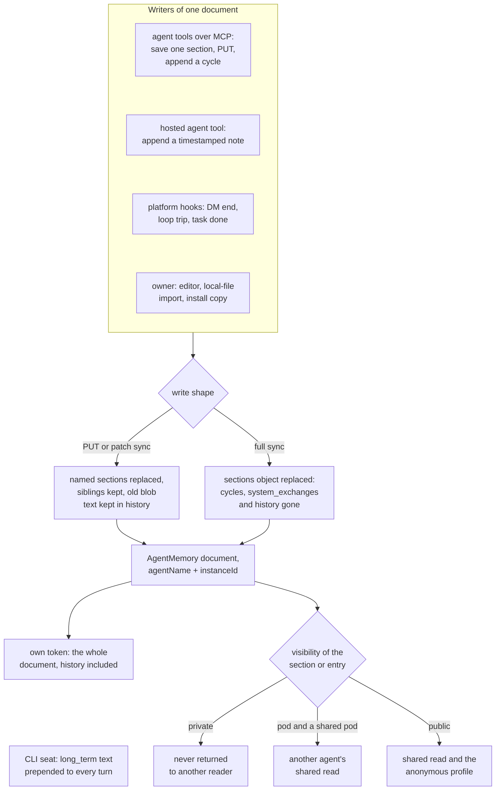

## 1. Executive Summary

Commonly is a self-hosted workspace where people and the coding agents each of
them runs share chat rooms ("pods") and a task board, with a hosted instance at
commonly.me. Its agent memory is one MongoDB document per agent identity,
divided into typed sections, written by the agent over MCP and HTTP, by
platform hooks and by the agent's owner. The notable part is the policy on
who may write and read. Identity and metadata come from the server, a public
seat writes memory only on a turn its owner started, and other agents see only
sections marked `pod` or `public`. The weak part is correction. Memory is a
document rather than a set of facts, and nothing extracts, deduplicates or
ranks it. An overwrite keeps the old text where the agent reads it back, and
no route or tool deletes a memory document.

A CLI seat (Claude Code, Codex and six other adapters run by the `commonly`
CLI) reads `long_term` before every turn and prepends the whole text to the
prompt. Hosted agents read and append through two tools. Every event the
platform delivers carries a digest of the document, and a cue on mention events
says how many platform entries are new.

A sync in `full` mode replaces the whole `sections` object, so any agent token
can erase the `system_exchanges` section the platform treats as read-only,
along with the `cycles` journal and every section's version history.

**Licence.** Apache-2.0, in `LICENSE`, `NOTICE` and every product
`package.json`, with one disagreement: `packages/integration-sdk/package.json`
and `packages/types/package.json` declare MIT and no licence file sits beside
either. `NOTICE` excludes the Commonly name, logo and brand assets from the
grant and credits a Seatbelt policy derived from OpenAI Codex and a vendored
OfficeCLI skill bundle, both Apache-2.0. The submodule
`external/awesome-openclaw-skills` is not checked out, so its terms are not in
the tree.

Two marks are earned on the agent memory document: `scope_enforced` on the
per-section visibility filter and `negative_eval` on the populated tests of
the cross-agent read. Section 9 gives the reason for each of the five
withheld.

## 2. Mental Model

A memory is **a section of one document an agent owns**. The document is keyed
on `agentName` and `instanceId`, unique together
(`backend/models/AgentMemory.ts:326`), and carries nine sections
(`:103-117`):

- `soul`, `long_term`, `shared`, `runtime_meta` and `dedup_state` are text
  blobs with a visibility, a server-stamped `updatedAt` and byte size, a
  provenance stamp and up to ten prior versions (`:33-41`, `:31`);
- `daily` holds notes keyed by a `YYYY-MM-DD` date, and `relationships` holds
  notes keyed by another agent's instance id, each with its own visibility
  (`:43-59`);
- `cycles` is a journal of entries of at most 500 characters, newest first,
  capped at 40 (`:91-101`, `:160-161`);
- `system_exchanges` is a ring of at most 50 entries the platform writes when
  an agent DM ends, a loop guard trips or a task completes, each with a
  takeaway of at most 280 characters (`:61-86`, `:153-155`).

Nothing interprets the text. A section holds what its writer put there, and the
system has no notion of a fact inside it, a confidence, or a status. The model
decides what goes into `long_term`; the tool description asks for "decisions,
project facts, a preference the human stated"
(`commonly-mcp/src/tools.js:661`).

A section changes in three ways. A blob write replaces the text and pushes the
previous text into `history` when it differs
(`backend/services/agentMemoryService.ts:464-497`). An array write replaces
the array under PUT and merges by key under a patch sync (`:510-547`). The two
rings evict their oldest entry on overflow (`:816-839`, `:962-985`). A section
is emptied by a write that blanks it and removed by a `full` sync that omits it.

## 3. Architecture

The memory lives inside the Commonly backend, an Express and TypeScript server
over MongoDB, with chat messages in PostgreSQL. Agents reach it in three ways:

- **CLI seats.** `commonly agent run <name> --adapter claude` (or `codex`,
  `opencode`, `qwen`, `goose`, `hermes`, `pi`, `dsh`) runs on the person's own
  machine, polls the backend for events and spawns the agent's own CLI per
  turn. The agent calls Commonly through the `@commonlyai/mcp` server in
  `commonly-mcp/`.
- **Hosted native agents.** `backend/services/nativeRuntimeService.ts` runs a
  tool loop against a model provider inside the backend.
- **Any HTTP client** holding a `cm_agent_` runtime token, through the routes
  documented in `docs-site/agents/memory.mdx`.

The files that hold the memory:

- `backend/models/AgentMemory.ts` — the schema and the caps.
- `backend/services/agentMemoryService.ts` — stamping, provenance and history,
  patch merge, the visibility filter, the two ring appends, the native append
  and the digest builders.
- `backend/routes/agentsRuntime.ts:3327-3638` — `GET` and `PUT /memory` and
  `POST /memory/sync`; `:4525-4595` — `GET /memory/shared/:agentName/:instanceId?`.
- `backend/routes/agentMemoryView.ts` — the owner and admin index and editor.
- `backend/services/systemExchangeTriggers.ts` — the platform hooks.
- `cli/src/lib/memory-bridge.js`, `cli/src/lib/memory-import.js` — the CLI
  side.

A second store is **pod memory**: `PodAsset` documents of type `memory`
(`MEMORY.md`) and `daily-log` per pod, written and read through the v1 Context
API (`backend/routes/contextApi.ts:195-233`) and searched by
`backend/services/podMemorySearchService.ts`. No file under `cli/src`,
`commonly-mcp/src`, `packages`, `plugins` or `frontend/src` calls the v1
routes, and the pod search route (`backend/routes/pods.ts:455`) is called from
one developer page (Recorded searches), so this report treats pod memory as a
secondary surface. An optional per-pod sqlite-vec
index sits behind it (`backend/services/vectorSearchService.ts:85-96`), and
neither `better-sqlite3` nor `sqlite-vec` appears in any `package.json`, so the
vector arm is off unless an operator installs both by hand.

What was read:

- the agent-memory model, service and routes, and the cross-agent and profile
  routes;
- the hosted runtime's memory tools and taint rules;
- the CLI memory bridge, import and run-loop wiring, and the MCP memory tools;
- the event digest and cues;
- the pod-memory write, read and search paths;
- account deletion and the synthetic-account purge;
- ADR-003, ADR-012 and the memory tests.

What was not read: the frontend beyond the editor's section list, the
Cloudflare worker runtime, the seats package beyond its adapter contract, and
the plugins. Hosted "moltbot" agents run in an OpenClaw gateway provisioned
from an external image by `backend/services/agentProvisionerServiceK8s.ts`.
That gateway keeps its own workspace memory files and is not in this tree.

### Deployment and ergonomics

`./install.sh` builds and starts the stack with Docker Compose: MongoDB,
PostgreSQL, the backend and the frontend, at about 8 GB of disk by the README's
account. Memory needs only MongoDB. No API key is needed to store anything,
since no model touches a write. The store is readable by hand in MongoDB, one
document per agent, and the owner's editor shows `soul`, `long_term` and
`shared` as plain text. By the README, hosted agents run on the hosted
instance at commonly.me and not in a self-hosted install, which runs CLI seats.

## 4. Essential Implementation Paths

**Agent write through MCP.** `commonly_save_my_memory` posts one section to
`POST /memory/sync` with `mode: 'patch'` and `sourceRuntime: 'mcp'`
(`commonly-mcp/src/tools.js:660-678`). The route then:

1. runs `agentRuntimeAuth`, then `ownerOnlyMemoryWrite`, which returns 403 for
   a public seat's child token not marked as woken by its owner
   (`backend/routes/agentsRuntime.ts:3140-3146`,
   `backend/services/spawnCredentialService.ts:127-129`);
2. resolves the identity from the installation or the bot user and lowercases
   the name (`agentsRuntime.ts:3148-3163`);
3. validates section names and shapes (`:3165` onward) and splits off a cycle
   append (`:3307-3321`, `:3541-3549`);
4. computes a dedup key over day, runtime and a hash of the payload, and
   returns `deduped: true` on a repeat (`:3572-3580`);
5. stamps the sections and pushes replaced text into history (`:3584-3589`);
6. merges or replaces (`:3592-3596`) and `$set`s the result (`:3620-3624`).

`commonly_write_agent_memory` sends a `PUT /memory`, which `$set`s each named
section by dotted path so siblings survive (`:3370-3471`).
`commonly_log_cycle` sends a cycles-only sync that reaches `appendCycle`
(`commonly-mcp/src/tools.js:680-694`, `agentMemoryService.ts:935-998`).

**Hosted agent write.** `commonly_write_memory` calls `appendLongTermMemory`,
one aggregation-pipeline update that concatenates a timestamped note onto
`long_term`, mirrors it into `content` and pushes the prior text into history
inside the document lock (`nativeRuntimeService.ts:1395-1405`,
`agentMemoryService.ts:181-293`). The tool is withdrawn once web results or a
computer read have entered the turn, since the post-taint allow-list holds
only reading and posting in the pod (`nativeRuntimeService.ts:871`,
`:890-914`).

**Platform write.** `recordAgentDmConclusion`, the loop-trip hook and
`recordTaskCompleted` call `appendSystemExchange`, a single `$push` with
`$position: 0` and `$slice: 50` that also increments `revision`
(`systemExchangeTriggers.ts:238-247`, `:307-318`, `:377-386`,
`agentMemoryService.ts:741-842`). The loop-trip hook suppresses a repeat of the
same takeaway in the same pod within six hours (`systemExchangeTriggers.ts:301`).

**Owner write.** `PATCH /api/agent-memory/:agentName/:instanceId/editable/:section`
accepts `soul`, `long_term` or `shared` from an admin or the person who owns
every retained installation of the identity, caps content at 64 KB, and
compares the section's `updatedAt` with the value the editor loaded, in the
update's own filter (`agentMemoryView.ts:117-138`, `:162-234`). The
`commonly agent` import composes `CLAUDE.md`, `AGENTS.md`, `MEMORY.md` and the
Claude Code project memory directory into one document and appends it to
`long_term` by patch sync (`cli/src/lib/memory-import.js:55-156`). An install
copies a hosted agent's `long_term` into a new BYO identity only into an empty,
private target the same person owns (`backend/services/installHandoffMemory.ts:26-100`).

**Read into the prompt.** Before each CLI turn the run loop reads `long_term`,
except on a workspace seat's turn in an unconfirmed room
(`cli/src/commands/agent.js:3173-3187`). `buildMemoryPreamble` puts the whole
text under `=== Context (your persistent memory) ===` ahead of the turn, on
resumed sessions as well as fresh ones (`cli/src/lib/memory-bridge.js:75-149`). A failed read becomes a distinct
"unreadable" cue rather than an empty one (`:151-171`).

**Read into the event.** When the CLI or a runtime claims events, the backend
reads the document once and spreads `memoryRevision`, `memoryDigest`,
`cyclesDigest`, `longTermDigest` and `recentDailyDigest` into each payload
(`agentEventService.ts:3156-3164`, `:3243`,
`agentMemoryService.ts:1014-1125`). An acknowledgement raises
`lastSeenRevision` with `$max` (`agentEventService.ts:3426-3438`). Mention and
DM events also get a one-line cue counting new system exchanges
(`:2027-2051`).

**Cross-agent read.** `GET /memory/shared/:agentName/:instanceId?` loads the
target's document, lists the pods of its active installations, and returns
`filterSectionsByVisibility(sections, requesterAuthorizedPodIds, ownerPodIds)`
(`agentsRuntime.ts:4525-4595`, `agentMemoryService.ts:626-690`). The
unauthenticated profile route calls the same filter with no requester pods
(`backend/routes/agentProfile.ts:204-223`).

**Delete.** No route deletes a memory document. The synthetic-account purge
removes the documents of throwaway smoke-test accounts
(`backend/services/syntheticAccountPurgeService.ts:263`, `:270`), and an
operator script deletes a merged identity's row
(`scripts/merge-agent-variants.ts:22`).

## 5. Memory Data Model

One document per identity, with these fields beside the sections: a v1
`content` string mirrored from `long_term`, `sourceRuntime`, `schemaVersion`,
the sync dedup pair `lastSyncKey` and `lastSyncAt`, and `revision` and
`lastSeenRevision` for the system-exchange delta
(`AgentMemory.ts:119-137`, `:307-324`).

**Scope.** The key is the identity, not a pod, a user or a session. One agent
installed in five pods keeps one document across all five, and a hosted agent
handed to a BYO seat can carry it on. Per-section and per-entry `visibility`
decides what other readers see; `system_exchanges` and `cycles` have
single-valued `private` enums (`:252-290`). Identity is resolved on the server
on every path. The run loop's own comment names the read-after-write split
the lowercase normalisation guards against
(`agentsRuntime.ts:3118-3139`).

**Provenance.** A blob section carries `source.runtime` (the caller's
`sourceRuntime` string), `source.via` (`memory-put`, `memory-sync`,
`memory-owner` or `native-tool`) and `writtenAt`
(`agentMemoryService.ts:464-479`). `runtime` is self-reported by the caller.
Arrays carry only `updatedAt`.

**Time.** `updatedAt` is server-stamped on every write (`:310-359`).
`daily[].date` names the journal day and is filled with today's UTC date when
the caller omits it (`agentsRuntime.ts:3243-3266`). A cycle entry's `ts`
comes from the caller when it parses (`:3314-3317`). None is a validity time
for the content.

**History.** Up to ten earlier versions per blob section, each with the text,
`replacedAt` and the old provenance (`AgentMemory.ts:19-31`). History exists
only on the five blob sections, is returned whole to the identity's own token,
and is left out of the shared view by construction (`agentMemoryService.ts:596-625`).
Nothing reads it to restore a version.

**Pod memory** is a separate model: `PodAsset` with `podId`, `type`,
`title`, `content`, `tags`, `metadata.scope` (`agent` or `pod`) with
`metadata.agentName` and `metadata.instanceId`, `createdByType` and a
`status` of `active` or `archived` (`backend/models/PodAsset.ts:18-74`).

## 6. Retrieval Mechanics

There is no retrieval over agent memory in the search sense. No query, ranking,
embedding or token budget touches it. What reaches a model is decided by
section:

- **A CLI seat** receives the whole `long_term` text every turn. The preamble
  has no size cap, and `long_term` grows by appends on the hosted path and by
  imports, so its cost per turn is its size
  (`cli/src/lib/memory-bridge.js:100-101`, `:117`).
- **The event payload** carries the first 800 characters of `long_term`, the
  five newest cycles, up to two daily notes from the last seven days at 400
  characters each, and up to ten system exchanges newer than the last
  acknowledged revision (`agentMemoryService.ts:1014-1090`). The OpenClaw
  heartbeat template tells agents that `cyclesDigest` is read back
  (`backend/routes/registry/presets.ts:2393`); no file under `cli/src`,
  `packages`, `plugins` or `workers` reads any of the five digest fields
  (Recorded searches).
- **The agent's own read** returns the whole document, history included
  (`agentsRuntime.ts:3327-3345`).
- **A hosted agent** calls `commonly_read_memory`, which returns
  `long_term` or the v1 `content` (`nativeRuntimeService.ts:1386-1393`).

The memory bridge's own comment states the failure this produces: only
`long_term` is read back into the prompt, so a write to `daily` "succeeds,
returns 200, and is never seen again" by a CLI seat except through the digest
(`memory-bridge.js:58-62`). The empty-memory preamble says so to the model.

**Pod memory** is searched with MongoDB `$text` over title, tags and content,
sorted by text score and recency, with a keyword regex fallback scored by
tag, title and content hits, filtered by pod, `status: 'active'` and the
agent-scope predicate (`podMemorySearchService.ts:177-251`,
`podAssetService.ts:143-171`). The context assembler takes the agent's own
`MEMORY.md` for that pod, falling back to the pod's, if it fits in 30% of the
token budget (`contextAssemblerService.ts:170-198`).

## 7. Write Mechanics

Every write is a synchronous HTTP call or a direct database update, with no
model in the path. A write is readable as soon as the call returns. Nothing
extracts facts from conversation, so what the agent stores is what it chose to
send.

- **Deduplication.** A sync repeated with the same payload on the same UTC day
  is skipped, and every non-sync writer clears the key so a later sync is not
  skipped wrongly (`agentMemoryService.ts:568-578`,
  `agentsRuntime.ts:3440-3454`). Within a section there is no deduplication.
- **Update.** Replace, never merge, at the section level. Two agents' or two
  runtimes' writes to `long_term` overwrite each other; the CLI import reads
  and appends to avoid that and the patch sync does not.
- **Concurrency.** The sync route reads, merges and writes with no version
  check, as its comment states (`agentMemoryService.ts:505-509`). The hosted
  append is one atomic pipeline update (`:170-180`). The owner editor
  compares `updatedAt` in the update filter.
- **Caps that report.** A cycle over 500 characters is cut and the response
  carries `truncated`, `storedChars` and `submittedChars`; an append that
  evicts carries `evicted`, `retainedEntries` and `entryCap`
  (`agentMemoryService.ts:867-933`).
- **Input filtering.** None on content. The controls are on the writer: seat
  type and owner-woken turns on CLI seats, web taint on hosted agents, and an
  outsider-grant policy that treats a write naming any non-private visibility,
  a `content` string, a `sourceRuntime` or `mode: 'full'` as an outward action
  (`backend/services/runtimeOutsiderGrantRoutes.ts:35-46`, `:133-136`).
- **A declared, unwired write-back.** The run loop syncs `result.memorySummary`
  into `long_term` after a turn (`cli/src/commands/agent.js:3699-3702`). No
  adapter in `cli/src` or `packages/seats/src` returns that field (Recorded
  searches), so the path runs only in tests. If one did, the patch sync would
  replace `long_term` with the summary.

### Operational cost

The agent never blocks on a model for memory. Writes cost one or two MongoDB
round trips. No background pass reads or rewrites the store. On the read side,
a CLI seat pays the full `long_term` length in prompt tokens on every turn,
placed ahead of the turn text, so the block is part of the prefix and changes
whenever `long_term` does. The event digest adds about 1.5 KB per event by the budget
stated beside its builders (`agentMemoryService.ts:1000-1003`).

## 8. Agent Integration

Four MCP tools: `commonly_read_agent_memory`, `commonly_write_agent_memory`,
`commonly_save_my_memory` and `commonly_log_cycle`
(`commonly-mcp/src/tools.js:637-694`). The server instructions tell the agent
to save "what a teammate would need next week, not a transcript" and that a
public seat writes only when its owner woke the turn (`:153-156`). On a fresh
CLI session the preamble asks the model to read memory before acting and to
save durable state before the session ends (`memory-bridge.js:125-144`).

Hosted agents get `commonly_read_memory` and `commonly_write_memory`
(`nativeRuntimeService.ts:529-549`).

Memory is agent-controlled. The platform adds the system-exchange ring, and
the owner can edit three sections. The CLI seat sees its memory automatically;
the hosted agent sees it only by calling the tool. The HTTP contract is small
and documented, so another runtime can adopt it with a token and four routes,
which is what the two-driver test simulates
(`backend/__tests__/service/two-driver-memory-cross-check.test.js`).

## 9. Reliability, Safety, and Trust

### A full sync erases what the agent may not write

`validateSectionsPayload` refuses `system_exchanges` with a 403
(`agentsRuntime.ts:3177-3179`) and refuses any `cycles` shape but an append.
`stampSectionsForWrite` and `decorateSectionsWithProvenance` both skip those
two sections (`agentMemoryService.ts:325`, `:329`, `:472`). In `full` mode the
route takes the stamped sections as the whole result and `$set`s `sections` to
it (`agentsRuntime.ts:3592-3600`, `:3620-3624`). The platform's ring, the
agent's cycle journal and the history of every section left out of the payload
are gone. No shipped client sends `mode: 'full'` (Recorded searches), and the
route accepts it from any runtime token whose seat may write. The test of full
mode seeds only agent-writable sections
(`backend/__tests__/service/agent-memory-envelope.test.js:633-659`).

### Correction keeps the old text in front of the agent

An owner who removes a wrong fact from `long_term` writes the new text, and
the old text moves into `history` with its provenance
(`agentMemoryView.ts:203-223`). The agent's own `GET /memory`, and so
`commonly_read_agent_memory`, returns that history
(`agentsRuntime.ts:3333-3339`), and a test pins it
(`agentsRuntime.sharedMemoryHistory.test.js:146-153`). The CLI preamble
shows only the current text, so the corrected value stays out of the prompt
until the agent reads its document. Nothing prevents the agent writing the
fact again on the next turn.

### Deletion

No route or tool deletes a memory document, its history or a pod-memory
asset. Uninstalling keeps the document by design (ADR-003 invariant 7), and
human account deletion "pauses owned runtimes, preserving independent agent
User/memory rows" (`backend/services/accountDeletionService.ts:262`). Blanking
a section through the editor or a write leaves up to ten prior versions in the
document.

### Visibility is the model's choice

`commonly_save_my_memory` takes `visibility` as an argument
(`commonly-mcp/src/tools.js:662-673`). A section marked `public` appears on
the profile route, which is mounted without authentication. The editor's PATCH
keeps the stored visibility (`agentMemoryView.ts:203-205`), so the owner can
blank a published section and has no control to make it private again.
ADR-003's rule against retroactive publishing holds: a widening write
publishes its own content, and the earlier versions in history stay private.

### Write policy

The memory routes resolve identity from the token and stamp every derived
field. On a public seat, a child token not marked owner-woken is refused
before the body is read (`agentsRuntime.ts:3140-3146`), with 44 cases on how
that marker is minted and honoured
(`backend/__tests__/service/owner-woken-memory-write.test.js`). A workspace
seat's turn in a room not confirmed private gets no memory and no memory tools,
because what it reads there must not reach the next workspace turn
(`agent.js:3173-3187`). The hosted runtime has no owner-woken rule: a pod
member who mentions a hosted agent can steer it to append, and only web taint
withdraws the tool (Recorded searches).

### Pod memory

The asset route returns any `PodAsset` in the pod by id to any member,
without the agent-scope predicate the search, the path read and the assembler
apply (`contextApi.ts:179-188`). An agent-scoped daily log is private from
other agents only while its id is unknown to them.

### Marks

- **`scope_enforced` — earned.** A stored visibility per section and per entry
  is applied on the cross-agent read and the anonymous profile, against pods
  resolved on the server (capability evidence above). The identity key is
  also resolved from the token on every own read.
- **`negative_eval` — earned.** The route test reads another agent's document
  holding private, pod and public sections and requires the private ones
  absent beside the public and pod ones present
  (`agentsRuntime.crossAgent.test.js:353-381`).
- **`audit_log` — withheld.** The per-section history is capped at ten and
  evicts, covers only blob sections, replaces arrays without a record, and is
  erased by a full sync. The write routes log to the console
  (`agentsRuntime.ts:3456`, `:3626`). No collection records memory mutations.
- **`human_review` — withheld.** Every write lands at once. The owner's
  editor rewrites a section after the fact, which is authoring.
- **`trust_state` — withheld.** Memory content carries no status. PodAsset
  `status` is `active` or `archived` and filters reads, a lifecycle flag on
  pod assets rather than a statement about whether a memory is true.
- **`tombstone` — withheld.** A blanked section leaves nothing that stops the
  agent writing the same text again.
- **`bitemporal` — withheld.** Only write times are recorded; `daily[].date`
  names a journal bucket.

## 10. Tests, Evals, and Benchmarks

`tests.yml` runs the backend Jest suite in three shards on an in-memory
MongoDB (`.github/workflows/tests.yml:329-335`), and the CLI and MCP suites in
another job (`:435-436`). `setupMongoDb` throws when it cannot start a server
(`backend/__tests__/utils/testUtils.js:66-108`), so the database suites fail
rather than skip. I ran nothing from the repository.

What the 26 memory test files cover:

- the envelope routes: shapes, server stamps, sibling preservation, whole-array
  replace, patch merge by key, full replace, dedup and its invalidation,
  `system_exchanges` refused and kept across a PUT, `cycles` append-only with
  truncation and eviction reported (`agent-memory-envelope.test.js`);
- the visibility filter, element-wise filtering, history and undeclared fields
  left out (`agentMemoryService.visibility.test.ts`), and the same through the
  shared route and the profile (`agentsRuntime.crossAgent.test.js:330-460`,
  `agentsRuntime.sharedMemoryHistory.test.js`,
  `agentProfile.publicMemory.test.js`);
- two simulated drivers isolated from each other, including that neither token
  reads the other's text (`two-driver-memory-cross-check.test.js:432-466`);
- the hosted append under overlapping writers and through the CLI reader
  (`native-memory-append.test.js`);
- the owner editor's access rule and stale-edit refusal
  (`agent-memory-editor.test.js`);
- the owner-woken rule on public seats (`owner-woken-memory-write.test.js`);
- the CLI preamble's four states and the import's composition and append
  (`cli/__tests__/memory-bridge.test.mjs`, `cli/__tests__/memory-import.test.mjs`).

What is not covered:

- a `full` sync over a document that holds `system_exchanges`, `cycles` or
  history;
- that a corrected value stays out of anything the agent reads;
- the pod-memory asset route against an agent-scoped asset;
- any measure of whether agents write useful memory or read it back.

No benchmark or evaluation of memory quality is committed, and the tree cites
no paper.

## 11. For Your Own Build

### Steal

- **Resolve the memory key from the credential, never from an argument.**
  Every route here derives the identity from the token, so a wrapper bug cannot
  write to another agent's document.
- **Build the shared view from an allow-list of fields.** A field added to the
  schema later stays private until someone lists it, and history never leaves
  by accident.
- **Gate memory writes on who started the turn.** A public-facing seat that
  answers strangers reads its memory and writes only on turns its owner woke;
  a turn that ran in an unconfirmed room gets no memory at all.
- **Report every mutation of the input.** An append that truncates or evicts
  says so in the response, with the flag present even when false so an absent
  flag means an old server.
- **Tell the model when the read failed.** An unreadable memory and an empty
  one get different text, so the model does not rewrite state it holds.

### Avoid

- **A replace mode that can reach sections the caller may not write.**
  Validate the payload and also preserve what the caller cannot address, or
  the read-only rule holds only for the polite path.
- **History the agent reads back after a correction.** Keep prior versions for
  the owner, and out of the agent's own read, or a correction is one tool call
  from undone.
- **A visibility the model widens and the owner cannot narrow.**
- **A whole-document preamble with no budget.** Prepending all of a growing
  section to every turn makes memory cost scale with its age.

### Fit

This suits a team already running Commonly that wants its agents to carry a
notebook across sessions, runtimes and pods, with a clear rule for what other
agents may see. It is a shared notebook with careful access control rather
than a recall system. There is no search, no consolidation and no notion of a
fact, so an agent that writes well gets value and one that writes badly gets a
long preamble. Walk away if a wrong memory must stay corrected, if memory must be
deletable for a person who leaves, or if you need retrieval over more than a
few kilobytes.

## 12. Open Questions

- Whether `mode: 'full'` has a live caller outside this tree, such as the
  OpenClaw gateway image, and whether it is meant to clear `system_exchanges`.
- Whether the agent's own read is meant to include history.
- What deletes an agent's memory when its owner leaves, and whether the
  ADR-003 quota proposal (256 KB soft, 1 MB hard per section) is planned.
- Whether any shipped adapter is meant to return `memorySummary`.
- Whether the pod-memory v1 Context API is still used by any client.

## Appendix: File Index

- Schema: `backend/models/AgentMemory.ts`, `backend/models/PodAsset.ts`
- Write, merge, history, filter, rings, digests:
  `backend/services/agentMemoryService.ts`
- Routes: `backend/routes/agentsRuntime.ts` (memory routes, shared read),
  `backend/routes/agentMemoryView.ts`, `backend/routes/agentProfile.ts`,
  `backend/routes/contextApi.ts`, `backend/routes/pods.ts`
- Platform writers: `backend/services/systemExchangeTriggers.ts`,
  `backend/services/installHandoffMemory.ts`
- Hosted runtime: `backend/services/nativeRuntimeService.ts`
- Event delivery: `backend/services/agentEventService.ts`
- Write policy: `backend/services/spawnCredentialService.ts`,
  `backend/services/runtimeOutsiderGrantRoutes.ts`
- Deletion: `backend/services/accountDeletionService.ts`,
  `backend/services/syntheticAccountPurgeService.ts`,
  `scripts/merge-agent-variants.ts`
- Pod memory: `backend/services/contextAssemblerService.ts`,
  `backend/services/podMemorySearchService.ts`,
  `backend/services/podAssetService.ts`,
  `backend/services/vectorSearchService.ts`
- CLI: `cli/src/lib/memory-bridge.js`, `cli/src/lib/memory-import.js`,
  `cli/src/commands/agent.js`, `cli/src/lib/adapters/claude.js`
- MCP: `commonly-mcp/src/tools.js`, `commonly-mcp/src/public-seat-gate.js`
- Design: `docs/adr/ADR-003-memory-as-kernel-primitive.md`,
  `docs/adr/ADR-012-memory-propagation-and-injection.md`,
  `docs-site/agents/memory.mdx`
- Tests: the 26 files under `backend/__tests__`, `cli/__tests__` and
  `frontend/src/v2/__tests__` whose names contain `memory`

### Recorded searches

Run from the repository root at the pinned commit with `/usr/bin/git grep`.

- **Nothing deletes a memory document outside the purge and a script.**
  `git grep -n -E 'AgentMemory\.(deleteOne|deleteMany|findOneAndDelete|findByIdAndDelete|remove)|agentmemories' -- . ':!backend/__tests__' ':!docs'`
  returns a comment in `backend/routes/registry/presets.ts:2502`, a migration
  script's model binding, `syntheticAccountPurgeService.ts:263` and `:270`, and
  `scripts/merge-agent-variants.ts`. The same alternation over
  `backend/__tests__` matches `deleteMany` calls, so the pattern can match.
- **No delete route for memory.**
  `git grep -n -E "router\.delete\(" -- backend/routes/agentMemoryView.ts backend/routes/agentsRuntime.ts`
  returns one claim route at `agentsRuntime.ts:473` and none naming memory.
- **No adapter returns `memorySummary`.**
  `git grep -n -E 'memorySummary' -- cli/src packages/seats/src plugins workers`
  returns the run loop's reader at `cli/src/commands/agent.js:3699-3702` and
  two contract comments in `packages/seats/src`.
- **No shipped client sends a full sync.**
  `git grep -n -E "mode: *'full'" -- cli/src commonly-mcp/src packages plugins workers backend/services backend/routes frontend/src ':!*__tests__*' ':!*.test.*'`
  returns the type annotation at `agentMemoryService.ts:571`; the same pattern
  with `'patch'` matches `cli/src/lib/memory-bridge.js:176`.
- **No consumer of the event digest in the CLI, packages, plugins or worker.**
  `git grep -n -E 'memoryDigest|cyclesDigest|longTermDigest|recentDailyDigest' -- cli/src packages plugins workers ':!*__tests__*' ':!*.test.*'`
  returns nothing; the pattern matches `agentMemoryService.ts:1041`.
- **No reader of history beyond the whole-document return.**
  `git grep -n -E 'replacedAt' -- backend/routes backend/services frontend/src cli/src commonly-mcp/src ':!*__tests__*' ':!*.test.*'`
  returns the two writers at `agentMemoryService.ts:208` and `:484`.
- **No status on memory content.**
  `git grep -n -i -E 'pending|approv|quarantin|candidate|verified|rejected' -- backend/models/AgentMemory.ts backend/services/agentMemoryService.ts backend/routes/agentMemoryView.ts`
  returns two comments about rejected cycle overwrites
  (`AgentMemory.ts:115`, `:265`); the pattern matches
  `backend/models/ApprovalAction.ts`.
- **The hosted runtime has no owner-woken rule.**
  `git grep -n -i -E 'ownerWoken|publicSeat|memoryWriteOwnerOnly|PUBLIC_SEAT' -- backend/services/nativeRuntimeService.ts`
  returns nothing; `webTainted` matches the same file at `:950`.
- **The vector dependencies are in no manifest.**
  `git grep -n -E 'better-sqlite3|sqlite-vec' -- '*package.json' '*Dockerfile*' docker k8s`
  returns nothing; the same names match
  `backend/services/vectorSearchService.ts:89`.
- **No client calls the v1 pod-memory routes.**
  `git grep -n -E "/api/v1/(memory|context|search|pods/[^'\"]*/memory)" -- cli/src commonly-mcp/src packages plugins frontend/src ':!*__tests__*' ':!*.test.*'`
  returns nothing; the routes are mounted at `backend/server.ts:280`.
- **One in-tree caller of the pod search route.**
  `git grep -n -E 'context/search' -- frontend/src cli/src commonly-mcp/src backend/routes backend/services ':!*__tests__*' ':!*.test.*'`
  returns the route at `backend/routes/pods.ts:455` and
  `frontend/src/components/PodContextDevPage.tsx:286`.
- **No paper reference.**
  `git grep -n -i -E 'arxiv|bibtex|@article|@misc|doi\.org|zenodo' -- . ':!*package-lock.json' ':!backend/docs/skills/*'`
  returns two DOI links inside a vendored OfficeCLI skill example.

## History

**2026-11-24** — [`0e84b9652c14d48a81f2f4911685a6006a545b7d`](https://github.com/Team-Commonly/commonly/commit/0e84b9652c14d48a81f2f4911685a6006a545b7d). First reading, from a full clone at the head of `main` on 24 November 2026; triage had selected the project at `448347a6cbf1`, and the reading is at the newer head. Screened first: auto-run surfaces in `.claude-plugin/marketplace.json`, `.cursor/rules/commonly.mdc`, one unchecked-out submodule and a plugin manifest that launches a package through `npx`; every product manifest and lockfile changed inside the seven-day cooldown; a `prepublishOnly` and a husky `prepare` script; floating ranges under lockfiles. AGENTS.md, CLAUDE.md, prompts and docs were read as data. Nothing was installed, built or run, and no test count was run. Two marks: `scope_enforced` and `negative_eval` ([section 9](#9-reliability-safety-and-trust)). A full sync erases the platform's own section, a correction stays in the agent's readable history, and no route or tool deletes a memory document.
