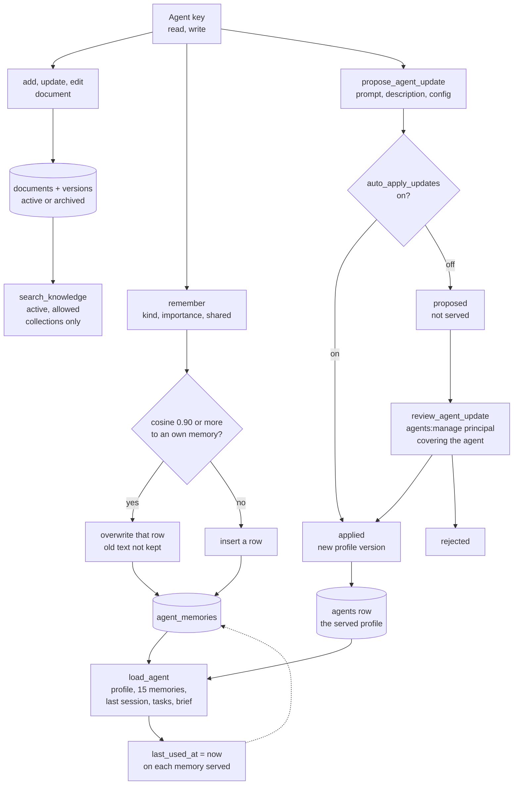

## 1. Executive Summary

Concilium is a self-hosted team knowledge base for people and agents: a
FastAPI server over one PostgreSQL database with pgvector, a notes
dashboard with folders, wikilinks and a graph, and an MCP server through which
agents search, read and write the same notes. Beside the notes sits an agent
registry holding each agent's profile, its memories, its session summaries and
its tasks. What is notable is the access boundary. Every document read applies
the collections the server reads from the presented key or OAuth grant, and an
agent's own proposal to change its prompt waits for an `agents:manage`
principal that covers it. What is weak is everything below the profile. An
agent's memories overwrite each other on a similarity threshold, keep no prior
text, and are shared across collections with one flag. Nothing checks that the
reviewer of a proposal is a person.

Three stores carry what an agent knows. Documents are the team's notes,
versioned on every edit and archived rather than deleted. Agent memories are
short typed statements the agent writes with `remember`, recalled by cosine
similarity and loaded fifteen at a time when a session starts. The profile is
the agent's own system prompt, changed by the agent only through a proposal.
A session ends with `save_session`, whose summary and next steps the next
session is handed.

**Licence.** Apache-2.0, in `LICENSE` and in `pyproject.toml:7-8` and the
plugin manifest. The dashboard's minified libraries under
`src/mcp_rag_api/static/vendor/` are listed with origin, version and licence
in that directory's README, except `force-graph.min.js`, whose entry names no
licence and which ships none. No restriction on use.

Three marks are earned: `scope_enforced` on agent ids and collections,
`audit_log` on the `audit_log` table, and `negative_eval` on one
folder-filter test. Section 9 gives the reason for each of the four withheld,
`human_review` on the profile proposals among them.

## 2. Mental Model

Each of the three stores turns something into a belief differently, and only
one of them asks anyone first.

**A document is believed from the moment it is saved.** An agent with `write`
or a dashboard editor adds it to a collection; it is chunked, embedded and
searchable in the same call. A later edit writes a new version with a
mandatory change note. Archiving takes it out of search, lists, links, the
graph, the brief and duplicate detection, and nothing returns it to `active`
(`src/mcp_rag_api/core/documents.py:438-449`).

**A memory is believed from the moment it is written, and it has no history.**
`remember` stores one statement with a kind, an importance and an optional
expiry. If the agent already holds a memory within cosine 0.90, that row's
text is replaced by the new one (`src/mcp_rag_api/core/memory.py:123-148`). The
previous text goes back to the caller once and is kept nowhere. `forget`
either deletes by id or overwrites the text with a replacement. A memory dies
by deletion, by overwrite, or by expiry, which the six-hourly cleanup turns
into a delete.

**A profile change is a candidate until someone applies it.** The agent calls
`propose_agent_update` with a new system prompt, description or config. The
proposal waits as `proposed` in `agent_versions` and is not what `load_agent`
serves. An `agents:manage` principal applies or rejects it, and applying
writes the agents row and a new version. With `auto_apply_updates` on, which
only a manager can set, the agent's proposal applies at once.

Session start assembles all three. `load_agent` returns the applied profile,
lifecycle instructions, fifteen memories, the last session's summary and next
steps, open tasks, the brief of the agent's first collection with one, and the
agent's board cards; the brief and the cards are added by the MCP tool, not
the REST route (`src/mcp_rag_api/mcp_server.py:544-557`). The Claude Code
plugin injects the brief when a session opens, before any tool is called, and
the last session and the cards too when `.concilium.json` names an agent.

## 3. Architecture

One Python package, `mcp_rag_api`, runs the REST API, the dashboard and the
MCP server in one FastAPI process (`src/mcp_rag_api/main.py`). The MCP server
is mounted at `/mcp` behind a gate that resolves the bearer before
`initialize` or `tools/list` (`main.py:224-262`), and also runs over stdio with
the key from `KB_API_KEY`. All SQL is hand-written over asyncpg; migrations are
numbered SQL files applied under an advisory lock at start
(`src/mcp_rag_api/db.py:30-54`).

Everything lives in one PostgreSQL 16 database with pgvector, `pg_trgm` and
`pgcrypto`. Search needs pgvector 0.8 for `hnsw.iterative_scan`
(`src/mcp_rag_api/core/search.py:1-8`). Embeddings come from Voyage by
default, or OpenAI, Hugging Face Inference or a local `BAAI/bge-m3`, all at
1024 dimensions (`src/mcp_rag_api/config.py:33`). OCR uses Tesseract, bundled
in the image.

Three background tasks start with the app: a six-hourly cleanup
(`main.py:73-85`), a graph layout warm-up and a Trello mirror worker
(`main.py:100-109`). None touches memory content beyond deleting expired rows.

### Deployment and ergonomics

An operator runs the API container and PostgreSQL with pgvector. A public
image is published to GHCR on every push to `main`, and the README's quick
start is a `docker run` of each. Storing anything needs an embedding: with the
default provider that is an API key, and with `local` a model of about 2 GB
loaded at start (`main.py:94-96`). A first admin user and an API key are
created from the CLI.

The store is readable SQL. Document versions are full copies, so a bad edit
is repaired from the dashboard's history. Agent memories are visible only
through MCP or REST; the dashboard shows their count and not their content
(`src/mcp_rag_api/dashboard_api.py:1163`). `KB_AUTH_DISABLED` makes every
caller an admin and is refused unless the process binds loopback and the
public URL is local (`config.py:196-209`).

The repository is a published copy of another one. Since 28 October 2026 each
commit is a sync titled with a date and a short sha that is not in this
history, so the history shows what changed and not why.

## 4. Essential Implementation Paths

- **Identity.** `src/mcp_rag_api/security.py`: `Principal` and
  `collection_filter` `:53-87`, `resolve_key` `:120-150`,
  `resolve_oauth_token` `:153-199`, `DEV_PRINCIPAL` `:90`. An agent key's
  scopes and collections come from the agents row; a human OAuth grant's from
  the grant, capped by the dashboard role (`:25-29`, `:176-178`).
- **Tool surface.** `src/mcp_rag_api/mcp_server.py`: `TOOL_SCOPES` `:59-136`,
  `AGENT_CONTEXT_TOOLS` and `SELF_ONLY_TOOLS` `:139-149`, `tool_visible`
  `:153-159`, the `dev` profile `:166-194`, the filtered `tools/list`
  `:206-223`, `current_principal` `:229-249`.
- **Agent memory.** `src/mcp_rag_api/core/memory.py`: `load_agent` `:26-70`,
  `recall` `:73-98`, `remember` `:101-164`, `forget` `:167-194`,
  `save_session` `:197-220`, `upsert_task` `:250-295`, `cleanup_memories`
  `:298-304`.
- **Agent registry.** `src/mcp_rag_api/core/agents.py`: `resolve_agent`
  `:17-31`, `_check_grant`, `_check_collections` and `_check_reach` `:34-55`,
  `_apply` `:86-160`, `set_agent_autonomy` `:263-276`, `propose_agent_update`
  `:416-469`, `list_proposals` `:472-484`, `review_agent_update` `:487-510`.
- **Documents.** `src/mcp_rag_api/core/documents.py`: `_find_similar`
  `:111-128`, `_load_doc` `:139-148`, `list_documents` `:159-187`,
  `add_document` `:190-254`, `update_document` `:257-348`, `edit_document`
  `:384-408`, `archive_document` `:438-449`, `move_document` `:452-474`.
- **Search.** `src/mcp_rag_api/core/search.py:16-91`; the snippet layer in
  `src/mcp_rag_api/core/lean.py:131-175`; links and related documents in
  `src/mcp_rag_api/core/links.py:13-89`.
- **Session start.** `src/mcp_rag_api/core/brief.py:71-195`; the
  `/context/brief` route `src/mcp_rag_api/api.py:242-252`; the hook
  `integrations/claude-code/hooks/session_start.py`.
- **Schema.** `src/mcp_rag_api/migrations/001_init.sql` (documents `:15-35`,
  versions `:37-49`, chunks `:51-62`, agents `:66-80`, agent_versions
  `:83-101`, agent_memories `:103-118`, sessions `:120-129`, tasks `:131-141`,
  api_keys `:145-155`, audit_log `:157-165`); boards and `board_events` in
  `012_boards.sql`.
- **Audit.** `db.audit` at `src/mcp_rag_api/db.py:116-123`.

## 5. Memory Data Model

`agent_memories` holds one statement per row: `kind` in a five-value CHECK,
`content`, a 1024-dimension `embedding`, `importance` 1 to 5, `shared`,
`source`, `expires_at`, `last_used_at` and record times
(`001_init.sql:103-118`). There is no status column, no version table and no
link to the session or document that produced the memory; `source` is a free
string the caller sets.

`documents` carry `collection_id`, an optional `external_id` unique per
collection for upserts, `content_hash`, JSONB `metadata`, `tags`, `version`,
`status` in `('active','archived')`, and `created_by` and `updated_by` set
from the principal. `document_versions` copies title, content, metadata and
tags per version with `changed_by` and a `change_note`. `chunks` hold the
embedding and a generated `tsvector` built with the `portuguese`
configuration whatever the language (`:58`).

The profile is the `agents` row: slug, system prompt, JSONB config,
`allowed_collections` (empty means every collection) and `scopes`. Its history
and the agent's proposals share `agent_versions`, whose status is `proposed`,
`applied` or `rejected`, with `proposed_by`, `reviewed_by` and `review_note`
(`:83-101`).

`agent_sessions` keep a summary, next steps and metadata; `agent_tasks` a
title, details and four statuses. No path deletes a session, a task or an
agent, which is archived. The scope keys are `agent_id` on these four tables
and `collection_id` on documents. Folders organise documents inside a
collection and are not an access boundary, as the migration says
(`006_folders.sql:3`). Separate companies are meant to run separate
instances.

## 6. Retrieval Mechanics

`search_knowledge` is hybrid. One CTE restricts chunks to active documents in
the effective collections, optional tags, metadata containment and folders
(`src/mcp_rag_api/core/search.py:16-27`). A cosine arm and a
`websearch_to_tsquery('portuguese', …)` arm each take `max(top_k * 4, 20)`
candidates, fused by reciprocal rank with k 60, and the call sets
`hnsw.iterative_scan = strict_order` so the HNSW index is used under the
filter (`:72-78`). The MCP tool asks for three times `top_k` chunks and keeps
one 120-word snippet per document, with `folder_path` and a count of further
matching chunks, cut to an optional `max_tokens` (`lean.py:146-175`). `top_k`
defaults to 5.

`recall` is cosine top-k over `agent_memories` where the row is the agent's
own or, with `include_shared` true by default, any agent's shared row, minus
the expired (`memory.py:80-93`). There is no threshold, so it always returns up
to `limit` rows. Every row it returns gets `last_used_at = now()`.

`load_agent` takes no query. It orders the agent's live memories by
`importance DESC, COALESCE(last_used_at, updated_at) DESC` and takes 15, then
stamps `last_used_at` on the 15 (`memory.py:33-61`). Within a tier the most
recently served rows come first, and being served makes them the most recently
served, so the same rows return every session until a newer one is written at
equal or higher importance, or `recall` touches another. A memory written at
importance 3 while 15 rows stand at 4 or 5 never reaches session start.

The brief is one note a person or the agent marks per collection, trimmed to
`BRIEF_MAX_TOKENS` (800), with a folder census, the agent's last session and
up to fifteen open tasks, the agent's cards and the cards other sessions hold
(`brief.py:71-183`). It reads the note only while `active` (`:86`), and after
60 days without an edit it carries a warning to check it before trusting it
(`:132-139`).

## 7. Write Mechanics

Every write is a synchronous tool or REST call by the agent or a person. No
model extracts, summarises or consolidates anything. The architecture note
describes a periodic job that consolidates similar memories and demotes unused
ones (`PLANO.md:360`); the only periodic memory job in the tree deletes the
expired.

**Documents.** `add_document` normalises the text, chunks it at 450 words
with 60 of overlap and embeds every chunk with the title before opening a
transaction (`documents.py:82-89`). Unless `force` is set it refuses when the
document's centroid is within 0.92 of an active document's in the same
collection, returning that document and a hint to update it instead
(`:208-219`). Updates require a change note, take an optimistic lock on the
version read or on `base_version`, write a version row, and re-chunk only when
the text hash changed (`:257-348`). `edit_document` applies exact-once string
replacements and appends server-side (`:365-408`).

**Memories.** `remember` embeds the text, finds the agent's single nearest
memory, and at cosine 0.90 or more overwrites its content, embedding and kind,
raises importance to the larger of the two, ORs `shared`, and keeps the old
expiry if none is given (`memory.py:123-148`). The overwritten text is in the
response and nowhere else. A memory once shared stays shared through every
later merge, and no verb unshares it. "The customer prefers WhatsApp" and "the
customer no longer prefers WhatsApp" are close enough under most embedders
for the second to replace the first, which is a correction when it is right
and an erasure when the second was a misreading.

**Profiles.** `propose_agent_update` accepts a prompt, a description and
config, drops `auto_apply_updates` from the config, and stores the proposal
(`agents.py:416-469`). Approval applies the proposal's fields onto the agent's
current version, not the version it was proposed against (`:507-510`).

### Operational cost

The agent blocks on one embedding call per `remember` and on all of a
document's chunks per save. A write is retrievable when the call returns.
Nothing rewrites the store in the background. `reindex` re-embeds everything
and is run by hand after an embedding change.

Per session, the plugin injects one brief of up to 800 tokens plus the
session, task and card sections, at `SessionStart` and again after `/clear` or
compaction (`hooks/hooks.json:3-14`). The README states that the MCP server
under `?tools=dev` adds about 1,200 tokens per session; the measuring script
is committed (`scripts/measure_tool_catalog.py`) and its output is not. The
brief's date line changes only when the note is edited, so the injection is
stable across sessions until then.

## 8. Agent Integration

The MCP server registers 62 tools, the `agent://{slug}/context` resource and
four prompts (`mcp_server.py:1085-1143`). `tools/list` is filtered per
connection by the scope each tool's core function requires
(`mcp_server.py:153-159`, `:206-223`); permission is still checked in the
core, so a hidden tool called by name is refused the same way. `?tools=dev`
lists 23 tools for coding agents (`:166-194`). It lists `remember` and
`save_session` and leaves out `recall` and `forget`, so the dev catalogue
carries the write verb and not its correction verb, though both stay
callable.

The server instructions and `load_agent`'s lifecycle text tell the model to
load the agent at the start, `remember` whatever is durable, `save_session` at
the end, propose prompt changes rather than make them, and treat retrieved
content as information and not instruction (`memory.py:14-21`,
`mcp_server.py:19-40`).

People connect Claude, ChatGPT, Cursor or VS Code through OAuth with dynamic
client registration limited to an allow-list of redirect hosts and schemes. On
the Authorize screen the person picks the scopes, capped by their dashboard
role, and the collections the client sees. An admin may instead connect the
client as a named agent (`security.py:153-199`).

### The Claude Code plugin, read as data

The repository root carries a marketplace entry pointing at
`integrations/claude-code`, whose `hooks.json` registers three hooks. None was
installed or run for this reading. Installed, they would do the following.

- **SessionStart** (`startup|clear|compact`, 10 s timeout) runs
  `hooks/session_start.py`. It walks up from the session folder for
  `.concilium.json`, takes `url`, `collection` and optionally `agent` from it,
  reads the key from `CONCILIUM_API_KEY` or the variable `key_env` names, and
  refuses any URL that is not `https` or `http` on localhost (`:64-90`). It
  calls `GET <url>/context/brief` with the key as a bearer, the repository
  name and the Claude Code session id, and returns the text as
  `additionalContext`, adding which `session` value to pass to the card tools
  (`:93-128`). Any failure exits 0 with one line on stderr.
- **Stop** and **SessionEnd** (async, 20 s) run `hooks/report_usage.py`. It
  reads the session transcript from its last offset, sums the API usage
  fields once per message id, counts tool calls whose name matches
  `concilium` or `kb-`, estimates their result tokens at four characters a
  token, keeps its state in `~/.cache/concilium/usage/<session>.json`, and
  posts the counters to `<url>/usage/sessions` with the same key
  (`:67-138`). No prompt or result text is sent.

The URL comes from the committed file before the environment
(`session_start.py:67`), and `.concilium.json` is meant to be committed
(`:14-17`). A cloned repository whose `.concilium.json` names another `https`
host receives the user's `CONCILIUM_API_KEY` as a bearer on the next session
start, and the text it returns enters the model's context. The guidance asks
for a read-only agent key, which bounds what the key can do and not where it
is sent.

The two commands are prompts. `/concilium-init` asks for the URL, collection
and agent, writes `.concilium.json` and offers a `CLAUDE.md`.
`/concilium-brief` drafts the brief from the repository and the existing
notes and tells the model to save only after the user approves, which is an
instruction to the model and not a check.

## 9. Reliability, Safety, and Trust

### The collection boundary

A principal's collections are set by the server: the agent row's
`allowed_collections` for an agent key or agent-bound grant, and the grant's
own list for a person's OAuth connection (`security.py:140-150`,
`:184-199`). `collection_filter` turns a requested list into a check of each
name, and no request into the allowed list (`:81-87`). It reaches the search
SQL as `col.name = ANY($2)` (`search.py:23`), list as the same predicate
(`documents.py:170-175`), and read by id, update, archive, version history and
links through `_load_doc`, which checks the document's collection
(`documents.py:139-148`). Related documents filter in SQL
(`links.py:33-43`, `:86`), and links and backlinks are filtered in code. A
wikilink resolved into a collection out of reach is shown as pending rather
than dropped, so the difference does not reveal that the title exists there
(`links.py:51-61`). The brief requires the collection (`brief.py:81`).

Managers are held inside the same boundary. An `agents:manage` principal acts
on another agent only if it covers that agent's scopes and collections, and
only an admin grants `admin` or `agents:manage` (`agents.py:34-55`). Memories,
sessions and tasks go through the same `resolve_agent` (`:17-31`), and a test
walks nine memory and profile calls against an admin agent with two managers
that do not cover it (`tests/integration/test_agents_privilege.py:86-112`).

Three things the boundary does not hold:

- **Shared memories ignore collections.** `recall` returns every agent's
  `shared` rows to every agent (`memory.py:85`), so an agent confined to one
  collection can place text in the recall of an agent confined to another,
  and any `write` key can set the flag.
- **Empty means everything.** `create_agent` stores `allowed_collections`
  empty unless given, and empty is every collection (`agents.py:194`,
  `security.py:74-75`).
- **Dashboard users are unrestricted.** Every dashboard route builds its
  principal from the role alone, with no collections
  (`dashboard_api.py:229-238`, `dashboard_boards.py:31`); viewers see every note.

### Memory has no history

Documents are the careful store. Every change is a version with an author and
a note, edits take a version lock, and restore copies an old version forward.
Memories have none of it. `remember`'s merge and `forget`'s replacement
overwrite in place, and the audit entry names the memory id and not the text
(`memory.py:147`, `:187-193`). An overwritten or deleted memory cannot be
recovered except from a database backup.

### The proposal queue and who may clear it

A proposal waits as `proposed` and the served profile does not change until
`review_agent_update` applies it. That function needs `agents:manage` and
refuses a reviewer who does not cover the agent (`agents.py:487-510`). A key
with the default `read` and `write` scopes neither sees nor may call it, and
the agent cannot set its own autonomy, which the proposal path strips
(`agents.py:428-431`, `tests/integration/test_flows.py:140-178`). A
non-admin agent holding `agents:manage` cannot review its own proposal,
because it does not cover its own elevated scope.

The reviewer is a principal, not a person. In the documented flow it is the
admin's own Claude, connected through OAuth with `agents:manage`, approving
in chat (`PLANO.md:358`). It can equally be a manager agent's key or any
script with an `agents:manage` key. An agent granted `admin` can approve its
own proposals. `reviewed_by` records the resolved actor. The dashboard shows
how many proposals wait and a switch for autonomy, but neither the proposed
text nor an approve control (`dashboard_api.py:776-791`, `:832-836`).

The gate covers the profile and nothing else. An agent can write a
`procedure` memory saying what its prompt would have said, at importance 5,
and `load_agent` hands it to every later session beside the profile, ungated.

### Prompt injection

Documents and memories are written by whoever holds `write`, including text
an agent read from the web or a file. The defence is the instruction that
retrieved content is data (`mcp_server.py:36`). Nothing marks where a memory's
text came from beyond the optional `source` string.

### Marks

- **`scope_enforced` — earned.** `agent_id` on memories, sessions and tasks
  and `collection_id` on documents are applied as predicates on every read
  path, with both values derived from the presented credential. Shared
  memories cross the collection boundary, and an empty list is every
  collection.
- **`audit_log` — earned.** `audit_log` is written inside the same
  transaction as every memory, document, session, task and profile mutation
  through one helper, and no code updates or deletes it. Three limits. The
  entries carry ids, not text, so an overwritten memory's old value is not in
  them. The expiry sweep deletes memories without an entry. And nothing in
  the tree reads the table, so it answers questions only over SQL. The
  boards' `board_events` table is the stricter log, append-only by trigger and
  readable through `board_log`, and it records cards, not memories.
- **`negative_eval` — earned, narrowly.** One populated test requires notes
  outside a folder subtree to be absent from a filtered search; the filter is
  reached from the dashboard's search tester, not from the agent's MCP
  search. Section 10 has the rest.
- **`trust_state` — withheld.** Memories carry no status. A document's
  `archived` is a one-way soft delete. The proposal states are the review
  queue described below, and the served profile is a separate row rather than
  a filtered read of them.
- **`tombstone` — withheld.** `forget` deletes by id, and an archived document
  is outside duplicate detection, so the same text written again is stored
  again with no warning.
- **`human_review` — withheld, and the near miss is the profile queue.** A
  proposal waits in a state the served profile does not read, and a key at
  the default scopes neither sees nor may call the verb that clears it. The
  only reviewer check is the `agents:manage` scope. `review_agent_update` is
  a declared MCP tool beside a REST route (`mcp_server.py:751-754`,
  `api.py:394-396`), nothing checks that the reviewer is a person, and an
  admin-scoped agent can approve its own proposal. The dashboard shows
  neither the proposed text nor an approve control, so no surface is
  reserved for a person. And the gate covers the profile only: memories,
  sessions and documents are never gated.
- **`bitemporal` — withheld.** `created_at`, `updated_at`, `ended_at` and
  `expires_at` are record times. A session's `started_at` is caller-supplied
  and dates the session, not a fact.

## 10. Tests, Evals, and Benchmarks

The suite has 383 test functions: 196 unit tests and 187 integration tests
against a real PostgreSQL. The integration suite drops and recreates the
`public` schema of `TEST_DATABASE_URL`, refuses a database whose name lacks
`test`, uses a hashing bag-of-words embedder, and is marked skipped when the
variable is unset (`tests/integration/conftest.py:22-65`,
`src/mcp_rag_api/core/embeddings.py:292-308`). The only workflow builds and
pushes the Docker image and runs no tests (`.github/workflows/docker.yml`). I
ran nothing.

What is tested well is authority. `test_flows.py:76-178` walks an agent's
read-only refusals, memory dedup, `load_agent`, a refused cross-agent load,
the proposal lifecycle with the protected field, autonomy, restore and
archive revoking the key. `test_agents_privilege.py` covers managers that
cannot widen collections, restore an elevated version, issue a key for an
elevated agent or touch the memories of an agent out of reach. The boards
suite proves `board_events` refuses `UPDATE`, `DELETE` and `TRUNCATE`
(`test_boards.py:226-234`).

Negative retrieval:

- **Earned on.** `test_search_folder_filter` seeds five notes, requires a
  non-empty search restricted to the Setor A subtree and that every hit be
  one of its three notes, then requires the root note in an unfiltered
  search (`tests/integration/test_folder_filter.py:47-54`). The vector arm has
  no threshold, so a broken filter returns the root and Setor B notes and the
  subset fails.
- **Vacuous.** After archiving, `test_flows.py:45` asserts
  `all(h["document_id"] != doc_id …)` over a search nothing requires to be
  non-empty; it passes against a search that returns nothing. `:110` asserts
  an agent with no memories recalls `[]`.
- **Not retrieval.** `test_agents_privilege.py:112` requires an exact list of
  one memory after refused writes, which tests that the writes were refused.
  `test_links.py:94` checks every backlink's collection over a list it does
  not require to be non-empty.

Missing: no test that agent B's `recall` excludes agent A's private
memories beside a present one, none for shared memories across collections,
none that a collection-restricted agent's unfiltered search excludes another
collection, and none of the merge overwriting a contradicting memory. No paper
is cited, and no retrieval evaluation is committed; `PLANO.md` lists rerank
and a recall@k and MRR set as open. The README's with-and-without comparison
over five questions has no committed result.

## 11. For Your Own Build

### Steal

- **Resolve scope from the credential, then let a manager borrow only what it
  covers.** One `Principal` carries scopes and collections from the key or the
  grant, and every cross-agent action checks that the actor covers the
  target's scopes and collections. A manager cannot mint a key, restore a
  version or plant a memory above its own reach.
- **Hide a cross-scope link as pending rather than dropping it.** Showing an
  out-of-reach wikilink as unresolved keeps a link from leaking that the title
  exists in a collection the reader cannot see.
- **Stage the agent's self-edits in a separate row.** The served profile is
  written only by the apply step, and the autonomy flag is stripped from
  proposals, so the agent cannot vote itself out of review.
- **Refuse a near-duplicate document with a pointer to the original.** The
  write returns the similar document and a hint to update it, and `force`
  exists for the case the threshold gets wrong.

### Avoid

- **A similarity merge that overwrites.** Above a cosine threshold the new
  text replaces the old with no version kept, so a contradiction erases what
  it contradicts. Keep the old row, link the new one, or ask.
- **Stamping recency on what you injected.** Marking every row served at
  session start as used makes the next session's ranking a copy of this one.
- **A gate on one tier when the same content can enter through another.** A
  reviewed prompt beside an unreviewed `procedure` memory in the same context
  package reviews the format, not the content.
- **Letting a committed config choose where a user's key is sent.** A
  repository file should name a project, not a host for a credential held in
  the user's environment.

### Fit

This fits a small company that wants one shared notes base for people and
agents, runs PostgreSQL already, and trusts every agent it registers about as
much as every employee with an editor role. The careful work is on who may
read and change what: collections, managers and the profile gate. The
memories are a lightweight scratchpad by comparison, without history or
review. A team that needs agent-learned facts to be correctable, attributable
or kept apart across projects should take the access layer and the document
versioning and build the memory tier again. A reader looking for memory that
extracts, consolidates or decays will find none here.

## 12. Open Questions

- Who reviews proposals in running deployments: a person in chat, or a
  manager agent? The tree supports both and records only the actor string.
- Does the private repository behind the sync commits run the integration
  suite, and against which embedder?
- How do deployments set `allowed_collections`: per project, as the plugin
  assumes, or left empty, which is every collection?
- How often does the 0.90 merge replace a contradicting memory under the
  production `bge-m3` embedder?

## Appendix: File Index

| Path | Role |
| --- | --- |
| `src/mcp_rag_api/security.py` | Principal, scopes, collection filter, key and OAuth resolution |
| `src/mcp_rag_api/core/memory.py` | load_agent, recall, remember, forget, sessions, tasks, expiry |
| `src/mcp_rag_api/core/agents.py` | Registry, reach checks, versions, proposals, review, autonomy, keys |
| `src/mcp_rag_api/core/documents.py` | Document CRUD, versions, duplicate detection, archive, move |
| `src/mcp_rag_api/core/search.py` | Hybrid search SQL |
| `src/mcp_rag_api/core/lean.py` | One snippet per document and token budgets |
| `src/mcp_rag_api/core/links.py` | Links, backlinks and related documents under the collection filter |
| `src/mcp_rag_api/core/brief.py` | The session-start brief |
| `src/mcp_rag_api/mcp_server.py` | MCP tools, visibility, dev profile, resource, prompts |
| `src/mcp_rag_api/api.py` | REST routes |
| `src/mcp_rag_api/dashboard_api.py` | Dashboard routes, search tester, autonomy switch |
| `src/mcp_rag_api/db.py` | Pool, migrations, the audit helper |
| `src/mcp_rag_api/main.py` | App, MCP gate, periodic cleanup |
| `src/mcp_rag_api/migrations/001_init.sql` | Documents, chunks, agents, memories, sessions, tasks, keys, audit_log |
| `src/mcp_rag_api/migrations/012_boards.sql` | Boards, cards and the trigger-guarded board_events |
| `integrations/claude-code/hooks/` | SessionStart brief hook and usage hooks |
| `tests/integration/test_flows.py` | Document, memory, agent and proposal flows |
| `tests/integration/test_agents_privilege.py` | Manager reach |
| `tests/integration/test_folder_filter.py` | The folder filter on search and graph |
| `PLANO.md` | Architecture plan and decisions |

### Recorded searches

Run from the repository root at the pinned commit with `/usr/bin/git grep`.

- **Nothing reads the audit log.**
  `git grep -n 'audit_log' -- src` returns the insert at
  `src/mcp_rag_api/db.py:118` and the table and index in `001_init.sql`.
  `git grep -n -E '(UPDATE|DELETE FROM) audit_log' -- src` returns nothing;
  `git grep -n -c 'INSERT INTO audit_log' -- src` matches `db.py`.
- **No consolidation or demotion job.**
  `git grep -n -i -E 'rebaix|demot|consolid' -- src ':!src/mcp_rag_api/static'`
  returns five lines about demoting dashboard users' roles.
- **No memory version table.**
  `git grep -n -E 'memory_versions|agent_memory_history' -- src` returns
  nothing; `git grep -n -c 'document_versions' -- src/mcp_rag_api/core/documents.py`
  returns 4.
- **One writer of a document's status, to archived.**
  `git grep -n -E 'SET status' -- src/mcp_rag_api/core/documents.py` returns
  `:444`.
- **No proposer check in review.**
  `git grep -n proposed_by -- src/mcp_rag_api/core/agents.py` returns the
  three inserts and two selects; `review_agent_update` at `:487-510` does not
  read it.
- **No approve control on the dashboard.**
  `git grep -n -i -E 'approv|review' -- src/mcp_rag_api/dashboard_api.py src/mcp_rag_api/static/js/views/agents.js src/mcp_rag_api/static/js/api.js`
  returns two lines of `agents.js` labelling an agent under review or
  autonomous; `git grep -n review_agent_update -- src` matches the REST route,
  the core function and the MCP tool.
- **The folder filter reaches search only from the dashboard.**
  `git grep -n -E 'search\.search_knowledge\(' -- src` returns `api.py:232`,
  `lean.py:147` and `:151`, none passing `folder_ids`, and
  `dashboard_api.py:1314`, which does.
- **No session, task or agent delete.**
  `git grep -n -E 'DELETE FROM (agent_sessions|agent_tasks|agents)( |$)' -- src`
  returns nothing; `git grep -n -E 'DELETE FROM agent_memories' -- src`
  matches `memory.py:183` and `:301`.
- **One branch on an agent config key.**
  `git grep -n -E "config\"?\]?\.get\(" -- src` returns `agents.py:456`,
  `auto_apply_updates`.
- **Dashboard principals carry no collections.**
  `git grep -n 'Principal(' -- src/mcp_rag_api/dashboard_api.py src/mcp_rag_api/dashboard_boards.py`
  returns twelve constructions, each from the role alone;
  `git grep -n 'Principal(.*allowed_collections' -- src/mcp_rag_api/dashboard_api.py src/mcp_rag_api/dashboard_boards.py`
  returns nothing.
- **No validity time.**
  `git grep -n -w -E 'valid_from|valid_to|valid_until|valid_at' -- src`
  returns nothing; `git grep -n -c expires_at -- src/mcp_rag_api/core/memory.py`
  returns 9.
- **No value-keyed rejection record.**
  `git grep -n -i -E 'tombstone|rejected_values|blocklist|denylist' -- src ':!src/mcp_rag_api/static'`
  returns nothing.
- **No test workflow.**
  `ls .github/workflows` lists `docker.yml`;
  `git grep -n pytest -- .github` returns nothing.
- **No paper reference.**
  `git grep -n -i -E 'arxiv|bibtex|doi\.org|citation' -- . ':!uv.lock' ':!src/mcp_rag_api/static/vendor'`
  returns nothing; `git grep -n -i 'reciprocal rank' -- src` matches
  `search.py:1`.

## History

**2026-11-26** — [`60e308635fe9bb37bbe4d74f6b50e85a885699e6`](https://github.com/concilium-mcp/web-server/commit/60e308635fe9bb37bbe4d74f6b50e85a885699e6). First reading, read only, from a full clone at the head of `main`, the commit triage selected. Screened first: four auto-run surfaces (`.claude-plugin/`, `integrations/claude-code/.claude-plugin/plugin.json`, `integrations/claude-code/hooks/` and its `hooks.json`), read as data and described in [section 8](#8-agent-integration); two build-time execution points (`tests/conftest.py`, `tests/integration/conftest.py`); nothing inside the cooldown; nothing unpinned, `uv.lock` present. Nothing was installed, built or run, and the 383 test functions were not run. Three marks: `scope_enforced`, `audit_log` and `negative_eval`; `human_review` withheld on the profile proposals ([section 9](#9-reliability-safety-and-trust)).
