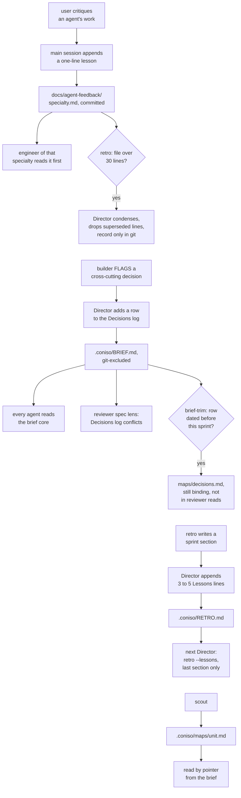

## 1. Executive Summary

Coniso is a Claude Code plugin that runs software work as a hierarchy of
subagents, each in a fresh context, with a standard-library Python script doing
the scheduling, worktrees, merges and roadmap edits. Its memory is a set of
Markdown files the agents are told to read: per-specialty lessons, a brief with
a Decisions log, sprint retros and scout maps. What is notable is that the
lessons live beside the code, filed under the specialty that will read them. What
is weak is upkeep: the trimming and condensing that keep the files small move
decisions out of the reviewers' sight and prune lessons with no record outside
git.

Most of the plugin is orchestration: tickets, waves, worktrees, a merge gate, a
roadmap and a SessionStart hook that reprints the sprint board after a
compaction. That machinery decides what the current context holds and is outside
the memory this report assesses ([section 9](#scope)). What survives a session
and is read back as instruction is smaller. A lesson in
`docs/agent-feedback/<specialty>.md` binds every engineer of that specialty. A row
in the brief's Decisions log binds every agent and is checked by reviewers.
Three to five retro lines per sprint are read by the next Director at setup.

None of it carries a status, a source or a date that any read consults. The
script enforces size, not content: `preflight` warns over 150 lines or 12 KB of
brief, `retro` names a lessons file over 30 lines, and `brief-trim` archives
decisions older than the current sprint.

The licence is Apache-2.0, unmodified, in `LICENSE`, `NOTICE` and the plugin
manifest.

No mark is earned. The nearest is a test that the Director's retro read leaves
out an earlier sprint's lesson, which pins a window rather than material that
must not be read. Section 9 gives the reason for each of the seven withheld.

## 2. Mental Model

A memory here is **a line of guidance an agent must follow**, kept in a file the
agent is pointed at. There are five kinds, and they differ in who writes them and
who reads them.

- **Lessons.** When the user critiques an agent's work, the main session appends
  a one-line imperative to `docs/agent-feedback/<specialty>.md` and commits it
  with the related fix (`skills/coniso/SKILL.md:99`). An engineer reads that file
  before working, and "its lessons bind you" (`agents/engineer.md:20`).
- **Decisions.** The brief's `## Decisions log (append-only, stamped)` is a table
  of Stamp, Decision and Binds (`skills/coniso/references/brief-template.md:27-29`).
  The artisan specialty sends any decision other tickets depend on to FLAGS for
  it (`skills/coniso/references/specialties/artisan.md:11`), the Director owns the
  brief (`brief-template.md:2`), and reviewers press it as part of the spec lens
  (`agents/reviewer.md:15`, `:21`).
- **Retro lessons.** After `retro`, the Director appends three to five lines on
  brief gaps, specialties worth promoting, auditor catches and overrules that
  proved wrong (`skills/coniso/references/director.md:133-134`). The next
  Director reads them at setup (`director.md:12`).
- **Maps.** A scout writes up to 60 lines on one area to `.coniso/maps/<unit>.md`,
  each claim with a pointer, and the brief points at it (`agents/scout.md:19`,
  `skills/coniso/SKILL.md:45`).
- **Forged specialties.** When three packets share a need, the Director copies
  the template to `.coniso/specialties/<name>.md`, which engineers check first
  (`SKILL.md:101`).

There is no candidate state. A line is binding from the moment it is written,
and it stops binding when a model edits it out. The script moves Decisions log
rows into an archive that the moving code itself calls still binding.

## 3. Architecture

The plugin is prompts plus one script. `.claude-plugin/plugin.json` declares it;
`agents/` holds eight subagent definitions (manager, lead, engineer, review lead,
reviewer, reviewer-lite, auditor, scout); `skills/` holds the role commands and
the `coniso` skill with its references; `output-styles/quiet.md` is optional.

`scripts/coniso.py` is copied into `.coniso/coniso.py` by `init`, which also
replaces `.coniso/ref/` with the plugin's references whenever it runs from the plugin copy
(`scripts/coniso.py:557-563`). It owns scheduling, sprint state in
`.coniso/sprint.json`, worktrees under `.coniso/wt/` on branches `coniso/<id>`,
diffs, test runs, squash merges, plan validation and roadmap edits.

Memory lives in two places with different reach. `docs/agent-feedback/` is part
of the user's repository and travels with it through git. Everything under
`.coniso/`, the brief, retros, maps and forged specialties included, is local to
one checkout, because `init` appends `/.coniso/` to `.git/info/exclude`
(`scripts/coniso.py:566-575`).

`close` archives the sprint's `sprint.json`, `ledger.jsonl`, tickets, assignments
and reports under `.coniso/archive/<sprint>/` (`scripts/coniso.py:1965-1970`). It
leaves the brief, `RETRO.md`, the maps and the specialties in place, which is what
makes them memory rather than sprint state.

One hook is registered: `SessionStart` with matcher `compact`
(`hooks/hooks.json:3-14`). `scripts/coniso_hook.py:25-45` finds
`.coniso/sprint.json`, prints the sprint name and current wave, and runs
`status --open` for the board. Outside a sprint it prints nothing.

### Deployment and ergonomics

- **Running:** nothing. Python 3.8 or later and git; no service, database or API
  key.
- **Local and offline:** yes. The script makes no network call; scouts' web
  lookups go through Claude Code's own tools.
- **Install:** `/plugin marketplace add` and `/plugin install`; the first role
  call runs `init`.
- **Repair by hand:** every memory is a Markdown file. Lessons are under version
  control; the rest is not, and nothing backs it up.

## 4. Essential Implementation Paths

- **Lesson write.** No code. `skills/coniso/SKILL.md:99` instructs the main
  session to append and commit. The script never writes under
  `docs/agent-feedback/`; it reads the directory in two places
  (`scripts/coniso.py:1936`, `:2020`).
- **Lesson read.** `specialty_files` returns the specialty file and, if
  `docs/agent-feedback/<spec>.md` exists in the main checkout, its absolute path
  (`scripts/coniso.py:2017-2023`). `cmd_dispatch` joins those with the brief and
  the packet into a solo engineer's `READ FIRST` line (`:2153`). A lead's
  assignment names only the brief and the packet (`:2167`); the lead writes its
  engineers' assignments from the template at
  `skills/coniso/references/formats.md:20`.
- **Lesson upkeep.** `cmd_retro` counts non-blank lines in each lessons file and
  names any over `FEEDBACK_MAX = 30` (`scripts/coniso.py:1862`, `:1936-1944`);
  `director.md:135` asks the Director to condense the file and commit.
- **Decisions write.** No code. The template declares the table
  (`brief-template.md:27-29`); no step of `director.md` writes a row.
- **Decisions read.** Every agent reads `.coniso/BRIEF.md`; the two reviewers read
  the Decisions log by name (`agents/reviewer.md:15`,
  `agents/reviewer-lite.md:15`).
- **Decisions archive.** `cmd_brief_trim` takes the cutoff from `--before` or the
  sprint's `created` date, moves each table row whose first cell holds an earlier
  ISO date into `.coniso/maps/decisions.md` opened for append, and leaves the line
  `Older decisions (still binding): … Grep it before changing an area they cover.`
  (`scripts/coniso.py:878-923`).
- **Retro write and read.** `cmd_retro` appends a section ending in `Lessons:` and
  a placeholder to `RETRO.md` (`:1945-1948`); `last_lessons` takes the text after
  the last `\n## `, collects lines after `Lessons:`, and skips the placeholder
  (`:1883-1899`).
- **Compaction.** `scripts/coniso_hook.py:18-45`; tests at
  `tests/test_coniso.py:479-501`.
- **Tests.** `tests/test_coniso.py`, 63 methods, each in a throwaway git
  repository.

## 5. Memory Data Model

Nothing is typed. A lesson is a Markdown bullet with no date, ticket, author or
source; the format is "a one-line imperative" (`SKILL.md:99`). A Decisions log
row has a free-text Stamp, which `brief-trim` reads as a date only when it holds
`YYYY-MM-DD` (`scripts/coniso.py:902-905`), and a Binds cell that nothing parses.
A retro section is a heading `## <sprint> — <date>` with outcome lines generated
from sprint state and the Director's free-text Lessons (`:1915-1945`). A map is
whatever the scout wrote.

Scope is physical. One lessons file per specialty decides which engineer reads a
lesson. One `.coniso/` per checkout decides which sessions see the brief and
retros, so a second clone of the same project starts with an empty brief and no
retro while sharing the committed lessons. The brief's `## Track notes` section,
"appended by managers", sits below the line `brief_core_lines` measures
(`:857-867`); every agent is still told to read the brief, and nothing restricts
a track's notes to that track.

The specialty headers name legacy lessons files for older projects, such as
`audio-designer.md` beside `audio.md`
(`skills/coniso/references/specialties/audio.md:2`). `specialty_files` checks only
`<spec>.md`, so a dispatch never names a lessons file kept under the older name.

There are no temporal fields beyond the Stamp and the retro heading date, no
version chain, no status and no deletion record.

## 6. Retrieval Mechanics

Retrieval is a path in a list. No query, ranking or budget selects content; the
whole file is read, and the size caps are the budget. The brief core is held under
150 lines and 12 KB by a `preflight` warning (`scripts/coniso.py:852-853`,
`:836-840`), a lessons file under 30 lines by a retro warning, and a map under 60
lines by the scout prompt.

Two copies of a lessons file can be meant. The dispatcher names the main
checkout's file (`scripts/coniso.py:2020-2022`), and the engineer prompt says to
read `docs/agent-feedback/<s>.md` in WORKDIR, the ticket's worktree
(`agents/engineer.md:20`). The worktree is cut from `HEAD` at dispatch, so a
lesson committed after that is in the first copy and not the second. An
uncommitted lessons file stops `schedule` and `merge` on a dirty checkout
(`:1014`, `:1422`), which keeps the gap to lessons written mid-sprint.

The retro read is the one with a selection rule. `retro --lessons` returns the
last section's Lessons only. Every earlier sprint's lines stay in the file and
leave recall, and `director.md:12` forbids reading the file directly. A sprint
whose Director appends nothing to its Lessons leaves the next Director with
`no lessons recorded`.

Readers differ by role. Engineers read lessons; reviewers, leads, managers and
auditors are not pointed at them (recorded searches). Reviewers read the Decisions
log in the brief and not the archive `brief-trim` writes, so once a sprint's
decisions are trimmed, the spec lens checks the next sprint's diffs against the
current sprint's decisions only.

## 7. Write Mechanics

Every memory write is a model editing a file under a prompt rule, on the hot path
of the main session. There is no extraction, deduplication or conflict check. A
lesson written from a critique is committed and read by the next engineer of that
specialty with no review step. A forged specialty takes effect at the next
dispatch.

Maintenance is warning-driven. `brief-trim` is the one script that changes memory
content, and it moves rows rather than revising them. The lessons cap triggers
model condensation, told to "merge duplicate lessons and drop ones a later lesson
supersedes" (`director.md:135`); which lesson supersedes which is the model's
call, and the commit is the record.

Maps are written once. The scout notes versions and publication dates for docs
findings (`agents/scout.md:16`), but a codebase map carries no commit and nothing
rewrites it as tickets merge. `close` leaves `maps/` in place, so a map outlives
the code it described.

### Operational cost

Writes cost one file edit and no model call beyond the session already running.
Reads cost the size caps on every spawn: the brief core, up to about 3k tokens by
the script's own comment (`scripts/coniso.py:853`), goes to every agent, and a
lessons file of up to 30 lines goes to every engineer of its specialty. Those
reads land in the subagent's first turn, not in the main session's prefix.

## 8. Agent Integration

The agent's reach over memory is total and informal. The main session writes
every kind of memory with ordinary file tools, and every subagent is told not to
edit the brief (`brief-template.md:34`, `agents/manager.md:54`). That rule is
prompt text; the script's file checks are about ownership of project files in a
delegation plan.

The compaction hook prints sprint state, not memory: the board, the wave and a
pointer to `.coniso/ref/director.md`, which the Director is told to trust over
what it remembers (`director.md:147`). The lessons, the brief and the retro reach
a restarted session only through the setup procedure.

Adapting the scheme to another agent means copying the conventions, not code:
the script knows the file names and does nothing with their content.

## 9. Reliability, Safety, and Trust

### Scope

The repository is in scope for its persistent guidance files, and only for them.
Sprint state, the auditor ledger, the roadmap and the compaction hook record what
the team did: a ticket merged at a sha, a reviewer ruled, an auditor objected.
Those records are workflow bookkeeping, and they are archived at `close`. The
lessons, decisions, retro lines, maps and forged specialties are claims about
how to work on this codebase. Each can turn false after a refactor or a reversed
choice and still be read as binding. Each mark below is judged on those files.

### Archived decisions leave the review lens

`brief-trim` exists to keep the brief small, and its default cutoff is the
current sprint's creation date, so one call moves every decision from earlier
sprints (`scripts/coniso.py:883-888`). The pointer it leaves calls them still
binding and asks agents to grep the archive. The reviewer prompts name only
`.coniso/BRIEF.md`, so the one role that checks diffs against decisions stops
seeing them. The test pins the move and the pointer
(`tests/test_coniso.py:436-452`); nothing requires the archive to be read.

### One sprint of retro lessons

The Director's setup read returns the last retro section's lessons. A retro whose
Lessons the Director left empty, or a second `retro` call in the same sprint, which appends a fresh
placeholder section each time (`scripts/coniso.py:1947`), puts an empty section
last and hides every earlier lesson from the next Director. Lessons meant to last
longer have to be carried into a specialty or a lessons file by hand, and the
procedure asks for that only as "specialties worth promoting"
(`director.md:134`).

### Pruning without a record

A lesson is dropped by a model condensing a file over 30 lines. The previous text
survives in git history, but nothing in the file records that a lesson was
dropped, why, or which later lesson replaced it, and the next critique on the same
point can re-add it. A Decisions log row is "append-only" by its heading; the
Director edits the brief with ordinary file tools, and the script's one edit of
the table removes rows.

### Provenance and injection

A lesson has no source field. It comes from the user's critique by the main
session's paraphrase, and a scout's map comes from code and web pages the scout
read. A web page that steers a scout reaches every agent pointed at that map.
`.coniso/` is git-excluded, so the brief and maps of one checkout are never seen
by a teammate, while lessons are shared through the repository with no review
beyond the commit.

### Marks

- **`negative_eval` — withheld.** The near-miss is
  `test_retro_lessons_prints_only_last_lessons`, which writes two sprint
  sections, the first holding `- old lesson`, and requires `retro --lessons` to
  equal exactly the second sprint's two lessons
  (`tests/test_coniso.py:133-138`). It is an exact-output test of a section
  parser: the older lesson is left out because the read is defined as the last
  sprint only, not because it is wrong, out of scope or retracted, so it is a
  recall test. No test exercises a lesson, decision or map that must not be
  read.
- **`scope_enforced` — withheld.** One lessons file per specialty and one
  `.coniso/` per checkout are physical partitions. The Binds cell is never parsed,
  and Track notes are read by everyone.
- **`trust_state` — withheld.** No file carries a status that a read excludes on.
- **`tombstone` — withheld.** A condensed-away lesson leaves no record keyed on its
  text, so restating it is accepted.
- **`bitemporal` — withheld.** The Stamp is when the row was written, and nothing
  records when a decision stopped holding.
- **`audit_log` — withheld.** No store records memory changes. `RETRO.md` and the
  decisions archive are opened for append, but the first holds retros and the
  second holds the moved rows themselves. `ledger.jsonl` counts auditor
  objections (`scripts/coniso.py:1479-1494`). Git history of the lessons files is
  a real record and a different mechanism.
- **`human_review` — withheld.** A lesson or decision binds as soon as it is
  written. The user's confirmation that `roadmap-sync` preserves applies to a
  ticket's `done` status, not to memory (`scripts/coniso.py:1812-1813`). The agent
  can also set it with `roadmap set --status done` (`:2875-2880`), and a ticket
  in `review` already satisfies a dependency unless the dependency is a gate or
  `--strict` is passed (`:957`, `:975`).

## 10. Tests, Evals, and Benchmarks

`tests/test_coniso.py` drives the script as agents would, in temporary git
repositories, with no dependency outside the standard library. Its memory-facing
cases are three. `test_retro_lessons_prints_only_last_lessons` pins the retro
read's last-sprint window, the near-miss in [section 9](#marks). `test_retro_flags_long_feedback_files` requires a 31-line `ui.md` to be named
and a one-line `net.md` not to be (`:140-147`). `BriefTrim` checks the move, the
pointer, idempotence and the `--before` cutoff (`:436-459`), and a preflight
case checks the line and byte warnings (`:461-471`, `:880-887`).

The hook cases check silence outside a sprint, the board from inside a
worktree, and the `hooks.json` shape (`:479-501`). They concern sprint state.

Nothing tests the engineer's lessons read end to end. `specialty_files` appending
an existing lessons file to `READ FIRST` has no case (recorded searches). Nor
does any case cover a reviewer reading archived decisions, or the Director's read
after an empty retro section. No workflow under `.github/` runs the suite. The
README makes no benchmark claim about memory, and the tree cites no paper.

## 11. For Your Own Build

### Steal

- **File a lesson under the reader it is for.** Keying guidance on the specialty
  that will act on it keeps one role's corrections out of another's context
  without any retrieval machinery.
- **Commit the lesson with the fix it came from.** The lesson and the change that
  prompted it share a commit, and the repository carries both to every clone.
- **Make a decisions table a review lens.** A reviewer told to check each diff
  against the recorded decisions turns a note into an enforced constraint.
- **Budget the always-read file in bytes as well as lines.** The 12 KB check
  exists because a line cap alone "is met by ever-longer lines"
  (`scripts/coniso.py:853`).

### Avoid

- **Archiving out of the enforcing reader's path.** If a rule stays binding, the
  role that enforces it has to read where it went.
- **A last-section-only read over an append-only file.** Recall then depends on
  the newest section being filled. Read back until a non-empty section, or keep
  durable lessons in a separate file.
- **Pruning by model with no record.** When a cap forces condensation, keep the
  dropped line and what replaced it where the next writer can see it.
- **Maps without a commit.** A codebase summary should name the tree it described
  so a reader can tell it has gone stale.

### Fit

This suits one developer driving long Claude Code sessions on one checkout, who
wants corrections to stick for the next engineer and accepts that the main
session is the only curator. The memory is a convention a model maintains, not a
store, so it holds as long as the prompts are followed. Walk away if guidance has
to be reviewed before it binds, shared across a team beyond the committed lessons,
or traced to who wrote it and why.

## 12. Open Questions

- Whether the Director is meant to write Decisions log rows itself or only from
  builders' FLAGS; `director.md` names neither.
- Whether reviewers are meant to read `.coniso/maps/decisions.md` after a trim.
- Whether retro lessons are meant to last one sprint, with promotion to a
  specialty or lessons file as the only way to keep them.
- Whether the legacy lessons file names are still expected to be read.

## Appendix: File Index

- Memory reads and upkeep: `scripts/coniso.py` (`brief_core_lines`,
  `cmd_brief_trim`, `last_lessons`, `cmd_retro`, `cmd_close`, `specialty_files`,
  `cmd_dispatch`, `cmd_init`)
- Compaction hook: `hooks/hooks.json`, `scripts/coniso_hook.py`
- Brief and formats: `skills/coniso/references/brief-template.md`,
  `skills/coniso/references/formats.md`
- Procedures: `skills/coniso/SKILL.md`, `skills/coniso/references/director.md`,
  `skills/coniso/references/playbook.md`
- Readers: `agents/engineer.md`, `agents/reviewer.md`,
  `agents/reviewer-lite.md`, `agents/scout.md`, `agents/manager.md`
- Specialties: `skills/coniso/references/specialties/`
- Tests: `tests/test_coniso.py`

### Recorded searches

Run from the repository root at the pinned commit with `/usr/bin/git grep`.

- **The script never writes a lessons file.**
  `git grep -n -E 'agent-feedback' -- scripts` returns
  `scripts/coniso.py:1936` and `:2020`, both reads.
- **The script writes no Decisions log row.**
  `git grep -n 'Decisions log' -- scripts/coniso.py` returns lines in
  `brief-trim`, its help text and the preflight warning (`:840`, `:879`,
  `:890`, `:892`, `:909`, `:918`, `:3095`).
- **Only engineers are pointed at lessons.**
  `git grep -n -i -E 'agent-feedback|lesson' -- agents` returns
  `agents/engineer.md:20` alone.
- **No Director step writes a decision.**
  `git grep -n -i -E 'decision' -- skills/coniso/references/director.md`
  returns `:3`, `:9`, `:120` and `:138`, none about the log.
- **No status, tombstone or validity field.**
  `git grep -n -i -E 'tombstone|blocklist|reject|suppress' -- scripts` returns
  one `argparse.SUPPRESS` at `scripts/coniso.py:2929`;
  `git grep -n -i -E 'superseded|deprecated|retired|valid_from|valid_to|expires' -- .`
  returns one line of `agents/scout.md:16` about deprecated Android APIs.
- **One hook event.** `git grep -n -E 'SessionStart|PreCompact|"Stop"' -- hooks .claude-plugin`
  returns `hooks/hooks.json:3` alone.
- **The hook reads no memory file.**
  `git grep -n -E 'RETRO|BRIEF|agent-feedback|maps' -- scripts/coniso_hook.py`
  returns nothing.
- **No test of the lessons read path.**
  `git grep -n -E 'specialty_files|agent-feedback' -- tests` returns
  `tests/test_coniso.py:141`, the retro line-count case.
- **No CI.** `git ls-files .github` lists issue templates and a pull request
  template, no workflow.
- **No paper reference.**
  `git grep -n -i -E 'arxiv|bibtex|@article|@misc|doi\.org|zenodo' -- .`
  returns nothing.

## History

**2026-11-25** — [`15b6eb9223af3e0b79805366d3678d603ce7d683`](https://github.com/Palatine-Labs/coniso/commit/15b6eb9223af3e0b79805366d3678d603ce7d683). First reading, from a full clone at the head of `main`; requested directly, not selected by triage. Screened first: three auto-run surfaces, the Claude Code plugin manifest, `hooks/` and `hooks/hooks.json`, which registers one `SessionStart` hook on the `compact` matcher; nothing inside the seven-day cooldown, no build-time execution, no unpinned manifest; no submodules. The hook was not run. Prompts, skills and docs were read as data. Nothing was installed, built or run, and the 63 test methods were not run. No marks; the retro-window test is the `negative_eval` near-miss ([section 9](#marks)). Trimmed decisions leave the reviewers' read, and the Director's retro read sees one sprint.
