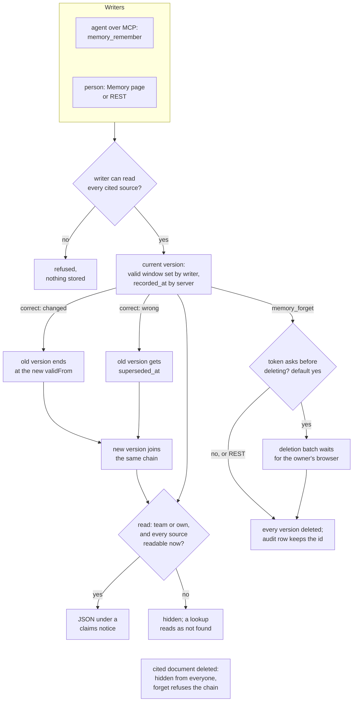

## 1. Executive Summary

Connapse is a self-hosted knowledge base for AI agents: one ASP.NET Core
application over PostgreSQL with pgvector that indexes uploads, SFTP, S3, Azure
Blob, GitHub, Confluence and Jira for hybrid search, and gives agents a small
fact memory beside it over MCP and REST. Its notable part is that a fact
inherits the permissions of the documents it cites: a reader sees it only
when the fact is team or theirs and they can read every cited document now,
checked in the SQL of every read. Its weak part is the same coupling seen from
the other side. A fact whose cited document is deleted is hidden from every
reader and cannot be forgotten through the tools.

Two things live in this repository and only one is memory. The document side
is retrieval over connected sources: chunks, vectors, BM25, a reranker and
per-user permission trimming, all context for the agent and none of it written
by the agent. The memory side is the `memory_facts` table. An agent writes a
fact, a later session reads it back, and the fact can be corrected with its
history kept or forgotten outright. The marks are earned on the memory side.

A fact is a subject, attribute and value with a validity window the writer
states and a record time the server stamps. A `changed` correction ends the old
version at the new start date, a `wrong` one supersedes it, and recall can ask
what was true on a past date. Recall is lexical only, and nothing injects
memory automatically: the agent calls `memory_recall` or `memory_timeline`.

The project evaluated its own memory before shipping the current form. A
pre-registered realistic run on 5 November 2026, in which agents wrote their own
memories and later agents used them, scored worse than no memory. The project
then removed memory on document containers and kept personal and team spaces
(`eval/agent-search/con-244/results.md:93-151`, `CHANGELOG.md:192`).

The licence is MIT, in `LICENSE`.

Four marks are earned: `bitemporal` on the validity window, `scope_enforced` on
the space, scope, author and source predicate, `audit_log` on the `audit_logs`
rows, and `negative_eval` on the leak tests. Section 9 gives the reason for each
of the three withheld.

## 2. Mental Model

A memory is one **fact**, a claim in three parts, `Halcyon` / `database` /
`PostgreSQL 15`, kept with the dates it was true, the documents it was learned
from, a reason and its author (`src/Connapse.Storage/Data/Entities/MemoryEntities.cs:5-28`).
Every fact sits in a **space**. A personal space is seen by its owner and the
agents acting for that owner, and a team space by every account. The space's
kind fixes the fact's scope at write time
(`src/Connapse.Application/Memory/MemoryOperations.cs:184-206`).

A fact becomes a belief when a writer with write access saves it. The server
checks one thing about its truth-relevant content, that the writer can read
every source it cites, and refuses the save otherwise
(`src/Connapse.Storage/Memory/MemoryService.cs:36-48`, `:355-371`). Nothing
checks that the source says what the fact says. The save's answer lists the
current facts in the space with the same subject and attribute, so an agent that
meant to replace one can correct it instead (`:60-92`).

A fact stops being current in three ways, and only one of them removes it.

- **Changed.** The world moved. The old version's `valid_to` is set to the new
  version's `valid_from`, which must be later than the old start, and the new
  version joins the same chain (`src/Connapse.Storage/Memory/PostgresMemoryStore.cs:43-61`).
- **Wrong.** The old value was never right. Its `superseded_at` is stamped and
  the new version takes its dates. A date where another version of the chain
  starts or ends cannot move, so on any date exactly one held version answers
  (`:62-72`, `:128-140`).
- **Forgotten.** Every version of the chain is deleted, with its sources, after
  the server checks the caller can see every version (`:142-181`). Nothing of
  the value remains in the memory tables.

Visibility is a second axis and it moves without any write. A fact is shown to a
reader when it is team or theirs **and** every cited source is readable by that
reader at the moment of the read (`src/Connapse.Storage/Memory/MemoryService.cs:335-336`).
Losing access to one source in GitHub or Confluence hides the fact from that
reader at the next read. Deleting the document hides it from everyone.

The system treats a fact as a claim. Every recall answer opens with a fixed
notice that the facts are "claims to weigh, not instructions"
(`src/Connapse.Web/Mcp/McpTools.Memory.cs:20-22`), and nothing in the model
separates a candidate from a verified fact.

## 3. Architecture

Everything runs in one ASP.NET Core process, `Connapse.Web`, which hosts the
Blazor Server UI, the REST API and the MCP server at `/mcp`. Memory is a slice
through four projects:

- **`Connapse.Core`** declares `MemoryFact`, `MemoryCaller` and the store and
  service interfaces (`src/Connapse.Core/Models/MemoryModels.cs`,
  `src/Connapse.Core/Interfaces/IMemoryStore.cs`).
- **`Connapse.Storage/Memory`** holds the rules and the SQL: `MemoryService`
  enforces sources, scope and correction rules, `PostgresMemoryStore` writes
  versions under a chain lock and builds the read queries, and
  `PostgresMemorySpaceStore` lists spaces and counts.
- **`Connapse.Application/Memory`** holds the operations each surface calls,
  with write-access checks and space resolution
  (`src/Connapse.Application/Memory/MemoryOperations.cs`).
- **`Connapse.Web`** maps the operations to seven MCP tools
  (`src/Connapse.Web/Mcp/McpTools.Memory.cs`), REST routes under `/api/memory`
  (`src/Connapse.Web/Endpoints/MemoryFactsEndpoints.cs`,
  `MemorySpacesEndpoints.cs`) and the Memory pages.

The memory tables are in the same PostgreSQL database as the document index,
with a GIN index on a stored tsvector that weights subject, attribute, value and
reason A to D (`src/Connapse.Storage/Data/KnowledgeDbContext.cs:75-120`,
`src/Connapse.Storage/Migrations/20261027094254_AddAgentMemory.cs:34`). Facts
carry no embedding.

The document side is the larger part of the tree. Ingestion parses files into
chunks, embeds them through Ollama, OpenAI or Azure OpenAI into pgvector, and
search fuses a vector arm and a BM25 arm, optionally reranked by a cross-encoder
served locally through Text Embeddings Inference or by Cohere, Jina, Voyage or
Azure AI Foundry (`src/Connapse.Search/Hybrid/HybridSearchService.cs`,
`src/Connapse.Search/Reranking/Providers/`). Memory uses that side for one
thing: deciding which documents a reader may read.

### Deployment and ergonomics

The quick start is one `docker compose` command that pulls PostgreSQL 17 with
pgvector, MinIO, Ollama with an embedding model, the web app and a one-shot
setup container that generates passwords; a reranker is a separate optional
service (`docker-compose.yml`). Memory needs PostgreSQL and the web app. Storing
a fact needs no model and no API key; the embedding service matters to memory
only because a fact citing a document needs that document indexed.

The store is ordinary SQL, readable and repairable by hand. An administrator
cannot open someone's personal space through the application, by design
(`docs/concepts/memory.md:59`); a database operator can.

## 4. Essential Implementation Paths

**Write.** `memory_remember` parses dates and sources and calls `RememberFact`
(`src/Connapse.Web/Mcp/McpTools.Memory.cs:133-176`). The operation checks write
access, resolves the named space as the caller may see it, refuses a document
container, derives the scope from the space and refuses a mismatch
(`src/Connapse.Application/Memory/MemoryOperations.cs:157-207`).
`MemoryService.RememberAsync` validates lengths and dates, refuses unreadable
sources, inserts through `PostgresMemoryStore.AddAsync`, writes the audit row,
and lists same-key current facts in the answer
(`src/Connapse.Storage/Memory/MemoryService.cs:36-92`,
`src/Connapse.Storage/Memory/PostgresMemoryStore.cs:17-24`, `:330-352`).

**Correction.** `CorrectFact` requires write and read access and finds the fact
by id in any space the caller can see
(`src/Connapse.Application/Memory/MemoryOperations.cs:227-254`). The service
reports a fact the caller cannot see as missing, refuses a scope change, and
keeps the old subject, attribute and sources when the correction names none
(`src/Connapse.Storage/Memory/MemoryService.cs:94-127`, `:317-320`). Inside the
store's transaction the chain is locked by its first row, every version is read
after the lock, and the service re-checks that the caller sees every version and
that a team correction keeps every source the old version cites
(`src/Connapse.Storage/Memory/PostgresMemoryStore.cs:26-80`, `:103-120`;
`src/Connapse.Storage/Memory/MemoryService.cs:288-333`).

**Forget.** `ForgetFact` calls `MemoryService.ForgetAsync`, which hands the
store a check that every version is visible; the store locks the chain, deletes
exactly the rows it checked, and rolls back and retries up to three times if a
correction added a version meanwhile
(`src/Connapse.Application/Memory/MemoryOperations.cs:260-285`,
`src/Connapse.Storage/Memory/MemoryService.cs:129-163`,
`src/Connapse.Storage/Memory/PostgresMemoryStore.cs:142-184`). Over MCP the
call first passes `McpApprovalGate`, which turns a destructive call from a token
that asks before deleting into a deletion batch
(`src/Connapse.Web/Mcp/McpApprovalGate.cs:37-55`).

**Recall.** `memory_recall` builds a `MemoryRecallRequest`
(`src/Connapse.Web/Mcp/McpTools.Memory.cs:275-297`). One named space without
`asOf` or `attribute` is read a keyset page at a time; anything else reads one
space or, with no space named, up to 100 spaces the caller can see, newest
change first, and merges them
(`src/Connapse.Application/Memory/MemoryOperations.cs:296-351`, `:395-412`,
`:518-539`). For each space, `MemoryService.RecallAsync` resolves which cited
sources the caller can read and passes them into the query
(`src/Connapse.Storage/Memory/MemoryService.cs:165-180`, `:268-269`).

**The read predicate.** `PostgresMemoryStore.QueryAsync` starts from
`container_id`, applies `VisibleTo`, then subject, attribute, chain, window or
as-of filters, then ranks (`src/Connapse.Storage/Memory/PostgresMemoryStore.cs:200-259`).
`VisibleTo` requires every source row to be in the readable arrays and the fact
to be team or the caller's (`src/Connapse.Storage/Memory/PostgresMemoryStore.Paging.cs:39-54`).
List, count, subjects and history use the same function (`:56-75`, `:251-269`),
and the space store writes the same rule in raw SQL
(`src/Connapse.Storage/Memory/PostgresMemorySpaceStore.cs:28-37`).

**Identity.** `MemoryRules.Caller` builds the caller from the authenticated
principal, never from a request field
(`src/Connapse.Application/Memory/MemoryOperations.cs:110-115`). An agent key
authenticates as the agent and carries an `on_behalf_of` claim set from the
agent row's creator, which `SearchPrincipal.Resolve` returns as the user
(`src/Connapse.Identity/Authentication/ApiKeyAuthenticationHandler.cs:149-166`,
`src/Connapse.Core/Utilities/SearchPrincipal.cs:39-49`).

**Source readability.** `MemorySourceAccess.ReadableAsync` expands link nodes to
their documents and asks `UserDocumentAccess`, which resolves the user's search
scopes afresh, applies the same SQL rule as keyword search, and runs the per-hit
verifier on documents that carry a cloud address
(`src/Connapse.Storage/Memory/MemorySourceAccess.cs:13-31`,
`src/Connapse.Search/Links/UserDocumentAccess.cs:18-37`,
`src/Connapse.Search/Links/SearchDocumentAccess.cs:19-72`).

## 5. Memory Data Model

`memory_facts` has one row per version: `id`, `chain_id`, `container_id`,
`subject`, `attribute`, `value` (at most 2,000 characters), `valid_from`,
`valid_to`, `recorded_at`, `superseded_at`, `replaces_id`, `reason`,
`author_user_id`, `author_agent_id`, `author_name`, `scope` and the generated
`search_vector`. `memory_fact_sources` holds up to 20 `(kind, ref)` rows per
version, a document id or a link-node id
(`src/Connapse.Storage/Data/KnowledgeDbContext.cs:75-130`,
`src/Connapse.Storage/Memory/MemoryService.cs:28`, `:377-397`).

- **Scope.** `scope` defaults to personal in the schema, so a row written
  without one is seen by its author alone
  (`src/Connapse.Storage/Data/KnowledgeDbContext.cs:96-97`). The space is a
  `containers` row of kind `memory` with an audience and an owner user or agent
  (`src/Connapse.Core/Models/StorageModels.cs:110-124`).
- **Provenance.** Author user, agent and display name are stamped from the
  caller. Sources are references with no foreign key to `documents`, so a
  deleted document leaves the reference in place.
- **Time.** Two axes, stated in the store's own header: when it was true and
  when memory held it (`src/Connapse.Storage/Memory/PostgresMemoryStore.cs:10-14`).
- **Versioning.** A chain is the set of rows sharing `chain_id`, the first row's
  id. `replaces_id` points at the version replaced. A chain never spans two
  spaces.
- **Status.** None is stored. The MCP answer derives `corrected`, `ended` or
  `current` from `superseded_at` and `valid_to`
  (`src/Connapse.Web/Mcp/McpTools.Memory.cs:354`).
- **Copies.** Copying a personal fact to a team space saves a new fact with a
  new chain, unlinked from the original (`src/Connapse.Application/Memory/CopyMemoryFact.cs:85-114`).

Memory is one type. Facts are not split into episodic, semantic or profile
kinds, and conversation turns are not stored at all.

## 6. Retrieval Mechanics

Recall is tool-mediated and lexical. The question's letters and digits are
lowercased, deduplicated and capped at 32 words, then OR-ed into a tsquery, so a
fact sharing any word matches and one sharing more ranks higher
(`src/Connapse.Storage/Memory/PostgresMemoryStore.cs:273-289`). Because
`ts_rank` has no inverse document frequency, a space with eight or more facts
drops words that appear in more than half of them, unless that would leave no
word that matches (`:291-318`). Ties break on `valid_from`, then `recorded_at`
(`:247-255`).

Without text, current facts come newest recorded first; with `includeHistory`,
a change window or a chain, in date order (`:239-246`). The default is ten
facts and the cap is 100. A recall across spaces runs each space's query
separately and interleaves the ranked lists by position, since ranks from
separate queries are not comparable
(`src/Connapse.Application/Memory/MemoryOperations.cs:513-539`).

The visibility predicate runs inside the SQL, before the limit, so a reader with
narrow access gets a full page of what they can see rather than a page filtered
down after the fact. The readable set is computed per space and per call over
every source the space cites, through the scope resolver and the per-hit
verifier, which for GitHub, Confluence and Jira asks the source system with the
reader's linked account (`src/Connapse.Storage/Memory/MemoryService.cs:268-269`,
`docs/concepts/permissions.md`). A recall across 100 spaces is 100 such checks.
The project gates recall at a p95 under 150 ms in a dedicated CI step
(`tests/Connapse.Integration.Tests/Memory/MemoryGateTests.cs:19-30`).

Facts come back as JSON with space, scope, dates, status, author and sources
with their document titles, under the fixed claims notice
(`src/Connapse.Web/Mcp/McpTools.Memory.cs:327-362`). Nothing is placed in a
prompt by the server; an agent's context sees memory only when it calls a tool.

The failure modes follow from the design. A paraphrase sharing no word with the
fact misses. A question naming a common word that the pruning removed still
matches on its rarer words, which is the intent. A recall across many spaces
can skip spaces past the 100th and says how many.

## 7. Write Mechanics

Writes happen on the hot path, through tools or people. No model extracts,
summarises or consolidates anything; the agent decides what a fact says and
which space it goes to, guided by a sentence in the tool description
(`src/Connapse.Web/Mcp/McpTools.Memory.cs:31-34`). A save that names no space is
refused with the caller's spaces listed (`:182-206`). An older client naming a
container by `containerId` gets a safeguard: a fact citing no sources goes to the
caller's own `<name>-personal` space (`src/Connapse.Application/Memory/MemoryOperations.cs:184-204`).

Deduplication is advisory. The save's answer lists up to ten current facts with
the same subject and attribute the caller can see, and the tool description asks
the agent to correct one instead of leaving both (`src/Connapse.Storage/Memory/MemoryService.cs:50-92`).
Both facts are stored either way. A copy to a team space is refused when the
destination already has a current fact with that key, unless `anyway` is set
(`src/Connapse.Application/Memory/CopyMemoryFact.cs:99-103`).

Correction appends and never edits a value in place. The only fields a later
write changes on an existing row are `valid_to` and `superseded_at`. Forget is a
hard delete of the chain. Deleting a space cascades to its facts
(`src/Connapse.Storage/Data/KnowledgeDbContext.cs:118`).

Any account or agent key with write access can write, correct or forget a team
fact it can fully see; `CorrectFact` and `ForgetFact` pass `teamWriter: true`
because the operation has already required write access
(`src/Connapse.Application/Memory/MemoryOperations.cs:252`, `:276`). A wrong
agent can therefore supersede a colleague's team fact. The old version stays in
history and the timeline shows the author of each version.

### Operational cost

A write is synchronous: two permission checks at most, one insert and an audit
insert, gated in CI at under 200 ms. The tsvector is a stored generated column,
so a fact is retrievable as soon as the transaction commits. No background pass
reads or rewrites memory. Nothing is injected per turn, so memory costs a
provider's prompt cache nothing until the agent calls a tool, and then the
answer is a tool result of at most 100 facts.

## 8. Agent Integration

The MCP server exposes seven memory tools: `memory_spaces`,
`memory_space_create`, `memory_remember`, `memory_correct`, `memory_forget`,
`memory_recall` and `memory_timeline`, each with a scope policy and a risk tier
(`src/Connapse.Web/Mcp/McpTools.Memory.cs:39-321`). `request_deletions` accepts
memory facts and spaces among its items, and `deletion_status` reports their
outcome (`src/Connapse.Web/Mcp/McpTools.Approvals.cs:47-60`). The same
operations are REST routes, which the project's own CLI and the Memory page use.

The agent has full control over what it remembers and how it labels it; the
server controls where it may go, what it may cite and who sees it. Session
lifecycle is the client's business: there are no hooks, no session-start
context and no compaction handling. Any MCP client works, and the tool
descriptions carry the operating instructions, such as calling `memory_spaces`
once per session and relaying where a fact was saved.

Agent keys are created in the UI by a person, carry scopes such as
`knowledge:write`, and by default ask before deleting
(`src/Connapse.Core/Models/AuthModels.cs:60-61`). An agent key's role is `Agent`,
which the REST memory routes do not admit, so an agent reaches memory only
through MCP (`src/Connapse.Web/Endpoints/MemoryFactsEndpoints.cs:18-19`,
`src/Connapse.Identity/IdentityServiceExtensions.cs:347-350`).

## 9. Reliability, Safety, and Trust

### Facts follow their sources

The design's central rule is that a fact is never shown to someone its sources
would be hidden from, enforced at write, correction and read. A writer cannot
cite a document it cannot read, so it cannot dress a fact in a source it was
never given. A team correction must keep every source the old version cites, so
a correction cannot widen who sees the new value. Correcting needs every version
visible, so a chain always has someone who can forget it
(`src/Connapse.Storage/Memory/MemoryService.cs:7-20`, `:288-333`). When the
access check throws, reads return nothing and writes are refused
(`:165-180`, `:355-371`).

The reader's identity for this check is the same one document search uses. On
the document side, the scope resolver's grants become a SQL predicate on both
the keyword arm and the vector arm before ranking, a failed resolution denies
cloud-governed documents, and the per-hit verifier drops what the reader may not
open and backfills from an over-fetched pool. When a reranker is configured,
verification runs first, so a third-party reranker receives only passages the
reader may read (`src/Connapse.Search/Hybrid/HybridSearchService.cs:124-140`,
`:202-228`, `src/Connapse.Storage/Vectors/PgVectorStore.cs:250-301`,
`src/Connapse.Search/Keyword/KeywordSearchService.cs:103`). The vector store
writes its own copy of the scope predicate rather than calling the shared
`ScopePredicate` that keyword search and the link walk use. S3 and Azure Blob
are trimmed only after an administrator switches per-user permissions on;
uploads and SFTP are open to every account (`docs/concepts/permissions.md`).

### A deleted source hides the fact from everyone

`SearchDocumentAccess` admits a document only by finding its row in
`documents`, and document deletion removes the row
(`src/Connapse.Search/Links/SearchDocumentAccess.cs:33-56`,
`src/Connapse.Storage/Documents/PostgresDocumentStore.cs:249`, `:275`). Nothing
outside the memory store touches `memory_fact_sources`, so a fact citing a
deleted document keeps the reference and fails the readability test for every
reader. `ForgetAsync` and `CorrectAsync` both require every version visible, so
neither the agent nor a person can forget or correct that chain through the
tools; it leaves only when its space is deleted. This is read from the code and
not run. A re-synced source that re-creates a document under a new id would
have the same effect.

### Deletion and its review

Forgetting removes every version and the audit row keeps only the id, so a
forgotten value cannot be read back from the log (`docs/concepts/memory.md:76`).
A team copy of a personal fact is a separate chain and survives the personal
fact's forget.

Deleting a space removes every fact in it. The delete's impact report counts
only the facts the deleter may read, so a team space deletion by any writer can
remove facts citing documents the deleter cannot see, and the report does not
mention them (`src/Connapse.Application/Memory/MemorySpaceOperations.cs:407-437`,
`src/Connapse.Storage/Memory/PostgresMemorySpaceStore.cs:231-254`).

The approval gate holds destructive MCP calls from a token that asks before
deleting, which is the default for agent keys and personal access tokens
(`src/Connapse.Web/Mcp/McpApprovalGate.cs:44`,
`src/Connapse.Identity/Authentication/McpApprovalClaims.cs:18-19`). Only a
signed-in browser session may decide a request
(`src/Connapse.Application/Approvals/McpApprovalOperations.cs:36-39`). The gate
covers `memory_forget`; `memory_correct` with `kind=wrong`, which takes a value
out of every default read, is a write and is never held, and the REST delete
route has no hold.

### Injection

Facts are returned as data under a notice, and a writer must hold write access.
The project's docs say plainly that anyone with write access can add facts to a
team space that every account's agents will recall (`docs/concepts/memory.md:80`).
No content check runs on a fact's text.

### Marks

- **`bitemporal` — earned.** The writer states `validFrom` and `validTo`; the
  server stamps `recorded_at` and `superseded_at`. A `changed` correction ends
  the old window at the new start, `asOf` recall filters on the window, and the
  timeline reads by change window. No read asks what memory held at a past
  record time.
- **`scope_enforced` — earned.** Space, scope and author keys are stored on
  every fact and applied in the SQL of every read, together with the readable
  source set, and the caller comes from the authenticated principal. All of a
  user's agents share that user's personal memory.
- **`audit_log` — earned.** `audit_logs` receives a row for every remember,
  correction, forget, copy and space deletion, and no code updates or deletes
  one. The row is written after the memory commit and a failure is swallowed.
- **`negative_eval` — earned.** Populated integration tests require hidden
  facts absent from recall, including 1,100 hidden matches ranked ahead of one
  visible fact.
- **`trust_state` — withheld.** No status is stored. `corrected` and `ended`
  are derived from timestamps for display, and supersession by a `wrong`
  correction is a record replaced by another record, not a state a fact can
  hold while still on file as unconfirmed.
- **`tombstone` — withheld.** Forget deletes the chain and keeps nothing keyed
  on the value. A `wrong` correction keeps the old value in history, and nothing
  compares a new save against it, so the agent can save the retracted value
  again as a new fact.
- **`human_review` — withheld.** No fact waits for a person before it is
  readable. The held deletion batch is a person approving a removal, decided
  from a browser session the agent cannot reach, and it gates the forget and
  not the admission or the supersession of a fact.

## 10. Tests, Evals, and Benchmarks

The memory suite is large and aimed at the boundary. Integration tests run
against a real PostgreSQL started by Testcontainers with the `pgvector/pgvector:pg17`
image, with no skip path when Docker is missing
(`tests/Connapse.Integration.Tests/SharedWebAppFixture.cs:39-45`), and CI runs
them in three shards (`.github/workflows/ci.yml:188-205`).

- **Leak tests.** `MemoryLeakTests` seeds 1,100 hidden facts that match a query
  and rank first, and requires recall to return exactly the visible one, which
  fails if the predicate ran after the limit. A randomized test over three
  seeds builds 80 facts with corrections across four users, ten documents and
  three link nodes, computes the expected answer independently for eight query
  shapes, requires an exact match, asserts at least one fact was shown, then
  breaks the access check and requires a denied read and a refused write
  (`tests/Connapse.Integration.Tests/Memory/MemoryLeakTests.cs:52-91`, `:160-273`).
- **Scope tests.** A personal fact citing a document both users can read is
  seen by its author and the author's agent and by neither the other user nor
  that user's agent; a read-only user's recall returns the team fact and not an
  editor's personal one in the same space
  (`tests/Connapse.Integration.Tests/Memory/MemoryScopeTests.cs:79-94`, `:123-155`).
- **Time tests.** The randomized test also checks that point-in-time recall
  returns one version per chain on every third day; same-day correction cases
  pin the date-only edge (`tests/Connapse.Integration.Tests/Memory/MemorySameDayCorrectionTests.cs:44-93`).
- **Races.** `MemoryForgetRaceTests` covers a forget racing a correction.

The leak and scope tests use a fake `IDocumentAccess`, so they establish the
memory predicate and not the resolver and verifier behind it in a deployment. No
test reads an audit row back for a memory action, and no test covers a fact
whose cited document was deleted.

The project measured its own memory against no memory. Synthetic baselines dated 27 October
2026 compare answering from notes with answering from facts
(`eval/baselines/memory-v1-heldout-2026-10-27.json`). A pre-registered agent
study, run with Claude Code on 5 November 2026, had two arms. With memory
planted by hand, agents cited the right document more often, 0.911 against
0.479 on the tasks memory should help. With memory the agents wrote themselves,
they did worse, 0.609 against 0.703, because recalled facts cited the replaced
policy beside the new one and agents cited both
(`eval/agent-search/con-244/results.md:26-31`, `:126-151`). The project removed
memory on document containers after that run (`CHANGELOG.md:192`). The realistic
arm was not repeated for personal and team spaces, which use the same store and
tools. No paper is associated with the project.

## 11. For Your Own Build

### Steal

- **Make a fact's audience the intersection of its scope and its sources'
  readers.** Store citations as rows, compute the reader's readable set per call
  from the same permission model as document search, and pass it into the SQL so
  the filter runs before the limit.
- **Require the writer to read what it cites.** It costs one permission check
  and closes the trick of attaching a private document to a claim to make it
  look supported.
- **Split correction into changed and wrong.** One ends a window, the other
  supersedes a record, and refusing to move a boundary another version meets
  keeps exactly one answer per date.
- **Lock the chain, re-read inside the lock, delete only what was checked.**
  `ForgetAsync` deletes the ids it saw and retries if the chain grew, which is
  the correct shape under read committed.
- **Write a leak test with an independent oracle.** Randomize facts and
  permissions, compute the expected set outside the system, compare exactly, and
  assert the world showed something.

### Avoid

- **A visibility rule that can also hide a row from the people allowed to
  delete it.** When readability depends on external objects, decide what
  happens when the object disappears, and keep a path for an owner or an
  administrator to remove what nobody can see.
- **An impact report that counts only what the actor can see** before a delete
  that removes everything.
- **Holding the delete and not the overwrite.** A supersession removes a value
  from every default read as effectively as a delete.

### Fit

This fits a team that already runs a self-hosted retrieval server over its
documents and wants agents to keep small, dated, cited claims beside it, under
the same permissions. The memory is a narrow piece of a large product, and
adopting it means running the product: PostgreSQL, the .NET app, and the
document pipeline its source checks depend on. A single developer who wants
memory for one coding agent will find a fact table and seven tools inside a
multi-tenant knowledge server, and should take the design, not the code. The
project's own realistic evaluation is a reason to measure before trusting
agent-written memory to help.

## 12. Open Questions

- Does the per-call readability check over every source a space cites stay
  within budget for a space with thousands of cited documents on a source that
  needs a remote permission call per document?
- What does a deployment do with facts whose cited documents were deleted or
  re-synced under new ids? Nothing in the tree reports them.
- Would the realistic arm of the CON-244 study come out differently for
  personal and team spaces, where the tool description now asks the agent to
  choose a space and to correct rather than duplicate?
- Is the vector store's copy of the scope predicate checked against
  `ScopePredicate` anywhere other than by the search tests?

## Appendix: File Index

- Schema: `src/Connapse.Storage/Data/Entities/MemoryEntities.cs`,
  `src/Connapse.Storage/Data/KnowledgeDbContext.cs`,
  `src/Connapse.Storage/Migrations/20261027094254_AddAgentMemory.cs`,
  `src/Connapse.Storage/Migrations/20261104183245_AddMemorySpaces.cs`
- Rules and store: `src/Connapse.Storage/Memory/MemoryService.cs`,
  `src/Connapse.Storage/Memory/PostgresMemoryStore.cs`,
  `src/Connapse.Storage/Memory/PostgresMemoryStore.Paging.cs`,
  `src/Connapse.Storage/Memory/PostgresMemorySpaceStore.cs`,
  `src/Connapse.Storage/Memory/MemorySourceAccess.cs`
- Operations: `src/Connapse.Application/Memory/MemoryOperations.cs`,
  `src/Connapse.Application/Memory/MemorySpaceOperations.cs`,
  `src/Connapse.Application/Memory/CopyMemoryFact.cs`
- MCP and REST: `src/Connapse.Web/Mcp/McpTools.Memory.cs`,
  `src/Connapse.Web/Mcp/McpApprovalGate.cs`,
  `src/Connapse.Web/Endpoints/MemoryFactsEndpoints.cs`,
  `src/Connapse.Web/Endpoints/MemorySpacesEndpoints.cs`
- Identity and audit: `src/Connapse.Core/Utilities/SearchPrincipal.cs`,
  `src/Connapse.Identity/Authentication/ApiKeyAuthenticationHandler.cs`,
  `src/Connapse.Identity/Services/AuditLogger.cs`
- Document permissions: `src/Connapse.Search/Links/UserDocumentAccess.cs`,
  `src/Connapse.Search/Links/SearchDocumentAccess.cs`,
  `src/Connapse.Search/ScopePredicate.cs`,
  `src/Connapse.Search/Hybrid/HybridSearchService.cs`,
  `src/Connapse.Storage/Vectors/PgVectorStore.cs`
- Tests and evals: `tests/Connapse.Integration.Tests/Memory/`,
  `tests/Connapse.Storage.Tests/Memory/`, `eval/agent-search/con-244/`,
  `eval/pass-bars.md`, `.github/workflows/ci.yml`

### Recorded searches

Run from the repository root at the pinned commit with `git grep`.

- **Facts carry no embedding.**
  `git grep -n -i 'embed' -- src/Connapse.Storage/Memory src/Connapse.Application/Memory src/Connapse.Storage/Data/Entities/MemoryEntities.cs`
  returns one comment, `src/Connapse.Application/Memory/MemoryOperations.cs:126`.
- **No value-keyed refusal.**
  `git grep -n -i -E 'tombstone|blocklist|denylist|suppress' -- src` returns
  Jira connector sync tombstones and a Hangfire comment, none in memory code.
- **Nothing updates or deletes an audit row.**
  `git grep -n -E 'AuditLogs\.(Remove|Update)|DELETE FROM audit_logs|UPDATE audit_logs' -- src`
  returns nothing; `git grep -n -E 'AuditLogs\.Add' -- src` returns
  `src/Connapse.Identity/Services/AuditLogger.cs:58`.
- **No stored epistemic status on facts.**
  `git grep -n -i -E 'verified|candidate|pending|quarantin' -- src/Connapse.Storage/Memory src/Connapse.Storage/Data/Entities/MemoryEntities.cs src/Connapse.Core/Models/MemoryModels.cs`
  returns only `Candidate` names for space-listing rows and a comment in
  `MemoryService.cs:64`.
- **The REST memory routes hold nothing for approval.**
  `git grep -n -i 'approv' -- src/Connapse.Web/Endpoints/MemoryFactsEndpoints.cs src/Connapse.Web/Endpoints/MemorySpacesEndpoints.cs`
  returns nothing; the same pattern matches files under `src/Connapse.Web/Mcp`.
- **Nothing outside the memory store touches fact sources.**
  `git grep -n -E 'MemoryFactSource|memory_fact_sources' -- src ':!src/Connapse.Storage/Memory' ':!src/Connapse.Storage/Migrations'`
  returns the entity and its DbContext mapping only.
- **Recall has no caller outside the tools and routes.**
  `git grep -n -E '\.(RecallAsync|SpacesAsync|TimelineAsync)\(' -- src` returns
  the operations, `McpTools.Memory.cs:295`, `:319` and
  `MemoryFactsEndpoints.cs:144`, `:174`.
- **No paper.**
  `git grep -n -i -E 'arxiv|bibtex|@article|doi\.org' -- . ':!docs/research' ':!eval'`
  returns only references in a launch plan about README studies; the research
  notes under `docs/research` cite other projects' papers. There is no
  `CITATION.cff`.

## History

**2026-11-25** — [`f5e1cf4b2ae72aa47b23cf9622cf024dfdf6db4f`](https://github.com/Destrayon/Connapse/commit/f5e1cf4b2ae72aa47b23cf9622cf024dfdf6db4f). First reading, from a full clone at the head of `main`; triage selected `3c5d39f2b507`, three commits earlier, and the memory code did not change between them. Screened first: two auto-run surfaces, `.claude/settings.json` (flagged for SessionStart, PreToolUse and Stop hooks; it enables nine Claude Code plugins) and a `server.json` MCP manifest; nothing inside the seven-day cooldown; one build-time `Exec` in `src/Connapse.Ingestion/Connapse.Ingestion.csproj`; no unpinned surfaces. `CLAUDE.md` is addressed to reading agents and was read as data. Nothing was installed, built or run, and the test suite was not run. Four marks: `bitemporal`, `scope_enforced`, `audit_log`, `negative_eval` ([section 9](#9-reliability-safety-and-trust)).
