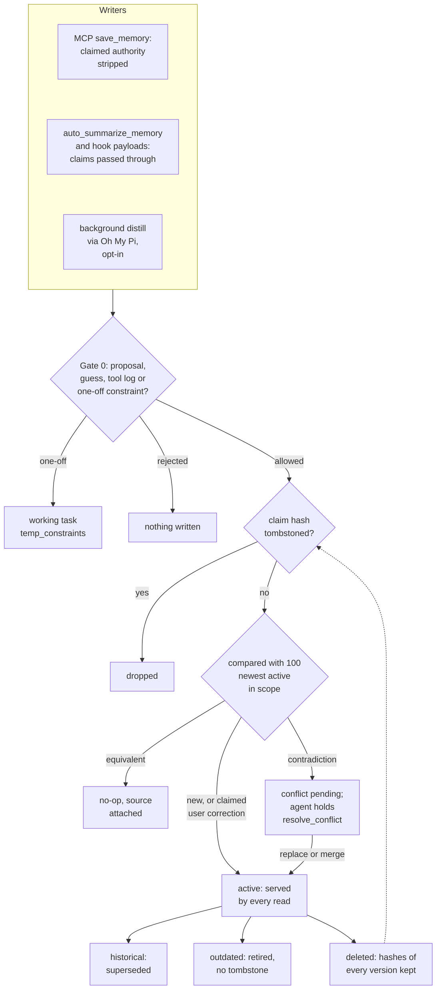

## 1. Executive Summary

Senrelay (ContextCore) is a local macOS developer workbench. A FastAPI and SQLite
service on `127.0.0.1`, a React workbench and an AppKit shell read the session
histories of six coding agents — Codex, Claude Code, Cursor, Antigravity, Oh My
Pi and OpenCode. One agent can resume another's conversation through a
`/contextcore` command. Every connected agent reads and writes long-term project
memories and short-term working tasks over MCP.

What is notable is the write gate. An agent write passes a regex admission
classifier, then a tombstone check keyed on the normalized claim, then a
comparison against active memories that ends in a no-op, a supersession or a
pending conflict for a person. Deleting a memory records hashes of every
version's claim. Every writer and reader consults them, so a deleted value is
not re-extracted under another category or with different whitespace.

What is weak is where the gate has a side door. The agent holds
`resolve_conflict`, so the conflict queue is advisory. `save_memory` strips an
agent's claimed authority; `auto_summarize_memory` passes `user_confirmed` and
`origin_authority` through, and a claimed confirmation supersedes a protected
decision without a conflict. `assemble_context` ranks across every project.

**Licence.** MIT, in `LICENSE` and `app/backend/LICENSE`, which are identical,
and `app/backend/pyproject.toml` agrees. Nothing restricts use. The copyright
line names `AI理享派`, not the author `CITATION.cff` names. `THIRD_PARTY_NOTICES.md`
is nine lines and lists no dependency. The macOS release bundles a Python
runtime that is not in the tree, so its notices cannot be checked here. The
optional embedding model, `intfloat/multilingual-e5-small`, is recorded as MIT
in `app/backend/app/services/semantic_service.py:26-36` and is downloaded only
on consent.

## 2. Mental Model

A memory is a row in `contents` with `kind = 'memory'`, one of six categories
(`preference`, `background`, `decision`, `task`, `lesson`, `knowledge`), a
project id or none for global, a version, an `origin_authority`, optional
`applicability` conditions, and sources with quotes
(`app/backend/app/database.py:361-383`, `:416-426`). Imported documents share
the table as `kind = 'document'`. Working tasks are a second tier in their own
table: a goal, completed steps, failed attempts, one-off constraints and an
`execution_mode` of `discussion_only` or `approved`
(`app/backend/app/services/working_memory_service.py:76-140`). Raw
conversations are a third store, and memories outlive them.

A candidate becomes a belief through `reconcile_long_term_memory`, whose own
docstring names its outcomes: `ROUTE_TO_WORKING_TASK`, `REJECTED`,
`DROP_TOMBSTONED`, `NOOP`, `SUPERSEDE`, `OPEN_CONFLICT`, `ADD`
(`app/backend/app/services/content_service.py:1126-1378`). Gate 0 is
`classify_write_candidate`. For an agent write without an authoritative origin
it rejects unconfirmed proposals, unverified guesses, raw tool output and
session-filler summaries. It routes "this time only" constraints to the active
working task (`app/backend/app/services/governance_guardrails.py:334-444`).

Then the tombstone check runs, then a comparison against the 100 most recently
updated active memories in the same scope. An equivalent claim attaches its
source to the existing row. A contradiction opens a pending conflict when
either side is a decision or preference, or the origin is not authoritative;
otherwise it supersedes. A user correction supersedes directly
(`content_service.py:1263-1294`).

An active memory stops being one three ways. Supersession sets `historical` and
`superseded_by_id`; `mark_outdated` sets `outdated` with a reason and stops
injection (`content_service.py:887-932`); deletion removes the row and writes
tombstones (`:1381-1461`). Every retrieval path selects `status = 'active'`;
`read_memory` by id returns any status. Once
active, a memory is treated as true. Decisions, preferences and pinned rules
form a protected tier that is injected ahead of ranked results.

## 3. Architecture

The service is one Python process (`contextcore serve`) on `127.0.0.1:8420`,
started by a LaunchAgent or the macOS app, with a single SQLite database in WAL
mode. A background loop syncs the authorized history directories of each host,
backfills the relay index, and runs queued distillation every 5 to 30 seconds
(`app/backend/app/main.py:28-97`). The browser workbench uses a session cookie
and CSRF. MCP at `/mcp` and the hook endpoint require a per-host bearer token,
which sets the authenticated agent for the call
(`app/backend/app/security.py:137-150`).

Lexical search runs on an FTS5 table rebuilt incrementally from active rows on
each search (`app/backend/app/services/retrieval_service.py:60`, `:200-238`).
Semantic search is off by default; when enabled it scans 384-dimension
`multilingual-e5-small` vectors stored in the same database
(`app/backend/app/services/semantic_service.py:26-36`, `:47`, `:639`). Background distillation
runs only through the Oh My Pi CLI, and only after the user authorizes compute
in Settings (`app/backend/app/services/distillation_service.py:728-741`).

`senrelay.com` is the vendor's static site, built from `website/`. Nothing in
`app/` calls it, and the backend's outbound hosts are provider presets, model
and wheel downloads, and GitHub. All memory work happens in the local service.

### Deployment and ergonomics

The supported build is Apple Silicon macOS 14 or later, as an ad-hoc-signed app
that bundles its own Python. From source the service needs Python 3.11 with
SQLite `blobopen`, and Node 24 for the workbench. No API key is needed to store
anything: capture, admission, tombstones and lexical search are local and
deterministic, and only distillation, handoff pages and relation extraction
use a model.
SQLite is readable by hand, and `contextcore backup` takes an online snapshot.

## 4. Essential Implementation Paths

- **Capture.** Host adapters read each agent's transcripts; the hook endpoint
  upserts a conversation, runs regex extraction over the new messages, and
  passes the result with any `memories` in the payload to
  `auto_summarize_memory` (`app/backend/app/routers/connections.py:416-452`).
- **Agent write.** `save_memory` resolves a project from `project_id` or `cwd`,
  refuses to fall back to global, routes `category = 'task'` to a working task,
  drops any authoritative origin the caller claims, and calls
  `reconcile_long_term_memory` with `is_user_correction=False`
  (`app/backend/app/mcp_server.py:798-889`).
- **Agent summary.** `auto_summarize_memory` copies each supplied item's
  `origin_authority` and `user_confirmed` into the candidate
  (`distillation_service.py:1618-1638`); `_apply_agent_supplied_summary`
  passes them on, with `is_user_correction=bool(mem.get("user_confirmed"))`
  (`:1275-1295`).
- **Background distillation.** The worker snapshots the conversation and the
  project's active decisions, invokes the model with a JSON contract, re-checks
  source revision and authorization, and applies the result through
  `apply_distilled_memories` (`:769-897`). That function requires each quote to
  be a substring of the cited message and requires a user message for a
  decision or preference (`:217-725`).
- **Retrieval.** `search`, `assemble_context` and `bootstrap_working_memory` in
  `retrieval_service.py`, wrapped by the MCP tools of the same names.
- **Correction and deletion.** `update_content`, `mark_outdated`,
  `correct_content`, `restore_version`, `delete_content` and
  `_tombstone_content_history` in `content_service.py`; conflict resolution in
  `app/backend/app/services/conflict_service.py:61-271`.

## 5. Memory Data Model

`contents` carries `status` (CHECK `active | outdated | historical`), `version`,
`content_hash`, `canonical_key`, `origin_authority`, `superseded_by_id`,
`outdated_at`, `outdated_reason`, `promoted_from_task_id` and `applicability`.
`content_versions` keeps every body by version. `content_identity_history`
records each content hash a row has held, maintained by triggers.
`content_sources` links a memory to a conversation or document with the quote
and a `deleted` flag (`app/backend/app/database.py:361-426`).

`tombstones` is keyed `UNIQUE(entity_type, dedupe_key)` with the project, the
actor and a reason (`:529-538`). A memory deletion writes five kinds of key:
the raw content hash, the whitespace-normalized hash, a canonical key over the
category and the normalized title and claim, a category-agnostic key, and a
claim-only key for claims of 12 or more normalized characters
(`app/backend/app/services/governance_guardrails.py:152-189`). Normalization
strips category prefixes, filler such as "please always" or 请务必, and
punctuation, and reads only the first 1,024 characters of the body.

Scope is `contents.project_id`; a global memory has none. Every key includes
the project id or `global`, so a value deleted in one project is not blocked in
another. `origin_authority` takes one of six valid values, of which
`user_explicit`, `user_confirmed` and `verified_outcome` are authoritative
(`governance_guardrails.py:11-18`). `conflicts` holds the proposed payload as
JSON with `pending` or `resolved` and a resolution. There is one clock per row:
`created_at`, `updated_at` and `outdated_at` are record times.

## 6. Retrieval Mechanics

`search` ranks FTS5 BM25 hits, or LIKE matches when FTS5 is unavailable, and
converts rank to `1/(60 + rank + 1)`. It adds 0.012 for the requested project
and 0.02 for decisions, tasks and preferences on an empty query, then sums in
semantic ranks the same way (`retrieval_service.py:357-436`). It does not
filter by project, and it reports `"scope": "global"`. Each candidate is
re-read through `_valid_content`, which requires `status = 'active'`, the
indexed version and no matching tombstone (`:99-152`).

`search_memory` keeps only hits in the requested project and re-selects them
with `c.project_id = ?` and `c.status = 'active'`. Without a project it returns
every project (`app/backend/app/mcp_server.py:351-460`).

`bootstrap_working_memory` is the session-start read. Its constraint layer
selects active decisions, preferences and pinned rules where
`project_id = ? OR project_id IS NULL`, and it adds active working tasks,
pending conflicts and relevant lessons from the same project or global
(`retrieval_service.py:1206-1226`, `:1300-1360`).

`assemble_context` takes the protected tier with the same project-or-global
predicate (`:660-674`). Its ranked tier then walks `search` results, applying
category quotas (task 4, background 3, lesson 3, knowledge 6, decision 4,
preference 4) and per-epoch deduplication, and degrades each entry from full
text to passage to a pointer to fit the budget (`:709-757`). Nothing in that
loop compares the hit's project with the requested one. A lesson, decision or
note from another project that matches the query enters the pack at full text,
behind the protected tier. The relay path calls `assemble_context` too
(`app/backend/app/services/handoff_service.py:3749-3755`). Retrieval is
tool-mediated: hooks return `"context_type": "none"`, and the installed skills
tell the agent to bootstrap.

## 7. Write Mechanics

Writes are synchronous SQLite transactions under `BEGIN IMMEDIATE`, and no model
runs on the agent's write path. Admission is regular expressions over Chinese
and English phrasing, and equivalence and contradiction are character-bigram
Jaccard thresholds plus two checks. One is a negation-polarity check; the other
is a table of mutually exclusive tools (npm, pnpm, yarn, bun; SQLite, Postgres
and others) (`governance_guardrails.py:104-113`, `:506-608`). A memory written
through MCP or a hook is searchable at once, since `search` refreshes the index
before it ranks.

Background distillation is the exception. It runs after 30 seconds of idle
time, only with compute authorized, and it fences the model call. It commits
an invoked marker first, re-checks the conversation's content hash and the
authorization afterwards, and discards a result whose source changed
(`distillation_service.py:811-890`). The model's output must name a category,
title and content (`app/backend/app/transport.py:1120-1131`); any
`origin_authority` it adds reaches `classify_write_candidate` as a hint when
the quote did not establish user confirmation (`distillation_service.py:386-399`).
No background pass rewrites the store; `consolidate_memories` merges duplicates
on request from the workbench (`app/backend/app/routers/content.py:109`).

Per call, `assemble_context` defaults to 24,000 tokens over MCP and 2,000 in
the service settings, estimated from UTF-8 bytes. The pack is a tool result, so
it does not sit in the host's system prompt.

## 8. Agent Integration

One-Click Connect writes each host's MCP entry, a bearer token, a skill or
slash command, and lifecycle hooks
(`app/backend/app/integrations/installer.py`). The hooks report events and
inject nothing. The MCP contract names the tools the agent holds, among them
`save_memory`, `edit_memory`, `delete_memory`, `resolve_conflict`,
`auto_summarize_memory`, `assemble_context` and the relay tools
(`app/backend/app/integrations/constants.py:43-67`). `mark_memory_outdated`,
`upsert_working_task`, `promote_task_lesson` and `bootstrap_working_memory`
are registered beside them in `app/backend/app/mcp_server.py`.

The relay is the product's centre. `/contextcore` lists recent conversations
from every host as short briefs, and a numbered reply loads bounded context with
`must_not_execute=true` and a transcript cursor the receiving agent pages
through `read_conversation_messages`. A working task in `discussion_only` keeps
`must_not_execute` set even when the user attaches an instruction
(`retrieval_service.py:605-624`). The design notes in `AGENTS.md` say all
projects and authorized agents share memory with no per-item approval, which
matches the flat token model.

## 9. Reliability, Safety, and Trust

### Who resolves a conflict

A contradiction of a decision or preference waits in `conflicts`, outside
`contents`, and the workbench shows a count badge until it is resolved. The
same resolution is an MCP tool. `resolve_conflict` asks only for
`confirmed=True` and records the calling agent as actor
(`app/backend/app/mcp_server.py:1302-1322`), and the service applies `keep`,
`replace`, `both` or `merge` with no check on who called
(`app/backend/app/services/conflict_service.py:61-271`). A `keep` resolution
leaves the proposal on the resolved conflict row. Background distillation reads
those rows and does not reopen a proposal already resolved against the same
memory (`app/backend/app/services/distillation_service.py:118-126`). The
reconciler that `save_memory` and agent summaries reach inserts a new conflict
without that check (`content_service.py:1092-1123`).

### Two write doors with different rules

`save_memory` sets any `user_explicit`, `user_confirmed` or `verified_outcome`
origin to `None` and passes `is_user_correction=False`; the comment above the
code says why (`app/backend/app/mcp_server.py:864-884`). `auto_summarize_memory`
is on the same MCP surface and accepts a list of memories whose
`origin_authority` and `user_confirmed` it copies through
(`distillation_service.py:1618-1638`, `:1275-1295`). Two consequences follow:

- With `user_confirmed: true`, a contradiction supersedes the active memory
  directly, whatever its category (`content_service.py:1282-1283`).
- With an authoritative `origin_authority`, the proposal and guess filters do
  not run (`governance_guardrails.py:419-435`). `_agent_summary_eligible` still
  refuses suggestion stances and a narrower set of unconfirmed phrasings
  (`distillation_service.py:1247-1272`).

A test asserts the first path's acceptance as intended: an agent-supplied
decision with `user_confirmed: True` and no quote is saved
(`app/backend/tests/test_relay_memory_management.py:979-995`).

### Other gaps

- **`edit_memory`** calls `update_content` directly. That checks tombstones and
  versions and runs neither admission nor contradiction detection
  (`app/backend/app/mcp_server.py:769-791`, `content_service.py:715-884`).
- **An outdated memory is not a tombstone.** Reconciliation compares only
  against active rows, so an agent re-asserting a retired rule adds it again.
- **A tombstone binds the user too.** `create_content` raises 410 on a deleted
  value from the workbench as well (`content_service.py:625-626`), and no path
  deletes a memory tombstone; the only tombstone deletions target conversations.
- **Raw transcripts** keep pasted secrets by design, per `README.md`; exports
  and audit rows strip managed secrets.

### Marks

- **`tombstone`** — awarded. The keys are on the value, the writer runs on
  every deletion from the workbench or MCP, and every write path consults
  them, including import, version restore and relation creation.
- **`trust_state`** — awarded on `contents.status`. `outdated` and
  `historical` are excluded from every retrieval path, and a pending conflict's proposal
  is never in `contents`. `origin_authority` is not the state: it changes which
  gate rules apply at write and filters nothing.
- **`scope_enforced`** — awarded on `project_id` in bootstrap and
  `search_memory`. The project is a caller argument or derived from the
  working directory, and the ranked tier of `assemble_context` is the gap.
- **`audit_log`** — awarded. Every content mutation inserts actor, action and
  target in its own transaction. Rows carry no prior value; prior bodies sit
  in `content_versions` and go when the memory is deleted.
- **`negative_eval`** — awarded; see section 10.
- **`human_review`** — withheld. The conflict queue is real and the workbench
  is a person's surface, but `resolve_conflict` is a registered MCP tool, and
  the agent that proposed a contradiction can clear it.
- **`bitemporal`** — withheld. Validity is expressed as `applicability`
  conditions such as module or version, not as time; every timestamp is record
  time.

## 10. Tests, Evals, and Benchmarks

The backend suite has 1,322 pytest functions in 130 files; the frontend has 201
Vitest cases. CI runs both on push and pull request, plus an opt-in 100,000-row
usage benchmark in its own step (`.github/workflows/ci.yml:3-81`).
`docs/evidence.md` reports 1,678 backend tests passing on 17 November 2026,
which counts parametrized cases. I ran none of it.

`negative_eval` rests on two populated cases:

- `app/backend/tests/test_memory_quality_gold.py:41-82` supersedes a
  PostgreSQL decision with a user-quoted SQLite one through the distillation
  path and asserts the assembled pack contains SQLite and not PostgreSQL, and
  that the old row is `historical`.
- `app/backend/tests/test_retrieval_distill_guardrails.py:205-336` seeds a
  global preference, a project-A decision and a project-B canary, and asserts
  bootstrap returns the first two and not the third.

The tombstone tests delete a decision and re-submit it as a preference with
extra spaces among five other items, then assert nothing was saved and only the
control preference is active (`test_retrieval_distill_guardrails.py:637-715`).
Others refuse re-import, version restore and relation creation for a deleted
body (`app/backend/tests/test_deleted_content_history.py:112-148`).

The cross-project test for assembled context asserts only about the protected
tier (`app/backend/tests/test_memory_quality_gold.py:130-133`). Read against
section 6, the ranked tier of that same pack would carry the other project's
decision. No test covers `resolve_conflict` from an agent, or
`auto_summarize_memory` superseding a protected decision. `CITATION.cff` is a
software citation; there is no paper, and no retrieval benchmark is in the
tree.

## 11. For Your Own Build

### Steal

- **Tombstone the claim, not the row.** Hash the normalized claim several ways
  — raw, whitespace-folded, category-agnostic, title-free — for the current
  body and every version, and check the set in every writer, importer and
  restore path.
- **Make the admission gate deterministic.** Regexes for proposals, guesses and
  tool logs, and a route that sends "this time only" to the task instead of the
  long-term store, cost nothing per write and need no model.
- **Hold contradictions outside the store.** A proposal that contradicts a
  decision lives in a conflicts table, so no read path can serve it by accident.
- **Strip claimed authority at the tool boundary.** `save_memory` treats every
  origin an agent asserts as unverified.

### Avoid

- **Two write tools with different trust rules.** If one strips claimed
  authority, every tool that reaches the same reconciler must, including the
  batch summary path and the hook payload.
- **The adjudication verb on the agent's tool list.** A conflict queue the
  proposer can resolve is a log of disagreements, not a review.
- **A project boost where a filter belongs.** If session-start reads isolate
  by project, the on-demand context pack should apply the same predicate.

### Fit

This suits one developer on one Mac who moves between several coding agents and
wants each to pick up where another stopped, with project rules that survive the
switch. The governance is unusually careful for that shape, and it is local and
free of model calls on the write path. Walk away if you need multi-device sync,
a team store, or isolation between agents. Every connected agent reads every
project, and the conflict queue is the agents' to clear. Expect to maintain six
host integrations whose transcript formats change underneath them.

## 12. Open Questions

- Whether `auto_summarize_memory` is meant to honour an agent's
  `user_confirmed` while `save_memory` refuses the equivalent claim.
- Whether the cross-project ranked tier of `assemble_context` is the intended
  reading of the shared-memory design, given that bootstrap isolates by project.
- Whether `resolve_conflict` is meant to stay in the MCP contract.
- How the six host adapters behave against live transcript formats; the
  support matrix in `docs/support-matrix.md` separates verified from claimed.

## Appendix: File Index

- Storage and schema: `app/backend/app/database.py`, `app/backend/app/models.py`,
  `app/backend/app/services/working_memory_service.py`
- Governance: `app/backend/app/services/governance_guardrails.py`,
  `app/backend/app/services/content_service.py`,
  `app/backend/app/services/conflict_service.py`
- Distillation and summaries: `app/backend/app/services/distillation_service.py`,
  `app/backend/app/transport.py`
- Retrieval: `app/backend/app/services/retrieval_service.py`,
  `app/backend/app/services/semantic_service.py`
- MCP and auth: `app/backend/app/mcp_server.py`, `app/backend/app/security.py`,
  `app/backend/app/integrations/constants.py`
- Capture: `app/backend/app/routers/connections.py`, `app/backend/app/adapters/`
- Tests: `app/backend/tests/test_memory_quality_gold.py`,
  `app/backend/tests/test_retrieval_distill_guardrails.py`,
  `app/backend/tests/test_deleted_content_history.py`,
  `app/backend/tests/test_decision_replacement.py`,
  `app/backend/tests/test_relay_memory_management.py`

### Recorded searches

Run from the repository root at the pinned commit with `/usr/bin/git grep`.

- **No validity-time field on memories.**
  `git grep -n -i -E 'valid_from|valid_to|valid_until|valid_at|as_of|event_time' -- app/backend/app/services/content_service.py app/backend/app/database.py app/backend/app/models.py`
  returns nothing; `git grep -c 'outdated_at' -- app/backend/app/database.py`
  counts 3.
- **Conflict resolution checks no caller.**
  `git grep -n -E 'authenticated_agent|ALLOWED_TARGET_AGENTS|is_agent' -- app/backend/app/services/conflict_service.py`
  returns nothing; `git grep -c 'authenticated_agent' -- app/backend/app/mcp_server.py`
  counts 11.
- **A kept conflict records no tombstone.**
  `git grep -n -i 'tombstone' -- app/backend/app/services/conflict_service.py`
  returns nothing; the same search counts 27 in `content_service.py`.
- **Only the distillation path consults resolved conflicts.**
  `git grep -n "status = 'resolved'" -- app/backend/app/services` matches the
  read at `distillation_service.py:119` and the resolving `UPDATE` at
  `conflict_service.py:268`; `git grep -n "FROM conflicts" -- app/backend/app/services/content_service.py`
  matches only the read-back of the row just inserted at line 1122.
- **Marking outdated writes no tombstone.**
  `sed -n 887,932p app/backend/app/services/content_service.py | grep -c -i tombstone`
  prints 0; `sed -n 1381,1417p` of the same file prints 3.
- **The ranked tier of `assemble_context` has no project predicate.**
  `sed -n 713,757p app/backend/app/services/retrieval_service.py | grep -c project_id`
  prints 0; `sed -n 660,674p` of the same file prints 1.
- **The summary path never consults the authoritative-origin set.**
  `git grep -n 'AUTHORITATIVE_ORIGINS' -- app/backend/app/services/distillation_service.py`
  returns nothing; the same search matches `app/backend/app/mcp_server.py:868`.
- **The audit table's only deletion is for draft handoffs.**
  `git grep -n -E 'DELETE FROM audit_logs|UPDATE audit_logs' -- app` matches
  `app/backend/app/services/handoff_service.py:3413` and one test.
- **No hosted memory service.** `git grep -n -i 'senrelay\.com' -- app` returns
  nothing; `git grep -c -i 'senrelay\.com' -- README.md` counts 2.
- **No paper.** `git grep -n -i -E 'arxiv|bibtex|@article|@misc|doi\.org'`
  returns nothing; `git grep -c 'cff-version' -- CITATION.cff` counts 1.

## History

**2026-11-21** — [`e4376e2da8245395cd9016fd5f184dfd576d46d8`](https://github.com/qingsongcui/ContextCore/commit/e4376e2da8245395cd9016fd5f184dfd576d46d8) — first reading, from a full clone of `main` four commits past `v1.0.0-beta.4`, scoped to the backend's content, governance, distillation, retrieval, conflict, tombstone, audit and MCP paths and their tests; the host adapters, provider management, usage accounting and the frontend were read only where they write what those paths read. Screened first: `server.json` declares an MCP start command; four dependency files changed inside the seven-day cooldown; `tests/conftest.py` executes on collection; `requirements-test.txt` and `app/frontend/package.json` float; `AGENTS.md` was read as data. MIT, no rider. Nothing installed, built or run. Five marks: `tombstone`, `trust_state`, `scope_enforced`, `audit_log`, `negative_eval`.
