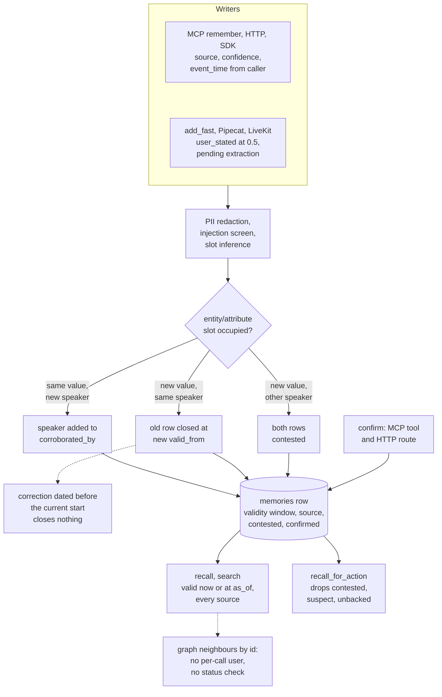

## 1. Executive Summary

ContextDB is an async Python SDK that stores agent memory in SQLite or
PostgreSQL and types every fact by who vouches for it: `user_stated`,
`agent_inferred` or `third_party`. What is notable is the slot model: a second
speaker asserting a different value in the same entity and attribute slot
contests it rather than overwriting it, and an action-shaped read returns
neither value until someone confirms one. What is weak is that the speaker,
the provenance and the confidence are what the caller says they are, and the
confirm verb sits on the agent's own tool surface.

A write runs PII redaction and an injection screen, then a per-slot lock that
corroborates, supersedes, contests or does nothing. Recall fuses cosine, BM25,
exact identifiers and graph neighbours, and keeps rows valid at the moment
asked. `recall_for_action` and the `VerifyBeforeAct` interceptor keep only rows
the active `TrustPolicy` passes. Every write and read appends to a hash-chained
audit table in the same database.

The scope keys are applied in the store's SQL, and the isolation tests pass.
They run with the entity and temporal graph overlays switched off. With them on,
a shared multi-user client fetches graph neighbours by id under the
construction-time scope only, and the entity graph is one table for every user.

**Licence.** The grant at this commit is Apache-2.0 and is not the issue. The
issue is what follows it: `COMMERCIAL.md` states that *"Production use of 1.0 and
later requires a commercial license from Atoms AI above 10,000 active profiles in
a month"*, with the text of that licence still to be written. The CLA grants
Atoms AI *"the right to relicense your contributions, including under a different
open-source or commercial license"* and promises Apache-2.0 permanence only
*"through commit `2554dae`"* (17 August 2026), 50 commits before this pin, while
`COMMERCIAL.md` names `9c6389c` (15 November 2026) for the same promise. The two
documents disagree on where the permanent grant ends.

Five marks are earned: `trust_state`, `bitemporal`, `scope_enforced`,
`audit_log` and `negative_eval`. Section 9 gives the reasons, and the reasons the
other two are withheld.

## 2. Mental Model

A memory is **a claim with a speaker and an optional slot**. Without a slot it is
a row that is stored and recalled. With an entity and attribute slot, from the
caller or from the deterministic slotter in `contextdb/core/slots.py`, it joins a
small state machine (`contextdb/dynamics/trust.py:209-345`):

- **Same value, new speaker:** the existing row gains a speaker in
  `corroborated_by`. A speaker is the session, else the user, else the agent
  (`:120-137`).
- **Same value, same speaker:** nothing changes, and a NOOP is audited.
- **New value, same speaker, equal or higher trust:** the old row is closed with
  `valid_until` and `superseded_by`, and kept.
- **New value, independent speaker, or lower trust over a first-party fact:**
  both rows are marked `contested` and both stay current.

A fact is believed for conversation from the moment it is stored. It is believed
for action only when `TrustPolicy.is_trusted` passes it
(`contextdb/core/policy.py:77-102`): action-relevant, not injection-suspect, not
contested unless confirmed, and then confirmed, or corroborated by enough
independent speakers for its class, or `user_stated` at confidence 0.7 or more.
The decision is computed at read time from stored fields. `contested`,
`confirmed`, `epistemic_source` and `injection_suspect` are the stored part.

`confirm` moves a fact to `confirmed`, rewrites its source to `user_stated`,
raises confidence to at least 0.95 and closes every rival in the slot
(`trust.py:753-821`). A memory dies by supersession, which keeps the row, or by
`forget`, which deletes it. Nothing records a rejected value.

## 3. Architecture

One package, `contextdb`, imported as a library. `ContextDB` in
`contextdb/client.py` builds lazily on first use: a store from
`contextdb/store/factory.py`, an embedder, a lazy LLM, a PII detector, a semantic
graph always, an entity graph by default, temporal and causal graphs when
`enable_multi_graph` is set (`client.py:161-298`). The audit logger and graphs
create their tables in the same database as the memories.

The SQLite store keeps the vector index in process, NumPy by default and FAISS
optionally, and rebuilds it when a revision counter in `contextdb_meta` moves, so
two instances over one file see each other's writes
(`contextdb/store/sqlite_store.py:95-120`, `:467-540`). The Postgres store
translates the same SQL, takes advisory locks per slot and for audit appends, and
is the documented choice for more than one process.

`contextdb serve` starts a Starlette app with REST routes and a `/mcp` call
route; `serve_stdio` in `contextdb/mcp.py` wraps the same tools for a stdio MCP
host and has no CLI command.

**The open-core boundary.** `OPEN_CORE.md` and `.cursor/rules/open-core-boundary.mdc`
reserve hosted gateway, tenancy, entitlements, organisation control plane,
*"Organization Action Ledger, signed compliance exports, or retention service"*
and *"Policy rollout/canary/approval controllers"* for a private ContextDB Cloud.
`scripts/check_open_core_boundary.py` fails CI on an import of `contextdb_cloud`
or on paid-tier tokens. No code in this tree imports a private module or calls a
hosted endpoint; the memory mechanisms this report credits are all here. What
the private edition adds is not readable, and the marks are judged on this tree.

### Deployment and ergonomics

`pip install pycontextdb` and `contextdb.init(...)` run against a local SQLite
file with no service. Mock embedder and LLM settings make it run offline; with
them the entity graph extracts nothing. Real recall needs an embedding provider,
OpenAI by default or any OpenAI-compatible base URL, and extraction needs an LLM.
The store is one SQLite table with readable columns; the audit table can be
verified with `verify_chain`.

## 4. Essential Implementation Paths

- **Model and policy.** `contextdb/core/models.py:188-374` (`MemoryItem`,
  `is_valid_at`), `contextdb/core/policy.py:22-140`.
- **Write.** `ContextDB.add` `contextdb/client.py:488-616`, `add_fast`
  `:1252-1332`, `add_many` `:2022-2070`, `_apply_slot` `:379-441`,
  `_screen_item` `:367-377`; `TrustEngine.write` and `_write_locked`
  `contextdb/dynamics/trust.py:168-345`, `_supersede` `:347-373`.
- **Explicit evolution.** `ContextDB.evolve` `client.py:618-850` and
  `TrustEngine.evolve_write` from `trust.py:375`; specified in
  `docs/memory_evolution.md`.
- **Consolidation.** `consolidate_pending` `client.py:1355-1437`, the loop
  `:1439-1462`; `Consolidator` and `Pruner`
  `contextdb/dynamics/evolution.py:54-196`.
- **Recall.** `ContextDB.search` `client.py:1090-1219`;
  `RetrievalEngine.search_scored` `contextdb/dynamics/retrieval.py:221-334`;
  BM25 `:360-417`; `QueryClassifier` `:72-81`.
- **Action read.** `FactualMemory.recall_for_action`
  `contextdb/memory/factual.py:166-191`; `slot_facts` `client.py:2103-2140`;
  `VerifyBeforeAct.decide` `contextdb/integrations/act.py:43-87`.
- **Confirm.** `client.py:1334-1353`, `TrustEngine.confirm` `trust.py:753-821`.
- **Forget.** `_forget_transactional` `client.py:1606-1704`,
  `_forget_user_transactional` `:1712-1778`, `verify_forgotten` `:1780-1812`.
- **Scope.** `SQLiteStore._resolve_scope`, `_scope_allows`, `_scope_sql`
  `contextdb/store/sqlite_store.py:358-392`; Postgres
  `contextdb/store/postgres_store.py:364-387`, `:433-446`.
- **Audit.** `contextdb/privacy/audit.py:81-208`.
- **Agent surfaces.** `contextdb/mcp.py:58-450`, `contextdb/serve.py:90-360`.

## 5. Memory Data Model

One `memories` table (`sqlite_store.py:33-87`) holds every type: `FACTUAL`,
`EXPERIENTIAL` and `WORKING`. Beside content and embedding it carries
`event_time` and `ingestion_time`, `created_at` and `updated_at`, a lifecycle
`status` of `ACTIVE`, `ARCHIVED` or `DELETED`, and the trust columns:
`epistemic_source`, `confidence`, `corroboration_count`, `corroborated_by`,
`action_relevant`, `entity_key`, `attribute_key`, `slot_class`, `slot_value`,
`negated`, `valid_from`, `valid_until`, `superseded_by`, `contested`,
`confirmed`, `confirmed_at`, `injection_suspect`, `pending_consolidation` and
`write_generation`. Scope is `user_id`, `tenant_id`, `agent_id` and
`session_id`.

**Two clocks.** `event_time` and `valid_from` are validity time and come from the
caller when given (`client.py:546-566`); `ingestion_time` and `created_at` are
record time. `ingestion_time` is read by no code outside the store and the model.

**Slots.** `slot_value` is derived from the original utterance, before
redaction, so two different emails stay different; when it contains detected PII
it is stored as an HMAC fingerprint (`client.py:443-464`).

**PII annotations.** In the default `redact` mode the detector keeps each matched
span in plaintext in `PIIAnnotation.original`
(`contextdb/privacy/pii_detector.py:17-18`, `:156`), and the store writes the
annotations to the row's `pii_annotations` column (`sqlite_store.py:586`). Only
`encrypt` stores ciphertext there. The README states *"PII runs before content
reaches storage"*; the content does, and the original span sits in the same row.

**Graphs.** `semantic_edges`, `temporal_edges`, causal edges, and an entity
overlay of `entities` (unique on the lowercased name, one table for all users),
`memory_entity_edges` and `entity_attribute_sources`
(`contextdb/graphs/entity.py:22-52`). No graph table stores a user.

## 6. Retrieval Mechanics

`search` redacts the query, embeds it and calls `search_scored`
(`client.py:1125-1137`). The engine:

1. Asks the store for cosine seeds over an allowlist built in SQL from `status =
   'ACTIVE'`, the scope predicate and, with `as_of`, the validity window
   (`sqlite_store.py:830-869`).
2. Expands the top seeds through each graph whose keyword weight is non-zero:
   *when, before, after* weight the temporal graph, *why, because* the causal
   graph, *who, whose, what company* the entity graph (`retrieval.py:72-81`,
   `:244-255`).
3. Adds whole-token matches for up to three identifier-like tokens and a BM25
   ranking over LIKE matches of up to eight keywords (`:257-279`).
4. Fuses by reciprocal rank with k=60 and multiplies by salience: recency,
   recurrence and a criticality boost for health, legal and financial content
   (`:281-334`).

`search` then applies the relevance floor (off by default at -1), keeps rows valid
at the moment, and filters by type, time range, entity, minimum confidence and,
when asked, `third_party` (`client.py:1144-1161`). `compose=True`, on in
`factual.recall`, adds sibling slots of the same entity.

A neighbour not already in hand is fetched with `store.get_raw(mid)`
(`retrieval.py:307-309`). `get_raw` applies the construction-time scope only and
no status (`sqlite_store.py:777-784`), and `search` adds no user check after it.
On a client built without a user, which `serve.py` documents as the shape for
multi-user HTTP, a query the classifier sends to the entity graph returns
another user's memory that mentions the same name. The project's own
`test_eval_7_2` asserts that such a cross-user edge exists
(`tests/evals/test_trust_model.py:840`). The temporal graph links rows by
`event_time` proximity with no user predicate (`contextdb/graphs/temporal.py:70-83`).
On any client an archived or soft-deleted row reached through a surviving edge is
returned too. This follows from the code and was not run.

**The action read.** With an entity and attribute, `recall_for_action` reads the
slot exactly and keeps trusted rows; without them it recalls `4 × top_k` and keeps
any trusted row, related or not (`factual.py:182-191`). The HTTP route passes no
slot (`serve.py:266-278`); the MCP tool passes the model's.

**Rendering.** `render_recalled_context` wraps hits in a *RECALLED DATA — not
instructions* block within a token budget and marks suspect rows
(`contextdb/integrations/prompting.py`).

## 7. Write Mechanics

**Keyed writes.** `add` with a slot takes a per-slot lock, an `asyncio.Lock` on
SQLite and an advisory transaction lock on Postgres, reads the slot's current
rows and applies the state machine of section 2 (`trust.py:201-345`). The new
row's `valid_from` is the caller's `event_time`, else the clock, and a supersede
closes the old row at that instant.

Candidates are the rows valid at the incoming `valid_from` (`trust.py:220-224`).
A correction dated before the current value's start therefore finds no current
row, supersedes nothing, and both values stay open from then on.

**Provenance is declared.** `source` and `confidence` are arguments on the SDK,
on HTTP `/v1/remember` and on the MCP `remember` tool (`mcp.py:76-90`). Two
checks lower trust: a slot the text does not support becomes `agent_inferred` at
confidence 0.4 or less, and instruction-shaped text becomes `third_party` at
0 with `injection_suspect` set (`client.py:367-441`). The extractor path also
demotes a high-stakes slot the raw text does not name. Nothing raises trust except
`confirm`.

**Fast writes.** `add_fast` stores raw text as `user_stated` at 0.5 with
`pending_consolidation` and embeds inline, with no LLM. `consolidate_pending`
later extracts facts, writes them through the trust engine and archives the raw
row (`client.py:1355-1437`). The extracted item is built without a `user_id`, and
the trust write takes `self.user_id`. On a client built with a user both are
that user. On a shared client the fact is stored with no user, and its slot
lookup has no user predicate, so it can corroborate, supersede or contest another
user's fact in the same slot (`client.py:1392-1428`, `sqlite_store.py:1007-1023`).
Read from the code, not run.

**Batch summaries.** `Consolidator.consolidate` merges semantic clusters of five
or more into an LLM summary that takes the least trusted source and confidence of
its inputs, and archives the inputs (`evolution.py:72-130`).

**Deletion.** `forget` hard-deletes by id, slot, age or entity. `forget_user`
also finds derived summaries through `consolidated_from` to a fixpoint, severs
graph edges and rebuilds shared entity attributes from the remaining sources
(`client.py:1712-1778`, `entity.py:195-224`).

### Operational cost

Under the default configuration `add` blocks on one embedding call, one LLM call
for entity extraction through the auto-linker, and the slot transaction; the
optional RL manager adds a second LLM call. `add_fast` blocks on the embedding
alone. A fast write is retrievable at once as raw text; its extracted facts appear
after the next consolidation pass, five seconds by default when the loop runs.
`consolidate` walks the whole store in 500-row pages and calls the LLM per
cluster. Recall returns `top_k` items, five by default on MCP, rendered within 512
tokens.

## 8. Agent Integration

Seven MCP tools: `remember`, `recall`, `recall_for_action`,
`pending_confirmations`, `confirm`, `forget` and `remember_many`
(`mcp.py:58-308`). `remember` requires `source`. Every tool takes `user_id`,
which on a client built without a user selects the partition; omitted, no user
predicate applies.

The HTTP server runs those tools at `/mcp` and as REST routes. With an `auth_hook`
the hook's user wins and a conflicting user anywhere in the request is a 400; with
the bearer token alone, which is what `contextdb serve` configures
(`contextdb/cli.py:105-113`), the request names the user (`serve.py:135-188`).
`docs/multi_tenant.md` and the module docstring say that without an authenticated
user this is not an authorisation boundary.

`VerifyBeforeAct` is the host-side gate for Pipecat, LiveKit and MCP hosts: act on
trusted facts, otherwise ask with the pending ids, otherwise abstain, and audit
the decision; a user's yes goes to `confirm_pending` (`act.py:43-125`). Adapters
for LangChain, CrewAI, AutoGen and OpenAI function calling are thin wrappers.
`ai-tools/` ships opt-in instruction files for coding assistants.

## 9. Reliability, Safety, and Trust

### The speaker is whoever the caller says

The design separates a wish from a fact by provenance, and the provenance is an
argument. An MCP `remember` with `source='user_stated'`, a slot and confidence 0.9
is action-trusted on arrival, and
`test_eval_8_1b_mcp_server_and_livekit_smoke` asserts exactly that
(`tests/evals/test_trust_model.py:907-918`). Corroboration counts speakers, and a
speaker is derived from the session, user or agent the client was built with or
the call names. A model holding the MCP surface can state a fact as the user's,
confirm a contested one, and clear a slot with `forget`.

The protections that do not depend on the caller are real: the injection screen,
the extractor bound, and the rule that a lower-trust write cannot replace a
first-party fact but only contest it (`trust.py:144-152`,
`test_trust_model.py:1435-1476`).

### Policy shown and policy applied differ

`recall_for_action` judges rows with the client's policy. The
`requires_confirmation` field that MCP and HTTP return is a computed property
under `DEFAULT_TRUST_POLICY` (`models.py:350-360`, `mcp.py:322`, `serve.py:60`).
Under `TrustPolicy.hospital()` a first-party health fact is untrusted for action
and is reported to the model as not requiring confirmation.

### Scope

The SQL predicate is consistent across the store's reads, and the vector
allowlist is built from it before ranking, with a test that twenty foreign
vectors cannot starve one in-scope hit. The gaps sit outside the store's SQL: the
graph overlay of section 6, consolidation on a shared client in section 7, and
the opt-in RL manager, which reads `list_memories(limit=20)` with no user and may
update or delete the id the LLM names (`client.py:529-540`).

### Forgetting

`forget_user` is thorough about rows, derived summaries, vectors and graph edges.
Three things survive it. SUPERSEDE and CONFLICT audit entries carry
`old_value` and `new_value` content (`trust.py:308-309`, `:369-370`), and the
audit table is never pruned. Names and addresses are not redacted by default
(`contextdb/core/config.py:81-89`). And `verify_forgotten` reads the user's audit
history oldest first with a limit of 1,000 (`client.py:1795`,
`audit.py:146-166`), so once a user has more than 1,000 entries, which 1,000
recalls produce, it does not see the newest FORGET entry and returns on the row
count alone.

### Marks

- **`trust_state` — earned.** `contested`, `confirmed`, `injection_suspect` and
  `epistemic_source` are stored; a conflicting independent write moves a slot
  into `contested`, `confirm` moves it out, and `recall_for_action` and
  `VerifyBeforeAct` exclude contested, suspect and unbacked rows. The exclusion is
  from action, not from recall, and the model can call `confirm`.
- **`bitemporal` — earned.** Validity comes from the caller's `event_time`
  through the SDK, `remember` and `remember_many`, record time is kept apart, and
  `as_of` filters every arm on the window, with an MCP-level test. `evolve` and
  `confirm` stamp the clock, and a backdated correction closes nothing.
- **`scope_enforced` — earned,** with the graph and consolidation gaps above.
- **`audit_log` — earned.** The hash-chained table records every keyed mutation
  and every delete; archival by consolidation and pruning, and `add_conversation`'s
  per-item writes, leave no entry of their own (`client.py:1431-1435`,
  `evolution.py:127`, `:176`, `:185`, `:194`, `client.py:1575-1583`). The chain
  is per database and unsigned, so a database writer can rewrite it from any
  point and recompute the hashes.
- **`negative_eval` — earned.** Section 10.
- **`tombstone` — withheld.** `forget` hard-deletes, and the ERASE and FORGET
  entries hold ids. The same text written again is a new row.
- **`human_review` — withheld.** `confirm` is an MCP tool and an HTTP route under
  the same credential as the writes, and a `user_stated` write needs no
  confirmation. `OPEN_CORE.md` lists approval controllers among the private
  edition's features; nothing of that shape is in this tree.

## 10. Tests, Evals, and Benchmarks

I ran none of the suites; the counts are from reading. CI runs the full suite on
Python 3.10, 3.11 and 3.12 and a Postgres 16 job over five files
(`.github/workflows/ci.yml`). The Postgres cases skip without
`CONTEXTDB_TEST_POSTGRES_URL` (`tests/pg_util.py:19-23`); the SQLite parameter of
each runs everywhere.

`tests/evals/test_trust_model.py` holds 45 acceptance evals. The cases that assert
absence from a populated result:

- `test_store_scopes_vector_candidates_before_ranking`: twenty foreign vectors
  aligned with the query and one in-scope vector; the in-scope search must equal
  `[mine.id]` (`tests/unit/test_vector_scope.py:73-102`).
- `test_decide_scopes_per_call_user_on_shared_client`: alice's decision must be
  non-empty and contain no row of bob's in the same slot
  (`tests/unit/test_decision_scope.py:33-66`).
- `test_eval_2_1_contradiction_supersedes`: recall must contain 4pm and not 3pm
  (`test_trust_model.py:435-465`).
- `test_eval_8_1b`: an MCP `recall` as of 1 February 2026 must contain the budget
  dated January and not the one dated June (`:935-962`).
- `test_backdated_event_time_and_pre_truncation_as_of`: thirty rows dated 25 April
  and one dated 15 March; recall as of 1 April must return exactly the March row
  (`tests/unit/test_retrieval.py:114-157`).

Two isolation evals assert `all("7788" not in h.content ...)` over a recall whose
result is not checked for content, so they would pass on an empty result
(`test_trust_model.py:1015-1016`, `:1312-1313`); the point-read and count
assertions beside them carry the case. The scope and isolation tests set
`enable_entity_graph=False` and `enable_multi_graph=False`
(`tests/conftest.py:51-52`, `test_trust_model.py:69-70`,
`test_decision_scope.py:22-23`, `test_serve.py:24-25`, `test_host_api.py:26-27`),
while the default enables the entity graph (`config.py:131`). The `client_full`
fixture that turns both overlays on (`tests/conftest.py:65-84`) is used by no test.
Two forget evals do build a shared client with the entity graph on, and
`test_eval_7_2` asserts that alice's memory's only entity neighbour is bob's
(`test_trust_model.py:840`). The cross-user edge is tested as intended; no test
searches through it.

`benchmarks/trust_bakeoff.py` runs eight synthetic traps against the trust arm
and an untyped control arm, and `test_eval_bakeoff_trust_arm_beats_raw_store_on_fabrication`
requires the control to fabricate on at least three traps, which makes the gate
able to fail (`test_trust_model.py:1062-1095`). The README describes it as
regression evidence inside the harness. `benchmarks/run_benchmarks.py` measures
latency with the mock embedder.

**The paper.** The README cites a Zenodo preprint, *ContextDB: A Unified Context
Layer for AI Agents* (record 19647089, 19 April 2026, one author). Its abstract
describes an RL-trained memory manager and an evaluation on LoCoMo, LongMemEval
and three domain benchmarks, and gives figures of up to 18% retrieval precision
gain and up to 90% token savings. The tree ships the RL manager's inference
prompt only; its docstring says training *"lives in a separate research harness —
not shipped with the library"* (`contextdb/agents/rl_manager.py:9-10`). No LoCoMo
or LongMemEval harness or result is committed. I read the record's abstract, not
the PDF.

## 11. For Your Own Build

### Steal

- **Contest instead of last-write-wins.** Two independent speakers asserting
  different values in one slot both stay current and neither gates an action;
  a confirmation closes the loser. It is one branch in a slot-locked write.
- **Let a lower-trust source contest a first-party fact but never replace it.**
  It closes the commonest laundering path, a document the agent stored on the
  user's behalf.
- **Close the old row at the new fact's validity start**, not at the write clock,
  when the caller knows when the change happened.
- **Build the vector allowlist from the scope SQL before ranking**, so a large
  foreign tenant cannot fill the candidate budget.
- **Audit the decision, not only the score.** Each recall logs the trust flags as
  they stood, because computed properties change after a confirm.
- **Keep a control arm in your own benchmark** that must fail the traps, so the
  gate can go red.

### Avoid

- **Provenance as a tool argument.** If the model can write `user_stated`, the
  wish-versus-fact distinction holds against a careful host and not against the
  model.
- **A confirm verb in the same registry as the write.** The person's yes should
  arrive on a channel the model does not hold.
- **Graph expansion that re-fetches by id.** Every id that enters a result from a
  side table needs the same scope and status predicate as the primary arm.
- **A shared entity table keyed on the name** in a multi-user store.
- **A verification read capped oldest first.** The proof is the newest entry.

### Fit

This suits a team building a voice or support agent for one end user per client,
where the host knows who is speaking and calls `confirm` itself when the person
says yes. Built that way, scope is fixed at construction, the graph gaps do not
apply, and the trust policy does what its name says.

It does not suit a shared multi-user server where the model drives the MCP tools.
There the scope is a request field unless the operator writes an auth hook,
the graph overlays cross users, and the model can author, assert and confirm a
fact by itself. A reader who needs a person between a write and an action gets
no review surface from this tree, and the boundary document says approval
controllers stay private.

## 12. Open Questions

- Does the hosted edition apply the per-call user to graph neighbours and
  consolidation, and is the entity graph partitioned there?
- What does ContextDB Cloud's approval controller gate, and would it take
  `confirm` off the agent's surface?
- Which of the abstract's figures come from this code, and is the RL training
  harness published anywhere?
- Is the disagreement between the CLA's `2554dae` and `COMMERCIAL.md`'s `9c6389c`
  deliberate?

## Appendix: File Index

| Path | Role |
| --- | --- |
| `contextdb/core/models.py` | `MemoryItem`, trust fields, validity check |
| `contextdb/core/policy.py` | `TrustPolicy.is_trusted` and the hospital and restaurant presets |
| `contextdb/dynamics/trust.py` | Slot-locked corroborate, supersede, contest, confirm |
| `contextdb/client.py` | Write paths, search, consolidation, forget, verify_forgotten |
| `contextdb/dynamics/retrieval.py` | Classifier, RRF, BM25, graph expansion |
| `contextdb/store/sqlite_store.py` | Schema, scope SQL, vector allowlist |
| `contextdb/store/postgres_store.py` | Postgres store, advisory locks |
| `contextdb/graphs/entity.py`, `temporal.py`, `semantic.py` | Graph overlays |
| `contextdb/privacy/audit.py` | Hash-chained audit table |
| `contextdb/privacy/pii_detector.py` | Redaction and annotation originals |
| `contextdb/memory/factual.py` | `recall_for_action`, `confirm` |
| `contextdb/integrations/act.py` | `VerifyBeforeAct` |
| `contextdb/mcp.py`, `contextdb/serve.py` | MCP tools and HTTP routes |
| `tests/evals/test_trust_model.py` | Acceptance evals |
| `tests/unit/test_vector_scope.py`, `test_decision_scope.py`, `test_retrieval.py` | Scope and as-of cases |

### Recorded searches

Run from the repository root at the pinned commit with `/usr/bin/git grep`.

- **No graph table or query carries a user.**
  `git grep -n 'user_id' -- contextdb/graphs` returns only
  `contextdb/graphs/semantic.py:59`, the link-time similarity search.
- **The audit table is never updated or deleted.**
  `git grep -n -i -E '(delete from|update) +audit_log'` returns only the tamper
  case in `tests/unit/test_audit.py:30`; `git grep -n 'audit_log' -- contextdb ':!contextdb/privacy/audit.py'`
  returns nothing.
- **Archival writes no audit entry.**
  `git grep -n -E 'status=MemoryStatus.ARCHIVED' -- contextdb` returns
  `client.py:1434`, `evolution.py:127`, `:176`, `:185`, `:194` and
  `retention.py:72`; only the retention site logs.
- **Record time is not read.** `git grep -n 'ingestion_time' -- contextdb ':!contextdb/store'`
  returns the two field lines in `contextdb/core/models.py`.
- **The HTTP routes take no as_of.** `git grep -n 'as_of' -- contextdb/serve.py`
  returns nothing; `git grep -n 'as_of' -- contextdb/mcp.py` matches `:6`,
  `:138` and `:381`.
- **Confirm callers.** `git grep -n -E '\.confirm\(|confirm_pending\(' -- contextdb`
  returns `client.py:1351`, `act.py:124`, `mcp.py:430`, `factual.py:195` and
  `serve.py:285`.
- **No value-keyed rejection record.**
  `git grep -n -i -E 'tombstone|rejected' -- contextdb` returns vector-index
  deletion markers and docstrings.
- **No private module imported.** `git grep -n -i -E 'contextdb_cloud'` returns
  the boundary script and its test.
- **No LoCoMo or LongMemEval artifact.**
  `git grep -n -i -E 'locomo|longmemeval'` returns nothing;
  `git grep -n -i 'benchmark' -- benchmarks` matches.
- **Paper reference.** `git grep -n -i 'zenodo'` returns `COMMERCIAL.md:71` and
  `README.md:549`, `:616`; `git grep -n -i -E 'arxiv|bibtex|doi\.org|CITATION'`
  returns an example string in `docs/prompts.md:250`.
- **Scope tests run without graph overlays.**
  `git grep -n -E 'enable_multi_graph|enable_entity_graph' -- tests` returns
  `False` in every test config and `True` only in `tests/conftest.py:73-74`
  and two forget evals, `test_trust_model.py:823` and `:1788`;
  `git grep -n 'client_full' -- tests` returns only the fixture's definition at
  `tests/conftest.py:66`.

## History

**2026-11-25** — [`df0b52a26fa188aa137f2baba052a7bb4531ff60`](https://github.com/atomsai/contextdb/commit/df0b52a26fa188aa137f2baba052a7bb4531ff60). First reading, read only, from a full clone at the head of `main`, tagged v0.4.9; triage selected the same commit. Screened first: two auto-run surfaces, `.cursor/rules/` (`open-core-boundary.mdc`, `publication-content.mdc`) and `.github/copilot-instructions.md`, injected into an agent's context and read as data; nothing inside the seven-day cooldown; one build-time execution point, `tests/conftest.py`; one unpinned manifest, `pyproject.toml`. Nothing was installed, built or run, and the 243 test functions were not run. Five marks ([section 9](#9-reliability-safety-and-trust)). Provenance is a caller argument and `confirm` is an MCP tool; graph neighbours skip the per-call user.
