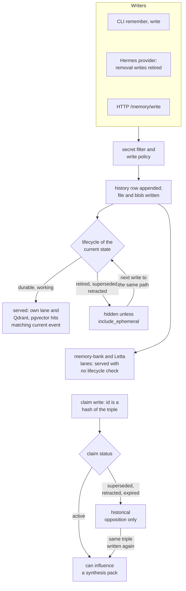

## 1. Executive Summary

ContextLattice is a self-hosted memory service for coding agents: a Go gateway,
driven mainly through a `contextlattice` CLI, that stores each memory as a file
under a project directory and appends every write to an NDJSON history. It
mirrors the text into Qdrant and pgvector, and answers a search by merging up to
eight retrieval lanes. A separate claim ledger holds subject-predicate-object
claims with a status and a validity window.

What is notable is that the vector stores are projections and never authority.
Every Qdrant and pgvector hit is checked against the gateway's current state
before it is served. A hit whose event id is not the current one, or whose
memory has been retired, superseded or retracted, is dropped
(`services/gateway-go/memory_current_state.go:2817-2928`). Writes reach the file
store and the history before any fanout, and nothing rewrites the history. The
tests seed populated stores and assert that a retired memory, an identical
memory in another project and a retracted claim stay out.

What is weak is the edge of what the gateway governs. Lifecycle reconciliation
runs on two of the eight lanes; memory-bank and Letta rows are served without
it, and the shipped stack runs a third-party MCP server that writes into the
gateway's own volume with no history row. The memory routes accept a request
that carries no API key when a key is configured. A retracted claim is revived
by the next write of the same triple, and `remember` overwrites one checkpoint
file per project.

**Licence.** The primary limit is what the tree withholds rather than what the
grant says: `CONTRIBUTING.md` names a *"commercial BUSL-1.1 source"* lane, and
`config/commercial_truth.v1.json` records it with an Apache-2.0 change licence,
but the tree's only licence file is the Apache-2.0 `LICENSE`. The paid features the README
lists — governed collaboration, protected activation, workspace operations —
therefore cannot be read here. Everything that is here is Apache-2.0, in
`LICENSE` and the Rust workspace manifest (`crates/Cargo.toml:12`), which agree.
One component ships modified: `Dockerfile.memorymcp:6-10` installs
`@allpepper/memory-bank-mcp@0.2.2` from npm and patches three of its compiled
files by string replacement at image build.

## 2. Mental Model

There are two kinds of stored belief, with different identities.

A **memory** is identified by `(project, file)`. Its content is whatever the
latest write to that path said, and every write is also a history row with its
own event id (`services/gateway-go/memory_store.go:1637-1876`). Each write
carries a `lifecycle`: `durable`, `working`, `ephemeral`, `test`, `retired`,
`superseded` or `retracted`, defaulting to `durable`
(`services/gateway-go/metadata_contract.go:80-99`). The last four are hidden
from default reads (`services/gateway-go/memory_lifecycle.go:55-62`).

A memory stops being served when a later write to the same path sets a hidden
lifecycle. Three paths do that. The Hermes provider writes `retired` when the
host agent removes or replaces an entry
(`integrations/hermes-memory-provider/__init__.py:674`). The retirement route
`/memory/lifecycle/retirement` proposes and applies `retired` for stale or
superseded rows not under legal hold
(`services/gateway-go/frontier_t5_policy_lab.go:444`). Any caller of
`/memory/write` can also set the field. The next write to the same path with the
default lifecycle brings it back. No durable memory is ever deleted.

A **claim** is identified by `claim_id`, which defaults to a hash of project,
subject, predicate and object (`services/gateway-go/temporal_claim_graph.go:175`).
Its `status` is `active`, `superseded`, `retracted` or `expired` (`:315-324`).
A claim that names another in `supersedes` sets the target to `superseded` in
the same append (`:428-437`). A claim that names another in `contradicts` changes
nothing on the target; the response labels the claim `contested` (`:696`). The
contradiction-resolution route sets the losing claims to `retracted`
(`services/gateway-go/frontier_t5_policy_lab.go:789`), and recommends a winner
only when its `verification.status` is `verified` (`:732`).

`verification` is a separate label (`verified`, `unverified`, `failed`,
`disputed`) that weights and annotates claims and filters none. Retrieved text
is also screened at read time for injection phrases and shown as
`[quarantined retrieved content]` in the context pack. That assessment is
recomputed per call and not stored.

## 3. Architecture

The system is one Go binary, `services/gateway-go`, built by both
`Dockerfile.gateway-go` and `Dockerfile.orchestrator`. In the default Compose
file the container on port 8075 is the one clients call, and it names the
`gateway-go` container on port 8091 as its engine (`docker-compose.yml:685`).
The Python orchestrator it replaced is under `archive/`, and
`services/orchestrator` is a symlink to it. `services/orchestrator-go` is a
separate task-queue scheduler.

The default Compose `core` profile runs Qdrant, MongoDB, a TimescaleDB image
with pgvector, Meilisearch, a fastembed sidecar, the Rust `memory-bank-spike-rs`
search sidecar, one spike adapter, an MCP hub (`ghcr.io/tbxark/mcp-proxy`), the
memory-bank MCP server, the gateways and a Next.js dashboard. Further profiles
add MindsDB, Ollama with Letta, a Langfuse stack and six more spike adapters.
The README quotes 8 to 12 GB of RAM for the local lite core profile.

The `gateway-go` container, the memory-bank MCP server and the search sidecars
mount one volume (`docker-compose.yml:78`, `:455`, `:1434`). The gateway's store
root defaults to `/data/memory-bank` (`:1403`), which is also the MCP server's
`MEMORY_BANK_ROOT`.

### Deployment and ergonomics

The documented install is `cp .env.example .env && gmake quickstart`, which
asks for a profile and brings up the containers. A single-container image for
Glama turns off Qdrant, pgvector and Mongo and serves only the gateway's own
lane (`Dockerfile.orchestrator`). No API key is needed to store anything.
Embeddings come from the fastembed sidecar, with a hashed fallback in-process
(`services/gateway-go/source_native_adapters.go:149`). The store is
human-readable: Markdown and JSON files under `<root>/<project>/`, NDJSON logs
and JSON state shards under `<root>/_contextlattice/`. The task-delivery ledger
is SQLite (`services/gateway-go/agent_task_delivery_store.go:252`).

## 4. Essential Implementation Paths

- **Write.** `handleWriteIngress` normalizes the payload, runs the secret filter
  and write policy, routes telemetry-class writes to the Mongo sink, and calls
  `memoryStore.put` (`services/gateway-go/write_ingress.go:34-154`). `put` takes
  per-path locks, computes a content hash and a token-set diff against the
  previous version, writes a blob and links the file, appends the history row and
  persists the current state (`services/gateway-go/memory_store.go:1637-1876`).
- **Fanout.** After the store commits, `handleNativeVectorWriteFanout` queues
  Qdrant and pgvector upserts in goroutines
  (`services/gateway-go/write_ingress.go:583-697`). The Qdrant point id is a hash
  of the event id (`services/gateway-go/source_native_adapters.go:537-554`), so
  each version is a new point.
- **Search.** `executeRetrieval` (`services/gateway-go/main.go:6932-8044`) plans
  the lanes, runs fast and slow ones, and merges rows; lane names are fixed at
  `main.go:31-38`. The gateway's own lane is `searchCurrentStateRowsScoped`, a
  lexical score over current summaries within one project and topic prefix
  (`services/gateway-go/memory_current_state_search.go:103-481`).
- **Reconcile.** `reconcileVectorRowsDetailed` drops vector rows with no current
  state, a hidden lifecycle, a stale event id or a mismatched hash, and rewrites
  the survivors' fields from the current state
  (`services/gateway-go/memory_current_state.go:2817-2928`). It is called on the
  Qdrant and pgvector lanes (`services/gateway-go/source_native_adapters.go:811`,
  `:1525`, `services/gateway-go/main.go:5559-5560`).
- **Context.** `contextlattice context` posts to `/memory/synthesis-pack/v2`,
  which builds a context pack, attaches one-hop graph neighbours (3 seeds,
  4 neighbours by default), and joins claims
  (`services/gateway-go/memory_context_pack.go:905-913`,
  `services/gateway-go/memory_synthesis_pack_v2.go:109-112`).
- **Correct.** `contextlattice correct` posts feedback, writes a factual claim
  marked `verified` with `supersedes` for `stale` or `superseded` and
  `contradicts` for `wrong`, and records a session event
  (`services/gateway-go/cmd/contextlattice-agent-tools/main.go:2621-2719`).
- **Claims.** `temporalClaimStore.upsert`, `trimLocked`, `compactLocked` and
  `query` (`services/gateway-go/temporal_claim_graph.go:401-612`).

## 5. Memory Data Model

`memoryStoreEntry` carries event id, project, file, topic path, agent and
session ids, tags, a summary clipped to 400 characters, content hash and ref,
data class, lifecycle, storage tier, horizon days, diff state and delta, a
Beta-prior confidence, timestamps, task attribution and structured references
(`services/gateway-go/memory_store.go:75-101`). The current state per key adds
`legal_hold` and `tombstone` (`services/gateway-go/memory_current_state.go:58-62`).

Scope is the project, sanitized and used both as the first path segment and as
the key of the history and current-state indexes. Topic paths form a hierarchy
used for narrowing and for nearest-ancestor fallback inside a project. Agent and
session ids are recorded and not used as read predicates on this lane.

Time on a memory is record time only: `created_at` and `last_accessed_at`. A
`horizon_days:N` tag sets how long an untouched memory stays in the hot index.

A `temporalClaim` carries subject, predicate, object and statement, status,
`valid_from`, `valid_to`, `observed_at`, confidence, `supersedes`,
`contradicts`, `caused_by`, support and opposition evidence, verification,
provenance, branch, commit, agent and session, a revision counter and
`created_at` and `updated_at` (`services/gateway-go/temporal_claim_graph.go:36-65`).
The ledger keeps at most 10,000 claims by default and drops those with the
oldest `updated_at` beyond that (`:100`, `:492-506`).

## 6. Retrieval Mechanics

The gateway's own lane is lexical over current summaries and requires a project
(`services/gateway-go/memory_current_state_search.go:136`). It skips hidden
lifecycles, cold tiers and rows past their horizon (`:315-343`), and fills a
sparse exact-topic result from the nearest ancestor topic only (`:421-452`). The
index counts and generations are rechecked after ranking, and any drift returns
an error rather than a partial result (`:456-479`).

Qdrant and pgvector are queried with an embedding of the query, filtered by
project and topic tag when given (`services/gateway-go/source_native_adapters.go:717-738`,
`:1439`), then reconciled. Qdrant payload reads do not include `lifecycle`
(`:349-359`); the lifecycle comes from the current state during reconciliation.

The memory-bank lane asks the Rust sidecar, which walks the shared volume and
indexes file text with Tantivy or one of several spike backends. It suppresses
only paths registered as exact runtime state. Letta archival search is filtered
by a `project:` tag. MindsDB and the Mongo telemetry sink make up the rest. None
of these four lanes passes through reconciliation.

Merging is by key and score. When duplicates disagree, the row with the
strongest safety class (forgotten, retired, unknown, hard lifecycle) donates the
lifecycle fields, so a duplicate cannot launder a retirement
(`services/gateway-go/main.go:4090-4313`). The context pack targets 4,096 tokens
by default (`services/gateway-go/memory_context_pack.go:1326`).

## 7. Write Mechanics

Writes are explicit. The agent or its hooks call `remember`, `write`, `finish`
or `correct`; the Hermes provider mirrors the host's built-in memory file. No
model extracts facts from a conversation. The one model-assisted writer is
Dream Mode, which turns a context pack into hypotheses and, only when the caller
passes `persist`, writes the report as a `durable` memory under `dreams/`
(`services/gateway-go/memory_dream.go:350`, `:1458`).

`remember` writes to `notes/agent-adapters/checkpoint.md` unless `--file` is
given (`services/gateway-go/cmd/contextlattice-agent-tools/main.go:7647`). Each
checkpoint therefore replaces the previous one in the current state of that
project. Earlier checkpoints remain in the history, as blobs, and in the session
event the command also posts.

Deduplication is per path: an identical retry with the same topic, lifecycle,
tags, attribution and references returns the existing event
(`services/gateway-go/memory_store.go:1790-1813`). There is no cross-path
duplicate detection.

### Operational cost

- **Blocking.** The write blocks on file, blob, history and current-state
  persistence, with no model call. Qdrant and pgvector fanout is asynchronous by
  default (`docker-compose.yml:1264`).
- **Lag.** A memory is searchable on the gateway's lane as soon as the call
  returns. Vector lanes see it after the embedding and upsert finish, bounded by
  the fanout timeout. With two Qdrant upserts already in flight the fanout is
  skipped with a warning and never retried
  (`services/gateway-go/write_ingress.go:553-554`, `:625-631`).
- **Background.** No timer re-reads or rewrites memory content. The tickers in
  the gateway drive task recovery, search continuations and telemetry.
- **Read cost.** A context pack targets 4,096 tokens and is fetched per call,
  not held in a system prompt; the Hermes provider places it in the user message
  so the cached system prompt is untouched.

## 8. Agent Integration

The CLI is the interface. `contextlattice context`, `resume`, `remember`,
`correct`, `finish`, `claim-write`, `claim-query` and `policy-lab` wrap HTTP
routes. `contextlattice_adopt integrate` writes managed blocks into the
instruction files of nine coding-agent harnesses, and `scripts/agent_hooks/`
holds shell hooks for pre- and post-compaction writes and reads.

The gateway also exposes `/tools/*` routes meant for tool-calling hosts. They
are HTTP, and the gateway registers no MCP endpoint. The project's MCP registry
entry points at a hosted `https://api.contextlattice.io/mcp`, which is not in
this tree (`registry/contextlattice.server.json`). Locally, the MCP hub proxies
three servers: the PyPI `mcp-server-qdrant`, a FastMCP proxy to MindsDB
(`scripts/mindsdb_http_proxy.py`) and the npm memory-bank server
(`mcp-config/hub.config.json`). An agent using the memory-bank tools writes
files into the gateway's volume directly, with no secret filter, history row or
current-state entry.

The Hermes provider (`integrations/hermes-memory-provider/__init__.py`) runs
two searches per prefetch, one in its project and one labelled
`CROSS-PROJECT RECALL` with no project (`:500`). It writes a handoff before
compaction, mirrors built-in memory edits and retires removed entries.

## 9. Reliability, Safety, and Trust

### Where the governed path ends

Reconciliation is what keeps a retired or superseded memory from being served
out of a vector store. It runs on Qdrant and pgvector only. The memory-bank lane
serves whatever text the file holds at read time, and Letta whatever its archive holds.
Both are in the default source list (`docker-compose.yml:1291`). Files written
through the memory-bank MCP server enter that lane without passing the gateway's
secret filter or leaving a history row.

### Authentication

`prepareAuthorizedHeaders` rejects a wrong key and accepts a request with no key
at all, then forwards the configured key on its behalf
(`services/gateway-go/main.go:1699-1718`). `/memory/write`, `/memory/search` and
`/memory/claims` use it. The `/tools/*` routes use `prepareToolHeaders`, which can
require a key and split roles (`main.go:1900-1965`). The Compose file binds both
gateway ports to `127.0.0.1` by default, so the exposure is to local processes.

### What a correction stops

- A claim retracted by status, or by contradiction resolution, is revived by the
  next write of the same subject, predicate and object without a status. The
  derived id finds the old claim and the status defaults to `active`
  (`services/gateway-go/temporal_claim_graph.go:175`, `:202`, `:407-424`).
- `correct --category wrong` links the new claim as contradicting the old one
  and leaves the old one `active`; only `stale` and `superseded` take it out of
  influence (`services/gateway-go/cmd/contextlattice-agent-tools/main.go:2677-2681`).
- A retired memory returns when its path is written again with the default
  lifecycle.

### Marks

- **`trust_state`** — awarded on memory `lifecycle` and claim `status`. Both
  are stored, moved by later writes and by the two policy routes, and read as
  filters. `verification` is the epistemic-sounding field and only weights and
  labels. No state holds a memory as a candidate awaiting confirmation.
- **`bitemporal`** — awarded on the claim ledger. `valid_from` and `valid_to`
  are caller-stated, beside `observed_at`, `created_at` and `updated_at`, and an
  `as_of` query evaluates the window (`services/gateway-go/temporal_claim_graph.go:627-641`).
  The record-time axis is stored and not queryable: status overrides the window
  at every `as_of`, and compaction keeps one revision per claim (`:508-541`).
- **`scope_enforced`** — awarded on the project key, required by the gateway's
  lane and applied by Qdrant and pgvector when supplied. The vector lanes run
  unfiltered without one, and the shipped Hermes provider sends that request on
  every prefetch.
- **`audit_log`** — awarded on `memory_write_history.ndjson`, appended on every
  put and declared `append_only_durable_file`
  (`services/gateway-go/gateway_state.go:110`). Nothing rewrites it; the
  reference-transaction writer truncates only a torn trailing row or its own
  failed append (`services/gateway-go/memory_structured_references.go:1650-1724`).
  The claim ledger is not covered: it compacts and trims.
- **`negative_eval`** — awarded; see section 10.
- **`tombstone`** — withheld. The claim id is keyed on the value, which is the
  shape the mark asks for, and a re-assertion overwrites the retracted status
  instead of being refused. The store's `memory_tombstone` row is keyed on a
  path, and `purgeEphemeral`, its only writer, has no caller
  (`services/gateway-go/memory_store.go:2002-2131`).
- **`human_review`** — withheld. Skill export requires `human_approved: true`
  and an `approver` string in the request, and the route is also
  `/tools/skill_foundry_export` (`services/gateway-go/skill_foundry.go:978-988`).
  Task approval compares an approver string to the task's `review_owner` string
  (`services/gateway-go/agent_task_delivery_store.go:4305-4307`). Neither gates
  a memory, and both identities are supplied by the caller.

### Other risks

- The claim ledger drops the claims with the oldest `updated_at` past 10,000
  on load and on write, and the next compaction removes them from disk.
- Dream Mode reports persist as `durable` memories under the same project, tagged
  `kind:dream_mode`, and are searchable like any other note.
- Injection screening is a phrase list evaluated at read time
  (`services/gateway-go/retrieval_receipts.go:39-184`); a memory that avoids the
  phrases is not screened.

## 10. Tests, Evals, and Benchmarks

The gateway has 1,729 Go test functions in 185 files. No committed workflow,
Makefile, `mk/` file or justfile runs `go test`; the CI workflows run release and
contract audits. I ran none of it.

`negative_eval` rests on four populated cases:

- `services/gateway-go/memory_current_state_search_test.go:45-94` seeds two
  alpha memories and an identical summary in project `other`, asserts exactly two
  rows, and fails if any row is not alpha.
- `services/gateway-go/memory_current_state_search_test.go:96-115` seeds an
  active and a retired memory in one topic and asserts the only row is the
  active file.
- `services/gateway-go/memory_reviewer_repair_test.go:146-197` writes active,
  held, retired and deep memories through `put`, feeds six vector rows, and
  asserts four suppressed and two kept, with the active and held rows checked by
  name.
- `services/gateway-go/cognition_proof_test.go:88-106` seeds an active and a
  retracted claim and asserts the default query returns only the active one.

No test covers the memory-bank or Letta lanes against a retired memory, a
request with no API key on a memory route, or a re-asserted retracted claim.
`services/gateway-go/storage_ops_test.go:21` asserts that a storage telemetry
route accepts a missing key.

`docs/evals/evidence-chain-2026-11.md` states its own limits: a fixture ledger
of 1,169 rows recorded with `production_runtime_used: false`, a
maintainer-reported aggregate of 2,109 test entries not reproducible from the
public tree, and no task-success result. `bench/results/` holds lane latency and
backend matrices from March 2026. No paper is associated with the project.

## 11. For Your Own Build

### Steal

- **Treat the vector store as a projection keyed to an event.** Write the event
  id into the vector payload and drop any hit whose id is not the current one
  for its path. A stale embedding then cannot outlive the correction.
- **Commit the authoritative write before fanout.** The file, blob, history row
  and current state land synchronously; the slower index is best-effort, and a
  missed upsert cannot serve wrong content because reconciliation would drop it.
- **Let a safety field win a duplicate merge.** When two lanes return the same
  memory, take the lifecycle from the strongest-retirement row, not the
  highest-scoring one.
- **Fail closed on index drift.** Re-read the project index generation after
  ranking and return an error rather than a result computed over a moving set.

### Avoid

- **A governance pass that covers some lanes.** A retrieval layer that federates
  stores should reconcile every lane against the same authority, or mark
  unreconciled rows so the consumer can tell.
- **Two writers on one volume with one log.** If a second process can write the
  files, either it writes through the gateway or the gateway rescans and records
  what it finds.
- **An auth check keyed on presence.** Reject a missing key wherever a key is
  configured; rejecting only a wrong key protects against typos.
- **A value-keyed id with a writable status.** If the id is the hash of the
  value, refuse a re-assertion of a retracted value instead of resetting it.

### Fit

This fits one developer running several coding agents on one machine who wants
a shared, inspectable project memory and is willing to run a container stack to
get it. The governed core — files, history, current state, reconciled vectors —
is sound and small enough to reason about. Most of the 178,000 lines surround
it: proof contracts, telemetry, policy labs, task delivery and receipts. Walk
away if you need multi-tenant isolation or authenticated writers, or if you want
memory extracted from conversations, which nothing here does.

## 12. Open Questions

- Whether the memory-bank and Letta lanes are meant to stay outside
  reconciliation, given that the memory-bank lane reads the gateway's own files.
- Whether `prepareAuthorizedHeaders` accepting a missing key is intended for the
  memory routes, as `storage_ops_test.go:21` shows it is for telemetry.
- What the BUSL-1.1 lane adds to the memory path, if anything.
- What `go test` reports on this tree; nothing committed runs it.

## Appendix: File Index

- Store: `services/gateway-go/memory_store.go`,
  `services/gateway-go/memory_current_state.go`,
  `services/gateway-go/memory_current_state_search.go`,
  `services/gateway-go/memory_lifecycle.go`,
  `services/gateway-go/metadata_contract.go`,
  `services/gateway-go/memory_structured_references.go`
- Write: `services/gateway-go/write_ingress.go`,
  `services/gateway-go/write_policy.go`,
  `services/gateway-go/write_secret_filter.go`
- Retrieval: `services/gateway-go/main.go`,
  `services/gateway-go/source_native_adapters.go`,
  `services/gateway-go/memory_context_pack.go`,
  `services/gateway-go/memory_synthesis_pack_v2.go`,
  `services/gateway-go/retrieval_receipts.go`,
  `services/memory_bank_spike_rs/src/main.rs`
- Claims and policy: `services/gateway-go/temporal_claim_graph.go`,
  `services/gateway-go/frontier_t5_policy_lab.go`,
  `services/gateway-go/causal_bridge_explanation.go`
- Integration: `services/gateway-go/cmd/contextlattice-agent-tools/main.go`,
  `integrations/hermes-memory-provider/__init__.py`,
  `mcp-config/hub.config.json`, `Dockerfile.memorymcp`, `docker-compose.yml`
- Review surfaces: `services/gateway-go/skill_foundry.go`,
  `services/gateway-go/agent_task_delivery_store.go`
- Tests: `services/gateway-go/memory_current_state_search_test.go`,
  `services/gateway-go/memory_reviewer_repair_test.go`,
  `services/gateway-go/cognition_proof_test.go`,
  `services/gateway-go/storage_ops_test.go`

### Recorded searches

Run from the repository root at the pinned commit with `/usr/bin/git grep`.

- **The gateway registers no MCP endpoint.**
  `git grep -n -E 'HandleFunc\("/mcp' -- services` returns nothing;
  `git grep -c -E 'HandleFunc\("/memory' -- services/gateway-go/main.go`
  counts 49. `git grep -l -i jsonrpc -- services crates` also returns nothing,
  and over `archive` lists the legacy `app.py` and `mcp_stdio_server.py`.
- **The ephemeral purge has no caller.** `git grep -n purgeEphemeral` matches
  only its definition at `services/gateway-go/memory_store.go:2002`.
- **No delete or forget route.**
  `git grep -n -E 'HandleFunc\("[^"]*(delete|forget|purge|erase)' -- services/gateway-go`
  returns nothing; `git grep -c -E 'HandleFunc\("[^"]*(write|claims)' -- services/gateway-go/main.go`
  counts 6.
- **Reconciliation runs on two lanes.**
  `git grep -n 'reconcileVectorRowsDetailed(' -- services/gateway-go ':!*_test.go'`
  matches the definition, its wrapper, `source_native_adapters.go:811` (Qdrant),
  `:1525` (pgvector) and `main.go:5560`, inside
  `if source == sourceQdrant || source == sourcePgvector`.
- **Verification never filters a read.**
  `git grep -n 'Verification\[' -- services/gateway-go ':!*_test.go'` matches
  `causal_bridge_explanation.go:673`, `frontier_t5_policy_lab.go:615`, `:706`,
  `:732`, `memory_synthesis_pack_v2.go:423` and `temporal_claim_graph.go:718`: a
  weight, a recommendation gate, a flag and a count.
- **No timer over memory content.**
  `git grep -n 'time.NewTicker' -- services/gateway-go ':!*_test.go'` matches task
  recovery, durable continuations, the agent-fit route, the telemetry flusher,
  the retrieval SSE heartbeat and the telemetry sink.
- **Nothing committed runs the Go suite.**
  `git grep -n -E 'go[[:space:]]+test' -- .github Makefile mk justfile` returns
  nothing; the same pattern over `docs/evals/evidence-chain-2026-11.md` matches
  line 98.
- **One licence file.** `git ls-files | grep -i -E '(^|/)(licen[sc]e|copying)'`
  lists only `LICENSE`; the same pattern lists both files in the atlas's own
  checkout of Loong Recall, a repository with two.
- **No paper.** `git grep -n -i -E 'arxiv|bibtex|doi\.org' -- ':!archive'`
  returns nothing and no `CITATION` file is tracked; the same pattern matches 5
  lines of the atlas's `content/methodology/atlas-rubric.md`.

## History

**2026-11-20** — [`9bfa38109068f501f5694ecf2567ee95c50b2a17`](https://github.com/sheawinkler/ContextLattice/commit/9bfa38109068f501f5694ecf2567ee95c50b2a17) — first reading, from a clone of `main` at release `v5.2.0`, scoped to the gateway's memory store, current-state search, vector fanout and reconciliation, claim ledger, policy-lab correction routes, auth, CLI memory commands, the Hermes provider and Compose wiring, with their tests; task delivery, telemetry, passports and skills were read only where they write memory or claim review. Screened first: `.envrc` runs under direnv, which is not installed here; two Makefiles execute at build; the dashboard's `package.json` and lockfile changed inside the seven-day cooldown; one unpinned Python requirement; `AGENTS.md` is instructions to agents, read as data. Apache-2.0. Nothing installed, built or run. Five marks: `trust_state`, `bitemporal`, `scope_enforced`, `audit_log`, `negative_eval`.
