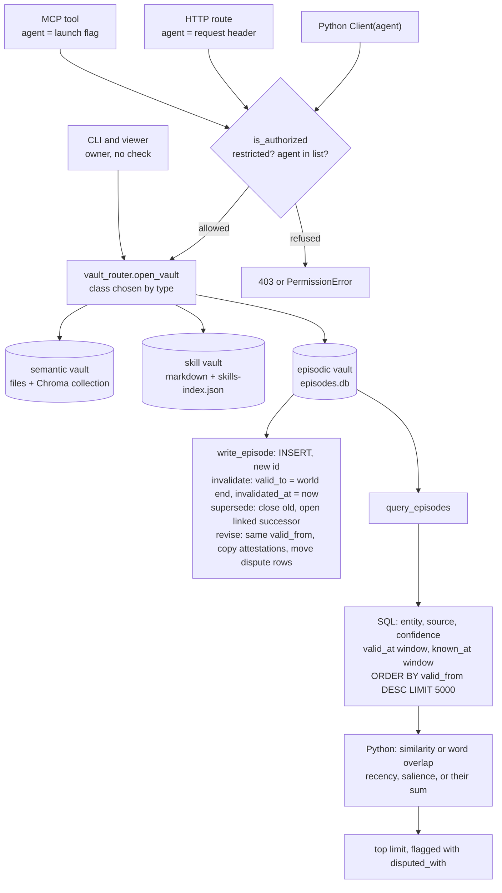

## 1. Executive Summary

CtxVault is a local memory layer in Python. Memory lives in *vaults*, each a
directory with one type. A semantic vault indexes documents into Chroma. A
skill vault holds markdown procedures. An episodic vault holds dated
statements in one SQLite file. A CLI, an HTTP API, an MCP server and a Python
client all call the same router.

The episodic vault is the part worth reading. Four things in it are built
with care.

- **Two time axes that move apart.** Each statement has a window in the
  world (`valid_from`, `valid_to`) and a window in the store (`recorded_at`,
  `invalidated_at`). A query takes `valid_at`, `known_at` or both.
- **An end is not a retraction.** Learning today that something ended in
  February leaves it open for any `known_at` before today. Only a *revision*
  retracts.
- **Revise and supersede are different verbs.** A supersession says the
  world changed. A revision says the wording improved, keeps the valid
  window and copies the re-assertions.
- **Impossible windows are refused.** An episode cannot be closed, superseded
  or confirmed at an instant before its own start.

Five things do not hold up.

- **Timestamps are text.** No write parses one. `2026-11-16T12:00:00+02:00`
  sorts after `10:30` UTC and the statement is hidden for two hours.
- **A revision rewrites the dispute record.** The dispute rows are moved to
  the new episode, so a past belief state shows the old pair undisputed.
- **Overwriting a document leaves old chunks.** `write_doc` upserts by chunk
  index and deletes nothing. A shorter rewrite keeps the old tail searchable.
- **One episode cannot be removed.** No statement deletes a row. The only
  removal is the whole vault.
- **The HTTP identity is a header.** Any caller can name any agent.

Marks held: `bitemporal`, `scope_enforced`, `negative_eval`. The licence is
MIT, in `LICENSE` and in `pyproject.toml`. No paper accompanies the project;
the README's citation block names the repository itself.

## 2. Mental Model

A vault is a folder plus one entry in a registry file. The entry holds the
type, the path, a `restricted` flag and a list of agent names. The type
decides which class opens the folder and which operations it accepts; an
episodic vault refuses file indexing and a semantic vault refuses episodes.

The three types share nothing below the router. They have separate stores,
separate write verbs and separate read verbs. The project's README frames
them after the semantic, procedural and episodic modules of
[CoALA](https://arxiv.org/abs/2309.02427).

An *episode* is one sentence the caller chose to record. The store never
merges two episodes and never compares their text. All structure comes from
the caller: which entities the sentence is about, when it started holding,
which earlier episode it replaces. The store's job is to keep the two
timelines consistent and to answer *what held at instant X, as far as the
vault knew at instant Y*.

Nothing runs between calls. There is no extraction pass, no consolidation
and no decay job.

## 3. Architecture

The code is small and layered. `core/vault_router.py` maps a vault name to a
class. `core/vaults/` holds the three classes. `storage/sqlite_store.py` is
the whole episodic engine in 978 lines, and `storage/chroma_store.py` is an
84-line wrapper over a Chroma collection.

### Deployment and ergonomics

Install is `pip install ctxvault`, or `uvx ctxvault mcp` from the committed
MCP registry manifest. The dependencies include `chromadb`,
`sentence-transformers` and `transformers`, so a first run downloads an
embedding model. The MCP server warms the model in the background and
refuses semantic calls until it is ready
(`src/ctxvault/mcp/server.py:47-72`).

An episodic vault needs none of that at query time unless it was created
with an embedding model. Without one, text relevance is word overlap.

The HTTP API is started with `uvicorn ctxvault.api.app:app`. The viewer runs
with `ctxvault ui` on loopback and can write the whole memory to one HTML
file.

## 4. Essential Implementation Paths

- **Episodic schema and migrations:**
  `src/ctxvault/storage/sqlite_store.py:39-114`, applied at `:141-171`.
- **Episode writers:** `write_episode` `:326-366`, `invalidate_episode`
  `:388-422`, `supersede_episode` `:424-492`, `revise_episode` `:494-571`,
  `confirm_episode` `:598-634`, `dispute_episodes` `:636-671`.
- **Episode readers:** `select_episodes` `:708-805`, `history` `:673-706`,
  `list_entities` `:807-861`, `count_episodes` `:903-930`.
- **Ranking:** `src/ctxvault/core/vaults/episodic.py:42-75` and `:321-397`.
- **Access check:** `src/ctxvault/utils/config.py:175-185`, called from
  `src/ctxvault/api/routes.py:11-14`, `src/ctxvault/mcp/server.py:82-84` and
  `src/ctxvault/client.py:92-99`.
- **Document path:** `src/ctxvault/core/vaults/semantic.py:33-42`, `:198-202`
  and `src/ctxvault/core/indexer.py:1-46`.
- **Skill path:** `src/ctxvault/core/vaults/skill.py:63-98`.
- **Viewer gate:** `src/ctxvault/ui/server.py:60-78`.

## 5. Memory Data Model

**Episodes.** One row per statement
(`src/ctxvault/storage/sqlite_store.py:45-62`): an id, `content`, a free-text
`source`, a `confidence` and a `salience` float, `occurred_at`, the four
window columns, `superseded_by`, `revised_by`, a recall counter, a JSON
`metadata` object and an optional float32 `embedding`.

Entities live in a side table keyed on the episode and the case-folded name
(`:69-74`). They are labels the caller passes. Nothing extracts them.

**Attestations.** `confirm_episode` inserts one row per re-assertion with a
time and a source (`:81-85`, `:629-632`). The count on an episode is derived
from those rows, and with `known_at` only rows up to that instant are
counted (`:212-227`). This is the one table in the store that only ever
receives inserts, apart from the copy a revision makes.

**Disputes.** A dispute is a row naming two open episodes (`:92-98`). It has
no status. The `disputed_with` field on an episode is computed on each read
from the other side's state (`:229-254`), so closing either side ends the
dispute without touching the row.

**Documents.** A semantic vault stores the file and one Chroma record per
chunk. The document id is the SHA-256 of the path string
(`src/ctxvault/core/identifiers.py:3-4`), and each chunk id is that id plus
a hash of the chunk index. Caller metadata is merged into every chunk's
metadata (`src/ctxvault/utils/metadata_builder.py:9-33`).

**Skills.** One markdown file with `name` and `description` frontmatter, and
a `skills-index.json` mapping the lower-cased name to the file
(`src/ctxvault/core/vaults/skill.py:84-98`).

## 6. Retrieval Mechanics

### Episodic

`select_episodes` builds a SQL filter and the vault class ranks the result.

The default filter is *holds now*: started, not ended, and not restated by a
revision (`src/ctxvault/storage/sqlite_store.py:747-754`). `valid_at` moves
the instant. `known_at` adds the transaction axis (`:739-745`, `:758-764`):

- a row must have been recorded by `known_at`;
- an end counts only if it was recorded by `known_at`, so a statement whose
  end the vault learned later is still open in that belief state;
- a revised original is excluded only if the revision was recorded by then.

Entity, source and minimum-confidence filters are SQL. Metadata equality and
the `disputed` filter run in Python afterwards (`:796-803`).

The SQL reads at most 5,000 rows, ordered by `valid_from` descending
(`:783-788`). Ranking happens after that cut. With `order_by="relevance"`,
a row older than the newest 5,000 matching rows is never scored, however
similar. The filters narrow the set first, so the limit bites on an
unfiltered text query over a large vault.

Each surviving row costs three more queries, for attestations, disputes and
entities (`:256-282`). Similarity is a Python cosine over every candidate
(`src/ctxvault/core/vaults/episodic.py:42-53`, `:363-369`).

Scores (`:371-384`):

- **relevance** — cosine against the stored vector, or the share of query
  words longer than two characters that appear in the content;
- **recency** — `0.5 ** (age / half_life)`, 30 days by default, measured
  from `valid_from` and not from when the vault recorded it;
- **salience** — the stored float;
- **composite** — the weighted sum of the three, weights 1.0 each.

The store has a recall counter. `mark_recalled` increments it and stamps
`last_recalled_at` when a query passes `reinforce` (`:394-395`,
`sqlite_store.py:573-585`). No ranking expression reads either column; the
CLI prints the count. The HTTP request model and the Python call carry
`reinforce`; the MCP tool does not.

### Semantic

The query is embedded with the vault's model and Chroma returns the nearest
chunks (`src/ctxvault/core/querying.py:55-59`,
`src/ctxvault/storage/chroma_store.py:59-66`). New collections use cosine
distance. The HTTP route passes a caller `filters` object straight to
Chroma's `where`; the MCP tool takes only a vault name and a query and
returns five chunks.

### Skill

`list_skills` returns names and descriptions from the index, and
`read_skill` returns the file body. There is no search. The MCP description
of `read_skill` tells the agent to follow the instructions it returns
(`src/ctxvault/mcp/server.py:174`).

## 7. Write Mechanics

**write_episode** inserts a row with a new UUID. `valid_from` falls back to
`occurred_at` and then to the recording time
(`src/ctxvault/storage/sqlite_store.py:359`). The MCP tool exposes
`valid_from` and `occurred_at` to the model and the CLI and HTTP route
expose `valid_to` as well, so the valid axis is a caller's statement about
the world and not a default.

**invalidate_episode** sets `valid_to` to the supplied world end or to now,
sets `invalidated_at` to now, and writes the reason into the row's metadata
(`:410-420`). An already closed episode is refused.

**supersede_episode** inserts the successor and closes the predecessor in
one transaction. The old `valid_to` equals the new `valid_from`
(`:466-490`), so one of the two holds at every instant. Entities and
salience carry over unless given.

**revise_episode** inserts a restatement with the original's `valid_from`,
copies its attestations, repoints its dispute rows, and closes the original
in transaction time only, leaving `valid_to` empty (`:537-569`).

**Documents.** `write_doc` writes the file and calls `index_file`
(`src/ctxvault/core/vaults/semantic.py:198-202`). `index_file` chunks,
embeds and upserts (`src/ctxvault/core/indexer.py:1-24`). It does not delete
the document's existing chunks. `reindex_file` does (`:33-46`), and so does
`sync_index` for a file whose modification time is newer than its index
time.

So an overwrite through `write_doc`, or `ctxvault index` on an edited file,
replaces chunks 0 to n-1 and leaves any chunk past the new length in the
collection. A three-chunk note rewritten as one chunk keeps its old second
and third chunks, which a query can still return and which
`get_document_content` appends to the rebuilt text. I read this from the
code and did not run it; the suite replaces Chroma with a mock, so no test
can observe it.

**Skills.** `write_skill` derives the file name from the skill name, writes
the file through a path check that refuses anything resolving outside the
vault (`src/ctxvault/core/vaults/base.py:101-119`), and updates the index.
Over MCP the default is no overwrite.

### Operational cost

No model call is made on any path except the local sentence-transformers
embedder. An episodic vault without an embedding model makes none. Query
cost in an episodic vault grows with the candidate set: up to 5,000 rows,
three extra queries each, and a Python cosine each when vectors exist.

## 8. Agent Integration

The MCP server registers 17 tools (`src/ctxvault/mcp/server.py:74-344`):
one status check, vault and document listing, semantic query and write,
three skill tools, and nine episodic tools covering write, query,
invalidate, supersede, revise, confirm, dispute, history and entity
listing.

The agent identity is the `--agent` argument of the server process (`:15-17`,
`:31`). Every tool that takes a vault name calls `check_access` with it.
The model cannot pass a different one. `source` on an episode defaults to
that identity and the model may override it with any string.

Nothing is injected into a prompt and nothing is captured automatically.
The tool descriptions carry the guidance: confirm instead of writing twice,
supersede when information contradicts, dispute when unsure which side is
wrong.

The Python `Client` takes the agent name in its constructor and applies the
same check when a vault is opened (`src/ctxvault/client.py:92-99`). Its
docstring states that the vault is built for one writing process.

## 9. Reliability, Safety, and Trust

### Timestamps are compared as text

Every time comparison is a string comparison in SQL or Python. The module
header says so and asks callers to use UTC
(`src/ctxvault/storage/sqlite_store.py:15-17`). Nothing enforces it. The
only `fromisoformat` calls in the package are on read paths: the recency
score, the document sync check and the viewer.

I re-derived three cases with the store's own schema and filter, written at
10:30 UTC:

| `valid_from` written | Instant it denotes | Returned by a default query at 10:30 UTC |
| --- | --- | --- |
| `2026-11-16T12:00:00+02:00` | 10:00 UTC | No, until 12:00 UTC |
| `2026-11-16T10:30:00Z` | 10:30 UTC | No, until the next second |
| `Q3 2026` | none | Never |

No error is raised in any of them. A negative offset fails the other way:
the statement appears early, and `_check_boundary` (`:375-386`) can refuse a
legitimate close. The MCP tool descriptions do not tell the model which
format to use.

### A revision rewrites the dispute record

`revise_episode` repoints dispute rows with two `UPDATE` statements
(`:561-562`). The attestations are copied; the disputes are moved.

- **Past belief states lose the dispute.** With a dispute noticed in
  February and one side revised in April, a query at `known_at` March
  returned both original statements with `disputed_with` empty. Before the
  revision the same query flagged both. The episode axis is reconstructable
  at that instant and the dispute axis is not.
- **The pair can be stored twice.** A dispute is inserted with its two ids
  sorted so that the primary key deduplicates it (`:659-669`). The repoint
  keeps column positions and breaks the ordering when the new id sorts on
  the other side of its counterpart. Recording the pair again then inserts
  a second row; the statistics counted two disputes and `disputed_with`
  lists the counterpart twice.

The committed test for this path asserts the present-time result only
(`tests/test_episodic.py:867-876`).

### Entity counts include revised originals

`list_entities` filters on the valid window alone
(`src/ctxvault/storage/sqlite_store.py:836-842`). A revised original keeps an
empty `valid_to`, so it is still counted. After one revision of a statement
about Anna, with one other open statement, a default query returned two
episodes and the entity listing reported three. The neighbouring
`_HOLDS_AT` condition (`:866`) carries the `revised_by IS NULL` clause that
this query lacks.

### Nothing removes one episode

No `DELETE` statement exists in the package. The schema declares
`ON DELETE CASCADE` on three tables and nothing triggers it. A statement
recorded by mistake, or one a person asks to have erased, can be closed and
hidden from default queries; its text stays readable through
`include_closed`, `history` and the viewer. The only removal is
`purge_vault`, which deletes the vault directory
(`src/ctxvault/utils/config.py:246-267`).

Closing is keyed on the row. Writing the same sentence again after an
invalidation inserts a new open episode, and nothing compares it with the
closed one.

### Access control

`is_authorized` returns true for a public vault and otherwise requires the
agent name to be on the list (`:175-185`). A restricted vault with no agent
name raises.

- **MCP:** the name is a process argument. This is the strong door.
- **HTTP:** the name is the `X-CtxVault-Agent` header
  (`src/ctxvault/api/routes.py:11-14`). There is no credential. A client
  that knows an attached agent's name reads that agent's vault, and
  `GET /ctxvault/vaults` returns every vault with its `allowed_agents`
  (`:104-107`).
- **`PUT /ctxvault/index`** calls no check (`:21-29`).
- **CLI and viewer** are owner surfaces and read restricted vaults whole.
  The viewer's router refuses a request from another host unless the server
  was started with an explicit `--host`
  (`src/ctxvault/ui/server.py:60-78`).

Attaching, detaching and publishing are CLI and Python calls with no gate;
no MCP tool or HTTP route changes the allowlist.

### Skills cross agents as instructions

An agent with access to a shared skill vault can write a skill, and another
agent attached to the same vault is told to follow it. No state separates a
person's skill from an agent's, and no step sits between the write and the
next read. The file is plain markdown on disk, so a person can inspect it
after the fact.

### Concurrency and recovery

One SQLite connection per file is cached in the process, with a process
lock around multi-statement writes (`sqlite_store.py:32-37`, `:173-203`).
Supersede and revise are single transactions. A file written by a newer
schema is refused (`:157-161`). A vault whose directory is missing is
reported as missing instead of being recreated empty
(`src/ctxvault/core/vault_router.py:37-44`).

The registry is a JSON file rewritten whole with no lock
(`src/ctxvault/utils/config.py:59-60`).

### Why four marks are withheld

- **`tombstone`:** a closed episode is a record keyed on a row. The same
  value written again is accepted.
- **`trust_state`:** `confidence` is a float used as an optional filter.
  `disputed_with` is derived on read and withholds nothing; both sides of a
  dispute are returned by default.
- **`audit_log`:** the history is carried by the window columns on the
  episode rows, which five statements update in place. A close records no
  actor. There is no separate event table of mutations, and a revision
  edits the dispute rows.
- **`human_review`:** no write waits on anyone. The viewer displays.

## 10. Tests, Evals, and Benchmarks

The suite has 116 test functions. `.github/workflows/test.yml` runs
`pytest`. I ran none of it.

**What the episodic tests cover.** `tests/test_episodic.py` holds 943 lines
against a real SQLite file. It asserts the valid axis and the transaction
axis separately (`:201-256`), the refusal of impossible windows
(`:104-127`), inheritance on supersede, attestation counts as of a past
`known_at` (`:492-508`), a v1 file migrating on open (`:748-796`) and a
newer file being refused (`:798-809`). The test at `:217-234` is the careful
one: it shows an end recorded later is not yet known in March and is not a
retraction in January.

**What they do not cover.** No test passes a timestamp with a non-UTC
offset. No test queries a dispute at a `known_at` before a revision. No test
counts entities after a revision.

**The semantic tests cannot fail on retrieval.** `tests/conftest.py:15-84`
replaces the embedder with a constant vector and Chroma with a mock whose
`query` returns one fixed chunk. The tests check wiring, error mapping and
chunking. The stale-chunk behaviour in section 7 is outside what they can
see.

**Access.** The refusal is asserted through the Python client
(`tests/test_client.py:36-61`). No test sends `X-CtxVault-Agent` to a
restricted vault and none calls the MCP `check_access`.

**Benchmarks.** `benchmarks/README.md` reports BEIR and CoIR retrieval
figures for the semantic pipeline against raw Chroma and a LangChain
retriever with the same embedding model, and concludes that the vault adds
no retrieval overhead. The three rows are within a fraction of a point of
each other, as they should be for the same index and model. Nothing in the
directory measures the episodic store, isolation or correction, and the
README lists those as planned. I did not run the scripts.

## 11. For Your Own Build

### Steal

- **Separate "it ended" from "we were wrong".** Supersede moves the valid
  window; revise moves only the transaction window. Two verbs keep an audit
  of the wrong wording without pretending the world changed.
- **An end recorded later is unknown earlier.** The `known_at` clause tests
  `invalidated_at > known_at` beside `valid_to`
  (`src/ctxvault/storage/sqlite_store.py:739-745`). It is one extra
  disjunct and it is what makes a past belief state correct.
- **Re-assertion as dated rows, not a counter.** A count can then be read
  as of any past instant.
- **Refuse impossible windows at the writer.** A close before the start
  would make a row invisible to every query without an error.
- **Bind agent identity at process launch.** The MCP server's name comes
  from its command line, so the model has no argument to forge.
- **Refuse a newer schema version.** An additive migration still bumps the
  version so an older build stops instead of ignoring tables.

### Avoid

- **Storing timestamps as unvalidated text.** Parse at the door and store
  one canonical form. The comparison is only as good as the least careful
  caller.
- **Moving history rows to a successor.** Copy them, as this store does for
  attestations, or key them on the chain. An `UPDATE` on a relation table
  breaks reconstruction on that relation.
- **Upsert without a delete on overwrite.** When chunk ids are positional,
  a shorter document leaves the old tail.
- **A row cap ordered by time in front of a relevance sort.** Either rank
  in the store or state the cap in the result.
- **A counter no ranking reads.** `recall_count` costs a write on each
  reinforced query and changes nothing.

### Fit

CtxVault fits a single developer or a small set of local agents that need
dated facts with correction history, and that can pass well-formed UTC
timestamps. The semantic and skill vaults are thin and conventional. It
does not fit a deployment where the HTTP API is reachable by an untrusted
caller, or one that must erase a single stored statement.

## 12. Open Questions

- Does any published client of the HTTP API authenticate the caller in
  front of the header, or is the header the intended boundary for a local
  port?
- Is the 5,000-row cap meant as a safety limit or as the working set? The
  docstring calls it the rows read before ranking.
- Is `recall_count` meant to feed the recency score? The docstring of
  `mark_recalled` says decay can favour recalled episodes, and no decay
  reads it.
- Should a past `known_at` show a dispute that a later revision inherited?
  The docstring of `revise_episode` says the original stays reconstructable
  at any `known_at` before the revision.

## Appendix: File Index

- **Router and registry:** `src/ctxvault/core/vault_router.py`,
  `src/ctxvault/utils/config.py`, `src/ctxvault/models/vaults.py`.
- **Episodic:** `src/ctxvault/storage/sqlite_store.py`,
  `src/ctxvault/core/vaults/episodic.py`, `src/ctxvault/models/episodes.py`.
- **Semantic:** `src/ctxvault/core/vaults/semantic.py`,
  `src/ctxvault/core/indexer.py`, `src/ctxvault/core/querying.py`,
  `src/ctxvault/storage/chroma_store.py`, `src/ctxvault/core/embedding.py`,
  `src/ctxvault/utils/chuncking.py`, `src/ctxvault/utils/metadata_builder.py`.
- **Skill:** `src/ctxvault/core/vaults/skill.py`,
  `src/ctxvault/core/vaults/base.py`.
- **Surfaces:** `src/ctxvault/mcp/server.py`, `src/ctxvault/api/routes.py`,
  `src/ctxvault/api/schemas.py`, `src/ctxvault/cli/app.py`,
  `src/ctxvault/client.py`, `src/ctxvault/ui/server.py`.
- **Tests:** `tests/test_episodic.py`, `tests/test_core.py`,
  `tests/test_api.py`, `tests/test_cli.py`, `tests/test_client.py`,
  `tests/test_mcp.py`, `tests/test_ui.py`, `tests/conftest.py`.
- **Benchmarks:** `benchmarks/README.md`, `benchmarks/retrieval/`,
  `benchmarks/internal/`.

### Recorded searches

Run with `/usr/bin/git grep` over the tree at
`d612d6e61b171307f31f05f3e00fc6a85442b3cc`.

- `git grep -n -i 'DELETE FROM' -- src` — no match.
- `git grep -n -i -E 'rmtree|\.unlink\(|delete_collection|collection\.delete' -- src` — four lines: the file unlink in `base.py:82`, the two Chroma deletes in `chroma_store.py:44` and `:70`, and the vault directory removal in `config.py:264`. None touches an episode row.
- `git grep -n -E 'UPDATE episodes|UPDATE episode_' -- src` — seven lines, all in `sqlite_store.py`: `:418`, `:488`, `:561`, `:562`, `:567`, `:583`, `:977`.
- `git grep -n 'fromisoformat' -- src` — three lines: `episodic.py:37`, `semantic.py:19`, `ui/server.py:91`. None is on a write path.
- `git grep -n 'revised_by IS NULL' -- src` — two lines, `sqlite_store.py:754` and `:866`. The entity listing at `:836-842` has neither.
- `git grep -n -E 'recall_count|last_recalled_at' -- src ':!src/ctxvault/ui/static'` — nine lines: the model fields, the columns, the row mapping, the update at `sqlite_store.py:583` and the CLI print at `cli/app.py:375-376`. No comparison or sort.
- `git grep -n -E 'delete_document\(|delete_file\(' -- src` — the callers are `indexer.py:45` (reindex), `semantic.py:138` (sync of a missing file) and `semantic.py:146` (delete). `index_file` and `write_doc` are not among them.
- `git grep -n -i -E 'WHERE content|content = \?|hashlib|fingerprint' -- src/ctxvault/storage src/ctxvault/core/vaults/episodic.py` — no match.
- `git grep -n -E 'X-CtxVault-Agent|check_access|check_vault_access' -- tests` — no match.
- `git grep -n -i -E 'approv|pending|quarantin|review' -- src ':!src/ctxvault/ui/static'` — four lines, all the word `preview` in `cli/app.py:89-92`.
- `git grep -n -i -E 'audit|event_log|changelog' -- src ':!src/ctxvault/ui/static'` — no match.
- `git grep -n 'reinforce' -- src/ctxvault/cli src/ctxvault/mcp docs` — no match.
- `git grep -n -i -E 'arxiv|bibtex|doi\.org|CITATION'` over the text files — the CoALA link in the README and the docs, and the README's `@software` block for the repository.

## History

**2026-11-16** — [`d612d6e61b171307f31f05f3e00fc6a85442b3cc`](https://github.com/Filippo-Venturini/ctxvault/commit/d612d6e61b171307f31f05f3e00fc6a85442b3cc) — first reading, at the head of `main`, dated 10 November 2026. Marks: `bitemporal` on the [two window pairs and the two query arguments](#episodic), `scope_enforced` on the [vault allowlist checked at each agent-facing door](#access-control), `negative_eval` on the [episodic absence assertions](#10-tests-evals-and-benchmarks). `tombstone`, `trust_state`, `audit_log` and `human_review` [withheld](#why-four-marks-are-withheld). Nothing from the tree was installed or run. The timestamp ordering, the dispute rewrite and the entity count were re-derived in a separate script that lifts the schema as text. The stale-chunk finding is from reading. The screen reported an MCP manifest that launches a package through `uvx`, a `pytest` collection hook, eight unpinned requirement files, and `pyproject.toml` changed inside the seven-day cooldown.
