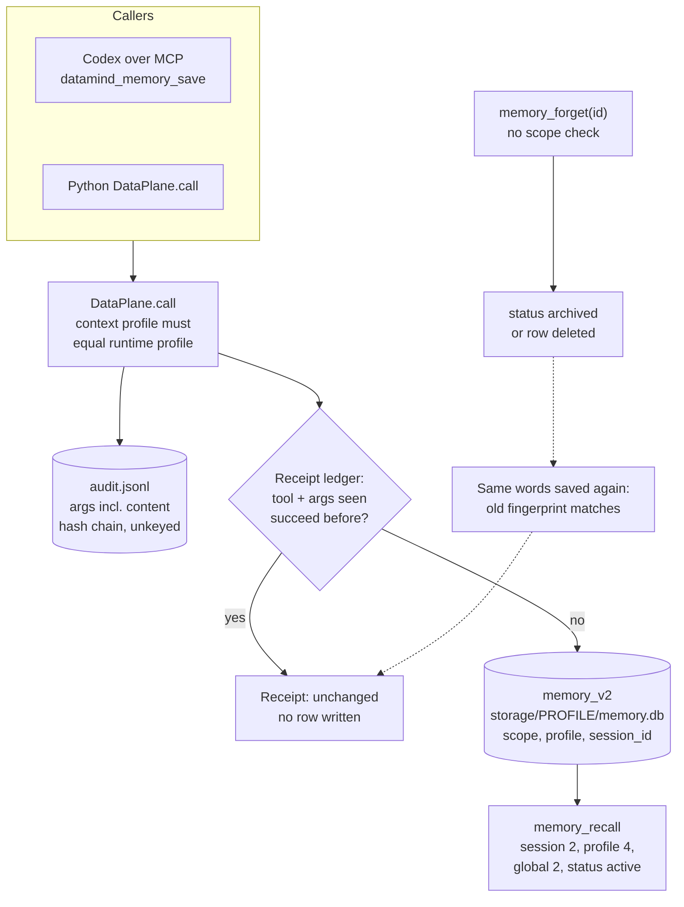

## 1. Executive Summary

DataMind is a data layer for Codex. A Codex plugin, the official Codex SDK and
a FastAPI server all reach one set of tools over a stdio MCP server, covering
five surfaces: a document KB, SQL, a graph, procedural Skills and Memory.
Memory is the one surface that is agent memory: free-text facts a later
session recalls under a profile or session key. What is notable is that every
memory write passes through a write-receipt ledger and a hash-chained audit
file. What is weak is that the same ledger silently refuses to store a fact
whose words and arguments it has seen succeed before.

The memory store is one SQLite table, `memory_v2`, with a scope of
`global`, `profile` or `session` on every row. Recall unions up to two session,
four profile and two global rows. Over MCP it scores them by substring
matching, because the memory call builds a runtime with no embedder.

The dedupe is the finding to read first. The ledger fingerprints the tool
name and its arguments, and the session a `session`-scoped save lands in comes
from context, not arguments. A second session saving the same sentence gets a
receipt saying `unchanged` and no row. A fact forgotten and saved again in the
same words is not saved either.

**Licence.** Apache-2.0, and the `LICENSE` file, `pyproject.toml` and the Codex
plugin manifest agree. The licence file carries no additions. Nothing restricts
use; the unpinned dependency surfaces the screen reported are an operational
caveat, not a licence one.

Three marks are earned: `scope_enforced` and `negative_eval` on the memory
store, and `audit_log` on the data plane's audit file and receipt ledger.
Section 9 gives the reasons for the four withheld.

## 2. Mental Model

A memory is **a sentence with a scope**. The model calls `memory_save` with
text, a scope and a kind; the row is active and recallable the moment the
insert commits. Nothing scores it, reviews it or links it to a source.

It stops being recalled one way: `memory_forget` with its id. A soft forget
sets `status='archived'` and every recall excludes it. A hard forget deletes
the row (`datamind/capabilities/memory/providers/sqlite_store.py:384-399`).
There is no edit and no supersession.

The scope decides who sees it:

- **session** — recalled only when the caller's session id matches.
- **profile** — recalled within one profile, which is also, by default, one
  file on disk.
- **global** — recalled by every caller of the same file. With the default
  layout that is every session of one profile, not every profile.

Between the tool and the table sits the receipt ledger, which belongs to the
data plane rather than to memory. It turns a repeat of a call that once
succeeded into a no-op, and that is where a forgotten fact meets its old
fingerprint.

## 3. Architecture

The installed package `datamind` is the product. `python -m datamind.mcp` is a
stdio MCP server whose tools are the data plane's direct tools, each prefixed
`datamind_` and each requiring an `operation_id` from
`datamind_operation_begin` (`datamind/mcp.py:35-58`). The Codex plugin under
`plugins/datamind-context/` launches that server. `CodexSession` and
`CodexHost` start Codex through the official SDK with the same server as a
subprocess, bound by environment to one profile and one session
(`datamind/codex.py:12-41`, `datamind/host.py:44-51`).

Each MCP call builds a fresh data plane for the one surface it touches and
closes it after the call (`datamind/mcp.py:160-171`). Storage is files under
`storage/<profile>/`: `memory.db`, `audit.jsonl`, `ingest_ledger.sqlite3`,
`ingest_receipts.jsonl` and `operations.sqlite3`
(`datamind/config.py:171-173`, `datamind/capabilities/memory/service.py:182-183`).

The root also holds a LlamaIndex-based runtime under `modules/` and `core/`,
whose `create_memory` wraps LlamaIndex's chat memory. Nothing in the
`datamind` package imports it and the wheel excludes it
(`pyproject.toml:113-116`). This report reads the `datamind` package.

### Deployment and ergonomics

`pip install -e .` and `./scripts/install_codex_plugin.sh` give a local Codex
a working memory with no model key, because memory needs no embedder on this
path. An operator who wants a shared deployment runs the FastAPI server or the
SDK host and is told, in `docs/SECURITY_BOUNDARIES.md`, to put authentication
and per-tenant authorization in front of it. CORS is `*` by default
(`datamind/server.py:65-70`).

## 4. Essential Implementation Paths

- **Store.** `datamind/capabilities/memory/providers/sqlite_store.py`: schema
  `:136-170`, legacy migration `:172-228`, `save` `:232-278`, `recall`
  `:282-380`, `forget` `:384-399`, slice query and scoring `:447-510`.
- **Service and tools.** `datamind/capabilities/memory/service.py:68-158`;
  `datamind/capabilities/memory/tools.py:22-190`.
- **Runtime assembly.** `datamind/runtime.py:32-46` (hooks), `:49-143`
  (services, receipt wrapping, direct tool set).
- **Dispatch.** `datamind/data_plane.py:49-86`; MCP wrapper
  `datamind/mcp.py:61-190`; operations `datamind/operations.py:40-64`.
- **Receipts.** `datamind/capabilities/ingest/ledger.py:47-97` (source
  identity), `:162-174` (append), `:182-289` (dedupe and execute),
  `:293-320` (wrapper).
- **Audit.** `datamind/capabilities/hooks/audit.py:156-249`.

## 5. Memory Data Model

`memory_v2` holds `id`, `scope` under a `CHECK`, `profile`, `session_id`,
`kind`, `status`, `content`, `metadata` as JSON, `embedding` as packed
float32, `created_at`, `updated_at` and `archived_at`
(`sqlite_store.py:140-153`). Three partial indexes cover the active rows of
each scope (`:158-169`).

`save` stores the profile only for profile scope and the session only for
session scope, so a row carries exactly one key or none (`:262-268`).
`kind` is one of six values the tool schema lists and is used only as an
optional recall filter. `status` has two values in practice: `active`, set on
insert, and `archived`, set by a soft forget.

A legacy `memory` table with a `namespace` column is copied into
`memory_v2` on first open, every row as profile scope under its old namespace,
and then dropped (`:172-228`). A namespace such as `session:s1` therefore
becomes a profile named `session:s1`, which the migration test asserts
(`datamind/tests/test_memory.py:220-258`).

## 6. Retrieval Mechanics

`memory_recall` is a tool the model calls. Nothing injects memory into a
prompt; the plugin's Skill and the server instructions name the tool and
leave the choice to Codex.

Recall runs up to three SQL slices, one per scope, each selecting every active
row of that scope and key (`sqlite_store.py:341-375`). Each slice is scored in
Python and cut to its budget: two session rows, four profile rows, two global
rows. The union is sorted by score, ties broken session before profile before
global, and cut to `top_k` (`:377-380`). A caller can narrow the scopes with
`scope_filter` and the kinds with `kinds`.

Scoring depends on whether the runtime has an embedder. With one, it is
cosine between the query vector and each row's stored vector, and a row saved
without a vector scores zero (`:481-493`). Without one, it is the fraction of
whitespace-separated query words that occur as substrings of the row
(`:495-510`).

The MCP path has no embedder. A memory call builds a data plane with only
the memory surface enabled, the embedder is built only when `kb` is enabled,
and the memory service is built with `auto_embedding=False`
(`datamind/runtime.py:60-81`, `datamind/mcp.py:160-167`). Codex therefore
recalls by substring, and rows it saves carry no vector. The FastAPI server's
read-only `/api/memory/{namespace}` peek builds with `kb` when an embedding key
is set, and then scores every Codex-saved row zero
(`datamind/server.py:43-46`, `:323-341`).

Two consequences of the scoring. There is no minimum score, so each slice
returns its full budget whether or not a row matched. And a query with no
spaces, which is how Chinese is written, is one term, matched only when the
whole query appears in the row; the UI's own suggested prompt is Chinese
(`datamind/static/app.html:868`). The slice query has no `ORDER BY`, so rows
that tie at zero come back in whatever order SQLite scans them.

## 7. Write Mechanics

**The model writes.** `memory_save` takes content, scope, kind and
metadata, and over MCP may also take a `session_id`
(`datamind/capabilities/memory/tools.py:40-59`, `:96-128`). Profile and
session default to the request context. The insert is synchronous, and the
row is recallable when it commits. On the MCP path no embedding call precedes
it.

**The receipt ledger decides first.** Every write tool with a surface is
wrapped by `with_receipts`, memory tools included
(`datamind/runtime.py:132-136`, `datamind/capabilities/ingest/ledger.py:293-320`).
The wrapper binds the handler's defaults and fingerprints the tool name, the
arguments and a hash of the content (`ledger.py:86-88`, `:191-199`). If that
fingerprint has a successful receipt, the call returns a receipt with status
`unchanged` and `duplicate_of`, and the handler does not run
(`:221-237`). The list of tools exempt from this, because they replace rather
than append, names KB, graph, DB and workspace tools and no memory tool
(`:216-220`).

Two cases follow, both inferred from the code and not run:

- **A fact forgotten and saved again.** `memory_forget` archives or deletes
  the row; the successful fingerprint of the original save stays in the
  ledger's `successful` table. The same `memory_save` call returns
  `unchanged`, and the fact stays forgotten.
- **The same session fact in two sessions.** The session id of a
  `session`-scoped save comes from context and is not an argument, so the
  fingerprint is the same in every session. The second session's save writes
  nothing, and its recall does not see the first session's row.

A model reading the receipt sees `unchanged` where it asked for a write.
`test_store_tool_emits_receipt_and_deduplicates` asserts the dedupe for a
`memory_save` stub: two identical calls, one handler invocation, the second
receipt `unchanged` (`datamind/tests/test_two_agent_data_plane.py:30-62`).

**Extraction is unwired.** `MemoryService.extract_and_save` asks the
fallback model for durable facts in a turn and saves each as session scope
with `_source: auto_extracted` (`datamind/capabilities/memory/service.py:126-158`).
Its only caller is `datamind/scripts/hello_memory.py`, and on every runtime
path the service gets no text client and returns an empty list. The
short-term rolling window beside it has the same single caller.

### Operational cost

A write blocks on one SQLite insert, one ledger transaction and two file
appends. Each MCP call also builds and closes a data plane. No background pass
reads or rewrites memory.

## 8. Agent Integration

Codex is the only agent the product assembles. Over MCP it gets
`datamind_memory_save`, `datamind_memory_recall` and `datamind_memory_forget`;
`memory_list_profiles` is defined and left out of the direct tool set
(`datamind/direct_tools.py:13-19`). A read-mode operation refuses the two
writes (`datamind/mcp.py:144-145`).

Memory is outside the workspace snapshot that the KB, SQL and graph surfaces
publish and pin. A pinned read operation still reads live memory
(`datamind/mcp.py:146-148`). The README states this.

Identity comes from the host. `sdk_config` sets `DATAMIND_PROFILE`, and
`CodexHost` sets `DATAMIND_SESSION_ID`, request id and access mode per request
and refuses a runtime environment that overrides them
(`datamind/codex.py:23-31`, `datamind/host.py:44-53`). With the local plugin
nothing binds either, and each `datamind_operation_begin` without a
`session_id` creates a fresh random session (`datamind/operations.py:40-50`).
A session-scoped memory then lasts one operation unless Codex passes the
session id along.

## 9. Reliability, Safety, and Trust

### The ledger drops writes it has seen

Section 7 has the mechanism. The design reason is sound for imports, where a
retried call should not append twice. It is wrong for memory, whose writes are
not idempotent in the store's own terms: the row a fingerprint vouches for may
have been forgotten, or may live in another session. The fix is either to
exempt `memory_save` as replacement tools are exempted, or to put the context
session and the current row's existence into the fingerprint.

### Scope

The scope keys are applied in SQL on every recall slice
(`sqlite_store.py:341-375`, `:460-471`). Who supplies them differs by key and
by path:

- **Profile over MCP** is server-resolved. The wrapper adds `profile` to every
  tool schema, pops it before dispatch to choose the runtime's storage
  directory, and raises when `DATAMIND_PROFILE` binds another
  (`datamind/mcp.py:51-54`, `:61-70`, `:79`). The tool's own `profile` override
  never reaches it. `DataPlane.call` refuses a context whose profile differs
  from the runtime's (`datamind/data_plane.py:54-56`).
- **Profile from Python** is a tool argument. `memory_save` and
  `memory_recall` accept `profile` and use it ahead of the context
  (`tools.py:49`, `:72`). The tool description says to pass it *"only when you
  need to cross boundaries on purpose"*.
- **Session** is a tool argument on every path. `memory_recall` takes
  `session_id` and uses it ahead of the context, and the MCP bound-session
  check compares the operation's session, not the argument
  (`tools.py:73`, `datamind/mcp.py:130-132`). A model that knows another
  session's id reads that session's memories.

By default each profile has its own `memory.db`, so the profile predicate runs
inside a file that holds one profile. Set `memory.dsn` and every profile
shares one file, where the predicate is the boundary; the tests exercise that
layout. `global` rows follow the file, so the tool's *"system-wide"* means one
profile in the default layout.

`memory_forget` deletes or archives by id with no scope predicate
(`sqlite_store.py:388-396`). Any id in the file can be forgotten from any
session.

### The audit keeps what forget removes

`AuditLogHook` writes one record per call through `DataPlane.call` with the
redacted arguments, the session, the profile, a hash of the result and the
previous record's hash (`datamind/capabilities/hooks/audit.py:156-205`). It is
on by default (`datamind/config.py:250-253`). A `memory_save` record holds the
content in full, and a hard `memory_forget` leaves it there. The record of a
save holds the result's hash and not the new id; the receipt holds the id.

The chain hash is an unkeyed SHA-256 truncated to 16 hex characters
(`audit.py:56`, `:68-69`). A writer who rewrites a record can recompute every
later hash, and deleting the newest records leaves a valid chain;
`verify_audit_log` checks only links and recomputed hashes (`:211-249`). The
committed tamper test edits one field and keeps its stale hash
(`datamind/tests/test_hooks.py:403-420`).

Each MCP call constructs a new hook, which reads the file's last hash and
appends under an in-process lock (`audit.py:190-205`). Two MCP subprocesses on
one profile, which the SDK host allows with a default concurrency of four
(`datamind/config.py:74`), can read the same tail and append two records
naming one predecessor. That breaks verification from the second record on.
This is inferred from the code and was not run; the receipt ledger takes an
`IMMEDIATE` SQLite transaction and is not exposed to it.

### Marks

- **`scope_enforced` — earned.** Session and profile keys are stored on each
  row and applied as SQL predicates on every recall slice. The session key is
  a model-suppliable argument, and the profile key is also, by default, a
  per-profile file.
- **`audit_log` — earned.** `audit.jsonl` and the receipt ledger are
  append-only records of every memory save and forget in the system's own
  store, with producers on the MCP path. The audit chain is unkeyed and can
  fork under concurrent MCP processes.
- **`negative_eval` — earned.** Three committed cases require another
  profile's or another session's row to be absent from a populated recall,
  beside rows that must be present.
- **`trust_state` — withheld.** `status` is `active` or `archived` and records
  deletion. No value marks a fact as doubted, and no producer exists for any
  other value.
- **`tombstone` — withheld.** The ledger's `successful` index does block a
  forgotten fact from being saved again in the same words. It is keyed on the
  call that succeeded, not on a rejected value, it blocks legitimate re-saves
  equally, and a save with any argument changed, a different kind for
  instance, walks past it.
- **`bitemporal` — withheld.** `created_at`, `updated_at` and `archived_at`
  are record times.
- **`human_review` — withheld.** A memory is recallable on insert. The UI's
  memory panel is a read-only peek, and any approval of a tool call happens in
  the Codex client, outside this tree.

## 10. Tests, Evals, and Benchmarks

I ran none of the suites. The counts are from reading.

`datamind/tests/test_memory.py` has 19 test functions, one parametrized over
six scope filters. The negative cases are populated:

- `test_scope_isolation_profile_to_profile` stores one row per profile in one
  file and requires `len == 1` and the right content for each, so it fails if
  the profile predicate is dropped (`:84-95`).
- `test_recall_unions_all_three_scopes` stores five rows, requires three and
  excludes session-Y and profile-B (`:124-140`).
- `test_session_scope_isolated_within_profile` requires one session's row and
  excludes the other's (`:112-121`).

`test_soft_delete_archives_and_hides_from_recall` checks the forgotten row is
absent with `not any(...)` over a recall that, with that row archived, has
nothing else to return. That assertion would pass on an empty result; the
`count` assertions after it carry the case (`:163-181`).

No test saves, forgets and saves the same fact, or saves one session fact
from two sessions. No test calls `memory_forget` on an id outside the caller's
scope, and none runs recall over MCP and checks the scoring.

The audit hook has eight tests: record shape, three on redaction, a denied
decision, a clean chain, one tampered field and a resumed chain
(`datamind/tests/test_hooks.py:284-437`). None runs two writers.

`benchmark/` runs dataset-neutral question sets through the Codex host and
fault experiments on workspace builds. No file in it names memory. There is no paper reference in the
tree, and a web search for the project and organisation names found no paper
about this system.

## 11. For Your Own Build

### Steal

- **A scope column with a `CHECK` and one key per scope.** `save` stores the
  profile only for profile scope and the session only for session scope, so a
  row cannot belong to two boundaries.
- **A per-scope recall budget.** Two session, four profile, two global keeps a
  pile of global preferences from crowding out the current conversation.
- **Bind identity in the transport, not the prompt.** The MCP wrapper consumes
  `profile` before the tool sees it and refuses a mismatch with the host's
  binding.
- **A receipt for every write**, including the failed and the unchanged ones,
  so the agent can tell a write that happened from one that did not.

### Avoid

- **Idempotency keys that omit the scope from context.** The fingerprint must
  include every input that decides where a write lands.
- **Dedupe that outlives deletion.** A success index that does not learn about
  a forget turns "remember this again" into a silent no-op.
- **Audit records that keep what erasure removes**, with no redaction path for
  them.
- **A scoring arm the main path never runs.** Codex's recall is substring-only
  while the server's peek scores by vector, and each scores the other's rows
  differently.
- **Delete by id without the caller's scope.**

### Fit

This suits a team already running Codex who want its KB, SQL, graph, Skills
and a small preferences store behind one MCP server, with receipts and an
audit file they can read. For them memory is the least of the five surfaces,
and it is enough for a few dozen stable preferences per profile.

It does not suit anyone whose memory must be corrected. The one correction
verb is forget, the ledger prevents restating a forgotten fact in the same
words, and forgotten text stays in the audit file. A reader who needs recall
over many facts, or in a language written without spaces, will find the MCP
path's substring scoring the limit.

## 12. Open Questions

- Is the receipt dedupe on `memory_save` intended? The replacement list names
  every graph and KB writer and no memory tool.
- Is `memory.dsn` with a shared file a supported deployment, given that
  `docs/SECURITY_BOUNDARIES.md` asks for a separate profile and database per
  trust boundary?
- Should Codex pass a stable `session_id` to `datamind_operation_begin` in the
  local plugin, so that session-scoped memory outlives one operation?

## Appendix: File Index

| Path | Role |
| --- | --- |
| `datamind/capabilities/memory/providers/sqlite_store.py` | Schema, migration, save, scoped recall, forget, scoring |
| `datamind/capabilities/memory/service.py` | Service, unwired fact extraction, store construction |
| `datamind/capabilities/memory/tools.py` | The four memory tools and their context defaults |
| `datamind/capabilities/memory/extractor.py` | The fact-extraction prompt |
| `datamind/runtime.py` | Data-plane assembly, hooks, receipt wrapping |
| `datamind/data_plane.py` | `DataPlane.call`: profile check, schema validation, hooks |
| `datamind/mcp.py` | The stdio MCP server, profile binding, operations |
| `datamind/operations.py` | Operation tokens and their sessions |
| `datamind/capabilities/ingest/ledger.py` | Receipt ledger and fingerprint dedupe |
| `datamind/capabilities/hooks/audit.py` | Hash-chained audit file and verifier |
| `datamind/server.py` | FastAPI host and the read-only memory peek |
| `datamind/tests/test_memory.py` | Scope, deletion and migration tests |
| `datamind/tests/test_two_agent_data_plane.py` | Receipt dedupe and context binding tests |
| `datamind/tests/test_hooks.py` | Audit chain tests |

### Recorded searches

Run from the repository root at the pinned commit with `/usr/bin/git grep`.

- **Fact extraction and the short-term window have one caller.**
  `git grep -n -E 'append_turn|recent_turns|extract_facts|extract_and_save' -- '*.py'`
  returns the definitions, `datamind/scripts/hello_memory.py` and
  `datamind/tests/test_memory.py`.
- **No memory tool is exempt from the dedupe.**
  `git grep -n -E 'memory_' -- datamind/capabilities/ingest/ledger.py`
  returns only `:86`, the source-identity branch; the replacement set is at
  `:216-220`.
- **Recall slices have no ORDER BY.**
  `git grep -n 'ORDER BY' -- datamind/capabilities/memory` returns only
  `list_profiles` at `sqlite_store.py:409`.
- **No minimum score.**
  `git grep -n -i -E 'min_score|threshold|min_sim' -- datamind/capabilities/memory`
  returns one word in the extraction prompt; `git grep -n 'top_k' -- datamind/capabilities/memory/providers/sqlite_store.py`
  matches.
- **No rejected value, review state or validity time on memory.**
  `git grep -n -i -E 'tombstone|rejected|blocklist|suppress' -- datamind/capabilities/memory datamind/capabilities/ingest/ledger.py`
  and `git grep -n -i -E 'approve|pending|review' -- datamind/capabilities/memory`
  return nothing; `git grep -n -i 'archived' -- datamind/capabilities/memory`
  matches. `git grep -n -i -E 'valid_from|valid_to|valid_at|valid_until' -- datamind`
  returns two substrings of `invalid_token` and a test named `..._is_valid_...`.
- **Every read of status keeps active rows.**
  `git grep -n -E 'status' -- datamind/capabilities/memory` returns the schema,
  the indexes, the archive update, `status='active'` in `count`, `list_profiles`
  and the slice query, and the row mapper.
- **Forget has no scope predicate; the only deletes.**
  `git grep -n -E 'DELETE FROM|UPDATE memory_v2' -- datamind/capabilities/memory`
  returns `sqlite_store.py:390` and `:393`.
- **No file lock on the audit file or the memory store.**
  `git grep -n -i -E 'filelock|FileLock' -- datamind/capabilities/hooks datamind/capabilities/memory`
  returns nothing; the same pattern matches `datamind/operations.py`.
- **No paper reference.**
  `git grep -n -i -E 'arxiv|bibtex|doi\.org|CITATION|@article|@misc' -- .`
  returns two lines of a Skill using the word "citations".
- **The benchmark does not touch memory.**
  `git grep -n -i 'memory' -- benchmark benchmark.py` returns nothing;
  `git grep -n -i -E 'kb_|graph_|db_' -- benchmark` matches.
- **No submodules.** `.gitmodules` is absent.

## History

**2026-11-24** — [`36e189d69e207d57410803c93c6d0a950be68921`](https://github.com/OpenDCAI/DataMind/commit/36e189d69e207d57410803c93c6d0a950be68921). First reading at `36e189d`, read only, from a full clone at the head of `main`. Screened first: four files scanned, no auto-run surface, nothing inside the seven-day cooldown, no build-time execution; `pyproject.toml` declares dependencies with no lockfile and `requirements-legacy.txt` has 14 unpinned requirements. Docs, Skills and prompts were read as data. Nothing was installed, built or run, and the 391 test functions were not run. Three marks: `scope_enforced`, `audit_log` and `negative_eval` ([section 9](#9-reliability-safety-and-trust)). The receipt ledger drops a memory save whose arguments succeeded before, forget checks no scope, and MCP recall is substring-only.
