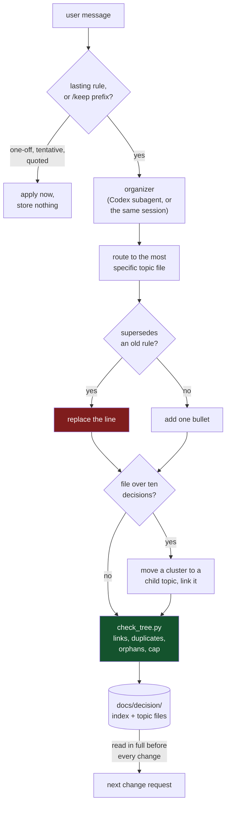

## 1. Executive Summary

Decision Keeper is a skill for Codex and Claude Code, with an installer, that
has the coding agent write down a project's lasting decisions. A decision is one
markdown bullet. The bullets live in a tree of files under `docs/decision/`, and
an instruction block in the project's `AGENTS.md` or `CLAUDE.md` tells the agent
to read the tree before every change.

It carries no capability mark. There is no store, no index and no retrieval:
the memory is the files, and the mechanism is 38 lines of skill prose plus two
Python scripts. One script installs and upgrades the skill. The other checks
the tree's shape after a write.

**Licence.** MIT, with no rider. The copyright line names *Decision Keeper
contributors*.

The part worth reading is the shape rule. No file may hold more than ten
decisions; past ten, the organizer moves related rules into a child topic and
links it from the parent, recursively
(`.agents/skills/decision-keeper/references/organizer.md:7`). The index
therefore stays short enough to read whole on every change, which is the only
retrieval the design has.

The limit is what holds the rule up. `check_tree.py` verifies links, duplicate
bullets, orphan files and the ten-bullet cap, and exits non-zero on any
failure. Nothing runs it but the agent, on an instruction in the organizer
procedure (`organizer.md:9`). No hook, no CI job and no git check calls it.

Supersession is replacement. The organizer keeps *only active policy*
(`organizer.md:6`), so a changed rule overwrites the old line and a dropped rule
is deleted. The tree cannot say what a rule used to be or that one was removed;
the project's own git history is the only record, where the project commits the
directory.

## 2. Mental Model

A project has one decision tree and one writer at a time.



Red is where history is lost. Green is the one deterministic step, and the
agent decides whether it runs.

## 3. Architecture

Nine tracked files. `SKILL.md` at the root and
`.agents/skills/decision-keeper/SKILL.md` are byte-identical.

| File | Lines | Role |
| --- | --- | --- |
| `SKILL.md` | 27 | When to record, how to apply, the `/keep` commands |
| `references/organizer.md` | 11 | The write procedure: routing, supersession, splitting, layout, verification |
| `scripts/check_tree.py` | 94 | Shape checker for the tree |
| `install.py` | 312 | Installer, upgrader and legacy migration |
| `.codex/agents/decision_keeper_organizer.toml` | 5 | The Codex subagent that owns a write |

### Deployment and ergonomics

`python3 install.py --client codex <project>` copies the skill into the project
and appends a block between `<!-- decision-keeper:begin -->` and
`<!-- decision-keeper:end -->` to the instruction file. It needs Python 3.9 and
an instruction file that already exists (`install.py:212-213`).

The installer is the most careful code in the tree:

- It refuses the filesystem root, the home directory, and any directory that is
  not the top level of its git repository (`install.py:175-183`).
- It rejects a symlink anywhere on the path of a file it would write
  (`:122-127`).
- It overwrites an installed skill file only when the file's SHA-256 matches a
  release it knows; a customised file stops the install (`:253-273`).
- It refuses when a non-empty `AGENTS.override.md` would take precedence over
  the file it edits (`:208-209`), and when the edit would push `AGENTS.md` past
  32 KiB (`:286-287`).
- It creates migrated files with mode `xb`, so an existing file is never
  replaced (`:294`).

The writes are sequential with no rollback (`:289-299`): skill files, migrated
decision files, the instruction file, then the deletions. An error part-way
leaves the earlier steps in place.

One argument does nothing. The positional `evidence` path is checked for
existence, location and size (`:236-249`) and is not read or stored afterwards;
the README does not mention it.

## 4. Essential Implementation Paths

| Path | Location |
| --- | --- |
| The standing instruction to read the tree | `install.py:20` |
| What counts as a decision, and what does not | `SKILL.md:10` |
| Apply at the narrowest scope; the current instruction wins | `SKILL.md:11` |
| Single writer and the Codex handoff | `SKILL.md:12` |
| Active policy only; one bullet per line | `references/organizer.md:6` |
| The ten-decision cap and recursive split | `references/organizer.md:7` |
| File and folder layout, link format | `references/organizer.md:8` |
| Before-and-after comparison of rules | `references/organizer.md:9` |
| Decision versus link, duplicate detection | `scripts/check_tree.py:44-57` |
| Link target and layout validation | `scripts/check_tree.py:59-77` |
| Orphan detection | `scripts/check_tree.py:82-84` |
| Legacy tree migration | `install.py:130-170` |

## 5. Memory Data Model

The unit is a line of text:

```text
- Use a solid fill for primary buttons.
- [Dates](decision-dates.md) — How the app presents dates and times.
```

The first is a decision. The second is a topic link, told apart by the `- [`
prefix (`check_tree.py:48`). A decision carries no id, date, author, source
turn or status. Its identity is its exact text: the checker's duplicate test is
a dictionary keyed on the stripped line (`:50-56`), so two wordings of one rule
are two rules.

Manual entries add one marker. Text recorded with `/keep` that does not state a
lasting rule is prefixed `Note: ` *"so it can be read as a record"*
(`organizer.md:11`). Nothing in either script reads the prefix; it is a
convention for the agent.

The tree has a fixed layout. Top-level topics sit beside the index. A deeper
parent `decision-delivery.md` keeps its children in a sibling folder
`delivery/`, at every depth (`organizer.md:8`). The checker enforces it: a link
must resolve to a `decision-*.md` file in exactly the expected child directory
(`check_tree.py:71-74`), and a file linked twice is an error (`:69-70`).

## 6. Retrieval Mechanics

There is no query. The instruction block reads, in part: read
`docs/decision/decision-keeper.md` in full, follow relevant links recursively,
and read the files fresh for each change request (`install.py:20`).

So recall is the agent reading an index of at most ten decisions and some
topic links, then choosing which links to open by their one-line descriptions.
The cap bounds what one read costs. It does not bound the tree: a project with
many decisions has a deep tree, and whether a relevant rule three levels down
is opened depends on the descriptions along the path.

Precedence is stated in prose. The user's current instruction beats a recorded
default, and a one-off exception is applied without changing the rules
(`SKILL.md:11`, `:19`).

## 7. Write Mechanics

The agent decides what to record. The skill asks for a clear, lasting rule the
user confirms, or a reusable correction, and names what to skip: ordinary task
requirements, tentative ideas, vague feedback, quoted examples and explicit
one-off exceptions. Secrets, personal data and transcripts are to be left out
(`SKILL.md:10`).

Two prefixes bypass the judgement. `/keep <text>` records the text and replies
with the location; `/keep and go <text>` records it and then handles it as a
request (`SKILL.md:24-27`).

The organizer then does five things (`organizer.md:5-9`):

1. Route each decision to the most specific existing topic, or keep a new
   standalone one in the index.
2. Replace superseded rules and keep conditions and exceptions that still
   apply. An ambiguous new policy is reported and the old one left intact.
3. Split any file over ten decisions into child topics, recursively.
4. Place files by the layout rule, children before parent links.
5. Run the checker and compare the rules before and after: moved decisions
   still reachable, new ones present once, unrelated ones preserved.

Step 5's comparison is the agent's own; the checker knows nothing about the
previous state of the tree.

### Operational cost

No model call beyond the session's own, no service and no dependency past the
standard library. On Codex a write hands off to a subagent, which is a second
context reading the same files.

## 8. Agent Integration

Two hosts. For Codex the skill lands in `.agents/skills/decision-keeper/` with
a subagent definition in `.codex/agents/`; for Claude Code it lands in
`.claude/skills/decision-keeper/` and the organizer runs in the session
(`SKILL.md:12`). Both hosts share one `docs/decision/` tree when both are
installed.

The instruction block is what makes the skill fire. It tells the agent to
follow the skill *"even if the client did not select it automatically"*
(`install.py:21`), which covers a host whose skill matcher does not trigger.

## 9. Reliability, Safety, and Trust

### The checker sees only one bullet form

`check_tree.py` considers a line only when it starts with `- ` at column zero
(`:45`). An indented bullet, a `* ` bullet and a numbered item are invisible to
it. They do not count toward the cap, are not checked as duplicates, and a link
written in one of those forms is not followed, so its target is reported as an
orphan instead.

A decision whose text begins with `[` is read as a malformed link and fails the
check (`:59-62`). The organizer procedure covers this by asking the agent to
escape the bracket (`organizer.md:11`).

### Nothing records a removal

A dropped rule is deleted and a changed rule overwritten. A later session that
meets the old behaviour in the code has no line telling it the behaviour was
decided against. The same request phrased again is recorded again.

### Rules are instructions with no provenance

Every bullet is read as policy by every later session. The file says nothing
about who set a rule, when, or in which conversation. Anyone who can commit to
`docs/decision/` sets policy for the agent, with the same weight as the user's
own confirmed decisions.

### Concurrency

The procedure asks for one writer and for a reload before continuing after a
failed handoff (`SKILL.md:12`), and for a check for concurrent changes before
editing (`organizer.md:8`). Neither script takes a lock.

### Marks

None of the seven is present.

- `tombstone`: a removed rule leaves no record.
- `trust_state`: a bullet has no status; `Note: ` is a text prefix no code reads.
- `bitemporal`: no dates at all.
- `scope_enforced`: one tree per project, and no read path to filter.
- `audit_log`: the tree holds current state only; git history is the host's.
- `human_review`: confirmation by the user is a condition in the skill prose,
  judged by the agent that writes.
- `negative_eval`: no tests.

## 10. Tests, Evals, and Benchmarks

No test file, no CI workflow and no evaluation is committed; the searches are
under Recorded searches. Neither the README nor the skill cites a paper or a
benchmark.

I ran nothing. The two scripts are short enough that every statement about
them above comes from reading the lines cited.

The installer's hash tables are the nearest thing to a regression record:
twenty-three SHA-256 values of earlier skill files under the names Record Me,
Teach Me and Decision Keeper (`install.py:41-85`). The files they describe are
not in the repository.

## 11. For Your Own Build

### Steal

**Cap the fan-out of an always-read file.** Ten decisions per file with a
recursive split keeps the entry point cheap to read whole, whatever the total.
It is the cheapest answer to an instruction file that grows until it is
skimmed.

**Check the shape with code, not with the model.** Links that resolve, one
parent per file, no orphans, no duplicate lines: 94 lines of standard library.

**Recognise your own releases by hash before overwriting.** The installer
upgrades a file only when it matches a known release and stops on anything a
person edited.

### Avoid

**Do not leave the checker for the agent to remember.** A pre-commit hook or a
CI step would make the cap and the link rules hold. As committed, they hold
when the agent runs the script.

**Do not make deletion the only form of retraction.** A project that drops a
rule usually wants later sessions to know it was dropped.

**Do not key identity on exact text.** A rule reworded during a split is a new
rule to the duplicate check.

### Fit

It fits a single developer or a small team that wants project conventions
written down by the agent as they are stated, in files that are reviewed like
any other change. It does not fit where a rule's origin matters, where rules
must be retired with a reason, or where more than one agent writes at once.

## 12. Open Questions

- **What is the `evidence` argument for?** It is validated and then unused, and
  its error messages speak of a pre-existing project knowledge file.
- **How deep does a real tree get?** No example tree is committed; the
  repository's own `docs/` is in `.gitignore`.
- **Does the Codex subagent see the conversation?** The skill passes it the
  confirmed decisions and any explicit supersession, so a supersession the
  parent did not notice is not one the organizer can apply.

## Appendix: File Index

| File | Role |
| --- | --- |
| `SKILL.md`, `.agents/skills/decision-keeper/SKILL.md` | The skill, twice |
| `.agents/skills/decision-keeper/references/organizer.md` | The write procedure |
| `.agents/skills/decision-keeper/scripts/check_tree.py` | The tree checker |
| `.codex/agents/decision_keeper_organizer.toml` | Codex subagent definition |
| `install.py` | Installer and migration |
| `README.md` | Usage and the trigger phrases |

### Recorded searches

Run with `/usr/bin/git` in a full clone at the pinned commit.

- `git ls-files | xargs wc -l` — nine files, 567 lines.
- `git grep -n -i -E 'def test_|unittest|pytest'` — nothing.
- `git ls-files | grep -c '^\.github'` — 0.
- `git grep -n -i -E 'evidence' -- README.md SKILL.md` — nothing.
- `git grep -n -E 'knowledge|evidence' -- install.py` — the signature, the validation at `:236-249`, the argument parser and the call; no later use.
- `git grep -n -i -E 'arxiv|doi\.org|bibtex|benchmark'` — nothing.
- `diff SKILL.md .agents/skills/decision-keeper/SKILL.md` — identical.

## History

**2026-11-16** — [`911ff6b88e7c5e65b64326f9a5719291e6608ab6`](https://github.com/mudassirzulfiqar/Decision-Keeper/commit/911ff6b88e7c5e65b64326f9a5719291e6608ab6) — first reading. Screened first: no findings. Nothing installed or run.
