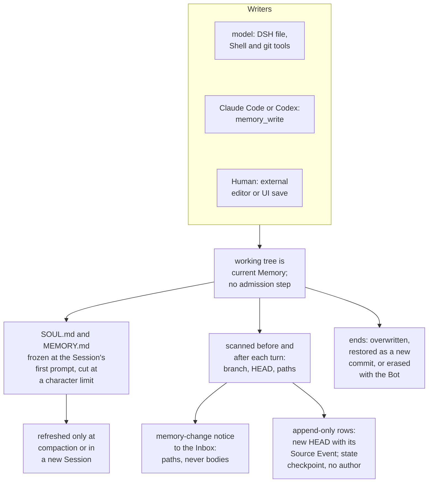

## 1. Executive Summary

Tobs, formerly DeepSeekBot, is a [DeepSeek Harness](../deepseek-harness/)
plugin from BotHarness that runs a crew of persistent PersonaBots, each with
its own identity, chat channels, schedules and IM accounts. Its memory is one
ordinary Git repository per Bot. The checked-out working tree *is* the memory,
the Bot's Orchestrator Session runs with that repository as its working
directory, and the model reads and writes it with DSH's own file, grep, Shell
and `git` tools. There are no memory CRUD tools for the native agent.

What is notable is the discipline around the prompt and around history. Only
`SOUL.md` and `MEMORY.md` enter the system prompt, frozen together at a
Session's first assembly. A mid-Session edit reaches the Bot as a path-only
Inbox notice rather than a changed prefix. The Host records every observed
state as an append-only checkpoint and a restore as a new commit, so no state
is lost to a reset.

What is weak is everything before a file lands. Nothing filters, labels or
admits what the model writes from a chat or an IM message, and the ledger
names no author for those writes. The decision record overstates three things
the tree does not do.

**Scope of this report.** The repository is a whole product: a React client,
a mobile app, a VRM companion, browser and desktop control, IM bridges, a
marketplace and docs. Memory is about 2% of its non-test TypeScript, 12,842/600,553
lines. The 2.3 GB history is mostly binary evidence: 7,116 PNG, 893
JPEG and 547 WebP revisions and 115 MP4s, with 3,066 files added under
`docs/assets/pr/` of which 649 remain at the pin. This report covers
`packages/core/src/memory/`, the memory prompt, tools and skill provider, the
observation and Inbox wiring in the runtime, and their tests.

**Relation to the DSH reports.** Tobs is not a fork of DeepSeek Harness; it
depends on its `@deepseek-ai/dsh-*` packages at `0.2.2-rc.1` and installs as a
plugin. Its decision record says it built its own store because *"DSH's memory
plugins are scoped to a project or Session"* (`docs/decisions/memory.md:14`).
It hosts none of the DSH memory plugins this atlas covers. Its research notes
survey several of them, [dsh-mneme](../dsh-mneme/) among them
(`docs/research/2026-09-21-awesome-dsh-ecosystem-survey.md:72`).

**Licence.** The root `LICENSE` grants MIT, and the memory code is under it
with nothing unusual. The grant does not reach everything shipped beside it:
`packages/vrm-companion/assets/avatar-sample-a.vrm`, a 13 MB model, is
VRoid's AvatarSample_A under its *VRoid Hub conditions*, which
`packages/vrm-companion/README.md:22` states is *"not under the MIT license"*.
`packages/cloudflared/` carries Apache-2.0 for the binary it fetches, and the
mobile module ships WebRTC's licence and patent grant. 13/15
`packages/*/package.json` files declare no `license` field, so the published
npm packages carry no licence metadata. The vendored agent skills under
`.agents/` are MIT with their own copyright lines.

## 2. Mental Model

A memory is whatever is in the working tree: staged, unstaged and untracked
files, Markdown or code or images (`docs/decisions/memory.md:10`). By
convention `SOUL.md` holds character and standing instructions, `MEMORY.md` is
an index of one line per entry plus a few facts, and topic files hold detail,
with a customer profile as the stated model of one. Nothing extracts memory
automatically: the Orchestrator prompt says *"Reading a message never
automatically writes long-term memory"* and *"you decide what to persist"*
(`packages/core/src/runtime/dsh-bot-agent-adapter.ts:385`).

A thing becomes a belief by being written to a file. There is no candidate
state, no review and no status: an accepted-commit gate, a Markdown-only rule
and per-branch admission *"were tried and dropped"*
(`docs/decisions/memory.md:16`). The `memory_accepted_*` table names in the
schema are the residue of that gate. They now record observations, not
admissions.

A belief stops being one by being edited or deleted in place. The Human can
also restore an older commit, which writes that tree as a new child commit
after backing up uncommitted work, or restore a recovery checkpoint, which
needs a Human confirmation. History is never rewritten by the Host, so a
superseded belief stays reachable in Git. The model can rewrite it with its own
Shell.

## 3. Architecture

Tobs runs inside the DSH desktop Host as a Cordis plugin; the README sends a
new user to install DSH first. Memory needs a Git of at least 2.28. When the
system has none, the Human installs a pinned, SHA-256-verified portable Git
into the Profile with one click (`packages/core/src/memory/managed-git.ts`,
`packages/core/src/memory/managed-git.json`). Each Bot's repository lives in
the Profile, and the registry maps a Bot slug to its directory.

The Host keeps its own state in one SQLite operational database shared by
every module. The memory module owns `memory_change_checkpoints` (the last
observation per Bot), `memory_accepted_commits` and `memory_accepted_heads`
(the commit ledger and the last recorded HEAD per branch),
`memory_recovery_checkpoints`, `memory_repair_events` and
`memory_commit_cursors` (`packages/core/src/database/schema-plan.ts:162-198`,
`:280-296`, `:1015-1052`, `:2055-2063`).

Adopting it means adopting DSH and Tobs together. The memory itself is the
cheapest part to stand up and to repair: plain files in a Git repository that
any editor opens, synced across machines by a `git push` the Bot performs on
request or by a Profile Backup (`docs/decisions/memory.md:17`). A model API is
needed to use a Bot at all, not to store anything.

## 4. Essential Implementation Paths

- **Native write.** The Orchestrator writes with DSH's file and Shell tools,
  in a Session whose working directory is the repository; nothing in Tobs sits
  on that path. The prompt lists what it may read and write
  (`packages/core/src/runtime/dsh-bot-agent-adapter.ts:385`).
- **Engine write.** For a Subscription Engine, the Host contributes
  `memory_list`, `memory_read` and `memory_write`
  (`packages/core/src/plugin.ts:2672-2679`). `memory_write` checks the path
  with the jail, caps content at 256 KiB and calls `writeFile`; it does not
  commit (`packages/core/src/engines/engine-memory-tools.ts:76-100`).
- **Human save.** `saveHuman` refuses if HEAD moved or the tree is dirty,
  writes the file, commits it with the subject `Human Memory edit:` and the
  path, and records the commit
  with `actorKind: 'human'` (`packages/core/src/memory/accepted-human.ts:142-227`).
- **Turn observation.** `prepareTurn` runs before an Orchestrator turn and
  `reconcileTurn` after it (`packages/core/src/runtime/bot-runtime.ts:7289`,
  `:7437`). Reconcile refuses a Source Event the Bot was not admitted for, then
  records a changed HEAD with actor `botharness-host` and the Source Event as
  cause (`packages/core/src/memory/accepted-turn.ts:185-277`).
- **Change notice.** A net change between scans becomes one `memory-change`
  Source Event and Inbox admission in one transaction
  (`packages/core/src/runtime/bot-runtime.ts:12495-12525`).
- **Prompt.** The `botharness:persona` system-prompt section calls
  `personaForSession`, which returns the Session's recorded snapshot or records
  one (`packages/core/src/plugin.ts:5072-5076`,
  `packages/core/src/memory/service.ts:98-107`). `refreshPersonaAfterCompaction`
  replaces it only if the files changed (`:109-125`).
- **Restore.** `restoreCommitHuman` captures a forced checkpoint, commits a
  backup of uncommitted work, writes the target tree as a new commit, and
  moves the branch with `update-ref` against the expected HEAD
  (`packages/core/src/memory/accepted-human.ts:229-327`).
- **Erasure.** Bot deletion with Memory erasure removes the repository
  directory after an ownership check (`packages/core/src/bots/deletion.ts:362-376`).

## 5. Memory Data Model

The repository has no schema. Paths go through one jail: relative only, no
NUL, no `..`, no `.git` segment, and a realpath check that refuses an escape
through a symlinked directory (`packages/core/src/memory/jail.ts:11-37`,
`:54-70`). Writes through the jail must end in `.md` and avoid dot-directories
(`:39-52`); native writes are under DSH's sandbox instead.

The decision record rules out per-entry scoping: *"Memory entries have no
`visibility` or `owner`"* (`docs/decisions/memory.md:53`), and the front-matter
type has neither. The front-matter writer in `packages/core/src/memory/store.ts:138-164`
stamps `summary`, `updated_at`, `sources` and `tags` and commits once per
write. Nothing in `packages/` or `apps/` reaches it outside the service and
the tests, so in the running product files carry front-matter only when the
model writes it.

A ledger row is `(bot_slug, sha, parent_sha, actor_kind, actor_id, cause_kind,
cause_id, validation_result, accepted_at)`, with actor kinds `agent`, `human`
and `system` and causes `source-event`, `human-edit` and `repository-init`
(`packages/core/src/database/schema-plan.ts:162-174`). `validation_result` is
the commit's tree hash and nothing more
(`packages/core/src/memory/accepted-git.ts:158-161`). A checkpoint row holds
branch, HEAD, index-tree and working-tree hashes, its hidden ref, an origin of
`host-observation`, `agent-session` or `human-command`, a cause and a time
(`packages/core/src/database/schema-plan.ts:1036-1050`). There is one time per
row and no validity time anywhere.

## 6. Retrieval Mechanics

Retrieval is the model's own. It lists, reads and greps its repository with
DSH's tools and runs `git log` when the Human asks for history
(`packages/core/src/features/memory/prompt.ts:1`). There is no index, no
ranking and no embedding. `searchMemoryFiles`, a ripgrep fixed-string search
that skips front-matter lines, is reachable only through the unused store
(`packages/core/src/memory/search.ts:98-138`).

What is automatic is the frozen pair. `renderStandingPrompt` emits a Soul
section and a Core Memory section, each headed with its percentage of a
per-Bot character limit, defaults 5,000 and 3,000, settable from 500 to 50,000
(`packages/core/src/memory/soul.ts:17-19`, `:105-119`). An over-limit file is
cut at the limit with a note naming its true length and asking the Bot to
consolidate (`:96-103`). Limits are in characters, counted as code points,
because *"bytes penalise Chinese"* (`docs/decisions/memory.md:43`).

Assignment Sessions, which do delegated work in a Workspace, get the Bot's
repository skills through a skill provider. It lists skills from the
repository and drops any a Workspace project skill of the same name shadows
(`packages/core/src/skills/memory-provider.ts:89-107`).

## 7. Write Mechanics

Writes are synchronous tool calls the model makes, and a written file is
memory at once for that Session's reads. The frozen pair is the exception: an
edit to `SOUL.md` or `MEMORY.md` reaches a new Session or the next compaction,
and the running Session gets an Inbox notice. Nothing deduplicates,
consolidates or summarises in the background; consolidation is the model's job
when a truncation note tells it so.

The observation scan reads branch, HEAD and fingerprints for at most 500
changed paths, counting any overflow as a hash and a count rather than
dropping it (`packages/core/src/memory/accepted-observation.ts:55`). It runs at
Host start, before each turn and before steering input into a running one, so
its cost scales with what changed. Per-turn injection is bounded by the two
limits and sits in the prefix, which by design never changes within a Session.

Concurrency is guarded per Bot: an in-process set refuses a second memory
operation while one runs, and the ledger write is a compare-and-swap on the
recorded HEAD (`packages/core/src/memory/accepted.ts:50-62`,
`packages/core/src/memory/accepted-ledger.ts:84-96`). A branch switch is a tool
call that refuses while the branch moved during the turn, and the prompt tells
the Bot to pause Assignments and stash before retrying
(`packages/core/src/features/memory/tools.ts:14-69`,
`packages/core/src/memory/accepted-human.ts:83-115`).

## 8. Agent Integration

The native Orchestrator holds two memory tools, `memory_switch_branch` and
`memory_continue_from_commit` (`packages/core/src/features/memory/tools.ts:14-118`),
registered beside its messaging tools
(`packages/core/src/runtime/dsh-bot-agent-adapter.ts:2232`). Everything else is
DSH's general tooling. The prompt says *"Assignments must never edit Memory"*
(`packages/core/src/features/memory/prompt.ts:3`), while the skill provider
gives Assignment Sessions the repository's skill files and their directories
(`packages/core/src/skills/memory-provider.ts:51`).

Claude Code or Codex, when a Human routes a Bot's Orchestrator through their
own subscription, get the three engine tools instead. That contradicts the
decision record's *"There are no model-facing `memory_*` CRUD tools"*
(`docs/decisions/memory.md:10`), which holds only for the DSH agent. Since
`memory_write` does not commit, an engine-written file appears as an
uncommitted change until something commits it.

Each memory commit made during a turn becomes a Self-Record: a notice in the
Channel whose message caused it, and an already-handled Inbox record, so
after compaction the Bot can see why it changed its memory
(`packages/core/src/channels/sqlite-store.notices.ts:46-59`).

## 9. Reliability, Safety, and Trust

### What the record proves

The ledger and the checkpoints are deliberate about authorship. A turn's
commit is recorded with actor `botharness-host`, not the model
(`packages/core/src/memory/accepted-turn.ts:265-277`), and the decision record
says an `agent-session` checkpoint *"never claims the Agent wrote every byte"*
(`docs/decisions/memory.md:75`). The cause is the Source Event, so a reader
can find the message that preceded a change, and the trees let them diff it.

The record has three gaps. A capture failure is a warning and the mutation
stands (`packages/core/src/memory/accepted-observation.ts:526`, `:561`). A
turn records only the HEAD it ended on, so intermediate commits are in Git
and not in the ledger. And the hidden refs that keep checkpoint trees alive
are in the repository the model's Shell can rewrite. Erasure deletes the
repository and leaves its ledger and checkpoint rows, which then name shas
and Source Event ids for content that no longer exists.

### What the model can be told to write

Any text that reaches a turn — a Human DM, a group mention, an IM message, an
Assignment report — can lead to a write, and nothing between the model and
the file filters it. Secrets are screened when a Bot is shared, not when it
remembers: `shareDraftFlags` runs patterns for keys, tokens, emails, phone
numbers and private keys over each file of a Share Draft
(`packages/core/src/marketplace/share-draft.ts:66-81`). Nothing in
`packages/core/src/memory/` screens a write, and the engine tool's *"Never
write secrets"* is prose
(`packages/core/src/engines/engine-memory-tools.ts:78`). A Bot uses
everything it knows in every chat, by design (`docs/decisions/memory.md:53`),
so a fact learned in one group is available in the next.

### Marks

- **`audit_log`** — awarded on `memory_accepted_commits` and
  `memory_recovery_checkpoints`: append-only SQLite tables in the Host's own
  store, written on every observed change, Human edit and restore, with actor
  kind, cause and tree hashes. No statement updates or deletes either
  (Recorded searches). Git history beside them is not the evidence.
- **`negative_eval`** — awarded on the memory-skill listing; see section 10.
- **`tombstone`** — withheld. Nothing records a rejected value.
- **`trust_state`** — withheld. There is no status; every working-tree file is
  current, and the acceptance gate the table names describe was removed.
- **`bitemporal`** — withheld. Front-matter `updated_at` and row times are
  record time.
- **`scope_enforced`** — withheld. Isolation is one repository per Bot,
  resolved from Session ownership (`packages/core/src/memory/service.ts:61-66`),
  a physical partition with no key on a record.
- **`human_review`** — withheld. Restore and checkpoint restore wait for a
  Human, but no memory waits: a write is current the moment it lands.

### Claims the tree does not carry

The decision record cites a TLA+ model of the restore compare-and-swap
(`docs/decisions/memory.md:81`); `verification/` holds models for enrollment,
harvest, live and outbox only. It calls the front-matter writer the CLI and
Human save path (`:110`); Human save commits the raw body with no
front-matter. And the engine tools contradict its no-CRUD-tools line.

## 10. Tests, Evals, and Benchmarks

The suite has 13,223 vitest cases in 1,864 files, 247 of them in 40 memory
test files. CI runs vitest in shards on push to `main`, on pull requests and
nightly (`.github/workflows/verify.yml:3-9`, `:388`). I ran none of it.

The memory tests are concrete and adversarial where the design is: path
escapes by `..`, `.git` and symlinked directories
(`packages/core/test/memory-store.test.ts:107`, `:140`); the frozen persona and
its refresh only on change (`packages/core/test/memory-service.test.ts:75`);
checkpoints surviving reset, merge, branch moves and a refused restore
(`packages/core/test/memory-recovery.test.ts:25-112`); and a Human edit on a
fetched branch recorded with a human actor
(`packages/core/test/memory-accepted.test.ts:343-365`).

`negative_eval` rests on one populated case. In
`packages/core/test/memory-skill-provider.test.ts:117-150` two Bots'
repositories hold skills. Ada's Assignment listing must be exactly the
Workspace's `deploy` and her three unshadowed skills, without `bob-only`;
Bob's must include `bob-only` and must not include `release-notes`. Each
exclusion has a present control beside it. The Team-mode cases that refuse
every memory method for another principal
(`packages/core/test/team-bot-memory.test.ts:367-400`) assert a refusal, not an
absence from a result.

Live-model scenarios run nightly against a DeepSeek model
(`.github/workflows/llm-e2e.yml:7-10`). One plants a key in a Bot's memory and
asserts that the steward Bot flags it, drops it from the Share Draft on the
Human's answer, and leaves the source repository untouched
(`scripts/e2e-llm-scenarios.mjs:456-540`). That keeps material out of an
export, not out of a read. No committed case asserts what the model declines
to remember, and no retrieval-quality eval or benchmark is committed. The files named `*bench*`
time client rendering, desktop frames and a human-attention query. No paper
is associated with the project.

## 11. For Your Own Build

### Steal

- **Freeze the always-loaded memory per Session.** Read the standing files
  once, record the snapshot with the Session, and refresh only at compaction.
  Deliver mid-Session edits as a notice rather than a new prefix.
- **Limit standing memory in characters and truncate visibly.** A header with
  the percentage used and a truncation note that names the true length turns
  an overflow into a consolidation task.
- **Restore as a new commit.** Back up the dirty tree, write the old tree as a
  child, and move the branch with a compare-and-swap, so every restore can be
  undone.
- **Record the observer, not a guessed author.** Attribute a change to the
  Host and the event that preceded it when that is all you know.

### Avoid

- **A write path with no admission at all.** When IM and group messages reach
  the same model that writes memory, the files need at least a label of where
  a fact came from.
- **Two write tools with different commit semantics.** One commits and one
  leaves a dirty tree, and the ledger only sees the first.
- **A decision record that cites checks the tree does not hold.** A reader
  takes *"enforced by"* lines at their word.

### Fit

This suits a person who wants a few long-lived assistant identities whose
memory they can open in an editor, diff and push to GitHub, and who already
runs DSH. The memory is cheap to keep and easy to repair by hand, and the
history is never lost. It does not suit anyone who needs memory to be
believed selectively. Nothing distinguishes a fact a Human stated from one an
IM stranger supplied, nothing expires, and no read is scoped below the Bot.
Walk away too if you do not want the rest of the product.

## 12. Open Questions

- Whether an Assignment Session's sandbox can write to the Bot's repository,
  given that the prompt forbids it and the skill provider exposes its skill
  directories.
- Whether the restore TLA+ model exists outside this repository.
- Which principal the Host bridge resolves for a `memory-restore-commit` run
  from the CLI by the steward Bot, and so which actor kind its ledger rows carry.
- Whether checkpoint refs are ever pruned; nothing in `packages/core/src/memory/`
  deletes one.

## Appendix: File Index

- Repository and Git: `packages/core/src/memory/repository.ts`,
  `packages/core/src/memory/git.ts`, `packages/core/src/memory/managed-git.ts`,
  `packages/core/src/memory/jail.ts`
- Observation, ledger and recovery: `packages/core/src/memory/accepted.ts`,
  `packages/core/src/memory/accepted-observation.ts`,
  `packages/core/src/memory/accepted-ledger.ts`,
  `packages/core/src/memory/accepted-turn.ts`,
  `packages/core/src/memory/accepted-human.ts`,
  `packages/core/src/memory/recovery.ts`,
  `packages/core/src/database/schema-plan.ts`
- Prompt: `packages/core/src/memory/soul.ts`,
  `packages/core/src/memory/service.ts`,
  `packages/core/src/features/memory/prompt.ts`, `packages/core/src/plugin.ts`
- Tools and skills: `packages/core/src/features/memory/tools.ts`,
  `packages/core/src/engines/engine-memory-tools.ts`,
  `packages/core/src/skills/memory-provider.ts`
- Runtime: `packages/core/src/runtime/bot-runtime.ts`,
  `packages/core/src/runtime/dsh-bot-agent-adapter.ts`,
  `packages/core/src/bots/deletion.ts`
- Unreached: `packages/core/src/memory/store.ts`,
  `packages/core/src/memory/search.ts`
- Design: `docs/decisions/memory.md`, `GLOSSARY.md`
- Tests: `packages/core/test/memory-*.test.ts`,
  `packages/core/test/memory-skill-provider.test.ts`,
  `packages/core/test/team-bot-memory.test.ts`

### Recorded searches

Run from the repository root at the pinned commit with `/usr/bin/git`.

- **Package licence fields.** `git ls-files | grep -E '^packages/[^/]+/package\.json$'`
  lists 15 manifests; reading each one's `license` key finds it absent in 13,
  `MIT` in `packages/links-cli` and `SEE LICENSE IN README.md` in
  `packages/vrm-companion`, which also shows the read can find one.
- **No rejected-value record.**
  `git grep -n -i -E 'tombstone|rejected' -- packages/core/src/memory` returns
  nothing; the same pattern over `verification/enrollment/Enrollment.tla`
  counts 3.
- **No status in front-matter.**
  `git grep -n -E 'status|confidence|verified' -- packages/core/src/memory/front-matter.ts`
  returns nothing; `git grep -n -c -E 'summary|updatedAt' -- packages/core/src/memory/front-matter.ts`
  counts 14.
- **No validity time.**
  `git grep -n -w -i -E 'valid_from|valid_to|validFrom|validTo|valid_at|validAt|valid_until' -- packages/core/src/memory`
  returns nothing; `git grep -n -w 'updatedAt' -- packages/core/src/memory/front-matter.ts`
  matches line 5.
- **The ledger and checkpoints are never updated or deleted.**
  `git grep -n -E '(DELETE FROM|UPDATE) +memory_(accepted_commits|recovery_checkpoints)' -- packages`
  returns nothing; `git grep -n -E 'UPDATE +memory_repair_events' -- packages`
  matches `packages/core/src/memory/accepted-repair.ts:182`.
- **The store has no product caller.**
  `git grep -n -E 'storeFor(Session|Agent)' -- packages apps` matches only
  `packages/core/src/memory/service.ts` outside tests, and
  `git grep -n 'searchMemoryFiles' -- packages` matches `search.ts`,
  `store.ts` and `packages/core/test/memory-search.test.ts`.
- **No restore model in TLA+.** `git ls-files '*.tla'` lists
  `verification/enrollment/Enrollment.tla`, `verification/harvest/Harvest.tla`,
  `verification/live/Live.tla` and `verification/outbox/Outbox.tla`.
- **No secret screen on the memory write path.**
  `git grep -n -i -E 'secret|credential|redact' -- packages/core/src/memory`
  returns nothing; the same pattern over
  `packages/core/src/engines/engine-memory-tools.ts` matches line 78, and over
  `packages/core/src/marketplace/share-draft.ts` matches the Share Draft
  detectors.
- **No per-entry visibility.**
  `git grep -n -i -E 'visibility|owner' -- packages/core/src/memory/front-matter.ts`
  returns nothing; the same pattern over `packages/core/src/memory/service.ts`
  matches the `ownership` imports and lookups.
- **No checkpoint ref is deleted.**
  `git grep -n -E "'-d'|update-ref -d" -- packages/core/src/memory` matches only
  `packages/core/src/memory/accepted-versions.ts:108`, a tag deletion.
- **No DSH memory plugin is a dependency.**
  `git grep -l -i -E 'dsh-(engram|mneme|mnemon|auto-memory|layered-memory|superagent|continual-harness)|zzjzzb/ai-memory' -- .`
  lists only `docs/research/2026-09-21-awesome-dsh-ecosystem-survey.md`,
  where `dsh-mneme` appears 3 times.
- **No paper.** `git grep -n -i -E 'arxiv|bibtex' -- README.md README.en.md`
  returns nothing, and `git ls-files | grep -i -c citation` counts 0.

## History

**2026-11-21** — [`72008bde43d41093cda393e3cd2059355d3544fe`](https://github.com/BotHarness/DeepSeekBot/commit/72008bde43d41093cda393e3cd2059355d3544fe) — first reading, from a blobless clone of `main` 1,030 commits after release `v1.7.1`, scoped to the memory module, its prompt, tools, skill provider and runtime wiring, and their tests. Screened first: two auto-run surfaces, `.claude/settings.json` hooks and a vendored skill's `plugin.json`, both inert unless a Claude Code session starts in the clone; one build-time execution point, a `prepare` script; 18 unpinned surfaces; eight manifests inside the seven-day cooldown; `AGENTS.md` and `CLAUDE.md` read as data. MIT, no rider. Nothing installed, built or run. Two marks: `audit_log`, `negative_eval`.
