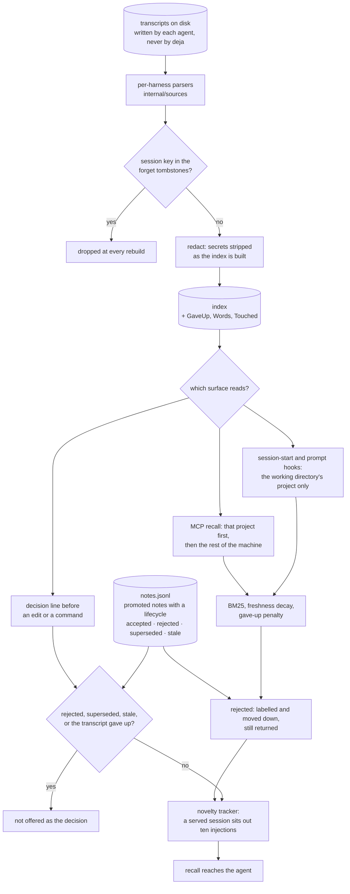

## 1. Executive Summary

deja-vu does not record forward from empty. Claude Code, Codex, Cursor and the
rest each write their sessions to disk, and deja indexes those transcripts and
hands the right one back in whichever agent asks next. The README's lead line is
*"Your coding agents stop re-debugging what you already fixed."*

**The design's best property is that it does not need a write path.** The agent's
own transcript is the write. `deja` parses it, strips credentials *"as the index
is built"* (`README.md:151`), derives a few fields the parsers never set, and
builds its own index beside the files. The store is a derived artefact: rebuild
it and you get it back.

**It carries two marks.** The first is a test that is a model for the corpus.
`internal/search/session_scope_test.go` asserts that a session-scoped search
returns exactly one hit and that it is the right one. The *next* test in the
file exists only to prove the fixture is not degenerate:

> Without the flag both sessions answer, so the test above is measuring the flag
> rather than a fixture that only had one match.

Most projects that guard against a vacuous negative put the control in the same
assertion. This one made the control its own named test and wrote the reasoning
above it. A third case pins the fail-closed direction — an unknown session id
*"answers with nothing rather than falling back to the whole store."*

**The second mark is on the state a person records.** Before an edit or a
command, a hook offers the decision a past session reached about that file or
command. `decisionUsable` refuses any session whose promoted note says
`rejected`, `superseded` or `stale` (`cmd/deja/hook_tool_file.go:651-669`).
Recall returns the same session, labelled *"this was tried and rejected"* and
moved below the others. The state keeps a reverted decision on record and out of
the role of the answer.

**The inferred layer is thin on purpose, and the argument is written down.**
The index derives `GaveUp` from a session's own words. Search applies a score
penalty and prints a line beside the hit — *"mentions backing an approach out —
one path here was abandoned"* — and the comment above it declines to go further:

> Nobody sets the rejected state by hand, so the sessions that ended in a dead
> end look exactly like the ones that ended in an answer. When the transcript
> itself says something was backed out, say so — as evidence from the session,
> not as a state someone recorded.

Only the decision lines treat `GaveUp` as disqualifying; everywhere else an
inference ranks and a recorded state is what withholds.

**Scope is a default on the push paths and a ranking on the pull path.** The
session-start and per-prompt hooks draw only from the working directory's
project. MCP recall ranks that project first and then appends the rest of the
machine, so a session from one project can answer a question an agent asks from
another. A system whose thesis is *one memory across every agent* records that
as a consequence, and `scope_enforced` is withheld on it.

## 2. Mental Model

The corpus is not something the tool creates. It is the pile of JSON and JSONL
transcripts that a dozen coding agents have been writing to your home directory
for months, in a dozen different shapes. `internal/sources` holds a parser per
harness; each turns a file into a `Session` of `Message`s.

Indexing is where the tool's own judgement enters, and it is careful about
saying so. Three fields are stamped by the index and never by a parser.
`GaveUp` records whether the transcript says an approach was backed out. `Words`
is how long the session is, because *"search sees only the messages that matched
a query, so it had no way to tell a short session that is about the query from a
marathon that mentions it once."* `Touched` lists the files it worked on most. The first two
carry a comment saying they are false or zero for a store indexed before they
existed (`internal/model/model.go:233-253`).

Redaction happens on this path, not on the read path. Secrets are stripped as
the index is built, which means the derived artefact never holds them and every
downstream surface inherits the property. A session can also be forgotten:
`deja forget` drops it and writes its key to a tombstone file that every rebuild
filters against.

Retrieval is BM25, scored and freshness-decayed. Hooks put it in front of the
agent without anybody asking: at session start, on each prompt, before an edit
or a command, and after a failed command. A novelty tracker sits a served
session out for the next ten injections, in that agent session and in that
project.

Two kinds of note are authored. An agent or a person stores a fact with
`remember`. A person promotes a session with `deja promote`, and that note
carries a lifecycle state another machine can sync. Everything else is history.



## 3. Architecture

A single Go binary, `deja`, with twenty-six internal packages. The ones that
carry the design are `sources` (a parser per harness), `index` (ingest, the
derived fields, the digest, the forget tombstones), `search` (BM25 scoring,
blame, context), `redact` (the secret stripper) and `query` (the narrowing
predicates). Beside them sit `policy` (which origins may activate on which
surface), `peers` (machine-to-machine sync), `embed` (an optional embedding
rerank), and two folding packages, `cjkfold` and `nfcfold`, that exist because
the corpus is real user text in real languages.

There is no database to run and no service to deploy. `deja install --auto`
finds the harnesses on the machine and wires their hook configuration; the
index lives beside the transcripts; a Dockerfile and a goreleaser config exist
for distribution rather than for operation.

The code is unusually well commented, and the comments are load-bearing: they
cite the issue number each decision came from (`#765`, `#692`, `#1100`, `#975`,
`#1316`, `#1321`, `#2113`), and several explain a choice by naming the failure
that produced it. The `MarshalJSON` on `Message` is a small example — a message
the transcript never stamped omits the time rather than emitting the zero value,
because *"the zero time marshals as `0001-01-01T00:00:00Z`, which reads as a date
rather than as the absence of one: a consumer sorting by it puts the message
before everything that ever happened."*

## 4. Essential Implementation Paths

- **Parse.** `internal/sources` per harness → a `model.Session` with
  `model.Message`s.
- **Index.** `internal/index/ingest.go:250` rebuilds through
  `rebuildWithTombstones`, which drops every forgotten key (`:286`) →
  `preRedactSessions` (`ingest_append.go:621`) runs `indexedText` over each
  message → `SessionMeta{...GaveUp: gaveUp(s.Messages), Words:
  sessionWords(s.Messages), Touched: ...}` (`ingest_derived.go:65`) → the index
  and its digest.
- **Narrow.** `internal/search/search.go:269-284` → skip on a harness mismatch,
  then `if !query.ProjectAnyMatches(s.Project, s.From, o.ProjectWants()) {
  continue }`, then a session-id prefix match against both `ID` and `OrigID`.
- **Score.** `internal/search/bm25.go:78-101` → `if doc.hit.Session.GaveUp &&
  !decided && doc.hit.Session.Lifecycle != "accepted" { score *= gaveUpPenalty
  }` → `score *= freshnessDecay(doc.hit.Session.Updated, now)` → sort →
  `liftNotesAboveTheirSource(hits)`.
- **Describe.** `lifecycleSummary` (`bm25.go:457-475`) words a recorded state
  for a reader — *"tried and rejected"*, *"replaced by a later decision"*,
  *"marked stale — may no longer hold"* — under a comment saying
  *"superseded" is our vocabulary, not the reader's.*
- **Inject.** `cmd/deja/digest_cache.go:408-567` → project names from the
  working directory → `search.BuildAutoRecall` in safe mode
  (`internal/search/recall.go:182-190`, `:257`) → `rememberInjectedIDsFor`
  (`cmd/deja/hook_seen.go:320`) records what was served.
- **Decide.** `cmd/deja/hook_tool_file.go:135` → `fileDecisionLineWithSymbols`
  (`:221-270`) skips every session `decisionUsable` refuses (`:651-669`).

## 5. Memory Data Model

A `Session` is what a transcript became, plus what the index derived from it
(`internal/model/model.go:223-312`).

**From the transcript.** `ID`, `Harness`, `Project`, `Path`, `Title`, `Started`,
`Updated`, and the `Message` list. A `Message` is a role, text and a time, with
the time omitted from JSON when the transcript never stamped one (`:187-219`).

**From the index.** `GaveUp`, `Words`, `Touched`, `AgentTitle`. The first three
are documented as filled by the index and never by a parser, and the first two
as false or zero for a store indexed before the field existed. That note is the
sort of discipline that keeps a derived index safe to rebuild incrementally.

**From sync.** `OrigID` and `From` record where a session came from when it
arrived from another machine, added because import *"renames sessions to
`imported-<hash>`, so a promoted note stopped looking like one"* across a machine
boundary (`:263-280`). `Lifecycle`, `LifecycleNote` and `LifecycleAt` carry the
state of a promoted note (`:281-286`), one of the four constants at `:42-45`.

**Beside the sessions.** `notes.jsonl` holds remembered facts and promoted
notes. A promotion is appended, and *"appending the same session again records a
correction"* (`internal/sources/notes_promoted.go:28-29`). Forgetting a session
rewrites the file without its notes (`rewriteNotes`, `:627-682`).

**Deletion.** `deja forget` takes `--session`, `--project` or `--before` and
writes each removed session's `harness:id` key (`model.go:86-87`) to two
tombstone files, one under the config directory and a mirror beside the index,
so that *"a wiped config directory"* does not let the next rebuild resurrect them
(`internal/index/privacy.go:163-184`). `filterTombstonedSet` drops a key, a
former key and a forgotten session's child runs (`:319-334`). `--unforget` is
the only way back.

**What is absent.** No confidence. No validity interval — a session has a start
and an update time, and a promoted note the source transcript's update time,
all of them record time. No owner or tenant key; `Project` is the nearest thing
and it is a label matched by substring, not a boundary.

## 6. Retrieval Mechanics

BM25 over the index, with CJK and NFC folding so the corpus's real text
behaves. Narrowing on the CLI is opt-in: `--harness`, `--project`, `--session`, a
time bound. `ProjectMatches` returns true when nothing was asked for and does a
case-insensitive containment match otherwise (`internal/query/project.go:22-38`).
It has a guard worth quoting, because it is the sort of thing that goes wrong
quietly: a bare want without a separator will not match the machine name, since
*"`--project mini` would select every session from a machine called mini rather
than a project of that name."*

The automatic surfaces use a stricter rule. `ProjectInScope` (`:79-110`) refuses
a bare directory name against a local project, because *"working in /work/api,
the candidate "api" matched a client's acme/api and the session-start hook
injected it "from this project" (#2333)."*

MCP recall scopes by ranking. With no `project` argument, `rankRecall` runs the
search for the machine, runs it again for the working directory's project, and
puts the project's hits first with the machine's from the same tier after them
(`cmd/deja/mcp_recall.go:597-686`). `DEJA_RECALL_GLOBAL=1` turns the
project-first pass off (`:606`).

Scoring applies a freshness decay and the give-up penalty. The penalty's comment
is precise about its own scope. A session that *"reverted one thing and settled
another keeps the boost above."* The penalty is skipped only when a person
accepted the session afterwards, since *"that is a fresher judgement that
overrides the transcript."* Rejected, stale and superseded do not rescue it,
because they *"agree it was a dead end"* or mean *"a better record exists."*

`liftNotesAboveTheirSource` puts a promoted note above the session it came from.
Before the page is cut, `demoteRejected` moves every hit a person marked
rejected below the ones they did not (`cmd/deja/lifecycle.go:181`), so a limit of
fifteen cannot fill with rejected attempts. Search excludes nothing on epistemic
grounds; the decision lines in section 9 do.

## 7. Write Mechanics

There is no write path for sessions, which is the whole point. The agent writes
its transcript because it always did; `deja` reads it.

The one thing the indexing path does that a write path normally would is
redaction. `indexedText` runs `redact.Text` over every message before the write
loop (`internal/index/ingest_append.go:603-613`), so the derived artefact never
holds a matched credential. The suite around it is built the way this project
builds suites: `TestEnvVarKeyIsRedacted` beside
`TestLowercaseKeyNamesAreLeftAlone`, and `TestKVGateNeverHidesAMatch` asserting
the gate that decides whether to scan a line never suppresses a real hit. The
source transcripts keep their secrets; `deja secrets --scrub` rewrites the ones
it can and keeps the original beside the file (`cmd/deja/secrets_scrub.go:75`).

Two writes are authored. The MCP `remember` mode appends a fact to
`notes.jsonl` under the working directory's project, refusing a duplicate
(`cmd/deja/mcp.go:690-727`, `internal/sources/notes.go:334-366`); it carries no
state and the hooks serve it at once. `deja promote <session> --state <state>`
appends a promoted note and refuses any state outside the four
(`cmd/deja/promote.go:76`, `:156`). Promotion is the only place a recorded
judgement enters the store.

Because the index is derived, correcting it is re-indexing. That is a genuine
advantage — no migration, no drift between store and source — and a genuine
limit: a harness that changes its transcript format breaks a parser, and there
is no copy of the old shape to fall back on.

## 8. Agent Integration

The integration is the product. `deja install --auto` finds the agents on the
machine and wires their hooks, so recall arrives without anyone calling a tool:
at session start, on each prompt, before a file is edited or a command runs, and
after a command fails. The MCP server lists one tool, `deja`, whose `mode` is
one of `recall`, `context`, `blame`, `fix`, `how`, `orient`, `remember` and
`handoff` (`cmd/deja/mcp.go:394`); older tool names still dispatch to the same
calls without being listed (`:420-438`).

The novelty tracker is the piece that makes automatic injection tolerable.
`rememberInjectedIDsFor` appends each served id with the agent session and the
project (`cmd/deja/hook_seen.go:320-345`). A session then sits out the next ten
injections in that agent session and, separately, in that project, counted *"in
injections rather than minutes because that is what the reader experiences"*
(`:217-222`). The file rotates past 1 MB, keeping the current session's lines,
and a compaction drops that session's entries so the truncated blocks can be
sent again.

`internal/peers` syncs between machines, which is where `OrigID`, `From` and the
note lifecycle come from — a promoted note travels, and the id it had at home
travels with it so a search by id still resolves. `internal/policy` decides per
surface (`search`, `mcp`, `auto`) whether local, imported or one peer group's
memory may activate, and defaults to allowing everything
(`internal/policy/policy.go:1-6`).

## 9. Reliability, Safety, and Trust

**Negative evaluation — awarded, on the strength of how the guard is written.**
`TestSearchNarrowsToOneSession` asserts one hit and the right one. The next test
asserts both answer without the flag, and says in a comment that its purpose is
to prove the first test measures the flag rather than a one-match fixture. A
third asserts an unknown id returns nothing rather than the whole store
(`internal/search/session_scope_test.go:29-71`). The redaction suite pairs a
redacted case with a left-alone case and adds a test that the pre-filter never
hides a match.

**Trust state — awarded, on the decision lines.** `Lifecycle` is a discrete
field with four values. `deja promote` writes it to the user's notes file, or
with `--repo` to `.deja/notes.jsonl` in the checkout (`cmd/deja/promote.go:34`,
`:143-158`), and sync carries another machine's (`internal/index/sync.go:509-516`).
Two read paths
refuse a session whose state is `rejected`, `superseded` or `stale`: the
decision line before an edit (`cmd/deja/hook_tool_file.go:221-244`) and the one
before a command (`cmd/deja/hook_tool.go:1038-1043`, `:1074`), both through
`decisionUsable` (`hook_tool_file.go:651-669`). The standing-decision lookup
keeps only `accepted` notes (`:504`). `TestASupersededImportedDecisionIsNotCarried`
asserts a superseded note is not served, under the comment *"rejected,
superseded and stale all mean someone took it back"*
(`cmd/deja/hook_tool_imported_decision_test.go:36-49`).

The same session is returned by recall, labelled and moved down. That is the
rubric's distinction exactly: on record, and not acted on as true. The code
draws it against itself. `lifecycle.go:107-115` records that `deja promote`
once printed that a note *"now outranks the raw transcript in recall"* and that,
measured, it did not: *"The state belongs to the session; ranking was never going
to carry it."* `decisionUsable` is present at
[`6a33ce289d0553b69ba9772da753cb447501f4d7`](https://github.com/vshulcz/deja-vu/commit/6a33ce289d0553b69ba9772da753cb447501f4d7)
as well, at `cmd/deja/hook_tool.go:1063`.

**Human review — withheld, and it fails the *easier* half of the test.** The
rubric's question is *can the agent that wrote the memory also clear its
review?* Here it cannot. None of the eight MCP modes promotes, and the aliases
add no verb. The adjudicating surface is the CLI verb `deja promote`. The
producer test passes in its strong form, by absence rather than by a check.

What is missing is the other clause: *a memory waits in a state until* that
actor resolves it. Nothing waits. A session is recallable the moment it is
indexed, and a fact the agent stores with `remember` is served by the next hook.
A promotion labels or withholds what had already been served, which is the
rubric's own exclusion: *"the write has already landed."* No command lists
sessions for adjudication.

**Scope — withheld, and it is the design.** The push paths carry the predicate.
`BuildAutoRecall` treats every mode but `off` and `aggressive` as safe, and safe
skips a session outside the working directory's project names
(`internal/search/recall.go:182-190`, `:257`). The candidates are loaded by those
names in the first place (`cmd/deja/digest_cache.go:408-451`), and the prompt
hook ranks inside them (`cmd/deja/hook_prompt.go:290`, `:317`). From a directory
in no project, the prompt hook searches the projects its terms name (`:832`).

The pull path does not carry it. MCP recall returns the machine after the
project, `project` is an optional argument, and CLI search is the whole store
by default. Only `how`, `orient` and `files` answer about the working
directory's project unless told otherwise (`cmd/deja/how.go:500-523`). A session holding something specific to one project can answer a
question an agent asks from another, and the redactor's job is secrets, not
confidentiality between projects.

**Tombstone — withheld.** The forget tombstones are keyed on `harness:id`, a
record key. They stop a rebuild resurrecting a forgotten session, and a new
session carrying the same text is indexed like any other. Nothing records a
rejected value.

**Audit log — withheld.** Promotions append to `notes.jsonl`, but `rewriteNotes`
edits and deletes its lines on a forget (`internal/sources/notes_promoted.go:627-682`).
The novelty tracker and `deja log` record what was served, and `deja log` notes a
`remember` call by its length (`cmd/deja/mcp.go:727`); neither records a
promotion, a forget or the text that changed. The index is derived from
transcripts.

**Bitemporal — withheld.** Start and update times, and a promoted note's source
time, are all record time.

**One property worth naming that the rubric has no mark for.** Redaction on the
indexing path is a stronger guarantee than redaction on the read path, because
the derived store never holds the secret at all. A system that redacts at read
time has the secret on disk in its own index; this one does not.

## 10. Tests, Evals, and Benchmarks

7,646 committed test functions across 541,750 lines of Go, and the suite's
character is consistent: small named tests, each with a comment saying what it
is for, several of which exist solely to keep another test honest. CI runs
`go test` over `./...` on every push to `main` and every pull request, split
across shards by test-name range (`.github/workflows/ci.yml:3-12`, `:237-247`).

The README states **88.9% hit@1 on LongMemEval-S** (the 470-question cleaned
set), **88.2%** on all 500 questions, and **71.9% hit@1 on LoCoMo** retrieval
(`README.md:428-429`). Each figure has a committed run record in
`docs/benchmarks/`: `longmemeval-s-cleaned.json`, `longmemeval-s-full.json` and
`locomo.json`. A record names the harness, the run date, the dataset file with
its byte size and SHA-256, the flags for the LongMemEval runs (`skip_abs` true
for the cleaned set), wall time, median search latency, a row per question type,
and evidence recall at 1, 5, 10 and 20.

A record does not name the commit it ran at; the schema has no such field
(`scripts/benchresult/result.go:45-58`). All three are dated 2026-10-28, and 19
commits touched `internal/search` between the one that committed them and the
pin. A figure is tied to a dataset, not to the code that produced it.

`cmd/deja/benchmark_artifacts_test.go` holds the prose to the records. It sits
in `package main` with no build constraint, so `go test ./...` runs it. Both
tests unmarshal the JSON and format each figure the way the page writes it.
`TestBenchmarkPageMatchesTheCommittedRuns` (`:47-131`) requires sixteen strings
in `docs/guide/benchmarks.html`. `TestQuotedHeadlineNumbersComeFromTheRuns`
(`:139-242`) checks every `<n>% hit@1` quote in five files against the run its
surrounding words name, and the landing page's animated R@5 counter against the
full run.

The checks are substring matches, and they cover what they list: the other ten
translated READMEs, the per-type rows other than preference, and the LoCoMo rows
are outside them. I did not run the Go test. I re-applied its string checks to
the files at the pin with a Python transcription, and every one matched. The
file's header says the published numbers were *"re-runnable and not checkable"*
before it, and that *"the independent review at neoneye/agent-memory-atlas said
exactly that"* (`:14-17`). The records and this test landed on 2026-09-15 in
[`8ecfa775a81a432b59426e64bf546b83dd66d540`](https://github.com/vshulcz/deja-vu/commit/8ecfa775a81a432b59426e64bf546b83dd66d540),
with figures of 85.3% and 69.7%.

`scripts/longmemeval -score <file>` scores a ranking another system produced: a
JSON map from question id to ranked session ids, read before any index is built
(`scripts/longmemeval/main.go:76`, `:134-139`). It prints hit@1 to hit@20, MRR
and evidence recall per question type with the dataset digest, counts an
unanswered question as a miss rather than skipping it, and with `-out` writes
the same record shape with the note *"deja did not run this retrieval"*
(`scripts/longmemeval/submission.go:98-233`). No committed test calls it, and
`-limit` is applied after the dispatch, so it does not narrow a scored file.

The token-cost figure beside them — *"58% fewer tokens"* on a task already
solved, eleven runs an arm — has its harness committed under `scripts/taskcost`
and its runs only as tables in `docs/guide/day-zero.html`.

No paper. `CITATION.cff` is software citation metadata for the repository, and
the one arXiv link under `docs/` cites another project's paper.

## 11. For Your Own Build

### Steal

- **Look for the corpus you already have.** This project's central idea is not
  an algorithm: every coding agent already writes its sessions to disk, and nobody
  was reading them. A memory that starts full beats a better-designed one that
  starts empty.
- **Redact on the way in, not on the way out.** Stripping secrets while the
  index is built means the derived store never holds them, and every downstream
  surface inherits the property without having to remember.
- **Write the vacuity guard as its own test, with the reason above it.**
  `TestSearchWithoutSessionSeesBoth` costs six lines and makes the test beside
  it mean something. Most suites bury this in an extra assertion, where it gets
  deleted in a refactor.
- **Make narrowing fail closed.** An unknown session id returning nothing rather
  than the whole store is the safe direction, and it is a one-line decision that
  is easy to get backwards.
- **Let a state withhold where acting matters and label everywhere else.** A
  rejected decision stays findable in search, marked, and is never offered as
  the answer at the moment an edit is about to land.
- **Commit the run beside the claim, and fail the build when the prose drifts.**
  A JSON record per run and a test that formats its figures the way the page
  does is cheap; add the commit to the record, which this one omits.

### Avoid

- **Assuming a project-first ranking is a boundary.** The hooks stay inside the
  project and the agent's own recall tool reaches the whole machine; the same
  index answers from every project, and only secrets are stripped.
- **Depending on file formats you do not own.** A parser per harness is the cost
  of starting full, and every harness that changes its transcript shape is a
  breakage with no stored copy of the old form to fall back on.

### Fit

deja-vu suits one person on one machine running several coding agents, who has
months of history already on disk and keeps rediscovering things they solved.
The install is a binary and a hook wiring; there is nothing to operate; and the
value arrives on the first index rather than after weeks of accumulation. It is
not a team memory, and its project scope is a default rather than a boundary. An
old wrong conclusion is withheld only once a person marks it; until then it is
ranked down at most.

## 12. Open Questions

- Should MCP recall default to the project the way the hooks do? The predicate
  exists and the hooks apply it; only the pull path appends the machine.
- Should `rejected` withhold from recall as well as from the decision lines? The
  project's own argument for labelling rather than hiding is that a reverted
  attempt is evidence; a person who marked it may want it gone from both.
- What happens to the index when a harness changes its transcript format
  mid-history — is a partial parse recorded, or does the session drop out?

## Appendix: File Index

| Path | Lines | What it holds |
| --- | --- | --- |
| `internal/model/model.go` | — | Lifecycle constants (42-45), `SessionKey` (86-87), `Message` and its zero-time marshalling (187-219), `Session` with the derived and synced fields (223-312) |
| `internal/sources/` | — | A parser per supported harness; `notes.go` with `AppendNoteTagged` (334-366); `notes_promoted.go` with `NoteStates` (20-26), the append-only promotion (28-31) and `rewriteNotes` (627-682) |
| `internal/index/` | — | `ingest.go` rebuilding through the tombstones (250, 286); `ingest_append.go` with `indexedText` and `preRedactSessions` (603-621); `ingest_derived.go` with `SessionMeta` assembly (65); `privacy.go` with the tombstone files (163-184) and `filterTombstonedSet` (319-334); `sync.go` with the carried note state (509-516) |
| `internal/search/` | — | `search.go` with the narrowing loop (269-284); `bm25.go` with the gave-up penalty and freshness decay (78-101), `lifecycleSummary` (457-475) and `gaveUpPenalty` (528-532); `search_render.go` with the printed give-up note (267-280); `recall.go` with `BuildAutoRecall` (182-190) and the safe-mode project filter (257) |
| `internal/query/project.go` | — | `ProjectMatches` (22-38), `DisplayProject`, kept beside it *"so the filter and the screen cannot drift"* (60-73), `ProjectInScope` (79-110) |
| `internal/redact/` | — | The secret stripper and its paired tests: `env_key_test.go`, `kvgate_test.go`, `entropy_scan_test.go` |
| `internal/policy/policy.go` | — | Activation rules per surface and origin (1-52) |
| `internal/peers/` | — | Machine-to-machine sync; the source of `OrigID`, `From` and note lifecycles |
| `internal/cjkfold/`, `internal/nfcfold/` | — | Folding for real multilingual text |
| `cmd/deja/mcp.go`, `mcp_recall.go` | — | `tools/list` (213-214), the mode enum (394), aliases (420-438), `remember` (690-727); `rankRecall` with the project-first pass (566-687) |
| `cmd/deja/digest_cache.go`, `hook_prompt.go`, `hook_seen.go` | — | Session-start candidates by project name (408-567); the prompt hook's project ranking (290-388, 832); the novelty tracker (217-222, 320-345) |
| `cmd/deja/hook_tool_file.go`, `hook_tool.go`, `lifecycle.go` | — | The pre-edit decision line (135, 221-270), the accepted-only lookup (504), `decisionUsable` (651-669); the pre-command line (1038-1043, 1074); `attachLifecycles` (107-133) and `demoteRejected` (181) |
| `cmd/deja/benchmark_artifacts_test.go`, `docs/benchmarks/` | — | The drift tests (47-131, 139-242) and the three committed run records |
| `scripts/locomo/`, `scripts/longmemeval/`, `scripts/benchresult/` | — | The two benchmark harnesses, the `-score` mode (`submission.go` 98-233), and the record schema (`result.go` 45-58) |
| `internal/search/session_scope_test.go`, `cmd/deja/hook_tool_imported_decision_test.go` | — | The narrowing case, its named vacuity guard and the fail-closed unknown-id case (29-71); the taken-back decision that is not carried (36-49) |

Searches behind the absence claims above, run from the repository root at the
pin:

```sh
git grep -n -E 'LifecycleRejected, model.LifecycleSuperseded' -- cmd/deja                # one hit: decisionUsable, the only state-based exclusion
git grep -n -E 'Lifecycle' -- internal/search internal/query cmd/deja/mcp.go cmd/deja/mcp_recall.go | grep -E 'continue|skip|exclude'  # none: search and recall label and reorder, never drop
git grep -n -E 'case "(review|inbox|triage|pending|approve|queue)"' -- cmd/deja          # none: no command lists sessions for adjudication
git grep -n -E 'valid_from|valid_to|as_of|ValidFrom|ValidTo' -- internal                 # none: start, update and source times, all record time
git grep -n -E -i 'commit|revision|sha' -- scripts/benchresult/result.go                  # none: a run record names no commit
gh api 'repos/vshulcz/deja-vu/commits?path=internal/search&sha=910d490f6b1909fa7a469c3adf95c0ec5d5187c5&since=2026-10-28T16:30:35Z&per_page=100' --jq length  # 19
git grep -n -E 'scoreSubmission|readSubmission|rankIn|evidenceRecallIn' -- '*_test.go'   # none: the -score mode is untested
git ls-files | grep -E '\.(json|jsonl|csv|tsv)$' | grep -i -E 'bench|result|run|cost|day0'  # three: the docs/benchmarks records, none for the token-cost stand
git grep -i -E -o 'arxiv|bibtex|@article|@misc|citation|doi\.org|10\.[0-9]{4,}/' -- README.md docs CITATION.cff  # one arXiv link in docs/guide/compare.html, about another project
```

## Appendix: Recorded Searches

Checked at the pinned revision from a shallow clone of the tag.

| Claim | Check | Result at this pin |
| --- | --- | --- |
| The agent's tool surface has no adjudicating verb | `cmd/deja/mcp.go`: `tools/list` returns `dejaTool()` alone (`:213-214`); its `mode` enum at `:394`; `dispatcherModes` at `:420-438` | One tool, eight modes: `recall`, `context`, `blame`, `fix`, `how`, `orient`, `remember`, `handoff`. The aliases resolve to the same calls. No `promote`, `approve` or `resolve`. |
| The adjudicating surface is a CLI verb over four states | `cmd/deja/promote.go:76` and `internal/sources/notes_promoted.go:20-26` | `NoteStates` is `accepted`, `rejected`, `superseded`, `stale`. |
| A rejected session is withheld from the decision lines and returned by recall | `cmd/deja/hook_tool_file.go:651-669` and its callers at `:237`, `:244`, `hook_tool.go:1042`, `:1074`; `cmd/deja/lifecycle.go:116-133`, `:181`; `cmd/deja/mcp_recall.go:528-530` | `decisionUsable` refuses the three taken-back states and `GaveUp`; recall attaches the state, demotes rejected hits and returns them. |
| The benchmark prose is pinned to the run records | `cmd/deja/benchmark_artifacts_test.go` read in full; its string checks re-applied in Python to the files at the pin | Every page string and every `hit@1` quote in the five listed files matches the records. |

## History

**2026-11-06** — [`910d490f6b1909fa7a469c3adf95c0ec5d5187c5`](https://github.com/vshulcz/deja-vu/commit/910d490f6b1909fa7a469c3adf95c0ec5d5187c5) — re-pinned at the v0.24.0 tag, 823 commits on. `trust_state` added: `decisionUsable` keeps a session a person marked rejected, superseded or stale off the decision lines, and it was at the previous pin too (`cmd/deja/hook_tool.go:1063`), so withholding the mark under-credited. Three absence claims were false at that pin: benchmark run records and a drift test had been committed on 2026-09-15 ([section 10](#10-tests-evals-and-benchmarks)); `deja forget` writes session-keyed tombstones ([section 5](#5-memory-data-model)); the novelty cooldown is ten injections, not unbounded. Session-start recall is scoped to the working directory's project by default, as at the previous pin ([section 9](#9-reliability-safety-and-trust)). The narrowing test is `TestSearchNarrowsToOneSession`. Nothing was installed, built or run.

**2026-11-02** — [`6a33ce289d0553b69ba9772da753cb447501f4d7`](https://github.com/vshulcz/deja-vu/commit/6a33ce289d0553b69ba9772da753cb447501f4d7) — re-screened at the same pin with plugins below the checkout root followed. The screen had not counted 2 auto-run surfaces, 5 in all: hooks declared inline in `claude-plugin/.claude-plugin/plugin.json` on SessionStart, UserPromptSubmit, PreToolUse, PostToolUse and PreCompact; an MCP server declared in `claude-plugin/.claude-plugin/plugin.json`. The hook and MCP files were read at the pin as data; nothing was installed or run, and no mark changes.

**2026-09-20** — same pin. Section 9 gained the `human_review` reasoning, which the report had not stated in either direction, and a Recorded Searches appendix carrying the three checks it rests on. The mark stays withheld and the reason is worth reading: the producer test passes in its strong form — the MCP server exposes one tool whose `mode` enum is `recall`, `context`, `blame`, `fix`, `how`, `remember`, so the agent has no adjudicating verb at all — and the mark fails on the clause before it, because nothing waits. `attachLifecycles` labels a rejected hit and still returns it. No mark changes.

**2026-09-17** — [`6a33ce289d0553b69ba9772da753cb447501f4d7`](https://github.com/vshulcz/deja-vu/commit/6a33ce289d0553b69ba9772da753cb447501f4d7) — re-pinned after 108 commits. All three anchored test files are byte-identical at both commits, so the mark stands on unchanged code and every anchor here is exact at the new pin. Nothing was installed, built or run.

**2026-09-10** — [`6a33ce289d0553b69ba9772da753cb447501f4d7`](https://github.com/vshulcz/deja-vu/commit/6a33ce289d0553b69ba9772da753cb447501f4d7) — first reading, at the head of `main`, the last commit of 10 September 2026. Screened before reading: three auto-run surfaces, six manifests inside the seven-day cooldown, one build-time execution path, five unpinned dependency surfaces, and `GEMINI.md` and the other agent instruction files treated as data; nothing was installed or run, and the read was made from a full clone. One mark. The reading covered the session model and its derived fields, the indexing and redaction path, the narrowing and scoring in search, the lifecycle handling, and the hook injection surface; the peer sync, the blame surface and the per-harness parsers were read as context rather than as subject.
