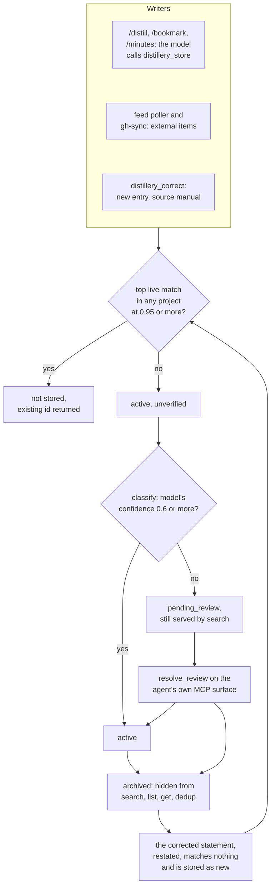

## 1. Executive Summary

Distillery is a team knowledge base for Claude Code: fifteen skills call an MCP
server that stores free-text entries in one DuckDB file and searches them with
BM25 and cosine similarity fused by rank. Its notable parts are the discipline
around its numbers and its read filter: a LongMemEval cell pre-registered
before any result landed, and an archived-entry filter that graph expansion
mirrors, with a populated test. Its weak part is correction. A corrected entry
is archived, the deduplicator does not look at archived entries, and the same
wrong statement stored a week later is accepted as new.

The product is a plugin, a server and a set of background feeds. A person runs
`/distill`, `/bookmark` or `/minutes`, and the model drafts an entry, checks it
against similar ones and stores it. Feeds and GitHub sync add external items on
a schedule. `/recall`, `/pour` and `/investigate` search it. Run over HTTP with
GitHub or GitLab OAuth, one store serves a whole organisation, and every member
reads every entry.

The quick starts in the README and docs set `DISTILLERY_EMBEDDING_PROVIDER`,
and no code reads that variable. Without a `distillery.yaml` the embedding
provider is the empty string, and the server constructs a provider that returns
a zero vector for every text (section 3).

The licence is Apache-2.0, in `LICENSE` and `pyproject.toml`.

Two marks are earned: `audit_log` on the row each MCP write tool appends, and
`negative_eval` on the archived-neighbour case under graph expansion. Section 9
gives the reason for each of the five withheld.

## 2. Mental Model

A memory is an **entry**: a block of prose with a type such as `session`,
`bookmark`, `reference` or `feed`, an author and project the caller names, tags,
and metadata (`src/distillery/models.py:278-350`). Entries are documents, not
extracted facts. Nothing in the server calls a language model; distillation,
classification and conflict judgement happen in the client model, steered by
skill prose.

An entry becomes memory when a caller stores it. The `/distill` skill is
user-invoked only (`disable-model-invocation: true`, `skills/distill/SKILL.md:10`)
and asks the model to show a preview first (`:65`); that request is prose, and
`distillery_store` is a plain tool. Before persisting, the handler runs
`find_similar` at 0.92 and refuses to store a candidate whose top match scores
0.95 or more, returning the existing id instead
(`src/distillery/mcp/tools/crud.py:488-570`,
`src/distillery/config.py:112`, `:153`).

An entry has three lifecycle states and three verification values, and the two
fields are independent (`src/distillery/models.py:72-101`).

- **`active`** is the default.
- **`pending_review`** is set when a classification's confidence is below 0.6
  (`src/distillery/mcp/tools/classify.py:178-179`). The confidence is about the
  entry's *type*, and the default read set includes this state
  (`src/distillery/mcp/tools/crud.py:1549`).
- **`archived`** is the soft delete. Update, correction, a review verdict, feed
  rescoring and a feed purge all reach it, and it hides the entry from search,
  list, get and the deduplicator.
- **`verification`** (`unverified`, `testing`, `verified`) is a field a caller
  sets and can filter on. Nothing filters on it by default.

A correction is a new entry with a `corrects` edge to the old one, which is
archived in the same transaction
(`src/distillery/store/duckdb.py:4428-4516`). No record is kept of the rejected
statement as a value.

## 3. Architecture

The server is one Python process around one DuckDB connection, with a second
read handle so searches do not queue behind writes
(`src/distillery/store/duckdb.py:1617-1672`). The store path may be a local
file, an S3 URL through `httpfs`, or MotherDuck; the default is
`~/.distillery/distillery.db` (`src/distillery/config.py:45`).

- **`store/`** holds the schema migrations and the DuckDB store with hybrid
  search, relations, the audit and search logs, and the bulk paths.
- **`mcp/`** holds the FastMCP server with 17 tools, OAuth providers for GitHub
  and GitLab, rate-limit and body-size middleware, and webhook routes.
- **`feeds/`** polls RSS and GitHub sources, scores relevance against the
  user's interests and syncs issues and pull requests.
- **`classification/`** parses a model's classification response and holds a
  heuristic classifier based on embedding centroids; it calls no model.
- **`eval/`** runs scenario evals through `claude` and the LongMemEval bench.
- **`skills/`** and **`.claude-plugin/`** are the client side.

The plugin's manifest registers a `SessionStart` and a `Stop` hook, and both
only `echo` a fixed line: the first names the skills, the second suggests
`/distill`, `/watch` or `/bookmark` (`.claude-plugin/plugin.json:12-35`).
Neither writes anything. The `/setup` skill can add a second `SessionStart`
hook, `scripts/hooks/distillery-hooks.sh`, which runs
`session_start_briefing.py`. That script finds the server, derives the project
from the basename of the git root, calls `distillery_list` for five recent
entries and three not accessed in 30 days, and prints at most three and two
60-character snippets (`scripts/hooks/session_start_briefing.py:795-812`,
`:874-891`). No hook captures a session or a transcript.

### Deployment and ergonomics

Local use is `uvx distillery-mcp` over stdio. The README says the default is
on-device `fastembed`, selected by `DISTILLERY_EMBEDDING_PROVIDER`
(`README.md:82-91`). The provider is read only from YAML: `EmbeddingConfig`
defaults it to `""` (`src/distillery/config.py:70`), a server with no config
file gets `DistilleryConfig()` (`:1845-1847`), and `_create_embedding_provider`
maps `""` to `StubEmbeddingProvider`, which returns `[0.0] * dimensions` for
every input (`src/distillery/mcp/server.py:116-152`,
`src/distillery/mcp/_stub_embedding.py:21-66`). `distillery_status` reports the
model name as `stub`. With every vector zero, cosine similarity carries no
information, so the vector arm, the 0.95 duplicate refusal and the conflict
check cannot discriminate, and BM25 is the only working arm. The variable has
the documented effect only for someone whose `DISTILLERY_CONFIG` file also
names the provider, as the docs' examples pair the two.

Jina and OpenAI need an API key; `fastembed` downloads an ONNX model on first
use. The store is a DuckDB file, queryable with the DuckDB CLI and not editable
as text. `distillery export` and `import` move it as JSON.

The team deployment is the same server over streamable HTTP with OAuth and an
optional organisation or group allow-list, deployed to Fly.io by a workflow.
`server.auth.provider` defaults to `none`, and an HTTP server started that way
logs a warning and serves everyone (`src/distillery/mcp/__main__.py:171-174`).
Scheduled work arrives over bearer-token webhooks: `/hooks/poll`,
`/hooks/rescore`, `/hooks/classify-batch` and `/api/maintenance`
(`src/distillery/mcp/webhooks.py:1760-1766`).

## 4. Essential Implementation Paths

- **Store.** `distillery_store` resolves the authenticated login, calls
  `_handle_store`, then `_audit` (`src/distillery/mcp/server.py:389-481`).
  `_handle_store` validates the type, metadata schema and reserved tags, checks
  the size and embedding budgets, runs the duplicate check, persists, and runs
  the conflict check (`src/distillery/mcp/tools/crud.py:277-680`).
  `_sync_store` inserts the row, fans out `related_entries` from metadata,
  optionally auto-links neighbours, rebuilds the FTS index and checkpoints
  (`src/distillery/store/duckdb.py:1959-2023`).
- **Search.** `_handle_search` builds filters, applies the default status
  filter, calls `store.search`, and optionally `_expand_search_with_graph`
  (`src/distillery/mcp/tools/search.py:188-256`, `:307-420`). `search` runs the
  vector query, then BM25, fetches BM25-only hits under the same filters, and
  fuses (`src/distillery/store/duckdb.py:2709-2903`).
- **Similarity.** `find_similar` is a cosine scan above a threshold that
  excludes archived entries and takes no other filter
  (`src/distillery/store/duckdb.py:2922-2981`). It serves the duplicate check,
  the conflict check and the `distillery_find_similar` tool.
- **Update.** `_handle_update` accepts content, type, author, project, tags,
  status, verification, metadata, expiry and session id, and the store
  re-embeds on a content change (`src/distillery/mcp/tools/crud.py:1353-1390`).
- **Correct.** `_handle_correct` builds the new entry with
  `source=EntrySource.MANUAL` and calls `apply_correction`
  (`src/distillery/mcp/tools/crud.py:2162-2275`,
  `src/distillery/store/duckdb.py:4428-4516`).
- **Classify and review.** `_handle_classify` sets type and status from the
  caller's confidence; `_handle_resolve_review` approves, reclassifies or
  archives (`src/distillery/mcp/tools/classify.py:129-240`, `:241-420`).
- **Relations.** `distillery_relations` adds, retires, revalidates, removes and
  traverses edges, lists and resolves candidate edges, suggests links and
  promotes entity tags to entries (`src/distillery/mcp/tools/relations.py`).
- **Ownership and audit.** `_own` and `_audit` wrap the mutating tools
  (`src/distillery/mcp/server.py:351-387`).
- **Feeds.** `FeedPoller` stores items as `feed` entries with source `import`
  and archives those whose rescored relevance falls below the threshold
  (`src/distillery/feeds/poller.py:553-554`, `:1284-1287`).

## 5. Memory Data Model

**Entries.** `id`, `content`, `entry_type`, `source`, `author`, `project`,
`tags`, `status`, `metadata`, `created_at`, `updated_at`, `version`,
`embedding FLOAT[n]`, `created_by` and `last_modified_by`
(`src/distillery/store/migrations.py:39-56`), later joined by `accessed_at`,
`expires_at`, `verification` and `session_id`. The embedding width is fixed at
creation, so changing provider means a new database.

**Scope fields.** `project` is a nullable string, `author` is whatever the
caller passes (the skills use `git config user.name`), and `created_by` is the
OAuth login when there is one (`skills/CONVENTIONS.md:84-90`). Tags are
lowercase slash-separated paths validated on construction
(`src/distillery/models.py:114-155`).

**Provenance.** `source` is one of six labels. Its docstring calls `inference`
*"lower trust"*, and no read consults it except an explicit filter. A
correction is always labelled `manual`, the label the enum reserves for a human
operator, whether a person or the model made it
(`src/distillery/mcp/tools/crud.py:2269`).

**Time.** `created_at` and `updated_at` are record times; `accessed_at` is
stamped by a deferred flusher after reads; `expires_at` is set by the caller
and only surfaces an entry in the stale list
(`src/distillery/mcp/tools/analytics.py:1063-1097`). An expired entry is still
searched.

**Relations.** `entry_relations` holds `from_id`, `to_id`, `relation_type` and
`created_at`, then `weight`, `valid_at`, `invalid_at` and `metadata`
(`src/distillery/store/migrations.py:126-133`, `:692-697`). Reads keep edges
whose window contains the current time (`src/distillery/store/duckdb.py:101-108`).
Candidate edges carry `metadata.review_status = "pending"` and are excluded from
traversal (`:4597-4601`).

**Logs.** `audit_log` (section 9), `search_log` with query and result ids,
`feedback_log` with implicit signals, and `_meta` for schema version, embedding
model and webhook audit records (`src/distillery/store/migrations.py:82-113`).

There is no entry history: an update overwrites content and bumps `version`.

## 6. Retrieval Mechanics

**Search is hybrid by default.** The vector arm orders by cosine distance
through the HNSW index when there is no filter, and by an exact cosine scan
when there is one, because DuckDB's HNSW filters after the index scan. It takes
three times the limit as candidates. BM25 runs over the FTS index for the same
count, BM25-only hits are fetched under the same filters, and the two rank
lists are fused with `1 / (60 + rank)` each, multiplied by a recency weight
that is 1.0 for 90 days and falls linearly to 0.5
(`src/distillery/store/duckdb.py:2690-2707`, `:2745-2884`). The displayed score
is the cosine similarity mapped to [0, 1], not the fused score.

**Default status filter.** Search and list add `status IN ('active',
'pending_review')` unless the caller passes a status, `status="any"` or
`include_archived` (`src/distillery/mcp/tools/crud.py:1976-2019`).

**Graph expansion.** With `expand_graph`, each seed's live relations are walked
one or two hops, each neighbour scored at half its parent, and neighbours whose
status the seed filter would have hidden are dropped
(`src/distillery/mcp/tools/search.py:307-420`). Type, project, tags and author
are not re-applied. A search for project `a` with expansion returns any
neighbour an edge reaches, in any project.

**Session-start injection** is the briefing hook from section 3: a few
snippets, scoped by the git root's name, printed at session start if `/setup`
installed the hook. Everything else is tool-mediated. `/recall` and `/pour`
pass a project only when the user names one (`skills/pour/SKILL.md:55-81`).

**Token cost.** The search tool returns summaries by default
(`src/distillery/mcp/tools/search.py:169`), with full content on request.
Nothing is injected per turn.

## 7. Write Mechanics

A store blocks the caller on up to three embeddings (candidate, duplicate check,
conflict check), the insert, and a rebuild of the whole FTS index followed by a
checkpoint (`src/distillery/store/duckdb.py:518-572`, `:1959-2023`). DuckDB's
FTS has no incremental update, so each single write costs time proportional to
the store; the bulk path defers the rebuild. Once the call returns, the entry is
searchable.

**Duplicates and conflicts.** The duplicate check returns up to five entries at
0.92 or above; at 0.95 the store is refused. Between the two, the response
carries a hint and the entry is stored. The conflict check returns entries at
0.60 or above, with an optional prompt for the model to judge them through
`distillery_find_similar(conflict_check=true)`
(`src/distillery/mcp/tools/crud.py:623-660`). Both checks span every project
and skip archived entries.

**Correction.** `distillery_correct` writes a new active entry, a `corrects`
edge and the old entry's archival in one transaction. The old text survives in
the archived row and is reachable with `include_archived`.

**Feeds and sync.** The poller stores items whose relevance passes a threshold,
deduplicates by external id and by similarity, and on rescoring archives items
that fall below it. GitHub sync materialises issues and pull requests with
citation edges. In a team deployment these are the largest writers, and none
of them writes an audit row.

**Batch classification.** `/hooks/classify-batch` classifies `inbox` entries by
heuristic or through `state["llm_client"]`. Only tests assign that key, so in
the default `llm` mode every batch entry is written back as `pending_review`
with a warning (`src/distillery/mcp/webhooks.py:1158`, `:1237-1247`,
`:1285-1292`).

**Deletion.** `distillery_update(status="archived")` is the delete. The archived
row keeps its content and embedding. The CLI `import --mode replace` runs
`DELETE FROM entries` before restoring (`src/distillery/cli.py:1391-1394`);
nothing else removes an entry. `remove` on a relation is a hard delete;
`retire` sets `invalid_at`.

### Operational cost

The server calls no language model. Embedding is local with `fastembed` or one
HTTP call per text with Jina or OpenAI, under an optional daily budget whose
default of 0 sets no ceiling (`src/distillery/config.py:474`). The per-write FTS
rebuild is the cost that grows with the store. No pass rewrites the whole
store; rescoring reads feed entries and updates their metadata.

## 8. Agent Integration

The model sees 17 tools (`src/distillery/mcp/server.py`). Every write tool is
on the same surface as the reads, including `distillery_resolve_review` and the
relation-candidate verdicts. Skills narrow which tools each one uses through
`allowed-tools`, and `/distill` is invocable only by the user. The model
supplies `author`, `project` and `source` as arguments.

`.claude/settings.local.json` in the repository is a permission allowlist that
pre-approves every `distillery_*` tool and a few shell commands. It ships in
the tree, not in the plugin.

Adapting the server to another MCP client is direct; the skills are
Claude-Code-specific prose.

## 9. Reliability, Safety, and Trust

### Correction does not hold

`find_similar` excludes archived rows by design, and its test says why:
*"an archived entry is conceptually removed, so it must not be returned as a
near-duplicate match"* (`tests/test_store_integration.py:313-337`). The
duplicate check and the conflict check both use it. So the statement a
correction archived matches nothing the next time it is stored, is persisted
as a new active entry, and ranks against the correction on equal terms. The
`corrects` edge links two records; nothing compares a new candidate with the
archived one.

### Scope is a facet

`project` is applied as a predicate on both search arms and on list when a
caller passes it. Three paths do not take it: `distillery_find_similar` has no
project parameter (`src/distillery/mcp/server.py:1066-1078`), graph expansion
re-applies only status, and the duplicate refusal can answer a store in project
`b` with the id of an entry in project `a`. Over HTTP, reads carry no identity
predicate. `_own` refuses an update, correction, classification or review by a
user other than `created_by`, and passes when `created_by` is empty, which it
is for every feed, sync and stdio-era entry
(`src/distillery/mcp/server.py:351-370`). `distillery_relations` has no
ownership check.

### The audit log

Each of six write tools appends a row with login, tool, entry id, action and
outcome after the handler returns (`src/distillery/mcp/server.py:372-387`). The
row holds no content. The write is a separate statement, and its failure is
logged at debug level and ignored. `_audit` derives success from the response
having no `error`, so a store refused as a duplicate is recorded as a
successful `store` against the existing entry's id
(`src/distillery/mcp/server.py:479-480`,
`src/distillery/mcp/tools/crud.py:557-561`). `docs/architecture.md:310` says
all tool invocations are recorded; classify, relations, watch, sync and
configure are not.

`_gather_audit` in `analytics.py` reads the table for a metrics scope, and its
handler is called from `src/distillery/eval/mcp_bridge.py:659` and from no
server tool. `docs/getting-started/mcp-setup.md:93` calls the audit view
operator-only.

### Marks

- **`audit_log` — earned.** A named table in the store, appended by every
  write tool on the MCP surface and by the ownership guard, and never updated
  or deleted by code. The limits are above: no content, best-effort, and the
  background writers absent.
- **`negative_eval` — earned.** `test_expand_graph_excludes_archived_neighbours_by_default`
  links an archived neighbour to an active seed and requires the seed present
  and the neighbour absent under both provenances; its twin requires the
  neighbour back with `include_archived`. The default list case requires
  exactly two of three seeded entries.
- **`scope_enforced` — withheld.** The project key reaches the search SQL on
  request. `distillery_find_similar`, a retrieval tool on the same surface,
  declares no project, and graph expansion drops it, so two of the agent's
  read paths return entries from any project. No read path carries a user
  predicate.
- **`trust_state` — withheld.** The state that withholds an entry is
  `archived`, the soft delete shared by deletion, correction, feed pruning and
  review. `pending_review` measures doubt about the type, not the content, and
  is served by default. `verification` is read only when a caller filters on
  it; `/briefing` lists `testing` entries in a section of their own.
- **`tombstone` — withheld.** No record keyed on a rejected value exists, and
  the archived row is invisible to the duplicate check that would consult it.
- **`bitemporal` — withheld.** Entries carry record time only. Relations carry
  `valid_at` and `invalid_at` beside `created_at`, and every read evaluates the
  window at the current time. `retire` writes the moment of retirement into
  `invalid_at` unless the caller supplies a time, `revalidate` clears it, and
  no column records when the system learned an edge had ended
  (`src/distillery/store/duckdb.py:4701-4742`). No skill passes either field.
- **`human_review` — withheld.** The review queue holds `pending_review`
  entries until `distillery_resolve_review` resolves them, and that tool is on
  the agent's surface. Its `reviewer` argument is client-supplied, and `_own`
  checks only that the caller created the entry, so the agent that stored and
  classified an entry can approve it.

### Prompt injection

Feed items, bookmarked pages and synced issues are stored as entries and
returned by the same search as `/distill` entries, labelled by type and source.
No filter or render step treats external text differently.

## 10. Tests, Evals, and Benchmarks

CI runs `pytest -m "not bench"` with an 80% coverage floor
(`.github/workflows/ci.yml:46-47`). Tests use an in-memory DuckDB, so the suite
needs no service. I ran nothing from the repository.

What the memory tests cover:

- default exclusion of archived entries from list and search, and the opt-ins
  (`tests/test_list_archived_default.py`);
- graph expansion's hop limits, discounts and archived-neighbour exclusion
  (`tests/test_mcp_tools/test_search_expand_graph.py`);
- correction archiving the original, inheriting or overriding fields, refusing
  an archived target, and chaining (`tests/test_corrections.py:29-182`);
- the duplicate check's thresholds and responses (`tests/test_dedup.py`,
  `tests/test_store_dedup_response.py`);
- ownership refusals and the auth audit callback (`tests/test_mcp_auth.py`);
- relation retirement, candidates and backfill (`tests/test_relations*.py`).

What the tests do not establish:

- `test_search_filter_by_project` loops over the results asserting each is in
  the project, which passes on an empty result
  (`tests/test_duckdb_store.py:391-396`). No populated case asserts a project
  boundary on search.
- `test_default_search_excludes_archived` asserts only that no returned status
  is `archived` (`tests/test_list_archived_default.py:161-171`).
- No test stores a value, corrects it, stores the original again and asserts
  anything. `test_find_similar_excludes_archived` pins the behaviour that lets
  it through, over a store holding only the archived entry.
- No test drives `_audit`.

**The LongMemEval bench.** `bench/HEADLINE.md` pre-registers one cell
(hybrid, session granularity, recency on, `bge-small`) and requires the
triplet R@5, R@10 and NDCG@10 together. `bench/LIMITATIONS.md` says these are
retrieval diagnostics and not the QA accuracy of
[arXiv:2410.10813](https://arxiv.org/abs/2410.10813) (LongMemEval, submitted
14 October 2024). The committed summary for the headline run of 18 May 2026
reports 0.970, 0.990 and 0.885 over 100 questions, 30 multi-session and 70
single-session-user, at git `fce1688c85df`
(`bench/results/summary_longmemeval_hybrid_session_on_bge-small_20260518T090851Z.json`).
R@5 recomputes from the two per-type rows. The 100 are the first 100 of the
dataset (`questions[:limit]`, `src/distillery/eval/longmemeval.py:770-771`, and
`limit: 100` in the summary), and only two of its question types appear
among them. Each question builds a fresh in-memory store with no project, no
archived entries and no relations, so the bench measures the hybrid ranker and
none of the mechanisms in section 9. No paper describes Distillery itself.

## 11. For Your Own Build

### Steal

- **Pre-register the benchmark cell and publish a triplet.** Fixing the
  configuration and the metrics before any result lands, with an ADR required
  to change them, removes the choice of best cell after the fact.
- **Mirror the seed filter into expansion.** When a search follows edges,
  re-test each neighbour against the predicates the seed query used, and test
  it with a neighbour only the expansion can reach. Do it for every predicate,
  not only status.
- **Correction as a linked new record.** Writing the correction, the edge and
  the archival in one transaction keeps both versions and the reason the old
  one stopped counting.
- **A duplicate refusal that returns the existing id.** The caller learns
  where its content already lives.

### Avoid

- **A deduplicator that cannot see what was retracted.** Excluding archived
  rows from the duplicate check is right for merging and wrong for correction.
  Check new candidates against corrected values separately and refuse or flag
  a match.
- **Configuration documented in one place and read in another.** An
  environment variable the code never reads, with a silent fallback to a zero
  vector, gives a working server whose semantic search does nothing.
- **A review verb on the reviewed agent's tool surface.** A queue the producer
  can clear records approvals nobody gave.
- **An audit outcome computed from the absence of an error.** Record what the
  handler did (stored, skipped, refused), not whether it raised.

### Fit

This suits a small team already working in Claude Code that wants a shared,
searchable record of decisions, meeting notes and bookmarks, plus feeds, on
one server it can run. The design assumes trusted colleagues: everyone in the
organisation reads everything, only some tools check ownership, and the model
is the classifier and the conflict judge. Walk away if projects must be
isolated from each other, if a correction has to stay corrected, or if an
operator needs to reconstruct what an entry said before an update.

## 12. Open Questions

- What DuckDB's `array_cosine_similarity` returns for two zero vectors, and so
  how the stub provider's vector arm orders results and whether any threshold
  comparison passes.
- Whether the briefing hook's project, the git root's basename, matches the
  project the skills store under when `--project` is given.
- Whether the Fly.io deployment names a provider in YAML, which would make the
  hosted demo semantic while the local quick starts are not.
- What is meant to populate `state["llm_client"]` for batch classification.

## Appendix: File Index

- Schema and store: `src/distillery/store/migrations.py`,
  `src/distillery/store/duckdb.py`, `src/distillery/models.py`
- MCP tools and wrappers: `src/distillery/mcp/server.py`,
  `src/distillery/mcp/tools/crud.py`, `src/distillery/mcp/tools/search.py`,
  `src/distillery/mcp/tools/classify.py`,
  `src/distillery/mcp/tools/relations.py`
- Embedding and configuration: `src/distillery/mcp/_stub_embedding.py`,
  `src/distillery/embedding/`, `src/distillery/config.py`
- Auth and middleware: `src/distillery/mcp/auth.py`,
  `src/distillery/mcp/gitlab_auth.py`, `src/distillery/mcp/middleware.py`,
  `src/distillery/mcp/__main__.py`
- Background: `src/distillery/feeds/poller.py`,
  `src/distillery/feeds/github_sync.py`, `src/distillery/mcp/webhooks.py`
- Hooks and skills: `.claude-plugin/plugin.json`, `scripts/hooks/`,
  `skills/distill/SKILL.md`, `skills/CONVENTIONS.md`, `skills/setup/SKILL.md`
- Bench: `bench/`, `src/distillery/eval/longmemeval.py`
- Tests: `tests/test_list_archived_default.py`,
  `tests/test_mcp_tools/test_search_expand_graph.py`,
  `tests/test_store_integration.py`, `tests/test_corrections.py`,
  `tests/test_query_audit_log.py`, `tests/test_duckdb_store.py`

### Recorded searches

Run from the repository root at the pinned commit with `/usr/bin/git grep`.

- **No code reads the documented embedding variable.**
  `git grep -n 'DISTILLERY_EMBEDDING_PROVIDER' -- src scripts tests .claude-plugin server.json`
  returns nothing; the same pattern over `README.md` returns three lines.
- **The only hard delete of entries is the import.**
  `git grep -n -E 'DELETE FROM entries' -- src` returns
  `src/distillery/cli.py:1393`.
- **Nothing edits the audit log.**
  `git grep -n -i -E '(DELETE FROM|UPDATE|TRUNCATE)[[:space:]]+audit_log' -- .`
  returns nothing; `git grep -n -E 'INSERT INTO audit_log' -- src` returns
  `src/distillery/store/duckdb.py:3471`.
- **The relations tool writes no audit row.**
  `awk 'NR>=1356 && NR<=1490' src/distillery/mcp/server.py | grep -c _audit`
  prints 0.
- **find_similar takes no project.**
  `awk 'NR>=1066 && NR<=1078' src/distillery/mcp/server.py | grep -c project`
  and `awk 'NR>=2922 && NR<=2981' src/distillery/store/duckdb.py | grep -c project`
  both print 0.
- **Graph expansion applies no filter other than status.**
  `awk 'NR>=307 && NR<=420' src/distillery/mcp/tools/search.py | grep -c -E 'project|filters'`
  prints 0.
- **No value-keyed rejection.**
  `git grep -n -i -E 'tombstone|blocklist|denylist|do_not_(store|remember)|rejected_value' -- src`
  returns nothing.
- **No default read filters on verification.**
  `git grep -n -E "verification[[:space:]]*(=|!=)[[:space:]]*.(verified|unverified|testing)" -- src`
  returns nothing; the same shape for status,
  `git grep -n -E "status[[:space:]]*(=|!=)[[:space:]]*.(archived|pending_review)" -- src`,
  matches `src/distillery/mcp/tools/analytics.py:448`.
- **llm_client is assigned only in tests.**
  `git grep -n -E '\[.llm_client.\] *=' -- .` returns two lines of
  `tests/test_webhooks/test_classify_batch.py`.
- **The audit metrics handler has no server caller.**
  `git grep -n -E '_handle_metrics\(' -- src` returns
  `src/distillery/eval/mcp_bridge.py:659` and
  `src/distillery/mcp/tools/relations.py:390`, the second being the relations
  module's own graph-metrics function of the same name.
- **No skill sets relation validity.**
  `git grep -n -E 'valid_at|invalid_at' -- skills` returns nothing.
- **No submodules.** `.gitmodules` is absent.
- **No paper on Distillery.**
  `git grep -n -i -E 'arxiv|bibtex|@article|@misc|doi\.org|zenodo' -- . ':!uv.lock'`
  returns the LongMemEval citation in `bench/` and `docs/benchmarks.md` and one
  test fixture string.

## History

**2026-11-24** — [`c5ad2e45ff6be07335892bc479498117bf33fda6`](https://github.com/norrietaylor/distillery/commit/c5ad2e45ff6be07335892bc479498117bf33fda6). First reading, from a full clone at the head of `main`. Screened first: four auto-run surfaces, the plugin manifest whose `SessionStart` and `Stop` hooks only echo a line, two `.claude` settings files holding an env var and a permission allowlist, and `server.json`; `uv.lock` inside the seven-day cooldown; the `Makefile` and `tests/conftest.py` execute; `CLAUDE.md`, skills and docs were read as data. Nothing was installed, built or run, and the test functions were not run. Two marks: `audit_log` and `negative_eval` ([section 9](#9-reliability-safety-and-trust)). A corrected value can be stored again, and the documented embedding variable is read by no code.
