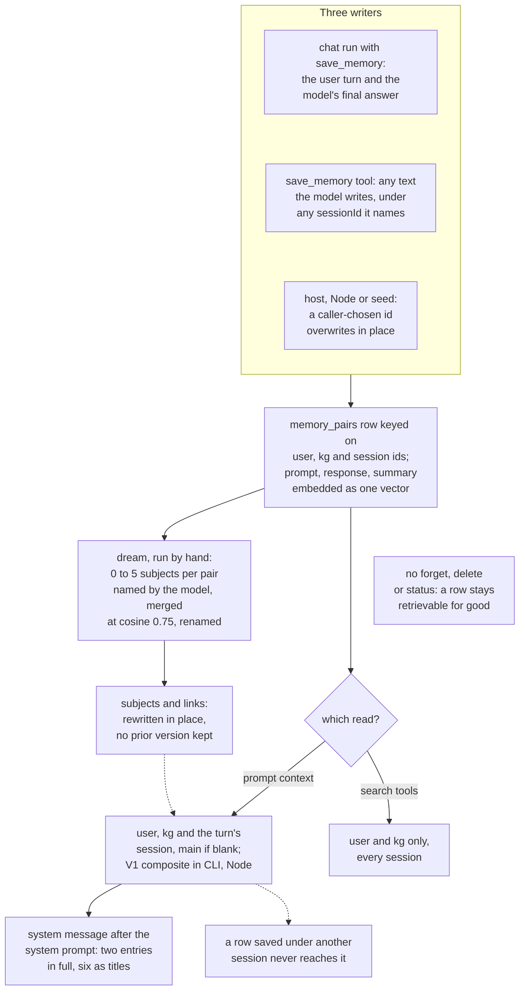

## 1. Executive Summary

Ditto Harness is the memory and agent library extracted from the Ditto
assistant's backend. The Rust crate stores each user prompt and assistant reply
as one embedded pair in a local Turso file and ranks pairs by a composite of
cosine, recency and a model-built subject graph. It injects the top ones into
the next turn and exposes the store as five agent tools. What is
notable is the ranker's clarity and the scope discipline: every signal is
documented with its normalisation, and the user and graph keys reach every SQL
read from the host rather than from the model. What is weak is correction.
Nothing in the tree deletes, forgets, expires or marks a memory, so a wrong
pair is recalled until someone edits the database.

The crate is the reference dependency for miners on Bittensor subnet 118, who
build against it through a separate starter kit. That kit, and the closed Ditto
backend this was extracted from, are outside the tree. The memory itself is
not: storage, ranking, extraction and injection are all here, in a local file.

The production-parity path the README describes, the V2 composite with learned
weights and a cross-encoder rerank, is reached by no entry point in this tree.
The CLI and the Node binding run the V1 composite with fixed weights, no
predictor and no reranker, and no model file is committed.

Two marks: `scope_enforced` on the user and kg keys, and `negative_eval` on the
session filter. Section 9 gives the reason for each of the five withheld.

## 2. Mental Model

A memory is **one exchange**: the user's prompt and the assistant's reply,
stored whole with an optional title and summary and embedded as a single
vector of `prompt\nresponse\nsummary`
(`crates/harness/src/memory/mod.rs:217-221`). Nothing is extracted from it at
write time. It also records which memories were in context when it was written
(`seed_memories`) and the retrieval weights used to find them
(`crates/harness/src/db/mod.rs:49-71`).

A pair enters the store by three routes. The chat facade saves the user turn
and the model's final answer after the loop, with source `chatv2`
(`crates/harness/src/chat.rs:206-230`). The model's `save_memory` tool stores
whatever prompt, response, summary, session and subjects it supplies, with
source `agent_tool` (`crates/harness/src/memory/tools.rs:158-189`). A host, the
CLI's `seed` and the Node binding call `Store::save_memory` directly, and may
choose the public pair id (`crates/node/src/lib.rs:262-301`).

The second layer is the **subject graph**. The dream pipeline, run by hand,
asks a model for zero to five durable subjects per recent pair, merges each
into the user's closest existing subject at cosine 0.75 or above by appending
its description, links subjects to pairs, and has the model rename and rewrite
any subject whose description accumulated merges
(`crates/harness/src/dream.rs:138-277`). Subjects affect ranking, not what is
true.

No memory has a state. Every stored pair is equally a candidate on every read,
whatever wrote it. A pair stops being recalled only by falling out of the
ranking or by an overwrite under the same public id, which keeps the row's old
subject links (`crates/harness/src/db/mod.rs:192-208`). Subjects change in
place and keep no prior version.

## 3. Architecture

The harness is a library crate with two thin shells. Nothing has to run except
the embedder and the chat model: the store is one Turso file opened with
`turso::Builder::new_local`, and the schema is five tables and six indexes,
each an idempotent `IF NOT EXISTS` statement applied on every open (`crates/harness/src/db/mod.rs:43-157`).

- **`crates/harness`** holds the store (`memory/`), the ranker (`retrieval/`),
  the dream pipeline (`dream.rs`), the agent loop (`agent/`), the chat facade
  (`chat.rs`), model and embedder clients over `rig-core` (`models/`) and the
  database layer (`db/`).
- **`crates/cli`** builds a `ditto-harness` binary with `seed`, `dream`,
  `search`, `subjects` and `chat`, defaulting to `--db ditto-harness.db` and
  `--user local` (`crates/cli/src/main.rs:25-52`).
- **`crates/node`** is a napi-rs binding with `open`, `seedUser`,
  `saveMemory`, `searchMemories`, `searchSubjects`, `dream` and `chat`
  (`crates/node/src/lib.rs:215-425`).

Vector search is a brute-force scan of the user's rows with
`vector_distance_cos`, deliberately with no HNSW index
(`crates/harness/src/db/mod.rs:13-17`). The embedding contract is fixed at 768
dimensions, and a vector of any other length is refused on write and on query
(`:543-563`). Each overlapping operation opens its own connection, because one
Turso connection refuses concurrent use (`:119-165`).

### Deployment and ergonomics

The CLI and the Node binding embed through a local Ollama server with
`embeddinggemma` (`crates/cli/src/commands/util.rs:27-44`). Chat runs on
Ollama by default, or on OpenRouter, vLLM or another OpenAI-compatible
endpoint with a key. Storing a memory therefore needs an embedder; the Node
binding's `embedder: "hash"` option substitutes a deterministic bag-of-words
stub for tests (`crates/node/src/lib.rs:227-235`).

Install is a Cargo build or a git dependency pinned to a commit; the README
publishes no crate version. The store is an ordinary SQLite-dialect file and
is readable with a SQL shell, which is also the only way to remove a memory
from it.

## 4. Essential Implementation Paths

- **Capture.** `Harness::run` calls `prepare`, runs the loop with
  `save_memory: false`, then calls `Store::save_memory` with the user input,
  the final text, the seed nodes and the retrieval metadata from preparation
  (`crates/harness/src/chat.rs:188-236`). `Store::save_memory` embeds once,
  upserts the user, upserts the pair, then embeds and upserts each non-blank
  subject and links it, each as its own statement
  (`crates/harness/src/memory/mod.rs:203-290`).
- **Extraction and consolidation.** `Dreamer::dream` loads the newest 128
  pairs and every subject of the user, runs one extraction prompt per pair at
  concurrency 2, writes the extracted summary onto pairs that have none,
  merges or inserts subjects in `dedup_or_create_subject`, links them, and
  runs `refine_subjects` over merged descriptions
  (`crates/harness/src/dream.rs:138-277`, `:307-510`).
- **Retrieval.** `Store::search_memories` runs one vector query per query
  string and deduplicates (`crates/harness/src/memory/mod.rs:294-330`).
  `Store::search_composite_memories` predicts weights, calls
  `retrieval::composite_retrieve`, fetches the full rows and applies the
  optional reranker (`:337-421`). `composite_retrieve` pulls a candidate pool
  by cosine, pulls subject links and global link counts, and scores in Rust
  (`crates/harness/src/retrieval/mod.rs:308-357`, `:422-552`, `:558-699`).
- **Context assembly.** `Store::get_prompt_memories` runs long-term retrieval,
  then lists recent memories of the session excluding what long-term returned,
  and builds the JSON payload (`crates/harness/src/memory/prompt_context.rs:149-245`).
  `memory_context_message` wraps it as a system message and
  `insert_after_system` places it before the first non-system message
  (`crates/harness/src/chat.rs:270-352`).
- **Update and delete.** `Db::create_memory_pair` is an upsert on
  `(user_id, firestore_pair_id)` that rewrites every content column and keeps
  `id` (`crates/harness/src/db/mod.rs:182-240`). There is no delete path
  (appendix, *Recorded searches*).
- **Schema.** `SCHEMA_STATEMENTS` (`crates/harness/src/db/mod.rs:43-117`).
- **Tools.** `memory_tools_with` returns `save_memory`, `search_memories`,
  `search_subjects`, `search_memories_in_subjects` and `fetch_memories`, each
  closing over `ToolOptions` (`crates/harness/src/memory/tools.rs:35-101`).
- **Retrieval log.** `log_event` inserts a `retrieval_events` row with the
  query text, its embedding, the returned ids and the weights when the caller
  sets `log_event` (`crates/harness/src/retrieval/mod.rs:719-748`).

## 5. Memory Data Model

**The pair.** `memory_pairs` holds a row UUID `id`, a public
`firestore_pair_id`, `user_id`, `kg_id`, `session_id`, `title`, `description`
(the summary), `prompt`, `response`, `input` and `output` as JSON content
parts, `source`, `source_context`, `timestamp`, `timezone_offset`,
`seed_memories`, `retrieval_metadata`, `conversation_embedding`,
`created_at` and `updated_at`, unique on `(user_id, firestore_pair_id)`
(`crates/harness/src/db/mod.rs:49-71`). The module header warns that the link
table references the row UUID while tools and exclusion lists speak the public
id, and that custom SQL mixing them matches nothing (`:19-27`).

**Subjects and links.** `subjects` holds the text, a description, an
`is_key_subject` flag and an embedding, unique on
`(user_id, kg_id, subject_text)`; `subject_memory_pair_links` joins subject to
pair row with the user and kg repeated (`:72-91`). `is_key_subject` is set on
first link and returned to callers; no query filters or ranks on it.

**Scope.** `user_id` references `harness_users`, and `kg_id` defaults to
`user_memories_<user_id>` (`crates/harness/src/types.rs:17-25`). A host may
give one user several kg ids. `session_id` is nullable, and every session read
treats null as `main`.

**Time.** `timestamp` is when the exchange happened and is set by the caller;
seeds and the Node binding backdate it with `daysAgo`. `created_at` and
`updated_at` are record times. No column records when a fact held.

**Provenance.** `source` names the writer (`chatv2`, `agent_tool`,
`agent_loop`, `node`, or a host's value), and `seed_memories` and
`retrieval_metadata` record what was in context. None of them is read by
retrieval, and none reaches the injected payload.

**Retrieval events.** `retrieval_events` keeps the user, kg, session, request
path, query text, query embedding, returned ids, weights and auxiliary features
of each logged composite retrieval (`:92-104`). It is a record of reads, there
for training the weight predictor, and nothing in the tree reads it outside
tests.

## 6. Retrieval Mechanics

**Two readers, two session rules.** The prompt path resolves a blank session to
`main` and passes it to long-term retrieval, so automatic recall sees only the
current session's pairs and pairs with no session
(`crates/harness/src/memory/prompt_context.rs:156-158`, `:210-245`,
`crates/harness/src/db/mod.rs:381-387`). The `search_memories` tool passes no
session and searches all of the user's pairs. Its schema hides `sessionId`
because a model that invents `default` or `main` gets nothing back from a
corpus partitioned per transcript (`crates/harness/src/memory/tools.rs:222-227`,
commit `f63422f`, 28 October 2026).

**Plain search.** Cosine similarity of at least 0.15, ordered by distance then
newest, eight results by default (`crates/harness/src/memory/mod.rs:35-39`).
This is the facade's default, since `use_composite` defaults to false
(`crates/harness/src/chat.rs:62-71`). The CLI and Node chat set it true.

**Composite search.** A candidate pool of `max(32, limit × 4)` nearest pairs is
scored as a weighted sum (`crates/harness/src/retrieval/mod.rs:5-27`):

- V1, the default variant: cosine 0.65, linear recency 0.20 and subject
  frequency 0.15 (`:130-133`). Recency is min-max over the pool, and frequency
  is the sum of global link counts of a pair's subjects over the pool maximum,
  so both scores move when the pool changes.
- V2 adds exponential recency with a 14-day time constant, the best cosine
  between the query and a linked subject, a binary session match, and the
  number of pool pairs sharing a subject, under a `scale` factor.

A `WeightPredictor` may supply per-query weights; `MlpPredictor` loads a binary
model from a path or reader, and a `Reranker` reorders a pool of 20
(`crates/harness/src/retrieval/mod.rs:240`). No in-tree caller loads a model,
implements a reranker or selects V2 (appendix, *Recorded searches*).

**Subject tools.** `search_subjects` is cosine over the user's subjects at 0.10.
`search_memories_in_subjects` takes a subject id from the model and searches
only the pairs linked to it, filtering the user but not the kg
(`crates/harness/src/db/mod.rs:454-485`).

**Injection.** Long-term results go into `{"memories": [...]}`: the first two in
detail, with the summary if any or else the full user and assistant text, and
the rest as titles, where a title falls back to the summary and then the full
prompt (`crates/harness/src/memory/prompt_context.rs:286-318`, `:334-378`). A
chat-saved pair has no summary until a dream writes one, so the first two
entries carry both texts whole and the other six carry whole prompts. Nothing
truncates them. Short-term recall is off unless the caller sets
`short_term_limit` (`:91-92`).

The payload goes in a system message after the leading system block, ahead of
the conversation history (`crates/harness/src/chat.rs:338-352`). It is
recomputed from the user input on every turn.

## 7. Write Mechanics

Writes are synchronous. `save_memory` calls the embedder and then writes, and
the facade's save runs after the loop and before `run` returns. A pair is
retrievable as soon as the call returns. The subject graph lags until someone
runs the dream.

**What gets stored.** The facade stores the user input and the model's final
answer, so the assistant's own statements are recalled later as part of the
memory, under the key `ditto`. The `save_memory` tool stores text the model
composes in both the `prompt` and `response` fields, so a model can write a
user statement that the user never made. Neither path filters content, and
the injected payload does not show `source`.

**The session the model can choose.** `save_memory` still advertises
`sessionId` (`crates/harness/src/memory/tools.rs:141`). A memory saved under
any session other than the current one, or `main` when the turn has none, is
invisible to prompt recall and visible only through the search tool. The
commit that hid the field from `search_memories` left it on the write.

**Overwrite.** An upsert on an existing public pair id rewrites the content,
the embedding and the summary and keeps the row id
(`crates/harness/src/db/mod.rs:192-208`). Subject links are keyed on the row id,
so the old content's subjects stay linked to the new content. Only a direct
library or Node caller can pass the id; the tool cannot.

**The dream.** Extraction asks for strict JSON with a summary and up to five
subjects, and parsing skips malformed entries
(`crates/harness/src/dream.rs:696-712`, `:740-780`). A subject merges into the
nearest existing one at cosine 0.75 by appending its description after `" | "`.
Refine asks the model for a 2-5 word name and a 1-3 sentence summary, keeps
the old name if the new one is taken, re-embeds, and overwrites
(`:398-510`). Two different entities within 0.75 become one subject, and the
merge cannot be undone because the prior text is gone.

**Partial writes.** `save_memory` issues the user upsert, the pair upsert and
each subject upsert and link as separate statements with no transaction, so a
failure after the pair write leaves a pair without its subjects
(`crates/harness/src/memory/mod.rs:228-287`).

### Operational cost

A turn with memory costs one query embedding and one brute-force cosine scan
over the user's pairs, plus, for the composite, two link queries and in V2 one
subject cosine query. A save costs one embedding, plus one batched embedding
for subjects. The scan grows with the user's pairs, and nothing ever removes
one. A dream run makes one model call per pair among the newest 128 and one per
merged subject, and re-reads all of the user's subjects into memory. Because
the injected block is unbounded and placed before the history, a changed
recall set changes the prompt from the system message onward.

## 8. Agent Integration

The model holds five tools when the host sets `include_memory_tools`
(`crates/harness/src/chat.rs:250-262`). It can write freely, search across
sessions, list subjects and fetch full text by id. It cannot name a user or kg:
those come from `ToolOptions`, set by the facade from the request
(`crates/harness/src/memory/tools.rs:35-43`). It has no update, delete or
forget tool.

The search tools return 500-character previews, and `fetch_memories` returns
truncated full text up to 8,000 bytes (`crates/harness/src/memory/slim.rs:10-12`).

Automatic recall happens in `prepare` whenever the store is set and the user
input is non-empty. A host adapts the loop through four traits, `Model`,
`Embedder`, `WeightPredictor` and `Reranker`, plus an `EventHandler` that can
block a repeated identical tool call before it runs
(`crates/harness/src/agent/mod.rs:76-98`). The loop's repetition handling is
tool-call machinery and not memory.

## 9. Reliability, Safety, and Trust

### Nothing can be forgotten

The tree has no delete statement, no forget verb, no expiry and no status
column. The schema's `ON DELETE CASCADE` clauses would follow a deleted user,
pair or subject, and no statement deletes any of them
(`crates/harness/src/db/mod.rs:52`, `:85-87`). A memory the user asks to forget stays in the file and keeps
being recalled. The README's statement that the harness *"stores and retrieves
agent memories"* is exact: it does nothing else.

### The model's words become memory

The facade saves the final answer beside the user's words, and the tool saves
text the model composes in a user-shaped field. Both are recalled into later
turns as `user` and `ditto` text with no provenance in the payload. A wrong
answer, once saved, is evidence for itself on the next related question.

### Scope

The user and kg keys are the boundary, and they hold on every read. Each query
in `db/mod.rs`, `retrieval/mod.rs`, `dream.rs` and the CLI that selects pairs
or subjects names `user_id`. The link and subject-similarity lookups inside
composite scoring key on ids taken from the user-filtered pool
(`crates/harness/src/retrieval/mod.rs:478-552`). `fetch_memories`, the
subject-linked search and the CLI's subject listing filter the user and not the
kg, so a host using several kg ids per user lets the model fetch across them by
id (`crates/harness/src/db/mod.rs:312`, `:464`,
`crates/cli/src/commands/dream.rs:64-77`). The host supplies the user; the
library authenticates nothing.

### Marks

- **`scope_enforced` — earned.** A stored user and kg key on every row,
  applied in SQL on every read, supplied by the host and never by the model.
  No committed case puts two users in one database.
- **`negative_eval` — earned, on the session filter.** A populated three-pair
  fixture requires the composite pool for one session to be exactly the one
  pair in it, leaving out the pair with cosine 1.0 to the query; the tool test
  requires zero rows for two invented sessions beside three positive controls.
  The user boundary has no such case.
- **`trust_state` — withheld.** No status field exists.
- **`tombstone` — withheld.** Nothing is deleted, so nothing is remembered as
  rejected.
- **`bitemporal` — withheld.** `timestamp` is when the exchange happened,
  `created_at` and `updated_at` are record times, and no column holds validity.
- **`audit_log` — withheld.** `retrieval_events` records reads, and upserts and
  dream updates overwrite with no record.
- **`human_review` — withheld.** No memory waits for anyone.

## 10. Tests, Evals, and Benchmarks

CI runs `cargo build`, `cargo test`, `cargo fmt --check` and `cargo clippy`
with warnings denied on push and pull request (`.github/workflows/ci.yml`). I
ran nothing from the repository.

What the memory tests cover, all against an in-memory Turso database with a
hash or one-hot embedder:

- the vector query's threshold and order, the session resolution of `list`,
  fetch order, the upsert's null handling and the subject upsert's merge
  (`crates/harness/src/db/mod.rs:1140-1290`);
- V1 and V2 composite scores and order on a three-pair fixture, the session
  filter, the timestamp floor and event logging
  (`crates/harness/src/retrieval/mod.rs:909-1294`);
- save, search, subject search, subject-scoped search and fetch round-trips,
  and two regressions where a blank entry shifted later embeddings
  (`crates/harness/src/memory/mod.rs:751-1000`);
- the tools' shapes, a round-trip through all five, and the session sentinel
  (`crates/harness/src/memory/tools.rs:397-585`);
- a dream that extracts and links, re-runs without duplicating, survives
  malformed output, and merges and refines two subjects
  (`crates/harness/src/dream.rs:994-1222`).

`dream_ollama_integration` and its twin in `models/mod.rs` return early unless
`DITTO_HARNESS_OLLAMA=1`, so CI passes them without a model
(`crates/harness/src/dream.rs:1229-1233`).

What is not covered: a second user or kg in any fixture; any case where a merge
joins two distinct subjects; the prompt path's exclusion of a tool-saved
memory under another session; and the `list` exclusion assertion at
`crates/harness/src/db/mod.rs:1255`, which runs over a session whose only row is
the one excluded.

The README and comments name a DittoBench reference baseline and LongMemEval,
and no result, harness or dataset for either is committed. The tree cites no
paper.

## 11. For Your Own Build

### Steal

- **Scope keys bound into the tool closure.** Building the tools over the
  host's user and kg ids, and leaving them out of every schema, removes the
  model from the scope decision without a check to forget.
- **Remove a filter from the model before you document it.** The session field
  on search was a parameter the model could only guess, and every guess emptied
  the result. The fix and the test that pins it are a small model of how to
  retire a dangerous argument.
- **Document each ranking signal with its normalisation.** The table at the top
  of `retrieval/mod.rs`, including its warning that three signals are
  pool-relative, is what makes the ranker auditable.

### Avoid

- **Storing the assistant's reply as memory with no marker.** Once the answer
  is recalled as `ditto` text beside the user's words, the system cannot tell
  what the user said from what it said back.
- **A write tool that accepts a key the read path filters on.** If the model can
  choose the session on save and the prompt reads one session, it can write
  memories that never come back.
- **Merging entities by appending text and letting a model rename them.** With
  no prior version kept, a bad merge at the threshold is permanent.

### Fit

This suits a team building a hosted assistant that will own deletion, consent
and provenance in its own service and wants a ranker it can read and retrain.
It is the reference engine of a benchmark competition, tuned for recall over
transcripts, and its shape follows from that: exchanges in, ranked exchanges
out. Walk away if users must be able to make it forget, if what the model said
must be kept apart from what the user said, or if the store must stay small.

## 12. Open Questions

- Whether the closed Ditto backend deletes or expires pairs outside this crate,
  and whether the harness is meant to stay append-only.
- Whether `save_memory` keeping `sessionId` is deliberate, given that the
  search tool dropped it.
- What the DittoBench baseline scores with V1 against V2 and the learned
  weights, since neither result is committed.
- Whether hosts are meant to use several kg ids per user, which the two reads
  without a `kg_id` predicate would cross.

## Appendix: File Index

- Schema and queries: `crates/harness/src/db/mod.rs`
- Store, save and search: `crates/harness/src/memory/mod.rs`
- Prompt context: `crates/harness/src/memory/prompt_context.rs`,
  `crates/harness/src/memory/slim.rs`
- Tools: `crates/harness/src/memory/tools.rs`
- Ranking: `crates/harness/src/retrieval/mod.rs`,
  `crates/harness/src/retrieval/features.rs`,
  `crates/harness/src/retrieval/mlp.rs`
- Dream: `crates/harness/src/dream.rs`
- Chat facade and loop: `crates/harness/src/chat.rs`,
  `crates/harness/src/agent/mod.rs`
- Models and embedders: `crates/harness/src/models/mod.rs`
- CLI: `crates/cli/src/main.rs`, `crates/cli/src/commands/`
- Node: `crates/node/src/lib.rs`
- CI: `.github/workflows/ci.yml`

### Recorded searches

Run from the repository root at the pinned commit with `/usr/bin/git grep`.

- **No delete or forget path.**
  `git grep -n -i -E 'DELETE FROM|forget|delete_memor|remove_memor|fn delete' -- crates`
  returns nothing; `git grep -n -c -E 'INSERT INTO' -- crates` counts 9 in
  `crates/harness/src/db/mod.rs`.
- **No status or trust field in the memory code.**
  `git grep -n -i -E 'status|pending|approv|verified|quarantin|trust' -- crates/harness/src/db crates/harness/src/memory crates/harness/src/retrieval crates/harness/src/dream.rs`
  returns a doc comment in `dream.rs`, a test string in `memory/mod.rs` and a
  comment in `slim.rs`.
- **No value-keyed refusal.**
  `git grep -n -i -E 'tombstone|blocklist|denylist|rejected|suppress' -- crates`
  returns one comment in `chat.rs` and two header-validation tests in
  `models/mod.rs`.
- **No validity time or expiry.**
  `git grep -n -i -E 'valid_from|valid_to|valid_until|expires_at|expiry' -- crates`
  and `git grep -n -i -w 'ttl' -- crates` return nothing;
  `git grep -n -E 'created_at|updated_at' -- crates/harness/src/db/mod.rs` matches
  the schema.
- **No second user in any test.**
  `git grep -n -E '"u2"|"user-b"|"other-user"|"bob"|"alice"' -- crates`
  returns nothing; `git grep -c -F '"u1"' -- crates/harness/src/retrieval/mod.rs`
  counts 11.
- **No transaction around a save.**
  `git grep -n -E 'BEGIN|transaction|COMMIT' -- crates/harness/src` returns
  nothing.
- **No in-tree entry point selects V2, a predictor or a reranker.**
  `git grep -n -E 'Variant::V2' -- crates/cli crates/node` and
  `git grep -n -E 'predictor: Some|reranker: Some' -- crates` return nothing;
  `git grep -n -E 'MlpPredictor::load|impl Reranker for|impl retrieval::Reranker' -- crates ':!crates/harness/src/retrieval/mlp.rs'`
  returns nothing; `git grep -n -E 'use_composite: true' -- crates/cli crates/node`
  matches `crates/cli/src/commands/chat.rs:73` and `crates/node/src/lib.rs:397`.
- **`source` is not in the injected payload.**
  `git grep -n -E 'mem\.source' -- crates/harness/src/memory/prompt_context.rs crates/harness/src/chat.rs crates/harness/src/retrieval/mod.rs`
  returns only `prompt_context.rs:269`, in `summarize_prompt_memories`, whose
  output the facade returns to the host and does not inject.
- **No paper or benchmark result.**
  `git grep -n -i -E 'arxiv|bibtex|@article|@misc|doi\.org|zenodo|citation' -- . ':!Cargo.lock' ':!crates/node/package-lock.json'`
  returns nothing; `git grep -n -i -E 'LongMemEval|LoCoMo|DittoBench' -- .`
  returns two README lines, a comment in `chat.rs` and one in `tools.rs`.

## History

**2026-11-26** — [`8785d38b4aa64f7167860132204ec60c9cfece1b`](https://github.com/ditto-assistant/ditto-harness/commit/8785d38b4aa64f7167860132204ec60c9cfece1b). First reading, from a full clone at the head of `main`, the commit triage selected. Screened first: no auto-run surface, nothing inside the seven-day cooldown, one build-time execution point (`crates/node/build.rs`), one unpinned surface (`crates/node/package.json`, with its lockfile beside it), `Cargo.lock` present. The agent skill and docs were read as data. Nothing was installed, built or run, and the 100 test functions were not run. Two marks: `scope_enforced` and `negative_eval` ([section 9](#9-reliability-safety-and-trust)). Nothing can be deleted, the model's answers are stored as memory, and the save tool's session field hides a row from prompt recall.
