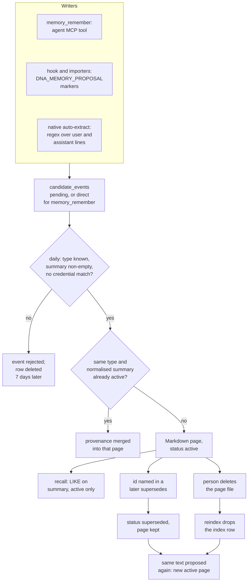

## 1. Executive Summary

DNA Memory is a local MCP server that gives Codex, Claude Code, Claude Desktop
and Hermes one long-term store. The store is a directory of Markdown pages in an
Obsidian-style vault, each holding one short typed conclusion, with an SQLite
table derived from them for search. A bundled skill tells every client to recall
before history-dependent work and to write back only verified conclusions.

What is notable is the write discipline on the truth store. A write that also
replaces older pages stages every file, installs them, reindexes, and on any
failure restores every file and the index (`scripts/memory_service.py:212-259`).
Replacement happens only through exact memory ids, never by inference from type
or project, and the replaced page is kept with `status: superseded`.

What is weak is the path the documentation calls review. Hooks and importers
queue proposals, from markers an agent emits and from regex matches over
transcript lines. Daily maintenance writes each one as an active memory after
checking its type, that it is non-empty, and three credential patterns
(`scripts/memory_operations.py:26-61`). Nothing in the tree reviews a proposal.
Recall is a substring match that ignores the project, session and client stored
on every page.

**Licence.** `README_EN.md:277` tells the English reader the project is
*MIT*, while `LICENSE` is the Apache License 2.0 and `README.md:371` says
Apache-2.0. The file in the tree governs, so the English README misstates the
patent grant and notice duties a reader inherits. There is no package manifest
to break the tie.

## 2. Mental Model

A memory is one conclusion: a Markdown page whose frontmatter carries an `id`,
one of eight `type` values, a `status`, a `confidence` word, an `importance`
float, `clients`, `source_refs`, `supersedes` and `superseded_by`, and whose
first paragraph is the summary (`scripts/markdown_memory.py:14-17`, `:28-83`).
Transcripts are never stored; importers keep paths, hashes and offsets.

There are two layers of state. A **candidate** is a row in `candidate_events`,
`pending` until daily maintenance marks it `crystallized`, `deduplicated`,
`rejected`, `superseded` or `expired` (`scripts/memory_operations.py:26-92`). A
**memory** is a page whose status the parser accepts as `active`,
`superseded`, `archived` or `rejected` (`scripts/markdown_memory.py:42`).
Recall serves `active` only (`scripts/memory_service.py:304`).

A memory becomes active in one of two ways. An agent calls `memory_remember`,
which writes an active page in the same call. Or a proposal waits in the queue
until the next daily run, which writes it if the format check passes. Both land
on `MemoryService.remember`, which first returns an existing active page with
the same `source_hash`, or with the same type and the same summary after NFKC
normalisation, whitespace collapsing and case folding
(`scripts/memory_service.py:41-60`, `:97-112`).

A memory stops being served in two ways. A later write names its id in
`supersedes`, and the old page is rewritten with `status: superseded` and a
`superseded_by` pointer (`:82-89`). Or a person deletes the file, and the next
reindex removes the row (`scripts/unified_memory.py:170-179`). No code writes
`archived` or `rejected` onto a page; a person can, by editing the frontmatter,
and recall then skips it.

Neither exit is remembered as a value. The duplicate check reads active rows
only, so the same text proposed again after supersession or deletion is a new
active memory.

## 3. Architecture

The maintained system is a set of Python scripts with one runtime dependency
for the store, PyYAML, and the `mcp` package for the server (`requirements.txt`,
`requirements-mcp.txt`). Each client launches its own stdio server,
`scripts/memory_mcp.py`, pointed at one profile JSON naming the vault, the
managed subdirectory, the database file, and backup and skill paths
(`scripts/config.py:11-27`, `:54-82`). Nothing else runs.

Persistence is two places. Markdown pages under
`<knowledge_root>/<managed_memory_dir>` are the truth. One SQLite file holds
`memory_index`, `memory_links`, `memory_feedback`, `memory_recall_events`,
`candidate_events` and `import_checkpoints` (`scripts/unified_memory.py:23-85`,
`scripts/candidate_events.py:16-45`). Only `memory_index` is rebuildable from
Markdown; the feedback that ranks recall and the pending proposal queue exist
only in SQLite.

Capture runs outside the server. `scripts/client_event_hook.py` is meant to be
appended to Claude Code's `SessionStart`, `Stop` and `SessionEnd` hooks
(`docs/mcp-and-client-adapters.md:93-98`). The native importers read Codex,
Claude Code, Claude Desktop and Hermes histories. The documentation suggests
LaunchAgent or cron labels for the importers and for daily, weekly and monthly
maintenance (`:250-258`).

The earlier system is still in the tree and still reachable. `dna remember`
routes to `scripts/evolve.py`, which writes a separate SQLite database under the
checkout's `memory/` directory with short-term and long-term flags, weight decay
and FTS5, then runs `sync_to_claude.py` (`dna:32-44`, `scripts/evolve.py:22-24`).
`scripts/semantic_search.py` adds an OpenAI-embedding search over a JSON file,
reached from `scripts/cli.py` and `scripts/api.py`. `SKILL.md` says these are
not the recommended integration path. This report covers them only where they
touch the maintained store.

### Deployment and ergonomics

- Nothing has to run besides the client: a local directory and a SQLite file.
- Fully local and offline; no API key is needed to store or recall.
- Install is a clone, a virtualenv with `requirements-mcp.txt`, a copied
  profile, and one `mcp add` per client.
- The store is human-readable and repairable by hand: a page is YAML and a
  paragraph, and `memory_reindex` rebuilds the index from whatever the vault
  holds.

## 4. Essential Implementation Paths

- **Direct write.** `memory_remember` packs its arguments into a proposal and
  calls `MemoryService.remember` (`scripts/memory_mcp.py:47-67`). That rejects
  an unknown type, an empty summary or a policy match, deduplicates, and checks
  every `supersedes` target is an active, Markdown-managed page inside the
  managed root. It then installs the new page and the rewritten old ones
  together (`scripts/memory_service.py:33-95`, `:163-203`).
- **Marker capture.** `extract_proposals` takes up to three
  `DNA_MEMORY_PROPOSAL {json}` markers with a known type, a summary under 800
  characters, a policy pass and valid confidence and importance
  (`scripts/bounded_proposals.py:11-50`). The Claude hook reads them from
  `last_assistant_message` or, on older clients, from the transcript's last
  64 KB (`scripts/client_event_hook.py:41-64`). The Codex and Hermes importers
  read assistant messages.
- **Automatic extraction.** `extract_automatic_proposals` splits the last
  twelve user and assistant messages of a native session into at most twelve
  units each, drops units matching eighteen noise patterns or the credential
  policy, and classifies the rest. A user line matching `remember`, `always`,
  `never` or `by default` is a `preference` at confidence `high`; an assistant
  line naming a concrete subject with `fixed`, `merged` or `completed` is
  usually a `project_state`
  (`scripts/native_auto_extract.py:17-21`, `:268-326`). Three proposals per
  session at most (`:390-395`).
- **Queue.** `CandidateEventQueue.enqueue` inserts with `INSERT OR IGNORE` on a
  deterministic event id, nulls an excerpt that fails policy, and caps pending
  non-proposal events at `max_candidate_events`
  (`scripts/candidate_events.py:48-75`).
- **Crystallize.** `MemoryOperations.daily` reads every pending
  `memory_proposal`, rejects a bad type, empty summary or policy match, and
  calls `remember` on the rest. It then compacts Codex turn pointers, expires
  other pending events after 30 days, and deletes terminal events 7 days after
  processing (`scripts/memory_operations.py:18-96`).
- **Recall.** `MemoryService.recall` splits the query into Unicode word terms,
  matches any term by `LIKE`, ranks, and logs a hashed query, client, session
  and result count (`scripts/memory_service.py:272-334`).
- **Reindex.** `reindex_markdown` walks every `*.md` under the vault root and
  parses those tagged `memory` with a supported type and status. It skips any
  page failing policy, upserts changed rows by content hash, and deletes rows
  whose file is gone (`scripts/markdown_memory.py:86-102`).

## 5. Memory Data Model

`memory_index` mirrors the frontmatter: id, path, type, status, summary,
content hash, source hash and refs, supersedes and superseded_by, confidence,
importance, sensitivity, clients, project path, session id, created, updated,
expires, `recall_count`, `last_recalled_at`, `legacy_id` and `source_kind`
(`scripts/unified_memory.py:28-51`, `:86-106`). `sensitivity` and `expires_at`
are copied from the page and read by nothing.

Scope fields are provenance. `project_path`, `session_id` and `clients` are
written on every page and merged on a duplicate (`scripts/memory_service.py:125-144`);
no query in the service filters on any of them. Every client sharing a profile
reads every memory.

Correction is a chain of ids. `supersedes` is a list on the new page and
`superseded_by` a single id on each old one; both are restored from Markdown on
reindex (`tests/test_markdown_memory.py:60-87`). `memory_links` is created and
never written.

Opening the store on a database that holds the earlier system's `memory` table
copies each row into `memory_index` as `source_kind = 'legacy_cache'`, status
defaulting to `active` (`scripts/unified_memory.py:113-131`). Recall does not
filter `source_kind`, so those rows are served. `supersedes` refuses them as
not Markdown-managed (`scripts/memory_service.py:175-178`), and reindex never
removes them.

## 6. Retrieval Mechanics

Recall is lexical and tool-mediated. Each distinct word term becomes a
`lower(summary) LIKE '%term%'` disjunct over active rows. Rows are ordered by
how many terms they hit, then net feedback (`useful` +1, `misleading` −1, any
other string 0), then confidence word, importance and update time, capped at 20
(`scripts/memory_service.py:272-315`). There is no stemming, no vector arm and
no scope predicate.

Feedback ranks and never excludes. A memory marked misleading many times is
still returned for any query it matches, below rows with the same hit count.
`feedback` accepts any non-empty `outcome` string (`:354-368`).

Context assembly is the agent's job. The bundled skill asks for one to four
`memory_recall` calls, deduplication by id, and at most five memories and about
2,000 tokens injected (`skills/dna-memory-loop/SKILL.md:18-24`). Nothing in the
server enforces the budget; each call returns up to 20 summaries.

`memory_get` returns a row of any status, so an agent can follow a
`superseded_by` chain (`scripts/memory_service.py:336-340`).

## 7. Write Mechanics

The direct write is synchronous and model-free: validate, deduplicate, stage,
install, reindex, all inside the MCP call. A page is recallable when the call
returns. Each install calls `reindex_markdown` on the whole vault root, not the
managed directory (`scripts/memory_service.py:233`). Every write therefore
re-reads and re-hashes every Markdown file in the vault, so its cost scales with
the user's notes rather than with memory.

Proposals wait for the next daily run. With the documented daily schedule the
lag is up to a day; without one, a proposal waits until someone runs
`dna memory maintain daily`. The run rewrites nothing it did not create.

Deduplication is exact after normalisation and scoped to active rows of the
same type. A duplicate's new source refs and clients are merged into the
existing page, and the page is rewritten (`scripts/memory_service.py:125-144`).

There is no delete. A person removes the page; the database keeps the
`memory_feedback` rows for that id and, for up to 7 days, the `crystallized`
event that produced it.

Writes are not serialised across clients. Four clients run four server
processes on one vault and one database, and the duplicate check and the file
install are separate steps with no lock. Two clients writing the same summary
at once can both create pages.

Noise filtering is regex. `inspect_content` rejects a PEM private-key header,
`sk-`, `ghp-` and `xox?-` tokens, `password=`-style pairs, and a 5,000-character
base64-like block (`scripts/policy.py:22-35`). The automatic extractor's
exclusion list is longer and was built from real backtest false positives
(`tests/test_native_auto_extract.py:304-332`).

### Operational cost

- No model call on any path; writes block only on file I/O and the vault walk.
- Proposal lag is one maintenance run.
- The vault walk on every write is the one whole-store pass; daily touches the
  queue only, and monthly reindexes once more.
- Injection is up to 20 summaries per call, placed wherever the client puts
  tool results.

## 8. Agent Integration

The server registers seven tools: `memory_recall`, `memory_get`,
`memory_remember`, `memory_feedback`, `memory_close_session`, `memory_status`
and `memory_reindex` (`scripts/memory_mcp.py:26-108`). The model holds every
verb, including the direct write, whose docstring calls it *"Write a reviewed
memory proposal"* (`:55`); nothing reviews it.

`memory_close_session` queues a `session_closed` pointer, and nothing reads it
except the value metrics (`scripts/memory_service.py:370-385`,
`scripts/memory_value.py:188-212`). Otherwise the session boundary is handled by
the Claude hook and the importers, which capture after the fact.

Adapting it to another agent means a stdio MCP entry and, optionally, an
importer for that client's history format. The skill file is the behavioural
contract, and it is prose.

## 9. Reliability, Safety, and Trust

### What "reviewable" means here

The README describes stored proposals as reviewable, and `memory value` counts
pending ones as `reviewable_proposals` (`README_EN.md:20-22`,
`scripts/memory_value.py:197-199`). The client guide asks an operator to label
each candidate in a backtest database true positive, false capture or
ambiguous with a `sqlite3` query, and to look at the production candidates
again before running daily (`docs/mcp-and-client-adapters.md:192-210`). It also lists
`io.dna-memory.daily` among the scheduler labels (`:250-258`).

The code has no approve or reject operation on a proposal. Daily writes every
pending proposal that passes the format check. A scheduled daily run therefore
crystallizes whatever the extractor queued, which is the outcome `SECURITY.md`
warns against: *"Never automatically promote candidates solely by increasing a
confidence number"* (`SECURITY.md:30-32`). The test for this path is named
`test_only_reviewed_safe_proposals_crystallize`; it queues one proposal and
asserts it crystallizes (`tests/test_memory_operations.py:23-51`).

The skill and README also promise a capacity check before crystallization
(`skills/dna-memory-loop/SKILL.md:56-57`, `README_EN.md:220-221`). `capacity_status` is called only for
`status` and `reindex`; the `maintain` branch returns before it
(`scripts/memory_cli.py:53-60`).

### What reaches the extractor

The automatic extractor reads any record whose role or type is `user` or
`assistant`, and `_text` descends into any `text`, `content`, `message` or
`output` key (`scripts/native_auto_extract.py:143-186`). A user-role record
carrying tool output is read as the user speaking, and a user line containing
`always` becomes a high-confidence preference. The one guard for this shape is
a prefix match on `search results for query:` (`:58-63`), and its test fixture
is a user-role web search result (`tests/test_native_auto_extract.py:298`).
Whether a given client stores tool results as user records is a property of
that client's format, not of this tree.

### Marks

- **`trust_state`** — withheld. The page status has four values and recall
  serves only `active`, but `superseded` is versioning, and `archived` and
  `rejected` are accepted from a hand-edited page with no writer in the tree.
  The candidate queue's `pending` is a write buffer the format check drains,
  and no read path consults it.
- **`tombstone`** — withheld. A rejected proposal's row is keyed on its event
  id and deleted 7 days later; a superseded page is keyed on its id. The
  duplicate check reads active rows only (`scripts/memory_service.py:103-112`).
- **`bitemporal`** — withheld. `created` and `updated` are write clocks;
  `expires` is stored and read by nothing.
- **`scope_enforced`** — withheld. `project_path`, `session_id` and `clients`
  are stored on every page and filtered by no query.
- **`audit_log`** — withheld. `memory_recall_events` and `memory_feedback`
  record reads and feedback, not mutations; `candidate_events` rows are deleted
  after 7 days; a supersede rewrites the old page in place. The earlier
  system's `operations` table logs `forget` and `dedupe` as counts, and
  `memory_manager.py` deletes and updates without writing to it
  (`scripts/evolve.py:318-331`, `:498-506`, `scripts/memory_manager.py:108-113`).
- **`human_review`** — withheld. The queue has no verb a person uses to admit
  or refuse a proposal, and the agent holds a direct write that bypasses it.
- **`negative_eval`** — withheld; see section 10.

### Other risks

- **A rebuild loses ranking.** Deleting the database, which the README calls
  disposable, rebuilds `memory_index` from Markdown and drops all feedback and
  every pending proposal.
- **Legacy rows are served and cannot be retired** through the MCP surface, if
  the profile points at a database holding the earlier table.
- **Recalled text is data.** The skill tells the model not to treat recalled
  text as instructions (`SKILL.md:17-18`); the server returns it unlabelled.

## 10. Tests, Evals, and Benchmarks

The suite has 130 pytest functions in 25 files, and CI runs it with
`compileall` and `check_public_safety.py` on every push and pull request
(`.github/workflows/ci.yml`). I ran none of it.

The service tests cover what section 2 describes. They check immediate recall
after a write, `source_hash` idempotency, normalised deduplication with
provenance merge, and supersede of several pages. They check refusal of an
invalid, archived or legacy target, the vault unchanged after an invalid one,
and rollback of every file and the index when an install or a reindex fails
(`tests/test_memory_service.py:21-308`).

`negative_eval` is withheld on the one recall-exclusion assertion.
`test_remember_supersedes_multiple_active_memories_and_hides_them_from_recall`
supersedes two pages and asserts `recall("obsolete unique") == []`
(`tests/test_memory_service.py:156-177`). The only other page is
`current verified state`, which matches neither term, so a recall returning
nothing also passes. Querying a term the replacement shares, and asserting the
replacement alone comes back, would make the case populated.

The extraction tests are the most specific in the suite. They pin all eight
types, eight type-specific negative cases, and twenty-three false positives
from a real backtest (`tests/test_native_auto_extract.py:273-332`). They assert
what is queued, not what recall returns.

No benchmark result is committed and the README states no score. Its one number
is an operator threshold: re-extract only when manual sampling finds at most 10%
false positives (`README_EN.md:234-235`). No paper is associated with the
project.

## 11. For Your Own Build

### Steal

- **Markdown as truth, the index as a projection.** Keep the human-editable
  file authoritative and rebuild search state from it, with a content hash per
  page so an unchanged page is not rewritten.
- **One install for a write and its replacements.** Stage every file, back up
  every target, swap, reindex, and restore all of them on any failure.
- **Replacement by exact id only.** Refuse a supersede whose target is missing,
  inactive or outside the managed root, and never infer one from type.
- **Pointers, not transcripts.** Store source path, offset and hash from
  native histories, and cap proposals per session.

### Avoid

- **A review queue whose only drain is a format check.** If proposals are
  called reviewable, the step that admits them must be one a person takes, and
  a scheduled job must not be able to take it.
- **Extracting user intent from every user-role record.** Tool output stored as
  a user turn turns `always` in a web page into the user's preference; decide
  by record kind, not by role string.
- **Dedup against live rows only.** A superseded or deleted value then has no
  standing against the next extraction of the same text.
- **Ranking state outside the rebuildable truth.** Feedback that steers recall
  should survive the rebuild the design advertises.

### Fit

This suits one person who uses several coding clients on one machine and wants
them to share a small set of conclusions they can open in Obsidian and fix by
hand. It costs nothing to run and nothing to stop running. It does not suit
anyone who needs memory separated by project or by client, since the stored
keys do nothing. Nor does it suit anyone who would schedule daily maintenance
expecting a review step. Treat the automatic importers as off until you have
read what they would queue.

## 12. Open Questions

- Whether the daily schedule is meant to run unattended, given the manual
  labelling procedure the client guide describes for re-extraction.
- Which client formats deliver tool results as user-role records to
  `_record_message`; running the importer against real histories would show it.
- Why the Apache licence's appendix notice names *KnowMe Contributors*, a
  related project (`scripts/knowme_link.py`), rather than this repository's
  author.
- Whether `archived`, `rejected` and `expires` are meant to gain writers.

## Appendix: File Index

- Store and schema: `scripts/markdown_memory.py`, `scripts/unified_memory.py`,
  `scripts/config.py`
- Write and recall: `scripts/memory_service.py`, `scripts/policy.py`
- Queue and maintenance: `scripts/candidate_events.py`,
  `scripts/memory_operations.py`, `scripts/memory_cli.py`,
  `scripts/memory_value.py`
- Capture: `scripts/bounded_proposals.py`, `scripts/client_event_hook.py`,
  `scripts/native_auto_extract.py`, `scripts/import_native_history.py`,
  `scripts/import_codex_rollouts.py`, `scripts/import_hermes_sessions.py`
- MCP and skill: `scripts/memory_mcp.py`, `skills/dna-memory-loop/SKILL.md`,
  `SKILL.md`
- Earlier system: `dna`, `dna.py`, `scripts/evolve.py`,
  `scripts/memory_manager.py`, `scripts/semantic_search.py`,
  `scripts/sync_to_claude.py`
- Tests: `tests/test_memory_service.py`, `tests/test_memory_operations.py`,
  `tests/test_native_auto_extract.py`, `tests/test_markdown_memory.py`,
  `tests/test_memory_mcp.py`, `tests/test_unified_memory.py`

### Recorded searches

Run from the repository root at the pinned commit with `/usr/bin/git grep`.

- **No query filters a scope field.**
  `git grep -n -E 'project_path|clients' -- scripts/memory_service.py` matches
  only the page metadata at lines 71 and 76, the duplicate merge at 133-139,
  the selected columns at 293 and 307, decoding at 345 and `close_session` at
  370 and 381; `git grep -n -E "WHERE m\.status='active'" -- scripts/memory_service.py`
  matches line 304.
- **No writer of `archived` or `rejected` on a page.**
  `git grep -n -E '(archived|rejected)' -- scripts/markdown_memory.py scripts/memory_service.py scripts/unified_memory.py scripts/memory_mcp.py`
  matches the accepted-status set at `scripts/markdown_memory.py:42` and two
  error messages at `scripts/memory_service.py:40` and `:361`.
- **No approve or reject verb on proposals.**
  `git grep -n -i -E 'approve|reject_proposal|review_proposal|def review' -- scripts/memory_service.py scripts/memory_operations.py scripts/memory_cli.py scripts/memory_mcp.py scripts/candidate_events.py dna dna.py`
  returns nothing; `git grep -n -i -E 'approve|promote' -- scripts` matches the
  earlier system's `auto_promote` in `scripts/evolve.py`.
- **Daily maintenance never checks capacity.**
  `git grep -n capacity_status -- scripts` matches its definition at
  `scripts/policy.py:38` and three calls in `scripts/memory_cli.py` at 60, 72
  and 87, all after the `maintain` branch returns at 59.
- **`expires` and `sensitivity` are never read.**
  `git grep -n -E 'expires' -- scripts` and `git grep -n -w sensitivity -- scripts`
  match only the parser and the schema and upsert in `scripts/unified_memory.py`.
- **`memory_links` is never written.** `git grep -n memory_links -- scripts`
  matches only its `CREATE TABLE` at `scripts/unified_memory.py:54`.
- **No delete on the maintained path.**
  `git grep -n -i -E 'delete|unlink|forget' -- scripts/memory_service.py scripts/memory_mcp.py`
  matches only temp-file and backup cleanup at lines 242-259.
- **The earlier manager's delete writes no operation row.**
  `git grep -n -E 'INSERT INTO operations|log_operation' -- scripts/memory_manager.py`
  returns nothing; `git grep -c -E 'log_operation\(' -- scripts/evolve.py`
  counts 10.
- **No tool-result handling in the extractor.**
  `git grep -n -E 'tool_result|tool_use'` returns nothing;
  `git grep -n response_item -- scripts/native_auto_extract.py` matches line 167.
- **No benchmark artifact.** `git ls-files | grep -i -E 'bench|eval|result|fixture'`
  returns nothing; `git ls-files | grep -c '^tests/'` counts 25.
- **No paper.** `git grep -n -i -E 'arxiv|bibtex|citation|doi\.org'` returns
  nothing; `git grep -n -i -w license -- README.md` matches lines 8, 369 and 371.

## History

**2026-11-21** — [`f135344d7d6f90f1be73e209cd0c6a7083f328ea`](https://github.com/AIPMAndy/dna-memory/commit/f135344d7d6f90f1be73e209cd0c6a7083f328ea) — first reading, from a full clone of `main`, scoped to the maintained Markdown store, SQLite index, MCP server, proposal queue, maintenance, capture paths and their tests; the earlier SQLite system was read where it shares the store or is still routed by `dna`. Screened first: no auto-run or build-time execution surface; three unpinned dependency surfaces, `requirements.txt`, `requirements-mcp.txt` and `requirements-dev.txt`, all ranged. Apache-2.0 in `LICENSE`, MIT in `README_EN.md`, no rider. Nothing installed, built or run. No marks.
